# Chapter 1: Fourier Series

## 1.1 Introduction and Choices to Make

Methods based on the Fourier transform are used in virtually all areas of engineering and science and by virtually all engineers and scientists. For starters:

- Circuit designers

- Spectroscopists

- Crystallographers

- Anyone working in signal processing and communications

- Anyone working in imaging

I’m expecting that many fields and many interests will be represented in the class, and this brings up an important issue for all of us to be aware of. With the diversity of interests and backgrounds present not all examples and applications will be familiar and of relevance to all people. We’ll all have to cut each other some slack, and it’s a chance for all of us to branch out. Along the same lines, it’s also important for you to realize that this is one course on the Fourier transform among many possible courses. The richness of the subject, both mathematically and in the range of applications, means that we’ll be making choices almost constantly. Books on the subject do not look alike, nor do they look like these notes — even the notation used for basic objects and operations can vary from book to book. I’ll try to point out when a certain choice takes us along a certain path, and I’ll try to say something of what the alternate paths may be.

The very first choice is where to start, and my choice is a brief treatment of Fourier series.1 Fourier analysis was originally concerned with representing and analyzing periodic phenomena, via Fourier series, and later with extending those insights to nonperiodic phenomena, via the Fourier transform. In fact, one way of getting from Fourier series to the Fourier transform is to consider nonperiodic phenomena (and thus just about any general function) as a limiting case of periodic phenomena as the period tends to infinity. A discrete set of frequencies in the periodic case becomes a continuum of frequencies in the nonperiodic case, the spectrum is born, and with it comes the most important principle of the subject:

Every signal has a spectrum and is determined by its spectrum. You can analyze the signal either in the time (or spatial) domain or in the frequency domain.

1 Bracewell, for example, starts right off with the Fourier transform and picks up a little on Fourier series later.

I think this qualifies as a Major Secret of the Universe.

All of this was thoroughly grounded in physical applications. Most often the phenomena to be studied were modeled by the fundamental differential equations of physics (heat equation, wave equation, Laplace’s equation), and the solutions were usually constrained by boundary conditions. At first the idea was to use Fourier series to find explicit solutions.

This work raised hard and far reaching questions that led in different directions. It was gradually realized that setting up Fourier series (in sines and cosines) could be recast in the more general framework of orthogonality, linear operators, and eigenfunctions. That led to the general idea of working with eigenfunction expansions of solutions of differential equations, a ubiquitous line of attack in many areas and applications.

In the modern formulation of partial differential equations, the Fourier transform has become the basis for defining the objects of study, while still remaining a tool for solving specific equations. Much of this development depends on the remarkable relation between Fourier transforms and convolution, something which was also seen earlier in the Fourier series days. In an effort to apply the methods with increasing generality, mathematicians were pushed (by engineers and physicists) to reconsider how general the notion of “function” can be, and what kinds of functions can be — and should be — admitted into the operating theater of calculus. Differentiation and integration were both generalized in the service of Fourier analysis.

Other directions combine tools from Fourier analysis with symmetries of the objects being analyzed. This might make you think of crystals and crystallography, and you’d be right, while mathematicians think of number theory and Fourier analysis on groups. Finally, I have to mention that in the purely mathematical realm the question of convergence of Fourier series, believe it or not, led G. Cantor near the turn of the 20th century to investigate and invent the theory of infinite sets, and to distinguish different sizes of infinite sets, all of which led to Cantor going insane.

## 1.2 Periodic Phenomena

To begin the course with Fourier series is to begin with periodic functions, those functions which exhibit a regularly repeating pattern. It shouldn’t be necessary to try to sell periodicity as an important physical (and mathematical) phenomenon — you’ve seen examples and applications of periodic behavior in probably (almost) every class you’ve taken. I would only remind you that periodicity often shows up in two varieties, sometimes related, sometimes not. Generally speaking we think about periodic phenomena according to whether they are periodic in time or periodic in space.

## 1.2.1 Time and space

In the case of time the phenomenon comes to you. For example, you stand at a fixed point in the ocean (or on an electrical circuit) and the waves (or the electrical current) wash over you with a regular, recurring pattern of crests and troughs. The height of the wave is a periodic function of time. Sound is another example: “sound” reaches your ear as a longitudinal pressure wave, a periodic compression and rarefaction of the air. In the case of space, you come to the phenomenon. You take a picture and you observe repeating patterns.

Temporal and spatial periodicity come together most naturally in wave motion. Take the case of one spatial dimension, and consider a single sinusoidal wave traveling along a string (for example). For such a wave the periodicity in time is measured by the frequency $ν,$ with dimension 1/sec and units Hz (Hertz = cycles per second), and the periodicity in space is measured by the wavelength $λ,$ with dimension length and units whatever is convenient for the particular setting. If we fix a point in space and let the time vary (take a video of the wave motion at that point) then successive crests of the wave come past that

point $ν$ times per second, and so do successive troughs. If we fix the time and examine how the wave is spread out in space (take a snapshot instead of a video) we see that the distance between successive crests is a constant $λ,$ as is the distance between successive troughs. The frequency and wavelength are related through the equation $v$ = $λν,$ where $v$ is the speed of propagation — this is nothing but the wave version of speed = distance/time. Thus the higher the frequency the shorter the wavelength, and the lower the frequency the longer the wavelength. If the speed is fixed, like the speed of electromagnetic waves in a vacuum, then the frequency determines the wavelength and vice versa; if you can measure one you can find the other. For sound we identify the physical property of frequency with the perceptual property of pitch, for light frequency is perceived as color. Simple sinusoids are the building blocks of the most complicated wave forms — that’s what Fourier analysis is about.

## 1.2.2 More on spatial periodicity

Another way spatial periodicity occurs is when there is a repeating pattern or some kind of symmetry in a spatial region and physically observable quantities associated with that region have a repeating pattern that reflects this. For example, a crystal has a regular, repeating pattern of atoms in space; the arrangement of atoms is called a lattice. The electron density distribution is then a periodic function of the spatial variable (in R3) that describes the crystal. I mention this example because, in contrast to the usual one-dimensional examples you might think of, here the function, in this case the electron density distribution, has three independent periods corresponding to the three directions that describe the crystal lattice.

Here’s another example — this time in two dimensions — that is very much a natural subject for Fourier analysis. Consider these stripes of dark and light:

No doubt there’s some kind of spatially periodic behavior going on in the respective images. Furthermore, even without stating a precise definition, it’s reasonable to say that one of the patterns is “low frequency” and that the others are “high frequency”, meaning roughly that there are fewer stripes per unit length in the one than in the others. In two dimensions there’s an extra subtlety that we see in these pictures:

“spatial frequency”, however we ultimately define it, must be a vector quantity, not a number. We have to say that the stripes occur with a certain spacing in a certain direction.

Such periodic stripes are the building blocks of general two-dimensional images. When there’s no color, an image is a two-dimensional array of varying shades of gray, and this can be realized as a synthesis — a

Fourier synthesis — of just such alternating stripes.

There are interesting perceptual questions in constructing images this way, and color is more complicated still. Here’s a picture I got from Foundations of Vision by Brian Wandell, who is in the Psychology Department here at Stanford.

The shades of blue and yellow are the same in the two pictures —the only a change is in the frequency.

The closer spacing “mixes” the blue and yellow to give a greenish cast. Here’s a question that I know has been investigated but I don’t know the answer. Show someone blue and yellow stripes of a low frequency and increase the frequency till they just start to see green. You get a number for that. Next, start with blue and yellow stripes at a high frequency so a person sees a lot of green and then lower the frequency till they see only blue and yellow. You get a number for that. Are the two numbers the same? Does the orientation of the stripes make a difference?

## 1.3 Periodicity: Definitions, Examples, and Things to Come

To be certain we all know what we’re talking about, a function $f(t)$ is periodic of period $T$ if there is a number $T >$ 0 such that

$$
f(t + T) = f(t)
$$

for all $t$. If there is such a $T$ then the smallest one for which the equation holds is called the fundamental period of the function $f^{2}$. Every integer multiple of the fundamental period is also a period:

$$
f(t + nT) = f(t), n = 0,±1,±2,...^{3}
$$

I’m calling the variable $t$ here because I have to call it something, but the definition is general and is not meant to imply periodic functions of time.

2 Sometimes when people say simply “period” they mean the smallest or fundamental period. (I usually do, for example.) Sometimes they don’t. Ask them what they mean.

3 It’s clear from the geometric picture of a repeating graph that this is true. To show it algebraically, if $n ≥ 1$ then we see inductively that $f(t$ +$nT)$ = $f(t$ + ($n−1)T$ +$T)$ = $f(t$ + ($n−1)T)$ = $f(t).$ Then to see algebraically why negative multiples of $T$ are also periods we have, for $n ≥ 1, f(t−nT)$ = $f(t−nT$ +$nT)$ = $f(t).$

The graph of $f$ over any interval of length $T$ is one cycle. Geometrically, the periodicity condition means that the shape of one cycle (any cycle) determines the graph everywhere; the shape is repeated over and over. A homework problem asks you to turn this idea into a formula.

This is all old news to everyone, but, by way of example, there are a few more points I’d like to make.

Consider the function

$f(t)$ = cos 2$πt$ + 12 cos 4$πt,$

whose graph is shown below.

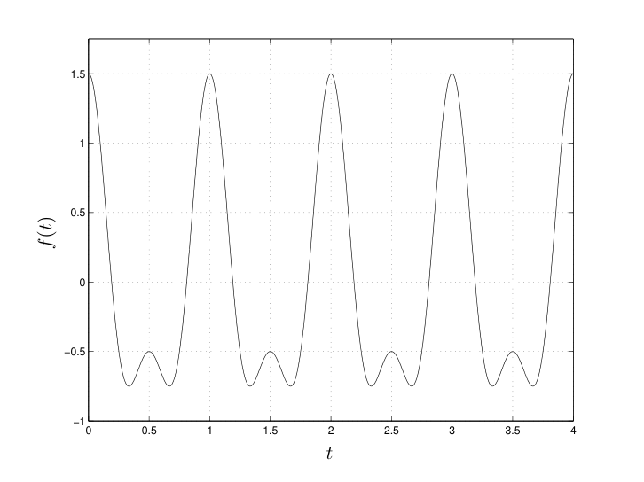

The individual terms are periodic with periods 1 and 1/2 respectively, but the sum is periodic with period 1:

$f(t$ + 1) = cos 2$π(t$ + 1) + 12 cos 4$π(t$ + 1) = cos(2$πt$ + 2$π)$ + 12 cos(4$πt$ + 4$π)$ = cos 2$πt$ + 12 cos 4$πt$ = $f(t).$ There is no smaller value of $T$ for which $f(t$ + $T)$ = $f(t)$. The overall pattern repeats every 1 second, but if this function represented some kind of wave would you say it had frequency 1 Hz? Somehow I don’t think so. It has one period but you’d probably say that it has, or contains, two frequencies, one cosine of frequency 1 Hz and one of frequency 2 Hz.

The subject of adding up periodic functions is worth a general question:

- Is the sum of two periodic functions periodic?

I guess the answer is no if you’re a mathematician, yes if you’re an engineer, i.e., no if you believe in irrational numbers and leave it at that, and yes if you compute things and hence work with approximations.

$$
√
$$

$$
√
$$

For example, cos$t$ and cos( 2$t)$ are each periodic, with periods 2$π$ and 2$π/$ 2 respectively, but the sum

$$
√
$$

cos$t$ + cos( 2$t)$ is not periodic.

$$
√
$$

Here are plots of $f_{1}(t)$ = cos$t$ + cos 1$.$4$t$ and of $f_{2}(t)$ = cos$t$ + cos( 2$t)$.

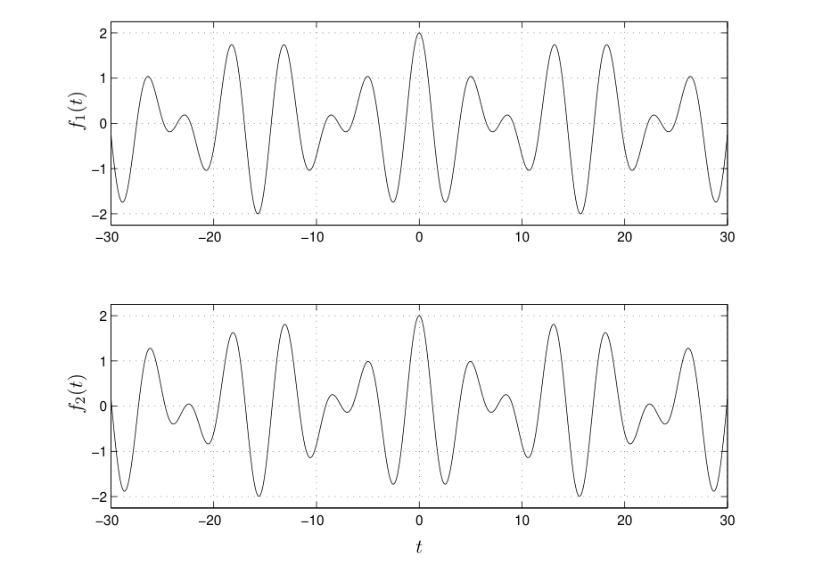

(I’m aware of the irony in making a big show of computer plots depending on an irrational number when the computer has to take a rational approximation to draw the picture.) How artificial an example is this?

Not artificial at all. We’ll see why, below.

## 1.3.1 The view from above

After years (centuries) of work, there are, in the end, relatively few mathematical ideas that underlie the study of periodic phenomena. There are many details and subtle points, certainly, but these are of less concern to us than keeping a focus on the bigger picture and using that as a guide in applications. We’ll need the following.

1. The functions that model the simplest periodic behavior, i.e., sines and cosines. In practice, both in calculations and theory, we’ll use the complex exponential instead of the sine and cosine separately.

2. The “geometry” of square integrable functions on a finite interval, i.e., functions for which

$$
\int_{a}^{b} |f(t)|^{2}dt < ∞.
$$

3. Eigenfunctions of linear operators (especially differential operators).

The first point has been familiar to you since you were a kid. We’ll give a few more examples of sines and cosines in action. The second point, at least as I’ve stated it, may not be so familiar — “geometry” of a space of functions? — but here’s what it means in practice:

- Least squares approximation

- Orthogonality of the complex exponentials (and of the trig functions)

I say “geometry” because what we’ll do and what we’ll say is analogous to Euclidean geometry as it is expressed (especially for computational purposes) via vectors and dot products. Analogous, not identical.

There are differences between a space of functions and a space of (geometric) vectors, but it’s almost more a difference of degree than a difference of kind, and your intuition for vectors in R2 or R3 can take you quite far. Also, the idea of least squares approximation is closely related to the orthogonality of the complex exponentials.

We’ll say less about the third point, though it will figure in our discussion of linear systems.4 Furthermore, it’s the second and third points that are still in force when one wants to work with expansions in functions other than sine and cosine.

## 1.3.2 The building blocks: a few more examples

The classic example of temporal periodicity is the harmonic oscillator, whether it’s a mass on a spring (no friction) or current in an LC circuit (no resistance). The harmonic oscillator is treated in exhaustive detail in just about every physics class. This is so because it is the only problem that can be treated in exhaustive detail.

The state of the system is described by a single sinusoid, say of the form $A$ sin(2$πνt$ + $φ).$ The parameters in this expression are the amplitude $A,$ the frequency $ν$ and the phase $φ$. The period of this function is 1$/ν,$ since

$$
( )
$$

$A$ sin(2$πν t$ + 1 + $φ)$ = $A$ sin(2$πνt$ + 2$πν^{1}_{ν}$ + $φ)$ = $A$ sin(2$πνt$ + 2$π$ + $φ)$ = $A$ sin(2$πνt$ + $φ).$

$$
ν
$$

The classic example of spatial periodicity, the example that started the whole subject, is the distribution of heat in a circular ring. A ring is heated up, somehow, and the heat then distributes itself, somehow, through the material. In the long run we expect all points on the ring to be of the same temperature, but they won’t be in the short run. At each fixed time, how does the temperature vary around the ring?

In this problem the periodicity comes from the coordinate description of the ring. Think of the ring as a circle. Then a point on the ring is determined by an angle $θ$ and quantities which depend on position are functions of $θ$. Since $θ$ and $θ$ + 2$π$ are the same point on the circle, any continuous function describing a physical quantity on the circle, e.g., temperature, is a periodic function of $θ$ with period 2$π$.

The distribution of temperature is not given by a simple sinusoid. It was Fourier’s hot idea to consider a sum of sinusoids as a model for the temperature distribution:

$$
\sum_{n=1}^{N}
$$

$A_{n}$ sin($nθ$ + $φ_{n}).$ The dependence on time is in the coefficients $A_{n}$. We’ll study this problem more completely later, but there are a few points to mention now.

Regardless of the physical context, the individual terms in a trigonometric sum such as the one above are called harmonics, terminology that comes from the mathematical representation of musical pitch — more 4 It is the role of complex exponentials as eigenfunctions that explains why you would expect to take only integer multiples of the fundamental period in forming sums of periodic functions.

on this in a moment. The terms contribute to the sum in varying amplitudes and phases, and these can have any values. The frequencies of the terms, on the other hand, are integer multiples of the fundamental frequency 1$/$2$π$. Because the frequencies are integer multiples of the fundamental frequency, the sum is also periodic, and the period is 2$π$. The term $A_{n}$ sin($nθ$ + $φ_{n})$ has period 2$π/n,$ but the whole sum can’t have a shorter cycle than the longest cycle that occurs, and that’s 2$π$. We talked about just this point when we first discussed periodicity.5

## 1.3.3 Musical pitch and tuning

Musical pitch and the production of musical notes is a periodic phenomenon of the same general type as we’ve been considering. Notes can be produced by vibrating strings or other objects that can vibrate regularly (like lips, reeds, or the bars of a xylophone). The engineering problem is how to tune musical instruments. The subject of tuning has a fascinating history, from the “natural tuning” of the Greeks, based on ratios of integers, to the theory of the “equal tempered scale”, which is the system of tuning used today. That system is based on 21$/12$.

There are 12 notes in the equal tempered scale, going from any given note to the same note an octave up, and two adjacent notes have frequencies with ratio 21$/12$. If an A of frequency 440 Hz (concert A) is described by A = cos(2$π ·$ 440$t),$ then 6 notes up from A in a well tempered scale is a D$♯$ given by

$$
√
$$

D$♯ =$ cos(2$π ·$ 440 2$t).$ (The notes in the scale are cos(2$π·$ 440$·$ 2$n/12t)$ from $n$ = 0 to $n$ = 12.) Playing the A and the D$♯$ together gives essentially the signal we had earlier, cos$t$ + cos 21$/2t$. I’ll withhold judgment whether or not it sounds any good.

Of course, when you tune a piano you don’t tighten the strings irrationally. The art is to make the right approximations. To read more about this, see, for example http://www.precisionstrobe.com/ To read more about tuning in general try http://www.wikipedia.org/wiki/Musical tuning Here’s a quote from the first reference describing the need for well-tempered tuning:

Two developments occurred in music technology which necessitated changes from the just toned temperament. With the development of the fretted instruments, a problem occurs when setting the frets for just tuning, that octaves played across two strings around the neck would produce impure octaves. Likewise, an organ set to a just tuning scale would reveal chords with unpleasant properties. A compromise to this situation was the development of the mean toned scale. In this system several of the intervals were adjusted to increase the number of usable keys. With the evolution of composition technique in the 18th century increasing the use of harmonic modulation a change was advocated to the equal tempered scale. Among these 5 There is another reason that only integer multiples of the fundamental frequency come in. It has to do with the harmonics being eigenfunctions of a differential operator, and the boundary conditions that go with the problem.

advocates was J. S. Bach who published two entire works entitled The Well-tempered Clavier.

Each of these works contain 24 fugues written in each of twelve major and twelve minor keys and demonstrated that using an equal tempered scale, music could be written in, and shifted to any key.

## 1.4 It All Adds Up

From simple, single sinusoids we can build up much more complicated periodic functions by taking sums.

To highlight the essential ideas it’s convenient to standardize a little and consider functions with period 1.

This simplifies some of the writing and it will be easy to modify the formulas if the period is not 1. The basic function of period 1 is sin 2$πt,$ and so the Fourier-type sum we considered briefly in the previous lecture looks like

$$
\sum_{n=1}^{N}
$$

$A_{n}$ sin(2$πnt$ + $φ_{n}).$ This form of a general trigonometric sum has the advantage of displaying explicitly the amplitude and phase of each harmonic, but it turns out to be somewhat awkward to calculate with. It’s more common to write a general trigonometric sum as

$$
\sum_{n=1}^{N}
$$

($a_{n}$ cos(2$πnt)$ + $b_{n}$ sin(2$πnt)),$

and, if we include a constant term ($n$ = 0), as

$$
\sum_{n=1}^{N}
$$

$\frac{a_{0}}{2}$ + ($a_{n}$ cos(2$πnt)$ + $b_{n}$ sin(2$πnt)).$ The reason for writing the constant term with the fraction 1$/$2 is because, as you will check in the homework, it simplifies still another expression for such a sum.

In electrical engineering the constant term is often referred to as the DC component as in “direct current”.

The other terms, being periodic, “alternate”, as in AC. Aside from the DC component, the harmonics have periods 1$,$ 1$/$2$,$ 1$/$3$,...,$ 1$/N,$ respectively, or frequencies 1$,$ 2$,$ 3$,...,N$. Because the frequencies of the individual harmonics are integer multiples of the lowest frequency, the period of the sum is 1.

Algebraic work on such trigonometric sums is made incomparably easier if we use complex exponentials to represent the sine and cosine.6 I remind you that cos$t$ = $\frac{e^{i t}+e^{−i t}}{2} ,$ sin$t$ = $\frac{e^{i t}−e^{−i t}}{2 i} .$ Hence cos(2$πnt)$ = $\frac{e^{2 π i n t}+e^{−2 π i n t}}{2} ,$ sin(2$πnt)$ = $\frac{e^{2 π i n t}−e^{−2 π i n t}}{2 i} .$ Using this, the sum

$$
\sum_{n=1}^{N}
$$

$\frac{a_{0}}{2}$ + ($a_{n}$ cos(2$πnt)$ + $b_{n}$ sin(2$πnt))$ 6 See the appendix on complex numbers where there is a discussion of complex exponentials, how they can be used without fear to represent real signals, and an answer to the question of what is meant by a “negative frequency”.

can be written as

$$
\sum_{n=−N}^{N} c_{n}e^{2 π i n t} .
$$

Sorting out how the $a$’s, $b$’s, and $c$’s are related will be left as a problem. In particular, you’ll get $c_{0}$ = $a_{0}/$2, which is the reason we wrote the constant term as $a_{0}/$2 in the earlier expression.7 In this final form of the sum, the coefficients $c_{n}$ are complex numbers, and they satisfy

$$
c_{−n} = \overline{c_{n}} .
$$

Notice that when $n$ = 0 we have

$$
c_{0} = \overline{c_{0}},
$$

which implies that $c_{0}$ is a real number; this jibes with $c_{0}$ = $a_{0}/$2. For any value of $n$ the magnitudes of $c_{n}$ and $c_{−n}$ are equal:

$$
|_{n}c | = |_{−n}c |.
$$

The (conjugate) symmetry property, $c_{−n}$ =$\overline{t c_{n},s,}$ of the coeffi$\frac{c i e n}{f(t)}$ts is important. To be explicit: if the signal is real then the coefficients have to satisfy i ince $f(t)$ = translates to

$$
\sum_{n=−N}^{N} c_{n}e^{2 π i n t} = \sum_{n=−N}^{N} c_{n}e^{2 π i n t} = \sum_{n=−N}^{N} \overline{c_{n}} \overline{e^{2 π i n t}} = \sum_{n=−N}^{N} \overline{c_{n}}e^{−2 π i n t} ,
$$

and if we equate like terms we get $c_{−n}$ =$\overline{h c_{n}e n.}$ Conversely, suppose the relation is satisfied. For each $n$ we can group $c_{n}e^{2 π i n t}$ with $c_{−n}e^{−2 π i n t},$ and t

$$
(c_{n}e^{2 π i n t})
$$

$c_{n}e^{2 π i n t}$ + $c_{−n}e^{−2 π i n t}$ = $c_{n}e^{2 π i n t}$ + $c_{n}$¯$\overline{e^{2 π i n t}}$ = 2 Re

$$
.
$$

Therefore the sum is real:

$$
)
$$

$$
(
$$

$$
\sum_{n=−N}^{N}
$$

$$
\sum_{n=0}^{N}
$$

$$
\sum_{n=0}^{N}
$$

$$
(c_{n}e^{2 π i n t})
$$

$c_{n}e^{2 π i n t}$ = 2 Re

$$
c_{n}e^{2 π i n t} .
$$

= 2 Re

## 1.5 Lost at c

Suppose we have a complicated looking periodic signal; you can think of one varying in time but, again and always, the reasoning to follow applies to any sort of one-dimensional periodic phenomenon. We can scale time to assume that the pattern repeats every 1 second. Call the signal $f(t)$. Can we express $f(t)$ as a sum?

$$
f(t) = \sum_{n=−N}^{N} c_{n}e^{2 π i n t}
$$

In other words, the unknowns in this expression are the coefficients $c_{n},$ and the question is can we solve for these coefficients?

7 When I said that part of your general math know-how should include whipping around sums, this expression in terms of complex exponentials was one of the examples I was thinking of.

Here’s a direct approach. Let’s take the coefficient $c_{k}$ for some fixed $k$. We can isolate it by multiplying both sides by $e^{−2 π i k t}:$

$$
e^{−2 π i k t}f(t) = e^{−2 π i k t} \sum_{n=−N}^{N} c_{n}e^{2 π i n t}
$$

$$
= ··· + e^{−2 π i k t}c_{k}e^{2 π i k t} + ··· = ··· + c_{k} + ···
$$

Thus

$$
c_{k} = e^{−2 π i k t}f(t) − \sum_{n=−N,n \neq k}^{N} c_{n}e^{−2 π i k t}e^{2 π i n t} = e^{−2 π i k t}f(t) − \sum_{n=−N,n \neq k}^{N} c_{n}e^{2 π i(n−k)t} .
$$

We’ve pulled out the coefficient $c_{k},$ but the expression on the right involves all the other unknown coefficients. Another idea is needed, and that idea is integrating both sides from 0 to 1. (We take the interval from 0 to 1 as “base” period for the function. Any interval of length 1 would work — that’s periodicity.) Just as in calculus, we can evaluate the integral of a complex exponential by

$$
\int_{0}^{1} e^{2 π i(n−k)t} dt = \frac{1}{2 π i(n−k)}e^{2 π i(n−k)t} ]^{t=1}_{t=0}
$$

$$
= \frac{1}{2 π i(n−k)}(e^{2 π i(n−k)} − e^{0}) = \frac{1}{2 π i(n−k)}(1 − 1) = 0.
$$

Note that $n\neq k$ is needed here.

Since the integral of the sum is the sum of the integrals, and the coefficients $c_{n}$ come out of each integral, all of the terms in the sum integrate to zero and we have a formula for the $k-$th coefficient:

$$
c_{k} = \int_{0}^{1} e^{−2 π i k t}f(t)dt.
$$

Let’s summarize and be careful to note what we’ve done here, and what we haven’t done. We’ve shown that if we can write a periodic function $f(t)$ of period 1 as a sum

$$
f(t) = \sum_{n=−N}^{N} c_{n}e^{2 π i n t} ,
$$

then the coefficients $c_{n}$ must be given by

$$
c_{n} = \int_{0}^{1} e^{−2 π i n t}f(t)dt.
$$

We have not shown that every periodic function can be expressed this way.

By the way, in none of the preceding calculations did we have to assume that $f(t)$ is a real signal. If, however, we do assume that $f(t)$ is real, then let’s see how the formula for the coefficients jibes with $c_{n}$ = $c_{−n}$. We have

$$
\overline{c_{n}} = \overline{(\int_{0}^{1}e^{−2 π i n t}f(t)d t)} = \int_{0}^{1} \overline{e^{−2 π i n t}} \overline{f(t)}dt
$$

$$
\int_{0}^{1}
$$

= $e^{2 π i n t}f(t)dt ($because $f(t)$ is real, as are $t$ and $dt)$

= $c_{−n} ($by definition of $c_{n})$

The $c_{n}$ are called the Fourier coefficients of $f(t),$ because it was Fourier who introduced these ideas into mathematics and science (but working with the sine and cosine form of the expression). The sum

$$
\sum_{n=−N}^{N} c_{n}e^{2 π i n t}
$$

is called a (finite) Fourier series.

If you want to be mathematically hip and impress your friends at cocktail parties, use the notation

$$
fˆ(n) = \int_{0}^{1} e^{−2 π i n t}f(t)dt
$$

for the Fourier coefficients. Always conscious of social status, I will use this notation.

Note in particular that the 0-th Fourier coefficient is the average value of the function:

$$
fˆ(0) = \int_{0}^{1} f(t)dt.
$$

Also note that because of periodicity of $f(t),$ any interval of length 1 will do to calculate $f$ˆ($n)$. Let’s check this. To integrate over an interval of length 1 is to integrate from $a$ to $a$ + 1, where $a$ is any number. Let’s compute how this integral varies as a function of $a$.

$$
(\int_{a}^{a+1}
$$

$$
)
$$

$$
d
$$

$$
e^{−2 π i n t}f(t)dt = e^{−2 π i n(a+1)}f(a + 1) − e^{−2 π i n a}f(a)
$$

$da$

$$
= e^{−2 π i n a}e^{−2 π i n}f(a + 1) − e^{−2 π i n a}f(a)
$$

= $e^{−2 π i n a}f(a)− e^{−2 π i n a}f(a) ($using $e^{−2 π i n}$ = 1 and $f(a$ + 1) = $f(a))$

$$
= 0.
$$

In other words, the integral

$$
\int_{a}^{a+1} e^{−2 π i n t}f(t)dt
$$

is independent of $a$. So in particular,

$$
\int_{a}^{a+1} e^{−2 π i n t}f(t)dt = \int_{0}^{1} e^{−2 π i n t}f(t)dt = fˆ(n).
$$

A common instance of this is

$$
fˆ(n) = \int_{−1/2}^{1/2} e^{−2 π i n t}f(t)dt.
$$

There are times when such a change is useful.

Finally note that for a given function some coefficients may well be zero. More completely: There may be only a finite number of nonzero coefficients; or maybe all but a finite number of coefficients are nonzero; or maybe none of the coefficients are zero; or there may be an infinite number of nonzero coefficients but also an infinite number of coefficients that are zero — I think that’s everything. What’s interesting, and important for some applications, is that under some general assumptions one can say something about the size of the coefficients. We’ll come back to this.

## 1.6 Period, Frequencies, and Spectrum

We’ll look at some examples and applications in a moment. First I want to make a few more general observations. In the preceding discussion I have more often used the more geometric term period instead of the more physical term frequency. It’s natural to talk about the period for a Fourier series representation of $f(t),$

$$
f(t) = \sum_{n=−∞}^{∞} fˆ(n)e^{2 π i n t} .
$$

The period is 1. The function repeats according to $f(t$ + 1) = $f(t)$ and so do all the individual terms, though the terms for $n̸$ = 1 have the strictly shorter period 1$/n^{8}$. As mentioned earlier, it doesn’t seem natural to talk about “the frequency” (should it be 1 Hz?). That misses the point. Rather, being able to write $f(t)$ as a Fourier series means that it is synthesized from many harmonics, many frequencies, positive and negative, perhaps an infinite number. The set of frequencies present in a given periodic signal is the spectrum of the signal. Note that it’s the frequencies, like $±$2, $±$7, $±$325, that make up the spectrum, not the values of the coefficients $f$ˆ($±$2), $f$ˆ($±$7), $\frac{f(±3}{f ˆ(n),}$ˆ 25).

Because of the symmetry relation $f$ˆ($−n)$ = the coefficients $f$ˆ($n)$ and $f$ˆ($−n)$ = 0 are either both zero or both nonzero. Are numbers $n$ where $f$ˆ($n)$ = 0 considered to be part of the spectrum? I’d say yes, with the following gloss: if the coefficients are all zero from some point on, say $f$ˆ($n)$ = 0 for $|n| > N,$ then it’s common to say that the signal has no spectrum from that point, or that the spectrum of the signal is limited to the points between $−N$ and $N$. One also says in this case that the bandwidth is $N$ (or maybe 2$N$ depending to whom you’re speaking) and that the signal is bandlimited.

Let me also point out a mistake that people sometimes make when thinking too casually about the Fourier coefficients. To represent the spectrum graphically people sometimes draw a bar graph where the heights of the bars are the coefficients. Something like:

$$
−4 −3 −2 −1 0 1 2 3 4
$$

Why is this a mistake? Because, remember, the coefficients $f$ˆ(0)$, f$ˆ($±$1)$, f$ˆ($±$2)$,...$ are complex numbers — you can’t draw them as a height in a bar graph. (Except for $f$ˆ(0) which is real because it’s the average value of $f(t)$.) What you’re supposed to draw to get a picture like the one above is a bar graph of $| f$ˆ(0)$|^{2},| f$ˆ($±$1)$|^{2},| f$ˆ($±$2)$|^{2},...,$ i.e., the squares of the magnitudes of the coefficients. The square magnitudes of the coefficient $| f$ˆ($n)|^{2}$ can be identified as the energy of the (positive and negative) harmonics $e^{±2 π i n t}$.

(More on this later.) These sorts of plots are what you see produced by a “spectrum analyzer”. One could 8 By convention, here we sort of ignore the constant term $c0$ when talking about periods or frequencies. It’s obviously periodic of period 1, or any other period for that matter.

also draw just the magnitudes $| f$ˆ(0)$|,| f$ˆ($±$1)$|,| f$ˆ($±$2)$|,...,$ but it’s probably more customary to consider the squares of the magnitudes.

The sequence of squared magnitudes $|f$ ˆ($n)|^{2}$ is called the power spectrum or the energy spectrum (different names in different fields). A plot of the power spectrum gives you a sense of how the coefficients stack up, die off, whatever, and it’s a way of comparing two signals. It doesn’t give you any idea of the phases of the coefficients. I point all this out only because forgetting what quantities are complex and plotting a graph anyway is an easy mistake to make (I’ve seen it, and not only in student work but in an advanced text on quantum mechanics).

The case when all the coefficients are real is when the signal is real and even. For then

$$
\overline{f ˆ(n)} = fˆ(−n) = \int_{0}^{1} e^{−2 π i(−n)t}f(t)dt = \int_{0}^{1} e^{2 π i n t}f(t)dt
$$

$$
\int_{0}^{−1}
$$

= $− e^{−2 π i n s}f(−s)ds ($substituting $t$ = $−s$ and changing limits accordingly)

$$
\int_{−1}^{0}
$$

= $e^{−2 π i n s}f(s)ds ($flipping the limits and using that $f(t)$ is even) = $f$ˆ($n) ($because you can integrate over any period, in this case from $−$1 to 0) Uniting the two ends of the calculation we get

$$
\overline{f ˆ(n)} = fˆ(n),
$$

hence $f$ˆ($n)$ is real. Hidden in the middle of this calculation is the interesting fact that if $f$ is even so is $f$ˆ, i.e., $f(−t)$ = $f(t) ⇒ f$ˆ($−n)$ = $f$ˆ($n).$ It’s good to be attuned to these sorts of symmetry results; we’ll see their like again for the Fourier transform.

What happens if $f(t)$ is odd, for example?

## 1.6.1 What if the period isn’t 1?

Changing to a base period other than 1 does not present too stiff a challenge, and it brings up a very important phenomenon. If we’re working with functions $f(t)$ with period $T,$ then

$$
g(t) = f(Tt)
$$

has period 1. Suppose we have

$$
g(t) = \sum_{n=−N}^{N} c_{n}e^{2 π i n t},
$$

or even, without yet addressing issues of convergence, an infinite series

$$
g(t) = \sum_{n=−∞}^{∞} c_{n}e^{2 π i n t}.
$$

Write $s$ = $Tt,$ so that $g(t)$ = $f(s)$. Then

$$
f(s) = g(t) = \sum_{n=−∞}^{∞} c_{n}e^{2 π i n t} = \sum_{n=−∞}^{∞} c_{n}e^{2 π i n s/T}
$$

The harmonics are now $e^{2 π i n s/T}$.

What about the coefficients? If

$$
gˆ(n) = \int_{0}^{1} e^{−2 π i n t}g(t)dt
$$

then, making the same change of variable $s$ = $Tt,$ the integral becomes

$$
\frac{1}{T} \int_{0}^{T} e^{−2 π i n s/T}f(s)ds.
$$

To wrap up, calling the variable $t$ again, the Fourier series for a function $f(t)$ of period $T$ is

$$
\sum_{n=−∞}^{∞} c_{n}e^{2 π i n t/T}
$$

where the coefficients are given by

$$
c_{n} = \frac{1}{T} \int_{0}^{T} e^{−2 π i n t/T}f(t)dt.
$$

As in the case of period 1, we can integrate over any interval of length $T$ to find $c_{n}$. For example,

$$
c_{n} = \frac{1}{T} \int_{−T/2}^{T/2} e^{−2 π i n t/T}f(t)dt.
$$

(I didn’t use the notation $f$ˆ($n)$ here because I’m reserving that for the case $T$ = 1 to avoid any extra confusion — I’ll allow that this might be too fussy.) Remark As we’ll see later, there are reasons to consider the harmonics to be

$$
√\frac{1}{T} e^{2 π i n t/T}
$$

and the Fourier coefficients for nonzero $n$ then to be

$$
c_{n} = √\frac{1}{T} \int_{0}^{T} e^{−2 π i n t/T}f(t)dt.
$$

$$
√
$$

This makes no difference in the final formula for the series because we have two factors of 1$/ \overline{T}$ coming in, one from the differently normalized Fourier coefficient and one from the differently normalized complex exponential.

Time domain / frequency domain reciprocity Here’s the phenomenon that this calculation illustrates. As we’ve just seen, if $f(t)$ has period $T$ and has a Fourier series expansion then

$$
f(t) = \sum_{n=−∞}^{∞} c_{n}e^{2 π i n t/T}.
$$

We observe from this an important reciprocal relationship between properties of the signal in the time domain (if we think of the variable $t$ as representing time) and properties of the signal as displayed in the frequency domain, i.e., properties of the spectrum. In the time domain the signal repeats after $T$ seconds, while the points in the spectrum are 0, $±$1$/T, ±$2$/T,$ . . . , which are spaced 1$/T$ apart. (Of course for period $T$ = 1 the spacing in the spectrum is also 1.) Want an aphorism for this?

The larger the period in time the smaller the spacing of the spectrum. The smaller the period in time, the larger the spacing of the spectrum.

Thinking, loosely, of long periods as slow oscillations and short periods as fast oscillations, convince yourself that the aphorism makes intuitive sense. If you allow yourself to imagine letting $T → ∞$ you can allow yourself to imagine the discrete set of frequencies becoming a continuum of frequencies.

We’ll see many instances of this aphorism. We’ll also have other such aphorisms — they’re meant to help you organize your understanding and intuition for the subject and for the applications.

## 1.7 Two Examples and a Warning

All this is fine, but does it really work? That is, given a periodic function can we expect to write it as a sum of exponentials in the way we have described? Let’s look at an example.

Consider a square wave of period 1, such as illustrated below.

$$
f(t)
$$

1

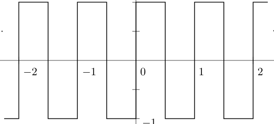

$$
···
$$

$$
··
$$

$$
t
$$

Let’s calculate the Fourier coefficients. The function is

$$
f(t) = (+1 0 ≤ t <^{1}_{2}
$$

$$
−1 12 ≤ t < 1
$$

and then extended to be periodic of period 1. The zeroth coefficient is the average value of the function on 0 $≤ t ≤$ 1. Obviously this is zero. For the other coefficients we have

$$
fˆ(n) = \int_{0}^{1} e^{−2 π i n t}f(t)dt
$$

$$
= \int_{0}^{1/2} e^{−2 π i n t} dt − \int_{1/2}^{1} e^{−2 π i n t} dt
$$

$$
[ \frac{1}{2 π i n}e^{−2 π i n t}]^{1/2} [ \frac{1}{2 π i n}e^{−2 π i n t}]^{1}
$$

$$
(1 − e^{−π i n})
$$

$$
−
$$

$$
− −
$$

=

$$
1/2 = \frac{1}{π i n}
$$

0

We should thus consider the infinite Fourier series

$$
\sum_{n \neq 0} \frac{1}{π i n}(1 − e^{−π i n})e^{2 π i n t}
$$

We can write this in a simpler form by first noting that

$$
(
$$

0 $n$ even

$$
1 − e^{−π i n} =
$$

2 $n$ odd

so the series becomes

$$
\sum_{n o d d} \frac{2}{π i n}e^{2 π i n t} .
$$

Now combine the positive and negative terms and use

$e^{2 π i n t} − e^{−2 π i n t}$ = 2$i$ sin2$πnt.$ Substituting this into the series and writing $n$ = 2$k$ + 1, our final answer is

$$
4 \sum_{k=0}^{∞}
$$

$\frac{1}{2 k+1}$ sin 2$π($2$k$ + 1)$t.$

$$
π
$$

(Note that the function $f(t)$ is odd and this jibes with the Fourier series having only sine terms.) What kind of series is this? In what sense does it converge, if at all, and to what does it converge, i.e, can we represent $f(t)$ as a Fourier series through

$$
\sum_{k=0}^{∞}
$$

$f(t)$ = 4 $\frac{1}{2 k+1}$ sin 2$π($2$k$ + 1)$t$ ?

$$
π
$$

The graphs below are sums of terms up to frequencies 9 and 39, respectively.

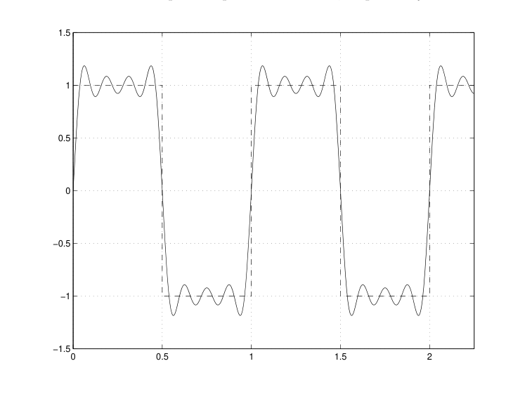

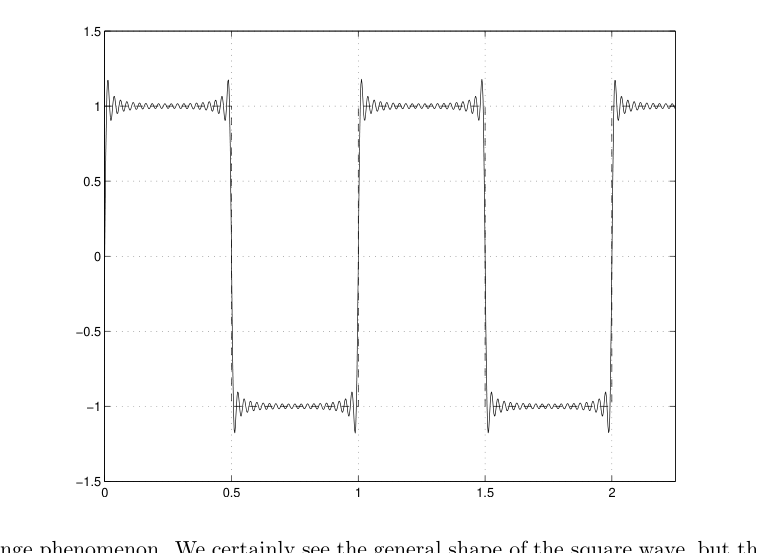

We see a stra ere is trouble at the corners. Clearly, in retrospect, we shouldn’t expect to represent a function like the square wave by a finite sum of complex exponentials. Why? Because a finite sum of continuous functions is continuous and the square wave has jump discontinuities. Thus, for maybe the first time in your life, one of those theorems from calculus that seemed so pointless at the time makes an appearance: The sum of two (or a finite number) of continuous functions is continuous. Whatever else we may be able to conclude about a Fourier series representation for a square wave, it must contain arbitrarily high frequencies. We’ll say what else needs to be said next time.

I picked the example of a square wave because it’s easy to carry out the integrations needed to find the Fourier coefficients. However, it’s not only a discontinuity that forces high frequencies. Take a triangle wave, say defined by

$$
f(t) = (_{1}_{2} + t −^{1}_{2} ≤ t ≤ 0
$$

$$
12 − t 0 ≤ t ≤ + 12
$$

and then extended to be periodic of period 1. This is continuous. There are no jumps, though there are corners. (Draw your own graph!) A little more work than for the square wave shows that we want the infinite Fourier series

$$
\sum_{k=0}^{∞}
$$

14 + $\frac{2}{π^{2}(2 k+1)2}$ cos(2$π($2$k$ + 1)$t)$ I won’t reproduce the calculations in public; the calculation of the coefficients needs integration by parts.

Here, too, there are only odd harmonics and there are infinitely many. This time the series involves only cosines, a reflection of the fact that the triangle wave is an even function. Note also that the triangle wave the coefficients decrease like 1$/n^{2}$ while for a square wave they decrease like 1$/n$. I alluded to this sort of thing, above (the size of the coefficients); it has exactly to do with the fact that the square wave is discontinuous while the triangle wave is continuous but its derivative is discontinuous. So here is yet another occurrence of one of those calculus theorems: The sines and cosines are differentiable to all orders, so any finite sum of them is also differentiable. We therefore should not expect a finite Fourier series to represent the triangle wave, which has corners.

How good a job do the finite sums do in approximating the triangle wave? I’ll let you use your favorite software to plot some approximations. You will observe something different from what happened with the square wave. We’ll come back to this, too.

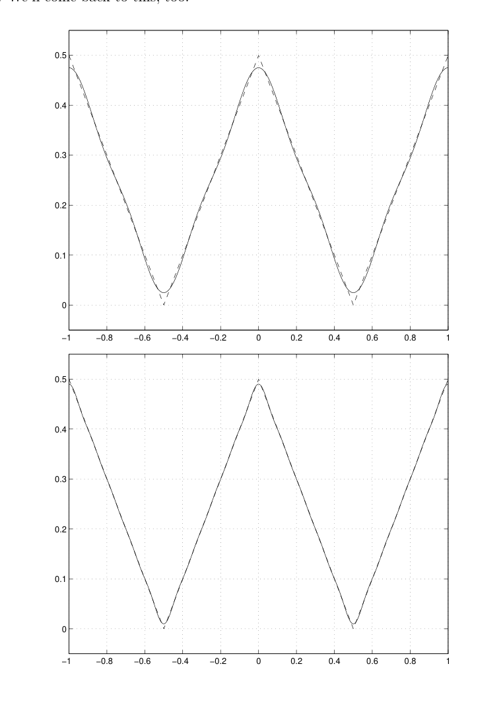

One thing common to these two examples might be stated as another aphorism:

It takes high frequencies to make sharp corners.

This particular aphorism is important, for example, in questions of filtering, a topic we’ll consider in detail later:

- Filtering means cutting off.

- Cutting off means sharp corners.

- Sharp corners means high frequencies.

This comes up in computer music, for example. If you’re not careful to avoid discontinuities in filtering the signal (the music) you’ll hear clicks — symptoms of high frequencies — when the signal is played back.

A sharp cutoff will inevitably yield an unsatisfactory result, so you have to design your filters to minimize this problem.

Why do instruments sound different? More precisely, why do two instruments sound different even when they are playing the same note? It’s because the note they produce is not a single sinusoid of a single frequency, not the A at 440 Hz, for example, but a sum (literally) of many sinusoids, each contributing a different amount. The complex wave that reaches your ear is the combination of many ingredients. Two instruments sound different because of the harmonics they produce and because of the strength of the harmonics.

Shown below are approximately the waveforms (what you’d see on an oscilloscope) for a bassoon and a flute both playing the same note and the power spectrum of the respective waves — what you’d see on a spectrum analyzer, if you’ve ever worked with one. The height of the bars corresponds to the energy of the individual harmonics, as explained above. Only the positive harmonics are displayed here. The pictures are highly simplified; in reality a spectrum analyzer would display hundreds of frequencies.

The spectral representation — the frequency domain — gives a much clearer explanation of why the instruments sound different than does the time domain signal. You can see how the ingredients differ and by how much. The spectral representation also offers many opportunities for varieties of signal processing that would not be so easy to do or even to imagine in the time domain. It’s easy to imagine pushing some bars down, pulling others up, or eliminating blocks, operations whose actions in the time domain are far from clear.

As an aside, I once asked Julius Smith, an expert in computer music here at Stanford, why orchestras tune to an oboe playing an A. I thought it might be because the oboe produces a very pure note, mostly a perfect 440 with very few other harmonics, and this would be desirable. In fact, it seems just the opposite is the case. The spectrum of the oboe is very rich, plenty of harmonics. This is good, apparently, because whatever instrument you happen to play, there’s a little bit of you in the oboe and vice versa. That helps you tune.

For a detailed discussion of the spectra of musical instruments see

http://epubs.siam.org/sam-bin/getfile/SIREV/articles/38228.pdf

## 1.8 The Math, the Majesty, the End

In previous sections, we worked with the building blocks of periodic functions — sines and cosines and complex exponentials — and considered general sums of such “harmonics”. We also showed that if a periodic function $f(t)$ — period 1, as a convenient normalization — can be written as a sum

$$
f(t) = \sum_{n=−N}^{N} c_{n}e^{2 π i n t} ,
$$

then the coefficients are given by the integral

$$
c_{n} = \int_{0}^{1} e^{−2 π i n t}f(t)dt.
$$

This was a pretty straightforward derivation, isolating $c_{n}$ nd then integrating. When $f(t)$ is real, as in many applications, one has the symmetry relation $c_{−n}$ = $\frac{a}{m c_{n}.}$ In a story we’ll spin out over the rest of the quarter, we think of this integral as some kind of transfor of $f,$ and use the notation

$$
fˆ(n) = \int_{0}^{1} e^{−2 π i n t}f(t)dt
$$

to indicate this relationship.9 At this stage, we haven’t done much. We have only demonstrated that if it is possible to write a periodic function as a sum of simple harmonics, then it must be done in the way we’ve just said. We also have some examples that indicate the possible difficulties in this sort of representation; an infinite series may be required and then convergence is certainly an issue. But we’re about to do a lot. We’re about to answer the question of how far the idea can be pushed: when can a periodic signal be written as a sum of simple harmonics?

## 1.8.1 Square integrable functions

There’s much more to the structure of the Fourier coefficients and to the idea of writing a periodic function as a sum of complex exponentials than might appear from our simple derivation. There are:

9 Notice that although $f(t)$ is defined for a continuous variable $t,$ the transformed function $f$ˆ is defined on the integers. There are reasons for this that are much deeper than just solving for the unknown coefficients as we did last time.

- Algebraic and geometric aspects

$◦$ The algebraic and geometric aspects are straightforward extensions of the algebra and geometry of vectors in Euclidean space. The key ideas are the inner product (dot product), orthogonality, and norm. We can pretty much cover the whole thing. I remind you that your job here is to transfer your intuition from geometric vectors to a more general setting where the vectors are signals; at least accept that the words transfer in some kind of meaningful way even if the pictures do not.

- Analytic aspects

$◦$ The analytic aspects are not straightforward and require new ideas on limits and on the nature of integration. The aspect of “analysis” as a field of mathematics distinct from other fields is its systematic use of limiting processes. To define a new kind of limit, or to find new consequences of taking limits (or trying to), is to define a new area of analysis. We really can’t cover the whole thing, and it’s not appropriate to attempt to. But I’ll say a little bit here, and similar issues will come up when we define the Fourier transform.

## 1.8.2 The punchline revealed

Let me introduce the notation and basic terminology and state what the important results are now, so you can see the point. Then I’ll explain where these ideas come from and how they fit together.

Once again, to be definite we’re working with periodic functions of period 1. We can consider such a function already to be defined for all real numbers, and satisfying the identity $f(t$ + 1) = $f(t)$ for all $t,$ or we can consider $f(t)$ to be defined initially only on the interval from 0 to 1, say, and then extended to be periodic and defined on all of R by repeating the graph (recall the periodizing operation in the first problem set). In either case, once we know what we need to know about the function on [0$,$ 1] we know everything. All of the action in the following discussion takes place on the interval [0$,$ 1].

When $f(t)$ is a signal defined on [0$,$ 1] the energy of the signal is defined to be the integral This definition of energy comes up in other physical contexts also; we don’t have to be talking about functions of time. (In some areas the integral of the square is identified with power.) Thus means that the signal has finite energy, a reasonable condition to expect or to impose.

I’m writing the definition in terms of the integral of the absolute value squared $|f(t)|^{2}$ rather than just $f(t^{2})$ because we’ll want to consider the definition to apply to complex valued functions. For real-valued functions it doesn’t matter whether we integrate $|f(t)|^{2}$ or $f(t^{2})$ .

One further point before we go on. Although our purpose is to use the finite energy condition to work with periodic functions, and though you think of periodic functions as defined for all time, you can see why we have to restrict attention to one period (any period). An integral of a periodic function from $−∞$ to $∞,$ for example does not exist (or is infinite).

$$
\int_{0}^{1} |f(t)|^{2}dt.
$$

$$
\int_{0}^{1} |f(t)|^{2}dt < ∞
$$

$$
\int_{−∞}^{∞}
$$

sin2$tdt$

For mathematical reasons, primarily, it’s best to take the square root of the integral, and to define

$$
∥f∥ = (\int_{0}^{1} |f(t)|^{2}dt)^{1/2}
$$

With this definition one has, for example, that

$$
∥αf∥ = ∥α∥∥f∥,
$$

whereas if we didn’t take the square root the constant would come out to the second power — see below.

One can also show, though the proof is not so obvious (see Section 1.10), that the triangle inequality holds:

$$
∥f + g∥ ≤ ∥f∥ + ∥g∥.
$$

Write that out in terms of integrals if you think it’s obvious:

$$
(\int_{0}^{1}
$$

$$
(\int_{0}^{1}
$$

$$
(\int_{0}^{1}
$$

$$
)^{1/2}
$$

$$
)^{1/2}
$$

$$
)^{1/2}
$$

$$
≤ |f(t)|^{2}dt
$$

$$
|g(t)|^{2}dt
$$

$$
|f(t) + g(t)|^{2}dt
$$

+

$$
.
$$

We can measure the distance between two functions via

$$
∥f − g∥ = (\int_{0}^{1} |f(t)− g(t)|^{2}dt)^{1/2}.
$$

Then $∥f − g∥ =$ 0 if and only if $f$ = $g$.

Now get this: The length of a vector is the square root of the sum of the squares of its components. This norm defined by an integral is the continuous analog of that, and so is the definition of distance.10 We’ll make the analogy even closer when we introduce the corresponding dot product.

We let $L^{2}([$0$,$ 1]) be the set of functions $f(t)$ on [0$,$ 1] for which

$$
\int_{0}^{1} |f(t)|^{2}dt < ∞.
$$

The “L” stands for Lebesgue, the French mathematician who introduced a new definition of the integral that underlies the analytic aspects of the results we’re about to talk about. His work was around the turn of the 20-th century. The length we’ve just introduced, $∥f∥,$ is called the square norm or the $L^{2}([$0$,$ 1])-norm of the function. When we want to distinguish this from other norms that might (and will) come up, we write $∥f∥_{2}$.

It’s true, you’ll be relieved to hear, that if $f(t)$ is in $L^{2}([$0$,$ 1]) then the integral defining its Fourier coefficients exists. See Section 1.10 for this. The complex integral

$$
\int_{0}^{1} e^{−2 π i n t}f(t)dt
$$

can be written in terms of two real integrals by writing $e^{−2 π i n t}$ = cos 2$πnt − i$ sin 2$πnt$ so everything can be defined and computed in terms of real quantities. There are more things to be said on complex-valued versus real-valued functions in all of this, but it’s best to put that off just now.

Here now is the life’s work of several generations of mathematicians, all dead, all still revered:

10 If we’ve really defined a “length” then scaling $f(t)$ to $αf(t)$ should scale the length of $f(t).$ If we didn’t take the square root in defining $∥f∥$ the length wouldn’t scale to the first power.

Let $f(t)$ be in $L^{2}([$0$,$ 1]) and let

$$
fˆ(n) = \int_{0}^{1} e^{−2 π i n t}f(t)dt, n = 0,±1,±2,...
$$

be its Fourier coefficients. Then

1. For any $N$ the finite sum

$$
\sum_{n=−N}^{N} fˆ(n)e^{2 π i n t}
$$

is the best approximation to $f(t)$ in $L^{2}([$0$,$ 1]) by a trigonometric polynomial11 of degree $N$. (You can think of this as the least squares approximation. I’ll explain the phrase “of degree $N$” in Section 1.12, where we’ll prove the statement.) 2. The complex exponentials $e^{2 π i n t},$ ($n$ = 0$,±$1$,±$2$,...)$ form a basis for $L^{2}([$0$,$ 1]), and the partial sums in statement 1 converge to $f(t)$ in $L^{2}-$distance as $N → ∞$. This means that

$$
\sum_{n=−N}^{N} fˆ(n)e^{2 π i n t} − f(t)
$$

lim

$$
= 0.
$$

$$
N→∞
$$

We write

$$
f(t) = \sum_{n=−∞}^{∞} fˆ(n)e^{2 π i n t} ,
$$

where the equals sign is interpreted in terms of the limit.

Once we introduce the inner product on $L^{2}([$0$,$ 1]) a more complete statement will be that the $e^{2 π i n t}$ form an orthonormal basis. In fact, it’s only the orthonormality that we’ll establish.

3. The energy of $f(t)$ can be calculated from its Fourier coefficients:

$$
\int_{0}^{1} |f(t)|^{2}dt = \sum_{n=−∞}^{∞} | fˆ(n)|^{2}.
$$

This is known, depending on to whom you are speaking, as Rayleigh’s identity or as Parseval’s theorem.

To round off the picture, let me add a fourth point that’s a sort of converse to items two and three. We won’t use this, but it ties things up nicely.

4. If ${_{n}c$ : $n$ = 0$,±$1$,±$2$,...}$ is any sequence of complex numbers for which

$$
\sum_{n=−∞}^{∞} |_{n}c |^{2} < ∞,
$$

then the function

$$
f(t) = \sum_{n=−∞}^{∞} c_{n}e^{2 π i n t}
$$

is in $L^{2}([$0$,$ 1]) (meaning the limit of the partial sums converges to a function in $L^{2}([$0$,$ 1])) and $c_{n}$ = $f$ˆ($n)$.

This last result is often referred to as the Riesz-Fischer theorem.

11 A trigonometric polynomial is a finite sum of complex exponentials with the same fundamental frequency.

And the point of this is, again . . . One way to think of the formula for the Fourier coefficients is as passing from the “time domain” to the “frequency domain”: From a knowledge of $f(t)$ (the time domain) we produce a portrait of the signal in the frequency domain, namely the (complex) coefficients $f$ˆ($n)$ associated with the (complex) harmonics $e^{2 π i n t}$. The function $f$ˆ($n)$ is defined on the integers, $n$ = 0$,±$1$,±$2$,...,$ and the equation

$$
f(t) = \sum_{n=−∞}^{∞} fˆ(n)e^{2 π i n t} ,
$$

recovers the time domain representation from the frequency domain representation. At least it does in the $L^{2}$ sense of equality. The extent to which equality holds in the usual, pointwise sense (plug in a value of $t$ and the two sides agree) is a question we will address later.

The magnitude $|f$ ˆ($n)|^{2}$ is the energy contributed by the $n-$th harmonic. We really have equal contributions from the “positive” and “negative” harmonics $e^{2 π i n t}$ and $e^{−2 π i n t}$ since $| f$ˆ($−n)|$ = $| f$ˆ($n)|$ (note the absolute values here). As you will show in the first problem set, in passing between the complex exponential form

$$
\sum_{n=−∞}^{∞} c_{n}e^{2 π i n t} , c_{n} = fˆ(n)
$$

and the sine-cosine form

$$
\sum_{n=1}^{∞}
$$

$$
\sum_{n=1}^{∞}
$$

12$a_{0}$ + $a_{n}$ cos 2$πnt$ + $b_{n}$ sin 2$πnt$

$$
\sqrt{a^{2}_{n}+b^{2}_{n},}
$$

of the Fourier series, we have $|_{n}c |$ = 1 so $f$ˆ($n)$ and $f$ˆ($−n)$ together contribute a total energy of

$$
\sqrt{a^{2}_{n}+b^{2}_{n}.}
$$

2 Rayleigh’s identity says that we can compute the energy of the signal by adding up the energies of the individual harmonics. That’s quite a satisfactory state of affairs — and an extremely useful result. You’ll see an example of its use in the first problem set.

Here are a few more general comments on these results.

- The first point, on best approximation in $L^{2}([$0$,$ 1]) by a finite sum, is a purely algebraic result. This

is of practical value since, in any real application you’re always making finite approximations, and this result gives guidance on how well you’re doing. We’ll have a more precise statement (in Appendix 3) after we set up the necessary ingredients on inner products and orthogonality.

Realize that this gives an alternative characterization of the Fourier coefficients. Originally we said: if we can express $f(t)$ as a sum of complex exponentials, then the unknown coefficients in the expression must be given by the integral formula we found. Instead, we could have asked: What is the “least squares” approximation to the function? And again we would be led to the same integral formula for the coefficients.

- Rayleigh’s identity is also an algebraic result. Once we have the proper setup it will follow effortlessly.

- The remaining statements, points 2 and 4, involve some serious analysis and we won’t go into the

proofs. The crisp statements that we have given are true provided one adopts a more general theory of integration, Lebesgue’s theory. In particular, one must allow for much wilder functions to be integrated than those that are allowed for the Riemann integral, which is the integral you saw in calculus courses. This is not to say that the Riemann integral is “incorrect”, rather it is incomplete — it does not allow for integrating functions that one needs to integrate in order to get an adequate theory of Fourier series, among other things.

These are mathematical issues only. They have no practical value. To paraphrase John Tukey, a mathematician who helped to invent the FFT: “I wouldn’t want to fly in a plane whose design depended on whether a function was Riemann or Lebesgue integrable.” So do you have to worry about this? Not really, but do take note of the examples we looked at in the previous lecture. Suppose a periodic signal has even a single discontinuity or a corner, like a square wave, a sawtooth wave or a triangle wave for example. Or think of taking a smooth signal and cutting it off (using a window), thus inducing a discontinuity or a corner. The Fourier series for such a signal must have infinitely many terms, and thus arbitrarily high frequencies in the spectrum. This is so, recall, because if

$$
f(t) = \sum_{n=−N}^{N} fˆ(n)e^{2 π i n t}
$$

for some finite $N$ then $f(t)$ would be the finite sum of smooth functions, hence smooth itself. It’s the possibility (the reality) of representing discontinuous (or wilder) functions by an infinite sum of smooth functions that’s really quite a strong result. This was anticipated, and even stated by Fourier, but people didn’t believe him. The results we’ve stated above are Fourier’s vindication, but probably not in a form he would have recognized.

## 1.9 Orthogonality

The aspect of Euclidean geometry that sets it apart from geometries which share most of its other features is perpendicularity and its consequences. To set up a notion of perpendicularity in settings other than the familiar Euclidean plane or three dimensional space is to try to copy the Euclidean properties that go with it.

Perpendicularity becomes operationally useful, especially for applications, when it’s linked to measurement, i.e., to length. This link is the Pythagorean theorem. 12 Perpendicularity becomes austere when mathematicians start referring to it as orthogonality, but that’s what I’m used to and it’s another term you can throw around to impress your friends.

Vectors To fix ideas, I want to remind you briefly of vectors and geometry in Euclidean space. We write vectors in R$n$ as $n-$tuples of real numbers:

$$
v = (v_{1},v_{2},...,v_{n})
$$

The $v_{i}$ are called the components of v. The length, or norm of v is

$$
∥v∥ = (v^{2}_{1} + v^{2}_{2} + ··· + v^{2}_{n})1/2.
$$

12 How do you lay out a big rectangular field of specified dimensions? You use the Pythagorean theorem. I had an encounter with this a few summers ago when I volunteered to help lay out soccer fields. I was only asked to assist, because evidently I could not be trusted with the details. Put two stakes in the ground to determine one side of the field. That’s one leg of what is to become a right triangle — half the field. I hooked a tape measure on one stake and walked off in a direction generally perpendicular to the first leg, stopping when I had gone the regulation distance for that side of the field, or when I needed rest. The chief of the crew hooked another tape measure on the other stake and walked approximately along the diagonal of the field — the hypotenuse. We adjusted our positions — but not the length we had walked off — to meet up, so that the Pythagorean theorem was satisfied; he had a chart showing what this distance should be. Hence at our meeting point the leg I determined must be perpendicular to the first leg we laid out. This was my first practical use of the Pythagorean theorem, and so began my transition from a pure mathematician to an engineer.

The distance between two vectors v and w is $∥$v $−$ w$∥$.

How does the Pythagorean theorem look in terms of vectors? Let’s just work in R2. Let u = ($u_{1},u_{2}),$ v = ($v_{1},v_{2}),$ and w = u+v = ($u_{1}+v_{1},u_{2}+v_{2})$. If u, v, and w form a right triangle with w the hypotenuse, then $∥$w$∥^{2}$ = $∥$u + v$∥^{2}$ = $∥$u$∥^{2}$ + $∥$v$∥^{2}$

$$
(u_{1} + v_{1}^{2}) + (u_{2} + v_{2}^{2}) = (u^{2}_{1} + u^{2}_{2}) + (v^{2}_{1} + v^{2}_{2})
$$

$$
(u^{2}_{1} + 2u_{1}v_{1} + v^{2}_{1}) + (u^{2}_{2} + 2u_{2}v_{2} + v^{2}_{2}) = u^{2}_{1} + u^{2}_{2} + v^{2}_{1} + v^{2}_{2}
$$

The squared terms cancel and we conclude that

$$
u_{1}v_{1} + u_{2}v_{2} = 0
$$

is a necessary and sufficient condition for u and v to be perpendicular.

And so we introduce the (algebraic) definition of the inner product or dot product of two vectors. We give this in R$n:$ If v = ($v_{1},v_{2},...,v_{n})$ and w = ($w_{1},w_{2},...,w_{n})$ then the inner product is v $·$ w = $v_{1}w_{1}$ + $v_{2}w_{2}$ + $···$ + $v_{n}w_{n}$ Other notations for the inner product are (v$,$ w) (just parentheses; we’ll be using this notation) and $⟨$v$,$ w$⟩$ (angle brackets for those who think parentheses are not fancy enough; the use of angle brackets is especially common in physics where it’s also used to denote more general pairings of vectors that produce real or complex numbers.) Notice that (v$,$ v) = $v^{2}_{1}$ + $v^{2}_{2}$ + $···$ + $v^{2}_{n}$ = $∥$v$∥^{2}.$ Thus $∥$v$∥ =$ (v$,$ v)1$/2.$ There is also a geometric approach to the inner product, which leads to the formula (v$,$ w) = $||$v$||||$w$||$ cos$θ$ where $θ$ is the angle between v and w. This is sometimes taken as an alternate definition of the inner product, though we’ll stick with the algebraic definition. For a few comments on this see Section 1.10.

We see that (v$,$ w) = 0 if and only if v and w are orthogonal. This was the point, after all, and it is a truly helpful result, especially because it’s so easy to verify when the vectors are given in coordinates. The inner product does more than identify orthogonal vectors, however. When it’s nonzero it tells you how much of one vector is in the direction of another. That is, the vector $\frac{(v,w)}{||w||} \frac{w}{||w||}$ also written as $\frac{(v,w)}{(w,w)}$ w $,$

is the projection of v onto the unit vector w$/||$w$||,$ or, if you prefer, (v$,$ w)$/||$w$||$ is the (scalar) component of v in the direction of w. I think of the inner product as measuring how much one vector “knows” another; two orthogonal vectors don’t know each other.

Finally, I want to list the main algebraic properties of the inner product. I won’t give the proofs; they are straightforward verifications. We’ll see these properties again — modified slightly to allow for complex numbers — a little later.

1. (v$,$ v)$≥$ 0 and (v$,$ v) = 0 if and only if v = 0

2. (v$,$ w) = (w$,$ v) (symmetry)

3. ($α$v$,$ w) = $α($v$,$ w) for any scalar $α$

4. (v + w$,$ u) = (v$,$ u) + (w$,$ u) (additivity) In fact, these are exactly the properties that ordinary multiplication has.

Orthonormal basis The natural basis for R$n$ are the vectors of length 1 in the $n$ “coordinate directions”:

e1 = (1$,$ 0$,...,$ 0)$,$ e2 = (0$,$ 1$,...,$ 0)$, ...,$ e$n$ = (0$,$ 0$,...,$ 1)$.$ These vectors are called the “natural” basis because a vector v = ($v_{1},v_{2},...,v_{n})$ is expressed “naturally” in terms of its components as v = $v_{1}$e1 + $v_{2}$e2 + $···$ + $v_{n}$e$n .$ One says that the natural basis e1, e2, . . . , e$n$ are an orthonormal basis for R$n,$ meaning where $δ_{i j}$ is the Kronecker delta defined by Notice that and hence that In words:

When v is decomposed as a sum of vectors in the directions of the orthonormal basis vectors, the components are given by the inner product of v with the basis vectors.

Since the e$k$ have length 1, the inner products (v$,$ e$k)$ are the projections of v onto the basis vectors.13 13 Put that the other way I like so much, the inner product (v$,$ e$k)$ is how much v and e$k$ know each other.

(positive definiteness)

(homogeneity)

(e$i,$ e$j)$ = $δ_{i j} ,$

$δ_{i j}$ = $($1 $i$ = $j$

$$
0 i\neq j
$$

(v$,$ e$k)$ = $v_{k} ,$

$$
\sum_{k=1}^{n}
$$

v = (v$,$ e$k)$e$k .$

Functions All of what we’ve just done can be carried over to $L^{2}([$0$,$ 1]), including the same motivation for orthogonality and defining the inner product. When are two functions “perpendicular”? Answer: when the Pythagorean theorem is satisfied. Thus if we are to have

$$
∥f + g∥^{2} = ∥f∥^{2} + ∥g∥^{2}
$$

then

$$
\int_{0}^{1} (f(t) + g(t))2dt = \int_{0}^{1} f(t^{2}) dt + \int_{0}^{1} g(t^{2}) dt
$$

$$
\int_{0}^{1} (f(t^{2}) + 2f(t)g(t) + g(t^{2}) )dt = \int_{0}^{1} f(t^{2}) dt + \int_{0}^{1} g(t^{2}) dt
$$

$$
\int_{0}^{1} f(t^{2}) dt + 2\int_{0}^{1} f(t)g(t)dt + \int_{0}^{1} g(t^{2}) dt = \int_{0}^{1} f(t^{2}) dt + \int_{0}^{1} g(t^{2}) dt
$$

If you buy the premise, you have to buy the conclusion — we conclude that the condition to adopt to define when two functions are perpendicular (or as we’ll now say, orthogonal) is

$$
\int_{0}^{1} f(t)g(t)dt = 0.
$$

So we define the inner product of two functions in $L^{2}([$0$,$ 1]) to be.

$$
(f,g) = \int_{0}^{1} f(t)g(t)dt.
$$

(See Section 1.10 for a discussion of why $f(t)g(t)$ is integrable if $f(t)$ and $g(t)$ are each square integrable.) This inner product has all of the algebraic properties of the dot product of vectors. We list them, again.

1. ($f,f) ≥$ 0 and ($f,f)$ = 0 if and only if $f$ = 0.

2. ($f,g)$ = ($g,f)$

3. ($f$ + $g,h)$ = ($f,h)$ + ($g,h)$

4. ($αf,g)$ = $α(f,g)$

In particular, we have

$$
(f,f) = \int_{0}^{1} f(t^{2}) dt = ∥f∥^{2}.
$$

Now, let me relieve you of a burden that you may feel you must carry. There is no reason on earth why you should have any pictorial intuition for the inner product of two functions, and for when two functions are orthogonal. How can you picture the condition ($f,g)$ = 0? In terms of the graphs of $f$ and $g$? I don’t think so. And if ($f,g)$ is not zero, how are you to picture how much $f$ and $g$ know each other? Don’t be silly.

We’re working by analogy here. It’s a very strong analogy, but that’s not to say that the two settings — functions and geometric vectors — are identical. They aren’t. As I have said before, what you should do is draw pictures in R2 and R3, see, somehow, what algebraic or geometric idea may be called for, and using the same words make the attempt to carry that over to $L^{2}([$0$,$ 1]). It’s surprising how often and how well this works.

There’s a catch There’s always a catch. In the preceding discussion we’ve been working with the real vector space R$n,$ as motivation, and with real-valued functions in $L^{2}([$0$,$ 1]). But, of course, the definition of the Fourier coefficients involves complex functions in the form of the complex exponential, and the Fourier series is a sum of complex terms. We could avoid this catch by writing everything in terms of sine and cosine, a procedure you may have followed in an earlier course. However, we don’t want to sacrifice the algebraic dexterity we can show by working with the complex form of the Fourier sums, and a more effective and encompassing choice is to consider complex-valued square integrable functions and the complex inner product.

Here are the definitions. For the definition of $L^{2}([$0$,$ 1]) we assume again that

$$
\int_{0}^{1} |f(t)|^{2}dt < ∞.
$$

The definition looks the same as before, but $|f(t)|^{2}$ is now the magnitude of the (possibly) complex number $f(t)$.

The inner product of complex-valued functions $f(t)$ and $g(t)$ in $L^{2}([$0$,$ 1]) is defined to be

$$
(f,g) = \int_{0}^{1} f(t)\overline{g(t)}dt.
$$

The complex $\frac{c o n j u g}{(g,f)}$ate in the second slot causes a few changes in the algebraic properties. To wit:

1. ($f,g)$ =

(Hermitian symmetry) 2. ($f,f) ≥$ 0 and ($f,f)$ = 0 if and only if $f$ = 0 (positive definiteness — same as before) 3. ($αf,g)$ = $α(f,g), (f,αg)$ =$\overline{s α e c(}f,g) ($homogeneity — same as before in the first slot, conjugate scalar comes out if it’s in the ond slot) 4. ($f$ + $g,h)$ = ($f,h)$ + ($g,h),$ ($f,g$ + $h)$ = ($f,g)$ + ($f,h) ($additivity — same as before, no difference between additivity in first or second slot) I’ll say more about the reason for the definition in Appendix 2. As before,

$$
(f,f) = \int_{0}^{1} f(t)\overline{f(t)}dt = \int_{0}^{1} |f(t)|^{2}dt = ∥f∥^{2}.
$$

From now on, when we talk about $L^{2}([$0$,$ 1]) and the inner product on $L^{2}([$0$,$ 1]) we will always assume the complex inner product. If the functions happen to be real-valued then this reduces to the earlier definition.

The complex exponentials are an orthonormal basis Number two in our list of the greatest hits of the theory of Fourier series says that the complex exponentials form a basis for $L^{2}([$0$,$ 1]). This is not a trivial statement. In many ways it’s the whole ball game, for in establishing this fact one sees why $L^{2}([$0$,$ 1]) is the natural space to work with, and why convergence in $L^{2}([$0$,$ 1]) is the right thing to ask for in asking for the convergence of the partial sums of Fourier series.14 But it’s too much for us to do.

Instead, we’ll be content with the news that, just like the natural basis of R$n,$ the complex exponentials are orthonormal. Here’s the calculation; in fact, it’s the same calculation we did when we first solved for the Fourier coefficients. Write

$$
e_{n}(t) = e^{2 π i n t} .
$$

14 An important point in this development is understanding what happens to the usual kind of pointwise convergence vis `a vis $L2([0,$ 1]) convergence when the functions are smooth enough.

The inner product of two of them, $e_{n}(t)$ and $e_{m}(t),$ when $n\neq m$ is

$$
(e_{n},e_{m}) = \int_{0}^{1} e^{2 π i n t}\overline{e^{2 π i m t}}dt = \int_{0}^{1} e^{2 π i n t}e^{−2 π i m t} dt = \int_{0}^{1} e^{2 π i(n−m)t} dt
$$

$$
\frac{1}{2 π i(n−m)}e^{2 π i(n−m)t}]^{1}
$$

$$
(e^{2 π i(n−m)} − e^{0}) \frac{1}{2 π i(n−m)}(1− 1) = 0.
$$

=

0 =

=

$$
\frac{1}{2 π i(n−m)}
$$

They are orthogonal. And when $n$ = $m$

$$
(e_{n},e_{n}) = \int_{0}^{1} e^{2 π i n t}\overline{e^{2 π i n t}} dt = \int_{0}^{1} e^{2 π i n t}e^{−2 π i n t} dt = \int_{0}^{1} e^{2 π i(n−n)t} dt = \int_{0}^{1} 1dt = 1.
$$

Therefore the functions $e_{n}(t)$ are orthonormal:

$$
(e_{n},e_{m}) = δ_{n m} = (01 nn\neq = mm
$$

What is the component of a function $f(t)$ “in the direction” $e_{n}(t)$? By analogy to the Euclidean case, it is given by the inner product

$$
(f,e_{n}) = \int_{0}^{1} f(t)\overline{e_{n}(t)}dt = \int_{0}^{1} f(t)e^{−2 π i n t} dt,
$$

precisely the $n-$th Fourier coefficient $f$ˆ($n)$. (Note that $e_{n}$ really does have to be in the second slot here.) Thus writing the Fourier series

$$
f = \sum_{n=−∞}^{∞} fˆ(n)e^{2 π i n t} ,
$$

as we did earlier, is exactly like the decomposition in terms of an orthonormal basis and associated inner product:

$$
f = \sum_{n=−∞}^{∞} (f,e_{n})e_{n} .
$$

What we haven’t done is to show that this really works — that the complex exponentials are a basis as well as being orthonormal. We would be required to show that

$$
\sum_{n=−N}^{N}
$$

lim $f − (f,e_{n})e_{n}$ = 0$.$

$$
N→∞
$$

We’re not going to do that. It’s hard.

What if the period isn’t 1? Remember how we modified the Fourier series when the period is $T$ rather than 1. We were led to the expansion

$$
f(t) = \sum_{n=−∞}^{∞} c_{n}e^{2 π i n t/T} .
$$

where

$$
c_{n} = \frac{1}{T} \int_{0}^{T} e^{−2 π i n t/T}f(t)dt.
$$

The whole setup we’ve just been through can be easily modified to cover this case. We work in the space $L^{2}([$0$,T])$ of square integrable functions on the interval [0$,T]$. The (complex) inner product is

$$
(f,g) = \int_{0}^{T} f(t)\overline{g(t)}dt.
$$

What happens with the $T-$periodic complex exponentials $e^{2 π i n t/T}$ ? If $n\neq m$ then, much as before,

$$
(e^{2 π i n t/T} , e^{2 π i m t/T}) = \int_{0}^{T} e^{2 π i n t/T} \overline{e^{2 π i m t/T}} dt = \int_{0}^{T} e^{2 π i n t/T} e^{−2 π i m t/T} dt
$$

$$
= \int_{0}^{T} e^{2 π i(n−m)t/T} dt = \frac{1}{2 π i(n−m)/T} e^{2 π i(n−m)t/T}]^{T}_{0}
$$

$$
= \frac{1}{2 π i(n−m)/T} (e^{2 π i(n−m)} − e^{0}) = \frac{1}{2 π i(n−m)/T} (1 − 1) = 0
$$

And when $n$ = $m:$

$$
(e^{2 π i n t/T} , e^{2 π i n t/T}) = \int_{0}^{T} e^{2 π i n t/T} \overline{e^{2 π i n t/T}} dt
$$

$$
= \int_{0}^{T} e^{2 π i n t/T} e^{−2 π i n t/T} dt = \int_{0}^{T} 1dt = T .
$$

Aha — it’s not 1, it’s $T$. The complex exponentials with period $T$ are orthogonal but not orthonormal.

To get the latter property we scale the complex exponentials to

$$
e_{n}(t) = √\frac{1}{T} e^{2 π i n t/T} ,
$$

for then

$$
(e_{n},e_{m}) = (1 n = m
$$

$$
0 n\neq m
$$

$$
√
$$

This is where the factor 1$/ \overline{T}$ comes from, the factor mentioned earlier in this chapter. The inner product of $f$ with $e_{n}$ is

$$
(f,e_{n}) = √\frac{1}{T} \int_{0}^{T} f(t)e^{−2 π i n t/T} dt.
$$

Then

$$
(
$$

$$
)
$$

$$
\int_{0}^{T}
$$

$$
\sum_{n=−∞}^{∞}
$$

$$
\sum_{n=−∞}^{∞}
$$

$$
e^{2 π i n t/T} = \sum_{n=−∞}^{∞}
$$

$$
√
$$

$$
√
$$

$$
(f,e_{n})e_{n} =
$$

$$
f(s)e^{−2 π i n s/T} ds
$$

$$
c_{n}e^{2 π i n t/T},
$$

$$
\frac{1}{T}
$$

$$
\frac{1}{T}
$$

where

$$
c_{n} = \frac{1}{T} \int_{0}^{T} e^{−2 π i n t/T}f(t)dt,
$$

as above. We’re back to our earlier formula.

Rayleigh’s identity As a last application of these ideas, let’s derive Rayleigh’s identity, which states that

$$
\int_{0}^{1} |f(t)|^{2}dt = \sum_{n=−∞}^{∞} | fˆ(n)|^{2}.
$$

This is a cinch! Expand $f(t)$ as a Fourier series:

$$
f(t) = \sum_{n=−∞}^{∞} fˆ(n)e^{2 π i n t} = \sum_{n=−∞}^{∞} (f,e_{n})e_{n} .
$$

Then

$$
\int_{0}^{1} |f(t)|^{2}dt = ∥f∥^{2} = (f,f)
$$

$$
(
$$

$$
)
$$

$$
\sum_{n=−∞}^{∞}
$$

$$
\sum_{m=−∞}^{∞}
$$

=

$$
(f,e_{n})e_{n}, (f,e_{m})e_{m}
$$

$$
\sum_{n,m} \overline{(f,e_{m})(}e_{n},e_{m}) =\sum_{n,m=−∞}^{∞}
$$

$$
\overline{(f,e_{m})}δ_{n m}
$$

$$
= (f,e_{n})
$$

$$
(f,e_{n})
$$

$$
= \sum_{n=−∞}^{∞} (f,e_{n})\overline{(f,e_{n})} = \sum_{n=−∞}^{∞} |(f,e_{n})|^{2} = \sum_{n=−∞}^{∞} | fˆ(n)|^{2}
$$

The above derivation used

1. The algebraic properties of the complex inner product; 2. The fact that the $e_{n}(t)$ = $e^{2 π i n t}$ are orthonormal with respect to this inner product; 3. Know-how in whipping around sums Do not go to sleep until you can follow every line in this derivation.

Writing Rayleigh’s identity as

$$
∥f∥^{2} = \sum_{n=−∞}^{∞} |(f,e_{n})|^{2}
$$

again highlights the parallels between the geometry of $L^{2}$ and the geometry of vectors: How do you find the squared length of a vector? By adding the squares of its components with respect to an orthonormal basis. That’s exactly what Rayleigh’s identity is saying.

## 1.10 Appendix: The Cauchy-Schwarz Inequality and its Consequences

The Cauchy-Schwarz inequality is a relationship between the inner product of two vectors and their norms.

It states

$|($v$,$ w)$|≤ ∥$v$∥∥$w$∥.$ This is trivial to see from the geometric formula for the inner product:

$|($v$,$ w)$|$ = $∥$v$∥∥$w$∥|$ cos$θ| ≤ ∥$v$∥∥$w$∥,$ because $|$ cos$θ| ≤$ 1. In fact, the rationale for the geometric formula of the inner product will follow from the Cauchy-Schwarz inequality.

It’s certainly not obvious how to derive the inequality from the algebraic definition. Written out in components, the inequality says that

$$
\sum_{k=1}^{n}v_{k}w_{k} ≤ (\sum_{k=1}^{n}v^{2}_{k}) (\sum_{k=1}^{1/2 n}w^{2}_{k})^{1/2}.
$$

Sit down and try that one out sometime.

In fact, the proof of the Cauchy-Schwarz inequality in general uses only the four algebraic properties of the inner product listed earlier. Consequently the same argument applies to any sort of “product” satisfying these properties. It’s such an elegant argument (due to John von Neumann, I believe) that I’d like to show it to you. We’ll give this for the real inner product here, with comments on the complex case to follow in the next appendix.

Any inequality can ultimately be written in a way that says that some quantity is positive. Some things that we know are positive: the square of a real number; the area of something; and the length of something are examples.15 For this proof we use that the norm of a vector is positive, but we throw in a parameter.16 Let $t$ be any real number. Then $∥$v$−t$w$∥^{2} ≥$ 0. Write this in terms of the inner product and expand using the algebraic properties; because of homogeneity, symmetry, and additivity, this is just like multiplication — that’s important to realize:

0 $≤ ∥$v $− t$w$∥^{2}$

= (v $− t$w$,$ v $− t$w)

= (v$,$ v)$−$ 2$t($v$,$ w) + $t^{2}($w$,$ w)

= $∥$v$∥^{2} −$ 2$t($v$,$ w) + $t^{2}∥$w$∥^{2}$ This is a quadratic equation in $t,$ of the form $a^{2}t$ + $bt$ + $c,$ where $a$ = $∥$w$∥^{2}, b$ = $−$2(v$,$ w), and $c$ = $∥$v$∥^{2}$.

The first inequality, and the chain of equalities that follow, says that this quadratic is always nonnegative.

Now a quadratic that’s always nonnegative has to have a non-positive discriminant: The discriminant, $b^{2} −$ 4$ac$ determines the nature of the roots of the quadratic — if the discriminant is positive then there are two real roots, but if there are two real roots, then the quadratic must be negative somewhere.

Therefore $b^{2} −$ 4$ac ≤$ 0, which translates to 4(v$,$ w)2$−$ 4$∥$w$∥^{2}∥$v$∥^{2} ≤$ 0 or (v$,$ w)2 $≤ ∥$w$∥^{2}∥$v$∥^{2}.$ Take the square root of both sides to obtain $|($v$,$ w)$|≤ ∥$v$∥∥$w$∥,$ as desired. (Amazing, isn’t it — a nontrivial application of the quadratic formula!)17 This proof also shows when equality holds in the Cauchy-Schwarz inequality. When is that?

To get back to geometry, we now know that

$$
−1 ≤ \frac{(v,w)}{∥v∥∥w∥} ≤ 1.
$$

Therefore there is a unique angle $θ$ with 0 $≤ θ ≤ π$ such that

cos$θ$ = $\frac{(v,w)}{∥v∥∥w∥} ,$ 15 This little riff on the nature of inequalities qualifies as a minor secret of the universe. More subtle inequalities sometimes rely on convexity, as in the center of gravity of a system of masses is contained within the convex hull of the masses.

16 “Throwing in a parameter” goes under the heading of dirty tricks of the universe.

17 As a slight alternative to this argument, if the quadratic $f(t)$ = $at2$ +$bt$ +$c$ is everywhere nonnegative then, in particular, its minimum value is nonnegative. This minimum occurs at $t$ = $−b/2a$ and leads to the same inequality, 4$ac−b2 ≥ 0.$

i.e.,

(v$,$ w) = $∥$v$∥∥$w$∥$cos$θ.$ Identifying $θ$ as the angle between v and w, we have now reproduced the geometric formula for the inner product. What a relief.

The triangle inequality,

$∥$v + w$∥ ≤ ∥$v$∥+ ∥$w$∥$ follows directly from the Cauchy-Schwarz inequality. Here’s the argument.

$∥$v + w$∥^{2}$ = (v + w$,$ v + w)

= (v$,$ v) + 2(v$,$ w) + (w$,$ w)

$≤ ($v$,$ v) + 2$|($v$,$ w)$|$ + (w$,$ w)

$≤ ($v$,$ v) + 2$∥$v$∥∥$w$∥+$ (w$,$ w) (by Cauchy-Schwarz)

= $∥$v$∥^{2}$ + 2$∥$v$∥∥$w$∥+ ∥$w$∥^{2}$ = ($∥$v$∥+ ∥$w$∥^{2}) .$ Now take the square root of both sides to get $∥$v + w$∥ ≤ ∥$v$∥+ ∥$w$∥$. In coordinates this says that

$$
(\sum_{k=1}^{n}(v_{k} + w_{k})2)^{1/2} ≤ (\sum_{k=1}^{n}v^{2}_{k})^{1/2} + (\sum_{k=1}^{n}w^{2}_{k})^{1/2}.
$$

For the inner product on $L^{2}([$0$,$ 1]), the Cauchy-Schwarz inequality takes the impressive form

$$
) (\int_{0}^{1/2 1}
$$

$$
(\int_{0}^{1}
$$

$$
)^{1/2}
$$

$$
\int_{0}^{1} f(t)g(t)dt ≤ f(t^{2}) dt
$$

$$
g(t^{2}) dt .
$$

You can think of this as a limiting case of the Cauchy-Schwarz inequality for vectors — sums of products become integrals of products on taking limits, an ongoing theme — but it’s better to think in terms of general inner products and their properties. For example, we now also know that

$$
∥f + g∥ ≤ ∥f∥ + ∥g∥,
$$

i.e.,

$$
(\int_{0}^{1} (f(t) + g(t))2dt)^{1/2} ≤ (\int_{0}^{1} f(t^{2}) dt)^{1/2} + (\int_{0}^{1} g(t^{2}) dt)^{1/2}.
$$

Once again, one could, I suppose, derive this from the corresponding inequality for sums, but why keep going through that extra work?

Incidentally, I have skipped over something here. If $f(t)$ and $g(t)$ are square integrable, then in order to get the Cauchy-Schwarz inequality working, one has to know that the inner product ($f,g)$ makes sense, i.e.,

$$
\int_{0}^{1} f(t)g(t)dt < ∞.
$$

(This isn’t an issue for vectors in R$n,$ of course. Here’s an instance when something more needs to be said for the case of functions.) To deduce this you can first observe that18

$$
f(t)g(t) ≤ f(t^{2}) + g(t^{2}) .
$$

18 And where does that little observation come from? From the same positivity trick used to prove Cauchy-Schwarz:

$$
0 ≤ (f(t)−g(t))2 = f(t)2 −2f(t)g(t) +g(t)2 ⇒ 2f(t)g(t) ≤ f(t)2 +g(t)2.
$$

This is the inequality between the arithmetic and geometric mean.

With this

$$
\int_{0}^{1} f(t)g(t)dt ≤ \int_{0}^{1} f(t^{2}) dt + \int_{0}^{1} g(t^{2}) dt < ∞,
$$

since we started by assuming that $f(t)$ and $g(t)$ are square integrable.

Another consequence of this last argument is the fortunate fact that the Fourier coefficients of a function in $L^{2}([$0$,$ 1]) exist. That is, we’re wondering about the existence of

$$
\int_{0}^{1} e^{−2 π i n t}f(t)dt,
$$

allowing for integrating complex functions. Now

$$
\int_{0}^{1}
$$

$$
\int_{0}^{1}
$$

$$
\int_{0}^{1}
$$

$$
≤
$$

$$
|f(t)|dt,
$$

$$
e^{−2 π i n t}f(t)dt
$$

$$
e^{−2 π i n t}f(t) dt =
$$

so we’re wondering whether

$$
\int_{0}^{1} |f(t)|dt < ∞,
$$

i.e., is $f(t)$ absolutely integrable given that it is square integrable. But $f(t)$ = $f(t) ·$ 1, and both $f(t)$ and the constant function 1 are square integrable on [0$,$ 1], so the result follows from Cauchy-Schwartz. We wonder no more.

Warning: This casual argument would not work if the interval [0$,$ 1] were replaced by the entire real line. The constant function 1 has an infinite integral on R. You may think we can get around this little inconvenience, but it is exactly the sort of trouble that comes up in trying to apply Fourier series ideas (where functions are defined on finite intervals) to Fourier transform ideas (where functions are defined on all of R).

## 1.11 Appendix: More on the Complex Inner Product

Here’s an argument why the conjugate comes in in defining a complex inner product. Let’s go right to the case of integrals. What if we apply the Pythagorean Theorem to deduce the condition for perpendicularity in the complex case, just as we did in the real case? We have

$$
\int_{0}^{1} |f(t) + g(t)|^{2} = \int_{0}^{1} |f(t)|^{2}dt + \int_{0}^{1} |g(t)|^{2}dt
$$

$$
\int_{0}^{1}
$$

$$
\int_{0}^{1}
$$

$$
\int_{0}^{1}
$$

($|f(t)|^{2}$ + 2 Re${f(t)\overline{g(t)}}$ + $|g(t)|^{2})dt$ = $|f(t)|^{2}dt$ + $|g(t)|^{2}dt$

$$
(\int_{0}^{1}
$$

$$
)
$$

$$
\int_{0}^{1}
$$

$$
\int_{0}^{1} |g(t)|^{2}dt = \int_{0}^{1} |f(t)|^{2}dt + \int_{0}^{1} |g(t)|^{2}dt
$$

$|f(t)|^{2}dt$ + 2 Re

$$
f(t)\overline{g(t)}dt +
$$

So it looks like the condition should be

$$
(\int_{0}^{1}
$$

$$
)
$$

Re

$$
f(t)\overline{g(t)}dt = 0.
$$

Why doesn’t this determine the definition of the inner product of two complex functions? That is, why don’t we define

$$
(\int_{0}^{1}
$$

$$
)
$$

($f,g)$ = Re

$$
f(t)\overline{g(t)}dt ?
$$

This definition has a nicer symmetry property, for example, than the definition we used earlier. Here we have

$$
(\int_{0}^{1}
$$

$$
(\int_{0}^{1}
$$

$$
)
$$

$$
)
$$

$$
\overline{g(t)}dt
$$

$$
\overline{f(t)}g(t)dt
$$

($f,g)$ = Re

$$
f(t)
$$

= Re

$$
= (g,f),
$$

so none of that Hermitian symmetry that we always have to remember.

The problem is that this definition doesn’t give any kind of homogeneity when multiplying by a complex scalar. If $α$ is a complex number then

$$
(\int_{0}^{1}
$$

$$
) (
$$

$$
)
$$

$$
\int_{0}^{1}
$$

($αf,g)$ = Re

$$
\overline{g(t)}dt
$$

$$
\overline{g(t)}dt
$$

$$
αf(t)
$$

= Re $α f(t)$

$$
.
$$

But we can’t pull the $α$ out of taking the real part unless it’s real to begin with. If $α$ is not real then

$$
(αf,g)\neq α(f,g).
$$

Not having equality here is too much to sacrifice. (Nor do we have anything good for ($f,αg),$ despite the natural symmetry ($f,g)$ = ($g,f)$.) We adopt the definition

$$
(f,g) = \int_{0}^{1} f(t)\overline{g(t)}dt.
$$

A helpful identity A frequently employed identity for the complex inner product is:

$∥f$ + $g∥^{2}$ = $∥f∥^{2}$ + 2 Re($f,g)$ + $∥g∥^{2}.$ We more or less used this, above, and I wanted to single it out. The verification is:

$$
∥f + g∥^{2} = (f + g,f + g) = (f,f + g) + (g,f + g)
$$

$$
= (f,f) + (f,g) + \frac{(g,f)}{(f,g)} + (g,g)
$$

= ($f,f)$ + ($f,g)$ + + ($g,g)$ = $∥f∥^{2}$ + 2 Re($f,g)$ + $∥g∥^{2}.$

Similarly,

$∥f − g∥^{2}$ = $∥f∥^{2} −$ 2 Re($f,g)$ + $∥g∥^{2}.$ Here’s how to get the Cauchy-Schwarz inequality for complex inner products from this. The inequality states

$$
|(f,g)| ≤ ∥f∥∥g∥.
$$

On the left hand side we have the magnitude of the (possibly) complex number ($f,g)$. As a slight twist on what we did in the real case, let $α$ = $te^{i θ}$ be a complex number ($t$ real) and consider 0 $≤ ∥f − αg∥^{2}$ = $∥f∥^{2} −$ 2 Re( $αg)$ + $∥αg∥^{2}$

$$
( )
$$

= $∥f∥^{2} −$ 2 Re $\frac{f,}{(α(}f,g) + ∥αg∥^{2}$

$$
)
$$

= $∥f∥^{2} −$ 2$t$ Re $e^{−i θ}(f,g) + t^{2}∥g∥^{2}.$

Now we can choose $θ$ here, and we do so to make

$$
(
$$

$$
)
$$

Re $e^{−i θ}(f,g) = |(f,g)|.$ Multiplying ($f,g)$ by $e^{−i θ}$ rotates the complex number ($f,g)$ clockwise by $θ,$ so choose $θ$ to rotate ($f,g)$ to be real and positive. From here the argument is the same as it was in the real case.

It’s worth writing out the Cauchy-Schwarz inequality in terms of integrals:

$$
) (\int_{0}^{1/2 1}
$$

$$
(\int_{0}^{1}
$$

$$
)^{1/2}
$$

$$
\int_{0}^{1}
$$

$$
≤ |f(t)|^{2}dt
$$

$$
|g(t)|^{2}dt
$$

$$
f(t)\overline{g(t)}dt
$$

$$
.
$$

## 1.12 Appendix: Best L^{2} Approximation by Finite Fourier Series

Here’s a precise statement, and a proof, that a finite Fourier series of degree $N$ gives the best (trigonometric) approximation of that order in $L^{2}([$0$,$ 1]) to a function.

Theorem If $f(t)$ is in $L^{2}([$0$,$ 1]) and $α_{1},α_{2},...,α_{N}$ are any complex numbers, then

$$
\sum_{n=−N}^{N}
$$

$$
≤ \sum_{n=−N}^{N}
$$

$$
f −
$$

$$
f −
$$

$$
.
$$

$$
(f,e_{n})e_{n}
$$

$$
α_{n}e_{n}
$$

Furthermore, equality holds only when $α_{n}$ = ($f,e_{n})$ for every $n$.

It’s the last statement, on the case of equality, that leads to the Fourier coefficients in a different way than solving for them directly as we did originally. Another way of stating the result is that the orthogonal projection of $f$ onto the subspace of $L^{2}([$0$,$ 1]) spanned by the $e_{n}, n$ = $−N,...,N$ is

$$
\sum_{n=−N}^{N} fˆ(n)e^{2 π i n t}.
$$

Here comes the proof. Hold on. Write

$$
\sum_{n=−N}^{N}
$$

$$
\sum_{n=−N}^{N}
$$

$$
\sum_{n=−N}^{N}
$$

$$
\sum_{n=−N}^{N}
$$

2

2

$$
f −
$$

$$
f −
$$

$$
(f,e_{n})e_{n} −
$$

$$
α_{n}e_{n} =
$$

$$
(f,e_{n})e_{n} +
$$

$$
α_{n}e_{n}
$$

$$
(
$$

$$
)
$$

$$
\sum_{n=−N}^{N}
$$

$$
\sum_{n=−N}^{N}
$$

2

$$
f −
$$

$$
+ ((f,e_{n}) − α_{n})e_{n}
$$

=

$$
(f,e_{n})e_{n}
$$

We squared all the norms because we want to use the properties of inner products to expand the last line.

Using the identity we derived earlier, the last line equals

$$
(f − \sum_{n=−N}^{N} (f,e_{n})e_{n}) + \sum_{n=−N}^{N} ((f,e_{n}) − α_{n})e_{n} 2 =
$$

$$
f − \sum_{n=−N}^{N} (f,e_{n})e_{n} 2 +
$$

$$
(
$$

$$
)
$$

2

$$
\sum_{n=−N}^{N}
$$

$$
\sum_{m=−N}^{N}
$$

$$
\sum_{n=−N}^{N}
$$

$$
f −
$$

$$
((f,e_{m}) − α_{m})e_{m}
$$

$$
((f,e_{n})− α_{n})e_{n}
$$

2 Re

$$
(f,e_{n})e_{n},
$$

+

$$
.
$$

This looks complicated, but the middle term is just a sum of multiples of terms of the form

$$
(f − \sum_{n=−N}^{N} (f,e_{n})e_{n},e_{m}) = (f,e_{m}) − \sum_{n=−N}^{N} (f,e_{n})(e_{n},e_{m}) = (f,e_{m}) − (f,e_{m}) = 0,
$$

so the whole thing drops out! The final term is

$$
\sum_{n=−N}^{N} ((f,e_{n}) − α_{n})e_{n} 2 = \sum_{n=−N}^{N} (f,e_{n}) − α_{n}^{2}.
$$

We are left with

$$
\sum_{n=−N}^{N}
$$

$$
\sum_{n=−N}^{N}
$$

$$
\sum_{n=−N}^{N}
$$

2

2

$$
f −
$$

$$
f −
$$

$$
|(f,e_{n}) − α_{n}|^{2}.
$$

$$
α_{n}e_{n} =
$$

$$
(f,e_{n})e_{n} +
$$

This completely proves the theorem, for the right hand side is the sum of two positive terms and hence

$$
f − \sum_{n=−N}^{N} α_{n}e_{n} 2 ≥ f − \sum_{n=−N}^{N} (f,e_{n})e_{n} 2
$$

with equality holding if and only if

$$
\sum_{n=−N}^{N} |(f,e_{n}) − α_{n}|^{2} = 0.
$$

The latter holds if and only if $α_{n}$ = ($f,e_{n})$ for all $n$.

The preceding argument may have seemed labor intensive, but it was all algebra based on the properties of the inner product. Imagine trying to write all of it out in terms of integrals.

## 1.13 Fourier Series in Action

We’ve had a barrage of general information and structure, and it’s time to pass to the particular and put some of these ideas to work. In these notes I want to present a few model cases of how Fourier series can be applied. The range of applications is vast, so my principle of selection has been to choose examples that are both interesting in themselves and have connections with different areas.

The first applications are to heat flow; these are classical, celebrated problems and should be in your storehouse of general knowledge. Another reason for including them is the form that one of the solutions takes as a convolution integral — you’ll see why this is interesting. We’ll also look briefly at how the differential equation governing heat flow comes up in other areas. The key word is diffusion.

The second application is not classical at all; in fact, it does not fit into the $L^{2}-$theory as we laid it out last time. It has to do, on the one hand, with sound synthesis, and on the other, as we’ll see later, with sampling theory. Later in the course, when we do higher dimensional Fourier analysis, we’ll have an application of higher dimensional Fourier series to random walks on a lattice. It’s cool, and, with a little probability thrown in the analysis of the problem is not beyond what we know to this point, but enough is enough.

## 1.13.1 Hot enough for ya?

The study of how temperature varies over a region was the first use by Fourier in the 1820’s of the method of expanding a function into a series of trigonometric functions. The physical phenomenon is described, at least approximately, by a partial differential equation, and Fourier series can be used to write down solutions.

We’ll give a brief, standard derivation of the differential equation in one spatial dimension, so the configuration to think of is a one-dimensional rod. The argument involves a number of common but difficult, practically undefined terms, first among them the term “heat”, followed closely by the term “temperature”.

As it is usually stated, heat is a transfer of “energy” (another undefined term, thank you) due to temperature difference; the transfer process is called “heat”. What gets transferred is energy. Because of this,

heat is usually identified as a form of energy and has units of energy. We talk of heat as a ‘transfer of energy’, and hence of ‘heat flow’, because, like so many other physical quantities heat is only interesting if it’s associated with a change. Temperature, more properly called “thermodynamic temperature” (formerly “absolute temperature”), is a derived quantity. The temperature of a substance is proportional to the kinetic energy of the atoms in the substance.19 A substance at temperature 0 (absolute zero) cannot transfer energy — it’s not “hot”. The principle at work, essentially stated by Newton, is:

A temperature difference between two substances in contact with each other causes a transfer of energy from the substance of higher temperature to the substance of lower temperature, and that’s heat, or heat flow. No temperature difference, no heat.

Back to the rod. The temperature is a function of both the spatial variable $x$ giving the position along the rod and of the time $t$. We let $u(x,t)$ denote the temperature, and the problem is to find it. The description of heat, just above, with a little amplification, is enough to propose a partial differential equation that $u(x,t)$ should satisfy.20 To derive it, we introduce $q(x,t),$ the amount of heat that “flows” per second at $x$ and $t$ (so $q(x,t)$ is the rate at which energy is transfered at $x$ and $t)$. Newton’s law of cooling says that this is proportional to the gradient of the temperature:

$$
q(x,t) = −ku_{x}(x,t), k > 0.
$$

The reason for the minus sign is that if $u_{x}(x,t) >$ 0, i.e., if the temperature is increasing at $x,$ then the rate at which heat flows at $x$ is negative — from hotter to colder, hence back from $x$. The constant $k$ can be identified with the reciprocal of “thermal resistance” of the substance. For a given temperature gradient, the higher the resistance the smaller the heat flow per second, and similarly the smaller the resistance the greater the heat flow per second.

As the heat flows from hotter to colder, the temperature rises in the colder part of the substance. The rate at which the temperature rises at $x,$ given by $u_{t}(x,t),$ is proportional to the rate at which heat “accumulates” per unit length. Now $q(x,t)$ is already a rate — the heat flow per second — so the rate at which heat accumulates per unit length is the rate in minus the rate out per length, which is (if the heat is flowing from left to right)

$$
\frac{q(x,t)−q(x+∆x,t)}{∆x} .
$$

Thus in the limit

$$
u_{t}(x,t) = −k^{′}q_{x}(x,t), k^{′} > 0.
$$

The constant $k^{′}$ can be identified with the reciprocal of the “thermal capacity” per unit length. Thermal resistance and thermal capacity are not the standard terms, but they can be related to standard terms, e.g., specific heat. They are used here because of the similarity of heat flow to electrical phenomena — see the discussion of the mathematical analysis of telegraph cables, below.

Next, differentiate the first equation with respect to $x$ to get

$$
q_{x}(x,t) = −ku_{x x}(x,t),
$$

and substitute this into the second equation to obtain an equation involving $u(x,t)$ alone:

$$
u_{t}(x,t) = kk^{′}u_{x x}(x,t).
$$

This is the heat equation.

To summarize, in whatever particular context it’s applied, the setup for a problem based on the heat equation involves:

19 With this (partial) definition the unit of temperature is the Kelvin.

20 This follows Bracewell’s presentation.

- A region in space.

- An initial distribution of temperature on that region.

It’s natural to think of fixing one of the variables and letting the other change. Then the solution $u(x,t)$ tells you

- For each fixed time $t$ how the temperature is distributed on the region.

- At each fixed point $x$ how the temperature is changing over time.

We want to look at two examples of using Fourier series to solve such a problem: heat flow on a circle and, more dramatically, the temperature of the earth. These are nice examples because they show different aspects of how the methods can be applied and, as mentioned above, they exhibit forms of solutions, especially for the circle problem, of a type we’ll see frequently.

Why a circle, why the earth — and why Fourier methods? Because in each case the function $u(x,t)$ will be periodic in one of the variables. In one case we work with periodicity in space and in the other periodicity in time.

Heating a circle Suppose a circle is heated up, not necessarily uniformly. This provides an initial distribution of temperature. Heat then flows around the circle and the temperature changes over time. At any fixed time the temperature must be a periodic function of the position on the circle, for if we specify points on the circle by an angle $θ$ then the temperature, as a function of $θ,$ is the same at $θ$ and at $θ$ + 2$π,$ since these are the same points.

We can imagine a circle as an interval with the endpoints identified, say the interval 0 $≤ x ≤$ 1, and we let $u(x,t)$ be the temperature as a function of position and time. Our analysis will be simplified if we choose units so the heat equation takes the form

$$
u_{t} = 12u_{x x},
$$

that is, so the constant depending on physical attributes of the wire is 1$/$2. The function $u(x,t)$ is periodic in the spatial variable $x$ with period 1, i.e., $u(x$ + 1$,t)$ = $u(x,t),$ and we can try expanding it as a Fourier series with coefficients that depend on time:

$$
\int_{0}^{1}
$$

$$
u(x,t) = \sum_{n=−∞}^{∞}
$$

$c_{n}(t)e^{2 π i n x}$ where $c_{n}(t)$ = $e^{−2 π i n x}u(x,t)dx.$ This representation of $c_{n}(t)$ as an integral together with the heat equation for $u(x,t)$ will allow us to find $c_{n}(t)$ explicitly. Differentiate $c_{n}(t)$ with respect to $t$ by differentiating under the integral sign:

$$
c^{′}_{n}(t) = \int_{0}^{1} u_{t}(x,t)e^{−2 π i n x} dx;
$$

Now using $u_{t}$ = 12$u_{x x}$ we can write this as

$$
c^{′}_{n}(t) = \int_{0 2}^{1} 1u_{x x}(x,t)e^{−2 π i n x}dx
$$

and integrate by parts (twice) to get the derivatives off of $u$ (the function we don’t know) and put them onto $e^{−2 π i n x}$ (which we can certainly differentiate). Using the facts that $e^{−2 π i n}$ = 1 and $u($0$,t)$ = $u($1$,t)$

(both of which come in when we plug in the limits of integration when integrating by parts) we get

$$
c^{′}_{n}(t) = \int_{0 2}^{1} 1u(x,t)\frac{d^{2}}{d x^{2}}e^{−2 π i n x} dx
$$

$$
= \int_{0 2}^{1} 1u(x,t)(−4π^{2}n^{2})e^{−2 π i n x} dx
$$

$$
= −2π^{2}n^{2}\int_{0}^{1} u(x,t)e^{−2 π i n x} dx = −2π^{2}n^{2} c_{n}(t).
$$

We have found that $c_{n}(t)$ satisfies a simple ordinary differential equation

$$
c^{′}_{n}(t) = −2π^{2}n^{2}c_{n}(t),
$$

whose solution is

$$
c_{n}(t) = c_{n}(0)e^{−2 π 2 n 2 t}.
$$

The solution involves the initial value $c_{n}($0) and, in fact, this initial value should be, and will be, incorporated into the formulation of the problem in terms of the initial distribution of heat.

At time $t$ = 0 we assume that the temperature $u(x,$ 0) is specified by some (periodic!) function $f(x):$ $u(x,$ 0) = $f(x), f(x$ + 1) = $f(x)$ for all $x.$ Then using the integral representation for $c_{n}(t),$

$$
c_{n}(0) = \int_{0}^{1} u(x, 0)e^{−2 π i n x}dx
$$

$$
= \int_{0}^{1} f(x)e^{−2 π i n x} dx = fˆ(n),
$$

the $n-$th Fourier coefficient of $f$! Thus we can write

$$
c_{n}(t) = fˆ(n)e^{−2 π 2 n 2 t},
$$

and the general solution of the heat equation is

$$
u(x,t) = \sum_{n=−∞}^{∞} fˆ(n)e^{−2 π 2 n 2 t}e^{2 π i n x} .
$$

This is a neat way of writing the solution and we could leave it at that, but for reasons we’re about to see it’s useful to bring back the integral definition of $f$ˆ($n)$ and write the expression differently.

Write the formula for $f$ˆ($n)$ as

$$
fˆ(n) = \int_{0}^{1} f(y)e^{−2 π i n y} dy.
$$

(Don’t use $x$ as the variable of integration since it’s already in use in the formula for $u(x,t)$.) Then

$$
u(x,t) = \sum_{n=−∞}^{∞} e^{−2 π 2 n 2 t}e^{2 π i n x} \int_{0}^{1} f(y)e^{−2 π i n y} dy
$$

$$
= \int_{0 n=−∞}^{1} \sum^{∞} e^{−2 π 2 n 2 t}e^{2 π i n(x−y)}f(y)dy,
$$

or, with

$$
g(x− y,t) = \sum_{n=−∞}^{∞} e^{−2 π 2 n 2 t}e^{2 π i n(x−y)} ,
$$

we have

$$
u(x,t) = \int_{0}^{1} g(x− y,t)f(y)dy.
$$

The function

$$
g(x,t) = \sum_{n=−∞}^{∞} e^{−2 π 2 n 2 t}e^{2 π i n x}
$$

is called Green’s function, or the fundamental solution for the heat equation for a circle. Note that $g$ is a periodic function of period 1 in the spatial variable. The expression for the solution $u(x,t)$ is a convolution integral, a term you have probably heard from earlier classes, but new here. In words, $u(x,t)$ is given by the convolution of the initial temperature $f(x)$ with Green’s function $g(x,t)$. This is a very important fact.

In general, whether or not there is extra time dependence as in the present case, the integral

$$
\int_{0}^{1} g(x− y)f(y)dy
$$

is called the convolution of $f$ and $g$. Observe that the integral makes sense only if $g$ is periodic. That is, for a given $x$ between 0 and 1 and for $y$ varying from 0 to 1 (as the variable of integration) $x − y$ will assume values outside the interval [0$,$ 1]. If $g$ were not periodic it wouldn’t make sense to consider $g(x−y),$ but the periodicity is just what allows us to do that.

To think more in EE terms, if you know the terminology coming from linear systems, the Green’s function $g(x,t)$ is the “impulse response” associated with the linear system “heat flow on a circle”, meaning

- Inputs go in: the initial heat distribution $f(x)$.

- Outputs come out: the temperature $u(x,t)$.

$$
\int_{0}^{1}
$$

- Outputs are given by the convolution of $g$ with the input: $u(x,t)$ = $g(x− y,t)f(y)dy.$

Convolutions occur absolutely everywhere in Fourier analysis and we’ll be spending a lot of time with them this quarter. In fact, an important result states that convolutions must occur in relating outputs to inputs for linear time invariant systems. We’ll see this later.

In our example, as a formula for the solution, the convolution may be interpreted as saying that for each time $t$ the temperature $u(x,t)$ at a point $x$ is a kind of smoothed average of the initial temperature distribution $f(x)$. In other settings a convolution integral may have different interpretations.

Heating the earth, storing your wine The wind blows, the rain falls, and the temperature at any particular place on earth changes over the course of a year. Let’s agree that the way the temperature varies is pretty much the same year after year, so that the temperature at any particular place on earth is roughly a periodic function of time, where the period is 1 year. What about the temperature $x-$meters under that particular place? How does the temperature depend on $x$ and $t$?21 21 This example is taken from Fourier Series and Integrals by H. Dym & H. McKean, who credit Sommerfeld.

Fix a place on earth and let $u(x,t)$ denote the temperature $x$ meters underground at time $t$. We assume again that $u$ satisfies the heat equation, $u_{t}$ = 1

$$
u(x,t) =
$$

reflecting the periodicity in time.

Again we have an integral representation of $c_{n}(x)$ as a Fourier coefficient,

$$
c_{n}(x) =
$$

and again we want to plug into the heat equation and find a differential equation that the coefficients satisfy. The heat equation involves a second (partial) derivative with respect to the spatial variable $x,$ so we differentiate $c_{n}$ twice and differentiate $u$ under the integral sign twice with respect to $x:$

$$
c^{′′}_{n}(x) =
$$

Using the heat equation and integrating by parts (once) gives

$$
c^{′′}_{n}(x) = \int_{0}^{1} 2u_{t}(x,t)e^{−2 π i n t}dt
$$

$$
= \int_{0}^{1} 4πinu(x,t)e^{−2 π i n t}dt = 4πin_{n}c (x).
$$

We can solve this second-order differential equation in $x$ easily on noting that

$$
(4πin^{1/2}) = ±(2π|n|^{1/2}) (1± i),
$$

where we take 1 + $i$ when $n >$ 0 and 1 $− i$ when $n <$ 0. I’ll leave it to you to decide that the root to take is $−($2$π|n|^{1/2}) ($1 $± i),$ thus

$$
c_{n}(x) = A_{n}e^{−(2 π|n|)1/2(1±i)x}.
$$

What is the initial value $A_{n}$ = $c_{n}($0)? Again we assume that at $x$ = 0 there is a periodic function of $t$ that models the temperature (at the fixed spot on earth) over the course of the year. Call this $f(t)$. Then $u($0$,t)$ = $f(t),$ and

$$
c_{n}(0) =
$$

Our solution is then

$$
u(x,t) = \sum_{n=−∞}
$$

That’s not a beautiful expression, but it becomes more interesting if we rearrange the exponentials to isolate the periodic parts (the ones that have an $i$ in them) from the nonperiodic part that remains. The latter is $e^{−(2 π|n|)1/2 x}$. The terms then look like

$$
fˆ(n)e^{−(2 π|n|)1/2 x} e^{2 π i n t∓(2 π|n|)1/2 i x}.
$$

What’s interesting here? The dependence on the depth, $x$. Each term is damped by the exponential 2$u_{x x}$. This time we try a solution of the form

$$
\sum_{n=−∞}^{∞} c_{n}(x)e^{2 π i n t} ,
$$

$$
\int_{0}^{1} u(x,t)e^{−2 π i n t} dt,
$$

$$
\int_{0}^{1} u_{x x}(x,t)e^{−2 π i n t}dt.
$$

$$
\int_{0}^{1} u(0,t)e^{−2 π i n t}dt = fˆ(n).
$$

$∞$

$f$ˆ($n)e^{−(2 π|n|)1/2(1±i)x}e^{2 π i n t} .$

$e^{−(2 π|n|)1/2 x}$

and phase shifted by the amount (2$π|n|^{1/2}) x$.

Take a simple case. Suppose that the temperature at the surface $x$ = 0 is given just by sin 2$πt$ and that the mean annual temperature is 0, i.e.,

$$
\int_{0}^{1} f(t)dt = fˆ(0) = 0.
$$

All Fourier coefficients other than the first (and minus first) are zero, and the solution reduces to $u(x,t)$ = $e^{−(2 π)1/2 x}$ sin(2$πt− ($2$π^{1/2}) x).$ Take the depth $x$ so that (2$π^{1/2}) x$ = $π$. Then the temperature is damped by $e^{−π}$ = 0$.$04, quite a bit, and it is half a period (six months) out of phase with the temperature at the surface. The temperature $x-$meters below stays pretty constant because of the damping, and because of the phase shift it’s cool in the summer and warm in the winter. There’s a name for a place like that. It’s called a cellar.

The first shot in the second industrial revolution Many types of diffusion processes are similar enough in principle to the flow of heat that they are modeled by the heat equation, or a variant of the heat equation, and Fourier analysis is often used to find solutions. One celebrated example of this was the paper by William Thomson (later Lord Kelvin): “On the theory of the electric telegraph” published in 1855 in the Proceedings of the Royal Society.

The high tech industry of the mid to late 19th century was submarine telegraphy. Sharp pulses were sent at one end, representing the dots and dashes of Morse code, and in transit, if the cable was very long and if pulses were sent in too rapid a succession, the pulses were observed to smear out and overlap to the degree that at the receiving end it was impossible to resolve them. The commercial success of telegraph transmissions between continents depended on undersea cables reliably handling a large volume of traffic.

How should cables be designed? The stakes were high and a quantitative analysis was needed.

A qualitative explanation of signal distortion was offered by Michael Faraday, who was shown the phenomenon by Latimer Clark. Clark, an official of the Electric and International Telegraph Company, had observed the blurring of signals on the Dutch-Anglo line. Faraday surmised that a cable immersed in water became in effect an enormous capacitor, consisting as it does of two conductors — the wire and the water — separated by insulating material (gutta-percha in those days). When a signal was sent, part of the energy went into charging the capacitor, which took time, and when the signal was finished the capacitor discharged and that also took time. The delay associated with both charging and discharging distorted the signal and caused signals sent too rapidly to overlap.

Thomson took up the problem in two letters to G. Stokes (of Stokes’ theorem fame), which became the published paper. We won’t follow Thomson’s analysis at this point, because, with the passage of time, it is more easily understood via Fourier transforms rather than Fourier series. However, here are some highlights. Think of the whole cable as a (flexible) cylinder with a wire of radius $a$ along the axis and surrounded by a layer of insulation of radius $b$ (thus of thickness $b−a)$. To model the electrical properties of the cable, Thomson introduced the “electrostatic capacity per unit length” depending on $a$ and $b$ and $ϵ,$ the permittivity of the insulator. His formula was

$$
C = \frac{2 π ϵ}{l n(b/a)} .
$$

(You may have done just this calculation in an EE or physics class.) He also introduced the “resistance per unit length”, denoting it by $K$. Imagining the cable as a series of infinitesimal pieces, and using Kirchhoff’s circuit law and Ohm’s law on each piece, he argued that the voltage $v(x,t)$ at a distance $x$ from the end

of the cable and at a time $t$ must satisfy the partial differential equation

$$
v_{t} = \frac{1}{K C}v_{x x} .
$$

Thomson states: “This equation agrees with the well-known equation of the linear motion of heat in a solid conductor, and various forms of solution which Fourier has given are perfectly adapted for answering practical questions regarding the use of the telegraph wire.” After the fact, the basis of the analogy is that charge diffusing through a cable may be described in the same way as heat through a rod, with a gradient in electric potential replacing gradient of temperature, etc. (Keep in mind, however, that the electron was not discovered till 1897.) Here we see $K$ and $C$ playing the role of thermal resistance and thermal capacity in the derivation of the heat equation.

The result of Thomson’s analysis that had the greatest practical consequence was his demonstration that “. . . the time at which the maximum electrodynamic effect of connecting the battery for an instant . . . ” [sending a sharp pulse, that is] occurs for

$$
t_{m a x} = 16KCx^{2} .
$$

The number $t_{m a x}$ is what’s needed to understand the delay in receiving the signal. It’s the fact that the distance from the end of the cable, $x,$ comes in squared that’s so important. This means, for example, that the delay in a signal sent along a 1000 mile cable will be 100 times as large as the delay along a 100 mile cable, and not 10 times as large, as was thought. This was Thomson’s “Law of squares.” Thomson’s work has been called “The first shot in the second industrial revolution.”22 This was when electrical engineering became decidedly mathematical. His conclusions did not go unchallenged, however.

Consider this quote of Edward Whitehouse, chief electrician for the Atlantic Telegraph Company, speaking in 1856 I believe nature knows no such application of this law [the law of squares] and I can only regard it as a fiction of the schools; a forced and violent application of a principle in Physics, good and true under other circumstances, but misapplied here.

Thomson’s analysis did not prevail and the first transatlantic cable was built without regard to his specifications. Thomson said they had to design the cable to make $KC$ small. They thought they could just crank up the power. The continents were joined August 5, 1858, after four previous failed attempts. The first successful sent message was August 16. The cable failed three weeks later. Too high a voltage. They fried it.

Rather later, in 1876, Oliver Heaviside greatly extended Thomson’s work by including the effects of induction. He derived a more general differential equation for the voltage $v(x,t)$ in the form

$$
v_{x x} = KCv_{t} + SCv_{t t} ,
$$

where $S$ denotes the inductance per unit length and, as before, $K$ and $C$ denote the resistance and capacitance per unit length. The significance of this equation, though not realized till later still, is that it allows for solutions that represent propagating waves. Indeed, from a PDE point of view the equation looks like a mix of the heat equation and the wave equation. (We’ll study the wave equation later.) It is Heaviside’s equation that is now usually referred to as the “telegraph equation”.

22 See Getting the Message: A History of Communications by L. Solymar.

The last shot in the second World War Speaking of high stakes diffusion processes, in the early stages of the theoretical analysis of atomic explosives it was necessary to study the diffusion of neutrons produced by fission as they worked their way through a mass of uranium. The question: How much mass is needed so that enough uranium nuclei will fission in a short enough time to produce an explosion.23 An analysis of this problem was carried out by Robert Serber and some students at Berkeley in the summer of 1942, preceding the opening of the facilities at Los Alamos (where the bulk of the work was done and the bomb was built). They found that the so-called “critical mass” needed for an explosive chain reaction was about 60 kg of $U^{2 3 5}$ , arranged in a sphere of radius about 9 cm (together with a tamper surrounding the Uranium). A less careful model of how the diffusion works gives a critical mass of 200 kg. As the story goes, in the development of the German atomic bomb project (which predated the American efforts), Werner Heisenberg worked with a less accurate model and obtained too high a number for the critical mass. This set their program back.

For a fascinating and accessible account of this and more, see Robert Serber’s The Los Alamos Primer.

These are the notes of the first lectures given by Serber at Los Alamos on the state of knowledge on atomic bombs, annotated by him for this edition. For a dramatized account of Heisenberg’s role in the German atomic bomb project — including the misunderstanding of diffusion — try Michael Frayn’s play Copenhagen.

## 1.13.2 A nonclassical example: What’s the buzz?

We model a musical tone as a periodic wave. A pure tone is a single sinusoid, while more complicated tones are sums of sinusoids. The frequencies of the higher harmonics are integer multiples of the fundamental harmonic and the harmonics will typically have different energies. As a model of the most “complete” and “uniform” tone we might take a sum of all harmonics, each sounded with the same energy, say 1. If we further assume that the period is 1 (i.e., that the fundamental harmonic has frequency 1) then we’re looking at the signal

$$
f(t) = \sum_{n=−∞}^{∞} e^{2 π i n t} .
$$

What does this sound like? Not very pleasant, depending on your tastes. It’s a buzz; all tones are present and the sum of all of them together is “atonal”. I’d like to hear this sometime, so if any of you can program it I’d appreciate it. Of course if you program it then: (1) you’ll have to use a finite sum; (2) you’ll have to use a discrete version. In other words, you’ll have to come up with the “discrete-time buzz”, where what we’ve written down here is sometimes called the “continuous-time buzz”. We’ll talk about the discrete time buzz later, but you’re welcome to figure it out now.

The expression for $f(t)$ is not a classical Fourier series in any sense. It does not represent a signal with finite energy and the series does not converge in $L^{2}$ or in any other easily defined sense. Nevertheless, the buzz is an important signal for several reasons. What does it look like in the time domain?

In the first problem set you are asked to find a closed form expression for the partial sum

$$
D_{N}(t) = \sum_{n=−N}^{N} e^{2 π i n t} .
$$

Rather than giving it away, let’s revert to the real form. Isolating the $n$ = 0 term and combining positive 23 The explosive power of an atomic bomb comes from the electrostatic repulsion between the protons in the nucleus when enough energy is added for it to fission. It doesn’t have anything to do with $E$ = $mc2.$

and negative terms we get

$$
\sum_{n=−N}^{N}
$$

$$
\sum_{n=1}^{N}
$$

$$
\sum_{n=1}^{N}
$$

$e^{2 π i n t}$ = 1 + ($e^{2 π i n t}$ + $e^{−2 π i n t})$ = 1 + 2 cos 2$πnt.$ One thing to note is that the value at the origin is 1+2$N;$ by periodicity this is the value at all the integers, and with a little calculus you can check that 1 + 2$N$ is the maximum. It’s getting bigger and bigger with $N$. (What’s the minimum, by the way?) Here are some plots (not terribly good ones) for $N$ = 5, 10, and 20:

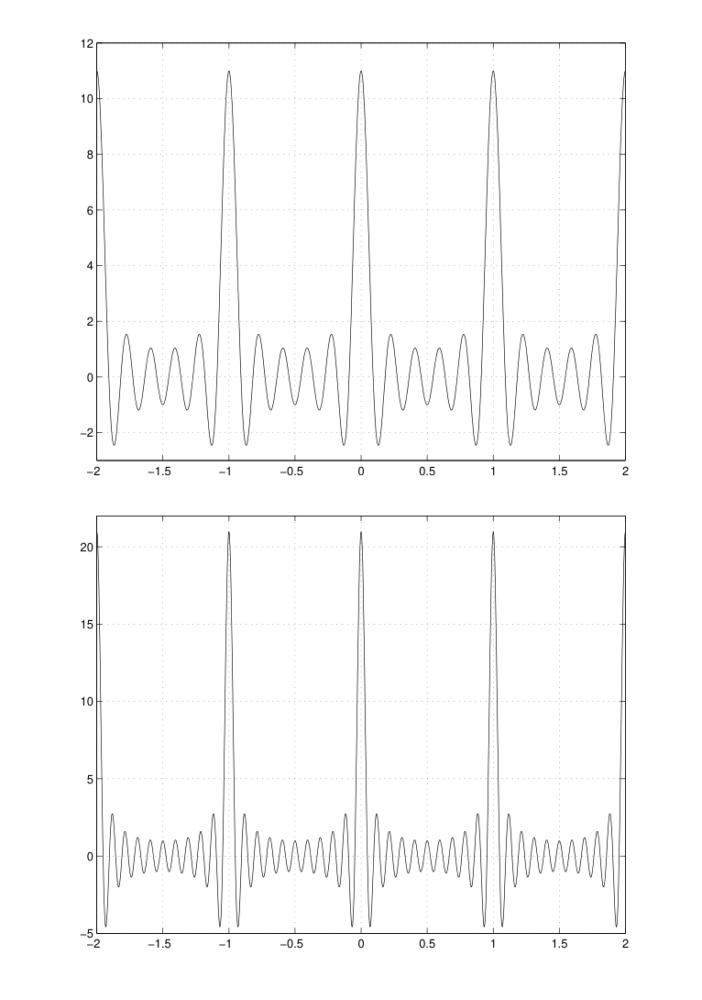

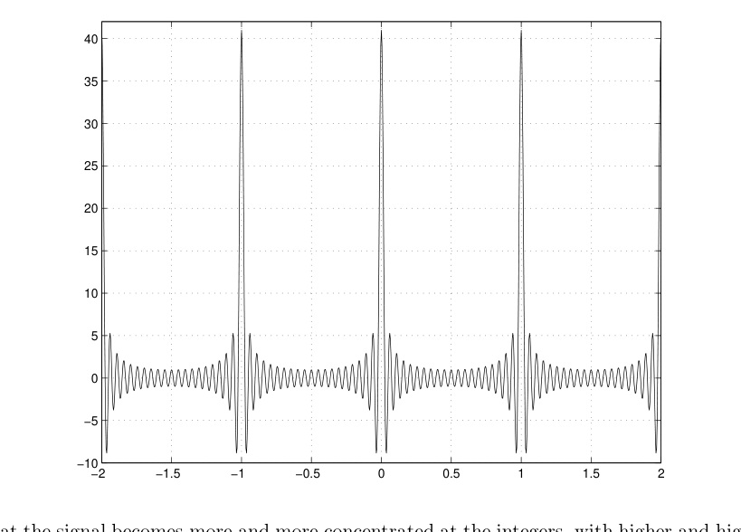

We see that the signal becomes more and more concentrated at the integers, with higher and higher peaks.

In fact, as we’ll show later, the sequence of signals $D_{N}(t)$ tends to a sum of $δ$’s at the integers as $N → ∞:$

$$
D_{N}(t) →
$$

In what sense the convergence takes place will also have to wait till later. This all goes to show you that $L^{2}$ is not the last word in the development and application of Fourier series (even if I made it seem that way).

The sum of regularly spaced $δ$’s is sometimes called an impulse train, and we’ll have other descriptive names for it. It is a fundamental object in sampling, the first step in turning an analog signal into a digital signal. The finite sum, $D_{N}(t),$ is called the Dirichlet kernel by mathematicians and it too has a number of applications, one of which we’ll see in the notes on convergence of Fourier series.

In digital signal processing, particularly computer music, it’s the discrete form of the impulse train — the discrete time buzz — that’s used. Rather than create a sound by adding (sampled) sinusoids one works in the frequency domain and synthesizes the sound from its spectrum. Start with the discrete impulse train, which has all frequencies in equal measure. This is easy to generate. Then shape the spectrum by increasing or decreasing the energies of the various harmonics, perhaps decreasing some to zero. The sound is synthesized from this shaped spectrum, and other operations are also possible. See, for example, A Digital Signal Processing Primer by Ken Steiglitz.

One final look back at heat. Green’s function for the heat equation had the form

$$
g(x,t) =
$$

$$
\sum_{n=−∞}^{∞} δ(t − n).
$$

$$
\sum_{n=−∞}^{∞} e^{−2 π 2 n 2 t}e^{2 π i n x} .
$$

Look what happens as $t →$ 0. This tends to

$$
\sum_{n=−∞}^{∞} e^{2 π i n x} ,
$$

the continuous buzz. Just thought you’d find that provocative.

## 1.14 Notes on Convergence of Fourier Series

My first comment on convergence is — don’t go there. Recall that we get tidy mathematical results on convergence of Fourier series if we consider $L^{2}-$convergence, or “convergence in mean square”. Unpacking the definitions, that’s convergence of the integral of the square of the difference between a function and its finite Fourier series approximation:

$$
\int_{N→∞0}^{1}
$$

$$
\sum_{n=−N}^{N} fˆ(n)e^{2 π i n t}^{2}
$$

lim $f(t) −$

$$
dt = 0.
$$

While this is quite satisfactory in many ways, you might want to know, for computing values of a function, that if you plug a value of $t$ into some finite approximation

$$
\sum_{n=−N}^{N} fˆ(n)e^{2 π i n t}
$$

you’ll be close to the value of the function $f(t)$. And maybe you’d like to know how big you have to take $N$ to get a certain desired accuracy.

All reasonable wishes, but starting to ask about convergence of Fourier series, beyond the $L^{2}-$convergence, is starting down a road leading to endless complications, details, and, in the end, probably madness.

Actually — and calmly — for the kinds of functions that come up in applications the answers are helpful and not really so difficult to establish. It’s when one inquires into convergence of Fourier series for the most general functions that the trouble really starts. With that firm warning understood, there are a few basic things you ought to know about, if only to know that this can be dangerous stuff.

In the first part of these notes my intention is to summarize the main facts together with some examples and simple arguments. I’ll give careful statements, but we won’t enjoy the complete proofs that support them, though in the appendices I’ll fill in more of the picture. There we’ll sketch the argument for the result at the heart of the $L^{2}-$theory of Fourier series, that the complex exponentials form a basis for $L^{2}([$0$,$ 1]).

For more and more and much more see Dym and McKean’s Fourier Series and Integrals.

## 1.14.1 How big are the Fourier coefficients?

Suppose that $f(t)$ is square integrable, and let

$$
f(t) = \sum_{n=−∞}^{∞} fˆ(n)e^{2 π i n t}
$$

be its Fourier series. Rayleigh’s identity says

$$
\sum_{n=−∞}^{∞} | fˆ(n)|^{2} = \int_{0}^{1} |f(t)|^{2}dt < ∞.
$$

In particular the series

$$
\sum_{n=−∞}^{∞} | fˆ(n)|^{2}
$$

converges, and it follows that

$| f$ˆ($n)|^{2} →$ 0 as $n → ±∞.$ This is a general result on convergent series from good old calculus days — if the series converges the general term must tend to zero.24 Knowing that the coefficients tend to zero, can we say how fast?

Here’s a simple minded approach that gives some sense of the answer, and shows how the answer depends on discontinuities in the function or its derivatives. All of this discussion is based on integration by parts with definite integrals.25 Suppose, as always, that $f(t)$ is periodic of period 1. By the periodicity condition we have $f($0) = $f($1). Let’s assume for this discussion that the function doesn’t jump at the endpoints 0 and 1 (like the saw tooth function, below) and that any “problem points” are inside the interval. (This really isn’t a restriction. I just want to deal with a single discontinuity for the argument to follow.) That is, we’re imagining that there may be trouble at a point $t_{0}$ with 0 $< t_{0} <$ 1; maybe $f(t)$ jumps there, or maybe $f(t)$ is continuous at $t_{0}$ but there’s a corner, so $f^{′}(t)$ jumps at $t_{0},$ and so on.

The $n-$th Fourier coefficient is given by

$$
fˆ(n) = \int_{0}^{1} e^{−2 π i n t}f(t)dt.
$$

To analyze the situation near $t_{0}$ write this as the sum of two integrals:

$$
fˆ(n) = \int_{0}^{t 0} e^{−2 π i n t}f(t)dt + \int_{t 0}^{1} e^{−2 π i n t}f(t)dt.
$$

Apply integration by parts to each of these integrals. In doing so, we’re going to suppose that at least away from $t_{0}$ the function has as many derivatives as we want. Then, on a first pass,

$$
[\frac{e^{−2 π i n t}f(t)}{−2 π i n}]^{t}0
$$

$$
\int_{0}^{t 0}
$$

$$
− \int_{0}^{t 0}
$$

$$
e^{−2 π i n t}f(t)dt =
$$

$$
\frac{e^{−2 π i n t}f^{′}(t)}{−2 π i n} dt
$$

0

$$
[\frac{e^{−2 π i n t}f(t)}{−2 π i n}]^{1}
$$

$$
\int_{t 0}^{1}
$$

$$
− \int_{t 0}^{1}
$$

$$
e^{−2 π i n t}f(t)dt =
$$

$$
\frac{e^{−2 π i n t}f^{′}(t)}{−2 π i n} dt
$$

$$
t0
$$

Add these together. Using $f($0) = $f($1), this results in

$$
fˆ(n) = [\frac{e^{−2 π i n t}f(t)}{−2 π i n}]^{t+}0 − \int_{0}^{1} \frac{e^{−2 π i n t}f^{′}(t)}{−2 π i n} dt,
$$

$$
t−0
$$

where the notation $t^{−}_{0}$ and $t^{+}_{0}$ means to indicate we’re looking at the values of $f(t)$ as we take left hand and right hand limits at $t_{0}$. If $f(t)$ is continuous at $t_{0}$ then the terms in brackets cancel and we’re left with just the integral as an expression for $f$ˆ($n)$. But if $f(t)$ is not continuous at $t_{0}$ — if it jumps, for example — then we don’t get cancellation, and we expect that the Fourier coefficient will be of order 1$/n$ in magnitude.26 24 In particular, P$∞n=−∞e2πint,$ the buzz example, cannot converge for any value of $t$ since $|e2πint|$ = 1.

25 On the off chance that you’re rusty on this, here’s what the formula looks like, as it’s usually written:

Z $budv$ = [$uv]ba −$Z $bvdu.$

$$
a
$$

$$
a
$$

To apply integration by parts in a given problem is to decide which part of the integrand is $u$ and which part is $dv.$ 26 If we had more jump discontinuities we’d split the integral up going over several subintervals and we’d have several terms of order 1$/n.$ The combined result would still be of order 1$/n.$ This would also be true if the function jumped at the endpoints 0 and 1.

Now suppose that $f(t)$ is continuous at $t_{0},$ and integrate by parts a second time. In the same manner as above, this gives

$$
fˆ(n) = [\frac{e^{−2 π i n t}f^{′}(t)}{(−2 π i n^{2})}]^{t+}0 − \int_{0}^{1} \frac{e^{−2 π i n t}f^{′}(t)}{(−2 π i n^{2})} dt,
$$

$$
t−0
$$

If $f^{′}(t)$ (the derivative) is continuous at $t_{0}$ then the bracketed part disappears. If $f^{′}(t)$ is not continuous at $t_{0},$ for example if there is a corner at $t_{0},$ then the terms do not cancel and we expect the Fourier coefficient to be of size 1$/n^{2}$.

We can continue in this way. The rough rule of thumb may be stated as:

- If $f(t)$ is not continuous then the Fourier coefficients should have some terms like 1$/n$.

- If $f(t)$ is differentiable except for corners ($f(t)$ is continuous but $f^{′}(t)$ is not) then the Fourier

coefficients should have some terms like 1$/n^{2}$.

- If $f^{′′}(t)$ exists but is not continuous then the Fourier coefficients should have some terms like 1$/n^{3}$.

$◦$ A discontinuity in $f^{′′}(t)$ is harder to visualize; typically it’s a discontinuity in the curvature.

For example, imagine a curve consisting of an arc of a circle and a line segment tangent to the circle at their endpoints. Something like 1

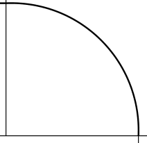

$$
−1
$$

1

0 The curve and its first derivative are continuous at the point of tangency, but the second derivative has a jump. If you rode along this path at constant speed you’d feel a jerk — a discontinuity in the acceleration — when you passed through the point of tangency.

Obviously this result extends to discontinuities in higher order derivatives. It also jibes with some examples we had earlier. The square wave

$$
f(t) = (+1 0 ≤ t <^{1}_{2}
$$

$$
−1 12 ≤ t < 1
$$

has jump discontinuities, and its Fourier series is

$$
\sum_{n o d d}
$$

$$
\sum_{k=0}^{∞}
$$

$\frac{2}{π i n}e^{2 π i n t}$ = 4 $\frac{1}{2 k+1}$ sin 2$π($2$k$ + 1)$t.$

$$
π
$$

The triangle wave

$$
g(t) = (_{1}_{2} + t −^{1}_{2} ≤ t ≤ 0
$$

$$
12 − t 0 ≤ t ≤ + 12
$$

is continuous but the derivative is discontinuous. (In fact the derivative is the square wave.) Its Fourier series is

$$
\sum_{k=0}^{∞}
$$

14 + $\frac{2}{π^{2}(2 k+1)2}$ cos(2$π($2$k$ + 1)$t).$

## 1.14.2 Rates of convergence and smoothness

The size of the Fourier coefficients tells you something about the rate of convergence of the Fourier series.

There is a precise result on the rate of convergence, which we’ll state but not prove:

Theorem Suppose that $f(t)$ is $p-$times continuously differentiable, where $p$ is at least 1. Then the partial sums

$$
S_{N}(t) = \sum_{n=−N}^{N} fˆ(n)e^{2 π i n t}
$$

converge to $f(t)$ pointwise and uniformly on [0$,$ 1] as $N → ∞$. Furthermore max$|f(t) − S_{N}(t)| ≤$ constant$\frac{1}{N^{p−1}2}$ for 0 $≤ t ≤$ 1.

We won’t prove it, but I do want to explain a few things. First, at a meta level, this result has to do with how local properties of the function are reflected in global properties of its Fourier series.27 In the present setting, “local properties” of a function refers to how smooth it is, i.e., how many times it’s continuously differentiable. About the only kind of “global question” one can ask about series is how fast they converge, and that’s what is estimated here. The essential point is that the error in the approximation (and indirectly the rate at which the coefficients decrease) is governed by the smoothness (the degree of differentiability) of the signal. The smoother the function — a “local” statement — the better the approximation, and this is not just in the mean, $L^{2}$ sense, but uniformly over the interval — a “global” statement.

Let me explain the two terms “pointwise” and “uniformly”; the first is what you think you’d like, but the second is better. “Pointwise” convergence means that if you plug in a particular value of $t$ the series converges at that point to the value of the signal at that point. “Uniformly” means that the rate at which the series converges is the same for all points in [0$,$ 1]. There are several ways of rephrasing this.

Analytically, the way of capturing the property of uniformity is by making a statement, as we did above, on the maximum amount the function $f(t)$ can differ from its sequence of approximations $S_{N}(t)$ for any $t$ in the interval. The “constant” in the inequality will depend on $f$ (typically the maximum of some derivative of some order over the interval, which regulates how much the function wiggles) but not on $t$ — that’s uniformity. A geometric picture of uniform convergence may be clearer. A sequence of functions $f_{n}(t)$ converges uniformly to a function $f(t)$ if the graphs of the $f_{n}(t)$ get uniformly close to the graph of $f(t)$. I’ll leave that second “uniformly” in the sentence to you to specify more carefully (it would force you to restate the analytic condition) but the picture should be clear. If the picture isn’t clear, see Appendix 1.16, and think about graphs staying close to graphs if you’re puzzling over our later discussion of Gibbs’ phenomenon.

27 We will also see “local” — “global” interplay at work in properties of the Fourier transform, which is one reason I wanted us to see this result for Fourier series.

Interestingly, in proving the theorem it’s not so hard to show that the partial sums themselves are converging, and how fast. The trickier part is to show that the sums are converging to the value $f(t)$ of the function at every $t$ ! At any rate, the takeaway headline from this is:

If the function is smooth, the Fourier series converges in every sense you could want; $L^{2},$ pointwise, uniformly.

So don’t bother me or anyone else about this, anymore.

## 1.14.3 Convergence if it’s not continuous?

Let’s consider the sawtooth signal from the homework, say

$$
f(t) =
$$

and extended to be periodic of period 1.

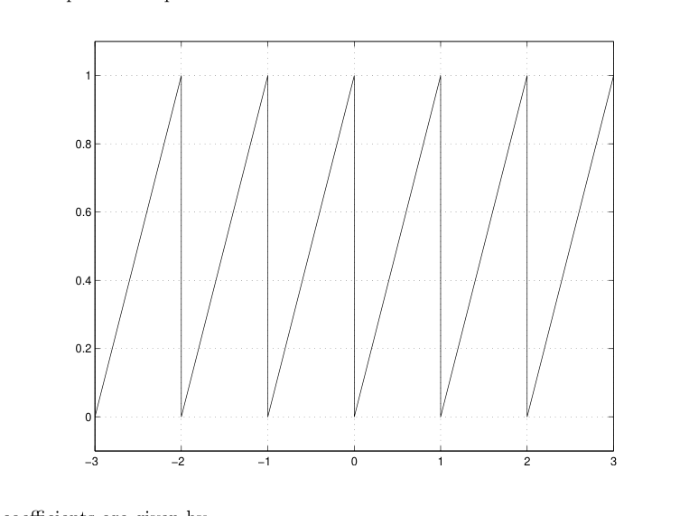

The Fourier coefficients are given by

$$
fˆ(n) =
$$

Integrating by parts gives, when $n\neq$ 0,

$$
fˆ(n) = [\frac{t e^{−2 π i n t}}{−2 π i n}] − \int_{0 0}^{1 1} \frac{1}{−2 π i n}e^{−2 π i n t} dt =
$$

Notice a few things.

- The coefficients are of the order 1$/n,$ just as they’re supposed to be.

- The term with $n$ = 0 is 1$/$2, which we have to get directly, not from the integration by parts step.

$(t$ 0 $≤ t <$ 1

0 otherwise

$$
\int_{0}^{1} te^{−2 π i n t} dt.
$$

$\frac{i}{2 π n} ($use 1$/i$ = $−i;$ the integral is 0.)

(You might also notice the conjugate symmetry in the coefficients, $f$ˆ($−n)$ = $\overline{f ˆ(n).}$ This is often a good check on your calculations.) So the Fourier series is

$$
f(t) = 12 + \sum_{n=−∞}^{∞} \frac{i}{2 π n}e^{2 π i n t} .
$$

which means that

$$
(
$$

$$
) = 0
$$

$$
\sum_{n=−N}^{N}
$$

lim $f(t) − 12$ +

$$
\frac{i}{2 π n}e^{2 π i n t}
$$

$$
N→∞
$$

in the $L^{2}$ norm. But what do we get when we plug in a value of $t$ and compute the sum, even setting aside the obvious problem of adding up an infinite number of terms?

Here are the plots for $N$ = 5, 10, and 50 of partial sums

$$
S_{N}(t) = 12 + \sum_{n=−N}^{N} \frac{i}{2 π n}e^{2 π i n t} .
$$

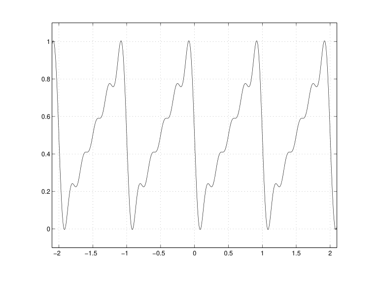

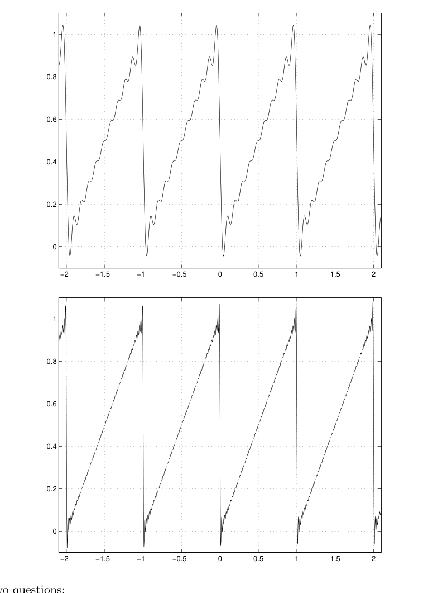

There are tw 1. What does the series converge to, if it converges at all, at a point of discontinuity?

2. What’s that funny behavior at the corners?

Here’s the answer to the first question.

Theorem At a jump discontinuity (such as occurs in the sawtooth) the partial sums

$$
S_{N}(t) = \sum_{n=−N}^{N} fˆ(n)e^{2 π i n t}
$$

converge to the average of the upper and lower values at the discontinuities.

For example, for the sawtooth the partial sums converge to 1$/$2 at the points $t$ = 0, $±$1, $±$2, . . . .

Because of this result some people define a value of a function at a jump discontinuity to be the average of the upper and lower values. That’s reasonable in many contexts — this is one context and we’ll see others — but it becomes a religious issue to some so I’ll pass without further comment.

We can combine this theorem with the previous theorem to state a useful result that’s easy to apply in practice:

Theorem on pointwise convergence Suppose that $f(t)$ is continuous with a continuous derivative except at perhaps a finite number of points (in a period). Then for each $a ∈ [$0$,$ 1], $S_{N}(a) →^{1}_{2}( t→$lim$a−f(t)$ + $t→$lim$a+f(t))$ as $N → ∞$.

If $f(t)$ is continuous at $a$ then the left and right hand limits are equal and we just have $S_{n}(a) → f(a)$. If $f(t)$ has a jump at $a$ then we’re in the situation in the theorem just above and $S_{N}(a)$ converges to the average of the left and right hand limits.

The funny behavior near the corners, where it seems that the approximations are overshooting the signal, is more interesting. We saw this also with the approximations to the square wave. This is the Gibbs phenomenon, named after J. W. Gibbs. It really happens, and it’s time to come to terms with it. It was observed experimentally by Michelson and Stratton (that’s the same Albert Michelson as in the famous “Michelson and Morley” experiment) who designed a mechanical device to draw finite Fourier series. Michelson and Stratton assumed that the extra wiggles they were seeing at jumps was a mechanical problem with the machine. But Gibbs, who used the sawtooth as an example, showed that the phenomenon is real and does not go away even in the limit. The oscillations may become more compressed, but they don’t go away. (However, they do contribute zero in the limit of the $L^{2}$ norm of the difference between the function and its Fourier series.) A standard way to formulate Gibbs’s phenomenon precisely is for a square wave that jumps from $−$1 to +1 at $t$ = 0 when $t$ goes from negative to positive. Away from the single jump discontinuity, $S_{N}(t)$ tends uniformly to the values, +1 or $−$1 as the case may be, as $N → ∞$. Hence the precise statement of Gibbs’s phenomenon will be that the maximum of $S_{N}(t)$ remains greater than 1 as $N → ∞$. And that’s what is proved:

$N$li$→$m$∞$max$S_{N}(t)$ = 1$.$089490$...$ So the overshoot is almost 9% — quite noticeable! See Section 1.18 of these notes for an outline of the derivation.

Now, there’s something here that may bother you. We have the theorem on pointwise convergence that says at a jump discontinuity the partial sums converge to the average of the values at the jump. We also have Gibbs” phenomenon and the picture of an overshooting oscillation that doesn’t go away. How can these two pictures coexist? If you’re confused it’s because you’re thinking that convergence of $S_{N}(t),$ at, say, $t$ = 0 in the sawtooth example, is the same as convergence of the graphs of the $S_{N}(t)$ to the graph of the sawtooth function. But they are not the same thing. It’s the distinction between pointwise and uniform convergence — see Section 1.15.

Finally, you should be aware that discontinuities are not at all uncommon. You might introduce jumps via windows or filters, for example. I mentioned earlier that this can be a problem in computer music,

and images as two-dimensional signals, often have edges.28 Remember, as we said in an earlier lecture, a discontinuity or a corner means that you must have infinitely high frequencies in the spectrum, so cutting off the approximation at a certain point is sure to introduce ripples in the computation of values of the function by means of a finite Fourier series approximation.

## 1.15 Appendix: Pointwise Convergence vs. Uniform Convergence

Here’s an example, a classic of its type, to show that pointwise convergence is not the same as uniform convergence, or what amounts to the same thing, that we can have a sequence of functions $f_{n}(t)$ with the property that $f_{n}(t) → f(t)$ for every value of $t$ as $n → ∞$ but the graphs of the $f_{n}(t)$ do not ultimately look like the graph of $f(t)$. Let me describe such a sequence of functions in words, draw a few pictures, and leave it to you to write down a formula.

The $f_{n}(t)$ will all be defined on 0 $≤ t ≤$ 1. For each $n$ the graph of the function $f_{n}(t)$ is zero from 1$/n$ to 1 and for 0 $≤ t ≤$ 1$/n$ it’s an isosceles triangle with height $n^{2}$. Here are pictures of $f_{1}(t), f_{5}(t)$ and $f_{1 0}(t)$.

$$
f_{1}(t)
$$

1

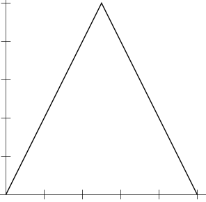

$$
0.8
$$

$$
0.6
$$

$$
0.4
$$

$$
0.2
$$

$$
0 0.2 0.4 0.6 0.8 1
$$

$$
f_{5}(t)
$$

25

20

15

10

5

$$
0 0.2 0.4 0.6 0.8 1
$$

28 In fact, it’s an important problem to detect edges in images.

$$
f_{1 0}(t)
$$

100

80

60

40

20

$$
0 0.2 0.4 0.6 0.8 1
$$

The peak slides to the left and gets higher and higher as $n$ increases. It’s clear that for each $t$ the sequence $f_{n}(t)$ tends to 0. This is so because $f_{n}($0) = 0 for all $n,$ and for any $t̸$ = 0 eventually, that is, for large enough $n,$ the peak is going to slide to the left of $t$ and $f_{n}(t)$ will be zero from that $n$ on out. Thus $f_{n}(t)$ converges pointwise to the constant 0. But the graphs of the $f_{n}(t)$ certainly are not uniformly close to 0!

## 1.16 Appendix: Studying Partial Sums via the Dirichlet Kernel: The

Buzz Is Back There are some interesting mathematical tools used to study the partial sums of Fourier series and their convergence properties, as in the theorem we stated earlier on the rate of convergence of the partial sums for $p$ times continuously differentiable functions. In fact, we’ve already seen the main tool — it’s the Dirichlet kernel

$$
D_{N}(t) = \sum_{n=−N}^{N} e^{2 π i n t}
$$

that we introduced in Section 1.13.2 in the context of the “buzz signal”. Here’s how it’s used.

We can write a partial sum in what turns out to be a helpful way by bringing back in the definition of the Fourier coefficients as an integral.

$$
S_{N}(t) = \sum_{n=−N}^{N} fˆ(n)e^{2 π i n t}
$$

$$
= \sum_{n=−N}^{N} (\int_{0}^{1} f(s)e^{−2 π i n s} ds)e^{2 π i n t}
$$

(calling the variable of integration $s$ since we’re already using $t)$

$$
= \sum_{n=−N}^{N} (\int_{0}^{1} e^{2 π i n t}f(s)e^{−2 π i n s} ds)
$$

$$
= \int_{0}^{1} ( \sum_{n=−N}^{N} e^{2 π i n t}e^{−2 π i n s}f(s))ds
$$

$$
(
$$

$$
)
$$

$$
\int_{0}^{1}
$$

$$
\int_{0}^{1}
$$

$$
\sum_{n=−N}^{N}
$$

$$
D_{N}(t − s)f(s)ds.
$$

=

$$
e^{2 π i n(t−s)} f(s)ds =
$$

Just as we saw in the solution of the heat equation, we have produced a convolution! The integral

$$
\int_{0}^{1} D_{N}(t − s)f(s)ds
$$

is the convolution of $f(t)$ with the function $D_{N}(t)$ and it produces the partial sum $S_{N}(t)$.29 Why is this helpful? By means of the convolution integral, estimates for $S_{N}(t)$ involve both properties of $f$ (on which we make certain assumptions) together with properties of $D_{N}(t),$ for which we can find an explicit expression. Here’s how it goes, just to see if anyone’s reading these notes. The idea is to view $D_{N}(t)$ as a geometric series. We can simplify the algebra by factoring out the term corresponding to $−N,$ thereby writing the sum as going from 0 to 2$N:$

$$
\sum_{n=−N}^{N} e^{2 π i n p} = e^{−2 π i N p} \sum_{n=0}^{2 N}e^{2 π i n p}
$$

$$
= e^{−2 π i N p} \frac{e^{2 π i(2 N+1)p}−1}{e^{2 π i p}−1}
$$

(using the formula for the sum of a geometric series $\sumr^{n}$ with $r$ = $e^{2 π i p})$ It’s most common to write this in terms of the sine function. Recall that sin$θ$ = $\frac{e^{i θ}−e^{−i θ}}{2 i} .$ To bring the sine into the expression, above, there’s a further little factoring trick that’s used often:

$$
e^{2 π i(2 N+1)p} − 1 = e^{π i(2 N+1)p}(e^{π i(2 N+1)p} − e^{−π i(2 N+1)p})
$$

= 2$ie^{π i(2 N+1)p}$ sin($π($2$N$ + 1)$p)$

$$
e^{2 π i p} − 1 = e^{π i p}(e^{π i p} − e^{−π i p})
$$

= 2$ie^{π i p}$ sin($πp)$

Therefore

$$
e^{−2 π i N p} \frac{e^{2 π i(2 N+1)p}−1}{e^{2 π i p}−1} = e^{−2 π i N p} \frac{e^{π i(2 N+1)p}}{e^{π i p}} \frac{2 i s i n(π(2 N+1)p)}{2 i s i n(π p)} = \frac{s i n(π(2 N+1)p)}{s i n(π p)} .
$$

Nice.

Recall from Section 1.13.2 that as $N$ gets larger $D_{N}(t)$ becomes more and more sharply peaked at the integers, and $D_{N}($0) $→ ∞$ as $N → ∞$. Forming the convolution, as in

$$
S_{N}(t) = \int_{0}^{1} D_{N}(t − s)f(s)ds,
$$

above, shifts the peak at 0 to $t,$ and integrates. The integrand is concentrated around $t$ (as it turns out the peaks at the other integers don’t contribute) and in the limit as $N → ∞$ the integral tends to $f(t)$.30 Carrying this out in detail — which we are not going to do — depends on the explicit formula for $D_{N}(t)$.

The more one assumes about the signal $f(t)$ the more the argument can produce. This is how one gets the theorem on order of differentiability and rate of convergence of partial sums of Fourier series.

29 It’s no accident that convolution comes in and we’ll understand this thoroughly when we develop some properties of the Fourier transform. The moral of the story will then be that while math majors take the appearance of $DN(t)$ to be a mystical revelation, to any EE it’s just meeting an old friend on the corner. You’ll see.

30 Those of you who have worked with $δ$ functions may think you recognize this sort of thing:

$$
Z δ(t−s)f(s)ds = f(t)
$$

and you’d be right. We’ll do plenty of this.

## 1.17 Appendix: The Complex Exponentials Are a Basis for L^{2}([0, 1])

Remember the second point in our hit parade of the $L^{2}-$theory of Fourier series:

The complex exponentials $e^{2 π i n t}, n$ = 0$,±$1$,±$2$,...$ form a basis for $L^{2}([$0$,$ 1]), and the partial sums converge to $f(t)$ as $N → ∞$ in the $L^{2}-$distance. This means that

$$
\sum_{n=−N}^{N} fˆ(n)e^{2 π i n t} − f(t)
$$

lim

$$
= 0.
$$

$$
N→∞
$$

I said earlier that we wouldn’t attempt a complete proof of this, and we won’t. But with the discussion just preceding we can say more precisely how the proof goes, and what the issues are that we cannot get into. The argument is in three steps.

Let $f(t)$ be a square integrable function and let $ϵ >$ 0.

Step 1 Any function in $L^{2}([$0$,$ 1]) can be approximated in the $L^{2}-$norm by a continuously differentiable function.31 That is, starting with a given $f$ in $L^{2}([$0$,$ 1]) and any $ϵ >$ 0 we can find a function $g(t)$ that is continuously differentiable on [0$,$ 1] for which

$$
∥f − g∥ < ϵ.
$$

This is the step we cannot do! It’s here, in proving this statement, that one needs the more general theory of integration and the limiting processes that go with it. Let it rest.

Step 2 From the discussion above, we now know (at least we’ve now been told, with some indication of why) that the Fourier partial sums for a continuously differentiable function ($p$ = 1 in the statement of the theorem) converge uniformly to the function. Thus, with $g(t)$ as in Step 1, we can choose $N$ so large that

$$
\sum_{n=−N}^{N}
$$

max $g(t)−$

$$
gˆ(n)e^{2 π i n t} < ϵ.
$$

Then for the $L^{2}-$norm,

$$
(
$$

$$
)^{2}
$$

$$
\int_{0}^{1}
$$

$$
\int_{0}^{1}
$$

$$
\int_{0}^{1}
$$

2

$$
\sum_{n=−N}^{N}
$$

$$
\sum_{n=−N}^{N}
$$

$$
dt ≤
$$

$$
g(t)−
$$

$$
g(t)−
$$

$$
gˆ(n)e^{2 π i n t}
$$

max

$$
gˆ(n)e^{2 π i n t} dt < ϵ^{2} dt = ϵ^{2} .
$$

Hence

$$
g(t)− \sum_{n=−N}^{N} gˆ(n)e^{2 π i n t} < ϵ.
$$

Step 3 Remember that the Fourier coefficients provide the best finite approximation in $L^{2}$ to the function, that is, as we’ll need it, $f(t) − \sum_{n=−N}^{N} f$ˆ($n)e^{2 π i n t} ≤ f(t) − \sum_{n=−N}^{N} g$ˆ($n)e^{2 π i n t} .$ 31 Actually, it’s true that any function in $L2([0,1])$ can be approximated by an infinitely differentiable function.

And at last $f(t) − \sum_{n=−N}^{N} f$ˆ($n)e^{2 π i n t} ≤ f(t) − \sum_{n=−N}^{N} g$ˆ($n)e^{2 π i n t}$

$$
= f(t) − g(t) + g(t)− \sum_{n=−N}^{N} gˆ(n)e^{2 π i n t}
$$

$$
≤ f(t) − g(t) + g(t)− \sum_{n=−N}^{N} gˆ(n)e^{2 π i n t} < 2ϵ.
$$

This shows that

$$
f(t) − \sum_{n=−N}^{N} fˆ(n)e^{2 π i n t})
$$

can be made arbitrarily small by taking $N$ large enough, which is what we were required to do.

## 1.18 Appendix: More on the Gibbs Phenomenon

Here’s what’s involved in establishing the Gibbs’ phenomenon for the square wave

$$
f(t) = (−1 −^{1}_{2} ≤ t < 0
$$

$$
+1 0 ≤ t ≤ + 12
$$

We’re supposed to show that

$N$l$→$im$∞$max$S_{N}(t)$ = 1$.$089490$...$ Since we’ve already introduced the Dirichlet kernel, let’s see how it can be used here. I’ll be content with showing the approach and the outcome, and won’t give the somewhat tedious detailed estimates. As in Appendix 2, the partial sum $S_{N}(t)$ can be written as a convolution with $D_{N}$. In the case of the square wave, as we’ve set it up here,

$$
S_{N}(t) = \int_{−1/2}^{1/2} D_{N}(t − s)f(s)ds
$$

$$
= −\int_{−1/2}^{0} D_{N}(t − s)ds + \int_{0}^{1/2} D_{N}(t − s)ds
$$

$$
= −\int_{−1/2}^{0} D_{N}(s − t)ds + \int_{0}^{1/2} D_{N}(s − t)ds
$$

(using that $D_{N}$ is even.) The idea next is to try to isolate, and estimate, the behavior near the origin by getting an integral from $−t$ to $t$. We can do this by first making a change of variable $u$ = $s − t$ in both integrals. This results in

$$
−\int_{−1/2}^{0} D_{N}(s − t)ds + \int_{0}^{1/2} D_{N}(s − t)ds = −\int_{−1 2−t}^{−t} D_{N}(u)du + \int_{−t}^{1−t} 2 D_{N}(u)du.
$$

To this last expression add and subtract

$$
\int_{−t}^{t} D_{N}(u)du
$$

and combine integrals to further obtain

$$
−\int_{−1 2−t}^{−t} D_{N}(u)du + \int_{−t}^{1−t} 2 D_{N}(u)du = −\int_{−1 2−t}^{t} D_{N}(u)du + \int_{−t}^{1−t} 2 D_{N}(u)du + \int_{−t}^{t} D_{N}(u)du
$$

Finally, make a change of variable $w$ = $−u$ in the first integral and use the evenness of $D_{N}$. Then the first two integrals combine and we are left with, again letting $s$ be the variable of integration in both integrals,

$$
S_{N}(t) = \int_{−t}^{t} D_{N}(s)ds− \int_{2 1−t}^{1+t} 2 D_{N}(s)ds.
$$

The reason that this is helpful is that using the explicit formula for $D_{N}$ one can show (this takes some work — integration by parts) that

$$
\int_{−t}^{t}
$$

$$
\int_{1 2−t}^{1+t} 2
$$

$$
≤
$$

$$
S_{N}(t) − D_{N}(s)ds =
$$

$$
D_{N}(s)ds \frac{c o n s t a n t}{n} ,
$$

and hence

$$
\int_{−t}^{t}
$$

lim $S_{N}(t) − D_{N}(s)ds$ = 0$.$

$$
N→∞
$$

$$
\int_{−t}^{t}
$$

This means that if we can establish a max for $D_{N}(s)ds$ we’ll also get one for $S_{N}(t)$. That, too, takes some work, but the fact that one has an explicit formula for $D_{N}$ makes it possible to deduce for $|t|$ small and $N$ large that $\int_{−t}^{t} D_{N}(t)dt,$ and hence $S_{N}(t)$ is well approximated by

$$
2 \int_{0}^{(2 N+1)π t}
$$

$$
\frac{s i n s}{s} ds.
$$

$$
π
$$

This integral has a maximum at the first place where sin((2$N$ + 1)$πt)$ = 0, i.e., at $t$ = 1$/($2$N$ + 1). At this point the value of the integral (found via numerical approximations) is

$$
π2 \int_{0}^{π} \frac{s i n s}{s} ds = 1.09940... ,
$$

and that’s where the 9% overshoot figure comes from.

Had enough?
