# Chapter 2: Fourier Transform

## 2.1 A First Look at the Fourier Transform

We’re about to make the transition from Fourier series to the Fourier transform. “Transition” is the appropriate word, for in the approach we’ll take the Fourier transform emerges as we pass from periodic to nonperiodic functions. To make the trip we’ll view a nonperiodic function (which can be just about anything) as a limiting case of a periodic function as the period becomes longer and longer. Actually, this process doesn’t immediately produce the desired result. It takes a little extra tinkering to coax the Fourier transform out of the Fourier series, but it’s an interesting approach.[^2-1]

[^2-1]: As an aside, I don’t know if this is the best way of motivating the definition of the Fourier transform, but I don’t know a better way and most sources you’re likely to check will just present the formula as a done deal. It’s true that, in the end, it’s the formula and what we can do with it that we want to get to, so if you don’t find the (brief) discussion to follow to your tastes, I am not offended.

---

Let’s take a specific, simple, and important example. Consider the “rect” function (“rect” for “rectangle”) defined by

$$
\Pi(t) = \begin{cases} 1 & |t| < 1/2 \\ 0 & |t| \ge 1/2 \end{cases}
$$

Here’s the graph, which is not very complicated.

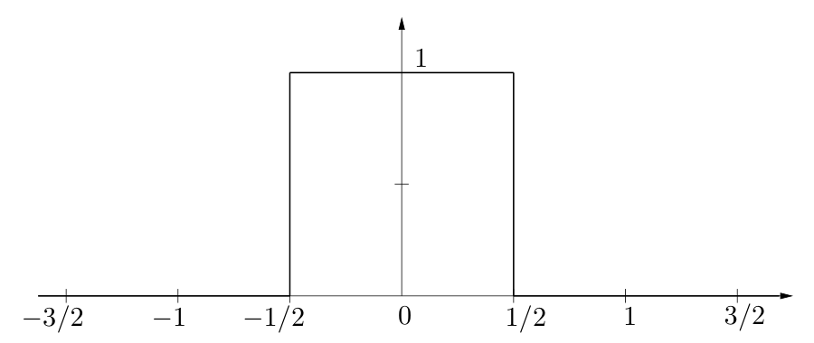

$\Pi(t)$ is even — centered at the origin — and has width 1. Later we’ll consider shifted and scaled versions. You can think of $\Pi(t)$ as modeling a switch that is on for one second and off for the rest of the time. $\Pi$ is also called, variously, the *top hat* function (because of its graph), the *indicator* function, or the *characteristic* function for the interval $(-1/2, 1/2)$.

While we have defined $\Pi(\pm 1/2) = 0$, other common conventions are either to have $\Pi(\pm 1/2) = 1$ or $\Pi(\pm 1/2) = 1/2$. And some people don’t define $\Pi$ at $\pm 1/2$ at all, leaving two holes in the domain. I don’t want to get dragged into this dispute. It almost never matters, though for some purposes the choice $\Pi(\pm 1/2) = 1/2$ makes the most sense. We’ll deal with this on an exceptional basis if and when it comes up.

---

$\Pi(t)$ is not periodic. It doesn’t have a Fourier series. In problems you experimented a little with periodizations, and I want to do that with $\Pi$ but for a specific purpose. As a periodic version of $\Pi(t)$ we repeat the nonzero part of the function at regular intervals, separated by (long) intervals where the function is zero. We can think of such a function arising when we flip a switch on for a second at a time, and do so repeatedly, and we keep it off for a long time in between the times it’s on. (One often hears the term *duty cycle* associated with this sort of thing.) Here’s a plot of $\Pi(t)$ periodized to have period 15.

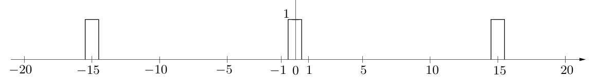

Here are some plots of the Fourier coefficients of periodized rectangle functions with periods 2, 4, and 16, respectively. Because the function is real and even, in each case the Fourier coefficients are real, so these are plots of the actual coefficients, not their square magnitudes.

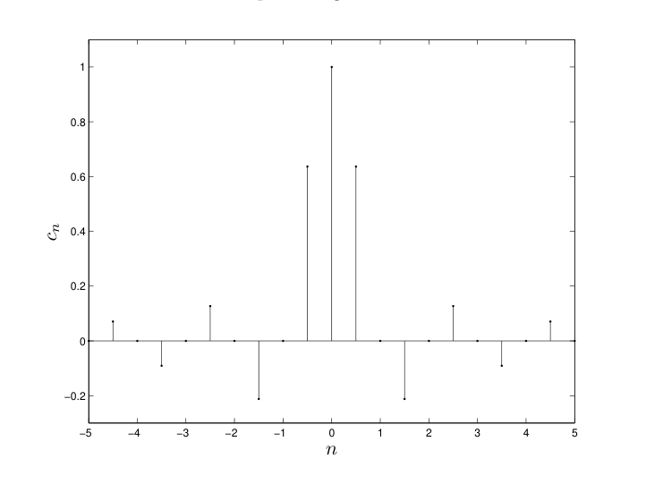

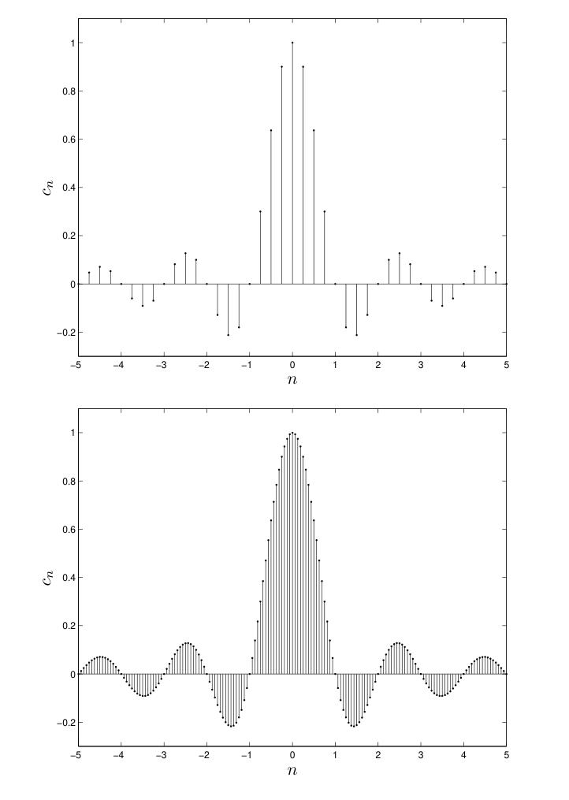

We see that as the period increases the frequencies are getting closer and closer together and it looks as though the coefficients are tracking some definite curve. (But we’ll see that there’s an important issue here of vertical scaling.) We can analyze what’s going on in this particular example, and combine that with some general statements to lead us on.

Recall that for a general function $f(t)$ of period $T$ the Fourier series has the form

$$
f(t) = \sum_{n=-\infty}^{\infty} c_n e^{2\pi i n t/T}
$$

so that the frequencies are $0, \pm 1/T, \pm 2/T, \dots$. Points in the spectrum are spaced $1/T$ apart and, indeed, in the pictures above the spectrum is getting more tightly packed as the period $T$ increases. The $n$-th Fourier coefficient is given by

$$
c_n = \frac{1}{T}\int_0^T e^{-2\pi i n t/T} f(t)\,dt = \frac{1}{T}\int_{-T/2}^{T/2} e^{-2\pi i n t/T} f(t)\,dt\,.
$$

We can calculate this Fourier coefficient for $\Pi(t)$:

$$
\begin{aligned}
c_n &= \frac{1}{T}\int_{-T/2}^{T/2} e^{-2\pi i n t/T}\,\Pi(t)\,dt = \frac{1}{T}\int_{-1/2}^{1/2} e^{-2\pi i n t/T}\cdot 1\,dt \\
&= \frac{1}{T}\left[\frac{1}{-2\pi i n/T}\, e^{-2\pi i n t/T}\right]_{t=-1/2}^{t=1/2} = \frac{1}{2\pi i n}\left(e^{\pi i n/T} - e^{-\pi i n/T}\right) = \frac{1}{\pi n}\sin\left(\frac{\pi n}{T}\right).
\end{aligned}
$$

Now, although the spectrum is *indexed* by $n$ (it’s a discrete set of points), the points in the spectrum are $n/T$ $(n = 0, \pm 1, \pm 2, \dots)$, and it’s more helpful to think of the “spectral information” (the value of $c_n$) as a transform of $\Pi$ *evaluated* at the points $n/T$. Write this, provisionally, as

$$
(\text{Transform of periodized } \Pi)\left(\frac{n}{T}\right) = \frac{1}{\pi n}\sin\left(\frac{\pi n}{T}\right).
$$

We’re almost there, but not quite. If you’re dying to just take a limit as $T \to \infty$ consider that, for each $n$, if $T$ is very large then $n/T$ is very small and

$$
\frac{1}{\pi n}\sin\left(\frac{\pi n}{T}\right) \quad \text{is about size } \frac{1}{T} \quad (\text{remember } \sin\theta \approx \theta \text{ if } \theta \text{ is small})\,.
$$

In other words, for each $n$ this so-called transform,

$$
\frac{1}{\pi n}\sin\left(\frac{\pi n}{T}\right),
$$

tends to 0 like $1/T$. To compensate for this we scale up by $T$, that is, we consider instead

$$
(\text{Scaled transform of periodized } \Pi)\left(\frac{n}{T}\right) = T\,\frac{1}{\pi n}\sin\left(\frac{\pi n}{T}\right) = \frac{\sin(\pi n/T)}{\pi n/T}\,.
$$

In fact, the plots of the *scaled* transforms are what I showed you, above.

Next, if $T$ is large then we can think of replacing the closely packed discrete points $n/T$ by a continuous variable, say $s$, so that with $s = n/T$ we would then write, approximately,

$$
(\text{Scaled transform of periodized } \Pi)(s) = \frac{\sin \pi s}{\pi s}\,.
$$

What does this procedure look like in terms of the integral formula? Simply

$$
\begin{aligned}
(\text{Scaled transform of periodized } \Pi)\left(\frac{n}{T}\right) &= T\cdot c_n \\
&= T\cdot\frac{1}{T}\int_{-T/2}^{T/2} e^{-2\pi i n t/T} f(t)\,dt = \int_{-T/2}^{T/2} e^{-2\pi i n t/T} f(t)\,dt\,.
\end{aligned}
$$

If we now think of $T \to \infty$ as having the effect of replacing the discrete variable $n/T$ by the continuous variable $s$, as well as pushing the limits of integration to $\pm\infty$, then we may write for the (limiting) transform of $\Pi$ the integral expression

$$
\widehat{\Pi}(s) = \int_{-\infty}^{\infty} e^{-2\pi i s t}\,\Pi(t)\,dt\,.
$$

Behold, the Fourier transform is born!

Let’s calculate the integral. (We know what the answer is, because we saw the discrete form of it earlier.)

$$
\widehat{\Pi}(s) = \int_{-\infty}^{\infty} e^{-2\pi i s t}\,\Pi(t)\,dt = \int_{-1/2}^{1/2} e^{-2\pi i s t}\cdot 1\,dt = \frac{\sin \pi s}{\pi s}\,.
$$

Here’s a graph. You can now certainly see the continuous curve that the plots of the discrete, scaled Fourier coefficients are shadowing.

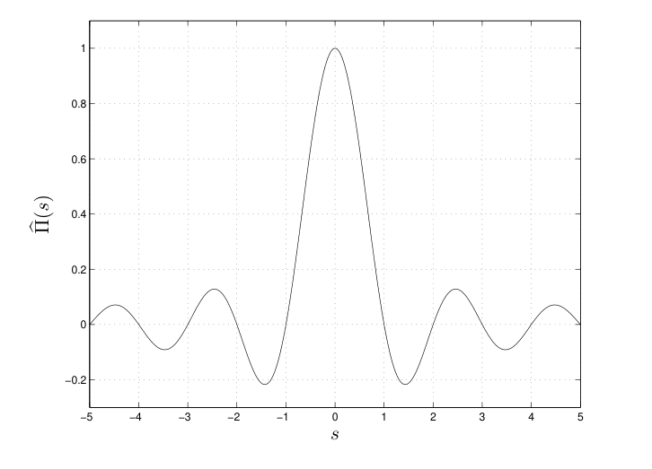

The function $\sin \pi x/\pi x$ (written now with a generic variable $x$) comes up so often in this subject that it’s given a name, sinc:

$$
\operatorname{sinc} x = \frac{\sin \pi x}{\pi x}
$$

pronounced “sink”. Note that

$$
\operatorname{sinc} 0 = 1
$$

by virtue of the famous limit

$$
\lim_{x\to 0} \frac{\sin x}{x} = 1\,.
$$

It’s fair to say that many EE’s see the sinc function in their dreams.

**How general is this?** We would be led to the same idea — scale the Fourier coefficients by $T$ — if we had started off periodizing just about any function with the intention of letting $T \to \infty$. Suppose $f(t)$ is zero outside of $|t| \le 1/2$. (Any interval will do, we just want to suppose a function is zero outside some interval so we can periodize.) We periodize $f(t)$ to have period $T$ and compute the Fourier coefficients:

$$
c_n = \frac{1}{T}\int_{-T/2}^{T/2} e^{-2\pi i n t/T} f(t)\,dt = \frac{1}{T}\int_{-1/2}^{1/2} e^{-2\pi i n t/T} f(t)\,dt\,.
$$

How big is this? We can estimate

$$
\begin{aligned}
|c_n| &= \frac{1}{T}\left|\int_{-1/2}^{1/2} e^{-2\pi i n t/T} f(t)\,dt\right| \\
&\le \frac{1}{T}\int_{-1/2}^{1/2} |e^{-2\pi i n t/T}|\,|f(t)|\,dt = \frac{1}{T}\int_{-1/2}^{1/2} |f(t)|\,dt = \frac{A}{T}\,,
\end{aligned}
$$

where

$$
A = \int_{-1/2}^{1/2} |f(t)|\,dt\,,
$$

which is some *fixed number independent* of $n$ and $T$. Again we see that $c_n$ tends to 0 like $1/T$, and so again we scale back up by $T$ and consider

$$
(\text{Scaled transform of periodized } f)\left(\frac{n}{T}\right) = Tc_n = \int_{-T/2}^{T/2} e^{-2\pi i n t/T} f(t)\,dt\,.
$$

In the limit as $T \to \infty$ we replace $n/T$ by $s$ and consider

$$
\hat{f}(s) = \int_{-\infty}^{\infty} e^{-2\pi i s t} f(t)\,dt\,.
$$

We’re back to the same integral formula.

**Fourier transform defined** There you have it. We now *define* the *Fourier transform* of a function $f(t)$ to be

$$
\hat{f}(s) = \int_{-\infty}^{\infty} e^{-2\pi i s t} f(t)\,dt\,.
$$

For now, just take this as a formal definition; we’ll discuss later when such an integral exists. We assume that $f(t)$ is defined for all real numbers $t$. For any $s \in \mathbf{R}$, integrating $f(t)$ against $e^{-2\pi i s t}$ with respect to $t$ produces a *complex valued* function of $s$, that is, the Fourier transform $\hat{f}(s)$ is a complex-valued function of $s \in \mathbf{R}$. If $t$ has dimension time then to make $st$ dimensionless in the exponential $e^{-2\pi i s t}$ $s$ must have dimension $1/\text{time}$.

While the Fourier transform takes flight from the desire to find spectral information on a nonperiodic function, the extra complications and extra richness of what results will soon make it seem like we’re in a much different world. The definition just given is a good one *because* of the richness and *despite* the complications. Periodic functions are great, but there’s more bang than buzz in the world to analyze.

The spectrum of a periodic function is a discrete set of frequencies, possibly an infinite set (when there’s a corner) but always a discrete set. By contrast, the Fourier transform of a nonperiodic signal produces a continuous spectrum, or a continuum of frequencies.

It may be that $\hat{f}(s)$ is identically zero for $|s|$ sufficiently large — an important class of signals called *bandlimited* — or it may be that the nonzero values of $\hat{f}(s)$ extend to $\pm\infty$, or it may be that $\hat{f}(s)$ is zero for just a few values of $s$.

The Fourier transform analyzes a signal into its frequency components. We haven’t yet considered how the corresponding synthesis goes. How can we recover $f(t)$ in the time domain from $\hat{f}(s)$ in the frequency domain?

**Recovering $f(t)$ from $\hat{f}(s)$** We can push the ideas on nonperiodic functions as limits of periodic functions a little further and discover how we might obtain $f(t)$ from its transform $\hat{f}(s)$. Again suppose $f(t)$ is zero outside some interval and periodize it to have (large) period $T$. We expand $f(t)$ in a Fourier series,

$$
f(t) = \sum_{n=-\infty}^{\infty} c_n e^{2\pi i n t/T}\,.
$$

The Fourier *coefficients* can be written via the Fourier *transform* of $f$ evaluated at the points $s_n = n/T$.

$$
\begin{aligned}
c_n &= \frac{1}{T}\int_{-T/2}^{T/2} e^{-2\pi i n t/T} f(t)\,dt = \frac{1}{T}\int_{-\infty}^{\infty} e^{-2\pi i n t/T} f(t)\,dt \\
&\qquad \text{(we can extend the limits to } \pm\infty \text{ since } f(t) \text{ is zero outside of } [-T/2, T/2]) \\
&= \frac{1}{T}\hat{f}\left(\frac{n}{T}\right) = \frac{1}{T}\hat{f}(s_n)\,.
\end{aligned}
$$

Plug this into the expression for $f(t)$:

$$
f(t) = \sum_{n=-\infty}^{\infty} \frac{1}{T}\hat{f}(s_n) e^{2\pi i s_n t}\,.
$$

Now, the points $s_n = n/T$ are spaced $1/T$ apart, so we can think of $1/T$ as, say $\Delta s$, and the sum above as a Riemann sum approximating an integral

$$
\sum_{n=-\infty}^{\infty} \frac{1}{T}\hat{f}(s_n) e^{2\pi i s_n t} = \sum_{n=-\infty}^{\infty} \hat{f}(s_n) e^{2\pi i s_n t}\,\Delta s \approx \int_{-\infty}^{\infty} \hat{f}(s) e^{2\pi i s t}\,ds\,.
$$

The limits on the integral go from $-\infty$ to $\infty$ because the sum, and the points $s_n$, go from $-\infty$ to $\infty$. Thus as the period $T \to \infty$ we would expect to have

$$
f(t) = \int_{-\infty}^{\infty} \hat{f}(s) e^{2\pi i s t}\,ds
$$

and we have recovered $f(t)$ from $\hat{f}(s)$. We have found the *inverse Fourier transform* and *Fourier inversion*.

**The inverse Fourier transform defined, and Fourier inversion, too** The integral we’ve just come up with can stand on its own as a “transform”, and so we define the *inverse Fourier transform* of a function $g(s)$ to be

$$
\check{g}(t) = \int_{-\infty}^{\infty} e^{2\pi i s t} g(s)\,ds \quad (\text{upside down hat — cute})\,.
$$

Again, we’re treating this formally for the moment, withholding a discussion of conditions under which the integral makes sense. In the same spirit, we’ve also produced the *Fourier inversion theorem*. That is

$$
f(t) = \int_{-\infty}^{\infty} e^{2\pi i s t}\hat{f}(s)\,ds\,.
$$

Written very compactly,

$$
(\hat{f})^{\vee} = f\,.
$$

The inverse Fourier transform looks just like the Fourier transform except for the minus sign. Later we’ll say more about the remarkable symmetry between the Fourier transform and its inverse.

---

By the way, we could have gone through the whole argument, above, starting with $\hat{f}$ as the basic function instead of $f$. If we did that we’d be led to the complementary result on Fourier inversion,

$$
(\check{g})^{\wedge} = g\,.
$$

**A quick summary** Let’s summarize what we’ve done here, partly as a guide to what we’d like to do next. There’s so much involved, all of importance, that it’s hard to avoid saying everything at once. Realize that it will take some time before everything is in place.

- The Fourier transform of the signal $f(t)$ is

  $$
  \hat{f}(s) = \int_{-\infty}^{\infty} f(t) e^{-2\pi i s t}\,dt\,.
  $$

  This is a complex-valued function of $s$.

  One value is easy to compute, and worth pointing out, namely for $s = 0$ we have

  $$
  \hat{f}(0) = \int_{-\infty}^{\infty} f(t)\,dt\,.
  $$

  In calculus terms this is the area under the graph of $f(t)$. If $f(t)$ is real, as it most often is, then $\hat{f}(0)$ is real even though other values of the Fourier transform may be complex.

- The domain of the Fourier transform is the set of real numbers $s$. One says that $\hat{f}$ is defined on the *frequency domain*, and that the original signal $f(t)$ is defined on the *time domain* (or the *spatial domain*, depending on the context). For a (nonperiodic) signal defined on the whole real line we generally do not have a discrete set of frequencies, as in the periodic case, but rather a *continuum* of frequencies.[^2-2] (We still do call them “frequencies”, however.) The set of all frequencies is the *spectrum* of $f(t)$.

  - Not all frequencies need occur, i.e., $\hat{f}(s)$ might be zero for some values of $s$. Furthermore, it might be that there aren’t any frequencies outside of a certain range, i.e.,

    $$
    \hat{f}(s) = 0 \quad \text{for } |s| \text{ large}\,.
    $$

    These are called *bandlimited signals* and they are an important special class of signals. They come up in sampling theory.

- The inverse Fourier transform is defined by

  $$
  \check{g}(t) = \int_{-\infty}^{\infty} e^{2\pi i s t} g(s)\,ds\,.
  $$

  Taken together, the Fourier transform and its inverse provide a way of passing between two (equivalent) representations of a signal via the Fourier inversion theorem:

  $$
  (\hat{f})^{\vee} = f\,, \quad (\check{g})^{\wedge} = g\,.
  $$

  We note one consequence of Fourier inversion, that

  $$
  f(0) = \int_{-\infty}^{\infty} \hat{f}(s)\,ds\,.
  $$

  There is no quick calculus interpretation of this result. The right hand side is an integral of a complex-valued function (generally), and result is real (if $f(0)$ is real).

  Now remember that $\hat{f}(s)$ is a transformed, complex-valued function, and while it may be “equivalent” to $f(t)$ it has very different properties. Is it really true that when $\hat{f}(s)$ exists we can just plug it into the formula for the inverse Fourier transform — which is also an improper integral that looks the same as the forward transform except for the minus sign — and really get back $f(t)$? Really? That’s worth wondering about.

- The square magnitude $|\hat{f}(s)|^2$ is called the *power spectrum* (especially in connection with its use in communications) or the *spectral power density* (especially in connection with its use in optics) or the *energy spectrum* (especially in every other connection).

  An important relation between the energy of the signal in the time domain and the energy spectrum in the frequency domain is given by Parseval’s identity for Fourier transforms:

  $$
  \int_{-\infty}^{\infty} |f(t)|^2\,dt = \int_{-\infty}^{\infty} |\hat{f}(s)|^2\,ds\,.
  $$

  This is also a future attraction.

[^2-2]: A periodic function *does* have a Fourier transform, but it’s a sum of $\delta$ functions. We’ll have to do that, too, and it will take some effort.

**A warning on notations: None is perfect, all are in use** Depending on the operation to be performed, or on the context, it’s often useful to have alternate notations for the Fourier transform. But here’s a warning, which is the start of a complaint, which is the prelude to a full blown rant. Diddling with notation seems to be an unavoidable hassle in this subject. Flipping back and forth between a transform and its inverse, naming the variables in the different domains (even writing or not writing the variables), changing plus signs to minus signs, taking complex conjugates, these are all routine day-to-day operations and they can cause endless muddles if you are not careful, and sometimes even if you are careful. You will believe me when we have some examples, and you will hear me complain about it frequently.

Here’s one example of a common convention:

> If the function is called $f$ then one often uses the corresponding capital letter, $F$, to denote the Fourier transform. So one sees $a$ and $A$, $z$ and $Z$, and everything in between. Note, however, that one typically uses different names for the variable for the two functions, as in $f(x)$ (or $f(t)$) and $F(s)$. This ‘capital letter notation’ is very common in engineering but often confuses people when ‘duality’ is invoked, to be explained below.

And then there’s this:

> Since taking the Fourier transform is an operation that is applied to a function to produce a new function, it’s also sometimes convenient to indicate this by a kind of “operational” notation. For example, it’s common to write $\mathcal{F}f(s)$ for $\hat{f}(s)$, and so, to repeat the full definition
>
> $$
> \mathcal{F}f(s) = \int_{-\infty}^{\infty} e^{-2\pi i s t} f(t)\,dt\,.
> $$
>
> This is often the most unambiguous notation. Similarly, the operation of taking the inverse Fourier transform is then denoted by $\mathcal{F}^{-1}$, and so
>
> $$
> \mathcal{F}^{-1}g(t) = \int_{-\infty}^{\infty} e^{2\pi i s t} g(s)\,ds\,.
> $$

We will use the notation $\mathcal{F}f$ more often than not. It, too, is far from ideal, the problem being with keeping variables straight — you’ll see.

Finally, a function and its Fourier transform are said to constitute a “Fourier pair”, ; this is concept of ‘duality’ to be explained more precisely later. There have been various notations devised to indicate this sibling relationship. One is

$$
f(t) \rightleftharpoons F(s)
$$

Bracewell advocated the use of

$$
F(s) \supset f(t)
$$

and Gray and Goodman also use it. I hate it, personally.

**A warning on definitions** Our definition of the Fourier transform is a standard one, but it’s not the only one. The question is where to put the $2\pi$: in the exponential, as we have done; or perhaps as a factor out front; or perhaps left out completely. There’s also a question of which is the Fourier transform and which is the inverse, i.e., which gets the minus sign in the exponential. All of the various conventions are in day-to-day use in the professions, and I only mention this now because when you’re talking with a friend over drinks about the Fourier transform, be sure you both know which conventions are being followed. I’d hate to see that kind of misunderstanding get in the way of a beautiful friendship.

Following the helpful summary provided by T. W. Körner in his book *Fourier Analysis*, I will summarize the many irritating variations. To be general, let’s write

$$
\mathcal{F}f(s) = \frac{1}{A}\int_{-\infty}^{\infty} e^{iBst} f(t)\,dt\,.
$$

The choices that are found in practice are

$$
\begin{aligned}
A &= \sqrt{2\pi} &\quad B &= \pm 1 \\
A &= 1 &\quad B &= \pm 2\pi \\
A &= 1 &\quad B &= \pm 1
\end{aligned}
$$

The definition we’ve chosen has $A = 1$ and $B = -2\pi$.

Happy hunting and good luck.

## 2.2 Getting to Know Your Fourier Transform

In one way, at least, our study of the Fourier transform will run the same course as your study of calculus. When you learned calculus it was necessary to learn the derivative and integral formulas for specific functions and types of functions (powers, exponentials, trig functions), and also to learn the general principles and rules of differentiation and integration that allow you to work with combinations of functions (product rule, chain rule, inverse functions). It will be the same thing for us now. We’ll need to have a storehouse of specific functions and their transforms that we can call on, and we’ll need to develop general principles and results on how the Fourier transform operates.

### 2.2.1 Examples

We’ve already seen the example

$$
\widehat{\Pi} = \operatorname{sinc} \quad \text{or} \quad \mathcal{F}\Pi(s) = \operatorname{sinc} s
$$

using the $\mathcal{F}$ notation. Let’s do a few more examples.

**The triangle function** Consider next the “triangle function”, defined by

$$
\Lambda(x) = \begin{cases} 1 - |x| & |x| \le 1 \\ 0 & \text{otherwise} \end{cases}
$$

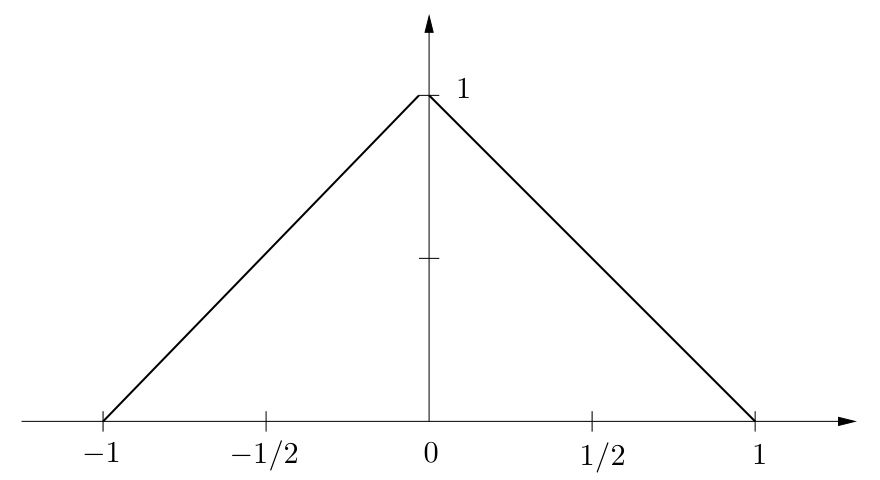

For the Fourier transform we compute (using integration by parts, and the factoring trick for the sine function):

$$
\begin{aligned}
\mathcal{F}\Lambda(s) &= \int_{-\infty}^{\infty} \Lambda(x) e^{-2\pi i s x}\,dx = \int_{-1}^{0} (1+x) e^{-2\pi i s x}\,dx + \int_{0}^{1} (1-x) e^{-2\pi i s x}\,dx \\
&= \left(\frac{1 + 2i\pi s}{4\pi^2 s^2} - \frac{e^{2\pi i s}}{4\pi^2 s^2}\right) - \left(\frac{2i\pi s - 1}{4\pi^2 s^2} + \frac{e^{-2\pi i s}}{4\pi^2 s^2}\right) \\
&= -\frac{e^{-2\pi i s}(e^{2\pi i s} - 1)^2}{4\pi^2 s^2} = -\frac{e^{-2\pi i s}(e^{\pi i s}(e^{\pi i s} - e^{-\pi i s}))^2}{4\pi^2 s^2} \\
&= -\frac{e^{-2\pi i s} e^{2\pi i s}(2i)^2 \sin^2 \pi s}{4\pi^2 s^2} = \left(\frac{\sin \pi s}{\pi s}\right)^2 = \operatorname{sinc}^2 s.
\end{aligned}
$$

It’s no accident that the Fourier transform of the triangle function turns out to be the square of the Fourier transform of the rect function. It has to do with convolution, an operation we have seen for Fourier series and will see anew for Fourier transforms in the next chapter.

The graph of $\operatorname{sinc}^2 s$ looks like:

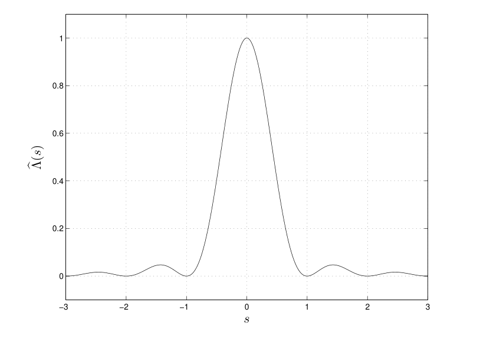

**The exponential decay** Another commonly occurring function is the (one-sided) exponential decay, defined by

$$
f(t) = \begin{cases} 0 & t \le 0 \\ e^{-at} & t > 0 \end{cases}
$$

where $a$ is a positive constant. This function models a signal that is zero, switched on, and then decays exponentially. Here are graphs for $a = 2, 1.5, 1.0, 0.5, 0.25$.

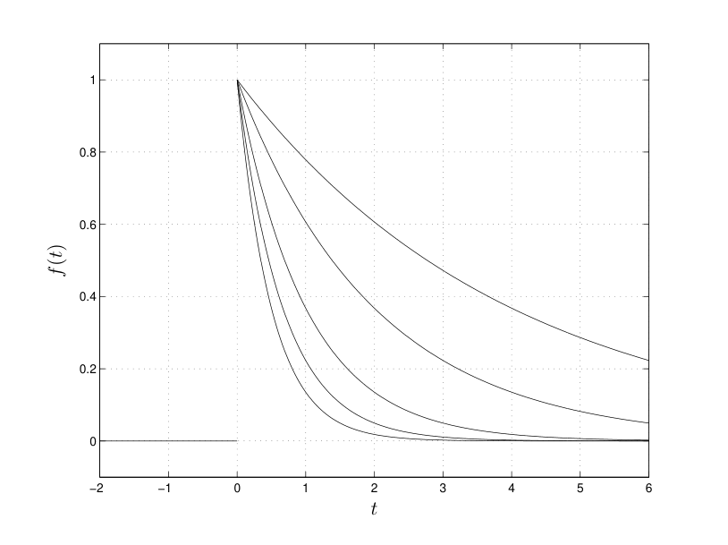

Which is which? If you can’t say, see the discussion on scaling the independent variable at the end of this section.

Back to the exponential decay, we can calculate its Fourier transform directly.

$$
\begin{aligned}
\mathcal{F}f(s) &= \int_0^{\infty} e^{-2\pi i s t} e^{-at}\,dt = \int_0^{\infty} e^{-2\pi i s t - at}\,dt \\
&= \int_0^{\infty} e^{(-2\pi i s - a)t}\,dt = \left[\frac{e^{(-2\pi i s - a)t}}{-2\pi i s - a}\right]_{t=0}^{t=\infty} \\
&= \frac{e^{(-2\pi i s)t}}{-2\pi i s - a}\, e^{-at}\Big|_{t=\infty} - \frac{e^{(-2\pi i s - a)t}}{-2\pi i s - a}\Big|_{t=0} = \frac{1}{2\pi i s + a}
\end{aligned}
$$

In this case, unlike the results for the rect function and the triangle function, the Fourier transform is complex. The fact that $\mathcal{F}\Pi(s)$ and $\mathcal{F}\Lambda(s)$ are real is because $\Pi(x)$ and $\Lambda(x)$ are even functions; we’ll go over this shortly. There is no such symmetry for the exponential decay.

The power spectrum of the exponential decay is

$$
|\mathcal{F}f(s)|^2 = \frac{1}{|2\pi i s + a|^2} = \frac{1}{a^2 + 4\pi^2 s^2}\,.
$$

Here are graphs of this function for the same values of $a$ as in the graphs of the exponential decay function.

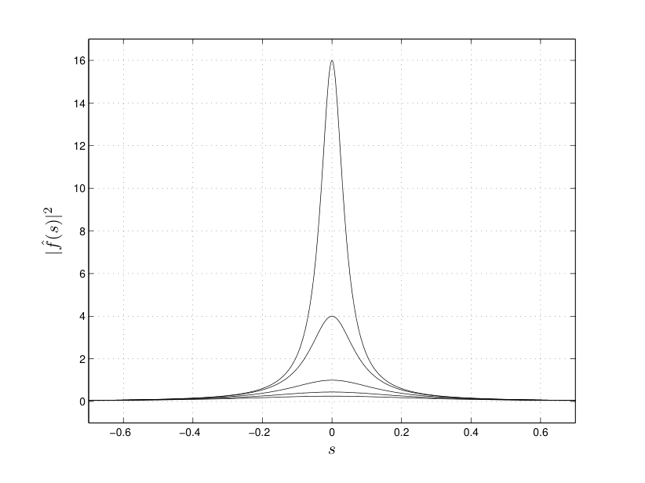

Which is which? You’ll soon learn to spot that immediately, relative to the pictures in the time domain, and it’s an important issue. Also note that $|\mathcal{F}f(s)|^2$ *is* an even function of $s$ even though $\mathcal{F}f(s)$ is not. We’ll see why later. The shape of $|\mathcal{F}f(s)|^2$ is that of a “bell curve”, though this is *not* Gaussian, a function we’ll discuss just below. The curve is known as a *Lorenz profile* and comes up in analyzing the transition probabilities and lifetime of the excited state in atoms.

**How does the graph of $f(ax)$ compare with the graph of $f(x)$?** Let me remind you of some elementary lore on scaling the independent variable in a function and how scaling affects its graph. The question is how the graph of $f(ax)$ compares with the graph of $f(x)$ when $0 < a < 1$ and when $a > 1$; I’m talking about any generic function $f(x)$ here. This is very simple, especially compared to what we’ve done and what we’re going to do, but you’ll want it at your fingertips and *everyone* has to think about it for a few seconds. Here’s how to spend those few seconds.

Consider, for example, the graph of $f(2x)$. The graph of $f(2x)$, compared with the graph of $f(x)$, is squeezed. Why? Think about what happens when you plot the graph of $f(2x)$ over, say, $-1 \le x \le 1$. When $x$ goes from $-1$ to 1, $2x$ goes from $-2$ to 2, so while you’re plotting $f(2x)$ over the interval from $-1$ to 1 you have to compute the values of $f(x)$ from $-2$ to 2. That’s more of the function in less space, as it were, so the graph of $f(2x)$ is a squeezed version of the graph of $f(x)$. Clear?

Similar reasoning shows that the graph of $f(x/2)$ is stretched. If $x$ goes from $-1$ to 1 then $x/2$ goes from $-1/2$ to $1/2$, so while you’re plotting $f(x/2)$ over the interval $-1$ to 1 you have to compute the values of $f(x)$ from $-1/2$ to $1/2$. That’s less of the function in more space, so the graph of $f(x/2)$ is a stretched version of the graph of $f(x)$.

### 2.2.2 For Whom the Bell Curve Tolls

Let’s next consider the Gaussian function and its Fourier transform. We’ll need this for many examples and problems. This function, the famous “bell shaped curve”, was used by Gauss for various statistical problems. It has some striking properties with respect to the Fourier transform which, on the one hand, give it a special role within Fourier analysis, and on the other hand allow Fourier methods to be applied to other areas where the function comes up. We’ll see an application to probability and statistics in Chapter 3.

The “basic Gaussian” is $f(x) = e^{-x^2}$. The shape of the graph is familiar to you.

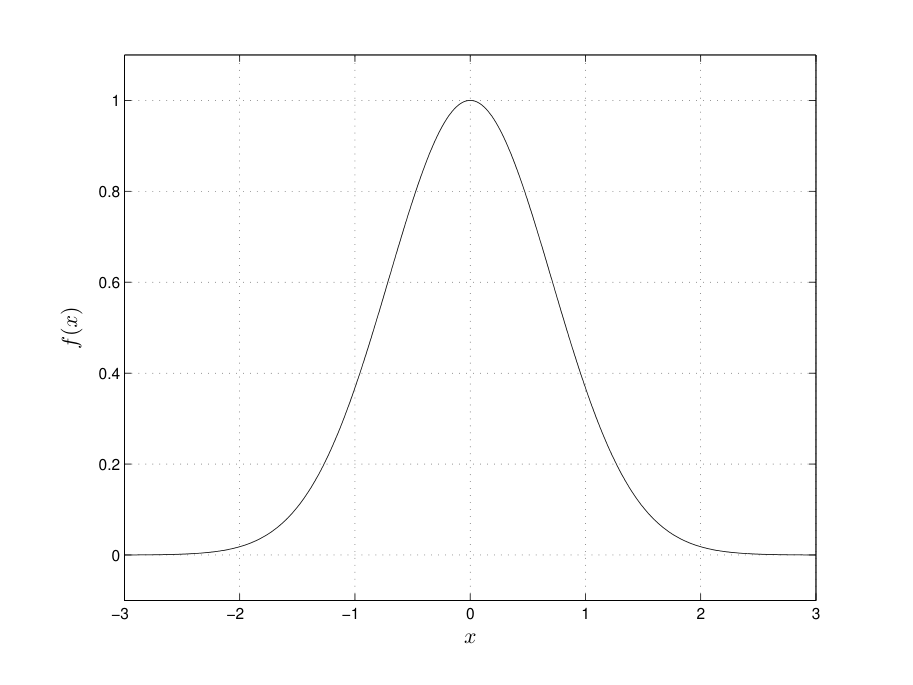

For various applications one throws in extra factors to modify particular properties of the function. We’ll do this too, and there’s not a complete agreement on what’s best. There is an agreement that before anything else happens, one has to know the amazing equation[^2-3]

$$
\int_{-\infty}^{\infty} e^{-x^2}\,dx = \sqrt{\pi}.
$$

[^2-3]: Speaking of this equation, William Thomson, after he became Lord Kelvin, said: “A mathematician is one to whom *that* is as obvious as that twice two makes four is to you.” What a ridiculous statement.

Now, the function $f(x) = e^{-x^2}$ does not have an elementary antiderivative, so this integral cannot be found directly by an appeal to the Fundamental Theorem of Calculus. The fact that it *can* be evaluated exactly is one of the most famous tricks in mathematics. It’s due to Euler, and you shouldn’t go through life not having seen it. And even if you have seen it, it’s worth seeing again; see the discussion following this section.

**The Fourier transform of a Gaussian** In whatever subject it’s applied, it seems always to be useful to normalize the Gaussian so that the total area is 1. This can be done in several ways, but for Fourier analysis the best choice, as we shall see, is

$$
f(x) = e^{-\pi x^2}\,.
$$

You can check using the result for the integral of $e^{-x^2}$ that

$$
\int_{-\infty}^{\infty} e^{-\pi x^2}\,dx = 1\,.
$$

---

Let’s compute the Fourier transform

$$
\mathcal{F}f(s) = \int_{-\infty}^{\infty} e^{-\pi x^2} e^{-2\pi i s x}\,dx\,.
$$

Differentiate with respect to $s$:

$$
\frac{d}{ds}\mathcal{F}f(s) = \int_{-\infty}^{\infty} e^{-\pi x^2}(-2\pi i x) e^{-2\pi i s x}\,dx\,.
$$

This is set up perfectly for an integration by parts, where $dv = -2\pi i x e^{-\pi x^2}dx$ and $u = e^{-2\pi i s x}$. Then $v = ie^{-\pi x^2}$, and evaluating the product $uv$ at the limits $\pm\infty$ gives 0. Thus

$$
\begin{aligned}
\frac{d}{ds}\mathcal{F}f(s) &= -\int_{-\infty}^{\infty} ie^{-\pi x^2}(-2\pi i s) e^{-2\pi i s x}\,dx \\
&= -2\pi s \int_{-\infty}^{\infty} e^{-\pi x^2} e^{-2\pi i s x}\,dx \\
&= -2\pi s\,\mathcal{F}f(s)
\end{aligned}
$$

So $\mathcal{F}f(s)$ satisfies the simple differential equation

$$
\frac{d}{ds}\mathcal{F}f(s) = -2\pi s\,\mathcal{F}f(s)
$$

whose unique solution, incorporating the initial condition, is

$$
\mathcal{F}f(s) = \mathcal{F}f(0)\, e^{-\pi s^2}\,.
$$

But

$$
\mathcal{F}f(0) = \int_{-\infty}^{\infty} e^{-\pi x^2}\,dx = 1\,.
$$

Hence

$$
\mathcal{F}f(s) = e^{-\pi s^2}\,.
$$

We have found the remarkable fact that the Gaussian $f(x) = e^{-\pi x^2}$ is its own Fourier transform!

**Evaluation of the Gaussian Integral** We want to evaluate

$$
I = \int_{-\infty}^{\infty} e^{-x^2}\,dx\,.
$$

It doesn’t matter what we call the variable of integration, so we can also write the integral as

$$
I = \int_{-\infty}^{\infty} e^{-y^2}\,dy\,.
$$

Therefore

$$
I^2 = \left(\int_{-\infty}^{\infty} e^{-x^2}\,dx\right)\left(\int_{-\infty}^{\infty} e^{-y^2}\,dy\right).
$$

Because the variables aren’t “coupled” here we can combine this into a double integral[^2-4]

$$
\int_{-\infty}^{\infty}\left(\int_{-\infty}^{\infty} e^{-x^2}\,dx\right) e^{-y^2}\,dy = \int_{-\infty}^{\infty}\int_{-\infty}^{\infty} e^{-(x^2+y^2)}\,dx\,dy\,.
$$

[^2-4]: We will see the same sort of thing when we work with the product of two Fourier transforms on our way to defining convolution in the next chapter.

Now we make a change of variables, introducing polar coordinates, $(r, \theta)$. First, what about the limits of integration? To let both $x$ and $y$ range from $-\infty$ to $\infty$ is to describe the entire plane, and to describe the entire plane in polar coordinates is to let $r$ go from 0 to $\infty$ and $\theta$ go from 0 to $2\pi$. Next, $e^{-(x^2+y^2)}$ becomes $e^{-r^2}$ and the area element $dx\,dy$ becomes $r\,dr\,d\theta$. It’s the extra factor of $r$ in the area element that makes all the difference. With the change to polar coordinates we have

$$
I^2 = \int_{-\infty}^{\infty}\int_{-\infty}^{\infty} e^{-(x^2+y^2)}\,dx\,dy = \int_0^{2\pi}\int_0^{\infty} e^{-r^2}\,r\,dr\,d\theta
$$

Because of the factor $r$, the inner integral can be done directly:

$$
\int_0^{\infty} e^{-r^2} r\,dr = -\tfrac{1}{2}e^{-r^2}\Big]_0^{\infty} = \tfrac{1}{2}\,.
$$

The double integral then reduces to

$$
I^2 = \int_0^{2\pi} \tfrac{1}{2}\,d\theta = \pi\,,
$$

whence

$$
\int_{-\infty}^{\infty} e^{-x^2}\,dx = I = \sqrt{\pi}\,.
$$

Wonderful.

### 2.2.3 General Properties and Formulas

We’ve started to build a storehouse of specific transforms. Let’s now proceed along the other path awhile and develop some general properties. For this discussion — and indeed for much of our work over the next few lectures — we are going to abandon all worries about transforms existing, integrals converging, and whatever other worries you might be carrying. Relax and enjoy the ride.

### 2.2.4 Fourier transform pairs and duality

One striking feature of the Fourier transform and the inverse Fourier transform is the symmetry between the two formulas, something you *don’t* see for Fourier series. For Fourier series the coefficients are given by an integral (a transform of $f(t)$ into $\hat{f}(n)$), but the “inverse transform” is the series itself. The Fourier transforms $\mathcal{F}$ and $\mathcal{F}^{-1}$ are the same except for the minus sign in the exponential.[^2-5] In words, we can say that if you replace $s$ by $-s$ in the formula for the Fourier transform then you’re taking the inverse Fourier transform. Likewise, if you replace $t$ by $-t$ in the formula for the inverse Fourier transform then you’re taking the Fourier transform. That is

$$
\begin{aligned}
\mathcal{F}f(-s) &= \int_{-\infty}^{\infty} e^{-2\pi i(-s)t} f(t)\,dt = \int_{-\infty}^{\infty} e^{2\pi i s t} f(t)\,dt = \mathcal{F}^{-1}f(s) \\
\mathcal{F}^{-1}f(-t) &= \int_{-\infty}^{\infty} e^{2\pi i s(-t)} f(s)\,ds = \int_{-\infty}^{\infty} e^{-2\pi i s t} f(s)\,ds = \mathcal{F}f(t)
\end{aligned}
$$

[^2-5]: Here’s the reason that the formulas for the Fourier transform and its inverse appear so symmetric; it’s quite a deep mathematical fact. As the general theory goes, if the original function is defined on a group then the transform (also defined in generality) is defined on the “dual group”, which I won’t define for you here. In the case of Fourier series the function is periodic, and so its natural domain is the circle (think of the circle as $[0,1]$ with the endpoints identified). It turns out that the dual of the circle group is the integers, and that’s why $\hat{f}$ is evaluated at integers $n$. It also turns out that when the group is $\mathbf{R}$ the dual group is again $\mathbf{R}$. Thus the Fourier transform of a function defined on $\mathbf{R}$ is itself defined on $\mathbf{R}$. Working through the general definitions of the Fourier transform and its inverse in this case produces the symmetric result that we have before us. Kick that one around over dinner some night.

This might be a little confusing because you generally want to think of the two variables, $s$ and $t$, as somehow associated with separate and different domains, one domain for the forward transform and one for the inverse transform, one for time and one for frequency, while in each of these formulas one variable is used in both domains. You have to get over this kind of confusion, because it’s going to come up again. Think purely in terms of the math: The transform is an operation on a function that produces a new function. To write down the formula I have to evaluate the transform at a variable, but it’s only a variable and it doesn’t matter what I call it as long as I keep its role in the formula straight.

Also be observant what the notation in the formula says and, just as important, what it doesn’t say. The first formula, for example, says what happens when you *first* take the Fourier transform of $f$ and *then* evaluate it at $-s$, it’s *not* a formula for $\mathcal{F}(f(-s))$ as in “first change $s$ to $-s$ in the formula for $f$ and then take the transform”. I could have written the first displayed equation as $(\mathcal{F}f)(-s) = \mathcal{F}^{-1}f(s)$, with an extra parentheses around the $\mathcal{F}f$ to emphasize this, but I thought that looked too clumsy. Just be careful, please.

---

The equations

$$
\begin{aligned}
\mathcal{F}f(-s) &= \mathcal{F}^{-1}f(s) \\
\mathcal{F}^{-1}f(-t) &= \mathcal{F}f(t)
\end{aligned}
$$

are sometimes referred to as the “duality” property of the transforms. One also says that “the Fourier transform pair $f$ and $\mathcal{F}f$ are related by duality”, meaning exactly these relations. They look like different statements but you can get from one to the other. We’ll set this up a little differently in the next section.

Here’s an example of how duality is used. We know that

$$
\mathcal{F}\Pi = \operatorname{sinc}
$$

and hence that

$$
\mathcal{F}^{-1}\operatorname{sinc} = \Pi\,.
$$

By “duality” we can find $\mathcal{F}\operatorname{sinc}$:

$$
\mathcal{F}\operatorname{sinc}(t) = \mathcal{F}^{-1}\operatorname{sinc}(-t) = \Pi(-t)\,.
$$

(Troubled by the variables? Remember, the left hand side is $(\mathcal{F}\operatorname{sinc})(t)$.) Now with the *additional* knowledge that $\Pi$ is an even function — $\Pi(-t) = \Pi(t)$ — we can conclude that

$$
\mathcal{F}\operatorname{sinc} = \Pi\,.
$$

Let’s apply the same argument to find $\mathcal{F}\operatorname{sinc}^2$. Recall that $\Lambda$ is the triangle function. We know that

$$
\mathcal{F}\Lambda = \operatorname{sinc}^2
$$

and so

$$
\mathcal{F}^{-1}\operatorname{sinc}^2 = \Lambda\,.
$$

But then

$$
\mathcal{F}\operatorname{sinc}^2(t) = (\mathcal{F}^{-1}\operatorname{sinc}^2)(-t) = \Lambda(-t)
$$

and since $\Lambda$ is even,

$$
\mathcal{F}\operatorname{sinc}^2 = \Lambda\,.
$$

**Duality and reversed signals** There’s a slightly different take on duality that I prefer because it suppresses the variables and so I find it easier to remember. Starting with a signal $f(t)$ define the *reversed signal* $f^-$ by

$$
f^-(t) = f(-t)\,.
$$

Note that a double reversal gives back the original signal,

$$
(f^-)^- = f\,.
$$

Note also that the conditions defining when a function is even or odd are easy to write in terms of the reversed signals:

$$
\begin{aligned}
&f \text{ is even if } f^- = f \\
&f \text{ is odd if } f^- = -f
\end{aligned}
$$

In words, a signal is even if reversing the signal doesn’t change it, and a signal is odd if reversing the signal changes the sign. We’ll pick up on this in the next section.

Simple enough — to reverse the signal is just to reverse the time. This is a general operation, of course, whatever the nature of the signal and whether or not the variable is time. Using this notation we can rewrite the first duality equation, $\mathcal{F}f(-s) = \mathcal{F}^{-1}f(s)$, as

$$
(\mathcal{F}f)^- = \mathcal{F}^{-1}f
$$

and we can rewrite the second duality equation, $\mathcal{F}^{-1}f(-t) = \mathcal{F}f(t)$, as

$$
(\mathcal{F}^{-1}f)^- = \mathcal{F}f\,.
$$

This makes it very clear that the two equations are saying the same thing. One is just the “reverse” of the other.

Furthermore, using this notation the result $\mathcal{F}\operatorname{sinc} = \Pi$, for example, goes a little more quickly:

$$
\mathcal{F}\operatorname{sinc} = (\mathcal{F}^{-1}\operatorname{sinc})^- = \Pi^- = \Pi\,.
$$

Likewise

$$
\mathcal{F}\operatorname{sinc}^2 = (\mathcal{F}^{-1}\operatorname{sinc}^2)^- = \Lambda^- = \Lambda\,.
$$

---

A natural variation on the preceding duality results is to ask what happens with $\mathcal{F}f^-$, the Fourier transform of the reversed signal. Let’s work this out. By definition,

$$
\mathcal{F}f^-(s) = \int_{-\infty}^{\infty} e^{-2\pi i s t} f^-(t)\,dt = \int_{-\infty}^{\infty} e^{-2\pi i s t} f(-t)\,dt\,.
$$

There’s only one thing to do at this point, and we’ll be doing it a lot: make a change of variable in the integral. Let $u = -t$ so that $du = -dt$, or $dt = -du$. Then as $t$ goes from $-\infty$ to $\infty$ the variable $u = -t$ goes from $\infty$ to $-\infty$ and we have

$$
\begin{aligned}
\int_{-\infty}^{\infty} e^{-2\pi i s t} f(-t)\,dt &= \int_{\infty}^{-\infty} e^{-2\pi i s(-u)} f(u)\,(-du) \\
&= \int_{-\infty}^{\infty} e^{2\pi i s u} f(u)\,du \quad (\text{the minus sign on the } du \text{ flips the limits back}) \\
&= \mathcal{F}^{-1}f(s)
\end{aligned}
$$

Thus, quite neatly,

$$
\mathcal{F}f^- = \mathcal{F}^{-1}f
$$

Even more neatly, if we now substitute $\mathcal{F}^{-1}f = (\mathcal{F}f)^-$ from earlier we have

$$
\mathcal{F}f^- = (\mathcal{F}f)^-\,.
$$

Note carefully where the parentheses are here. In words, the Fourier transform of the reversed signal is the reversed Fourier transform of the signal. That one I can remember.

To finish off these questions, we have to know what happens to $\mathcal{F}^{-1}f^-$. But we don’t have to do a separate calculation here. Using our earlier duality result,

$$
\mathcal{F}^{-1}f^- = (\mathcal{F}f^-)^- = (\mathcal{F}^{-1}f)^-\,.
$$

In words, the inverse Fourier transform of the reversed signal is the reversed inverse Fourier transform of the signal. We can also take this one step farther and get back to $\mathcal{F}^{-1}f^- = \mathcal{F}f$

---

And so, the whole list of duality relations really boils down to just two:

$$
\begin{aligned}
\mathcal{F}f &= (\mathcal{F}^{-1}f)^- \\
\mathcal{F}f^- &= \mathcal{F}^{-1}f
\end{aligned}
$$

Learn these. Derive all others.

Here’s one more:

$$
\mathcal{F}(\mathcal{F}f)(s) = f(-s) \quad \text{or} \quad \mathcal{F}(\mathcal{F}f) = f^- \quad \text{without the variable.}
$$

This identity is somewhat interesting in itself, as a variant of Fourier inversion. You can check it directly from the integral definitions, or from our earlier duality results.[^2-6] Of course then also

$$
\mathcal{F}(\mathcal{F}f^-) = f\,.
$$

[^2-6]: And you can then also then check that $\mathcal{F}(\mathcal{F}(\mathcal{F}(\mathcal{F}f)))(s) = f(s)$, i.e., $\mathcal{F}^4$ is the identity transformation. Some people attach mystical significance to this fact.

### 2.2.5 Even and odd symmetries and the Fourier transform

We’ve already had a number of occasions to use even and odd symmetries of functions. In the case of real-valued functions the conditions have obvious interpretations in terms of the symmetries of the graphs; the graph of an even function is symmetric about the $y$-axis and the graph of an odd function is symmetric through the origin. The (algebraic) definitions of even and odd apply to complex-valued as well as to real-valued functions, however, though the geometric picture is lacking when the function is complex-valued because we can’t draw the graph. A function can be even, odd, or neither, but it can’t be both unless it’s identically zero.

How are symmetries of a function reflected in properties of its Fourier transform? I won’t give a complete accounting, but here are a few important cases.

- If $f(x)$ is even or odd, respectively, then so is its Fourier transform.

Working with reversed signals, we have to show that $(\mathcal{F}f)^- = \mathcal{F}f$ if $f$ is even and $(\mathcal{F}f)^- = -\mathcal{F}f$ if $f$ is odd. It’s lighting fast using the equations that we derived, above:

$$
(\mathcal{F}f)^- = \mathcal{F}f^- = \begin{cases} \mathcal{F}f, & \text{if } f \text{ is even} \\ \mathcal{F}(-f) = -\mathcal{F}f & \text{if } f \text{ is odd} \end{cases}
$$

Because the Fourier transform of a function is complex valued there are other symmetries we can consider for $\mathcal{F}f(s)$, namely what happens under complex conjugation.

- If $f(t)$ is real-valued then $(\mathcal{F}f)^- = \overline{\mathcal{F}f}$ and $\mathcal{F}(f^-) = \overline{\mathcal{F}f}$.

This is analogous to the conjugate symmetry property possessed by the Fourier coefficients for a real-valued periodic function. The derivation is essentially the same as it was for Fourier coefficients, but it may be helpful to repeat it for practice and to see the similarities.

$$
\begin{aligned}
(\mathcal{F}f)^-(s) &= \mathcal{F}^{-1}f(s) \quad (\text{by duality}) \\
&= \int_{-\infty}^{\infty} e^{2\pi i s t} f(t)\,dt \\
&= \overline{\left\{\int_{-\infty}^{\infty} e^{-2\pi i s t} f(t)\,dt\right\}} \quad (\overline{f(t)} = f(t) \text{ since } f(t) \text{ is real}) \\
&= \overline{\mathcal{F}f(s)}
\end{aligned}
$$

We can refine this if the function $f(t)$ itself has symmetry. For example, combining the last two results and remembering that a complex number is real if it’s equal to its conjugate and is purely imaginary if it’s equal to minus its conjugate, we have:

- If $f$ is real valued and even then its Fourier transform is even and real valued.

- If $f$ is real valued and odd function then its Fourier transform is odd and purely imaginary.

We saw this first point in action for Fourier transform of the rect function $\Pi(t)$ and for the triangle function $\Lambda(t)$. Both functions are even and their Fourier transforms, sinc and $\operatorname{sinc}^2$, respectively, are even and real. Good thing it worked out that way.

### 2.2.6 Linearity

One of the simplest and most frequently invoked properties of the Fourier transform is that it is linear (operating on functions). This means:

$$
\begin{aligned}
\mathcal{F}(f+g)(s) &= \mathcal{F}f(s) + \mathcal{F}g(s) \\
\mathcal{F}(\alpha f)(s) &= \alpha\mathcal{F}f(s) \quad \text{for any number } \alpha \text{ (real or complex).}
\end{aligned}
$$

The linearity properties are easy to check from the corresponding properties for integrals, for example:

$$
\begin{aligned}
\mathcal{F}(f+g)(s) &= \int_{-\infty}^{\infty} (f(x) + g(x)) e^{-2\pi i s x}\,dx \\
&= \int_{-\infty}^{\infty} f(x) e^{-2\pi i s x}\,dx + \int_{-\infty}^{\infty} g(x) e^{-2\pi i s x}\,dx = \mathcal{F}f(s) + \mathcal{F}g(s)\,.
\end{aligned}
$$

We used (without comment) the property on multiples when we wrote $\mathcal{F}(-f) = -\mathcal{F}f$ in talking about odd functions and their transforms. I bet it didn’t bother you that we hadn’t yet stated the property formally.

### 2.2.7 The shift theorem

A shift of the variable $t$ (a delay in time) has a simple effect on the Fourier transform. We would expect the magnitude of the Fourier transform $|\mathcal{F}f(s)|$ to stay the same, since shifting the original signal in time should not change the energy at any point in the spectrum. Hence the only change should be a phase shift in $\mathcal{F}f(s)$, and that’s exactly what happens.

To compute the Fourier transform of $f(t+b)$ for any constant $b$, we have

$$
\begin{aligned}
\int_{-\infty}^{\infty} f(t+b) e^{-2\pi i s t}\,dt &= \int_{-\infty}^{\infty} f(u) e^{-2\pi i s(u-b)}\,du \\
&\qquad (\text{substituting } u = t+b \text{; the limits still go from } -\infty \text{ to } \infty) \\
&= \int_{-\infty}^{\infty} f(u) e^{-2\pi i s u} e^{2\pi i s b}\,du \\
&= e^{2\pi i s b}\int_{-\infty}^{\infty} f(u) e^{-2\pi i s u}\,du = e^{2\pi i s b}\hat{f}(s).
\end{aligned}
$$

The best notation to capture this property is probably the pair notation, $f \rightleftharpoons F$.[^2-7] Thus:

[^2-7]: This is, however, an excellent opportunity to complain about notational matters. Writing $\mathcal{F}f(t+b)$ invites the same anxieties that some of us had when changing signs. What’s being transformed? What’s being plugged in? There’s no room to write an $s$. The hat notation is even worse — there’s no place for the $s$, again, and do you really want to write $\widehat{f(t+b)}$ with such a wide hat?

- If $f(t) \rightleftharpoons F(s)$ then $f(t+b) \rightleftharpoons e^{2\pi i s b}F(s)$.
  - A little more generally, $f(t \pm b) \rightleftharpoons e^{\pm 2\pi i s b}F(s)$.

Notice that, as promised, the magnitude of the Fourier transform has not changed under a time shift because the factor out front has magnitude 1:

$$
\left|e^{\pm 2\pi i s b}F(s)\right| = \left|e^{\pm 2\pi i s b}\right|\,|F(s)| = |F(s)|\,.
$$

### 2.2.8 The stretch (similarity) theorem

How does the Fourier transform change if we stretch or shrink the variable in the time domain? More precisely, we want to know if we scale $t$ to $at$ what happens to the Fourier transform of $f(at)$. First suppose $a > 0$. Then

$$
\begin{aligned}
\int_{-\infty}^{\infty} f(at) e^{-2\pi i s t}\,dt &= \int_{-\infty}^{\infty} f(u) e^{-2\pi i s(u/a)}\,\frac{1}{a}\,du \\
&\qquad (\text{substituting } u = at \text{; the limits go the same way because } a > 0) \\
&= \frac{1}{a}\int_{-\infty}^{\infty} f(u) e^{-2\pi i (s/a)u}\,du = \frac{1}{a}\mathcal{F}f\left(\frac{s}{a}\right)
\end{aligned}
$$

If $a < 0$ the limits of integration are reversed when we make the substitution $u = ax$, and so the resulting transform is $(-1/a)\mathcal{F}f(s/a)$. Since $-a$ is positive when $a$ is negative, we can combine the two cases and present the Stretch Theorem in its full glory:

- If $f(t) \rightleftharpoons F(s)$ then $f(at) \rightleftharpoons \dfrac{1}{|a|}F\left(\dfrac{s}{a}\right)$.

This is also sometimes called the *Similarity Theorem* because changing the variable from $x$ to $ax$ is a change of scale, also known as a similarity.

---

There’s an important observation that goes with the stretch theorem. Let’s take $a$ to be positive, just to be definite. If $a$ is large (bigger than 1, at least) then the graph of $f(at)$ is squeezed horizontally compared to $f(t)$. Something different is happening in the frequency domain, in fact in two ways. The Fourier transform is $(1/a)F(s/a)$. If $a$ is large then $F(s/a)$ is *stretched out* compared to $F(s)$, rather than squeezed in. Furthermore, multiplying by $1/a$, since the transform is $(1/a)F(a/s)$, also squashes down the values of the transform.

The opposite happens if $a$ is small (less than 1). In that case the graph of $f(at)$ is stretched out horizontally compared to $f(t)$, while the Fourier transform is compressed *horizontally* and stretched *vertically*. The phrase that’s often used to describe this phenomenon is that a signal cannot be *localized* (meaning concentrated at a point) in both the time domain and the frequency domain. We will see more precise formulations of this principle.[^2-8]

[^2-8]: In fact, the famous Heisenberg Uncertainty Principle in quantum mechanics is an example.

To sum up, a function stretched out in the time domain is squeezed in the frequency domain, and vice versa. This is somewhat analogous to what happens to the spectrum of a periodic function for long or short periods. Say the period is $T$, and recall that the points in the spectrum are spaced $1/T$ apart, a fact we’ve used several times. If $T$ is large then it’s fair to think of the function as spread out in the time domain — it goes a long time before repeating. But then since $1/T$ is small, the spectrum is squeezed. On the other hand, if $T$ is small then the function is squeezed in the time domain — it goes only a short time before repeating — while the spectrum is spread out, since $1/T$ is large.

> **Careful here** In the discussion just above I tried not to talk in terms of properties of the *graph of the transform* — though you may have reflexively thought in those terms and I slipped into it a little — because the transform is generally *complex valued*. You do see this squeezing and spreading phenomenon geometrically by looking at the graphs of $f(t)$ in the time domain and the *magnitude* of the Fourier transform in the frequency domain.[^2-9]

[^2-9]: We observed this for the one-sided exponential decay and its Fourier transform, and you should now go back to that example and match up the graphs of $|\mathcal{F}f|$ with the various values of the parameter.

**Example: The stretched rect** Hardly a felicitous phrase, “stretched rect”, but the function comes up often in applications. Let $p > 0$ and define

$$
\Pi_p(t) = \begin{cases} 1 & |t| < p/2 \\ 0 & |t| \ge p/2 \end{cases}
$$

Thus $\Pi_p$ is a rect function of width $p$. We can find its Fourier transform by direct integration, but we can also find it by means of the stretch theorem if we observe that

$$
\Pi_p(t) = \Pi(t/p)\,.
$$

To see this, write down the definition of $\Pi$ and follow through:

$$
\Pi(t/p) = \begin{cases} 1 & |t/p| < 1/2 \\ 0 & |t/p| \ge 1/2 \end{cases} = \begin{cases} 1 & |t| < p/2 \\ 0 & |t| \ge p/2 \end{cases} = \Pi_p(t)\,.
$$

Now since $\Pi(t) \rightleftharpoons \operatorname{sinc} s$, by the stretch theorem

$$
\Pi(t/p) \rightleftharpoons p\operatorname{sinc} ps\,,
$$

and so

$$
\mathcal{F}\Pi_p(s) = p\operatorname{sinc} ps\,.
$$

This is useful to know.

Here are plots of the Fourier transform pairs for $p = 1/5$ and $p = 5$, respectively. Note the scales on the axes.

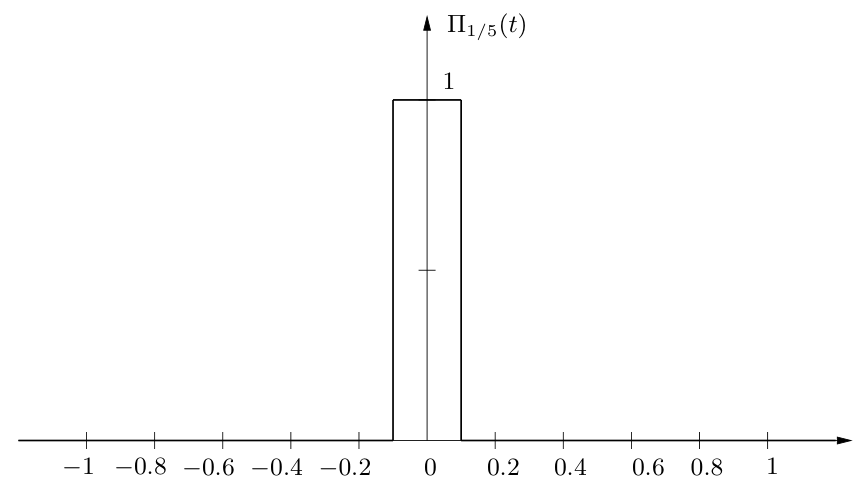

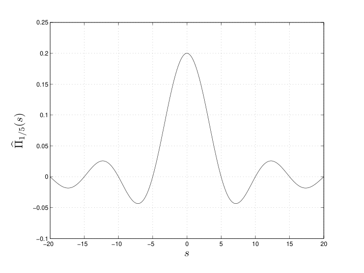

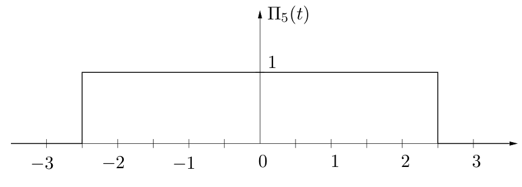

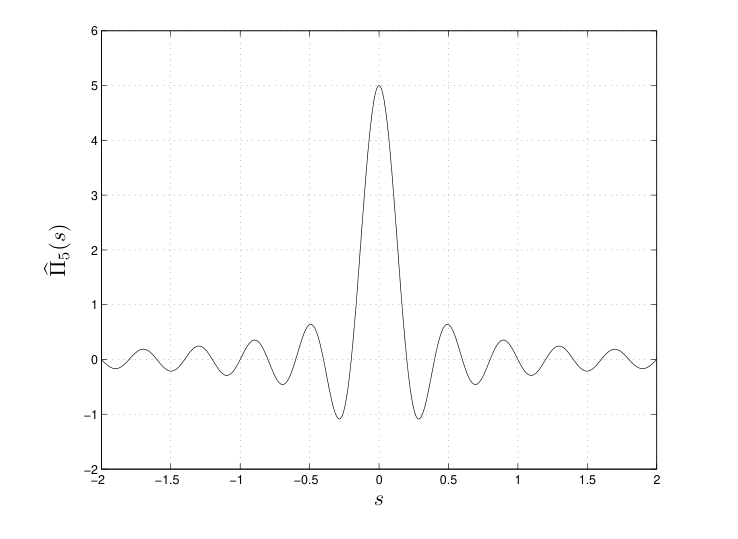

### 2.2.9 Combining shifts and stretches

We can combine the shift theorem and the stretch theorem to find the Fourier transform of $f(ax+b)$, but it’s a little involved.

Let’s do an example first. It’s easy to find the Fourier transform of $f(x) = \Pi((x-3)/2)$ by direct integration.

$$
\begin{aligned}
F(s) &= \int_2^4 e^{-2\pi i s x}\,dx \\
&= -\frac{1}{2\pi i s}e^{-2\pi i s x}\Big]_{x=2}^{x=4} = -\frac{1}{2\pi i s}(e^{-8\pi i s} - e^{-4\pi i s})\,.
\end{aligned}
$$

We can still bring the sinc function into this, but the factoring is a little trickier.

$$
e^{-8\pi i s} - e^{-4\pi i s} = e^{-6\pi i s}(e^{-2\pi i s} - e^{2\pi i s}) = e^{-6\pi i s}(-2i)\sin 2\pi s\,.
$$

Plugging this into the above gives

$$
F(s) = e^{-6\pi i s}\frac{\sin 2\pi s}{\pi s} = 2e^{-6\pi i s}\operatorname{sinc} 2s\,.
$$

The Fourier transform has become complex — shifting the rect function has destroyed its symmetry.

Here’s a plot of $\Pi((x-3)/2)$ and of $4\operatorname{sinc}^2 2s$, the square of the *magnitude* of its Fourier transform. Once again, looking at the latter gives you no information about the phases in the spectrum, only on the energies.

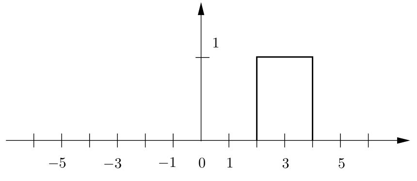

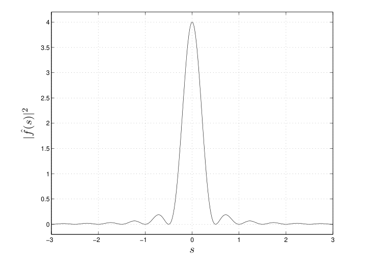

---

As an exercise you can establish the following general formula on how shifts and stretches combine:

- If $f(t) \rightleftharpoons F(s)$ then $f(at \pm b) = f\left(a\left(t \pm \dfrac{b}{a}\right)\right) \rightleftharpoons \dfrac{1}{|a|}e^{\pm 2\pi i s b/a}F\left(\dfrac{s}{a}\right)$.

Try this on $\Pi((x-3)/2) = \Pi\left(\frac{1}{2}x - \frac{3}{2}\right)$. With $a = 1/2$ and $b = -3/2$ we get

$$
\mathcal{F}\left(\Pi\left(\tfrac{1}{2}x - \tfrac{3}{2}\right)\right) = 2e^{-6\pi i s}\,\widehat{\Pi}(2s) = 2e^{-6\pi i s}\operatorname{sinc} 2s
$$

just like before. Was there any doubt? (Note that I used the notation $\mathcal{F}$ here along with the hat notation. It’s not ideal either, but it seemed like the best of a bad set of ways of writing the result.)

**Example: two-sided exponential decay** Here’s an example of how you might combine the properties we’ve developed. Let’s find the Fourier transform of the *two*-sided exponential decay

$$
g(t) = e^{-a|t|}\,, \quad a \text{ a positive constant.}
$$

Here are plots of $g(t)$ for $a = 0.5, 1, 2$. Match them!

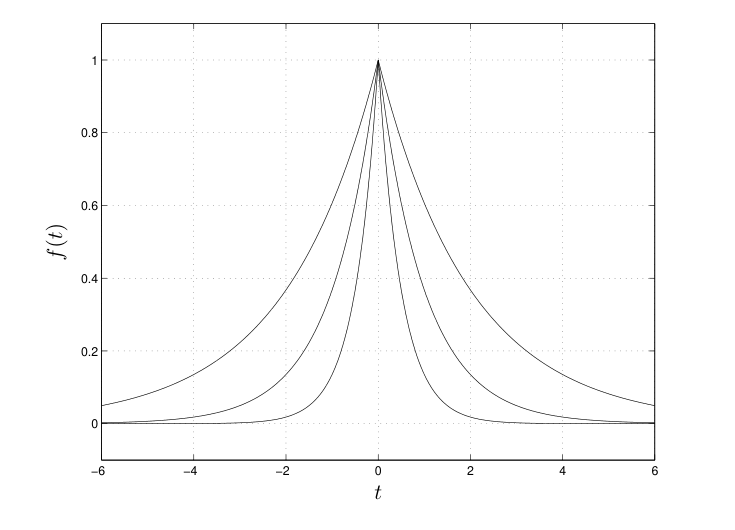

We could find the transform directly — plugging into the formula for the Fourier transform would give us integrals we could do. However, we’ve already done half the work, so to speak, when we found the Fourier transform of the one-sided exponential decay. Recall that for

$$
f(t) = \begin{cases} 0 & t < 0 \\ e^{-at} & t \ge 0 \end{cases} \quad \Rightarrow \quad F(s) = \hat{f}(s) = \frac{1}{2\pi i s + a}
$$

and now realize

$$
g(t) \quad \text{is almost equal to} \quad f(t) + f(-t)\,.
$$

They agree except at the origin, where $g(0) = 1$ and $f(t)$ and $f(-t)$ are both one. But two functions which agree except for one point (or even finitely many points[^2-10]) will clearly give the same result when integrated against $e^{-2\pi i s t}$. Therefore

$$
\begin{aligned}
G(s) = \mathcal{F}g(s) &= F(s) + F(-s) \\
&= \frac{1}{2\pi i s + a} + \frac{1}{-2\pi i s + a} = \frac{2a}{a^2 + 4\pi^2 s^2}\,.
\end{aligned}
$$

[^2-10]: Or, more generally, sets of “measure zero”

Note that $g(t)$ is even and $G(s)$ is real. These sorts of quick checks on correctness and consistency (evenness, oddness, real or purely imaginary, etc.) are useful when you’re doing calculations. Here are plots of $G(s)$ for the $a = 0.5, 1, 2$. Match them!

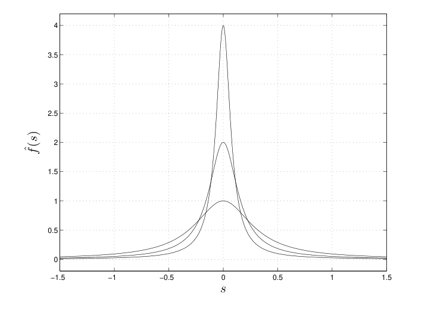

In the future, we’ll see an application of the two-sided exponential decay to solving a second order ordinary differential equation.

**Example: Other Gaussians** As mentioned, there are other ways of normalizing a Gaussian. For example, instead of $e^{-\pi x^2}$ we can take

$$
g(x) = \frac{1}{\sigma\sqrt{2\pi}}e^{-x^2/2\sigma^2}\,.
$$

You might recognize this from applications to probability and statistics as the Gaussian with *mean* zero and *standard deviation* $\sigma$ (or *variance* $\sigma^2$). The Gaussian with mean $\mu$ and standard deviation $\sigma$ is the shifted version of this:

$$
g(x, \mu, \sigma) = \frac{1}{\sigma\sqrt{2\pi}}e^{-(x-\mu)^2/2\sigma^2}\,.
$$

Geometrically, $\sigma$ is a measure of how peaked or spread out the curve is about the mean. In terms of the graph, the inflection points occur at $\mu \pm \sigma$; thus if $\sigma$ is large the curve is spread out and if $\sigma$ is small the curve is sharply peaked. The area under the graph is still 1.

The question for us is what happens to the Fourier transform when the Gaussian is modified in this way. This can be answered by our results on shifts and stretches, since that’s all that’s ever involved. Take the case of $\mu = 0$, for simplicity. To find the Fourier transform we can apply the similarity theorem: $f(ax) \rightleftharpoons (1/|a|)F(s/a)$. With $a = 1/\sigma\sqrt{2\pi}$ This gives

$$
g(t) = \frac{1}{\sigma\sqrt{2\pi}}e^{-x^2/2\sigma^2} \quad \Rightarrow \quad \hat{g}(s) = e^{-2\pi^2\sigma^2 s^2}
$$

still a Gaussian, but not an exact replica of what we started with. Note that with $\mu = 0$ the Gaussian is even and the Fourier transform is real and even.
