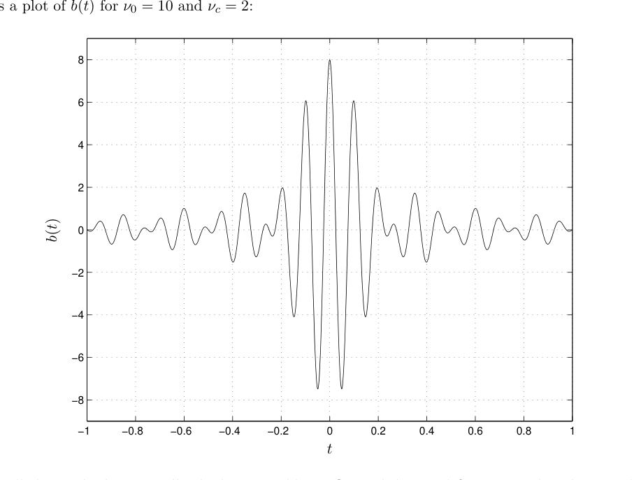
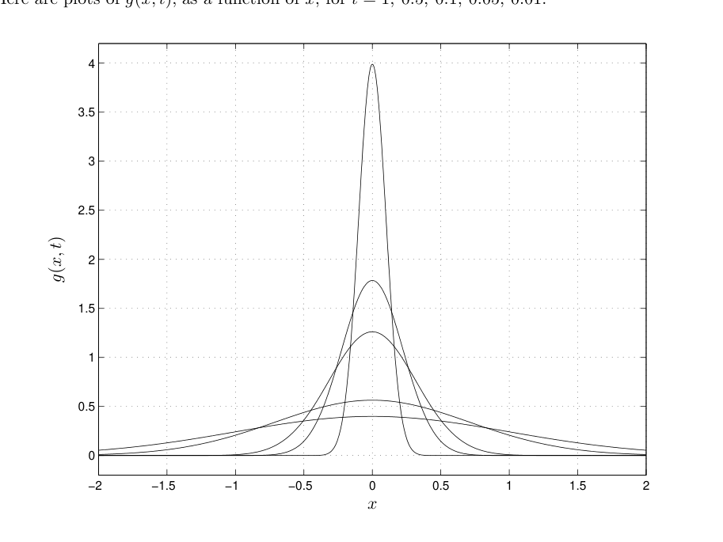
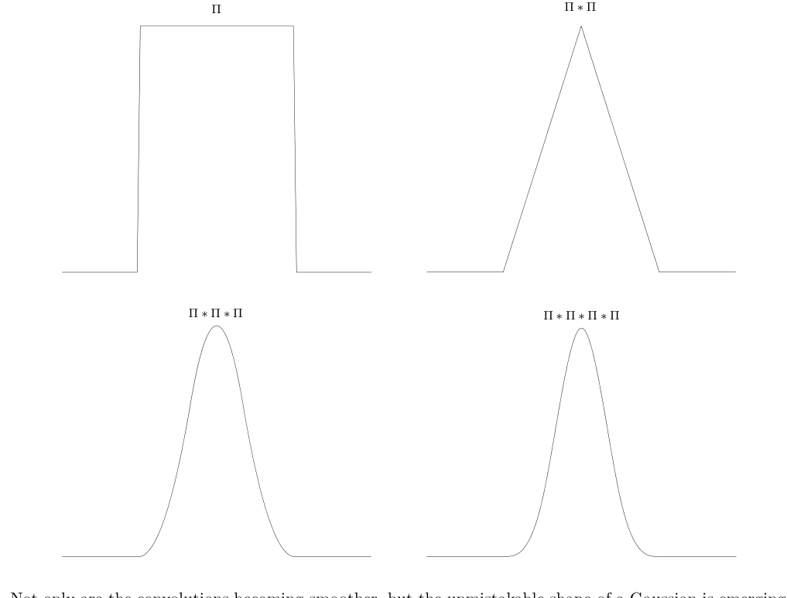
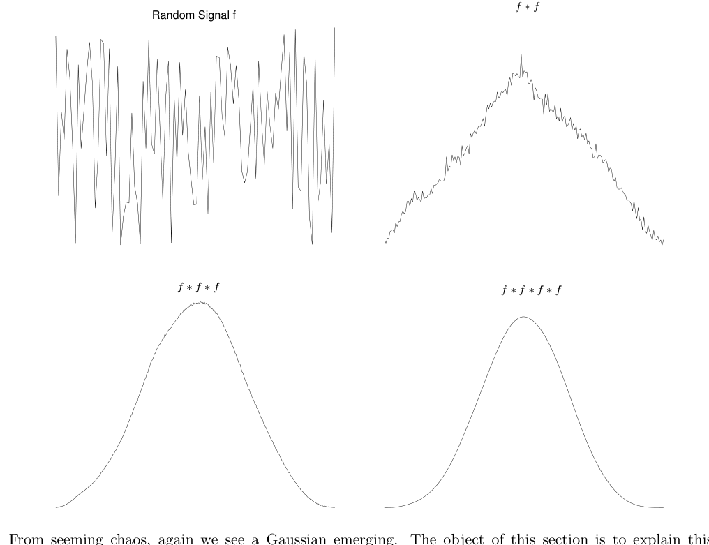

# Chapter 3: Convolution

## 3.1 A ∗ is Born

How can we use one signal to modify another? Some of the properties of the Fourier transform that we have already derived can be thought of as addressing this question. The easiest is the result on additivity, according to which

$$
\mathcal{F}(f + g) = \mathcal{F}f + \mathcal{F}g.
$$

Adding the signal $g(t)$ to the signal $f(t)$ adds the amounts $\mathcal{F}g(s)$ to the frequency components $\mathcal{F}f(s)$.

(Symmetrically, $f(t)$ modifies $g(t)$ in the same way.) The spectrum of $f$ + $g$ may be more or less “complicated” than the spectrum of $f$ and $g$ alone, and it’s an elementary operation in both the time domain and the frequency domain that produces or eliminates the complications. It’s an operation that’s also easily undone: See some frequencies you don’t like in the spectrum (a bad buzz)? Then try adding something in or subtracting something out and see what the signal looks like.

We can view the question of using one signal to modify another in either the time domain or in the frequency domain, sometimes with equal ease and sometimes with one point of view preferred. We just looked at sums, what about products? The trivial case is multiplying by a constant, as in $\mathcal{F}(af)(s)$ = $a\mathcal{F}f(s)$. The energies of the harmonics are all affected by the same amount, so, thinking of music for example, the signal sounds the same, only louder or softer. It’s much less obvious how to scale the harmonics separately. That is, as a question “in the frequency domain”, we ask:

Is there some combination of the signals $f(t)$ and $g(t)$ so that in the frequency domain the Fourier transform is

$$
\mathcal{F}g(s)\mathcal{F}f(s) ?
$$

In other words, in the time domain can we combine the signal $g(t)$ with the signal $f(t)$ so that the frequency components $\mathcal{F}f(s)$ of $f(t)$ are scaled by the frequency components $\mathcal{F}g(s)$ of $g(t)$?

(Once again this is symmetric — we could say that the frequency components $\mathcal{F}g(s)$ are scaled by the frequency components $\mathcal{F}f(s)$.) Let’s check this out, and remember that the rigor police are off duty. No arrests will be made for unstated assumptions, divergent integrals, etc.

The product of the Fourier transforms of $f(t)$ and $g(t)$ is

$$
\mathcal{F}g(s)\mathcal{F}f(s) = \int_{−∞}^{∞} e^{−2 π i s t}g(t)dt\int_{−∞}^{∞} e^{−2 π i s x}f(x)dx.
$$

We used different variables of integration in the two integrals because we’re going to combine the product into an iterated integral.1

$$
\int_{−∞}^{∞} e^{−2 π i s t}g(t)dt\int_{−∞}^{∞} e^{−2 π i s x}f(x)dx = \int_{−∞∞}^{∞} \int_{−∞∞}^{∞} e^{−2 π i s t}e^{−2 π i s x}g(t)f(x)dtdx
$$

$$
= \int_{−∞} \int_{−∞} e^{−2 π i s(t+x)}g(t)f(x)dtdx
$$

$$
= \int_{−∞}^{∞} (\int_{−∞}^{∞} e^{−2 π i s(t+x)}g(t)dt)f(x)dx
$$

Now make the change of variable $u$ = $t$ + $x$ in the inner integral. Then $t$ = $u − x, du$ = $dt,$ and the limits are the same. The result is

$$
(\int_{−∞}^{∞}
$$

$$
(\int_{−∞}^{∞}
$$

$$
)
$$

$$
)
$$

$$
\int_{−∞}^{∞}
$$

$$
\int_{−∞}^{∞}
$$

$$
e^{−2 π i s u}g(u− x)du
$$

$$
e^{−2 π i s(t+x)}g(t)dt f(x)dx =
$$

$$
f(x)dx
$$

Next, switch the order of integration:

$$
)
$$

$$
\int_{−∞}^{∞} (\int_{−∞}^{∞}
$$

$$
\int_{−∞∞}^{∞} \int_{−∞∞}^{∞}
$$

$$
e^{−2 π i s u}g(u − x)du
$$

$$
e^{−2 π i s u}g(u− x)f(x)dudx
$$

$$
f(x)dx =
$$

$$
= \int_{−∞} \int_{−∞} e^{−2 π i s u}g(u− x)f(x)dxdu
$$

$$
= \int_{−∞}^{∞} e^{−2 π i s u} (\int_{−∞}^{∞} g(u− x)f(x)dx)du
$$

Look at what’s happened here. The inner integral is a function of $u$. Let’s set it up on its own:

$$
h(u) = \int_{−∞}^{∞} g(u− x)f(x)dx.
$$

Then the outer integral produces the Fourier transform of $h:$

$$
\int_{−∞}^{∞} e^{−2 π i s u} (\int_{−∞}^{∞} g(u− x)f(x)dx)du = \int_{−∞}^{∞} e^{−2 π i s u}h(u)du = \mathcal{F}h(s)
$$

Switching the variable name for $h$ from $h(u)$ to $h(t)$ (solely for psychological comfort), we have discovered that the signals $f(t)$ and $g(t)$ are combined into a signal

$$
h(t) = \int_{−∞}^{∞} g(t− x)f(x)dx.
$$

In other words,

$$
\mathcal{F}h(s) = \mathcal{F}g(s)\mathcal{F}f(s).
$$

Remarkable.

We have solved our problem. The only thing to do is to realize what we’ve done and declare it to the world. We make the following definition:

1 If you’re uneasy with this (never mind issues of convergence) you might convince yourself that it’s correct by working your way backwards from the double integral to the product of the two single integrals.

- Convolution defined The convolution of two functions $g(t)$ and $f(t)$ is the function

$$
h(t) = \int_{−∞}^{∞} g(t− x)f(x)dx.
$$

We use the notation

$$
(g ∗ f)(t) = \int_{−∞}^{∞} g(t− x)f(x)dx.
$$

We can now proudly announce:

- Convolution Theorem $\mathcal{F}(g ∗f)(s)$ = $\mathcal{F}g(s)\mathcal{F}f(s)$

$◦$ In other notation: If $f(t)$ ⇌ $F(s)$ and $g(t)$ ⇌ $G(s)$ then ($g ∗f)(t)$ ⇌ $G(s)F(s)$.

- In words: Convolution in the time domain corresponds to multiplication in the frequency domain.2

Recall that when we studied Fourier series, convolution came up in the form

$$
(g ∗ f)(t) = \int_{0}^{1} g(t− x)f(x)dx.
$$

In that setting, for the integral to make sense, i.e., to be able to evaluate $g(t − x)$ at points outside the interval from 0 to 1, we had to assume that $g$ was periodic. That’s not an issue in the present setting, where we assume that $f(t)$ and $g(t)$ are defined for all $t,$ so the factors in the integral

$$
\int_{−∞}^{∞} g(t− x)f(x)dx
$$

are defined everywhere. There may be questions to raise about whether the integral converges, and there are, but at least the setup makes sense.

Remark on notation, again It’s common to see the people write the convolution as $g(t)∗f(t),$ putting the variable $t$ in each of $g$ and $f$. There are times when that’s OK, even sometimes preferable to introducing a lot of extra notation, but in general I think it’s a bad idea because it can lead to all sorts of abuses and possible mistakes. For example, what’s $g($2$t)∗f(t)$? If you plugged in too casually you might write this as the integral

$$
\int_{−∞}^{∞} g(2t− x)f(x)dx.
$$

That’s wrong. The right answer in convolving $g($2$t)$ and $f(t)$ is

$$
\int_{−∞}^{∞} g(2(t− x))f(x)dx = \int_{−∞}^{∞} g(2t− 2x)f(x)dx.
$$

Make sure you understand why the first is wrong and second is right.3 2 What we’ve just gone through is the same sort of thing we did when we “found” the formula for the Fourier coefficients for a periodic function. Remember the principle: First suppose the problem is solved and see what the answer must be. The second step, assuming the first one works, is to turn that solution into a definition and then announce to the world that you have solved your original problem based on your brilliant definition. Mathematicians, in particular, are very good at presenting their results and writing their books in this way — do step one in secret and tell the world only step two. It’s extremely irritating.

$$
R∞
$$

3 The way to be unambiguous about this is to say something like: “Let”s define $h(t)$ = $g(2t),$ then ($h ∗ f)(t)$ = $−∞h(t −$ $x)f(x)dx$ = $...$ .” I concede that this is too much of a hassle in most cases. Just be careful.

Let’s see a quick application of our brilliant new discovery. As an exercise you can show (by hand) that (Π $∗$ Π)($x)$ = Λ($x)$ Recall that Λ is the triangle function. Applying the Convolution Theorem, we find that $\mathcal{F}$Λ($s)$ = $\mathcal{F}($Π$∗$Π)($s)$ = sinc$s ·$ sinc$s$ = sinc2$s,$ just like before. Was there any doubt?

Convolving in the frequency domain If you look at the argument for the convolution theorem $\mathcal{F}(g ∗ f)$ = $\mathcal{F}g · \mathcal{F}f,$ you’ll see that we could have carried the whole thing out for the inverse Fourier transform, and given the symmetry between the Fourier transform and its inverse that’s not surprising.

That is, we also have

$$
\mathcal{F}^{−1}(g ∗ f) = \mathcal{F}^{−1}g ·\mathcal{F}^{−1}f .
$$

What’s more interesting, and doesn’t follow without a little additional argument, is this:

$$
\mathcal{F}(gf)(s) = (\mathcal{F}g ∗ \mathcal{F}f)(s).
$$

In words:

- Multiplication in the time domain corresponds to convolution in the frequency domain.

Here’s how the derivation goes. We’ll need one of the duality formulas, the one that says $\mathcal{F}(\mathcal{F}f)(s)$ = $f(−s)$ or $\mathcal{F}(\mathcal{F}f)$ = $f^{−}$ without the variable.

To derive the identity $\mathcal{F}(gf)$ = $\mathcal{F}g ∗ \mathcal{F}f,$ we write, for convenience, $h$ = $\mathcal{F}f$ and $k$ = $\mathcal{F}g$. Then we’re to show

$$
\mathcal{F}(gf) = k ∗ h.
$$

The one thing we know is how to take the Fourier transform of a convolution, so, in the present notation, $\mathcal{F}(k∗h)$ = ($\mathcal{F}k)(\mathcal{F}h)$. But now $\mathcal{F}k$ = $\mathcal{F}\mathcal{F}g$ = $g^{−},$ from the identity above, and likewise $\mathcal{F}h$ = $\mathcal{F}\mathcal{F}f$ = $f^{−}$.

So $\mathcal{F}(k ∗ h)$ = $g^{−}f^{−} =$ ($gf)−,$ or

$$
gf = \mathcal{F}(k ∗ h^{−}) .
$$

Now, finally, take the Fourier transform of both sides of this last equation and appeal to the $\mathcal{F}\mathcal{F}$ identity again:

$$
\mathcal{F}(gf) = \mathcal{F}(\mathcal{F}(k∗h^{−}) ) = k ∗ h = \mathcal{F}g ∗\mathcal{F}f .
$$

We’re done.

Remark You may wonder why we didn’t start by trying to prove $\mathcal{F}(gf)(s)$ = ($\mathcal{F}g ∗ \mathcal{F}f)(s)$ rather than $\mathcal{F}(g ∗ f)$ = ($\mathcal{F}f)(\mathcal{F}g)$ as we did. That is, it seems more “natural” to multiply signals in the time domain and see what effect this has in the frequency domain, so why not work with $\mathcal{F}(fg)$ directly? But write the integral for $\mathcal{F}(gf);$ there’s nothing you can do with it to get toward $\mathcal{F}g ∗ \mathcal{F}f$.

## 3.2 What is Convolution, Really?

There’s not a single answer to that question. Those of you who have had a course in “Signals and Systems” probably saw convolution in connection with Linear Time Invariant Systems and the impulse response for such a system. (This already came up in connection with our solution of the heat equation.) That’s a very natural setting for convolution and we’ll consider it later, after we have the machinery of delta functions et al.

The fact is that convolution is used in many ways and for many reasons, and it can be a mistake to try to attach to it one particular meaning or interpretation. This multitude of interpretations and applications is somewhat like the situation with the definite integral. When you learned about the integral, chances are that it was introduced via an important motivating problem, typically recovering the distance traveled from the velocity, or finding the area under a curve. That’s fine, but the integral is really a much more general and flexible concept than those two sample problems might suggest. You do yourself no service if every time you think to use an integral you think only of one of those problems. Likewise, you do yourself no service if you insist on one particular interpretation of convolution.

To pursue the analogy with the integral a little bit further, in pretty much all applications of the integral there is a general method at work: cut the problem into small pieces where it can be solved approximately, sum up the solution for the pieces, and pass to a limit.4 There is also often a general method to working, or seeking to work with convolutions: usually there’s something that has to do with smoothing and averaging, understood broadly. You see this in both the continuous case (which we’re doing now) and the discrete case (which we’ll do later).

For example, in using Fourier series to solve the heat equation on a circle, we saw that the solution was expressed as a convolution of the initial heat distribution with the Green’s function (or fundamental solution). That’s a smoothing and averaging interpretation (both!) of the convolution. It’s also a linear systems interpretation of convolution, where the system is described by the heat equation.

In brief, we’ll get to know the convolution by seeing it in action:

- Convolution is what convolution does.

That’s probably the best answer to the question in the heading to this section.

## 3.2.1 But can I visualize convolution? or “Flip this, buddy”

I’m tempted to say don’t bother. Again for those of you who have seen convolution in earlier courses, you’ve probably heard the expression “flip and drag”. For

$$
(g ∗f)(t) = \int_{−∞}^{∞} g(t − x)f(x)dx
$$

here’s what this means.

- Fix a value $t$. The graph of the function $g(x−t)$ has the same shape as $g(x)$ but shifted to the right

by $t$. Then forming $g(t − x)$ flips the graph (left-right) about the line $x$ = $t$. If the most interesting or important features of $g(x)$ are near $x$ = 0, e.g., if it’s sharply peaked there, then those features are shifted to $x$ = $t$ for the function $g(t − x)$ (but there’s the extra “flip” to keep in mind).

4 This goes back to Archimedes, who called his paper on the subject “The Method”.

- Multiply the two functions $f(x)$ and $g(t − x)$ and integrate with respect to $x$. Remember that the

value of the convolution ($g∗f)(t)$ is not just the product of the values of $f$ and the flipped and shifted $g,$ it’s the integral of the product — much harder to visualize. Integrating the product sums up these values, that’s the “dragging” part.

Smoothing and averaging I prefer to think of the convolution operation as using one function to smooth and average the other. (Say $g$ is used to smooth $f$ in $g ∗ f$.) In many common applications $g(x)$ is a positive function, concentrated near 0, with total area 1,

$$
\int_{−∞}^{∞} g(x)dx = 1,
$$

like a sharply peaked Gaussian, for example (stay tuned). Then $g(t − x)$ is concentrated near $t$ and still has area 1. For a fixed $t,$ forming the integral

$$
\int_{−∞}^{∞} g(t− x)f(x)dx
$$

is like taking a weighted average of the values of $f(x)$ near $x$ = $t,$ weighted by the values of (the flipped and shifted) $g$. (It’s a legitimate weighted average because $\int_{−∞}^{∞} g(x)dx$ = 1.) That’s the averaging part of the description: Computing the convolution $g ∗f$ at $t$ replaces the value $f(t)$ by a weighted average of the values of $f$ near $t$. Where does the smoothing come in? Here’s where.

- Changing $t$ (“dragging” $g(t− x)$ through different values of $t)$ repeats this operation.

Again take the case of an averaging-type function $g(t),$ as above. At a given value of $t,$ ($g ∗ f)(t)$ is a weighted average of values of $f$ near $t$. Move $t$ a little to a point $t^{′}$. Then ($g ∗f)(t^{′})$ is a weighted average of values of $f$ near $t^{′},$ which will include values of $f$ that entered into the average near $t$. Thus the values of the convolutions ($g ∗f)(t)$ and ($g ∗f)(t^{′})$ will likely be closer to each other than are the values $f(t)$ and $f(t^{′})$. That is, ($g ∗ f)(t)$ is “smoothing” $f$ as $t$ varies — there’s less of a change between values of the convolution than between values of $f$.

We’ll study this in more detail later, but you’ve already seen at least one example of smoothing. The rect function Π($x)$ is discontinuous — it has jumps at $±$1$/$2. The convolution Π $∗$ Π is the triangle function Λ, which is continuous — the jumps at the endpoints have been smoothed out. There’s still a corner, but there’s no discontinuity.

In fact, as an aphorism we can state

- The convolution $g ∗ f$ is at least as smooth a function as $g$ and $f$ are separately.

A smear job, too Now, be a little careful in how you think about this averaging and smoothing process.

Computing any value of ($g ∗f)(t)$ involves all of the values of $g$ and all of the values of $f,$ and adding the products of corresponding values of $g$ and $f$ with one of the functions flipped and dragged. If both $f(t)$ and $g(t)$ become identically zero after awhile then the convolution $g ∗ f$ will also be identically zero outside of some interval. But if either $f(t)$ or $g(t)$ does not become identically zero then neither will the convolution.

In addition to averaging and smoothing the convolution also “smears” out the factors — not a becoming description, but an accurate one.

Definitely keep the general description we’ve just gone through in mind, but as far as visualizing the convolution of any two old functions, I think it’s of dubious value to beat yourself up trying to do that.

It’s hard geometrically, and it’s hard computationally, in the sense that you have to calculate some tedious integrals. (You do have to do a few of these in your life — hence the homework assignment — but only a few.) For developing further intuition, I do recommend the Johns Hopkins web page on signals, systems and control:

http://www.jhu.edu/~signals/ There you’ll find a Java applet called “Joy of Convolution” (and many other things). It will allow you to select sample curves $f(t)$ and $g(t),$ or to draw your own curves with a mouse, and then produce the convolution ($g ∗ f)(t)$.

By the way, of course you can try to get some intuition for how the convolution looks by thinking of what’s happening in the frequency domain. It’s not so far fetched to try to imagine the Fourier transforms $\mathcal{F}f,$ $\mathcal{F}g,$ and their product, and then imagine the inverse transform to get you $g ∗ f$.

## 3.3 Properties of Convolution: It’s a Lot like Multiplication

Convolution behaves in many ways (not all ways) like multiplication. For example, it is commutative:

$$
f ∗ g = g ∗f .
$$

So although it looks like the respective roles of $f$ and $g$ are different — one is “flipped and dragged”, the other isn’t — in fact they share equally in the end result.

Do we have to prove this? Not among friends. After all, we defined the convolution so that the convolution theorem holds, that is so that $\mathcal{F}(g ∗ f)$ = $\mathcal{F}g\mathcal{F}f$. But $g$ and $f$ enter symmetrically on the right hand side, so $g ∗ f$ = $f ∗ g$ — $g(t)$ can be used to modify $f(t)$ or $f(t)$ can be used to modify $g(t)$.

Nevertheless, the commutativity property is easy to check from the definition:

$$
(f ∗g)(t) = \int_{−∞∞}^{∞} f(t − u)g(u)du
$$

$$
\int_{−∞}
$$

= $g(t − v)f(v)dv ($making the substitution $v$ = $t − u)$

$$
= (g ∗ f)(t).
$$

The same idea, a change of variable but with more bookkeeping, establishes that convolution is associative (an exercise for you in integrals):

$$
(f ∗g) ∗h = f ∗ (g ∗ h).
$$

Much more easily one gets that

$$
f ∗ (g + h) = f ∗ g + f ∗ h.
$$

The corresponding statements are easily verified in the frequency domain.

How about a “1”? Is there a function which is to convolution as 1 is to multiplication? Is there a function $g$ such that ($g ∗ f)(t)$ = $f(t),$ for all functions $f$?

What property would such a $g$ have? Take Fourier transforms of both sides:

$$
\mathcal{F}f(s)\mathcal{F}g(s) = \mathcal{F}f(s).
$$

Then $g(x)$ must be such that

$$
\mathcal{F}g(s) = 1.
$$

Is there such a $g$? Applying the inverse Fourier transform would lead to

$$
\int_{−∞}^{∞} e^{2 π i s x} dx,
$$

and that integral does not exist — even I wouldn’t try to slip that by the rigor police. Something is up here. Maybe Fourier inversion doesn’t work in this case, or else there’s no classical function whose Fourier transform is 1, or something. In fact, though the integral does not exist in any sense, the problem of a “1 for convolution” leads exactly to the delta function, or unit impulse — not a classical function, but a “generalized” function. We’ll return to that shortly.

How about “division”? Suppose we know $h$ and $g$ in

$$
h = f ∗ g
$$

and we want to solve for $f$. Again, taking Fourier transforms we would say

$$
\mathcal{F}h = \mathcal{F}f · \mathcal{F}g ⇒ \mathcal{F}f = \frac{\mathcal{F}h}{\mathcal{F}g} .
$$

We’d like the convolution quotient to be the inverse Fourier transform of $\mathcal{F}h/\mathcal{F}g$. But there are problems caused by places where $\mathcal{F}g$ = 0, along with the usual problems with the integral for the inverse Fourier transform to exist.

Solving for $f(t)$ is the deconvolution problem, which is extremely important in applications. Many times a noisy signal comes to you in the form $h$ = $f ∗ g;$ the signal is $f,$ the noise is $g,$ you receive $h$. You make some assumptions about the nature of the noise, usually statistical assumptions, and you want to separate the signal from the noise. You want to deconvolve.

Other identities It’s not hard to combine the various rules we have and develop an algebra of convolutions. Such identities can be of great use — it beats calculating integrals. Here’s an assortment. (Lower and uppercase letters are Fourier pairs.)

$$
((f · g)∗ (h ·k))(t) ⇌ ((F ∗ G)· (H ∗ K))(s)
$$

$$
((f(t) + g(t))· (h(t) + k(t)) ⇌ (((F + G)∗ (H + K)))(s)
$$

$$
(f(t) · (g ∗ h)(t) ⇌ (F ∗ (G· H))(s)
$$

You can write down others. Be confident — careful, but confident.

## 3.4 Convolution in Action I: A Little Bit on Filtering

“Filtering” is a generic term for just about any operation one might want to apply to a signal. We have to be reasonable, of course — there’s usually some feature of the signal that one wants to enhance or eliminate, and one expects something of the original signal to be recognizable or recoverable after it’s been

filtered. Most filters are described as somehow modifying the spectral content of a signal, and they are thus set up as an operation on the Fourier transform of a signal. We’ll take up this topic in more detail when we discuss linear time invariant (LTI) systems, but it’s worthwhile saying a little bit now because the most common filters operate through multiplication in the frequency domain, hence through convolution in the time domain.

The features are:

- An input signal $v(t)$

- An output signal $w(t)$

- The operation that produces $w(t)$ from $v(t)$ in the time domain is convolution with a function $h(t):$

$$
w(t) = (h ∗ v)(t) = \int_{−∞}^{∞} h(t − x)v(x)dx
$$

With this description the Fourier transforms of the input and output are related by multiplication in the frequency domain:

$$
W(s) = H(s)V (s),
$$

where, following tradition, we denote the Fourier transforms by the corresponding capital letters. In this context $h(t)$ is usually called the impulse response 5 and $H(s)$ is called the transfer function. It seems to be a matter of course always to denote the impulse response by $h(t)$ and always to denote the transfer function by $H(s)$. Who am I to do otherwise?

Remember that $h(t),$ hence $H(s),$ is “fixed” in this discussion. It’s wired into the circuit or coded into the software and it does what it does to any input you may give it. Filters based on convolution are usually designed to have a specific effect on the spectrum of an input, and so to design a filter is to design a transfer function. The operations, which you’re invited to draw a block diagram for, are thus Input $→$ Fourier transform $→$ Multiply by $H →$ Inverse Fourier transform = output We want to see some examples of this today — filters that are in day-to-day use and the principles that go into their design.

One preliminary comment about how the spectra of the input and output are related. Write

$$
(\frac{I m V(s)}{R e V(s)} )
$$

$V$ ($s)$ = $|V$ ($s)|e^{i φ V(s)} , φ_{V}$ ($s)$ = tan$−1$

$$
,
$$

so the phase of $V$ ($s)$ is $φ_{V}$ ($s),$ with similar notations for the phases of $W(s)$ and $H(s)$. Then

$$
|W(s)|e^{i φ W(s)} = |H(s)|e^{i φ H(s)}|V (s)|e^{i φ V(s)}
$$

$$
= |H(s)||V (s)|e^{i(φ H(s)+φ V(s))} .
$$

Thus the magnitudes multiply and the phases add:

$$
|W(s)| = |H(s)||V (s)|
$$

$$
φ_{W} (s) = φ_{V} (s) + φ_{H}(s)
$$

5 Because, as we’ll see, it is how the system “responds” to a unit impulse.

Multiplying $V$ ($s)$ by $H(s)$ can’t make the spectrum of $V$ ($s)$ any bigger6, but it can make the spectrum smaller by zeroing out parts of it. Furthermore, there is no phase change when $φ_{H}(s)$ = 0, and this happens when $H(s)$ is real. In this case only the amplitude is changed when the signal goes through the filter. Common examples of filters that do both of these things — modify some part of the magnitude of the spectrum with no phase change — are lowpass, bandpass, highpass, and notch filters, to which we’ll now turn.

## 3.4.1 Designing filters

Lowpass filters An ideal lowpass filter cuts offall frequencies above a certain amount$ν_{c}$ (“$c$” for “cutoff”) and lets all frequencies below $ν_{c}$ pass through unchanged. (Hence the description “lowpass”.) If we write the operation as

$$
w(t) = (h ∗v)(t) ⇌ W(s) = H(s)V (s),
$$

then the transfer function we want is

$$
H(s) = (1 |s| < ν_{c}
$$

$$
0 |s| ≥ ν_{c}
$$

Multiplying $V$ ($s)$ by $H(s)$ leaves unchanged the spectrum of $v$ for $|s| < ν_{c}$ and eliminates the other frequencies. The transfer function is just a scaled rect function, and we can write it (to remind you) as

$$
(1 |s/2ν_{c}| <^{1}_{2} (1 |s| < ν_{c}
$$

$H(s)$ = Π2$νc(s)$ = Π($s/$2$ν_{c})$ =

$$
0 |s/2ν_{c}| ≥^{1}_{2} = 0 |s| ≥ ν_{c}
$$

In the time domain the impulse response is the inverse Fourier transform of Π2$νc,$ and this is $h(t)$ = 2$ν_{c}$ sinc(2$ν_{c}t).$ By the way, why is this called just a “lowpass filter”; aren’t the frequencies below $−ν_{c}$ also eliminated and so not “passed” by the filter? Yes, but rem$\frac{e m b e}{V(s).}$r that for real signals $v(t)$ (which is where this is applied) one has the symmetry relation $V$ ($−s)$ = The positive and negative frequencies combine in reconstructing the real signal in the inverse Fourier transform, much like what happens with Fourier series.

Thus one wants to pass the frequencies with $−ν_{c} < s < ν_{c}$ and eliminate the frequencies with $s ≥ ν_{c}$ and $s ≤ −ν_{c}$.

And, by the way, why is this called an ideal lowpass filter? Because the cutoff is a sharp one — right at a particular frequency $ν_{c}$. In practice this cannot be achieved, and much of the original art of filter design is concerned with useful approximations to a sharp cutoff.

Bandpass filters Another very common filter passes a particular band of frequencies through unchanged and eliminates all others. This is the ideal bandpass filter. Its transfer function, $B(s),$ can be constructed by shifting and combining the transfer function $H(s)$ for the lowpass filter.

We center our bandpass filter at $±ν_{0}$ and cut off frequencies more than $ν_{c}$ above and below $ν_{0};$ just as for the lowpass filter we pass symmetric bands of positive frequencies and negative frequencies, and eliminate 6 In $s,$ that is; the spectrum of the output takes up no more of R than the spectrum of the input. One says that no new frequencies are added to the spectrum

everything else. That is, we define the transfer function of a bandpass filter to be

$$
B(s) = (1 ν_{0} − ν_{c} < |s| < ν_{0} + ν_{c}
$$

0 otherwise

$$
= H(s− ν_{0}) + H(s + ν_{0})
$$

Here’s the graph.

1

$$
2ν_{c}
$$

$$
2ν_{c}
$$

$$
−ν_{0}
$$

0

$$
+ν_{0}
$$

From the representation of $B(s)$ in terms of $H(s)$ it’s easy to find the impulse response, $b(t)$. That’s given by $b(t)$ = $h(t)e^{2 π i ν 0 t}$ + $h(t)e^{−2 π i ν 0 t} ($using the shift theorem or the modulation theorem) = 4$ν_{c}$ cos(2$πν_{0}t)$ sinc(2$ν_{c}t).$ Here’

Now, tell the truth, do you really think you could just flip and drag and figure out what the convolution looks like of that thing with some other thing?

Highpass filters The twin to an ideal lowpass filter is an ideal high pass filter, where all frequencies above a cutoff frequency $ν_{c}$ are passed through unchanged and all frequencies below are eliminated. You might use this, for example, if there’s a slow “drift” in your data that suggests a low frequency disturbance or noise that you may want to eliminate. Highpass filters are used on images to sharpen edges and details (associated with high spatial frequencies) and eliminate blurring (associated with low spatial frequencies).

The graph of the transfer function for an ideal highpass filter looks like:

1

$$
−ν_{c}
$$

0

$$
ν_{c}
$$

It’s easy to write a formula for this; it’s just

High($s)$ = 1 $−$ Π2$νc(s),$ where $ν_{c}$ is the cutoff frequency.7 At this point we’re stuck. We can’t find the impulse response because we haven’t yet gained the knowledge that the inverse Fourier transform of 1 is the $δ$ function. Think of the highpass filter as the evil twin of the lowpass filter.

Notch filters The evil twin of a bandpass filter is a notch filter. The effect of a notch filter is to eliminate frequencies within a given band (the “notch”) and to pass frequencies outside that band. To get the transfer function we just subtract a bandpass transfer function from 1. Using the one we already have:

Notch($s)$ = 1 $− B(s)$ = 1$− (H(s− ν_{0})$ + $H(s$ + $ν_{0})).$ This will eliminate the positive frequencies between $ν_{0} −ν_{c}$ and $ν_{0}$ + $ν_{c},$ and the symmetric corresponding negative frequencies between $−ν_{0} − ν_{c}$ and $−ν_{0}$ + $ν_{c},$ and pass all frequencies outside of these two bands.

You can draw your own graph of that.

Unfortunately, for the impulse response we’re in the same position here as we were for the highpass filter.

We cannot write down the impulse response without recourse to $δ$’s, so this will have to wait.

## 3.5 Convolution in Action II: Differential Equations

One of the most common uses of convolution and the Fourier transform is in solving differential equations.

Solving differential equations was Fourier’s original motivation for Fourier series and the use of the Fourier transform to this end has continued to exercise a strong influence on the theory and the applications. We’ll consider several illustrations, from a simple ordinary differential equation to problems associated with the heat equation. We’ll also revisit the problem of a signal propagating along a cable.

7 OK, this High($s)$ is 1 at the endpoints $±νc$ instead of 0, but that makes no practical difference. On the other hand, this is a further argument for defining Π to have value 1$/2$ at the endpoints, for then the transfer functions for the low and highpass filters agree in how they cut.

The derivative formula To put the Fourier transform to work, we need a formula for the Fourier transform of the derivative, and as you found in homework:

$$
(\mathcal{F}f^{′})(s) = 2πis\mathcal{F}f(s).
$$

We see that differentiation has been transformed into multiplication, another remarkable feature of the Fourier transform and another reason for its usefulness. Formulas for higher derivatives also hold, and the result is:

$$
(\mathcal{F}f^{(n)} )(s) = (2πis^{n}) \mathcal{F}f(s).
$$

We’ll come back to these formulas in another context a little later.

In general, a differential operator can be thought of as a polynomial in $d/dx,$ say of the form

$$
P(\frac{d}{d x}) = a_{n}(\frac{d}{d x})^{n} + a_{n−1}(\frac{d}{d x})^{n−1} + ··· + a_{1}\frac{d}{d x} + a_{0},
$$

and when applied to a function $f(x)$ the result is

$$
a_{n}f^{(n)} + a_{n−1}f^{(n−1)} + ··· + a_{1}f^{′} + a_{0}f .
$$

If we now take the Fourier transform of this expression, we wind up with the Fourier transform of $f$ multiplied by the corresponding $n-$th degree polynomial evaluated at 2$πis$.

$$
(\mathcal{F}(P(\frac{d}{d x})f))(s) = P(2πis)\mathcal{F}f(s)
$$

$$
= (a_{n}(2πis^{n}) + a_{n−1}(2πis^{n−1}) + ··· + a_{1}(2πis) + a_{0})\mathcal{F}f(s).
$$

Don’t underestimate how important this is.

A simple ordinary differential equation and how to solve it You might like starting off with the classic second order, ordinary differential equation

$$
u^{′′} − u = −f
$$

Maybe you’ve looked at a different form of this equation, but I’m writing it this way to make the subsequent calculations a little easier. $f(t)$ is a given function and you want to find $u(t)$.

Take the Fourier transform of both sides:

$$
(2πis^{2}) \mathcal{F}u− \mathcal{F}u = −\mathcal{F}f
$$

$$
−4π^{2}s^{2}\mathcal{F}u− \mathcal{F}u = −\mathcal{F}f
$$

$$
(1 + 4π^{2}s^{2})\mathcal{F}u = \mathcal{F}f
$$

So we can solve for $\mathcal{F}u$ as

$$
\mathcal{F}u = \frac{1}{1+4 π^{2}s^{2}} \mathcal{F}f ,
$$

and — with a little struggle — we recognize 1$/($1 + 4$π^{2}s^{2})$ as the Fourier transform of 12$e^{−|t|},$ that is,

$$
\mathcal{F}u = \mathcal{F} (_{1 2}e^{−|t|}) · \mathcal{F}f .
$$

The right hand side is the product of two Fourier transforms. Therefore, according to the convolution theorem,

$$
u(t) = 12e^{−|t|} ∗f(t).
$$

Written out in full this is

$$
u(t) = 1 \int_{2−∞}^{∞} e^{−|t−τ|}f(τ)dτ .
$$

And there you have the two-sided exponential decay in action, as well as convolution.

The heat equation Remember the heat equation? In one spatial dimension, the equation that describes the rates of change of the temperature $u(x,t)$ of the body at a point $x$ and time $t$ (with some normalization of the constants associated with the material) is the partial differential equation

$$
u_{t} = 12u_{x x}.
$$

In our earlier work on Fourier series we considered heat flow on a circle, and we looked for solutions that are periodic function of $x$ on the interval [0$,$ 1], so $u$ was to satisfy $u(x$ + 1$,t)$ = $u(x,t)$. This time we want to consider the problem of heat flow on the “infinite rod”. A rod of great length (effectively of infinite length) is provided with an initial temperature distribution $f(x)$ and we want to find a solution $u(x,t)$ of the heat equation with

$$
u(x, 0) = f(x).
$$

Both $f(x)$ and $u(x,t)$ are defined for $−∞ < x < ∞,$ and there is no assumption of periodicity. Knowing the Fourier transform of the Gaussian is essential for the treatment we’re about to give.

The idea is to take the Fourier transform of both sides of the heat equation, “with respect to $x$”. The Fourier transform of the right hand side of the equation, 12$u_{x x}(x,t),$ is

$$
12\mathcal{F}u_{x x}(s,t) = 12(2πis^{2}) \mathcal{F}u(s,t) = −2π^{2}s^{2}\mathcal{F}u(s,t),
$$

from the derivative formula. Observe that the “frequency variable” $s$ is now in the first slot of the transformed function and that the time variable $t$ is just going along for the ride. For the left hand side, $u_{t}(x,t),$ we do something different. We have

$$
\int_{−∞∞}^{∞}
$$

$\mathcal{F}u_{t}(s,t)$ = $u_{t}(x,t)e^{−2 π i s x}dx ($Fourier transform in $x)$

$$
= \int_{−∞} \frac{∂}{∂t}u(x,t)e^{−2 π i s x} dx
$$

$$
= \frac{∂}{∂t} \int_{−∞}^{∞} u(x,t)e^{−2 π i s x}dx = \frac{∂}{∂t} uˆ(s,t).
$$

Thus taking the Fourier transform (with respect to $x)$ of both sides of the equation

$$
u_{t} = 12u_{x x}
$$

leads to

$$
\frac{∂\mathcal{F}u(s,t)}{∂t} = −2π^{2}s^{2}\mathcal{F}u(s,t).
$$

This is a differential equation in $t$ — an ordinary differential equation, despite the partial derivative symbol — and we can solve it:

$$
\mathcal{F}u(s,t) = \mathcal{F}u(s, 0)e^{−2 π 2 s 2 t}.
$$

What is the initial condition, $\mathcal{F}u(s,$ 0)?

$$
\mathcal{F}u(s, 0) = \int_{−∞}^{∞} u(x, 0)e^{−2 π i s x}dx
$$

$$
= \int_{−∞}^{∞} f(x)e^{−2 π i s x} dx = \mathcal{F}f(s)
$$

Putting it all together,

$$
\mathcal{F}u(s,t) = \mathcal{F}f(s)e^{−2 π 2 s 2 t}.
$$

We recognize (we are good) that the exponential factor on the right hand side is the Fourier transform of the Gaussian,

$$
g(x,t) = √\frac{1}{2 π t}e^{−x 2/2 t}.
$$

We then have a product of two Fourier transforms,

$$
\mathcal{F}u(s,t) = \mathcal{F}g(s,t)\mathcal{F}f(s)
$$

and we invert this to obtain a convolution in the spatial domain:

$$
(
$$

$$
)
$$

$$
u(x,t) = g(x,t)∗ f(x) = √
$$

$$
∗ f(x)
$$

(convolution in $x)$

$$
\frac{1}{2 π t}e^{−x 2/2 t}
$$

or, written out,

$$
u(x,t) = \int_{−∞}^{∞} √\frac{1}{2 π t}e^{−(x−y)2/2 t}f(y)dy.
$$

It’s reasonable to believe that the temperature $u(x,t)$ of the rod at a point $x$ at a time $t >$ 0 is some kind of averaged, smoothed version of the initial temperature $f(x)$ = $u(x,$ 0). That’s convolution at work.

The function

$$
g(x,t) = √\frac{1}{2 π t}e^{−x 2/2 t}.
$$

is called the heat kernel (or Green’s function, or fundamental solution) for the heat equation for the infinite rod. Here are plots of $g(x,t),$ as a function of $x,$ for $t$ = 1$,$ 0$.$5$,$ 0$.$1$,$ 0$.$05$,$ 0$.$01.

You can see that the curves are becoming more concentrated near $x$ = 0. Nevertheless, they are doing so in a way that keeps the area under each curve 1. For

$$
\int_{∞−∞}^{∞}
$$

$$
\int_{−∞}^{∞}
$$

$$
√
$$

$$
e^{−π u 2} √
$$

$$
√
$$

$$
√
$$

$\overline{2 π t}du ($making the substitution $u$ = $x/ \overline{2 π t.})$

$$
\frac{1}{2 π t}e^{−x 2/2 t}dx = \frac{1}{2 π t}
$$

$$
= \int_{−∞} e^{−π u 2} du = 1
$$

We’ll see later that the $g(x,t)$ serve as an approximation to the $δ$ function as $t →$ 0.

You might ask at this point: Didn’t we already solve the heat equation? Is what we did then related to what we just did now? Indeed we did and indeed they are: see Section 3.5.

More on diffusion — back to the cable Recall from our earlier discussion that William Thomson appealed to the heat equation to study the delay in a signal sent along a long, undersea telegraph cable. The physical intuition, as of the mid 19th century, was that charge “diffused” along the cable. To reconstruct part of Thomson’s solution (essentially) we must begin with a slightly different setup. The equation is the same

$$
u_{t} = 12u_{x x},
$$

so we’re choosing constants as above and not explicitly incorporating physical parameters such as resistance per length, capacitance per length, etc., but the initial and boundary conditions are different.

We consider a semi-infinite rod, having one end (at $x$ = 0) but effectively extending infinitely in the positive $x-$direction. Instead of an initial distribution of temperature along the entire rod, we consider a source of heat (or voltage) $f(t)$ at the end $x$ = 0. Thus we have the initial condition

$$
u(0,t) = f(t).
$$

We suppose that

$$
u(x, 0) = 0,
$$

meaning that at $t$ = 0 there’s no temperature (or charge) in the rod. We also assume that $u(x,t)$ and its derivatives tend to zero as $x → ∞$. Finally, we set $u(x,t)$ = 0 for $x <$ 0 so that we can regard $u(x,t)$ as defined for all $x$. We want a solution that expresses $u(x,t),$ the temperature (or voltage) at a position $x >$ 0 and time $t >$ 0 in terms of the initial temperature (or voltage) $f(t)$ at the endpoint $x$ = 0.

The analysis of this is really involved. It’s quite a striking formula that works out in the end, but, be warned, the end is a way off. Proceed only if interested.

First take the Fourier transform of $u(x,t)$ with respect to $x$ (the notation $u$ˆ seems more natural here):

$$
uˆ(s,t) = \int_{−∞}^{∞} e^{−2 π i s x}u(x,t)dx.
$$

Then, using the heat equation,

$$
\frac{∂}{∂t} uˆ(s,t) = \int_{−∞}^{∞} e^{−2 π i s x∂}_{\overline{∂t}}u(x,t)dx = \int_{−∞}^{∞} e^{−2 π i s x∂2}^{1}_{\overline{∂x^{2}}2}u(x,t)dx.
$$

We need integrate only from 0 to $∞$ since $u(x,t)$ is identically 0 for $x <$ 0. We integrate by parts once:

$$
\int_{0}^{∞} e^{−2 π i s x 1}_{2} \frac{∂^{2}}{∂x^{2}}u(x,t)dx = 12 ([e^{−2 π i s x} \frac{∂}{∂x}u(x,t)]^{x=∞}_{x=0} + 2πis\int_{0}^{∞} \frac{∂}{∂x}u(x,t)e^{−2 π i s x}dx)
$$

$$
= −^{1}_{2}u_{x}(0,t) + πis\int_{0}^{∞} \frac{∂}{∂x}u(x,t)e^{−2 π i s x} dx,
$$

taking the boundary conditions on $u(x,t)$ into account. Now integrate by parts a second time:

$$
\int_{0}^{∞} \frac{∂}{∂x}u(x,t)e^{−2 π i s x}dx = [e^{−2 π i s x} u(x,t)]^{x=∞} + 2πis\int_{0}^{∞} e^{−2 π i s t} u(x,t)dx
$$

$$
= −u(0,t) + 2πis\int_{0}^{x=∞0} e^{−2 π i s t} u(x,t)dx
$$

$$
= −f(t) + 2πis\int_{−∞}^{∞} e^{−2 π i s t} u(x,t)dx
$$

(we drop the bottom limit back to $−∞$ to bring back the

Fourier transform)

$$
= −f(t) + 2πis uˆ(s,t).
$$

Putting these calculations together yields $\frac{∂}{∂t} u$ˆ($s,t)$ = $−^{1}_{2}u_{x}($0$,t)− πisf(t) −$ 2$π^{2}s^{2}u$ˆ($s,t).$ Now, this is a linear, first order, ordinary differential equation (in $t)$ for $u$ˆ. It’s of the general type

$$
y^{′}(t) + P(t)y(t) = Q(t),
$$

and if you cast your mind back and search for knowledge from the dim past you will recall that to solve such an equation you multiply both sides by the integrating factor

$$
eR0tP (τ)dτ
$$

which produces

$($ R0$tP$ ($τ)dτ)^{′}$ R$t$

$$
= e 0 P (τ)dτQ(t).
$$

$$
y(t)e
$$

From here you get $y(t)$ by direct integration. For our particular application we have $P(t)$ = 2$π^{2}s^{2} ($that’s a constant as far as we’re concerned because there’s no $t)$

$$
Q(t) = −^{1}_{2}u_{x}(0,t)− πisf(t).
$$

The integrating factor is $e^{2 π 2 s 2 t}$ and we’re to solve8

$$
(e^{2 π 2 s 2 t}uˆ(t))′ = e^{2 π 2 s 2 t}(−^{1}_{2}u_{x}(0,t)− πisf(t)) .
$$

Write $τ$ for $t$ and integrate both sides from 0 to $t$ with respect to $τ:$

$$
\int_{0}^{t} e^{2 π s 2 τ} (−^{1}_{2}u_{x}(0,τ)− πisf(τ))
$$

$e^{2 π 2 s 2 t}u$ˆ($s,t) − u$ˆ($s,$ 0) =

$$
dτ .
$$

8 I want to carry this out so you don’t miss anything

But $u$ˆ($s,$ 0) = 0 since $u(x,$ 0) is identically 0, so

$$
uˆ(s,t) = e^{−2 π 2 s 2 t}\int_{0}^{t} e^{2 π s 2 τ} (−^{1}_{2}u_{x}(0,τ)− πisf(τ)) dτ
$$

$$
= \int_{0}^{t} e^{−2 π 2 s 2(t−τ)}(−^{1}_{2}u_{x}(0,τ)− πisf(τ)) dτ.
$$

We need to take the inverse transform of this to get $u(x,t)$. Be not afraid:

$$
u(x,t) = \int_{−∞}^{∞} e^{2 π i s x}uˆ(s,t)ds
$$

$$
= \int_{−∞}^{∞} e^{2 π i s x}(\int_{0}^{t} e^{−2 π 2 s 2(t−τ)}(−^{1}_{2}u_{x}(0,τ)− πisf(τ)) dτ)ds
$$

$$
= \int_{0}^{t} \int_{−∞}^{∞} e^{2 π i s x}e^{−2 π 2 s 2(t−τ)}(−^{1}_{2}u_{x}(0,τ)− πisf(τ)) dsdτ .
$$

Appearances to the contrary, this is not hopeless. Let’s pull out the inner integral for further examination:

$$
\int_{−∞}^{∞} e^{2 π i s x}(e^{−2 π 2 s 2(t−τ)}(−^{1}_{2}u_{x}(0,τ)− πisf(τ))) ds =
$$

$$
−^{1}_{2}u_{x}(0,τ)\int_{−∞}^{∞} e^{2 π i s x}e^{−2 π 2 s 2(t−τ)}ds − πif(τ)\int_{−∞}^{∞} e^{2 π i s x} se^{−2 π 2 s 2(t−τ)}ds
$$

$$
e^{−2 π s 2(t−τ)})
$$

The first integral is the inverse Fourier transform of a Gaussian; we want to find $\mathcal{F}^{−1}($ . Recall the formulas

$$
( \frac{1}{2 π}e^{−x 2/2 σ 2})
$$

$$
√
$$

$$
\mathcal{F}
$$

$$
= e^{−2 π 2 σ 2 s 2} , \mathcal{F}(e^{−x 2/2 σ 2}) = σ \overline{2 π}e^{−2 π 2 σ 2 s 2}.
$$

$$
\frac{√}{σ}
$$

Apply this with

$$
σ = \frac{1}{2 π}_{\sqrt{(t−τ)}} .
$$

Then, using duality and evenness of the Gaussian, we have

$$
\int_{−∞}^{∞} e^{2 π i s x}e^{−2 π s 2(t−τ)}ds = \mathcal{F}^{−1}(e^{−2 π s 2(t−τ)}) = \sqrt{2 π(t−τ)}e^{−x 2/2(t−τ)} .
$$

In the second integral we want to find $\mathcal{F}^{−1}(se^{−2 π 2 s 2(t−τ)})$. For this, note that

$$
se^{−2 π 2 s 2(t−τ)} = −\frac{1}{4 π^{2}(t−τ)} \frac{d}{d s}e^{−2 π 2 s 2(t−τ)}
$$

and hence

$$
\int_{−∞}^{∞}
$$

$$
e^{−2 π 2 s 2(t−τ)}) \frac{1}{4 π^{2}(t−τ)}\mathcal{F}^{−1}(\frac{d}{d s}e^{−2 π 2 s 2(t−τ)})
$$

$$
e^{2 π i s x} se^{−2 π 2 s 2(t−τ)}ds = \mathcal{F}^{−1}(−
$$

$$
= −
$$

$$
.
$$

$$
\frac{1}{4 π^{2}(t−τ)} \frac{d}{d s}
$$

We know how to take the inverse Fourier transform of a derivative, or rather we know how to take the (forward) Fourier transform, and that’s all we need by another application of duality. We use, for a general function $f,$

$$
\mathcal{F}^{−1}f^{′} = (\mathcal{F}f^{′}^{−}) = (2πix\mathcal{F}f)− = −2πix(\mathcal{F}f)− = −2πix\mathcal{F}^{−1}f .
$$

Apply this to

$$
\mathcal{F}^{−1}(\frac{d}{d s}e^{−2 π 2 s 2(t−τ)}) = −2πix\mathcal{F}^{−1}(e^{−2 π 2 s 2(t−τ)})
$$

1 = $−$2$πix_{\sqrt{2 π(t−τ)}} e^{−x 2/2(t−τ)} ($from our earlier calculation, fortunately) Then

$$
−\frac{1}{4 π^{2}(t−τ)}\mathcal{F}^{−1}(\frac{d}{d s}e^{−2 π 2 s 2(t−τ)}) = \frac{2 π i x}{4 π^{2}(t−τ)}^{e^{−x 2/2(t−τ)}}_{\sqrt{2 π(t−τ)}} = \frac{i}{2 π}^{x e^{−x 2/2(t−τ)}}_{\sqrt{2 π(t−τ)3}} .
$$

That is,

$$
\mathcal{F}^{−1}(se^{−2 π 2 s 2(t−τ)}) = \frac{i}{2 π}^{x e^{−x 2/2(t−τ)}}_{\sqrt{2 π(t−τ)3}} .
$$

Finally getting back to the expression for $u(x,t),$ we can combine what we’ve calculated for the inverse Fourier transforms and write

$$
\int_{2 0}^{t}
$$

$$
\int_{0}^{t}
$$

$$
e^{−2 π s 2(t−τ)})
$$

$$
f(τ)\mathcal{F}^{−1}(se^{−2 π 2 s 2(t−τ)})
$$

$$
u(x,t) = −^{1} u_{x}(0,τ)\mathcal{F}^{−1}(
$$

$$
dτ − πi
$$

$$
dτ
$$

$$
= −^{1} \int_{2 0}^{t} u_{x}(0,τ)\sqrt{2 π(t−τ)}e^{−x 2/2(t−τ)} dτ + 1 \int_{2 0}^{t} f(τ) x\sqrt{2 π(t−τ)3}e^{−x 2/2(t−τ)} dτ.
$$

We’re almost there. We’d like to eliminate $u_{x}($0$,τ)$ from this formula and express $u(x,t)$ in terms of $f(t)$ only. This can be accomplished by a very clever, and I’d say highly nonobvious observation. We know that $u(x,t)$ is zero for $x <$ 0; we have defined it to be so. Hence the integral expression for $u(x,t)$ is zero for $x <$ 0. Because of the evenness and oddness in $x$ of the two integrands this has a consequence for the values of the integrals when $x$ is positive. (The first integrand is even in $x$ and the second is odd in $x$.) In fact, the integrals are equal!

Let me explain what happens in a general situation, stripped down, so you can see the idea. Suppose we have

$$
Φ(x,t) = \int_{0}^{t} φ(x,τ)dτ + \int_{0}^{t} ψ(x,τ)dτ
$$

where we know that: Φ($x,t)$ is zero for $x <$ 0; $φ(x,τ)$ is even in $x; ψ(x,τ)$ is odd in $x$. Take $a >$ 0. Then Φ($−a,τ)$ = 0, hence using the evenness of $φ(x,τ)$ and the oddness of $ψ(x,τ),$

$$
0 = \int_{0}^{t} φ(−a,τ)dτ + \int_{0}^{t} ψ(−a,τ)dτ = \int_{0}^{t} φ(a,τ)dτ − \int_{0}^{t} ψ(a,τ)dτ .
$$

We conclude that for all $a >$ 0,

$$
\int_{0}^{t} φ(a,τ) = \int_{0}^{t} ψ(a,τ)dτ ,
$$

and hence for $x >$ 0 (writing $x$ for $a)$

$$
Φ(x,t) = \int_{0}^{t} φ(x,τ)dτ + \int_{0}^{t} ψ(x,τ)dτ
$$

$$
\int_{0}^{t}
$$

$$
\int_{0}^{t}
$$

= 2 $ψ(x,τ)dτ$ = 2 $φ(x,τ)dτ ($either $φ$ or $ψ$ could be used)$.$

We apply this in our situation with

$$
φ(x,τ) = −^{1}_{2}u_{x}(0,τ)\sqrt{2 π(t−τ)}e^{−x 2/2(t−τ)} , ψ(x,τ) = 12f(τ) \sqrt{2 π(t−τ)3}xe^{−x 2/2(t−τ)} .
$$

The result is that we can eliminate the integral with the $u_{x}($0$,τ)$ and write the solution — the final solution — as

$$
u(x,t) = \int_{0}^{t} f(τ) \sqrt{2 π(t−τ)3}xe^{−x 2/2(t−τ)} dτ .
$$

This form of the solution was the one given by Stokes. He wrote to Thomson:

In working out myself various forms of the solution of the equation $dv/dt$ = $d^{2}v/dx^{2}$ [Note: He puts a 1 on the right hand side instead of a 1$/$2] under the condition $v$ = 0 when $t$ = 0 from $x$ = 0 to $x$ = $∞; v$ = $f(t)$ when $x$ = 0 from $t$ = 0 to $t$ = $∞$ I found the solution . . . was . . .

$$
v(x,t) = \frac{√x}{2 π} \int_{0}^{t} (t − t^{′})−3/2e^{−x 2/4(t−t′)}f(t^{′})d^{′}t .
$$

Didn’t We Already Solve the Heat Equation? Our first application of Fourier series (the first application of Fourier series) was to solve the heat equation. Let’s recall the setup and the form of the solution. We heat a circle, which we consider to be the interval 0 $≤ x ≤$ 1 with the endpoints identified.

If the initial distribution of temperature is the function $f(x)$ then the temperature $u(x,t)$ at a point $x$ at time $t >$ 0 is given by

$$
u(x,t) = \int_{0}^{1} g(x− y)f(y)dy,
$$

where

$$
g(u) = \sum_{n=−∞}^{∞} e^{−2 π 2 n 2 t}e^{2 π i n u} .
$$

That was our first encounter with convolution. Now, analogous to what we did, above, we might write instead

$$
g(x,t) = \sum_{n=−∞}^{∞} e^{−2 π 2 n 2 t}e^{2 π i n x}
$$

and the solution as

$$
u(x,t) = g(x,t)∗ f(x) = \int_{0 n=−∞}^{1} \sum^{∞} e^{−2 π 2 n 2 t}e^{2 π i n(x−y)}f(y)dy,
$$

a convolution in the spatial variable, but with limits of integration just from 0 to 1. Here $f(x), g(x,t),$ and $u(x,t)$ are periodic of period 1 in $x$.

How does this compare to what we did for the rod? If we imagine initially heating up a circle as heating up an infinite rod by a periodic function $f(x)$ then shouldn’t we be able to express the temperature $u(x,t)$ for the circle as we did for the rod? We will show that the solution for a circle does have the same form as the solution for the infinite rod by means of the remarkable identity:

$$
\sum_{n=−∞}^{∞} e^{−(x−n)2/2 t} = √\overline{2 π t} \sum_{n=−∞}^{∞} e^{−2 π 2 n 2 t}e^{2 π i n x}
$$

Needless to say, this is not obvious.

As an aside, for general interest, a special case of this identity is particularly famous. The Jacobi theta function is defined by

$$
ϑ(t) = \sum_{n=−∞}^{∞} e^{−π n 2 t},
$$

for $t >$ 0. It comes up in surprisingly diverse pure and applied fields, including number theory, and statistical mechanics (where it is used to study “partition functions”). Jacobi’s identity is

$$
ϑ(t) = \frac{√1}{t}ϑ(_{t}1) .
$$

It follows from the identity above, with $x$ = 0 and replacing $t$ by 1$/$2$πt$.

We’ll show later why the general identity holds. But first, assuming that it does, let’s work with the solution of the heat equation for a circle and see what we get. Applying the identity to Green’s function $g(x,t)$ for heat flow on the circle we have

$$
g(x,t) = \sum_{n=−∞}^{∞} e^{−2 π 2 n 2 t}e^{2 π i n x} = √\frac{1}{2 π t} \sum_{n=−∞}^{∞} e^{−(x−n)2/2 t}
$$

Regard the initial distribution of heat $f(x)$ as being defined on all of R and having period 1. Then

$$
u(x,t) = \int_{0 n=−∞}^{1} \sum^{∞} e^{−2 π 2 n 2 t}e^{2 π i n(x−y)}f(y)dy
$$

$$
= √ \int_{0 n=−∞}^{1} \sum^{∞}
$$

$e^{−(x−y−n)2/2 t}f(y)dy ($using the Green’s function identity)

$$
\frac{1}{2 π t}
$$

$$
= √\frac{1}{2 π t} \sum_{=−∞0}^{∞} \int^{1} e^{−(x−y−n)2/2 t}f(y)dy
$$

$$
n
$$

$$
= √ \sum_{=−∞n}^{∞} \int^{n+1} e^{−(x−u)2/2 t}f(u − n)du
$$

(substituting $u$ = $y$ + $n)$

$$
\frac{1}{2 π t}
$$

$$
n
$$

$$
= √ \sum_{=∞−∞n}^{∞} \int^{n+1}
$$

$e^{−(x−u)2/2 t}f(u)du ($using that $f$ has period 1)

$$
\frac{1}{2 π t}
$$

$$
= √\frac{1}{2 π t}^{n}\int_{−∞} e^{−(x−u)2/2 t}f(u)du.
$$

Voil`a, we are back to the solution of the heat equation on the line.

Incidentally, since the problem was originally formulated for heating a circle, the function $u(x,t)$ is periodic in $x$. Can we see that from this form of the solution? Yes, for

$$
u(x + 1,t) = √\frac{1}{2 π t} \int_{−∞∞}^{∞} e^{−(x+1−u)2/2 t}f(u)du
$$

$$
\int_{−∞∞}
$$

= $√\frac{1}{2 π t} e^{−(x−w)2/2 t}f(w$ + 1)$dw ($substituting $w$ = $u −$ 1)

$$
\int_{−∞}
$$

= $√\frac{1}{2 π t} e^{−(x−w)2/2 t}f(w)dw ($using the periodicity of $f(x))$

$$
= u(x,t).
$$

Now let’s derive the identity

$$
\sum_{n=−∞}^{∞} e^{−(x−n)2/2 t} = √\overline{2 π t} \sum_{n=−∞}^{∞} e^{−2 π 2 n 2 t}e^{2 π i n x}
$$

This is a great combination of many of the things we’ve developed to this point, and it will come up again.9 Consider the left hand side as a function of $x,$ say

$$
h(x) = \sum_{n=−∞}^{∞} e^{−(x−n)2/2 t}.
$$

This is a periodic function of period 1 — it’s the periodization of the Gaussian $e^{−x 2/2 t}$. (It’s even not hard to show that the series converges, etc., but we won’t go through that.) What are its Fourier coefficients?

We can calculate them:

$$
hˆ(k) = \int_{0}^{1} h(x)e^{−2 π i k x} dx
$$

$$
= \int_{0}^{1} ( \sum_{n=−∞}^{∞} e^{−(x−n)2/2 t})e^{−2 π i k x} dx
$$

$$
= \sum_{n=−∞0}^{∞} \int^{1} e^{−(x−n)2/2 t}e^{−2 π i k x} dx
$$

$$
= \sum_{n=−∞−n}^{∞} \int^{−n+1} e^{−u 2/2 t}e^{−2 π i k u} du
$$

(substituting $u$ = $x − n$ and using periodicity of $e^{−2 π i k x})$

$$
= \int_{−∞}^{∞} e^{−u 2/2 t}e^{−2 π i k u} du
$$

But this last integral is ex the Fourier transform of the Gaussian $e^{−x 2/2 t}$ at $s$ = $k$. We know how to

$$
√
$$

do that — the answer is $\frac{a c t l y}{2 π t}e^{−2 π 2 k 2 t}$.

We have shown that the Fourier coefficients of $h(x)$ are

$$
ˆh(k) = √\overline{2 π t}e^{−2 π 2 k 2 t}.
$$

Since the function is equal to its Fourier series (really equal here because all the series converge and all that) we conclude that

$$
h(x) = \sum_{n=−∞}^{∞} e^{−(x−n)2/2 t}
$$

$$
= \sum_{n=−∞}^{∞} hˆ(n)e^{2 π i n x} = √\overline{2 π t} \sum_{n=−∞}^{∞} e^{−2 π 2 n 2 t}e^{2 π i n x} ,
$$

and there’s the identity we wanted to prove.

## 3.6 Convolution in Action III: The Central Limit Theorem

Several times we’ve met the idea that convolution is a smoothing operation. Let me begin with some graphical examples of this, convolving a discontinuous or rough function repeatedly with itself. For homework you computed, by hand, the convolution of the rectangle function Π with itself a few times. Here are plots of this, up to Π $∗$ Π $∗$ Π $∗$ Π.

9 It’s worth your effort to go through this. The calculations in this special case will come up more generally when we do the Poisson Summation Formula. That formula is the basis of the sampling theorem.

Not only are the convolutions becoming smoother, but the unmistakable shape of a Gaussian is emerging.

Is this a coincidence, based on the particularly simple nature of the function Π, or is something more going on? Here is a plot of, literally, a random function $f(x)$ — the values $f(x)$ are just randomly chosen numbers between 0 and 1 — and its self-convolution up to the four-fold convolution $f ∗ f ∗ f ∗ f$.

s

phenomenon, to give substance to the following famous quotation:

Everyone believes in the normal approximation, the experimenters because they think it is a mathematical theorem, the mathematicians because they think it is an experimental fact.

G. Lippman, French Physicist, 1845–1921 The “normal approximation” (or normal distribution) is the Gaussian. The “mathematical theorem” here is the Central Limit Theorem. To understand the theorem and to appreciate the “experimental fact”, we have to develop some ideas from probability.

## 3.6.1 Random variables

In whatever field of science or engineering you pursue you will use probabilistic ideas. You will use the Gaussian. I’m going under the assumption that you probably know some probability, and probably some statistics, too, even if only in an informal way. For our present work, where complete generality based on exquisitely precise terminology is not the goal, we only need a light dose of some of the fundamental notions.

The fundamental notion is the random variable. A random variable is a number you don’t know yet.10 By that I mean that it, or rather its value, is the numerical result of some process, like a measurement 10 I think this phrase to describe a random variable is due to Sam Savage in Management Science & Engineering.

or the result of an experiment. The assumption is that you can make the measurement, you can perform the experiment, but until you do you don’t know the value of the random variable. It’s called “random” because a particular object to be measured is thought of as being drawn “at random” from a collection of all such objects. For example:

Random Variable

Value of random variable

Height of people in US population

Height of particular person

Length of pins produced

Length of particular pin

Momentum of atoms in a gas

Momentum of particular atom Resistance of resistors off a production line Resistance of a particular resistor Toss of coin 0 or 1 (head or tail) Roll of dice Sum of numbers that come up A common notation is to write $X$ for the name of the random variable and $x$ for its value. If you then think that a random variable $X$ is just a function, you’re right, but deciding what the domain of such a function should be, and what mathematical structure to require of both the domain and the function, demands the kind of precision that we don’t want to get into. This was a long time in coming. Consider, for example, Mark Kac’s comment: “independent random variables were to me (and others, including my teacher Steinhaus) shadowy and not really well-defined objects.” Kac was one of the most eminent probabilists of the 20th century.

## 3.6.2 Probability distributions and probability density functions

“Random variable” is the fundamental notion, but not the fundamental object of study. For a given random variable what we’re most interested in is how its values are distributed. For this it’s helpful to distinguish between two types of random variables.

- A random variable is discrete if its values are among only a finite number of possibilities.

$◦$ For example “Roll the die” is a discrete random variable with values 1, 2, 3, 4, 5 or 6. “Toss the coin” is a discrete random variable with values 0 and 1. (A random variable with values 0 and 1 is the basic random variable in coding and information theory.)

- A random variable is continuous if its values do not form a discrete set, typically filling up one or

more intervals of real numbers.

$◦$ For example “length of a pin” is a continuous random variable since, in theory, the length of a pin can vary continuously.

For a discrete random variable we are used to the idea of displaying the distribution of values as a histogram.

We set up bins, one corresponding to each of the possible values, we run the random process however many times we please, and for each bin we draw a bar with height indicating the percentage that value occurs among all actual outcomes of the runs.11 Since we plot percentages, or fractions, the total area of the histogram is 100%, or just 1.

A series of runs of the same experiment or the same measurement will produce histograms of varying shapes.12 We often expect some kind of limiting shape as we increase the number of runs, or we may 11 I have gotten into heated arguments with physicist friends who insist on plotting frequencies of values rather than percentages. Idiots.

12 A run is like: “Do the experiment 10 times and make a histogram of your results for those 10 trials.” A series of runs is like: “Do your run of 10 times, again. And again.”

suppose that the ideal distribution has some shape, and then compare the actual data from a series of runs to the ideal, theoretical answer.

- The theoretical histogram is called the probability distribution.

- The function that describes the histogram (the shape of the distribution) is called the probability

density function or pdf, of the random variable.

Is there a difference between the probability distribution and the probability density function? No, not really — it’s like distinguishing between the graph of a function and the function. Both terms are in common use, more or less interchangeably.

- The probability that any particular value comes up is the area of its bin in the probability distribution,

which is therefore a number between 0 and 1.

If the random variable is called $X$ and the value we’re interested in is $x$ we write this as Prob($X$ = $x)$ = area of the bin over $x.$ Also Prob($a ≤ X ≤ b)$ = areas of the bins from $a$ to $b.$ Thus probability is the percentage of the occurrence of a particular outcome, or range of outcomes, among all possible outcomes. We must base the definition of probability on what we presume or assume is the distribution function for a given random variable. A statement about probabilities for a run of experiments is then a statement about long term trends, thought of as an approximation to the ideal distribution.

One can also introduce probability distributions and probability density functions for continuous random variables. You can think of this — in fact you probably should think of this — as a continuous version of a probability histogram. It’s a tricky business, however, to “take a limit” of the distribution for a discrete random variable, which have bins of a definite size, to produce a distribution for a continuous random variable, imagining the latter as having infinitely many infinitesimal bins.

It’s easiest, and best, to define the distribution for a continuous random variable directly.

- A probability density function is a nonnegative function $p(x)$ with area 1, i.e.,

$$
\int_{−∞}^{∞} p(x)dx = 1.
$$

Remember, $x$ is the measured value of some experiment. By convention, we take $x$ to go from $−∞$ to $∞$ so we don’t constantly have to say how far the values extend.

Here’s one quick and important property of pdfs:

- If $p(x)$ is a pdf and $a >$ 0 then $ap(ax)$ is also a pdf.

To show this we have to check that the integral of $ap(ax)$ is 1. But

$$
\int_{−∞}^{∞} ap(ax)dx = \int_{−∞}^{∞} ap(u)a1 du = \int_{−∞}^{∞} p(u)du = 1,
$$

making the change of variable $u$ = $ax$. We’ll soon see this property in action.

- We think of a pdf as being associated with a random variable $X$ whose values are $x$ and we write $p_{X}$

if we want to emphasize this. The (probability) distribution of $X$ is the graph of $p_{X},$ but, again, the terms probability density function and probability distribution are used interchangeably.

- Probability is defined by

Prob($X ≤ a)$ = Area under the curve for $x ≤ a$

$$
= \int_{−∞}^{a} p_{X}(x)dx,
$$

Also

$$
\int_{a}^{b}
$$

Prob($a ≤ X ≤ b)$ = $p_{X}(x)dx.$ For continuous random variables it really only makes sense to talk about the probability of a range of values occurring, not the probability of the occurrence of a single value. Think of the pdf as describing a limit of a (discrete) histogram: If the bins are becoming infinitely thin, what kind of event could land in an infinitely thin bin?13 Finally, for variable $t,$ say, we can view

$$
P(t) = \int_{−∞}^{t} p(x)dx
$$

as the “probability function”. It’s also called the cumulative probability or the cumulative density function.14 We then have Prob($X ≤ t)$ = $P(t)$ and Prob($a ≤ X ≤ b)$ = $P(b)− P(a).$ According to the fundamental theorem of calculus we can recover the probability density function from $P(t)$ by differentiation:

$$
\frac{d}{d t}P(t) = p(t).
$$

In short, to know $p(t)$ is to know $P(t)$ and vice versa. You might not think this news is of any particular practical importance, but you’re about to see that it is.

## 3.6.3 Mean, variance, and standard deviation

Suppose $X$ is a random variable with pdf $p(x)$. The $x$’s are the values assumed by $X,$ so the mean $µ$ of $X$ is the weighted average of these values, weighted according to $p$. That is,

$$
µ(X) = \int_{−∞}^{∞} xp(x)dx.
$$

13 There’s also the familiar integral identity

$$
ZaapX(x)dx = 0
$$

to contend with. In this context we would interpret this as saying that Prob($X$ = $a)$ = 0.

14 Cumulative density function is the preferred term because it allows for a three letter acronym: cdf.

Be careful here — the mean of $X,$ defined to be the integral of $xp(x),$ is not the average value of the function $p(x)$. It might be that $µ(X)$ = $∞,$ of course, i.e., that the integral of $xp_{X}(x)$ does not converge.

This has to be checked for any particular example.

If $µ(X) < ∞$ then we can always “subtract off the mean” to assume that $X$ has mean zero. Here’s what this means, no pun intended; in fact let’s do something slightly more general. What do we mean by $X −a,$ when $X$ is a random variable and $a$ is a constant? Nothing deep — you “do the experiment” to get a value of $X$ ($X$ is a number you don’t know yet) then you subtract $a$ from it. What is the pdf of $X − a$? To figure that out, we have Prob($X − a ≤ t)$ = Prob($X ≤ t$ + $a)$

$$
= \int_{−∞}^{t+a}
$$

$$
= \int_{−∞}^{t}
$$

This identifies the pdf of $X − a$ as $p(x$ + $a),$ the shifted pdf of $X^{1 5}$.

Next, what is the mean of $X − a$. It must be $µ(X) − a$ (common sense, please). Let’s check this now knowing what pdf to integrate.

$$
µ(X − a) = \int_{−∞∞}^{∞} xp(x + a)dx
$$

$$
= \int_{−∞∞} (u − a)p(u)du
$$

$$
= \int_{−∞} up(u)du− a
$$

Note that translating the pdf $p(x)$ to $p(x$ + $a)$ does nothing to the shape, or areas, of the distribution, hence does nothing to calculating any probabilities based on $p(x)$. As promised, the mean is $µ(X)−a$. We are also happy to be certain now that “subtracting off the mean”, as in $X − µ(X),$ really does result in a random variable with mean 0. This normalization is often a convenient one to make in deriving formulas.

Suppose that the mean $µ(X)$ is finite. The variance $σ^{2}$ is a measure of the amount that the values of the random variable deviate from the mean, on average, i.e., as weighted by the pdf $p(x)$. Since some values are above the mean and some are below we weight the square of the differences, ($x− µ(X))2,$ by $p(x)$ and define

$$
σ^{2}(X) =
$$

If we have normalized so that the mean is zero this becomes simply

$$
σ^{2}(X) =
$$

The standard deviation is $σ(X),$ the square root of the variance. Even if the mean is finite it might be that $σ^{2}(X)$ is infinite; this, too, has to be checked for any particular example.

15 This is an illustration of the practical importance of going from the probability function to the pdf. We identified the pdf by knowing the probability function. This won’t be the last time we do this.

$p(x)dx$

$p(u$ + $a)du ($substituting $u$ = $x − a).$

(substituting $u$ = $x$ + $a)$

$$
\int_{−∞}^{∞} p(u)du = µ(X)− a.
$$

$$
\int_{−∞}^{∞} (x − µ(X))2p(x)dx.
$$

$$
\int_{−∞}^{∞} x^{2}p(x)dx.
$$

We’ve just seen that we can normalize the mean of a random variable to be 0. Assuming that the variance is finite, can we normalize it in some helpful way? Suppose $X$ has pdf $p$ and let $a$ be a positive constant.

Then

$$
(1 )
$$

Prob $aX ≤ t =$ Prob($X ≤ at)$

$$
= \int_{−∞}^{a t} p(x)dx
$$

$$
\int_{−∞}^{t}
$$

= $ap(au)du ($making the substitution $u$ = 1

$$
ax)
$$

This says that the random variable $a1X$ has pdf $ap(ax)$. (Here in action is the scaled pdf $ap(ax),$ which we had as an example of operations on pdf’s.) Suppose that we’ve normalized the mean of $X$ to be 0. Then the variance of $a1X$ is

$$
σ^{2}(_{a}1X) = \int_{−∞∞}^{∞} x^{2}ap(ax)dx
$$

$$
\int_{−∞∞}
$$

= $a \frac{1}{a^{2}}u^{2}p(u)$1 (making the substitution $u$ = $ax)$

$$
a du
$$

$$
= \frac{1}{a^{2}} \int_{−∞} u^{2}p(u)du = \frac{1}{a^{2}}σ^{2}(X)
$$

In particular, if we choose $a$ = $σ(X)$ then the variance of 1$aX$ is one. This is also a convenient normalization for many formulas.

In summary:

- Given a random variable $X$ with finite $µ(X)$ and $σ(X) < ∞,$ it is possible to normalize and assume

that $µ(X)$ = 0 and $σ^{2}(X)$ = 1.

You see these assumptions a lot.

## 3.6.4 Two examples

Let’s be sure we have two leading examples of pdfs to refer to.

The uniform distribution “Uniform” refers to a random process where all possible outcomes are equally likely. In the discrete case tossing a coin or throwing a die are examples. All bins in the ideal histogram have the same height, two bins of height 1$/$2 for the toss of a coin, six bins of height 1$/$6 for the throw of a single die, and $N$ bins of height 1$/N$ for a discrete random variable with $N$ values.

For a continuous random variable the uniform distribution is identically 1 on an interval of length 1 and zero elsewhere. We’ve seen such a graph before. If we shift to the interval from $−$1$/$2 to 1$/$2, it’s the graph of the ever versatile rect function. Π($x)$ is now starring in yet another role, that of the uniform distribution.

The mean is 0, obviously,16 but to verify this formally:

$$
µ = \int_{−∞}^{∞} xΠ(x)dx = \int_{−1/2}^{1/2} xdx = 12x^{2}]^{+1/2} = 0.
$$

$$
−1/2
$$

16 . . . the mean of the random variable with pdf $p(x)$ is not the average value of $p(x)$ . . .

The variance is then

$$
σ^{2} = \int_{−∞}^{∞} x^{2}Π(x)dx = \int_{−1/2}^{1/2} x^{2} dx = 13x^{3}]^{+1/2} = \frac{1}{1 2} ,
$$

$$
−1/2
$$

perhaps not quite so obvious.

The normal distribution This whole lecture is about getting to Gaussians, so it seems appropriate that at some point I mention:

The Gaussian is a pdf.

Indeed, to borrow information from earlier work in this chapter, the Gaussian

$$
g(x,µ,σ) = \frac{√}{σ}\frac{1}{2 π}e^{−(x−µ)2/2 σ 2} .
$$

is a pdf with mean $µ$ and variance $σ^{2}$. The distribution associated with such a Gaussian is called a normal distribution. There, it’s official. But why is it “normal”? You’re soon to find out.

## 3.6.5 Independence

An important extra property that random variables may have is independence. The plain English description of independence is that one event or measurement doesn’t influence another event or measurement.

Each flip of a coin, roll of a die, or measurement of a resistor is a new event, not influenced by previous events.

Operationally, independence implies that the probabilities multiply: If two random variables $X_{1}$ and $X_{2}$ are independent then Prob($X_{1} ≤ a$ and $X_{2} ≤ b)$ = Prob($X_{1} ≤ a) ·$ Prob($X_{2} ≤ b).$ In words, if $X_{1} ≤ a$ occurs $r$ percent and $X_{2} ≤ b$ occurs $s$ percent then, if the events are independent, the percent that $X_{1} ≤ a$ occurs and $X_{2} ≤ b$ occurs is $r$ percent of $s$ percent, or $rs$ percent.

## 3.6.6 Convolution appears

Using the terminology we’ve developed, we can begin to be more precise about the content of the Central Limit Theorem. That result — the ubiquity of the bell-shaped curve — has to do with sums of independent random variables and with the distributions of those sums.

While we’ll work with continuous random variables, let’s look at the discrete random variable $X$ = “roll the dice” as an example. The ideal histogram for the toss of a single die is uniform — each number 1 through 6 comes up with equal probability. We might represent it pictorially like this:

I don’t mean to think just of a picture of dice here — I mean to think of the distribution as six bins of equal height 1$/$6, each bin corresponding to one of the six possible tosses.

What about the sum of the tosses of two dice? What is the distribution, theoretically, of the sums? The possible values of the sum are 2 through 12, but the values do not occur with equal probability. There’s only one way of making 2 and one way of making 12, but there are more ways of making the other possible sums. In fact, 7 is the most probable sum, with six ways it can be achieved. We might represent the distribution for the sum of two dice pictorially like this:

It’s triangular. Now let’s see . . . For the single random variable $X$ = “roll one die” we have a distribution like a rect function. For the sum, say random variables $X_{1}$ + $X_{2}$ = “roll of die 1 plus roll of die 2”, the distribution looks like the triangle function . . . .

The key discovery is this:

Convolution and probability density functions The probability density function of the sum of two independent random variables is the convolution of the probability density functions of each.

What a beautiful, elegant, and useful statement! Let’s see why it works.

We can get a good intuitive sense of why this result might hold by looking again at the discrete case and at the example of tossing two dice. To ask about the distribution of the sum of two dice is to ask about the probabilities of particular numbers coming up, and these we can compute directly using the rules of probability. Take, for example, the probability that the sum is 7. Count the ways, distinguishing which throw is first:

Prob(Sum = 7) = Prob(${$1 and 6$}$ or${$2 and 5$}$ or${$3 and 4$}$ or${$4 and3$}$ or${$5 and2$}$ or${$6 and1$})$ = Prob(1 and 6) + Prob(2 and5) + Prob(3 and 4) + Prob(4 and 3) + Prob(5 and 2) + Prob(6 and 1) (probabilities add when events are mutually exclusive) = Prob(1) Prob(6) + Prob(2) Prob(5) + Prob(3) Prob(4) + Prob(4) Prob(3) + Prob(5) Prob(2) + Prob(6) Prob(1) (probabilities multiply when events are independent)

$$
= 6(_{6}1)^{2} = 16 .
$$

The particular answer, Prob(Sum = 7) = 1$/$6, is not important here17 — it’s the form of the expression 17 But do note that it agrees with what we can observe from the graphic of the sum of two dice. We see that the total number of possibilities for two throws is 36 and that 7 comes up 6$/36$ = 1$/6$ of the time.

for the solution that should catch your eye. We can write it as

$$
\sum_{k=1}^{6}
$$

Prob(Sum = 7) = Prob($k)$ Prob(7 $− k)$ which is visibly a discrete convolution of Prob with itself — it has the same form as an integral convolution with the sum replacing the integral.

We can extend this observation by introducing

$$
p(n) = (_{1 6} n = 1, 2,..., 6
$$

0 otherwise This is the discrete uniform density for the random variable “Throw one die”. Then, by the same reasoning as above,

$$
\sum_{k=−∞}^{∞} p(k)p(n− k).
$$

Prob(Sum of two dice = $n)$ = You can check that this gives the right answers, including the answer 0 for $n$ bigger than 12 or $n$ less than 2:

$$
\frac{n P r o b(S u m=n)}{2 1/3 6}
$$

3

$$
2/36
$$

4

$$
3/36
$$

5

$$
4/36
$$

6

$$
5/36
$$

7

$$
6/36
$$

8

$$
5/36
$$

9

$$
4/36
$$

10

$$
3/36
$$

11

$$
2/36
$$

12

$$
1/36
$$

Now let’s turn to the case of continuous random variables, and in the following argument look for similarities to the example we just treated. Let $X_{1}$ and $X_{2}$ be independent random variables with probability density functions $p_{1}(x_{1})$ and $p_{2}(x_{2})$. Because $X_{1}$ and $X_{2}$ are independent,

$$
)
$$

$$
)(\int_{a 2}^{b 2}
$$

$$
(\int_{a 1}^{b 1}
$$

Prob($a_{1} ≤ X_{1} ≤ b_{1}$ and $a_{2} ≤ X_{2} ≤ b_{2})$ =

$$
p_{1}(x_{1})dx_{1}
$$

$$
p_{2}(x_{2})dx_{2}
$$

Using what has now become a familiar trick, we write this as a double integral.

$$
(\int_{a 1}^{b 1}
$$

$$
)
$$

$$
)(\int_{a 2}^{b 2}
$$

$$
\int_{a 2}^{b 2} \int_{a 1}^{b 1}
$$

$$
p_{1}(x_{1})dx_{1}
$$

$$
p_{2}(x_{2})dx_{2} =
$$

$$
p_{1}(x_{1})p_{2}(x_{2})dx_{1}dx_{2},
$$

that is,

$$
\int_{a 2}^{b 2} \int_{a 1}^{b 1}
$$

Prob($a_{1} ≤ X_{1} ≤ b_{1}$ and $a_{2} ≤ X_{2} ≤ b_{2})$ =

$$
p_{1}(x_{1})p_{2}(x_{2})dx_{1}dx_{2}.
$$

If we let $a_{1}$ and $a_{2}$ drop to $−∞$ then

$$
\int_{−∞}^{b 2} \int_{−∞}^{b 1}
$$

Prob($X_{1} ≤ b_{1}$ and$X_{2} ≤ b_{2})$ =

$$
p_{1}(x_{1})p_{2}(x_{2})dx_{1}dx_{2}.
$$

Since this holds for any $b_{1}$ and $b_{2},$ we can conclude that

Prob($X_{1}$ + $X_{2} ≤ t)$ = for every $t$. In words, the probability that $X_{1}$ + $X_{2} ≤ t$ is computed by integrating the joint probability density $p_{1}(x_{1})p_{2}(x_{2})$ over the region in the ($x_{1},x_{2})-$plane where $x_{1}$ + $x_{2} ≤ t$.

We’re going to make a change of variable in this double integral. We let Notice that $x_{1}$ + $x_{2}$ = $v$. Thus under this transformation the (oblique) line $x_{1}$ + $x_{2}$ = $t$ becomes the horizontal line $v$ = $t,$ and the region $x_{1}$ + $x_{2} ≤ t$ in the ($x_{1},x_{2})-$plane becomes the half-plane $v ≤ t$ in the ($u,v)-$plane.

The integral then becomes

$$
\int_{x 1+x 2≤t}\int
$$

$$
p_{1}(x_{1})p_{2}(x_{2})dx_{1}dx_{2} =
$$

To summarize, we now see that the probability Prob($X_{1}$ + $X_{2} ≤ t)$ for any $t$ is given by Prob($X_{1}$ + $X_{2} ≤ t)$ = Therefore the probability density function of $X_{1}$ + $X_{2}$ is ($p_{2} ∗ p_{1})(t)$.

$$
\int_{x 1+x 2≤t}\int
$$

$$
p_{1}(x_{1})p_{2}(x_{2})dx_{1}dx_{2}
$$

$x_{1}$ = $u$

$x_{2}$ = $v − u$

$$
\int_{−∞}^{t} \int_{−∞}^{∞} p_{1}(u)p_{2}(v − u)dudv
$$

(the convolution of $p_{1}$ and $p_{2}$ is inside!)

$$
= \int_{−∞}^{t} (p_{2} ∗ p_{1})(v)dv.
$$

$$
\int_{−∞}^{t} (p_{2} ∗p_{1})(v)dv.
$$

This extends to the sum of any finite number of random variables: If $X_{1},X_{2},...,X_{n}$ are independent random variables with probability density functions $p_{1},p_{2},...,p_{n},$ respectively, then the probability density function of $X_{1}$ + $X_{2}$ + $···$ + $X_{n}$ is $p_{1} ∗ p_{2} ∗ ···∗ p_{n}$. Cool. Cool. . . . Cool.

For a single probability density $p(x)$ we’ll write $p^{∗n}(x)$ = ($p ∗ p ∗···∗p)(x) (n$ factors of $p,$ i.e., $n −$ 1 convolutions of $p$ with itself)$.$

## 3.7 The Central Limit Theorem: The Bell Curve Tolls for Thee

The Central Limit Theorem says something like the sum of $n$ independent random variables is well approximated by a Gaussian if $n$ is large. That means the sum is distributed like a Gaussian. To make a true statement, we have to make a few assumptions — but not many — on how the random variables themselves are distributed. Call the random variables $X_{1}, X_{2},$. . . , $X_{n}$. We assume first of all that the $X$’s are independent. We also assume that all of $X$’s have the same probability density function.18 There’s some terminology and an acronym that goes along with this, naturally. One says that the $X$’s are independent and identically distributed, or iid. In particular the $X$’s all have the same mean, say $µ,$ and they all have the same standard deviation, say $σ$.

Consider the sum

$$
S_{n} = X_{1} + X_{2} + ···X_{n}.
$$

We want to say that $S_{n}$ is distributed like a Gaussian as $n$ increases, but which Gaussian? The mean and standard deviation for the $X$’s are all the same, but for $S_{n}$ they are changing with $n$. It’s not hard to show, though, that for $S_{n}$ the mean scales by $n$ and thus the standard deviation scales by $√n:$

$$
µ(S_{n}) = nµ
$$

$$
σ(S_{n}) = √nσ
$$

For the derivations see Section 3.9.

So to make sense of $S_{n}$ approaching a particular Gaussian we should therefore recenter and rescale the sum, say fix the mean to be zero, and fix the standard deviation to be 1. That is, we should work with

$$
\frac{S_{n}√−n µ}{n σ}
$$

and ask what happens as $n → ∞$. One form of the Central Limit Theorem19 says that

$$
(
$$

$$
) √ \int_{a}^{b}
$$

$$
a < \frac{S_{n}√−n µ}{n σ}
$$

$n$l$→$im$∞$Prob

$$
< b =
$$

$$
e^{−x 2/2}dx.
$$

$$
\frac{1}{2 π}
$$

$$
√
$$

On the right hand side is the Gaussian (1$/ \overline{2 π)}e^{−x 2/2}$ with mean 0 and standard deviation 1. The theorem says that probabilities for the normalized sum of the random variables approach those based on this Gaussian.

18 So you can sort of think of the random variables as being the same for practical purposes, like making the same measurements in different trials, or throwing a die hundreds of times, recording the results, and then doing it again.

19 Abbreviated, of course, as CLT.

We’ll focus on the convergence of the pdf’s for $S_{n}$ — sort of an unintegrated form of the way the CLT is stated, above. Let $p(x)$ be the common probability density function for the $X_{1},X_{2},...,X_{n}$. (The pdf for the iid $X$’s, for those who like to compress their terminology.) We’ll start by assuming already that $µ$ = 0 and $σ$ = 1 for the $X$’s. This means that

$$
\int_{−∞}^{∞}
$$

$$
\int_{−∞}^{∞}
$$

$xp(x)dx$ = 0 and

$$
x^{2}p(x)dx = 1,
$$

in addition to

$$
\int_{−∞}^{∞} p(x)dx = 1,
$$

which is true for every pdf.

Now, the mean of $S_{n}$ is zero, but the standard deviation is $√n,$ so we want to work $S_{n}/√n$. What is the pdf of this? We’ve shown that the pdf for $S_{n}$ = $X_{1}$ + $···$ + $X_{n}$ is

$$
p^{∗n}(x) = (p ∗ p ∗ ···∗ p)(x).
$$

Hence the probability density function for $S_{n}/√n$ is

$$
p_{n}(x) = √np^{∗n}(√nx).
$$

(Careful here: It’s ($p ∗ p ∗ ···∗p)(√nx),$ not $p(√nx) ∗ p(√nx) ∗···p(√nx)$.) We’re all set to show:

Central Limit Theorem Let $X_{1},X_{2},...,X_{n}$ be independent, identically distributed random variables with mean 0 and standard deviation 1. Let $p_{n}(x)$ be the probability density function for $S_{n}/√n$ = ($X_{1}$ + $X_{2}$ + $···$ + $X_{n})/√n$. Then $p_{n}(x) → √\frac{1}{2 π}e^{−x 2/2}$ as $n → ∞.$ The idea is to take the Fourier transform of $p_{n},$ which, by the Convolution Theorem, will essentially be the product of the Fourier transforms of $p$. Products are easier than convolutions, and the hope is to use the assumptions on $p$ to get some information on the form of this product as $n → ∞$.

Begin with the Fourier transform of

$$
p_{n}(x) = √np^{∗n}(√nx).
$$

We’ll use the capital letter notation and write $P(s)$ = $\mathcal{F}p(s)$. Then the Fourier transform of $p_{n}(x)$ is

$$
( )
$$

$P^{n} \frac{√s}{n} ($ordinary $n$th power here)$.$ The normalization of mean zero and standard deviation 1 allows us to do something with $P(s/√n)$. Using

a Taylor series approximation for the exponential function, we have

$$
P (\frac{√s}{n}) = \int_{−∞}^{∞} e^{−2 π i s x/√}^{n} p(x)dx
$$

$$
(
$$

$$
( )^{2}
$$

$$
)
$$

$$
\int_{−∞}^{∞}
$$

+ 1

=

$\frac{2 π√i s x}{n} +$ small $p(x)dx$

$$
1 \frac{−^{2 π i s x}√}{n} 2
$$

$$
(
$$

$$
)
$$

$$
= \int_{−∞∞}^{∞}
$$

1 $\frac{−^{2 π i s x}√}{n} \frac{−^{2 π 2 s 2 x 2}}{n} +$ small $p(x)dx$

$$
\int_{−∞}
$$

$$
\int_{−∞}^{∞}
$$

$$
\int_{−∞}^{∞}
$$

$$
\int_{−∞}^{∞}
$$

= $p(x)dx\frac{−^{2 π i s}√}{n} xp(x)dx\frac{−^{2 π 2 s 2}}{n} x^{2}p(x)dx$ + (small)$p(x)dx$ = 1 $\frac{−^{2 π 2 s 2}}{n} +$ small$.$ In the last step we used the normalizations

$$
\int_{−∞}^{∞}
$$

$$
\int_{−∞}^{∞}
$$

$$
\int_{−∞}^{∞}
$$

$$
p(x)dx = 1,
$$

$$
xp(x)dx = 0, x^{2}p(x)dx = 1.
$$

That “small” term tends to 0 faster than 1$/n$ as $n → ∞$ — see Section 3.10 for more details.

$$
(
$$

Using the well known fact that 1 + $x/n)^{n} → e^{x},$ we have for large $n$

$$
P^{n} (\frac{√s}{n}) ≈ (1 \frac{−^{2 π 2 s 2}}{n})^{n} ≈ e^{−2 π 2 s 2} .
$$

Taking the inverse Fourier transform of $e^{−2 π 2 s 2}$ and knowing what happens to the Gaussian, taking the limit as $n → ∞,$ taking the rest of the day off for a job well done, we conclude that

$$
p_{n}(x) → √\frac{1}{2 π}e^{−x 2/2}.
$$

Catch your breath and relax.

## 3.8 Fourier transform formulas under different normalizations

With convolution now part of our working lives we’ve seen the major operations and formulas involving Fourier transforms. At the end of Section 2.1 we cautioned that there are different conventions for defining the Fourier transform, and different conventions result in different formulas. Here is a summary of what you’ll find out there.

To be as general as possible let’s write, as we did back in Section 2.1,

$$
\mathcal{F}f(s) = \frac{1}{A} \int_{−∞}^{∞} e^{i B s t}f(t)dt.
$$

We use $A$ = 1 and $B$ = $−$2$π$ but different Fourier practitioners may well use any of the following pairs of values:

$$
A = √\overline{2 π} B = ±1
$$

$$
B = ±2π
$$

$$
A = 1
$$

$$
B = ±1
$$

$$
A = 1
$$

Whatever you choose, here’s what you’ll then have to live with:

$$
\mathcal{F}\mathcal{F}f =
$$

$$
= −iB\mathcal{F}f
$$

$$
\frac{2 π}{A^{2}|B|}f^{−}\mathcal{F}(f^{′})
$$

$$
(\mathcal{F}f)′ = iB\mathcal{F}(tf(t))
$$

$$
\mathcal{F}(f ∗ g) = A(\mathcal{F}f)(\mathcal{F}g)
$$

## 3.9 Appendix: The Mean and Standard Deviation for the Sum of Ran-

dom Variables

The setup for the Central Limit Theorem involves the sum

$$
S_{n} = X_{1} + X_{2} + ··· + X_{n}
$$

of $n$ independent random variables, all having the same pdf $p(x)$. Thus all of the $X$’s have the same mean and the same variance

$$
µ = \int_{−∞}^{∞} xp(x)dx, σ^{2} = \int_{−∞}^{∞} x^{2}p(x)dx.
$$

We needed to know that the mean and the standard deviation of $S_{n}$ were

$$
µ(S_{n}) = nµ, σ(S_{n}) = √nσ.
$$

Take the first of these. The pdf for $S_{2}$ = $X_{1}$ + $X_{2}$ is $p ∗ p,$ and hence

$$
µ(S_{2}) = \int_{−∞}^{∞} x(p ∗ p)(x)dx
$$

$$
= \int_{−∞}^{∞} x(\int_{−∞}^{∞} p(x − y)p(y)dy) dx
$$

$$
= \int_{−∞}^{∞} (\int_{−∞}^{∞} xp(x− y)dx)p(y)dy
$$

$$
\int_{−∞}^{∞} (\int_{−∞}^{∞}
$$

$$
)
$$

(using $u$ = $x − y)$

=

$$
(u + y)p(u)du p(y)dy
$$

$$
\int_{−∞∞}^{∞} (\int_{−∞}^{∞}
$$

$$
)
$$

$$
\int_{−∞}^{∞}
$$

=

$$
up(u)du + y p(u)du p(y)dy
$$

$$
\int_{−∞∞}
$$

$$
\int_{−∞}^{∞}
$$

$$
\int_{−∞}^{∞}
$$

= ($µ$ + $y)p(y)dy ($using $up(u)du$ = $µ$ and $p(u)du$ = 1)

$$
= µ\int_{−∞} p(u)du + \int_{−∞}^{∞} yp(y)dy
$$

$$
= µ + µ.
$$

By induction we get $µ(S_{n})$ = $nµ$.

How about the variance, or standard deviation? Again let’s do this for $S_{2}$ = $X_{1}$ + $X_{2}$. We first assume that the mean of the $X$’s is 0 and therefore the mean $S_{2}$ is 0, so that

$$
\int_{−∞}^{∞}
$$

$$
\int_{−∞}^{∞} x(p∗ p)(x)dx = 0.
$$

$xp(x)dx$ = 0 and

Then the variance of $S_{2}$ is

$$
σ^{2}(S_{2}) = \int_{−∞}^{∞} x^{2}(p ∗ p)(x)dx
$$

$$
= \int_{−∞}^{∞} x^{2}(\int_{−∞}^{∞} p(x − y)p(y)dy) dx
$$

$$
= \int_{−∞}^{∞} (\int_{−∞}^{∞} x^{2}p(x − y)dx)p(y)dy
$$

$$
)
$$

$$
\int_{−∞}^{∞} (\int_{−∞}^{∞}
$$

(using $u$ = $x − y)$

=

$$
(u + y^{2}) p(u)du p(y)dy
$$

$$
= \int_{−∞}^{∞} (\int_{−∞}^{∞} (u^{2} + 2uy + y^{2})p(u)du)p(y)dy
$$

$$
)
$$

$$
\int_{−∞∞}^{∞} (\int_{−∞}^{∞}
$$

$$
\int_{−∞}^{∞}
$$

$$
\int_{−∞}^{∞}
$$

=

$$
u^{2}p(u)du + 2y up(u)du + y^{2} p(u)du p(y)dy
$$

$$
\int_{−∞}
$$

= ($σ^{2}$ + $y^{2})p(y)dy ($using $\int_{−∞}^{∞} u^{2}p(u)du$ = $σ^{2}$ and $\int_{−∞}^{∞} up(u)du$ = 0)

$$
= σ^{2}\int_{−∞}^{∞} p(y)dy + \int_{−∞}^{∞} y^{2}p(y)dy
$$

$$
= σ^{2} + σ^{2} = 2σ^{2}.
$$

$$
√
$$

So the variance is of ($S_{2})$ is 2$σ^{2}$ and the standard deviation is $σ(S_{2})$ = 2$σ$. Once again we see by induction that

$$
σ(S_{n}) = √nσ.
$$

Pretty nice, really. I’ll let you decide what to do if the mean is not zero at the start.

## 3.10 Appendix: More Details on the Derivation of the Central Limit

Theorem In the proof of the Central Limit Theorem we had the following chain of equalities:

$$
P (\frac{√s}{n}) = \int_{−∞}^{∞} e^{−2 π i s x/√}^{n} p(x)dx
$$

$$
(
$$

$$
( )^{2}
$$

$$
)
$$

$$
= \int_{−∞}^{∞} 1 \frac{−^{2 π i s x}√}{n} + 1
$$

$\frac{2 π√i s x}{n} +$ small $p(x)dx$

2

$$
(
$$

$$
)
$$

$$
= \int_{−∞∞}^{∞}
$$

1 $\frac{−^{2 π i s x}√}{n} \frac{−^{2 π 2 s 2 x 2}}{n} +$ small $p(x)dx$

$$
\int_{−∞}
$$

$$
\int_{−∞}^{∞}
$$

$$
\int_{−∞}^{∞}
$$

$$
\int_{−∞}^{∞}
$$

= $p(x)dx\frac{−^{2 π i s}√}{n} xp(x)dx\frac{−^{2 π 2 s 2}}{n} x^{2}p(x)dx$ + (small)$p(x)dx$ = 1 $\frac{−^{2 π 2 s 2}}{n} +$ small$.$ To see more carefully what’s going on with the “small” part, here’s a different way of writing this.

$$
P (\frac{√s}{n}) = \int_{−∞∞}^{∞} e^{−2 π i s x/√}^{n} p(x)dx
$$

$$
\int_{−∞} (
$$

$$
+ 1( )^{2}(1 + ϵ_{n}(x)))
$$

=

$$
p(x)dx.
$$

$$
1 \frac{−^{2 π i s x}√}{n} 2 \frac{2 π√i s x}{n}
$$

Here, $ϵ_{n}(x)$ is bounded and tends to zero pointwise as $n → ∞$. Therefore

$$
( )
$$

$$
)
$$

$$
= 1 − \frac{2 π^{2}s^{2}}{n} ( \int_{−∞}^{∞}
$$

$$
P
$$

$$
1 + x^{2}ϵ_{n}(x)p(x)dx
$$

$$
\frac{√s}{n}
$$

But since, by assumption,

$$
\int_{−∞}^{∞} x^{2}p(x)dx = 1
$$

it’s clear that

$$
\int_{−∞}^{∞} x^{2}ϵ_{n}(x)p(x)dx = o(1)
$$

as $n → ∞,$ i.e.,

$$
( )
$$

$$
(1 + o(1)) = 1 − \frac{2 π^{2}s^{2}}{n}
$$

$$
pˆ
$$

$$
+ \frac{o(1)}{n} .
$$

$$
\frac{√s}{n} = 1 \frac{−^{2 π 2 s 2}}{n}
$$

Here we use the symbol $o($1) to denote a quantity that tends to zero as $n → ∞$.

## 3.11 Appendix: Heisenberg’s Inequality

Since we’ve gone to the trouble of introducing some of the terminology from probability and statistics (mean, variance, etc.), I thought you might appreciate seeing another application.

Consider the stretch theorem, which reads

$$
(s)
$$

- If $f(t)$ ⇌ $F(s)$ then $f(at)$ ⇌ $\frac{1}{|a|}F$ .

$$
a
$$

If $a$ is large then $f(at)$ is squeezed and (1$/|a|)F(s/a)$ is stretched. Conversely if $a$ is small then $f(at)$ is stretched and (1$/|a|)F(s/a)$ is squeezed.

A more quantitative statement of the trade-off between the spread of a signal and the spread of its Fourier transform is related to (equivalent to) that most famous inequality in quantum mechanics, the Heisenberg Uncertainty Principle.

Suppose $f(x)$ is a signal with finite energy,

$$
\int_{−∞}^{∞} |f(x)|^{2}dx < ∞.
$$

We can normalize $f$ by dividing $f$ by the square root of its energy and thus assume that

$$
\int_{−∞}^{∞} |f(x)|^{2}dx = 1.
$$

We can then regard $|f(x)|^{2}$ as defining a probability density function, and it has a mean and a variance.

Now, by Parseval’s identity (which I’ve stated and will derive later),

$$
\int_{−∞}^{∞} | fˆ(s)|^{2}ds = \int_{−∞}^{∞} |f(x)|^{2}dx = 1.
$$

Thus $| f$ˆ($s)|^{2}$ also defines a probability distribution, and it too has a mean and variance. How do they compare to those of $|f(x)|^{2}$?

As earlier, we shift $f(x),$ or rather $|f(x)|^{2},$ to assume that the mean is 0. The effect on $f$ˆ($s)$ of shifting $f(x)$ is to multiply by a complex exponential, which has absolute value 1 and hence does not affect $| f$ˆ($s)|^{2}$.

In the same manner we can shift $f$ˆ($s)$ so it has zero mean, and again there will be no effect on $|f(x)|^{2}$.

To summarize, we assume that the probability distributions $|f(x)|^{2}$ and $| f$ˆ($s)|^{2}$ each have mean 0, and we are interested in comparing their variances;

$$
\int_{−∞}^{∞}
$$

$$
\int_{−∞}^{∞}
$$

$σ^{2}(f)$ = $x^{2}|f(x)|^{2}dx$ and $σ^{2}( f$ˆ) = $s^{2}| f$ˆ($s)|^{2}ds.$ The Heisenberg uncertainty principle states that

$$
σ(f)σ( fˆ) ≥ \frac{1}{4 π} .
$$

In words, this says that not both of $σ(f)$ and $σ(f$ ˆ) can be small — if one is tiny, the other has to be big enough so that their product is at least 1$/$4$π$.

After all the setup, the argument to deduce the lower bound is pretty easy, except for a little trick right in the middle. It’s also helpful to assume that we’re working with complex-valued functions — the trick that comes up is a little easier to verify in that case. Finally, we’re going to assume that $|f(x)|$ decreases rapidly enough at $±∞$. You’ll see what’s needed. The result can be proved for more general functions via approximation arguments. Here we go.

$$
\int_{∞−∞}^{∞}
$$

$$
\int_{∞−∞}^{∞}
$$

4$π^{2}σ(f)2σ( f$ˆ)2 = 4$π^{2} x^{2}|f(x)|^{2}dx s^{2}| f$ˆ($s)|^{2}ds$

$$
= \int_{−∞∞} x^{2}|f(x)|^{2}dx\int_{−∞∞} |2πis^{2}| | fˆ(s)|^{2}ds
$$

$$
\int_{−∞∞}
$$

$$
\int_{−∞∞}
$$

$$
|\widehat{f(d e)^{2}f^{′}v)^{2}a x≥^{1}(x e—s}(x)|^{2}dx
$$

$$
= |xf(x)|^{2}dx |f^{′}(s)|^{2}ds
$$

$$
= \int_{−∞∞} |xf(x)|^{2}dx\int_{−∞}
$$

(by Parseval’s identity applied to $f^{′}(x))$

$$
≥ (\int_{−∞}
$$

$|x\overline{f(x)}f^{′}(x)|dx ($by the Cauchy-Schwarz inequality) Here comes the trick. In the integrand we ha $\overline{|f(x)}f^{′}(x)|$. The magnitude of any complex number is always greater than its real part; draw a pictur the complex number is a vector, which is always longer than its $x-$com nt. Hence $|x\frac{p o n e}{f(x)}f^{′}(x)| ≥ x$ Re $\overline{f(x)}f^{′}(x)}$

$$
(\frac{{}{f(x)}f^{′}(x) + f )f^{′}(x^{∗}) )
$$

$$
(
$$

$$
)
$$

1

$$
12|f(x)|^{2}.
$$

$$
\overline{f(x)}f(x)
$$

$$
= x^{1}
$$

$$
= \frac{x^{d}}{d x}
$$

$$
= \frac{x^{d}}{d x}
$$

2

2

Use this in the last line, above:

$$
(\int_{−∞}^{∞}
$$

$$
)^{2} (\int_{−∞}^{∞}
$$

$$
)^{2}
$$

1

$$
≥
$$

$$
|x
$$

$$
2|f(x)|^{2}dx
$$

$$
\overline{f(x)}f^{′}(x)|
$$

$$
x\frac{d}{d x}
$$

Now integrate by parts with $u$ = $x, dv$ = 1 $| x)|^{2}dx$. The term $uv^{∞}_{−∞}]$ drops out because we assume it 2 does, i.e., we assume that $x|f(x)|$ goes to z$\frac{d}{e d x r}$o $x → ±∞$. Therefore we’re left with the integral of $vdu$ (and the whole thing is squared). That is,

$$
(\int_{−∞}^{∞} x\frac{d}{d x}^{1}_{2}|f(x)|^{2}dx dx = 1(\int_{4−∞}^{∞} |f(x)|^{2}dx)^{2} = 14 .
$$

To summarize, we have shown that

$$
4π^{2}σ(f)2σ(f ˆ)2
$$

$$
σ(f)σ( fˆ) ≥
$$

or

$$
\frac{1}{4 π} .
$$

4

Remark One can show, using the case of equality in the Cauchy-Schwarz inequality, that equality holds in Heisenberg’s inequality exactly for constant multiples of $f(x)$ = $e^{−k x 2}$ — yet another spooky appearance of the Gaussian.

Is this quantum mechanics? The quantum mechanics of a particle moving in one dimension that goes along with this inequality runs as follows — in skeletal form, with no attempt at motivation:

The state of a particle moving in one dimension is given by a complex-valued function $ψ$ in $L^{2}($R), the square integrable functions on the real line. ($L^{2}$ plays a big role in quantum mechanics — you need a space to work in, and $L^{2}$ is the space. Really.) Probabilities are done with complex quantities in this business, and the first notion is that the probability of finding the particle in the interval $a ≤ x ≤ b$ is given by

$$
\int_{a}^{b} ψ(x^{∗}) ψ(x)dx,
$$

where in this field it’s customary to write the complex conjugate of a quantity using an asterisk instead of an overline.

An observable is a symmetric linear operator $A,$ operating on some subset of functions (states) in $L^{2}($R).

The average of $A$ in the state $ψ$ is defined to be

$$
\int_{−∞}^{∞} ψ(x^{∗}) (Aψ)(x)dx
$$

One important observable is the “position of the particle”, and this, as it turns out, is associated to the operator “multiplication by $x$”. Thus the average position is

$$
\int_{−∞}^{∞} ψ(x^{∗}) (Aψ)(x)dx = \int_{−∞}^{∞} ψ(x^{∗}) xψ(x)dx = \int_{−∞}^{∞} x|ψ(x)|^{2}dx.
$$

Another important observable is momentum, and this is associated with the operator

$$
B = \frac{1}{2 π i} \frac{d}{d x} .
$$

The average momentum is then

$$
\int_{−∞}^{∞} ψ(x^{∗}) (Bψ)(x)dx = \int_{−∞∞}^{∞} ψ(x^{∗}) \frac{1}{2 π i}ψ^{′}(x)dx
$$

$$
\int_{−∞∞}
$$

= $ψ$ˆ($s^{∗}) s ψ$ˆ($s)ds ($using the Parseval identity for products of functions)

$$
= \int_{−∞} s|ψ(s)|^{2}ds.
$$

The position and momentum operators do not commute:

$$
(AB − BA)(ψ) = \frac{1}{2 π i} (x\frac{d}{d x} − \frac{d}{d x}x)(ψ) = −\frac{1}{2 π i}ψ.
$$

In quantum mechanics this means that the position and momentum cannot simultaneously be measured with arbitrary accuracy. The Heisenberg inequality, as a lower bound for the product of the two variances, is a quantitative way of stating this.
