# Chapter 4: Distributions and Their Fourier Transforms

## 4.1 The Day of Reckoning

We’ve been playing a little fast and loose with the Fourier transform — applying Fourier inversion, appealing to duality, and all that. “Fast and loose” is an understatement if ever there was one, but it’s also true that we haven’t done anything “wrong”. All of our formulas and all of our applications have been correct, if not fully justified. Nevertheless, we have to come to terms with some fundamental questions. It will take us some time, but in the end we will have settled on a very wide class of signals with these properties:

- The allowed signals include $\delta$’s, unit steps, ramps, sines, cosines, and all other standard signals that the world’s economy depends on.

- The Fourier transform and its inverse are defined for all of these signals.

- Fourier inversion works.

These are the three most important features of the development to come, but we’ll also reestablish some of our specific results and as an added benefit we’ll even finish off differential calculus!

### 4.1.1 A too simple criterion and an example

It’s not hard to write down an assumption on a function that guarantees the existence of its Fourier transform and even implies a little more than existence.

- If $\displaystyle\int_{-\infty}^{\infty} |f(t)|\,dt < \infty$ then $\mathcal{F}f$ and $\mathcal{F}^{-1}f$ exist and are continuous.

Existence follows from

$$
\begin{aligned}
|\mathcal{F}f(s)| &= \left|\int_{-\infty}^{\infty} e^{-2\pi i s t} f(t)\,dt\right| \\
&\le \int_{-\infty}^{\infty} |e^{-2\pi i s t}|\,|f(t)|\,dt = \int_{-\infty}^{\infty} |f(t)|\,dt < \infty\,.
\end{aligned}
$$

Here we’ve used that the magnitude of the integral is less that the integral of the magnitude.[^4-1] There’s actually something to say here, but while it’s not complicated, I’d just as soon defer this and other comments on “general facts on integrals” to Section 4.3; read it if only lightly — it provides some additional orientation.

[^4-1]: Magnitude, not absolute value, because the integral is complex number.

Continuity is the little extra information we get beyond existence. Continuity follows as follows. For any $s$ and $s'$ we have

$$
\begin{aligned}
|\mathcal{F}f(s) - \mathcal{F}f(s')| &= \left|\int_{-\infty}^{\infty} e^{-2\pi i s t} f(t)\,dt - \int_{-\infty}^{\infty} e^{-2\pi i s' t} f(t)\,dt\right| \\
&= \left|\int_{-\infty}^{\infty} (e^{-2\pi i s t} - e^{-2\pi i s' t}) f(t)\,dt\right| \le \int_{-\infty}^{\infty} |e^{-2\pi i s t} - e^{-2\pi i s' t}|\,|f(t)|\,dt
\end{aligned}
$$

As a consequence of $\int_{-\infty}^{\infty} |f(t)|\,dt < \infty$ we can take the limit as $s' \to s$ inside the integral. If we do that then $|e^{-2\pi i s t} - e^{-2\pi i s' t}| \to 0$, that is,

$$
|\mathcal{F}f(s) - \mathcal{F}f(s')| \to 0 \quad \text{as} \quad s' \to s
$$

which says that $\mathcal{F}f(s)$ is continuous. The same argument works to show that $\mathcal{F}^{-1}f$ is continuous.[^4-2]

[^4-2]: So another general fact we’ve used here is that we can take the limit inside the integral. Save yourself for other things and let some of these “general facts” ride without insisting on complete justifications — they’re everywhere once you let the rigor police back on the beat.

---

We haven’t said anything here about Fourier inversion — no such statement appears in the criterion. Let’s look right away at an example.

The very first example we computed, and still an important one, is the Fourier transform of $\Pi$. We found directly that

$$
\mathcal{F}\Pi(s) = \int_{-\infty}^{\infty} e^{-2\pi i s t}\,\Pi(t)\,dt = \int_{-1/2}^{1/2} e^{-2\pi i s t}\,dt = \operatorname{sinc} s\,.
$$

No problem there, no problem whatsoever. The criterion even applies; $\Pi$ is in $L^1(\mathbf{R})$ since

$$
\int_{-\infty}^{\infty} |\Pi(t)|\,dt = \int_{-1/2}^{1/2} 1\,dt = 1\,.
$$

Furthermore, the transform $\mathcal{F}\Pi(s) = \operatorname{sinc} s$ is continuous. That’s worth remarking on: Although the signal jumps ($\Pi$ has a discontinuity) the *Fourier transform* does not, just as guaranteed by the preceding result — make this part of your intuition on the Fourier transform vis à vis the signal.

Appealing to the Fourier inversion theorem and what we called duality, we then said

$$
\mathcal{F}\operatorname{sinc}(t) = \int_{-\infty}^{\infty} e^{-2\pi i s t} \operatorname{sinc} t\,dt = \Pi(s)\,.
$$

Here we have a problem. The sinc function *does not* satisfy the integrability criterion. It is my sad duty to inform you that

$$
\int_{-\infty}^{\infty} |\operatorname{sinc} t|\,dt = \infty\,.
$$

I’ll give you two ways of seeing the failure of $|\operatorname{sinc} t|$ to be integrable. First, if sinc did satisfy the criterion $\int_{-\infty}^{\infty} |\operatorname{sinc} t|\,dt < \infty$ then its Fourier transform would be continuous. But its Fourier transform, which *has* to come out to be $\Pi$, is *not* continuous. Or, if you don’t like that, here’s a direct argument. We can find infinitely many intervals where $|\sin \pi t| \ge 1/2$; this happens when $t$ is between $1/6$ and $5/6$, and that repeats for infinitely many intervals, for example on $I_n = [\frac{1}{6} + 2n, \frac{5}{6} + 2n]$, $n = 0, 1, 2, \dots$, because $\sin \pi t$ is periodic of period 2. The $I_n$ all have length $2/3$. On $I_n$ we have $|t| \le \frac{5}{6} + 2n$, so

$$
\frac{1}{|t|} \ge \frac{1}{5/6 + 2n}
$$

and

$$
\int_{I_n} \frac{|\sin \pi t|}{\pi |t|}\,dt \ge \frac{1}{2\pi}\,\frac{1}{5/6 + 2n} \int_{I_n} dt = \frac{1}{2\pi}\,\frac{2}{3}\,\frac{1}{5/6 + 2n}\,.
$$

Then

$$
\int_{-\infty}^{\infty} \frac{|\sin \pi t|}{\pi |t|}\,dt \ge \sum_n \int_{I_n} \frac{|\sin \pi t|}{\pi |t|}\,dt = \frac{1}{3\pi} \sum_{n=1}^{\infty} \frac{1}{5/6 + 2n} = \infty\,.
$$

It’s true that $|\operatorname{sinc} t| = |\sin \pi t / \pi t|$ tends to 0 as $t \to \pm\infty$ — the $1/t$ factor makes that happen — but not “fast enough” to make the integral of $|\operatorname{sinc} t|$ converge.

---

This is the most basic example in the theory! It’s not clear that the integral defining the Fourier transform of sinc exists, at least it doesn’t follow from the criterion. Doesn’t this bother you? Isn’t it a little embarrassing that multibillion dollar industries seem to depend on integrals that don’t converge?

In fact, there isn’t so much of a problem with either $\Pi$ or sinc. It *is* true that

$$
\int_{-\infty}^{\infty} e^{-2\pi i s t} \operatorname{sinc} s\,ds = \begin{cases} 1 & |t| < \frac{1}{2} \\ 0 & |t| > \frac{1}{2} \end{cases}
$$

However showing this — evaluating the improper integral that defines the Fourier transform — requires special arguments and techniques. The sinc function oscillates, as do the real and imaginary parts of the complex exponential, and integrating $e^{-2\pi i s t} \operatorname{sinc} s$ involves enough cancellation for the limit

$$
\lim_{\substack{a \to -\infty \\ b \to \infty}} \int_a^b e^{-2\pi i s t} \operatorname{sinc} s\,ds
$$

to exist.

Thus Fourier inversion, and duality, can be pushed through in this case. At least almost. You’ll notice that I didn’t say anything about the points $t = \pm 1/2$, where there’s a jump in $\Pi$ in the time domain. In those cases the improper integral does not exist, but with some additional interpretations one might be able to convince a sympathetic friend that

$$
\int_{-\infty}^{\infty} e^{-2\pi i (\pm 1/2) s} \operatorname{sinc} s\,ds = \tfrac{1}{2}
$$

in the appropriate sense (invoking “principle value integrals” — more on this in a later lecture). At best this is *post hoc* and needs some fast talking.[^4-3]

[^4-3]: One might also then argue that defining $\Pi(\pm 1/2) = 1/2$ is the best choice. I don’t want to get into it.

The truth is that cancellations that occur in the sinc integral or in its Fourier transform are a very subtle and dicey thing. Such risky encounters are to be avoided. We’d like a more robust, trustworthy theory.

**The news so far** Here’s a quick summary of the situation. The Fourier transform of $f(t)$ is defined when

$$
\int_{-\infty}^{\infty} |f(t)|\,dt < \infty\,.
$$

We allow $f$ to be complex valued in this definition. The collection of all functions on $\mathbf{R}$ satisfying this condition is denoted by $L^1(\mathbf{R})$, the superscript 1 indicating that we integrate $|f(t)|$ to the first power.[^4-4] The $L^1$-norm of $F$ is defined by

$$
\|f\|_1 = \int_{-\infty}^{\infty} |f(t)|\,dt\,.
$$

[^4-4]: And the letter “L” indicating that it’s really the Lebesgue integral that should be employed.

Many of the examples we worked with are $L^1$-functions — the rect function, the triangle function, the exponential decay (one or two-sided), Gaussians — so our computations of the Fourier transforms in those cases were perfectly justifiable (and correct). Note that $L^1$-functions can have discontinuities, as in the rect function.

The criterion says that if $f \in L^1(\mathbf{R})$ then $\mathcal{F}f$ exists. We can also say

$$
|\mathcal{F}f(s)| = \left|\int_{-\infty}^{\infty} e^{-2\pi i s t} f(t)\,dt\right| \le \int_{-\infty}^{\infty} |f(t)|\,dt = \|f\|_1\,.
$$

That is:

- The magnitude of the Fourier transform is bounded by the $L^1$-norm of the function.

This is a handy estimate to be able to write down — we’ll use it shortly. However, to issue a warning:

> Fourier transforms of $L^1(\mathbf{R})$ functions may themselves *not* be in $L^1$, like for the sinc function, so we don’t know without further work what more can be done, if anything.

The conclusion is that $L^1$-integrability of a signal is just too simple a criterion on which to build a really helpful theory. This is a serious issue for us to understand. Its resolution will greatly extend the usefulness of the methods we have come to rely on.

There are other problems, too. Take, for example, the signal $f(t) = \cos 2\pi t$. As it stands now, this signal does not even *have* a Fourier transform — does not have a spectrum! — for the integral

$$
\int_{-\infty}^{\infty} e^{-2\pi i s t} \cos 2\pi t\,dt
$$

does not converge, no way, no how. This is no good.

---

Before we bury $L^1(\mathbf{R})$ as too restrictive for our needs, here’s one more good thing about it. There’s actually a stronger consequence for $\mathcal{F}f$ than just continuity.

- If $\displaystyle\int_{-\infty}^{\infty} |f(t)|\,dt < \infty$ then $\mathcal{F}f(s) \to 0$ as $s \to \pm\infty$.

This is called the Riemann-Lebesgue lemma and it’s more difficult to prove than showing simply that $\mathcal{F}f$ is continuous. I’ll comment on it later; see Section 4.19. One might view the result as saying that $\mathcal{F}f(s)$ is at least *trying* to be integrable. It’s continuous and it tends to zero as $s \to \pm\infty$. Unfortunately, the fact that $\mathcal{F}f(s) \to 0$ does not imply that it’s integrable (think of sinc, again).[^4-5] If we knew something, or could insist on something about the *rate* at which a signal or its transform tends to zero at $\pm\infty$ then perhaps we could push on further.

[^4-5]: For that matter, a function in $L^1(\mathbf{R})$ need not tend to zero at $\pm\infty$; that’s also discussed in Appendix 1.

### 4.1.2 The path, the way

To repeat, we want our theory to encompass the following three points:

- The allowed signals include $\delta$’s, unit steps, ramps, sines, cosines, and all other standard signals that the world’s economy depends on.

- The Fourier transform and its inverse are defined for all of these signals.

- Fourier inversion works.

Fiddling around with $L^1(\mathbf{R})$ or substitutes, putting extra conditions on jumps — all have been used. The path to success lies elsewhere. It is well marked and firmly established, but it involves a break with the classical point of view. The outline of how all this is settled goes like this:

1. We single out a collection of functions $\mathcal{S}$ for which convergence of the Fourier integrals is assured, for which a function *and* its Fourier transform are both in $\mathcal{S}$, and for which Fourier inversion works. Furthermore, Parseval’s identity holds:

   $$
   \int_{-\infty}^{\infty} |f(x)|^2\,dx = \int_{-\infty}^{\infty} |\mathcal{F}f(s)|^2\,ds\,.
   $$

   This much *is* classical; new ideas with new *intentions*, yes, but not new *objects*. Perhaps surprisingly it’s not so hard to find a suitable collection $\mathcal{S}$, at least if one knows what one is looking for. But what comes next is definitely not “classical”. It had been first anticipated and used effectively in an early form by O. Heaviside, developed, somewhat, and dismissed, mostly, soon after by less talented people, then cultivated by and often associated with the work of P. Dirac, and finally refined by L. Schwartz.

2. $\mathcal{S}$ forms a class of *test functions* which, in turn, serve to define a larger class of *generalized functions* or *distributions*, called, for this class of test functions the *tempered distributions*, $\mathcal{T}$. Precisely because $\mathcal{S}$ was chosen to be the ideal Fourier friendly space of classical signals, the tempered distributions are likewise well suited for Fourier methods. The collection of tempered distributions includes, for example, $L^1$ and $L^2$-functions (which can be wildly discontinuous), the sinc function, and complex exponentials (hence periodic functions). But it includes much more, like the delta functions and related objects.

3. The Fourier transform and its inverse will be defined so as to operate on these tempered distributions, and they operate to produce distributions of the same type. Thus the inverse Fourier transform can be applied, and the Fourier inversion theorem holds in this setting.

4. In the case when a tempered distributions “comes from a function” — in a way we’ll make precise — the Fourier transform reduces to the usual definition as an integral, when the integral makes sense. However, tempered distributions are more general than functions, so we really will have done something new and we won’t have lost anything in the process.

Our goal is to hit the relatively few main ideas in the outline above, suppressing the considerable mass of details. In practical terms this will enable us to introduce delta functions and the like as tools for computation, and to feel a greater measure of confidence in the range of applicability of the formulas. We’re taking this path because it works, it’s very interesting, and it’s easy to compute with. I especially want you to believe the last point.

We’ll touch on some other approaches to defining distributions and generalized Fourier transforms, but as far as I’m concerned they are the equivalent of vacuum tube technology. You can do distributions in other ways, and some people really love building things with vacuum tubes, but wouldn’t you rather learn something a little more up to date?

## 4.2 The Right Functions for Fourier Transforms: Rapidly Decreasing Functions

Mathematics progresses more by making intelligent definitions than by proving theorems. The hardest work is often in formulating the fundamental concepts in the right way, a way that will then make the deductions from those definitions (relatively) easy and natural. This can take awhile to sort out, and a subject might be reworked several times as it matures; when new discoveries are made and one sees where things end up, there’s a tendency to go back and change the starting point so that the trip becomes easier. Mathematicians may be more self-conscious about this process, but there are certainly examples in engineering where close attention to the basic definitions has shaped a field — think of Shannon’s work on Information Theory, for a particularly striking example.

Nevertheless, engineers, in particular, often find this tiresome, wanting to *do something* and not “just talk about it”: “Devices don’t have hypotheses”, as one of my colleagues put it. One can also have too much of a good thing — too many trips back to the starting point to rewrite the rules can make it hard to follow the game, especially if one has already played by the earlier rules. I’m sympathetic to both of these criticisms, and for our present work on the Fourier transform I’ll try to steer a course that makes the definitions reasonable and lets us make steady forward progress.

### 4.2.1 Smoothness and decay

To ask “how fast” $\mathcal{F}f(s)$ might tend to zero, depending on what additional assumptions we might make about the function $f(x)$ *beyond* integrability, will lead to our defining “rapidly decreasing functions”, and this is the key. Integrability is too weak a condition on the signal $f$, but it does imply that $\mathcal{F}f(s)$ is continuous and tends to 0 at $\pm\infty$. What we’re going to do is study the relationship between the *smoothness* of a function — not just continuity, but how many times it can be differentiated — and the rate at which its Fourier transform decays at infinity.

We’ll always assume that $f(x)$ is absolutely integrable, and so has a Fourier transform. Let’s suppose, more stringently, that

- $xf(x)$ is integrable, i.e., $\displaystyle\int_{-\infty}^{\infty} |xf(x)|\,dx < \infty$.
Then $xf(x)$ has a Fourier transform, and so does $-2\pi i x f(x)$ and its Fourier transform is

$$
\begin{aligned}
\mathcal{F}(-2\pi i x f(x)) &= \int_{-\infty}^{\infty} (-2\pi i x) e^{-2\pi i s x} f(x)\,dx \\
&= \int_{-\infty}^{\infty} \left(\frac{d}{ds} e^{-2\pi i s x}\right) f(x)\,dx = \frac{d}{ds} \int_{-\infty}^{\infty} e^{-2\pi i s x} f(x)\,dx \\
&\qquad \text{(switching } d/ds \text{ and the integral is justified by the integrability of } |xf(x)|\text{)} \\
&= \frac{d}{ds}(\mathcal{F}f)(s)
\end{aligned}
$$

This says that the Fourier transform $\mathcal{F}f(s)$ is differentiable and that its derivative is $\mathcal{F}(-2\pi i x f(x))$. When $f(x)$ is merely integrable we know that $\mathcal{F}f(s)$ is merely continuous, but with the extra assumption on the integrability of $xf(x)$ we conclude that $\mathcal{F}f(s)$ is actually differentiable. (And its derivative is continuous. Why?)

For one more go-round in this direction, what if $x^2 f(x)$ is integrable? Then, by the same argument,

$$
\begin{aligned}
\mathcal{F}((-2\pi i x)^2 f(x)) &= \int_{-\infty}^{\infty} (-2\pi i x)^2 e^{-2\pi i s x} f(x)\,dx \\
&= \int_{-\infty}^{\infty} \left(\frac{d^2}{ds^2} e^{-2\pi i s x}\right) f(x)\,dx = \frac{d^2}{ds^2} \int_{-\infty}^{\infty} e^{-2\pi i s x} f(x)\,dx = \frac{d^2}{ds^2}(\mathcal{F}f)(s)\,,
\end{aligned}
$$

and we see that $\mathcal{F}f$ is twice differentiable. (And its second derivative is continuous.)

Clearly we can proceed like this, and as a somewhat imprecise headline we might then announce:

- Faster decay of $f(x)$ at infinity leads to a greater smoothness of the Fourier transform.

Now let’s take this in another direction, with an assumption on the smoothness of the signal. Suppose $f(x)$ is differentiable, that its derivative is integrable, and that $f(x) \to 0$ as $x \to \pm\infty$. I’ve thrown in all the assumptions I need to justify the following calculation:

$$
\begin{aligned}
\mathcal{F}f(s) &= \int_{-\infty}^{\infty} e^{-2\pi i s x} f(x)\,dx \\
&= \left[f(x)\frac{e^{-2\pi i s x}}{-2\pi i s}\right]_{x=-\infty}^{x=\infty} - \int_{-\infty}^{\infty} \frac{e^{-2\pi i s x}}{-2\pi i s} f'(x)\,dx \\
&\qquad \text{(integration by parts with } u = f(x),\ dv = e^{-2\pi i s x}dx\text{)} \\
&= \frac{1}{2\pi i s} \int_{-\infty}^{\infty} e^{-2\pi i s x} f'(x)\,dx \quad \text{(using } f(x) \to 0 \text{ as } x \to \pm\infty\text{)} \\
&= \frac{1}{2\pi i s}(\mathcal{F}f')(s)
\end{aligned}
$$

We then have

$$
|\mathcal{F}f(s)| = \frac{1}{2\pi s}|(\mathcal{F}f')(s)| \le \frac{1}{2\pi s}\|f'\|_1\,.
$$

The last inequality follows from the result: “The Fourier transform is bounded by the $L^1$-norm of the function”. This says that $\mathcal{F}f(s)$ tends to 0 at $\pm\infty$ *like* $1/s$. (Remember that $\|f'\|_1$ is some fixed number here, independent of $s$.) Earlier we commented (without proof) that if $f$ is integrable then $\mathcal{F}f$ tends to 0 at $\pm\infty$, but here with the stronger assumptions we get a stronger conclusion, that $\mathcal{F}f$ tends to zero *at a certain rate*.

Let’s go one step further in this direction. Suppose $f(x)$ is *twice* differentiable, that its first and second derivatives are integrable, and that $f(x)$ and $f'(x)$ tend to 0 as $x \to \pm\infty$. The same argument gives

$$
\begin{aligned}
\mathcal{F}f(s) &= \int_{-\infty}^{\infty} e^{-2\pi i s x} f(x)\,dx \\
&= \frac{1}{2\pi i s} \int_{-\infty}^{\infty} e^{-2\pi i s x} f'(x)\,dx \quad \text{(picking up on where we were before)} \\
&= \frac{1}{2\pi i s}\left(\left[f'(x)\frac{e^{-2\pi i s x}}{-2\pi i s}\right]_{x=-\infty}^{x=\infty} - \int_{-\infty}^{\infty} \frac{e^{-2\pi i s x}}{-2\pi i s} f''(x)\,dx\right) \\
&\qquad \text{(integration by parts with } u = f'(x),\ dv = e^{-2\pi i s x}dx\text{)} \\
&= \frac{1}{(2\pi i s)^2} \int_{-\infty}^{\infty} e^{-2\pi i s x} f''(x)\,dx \quad \text{(using } f'(x) \to 0 \text{ as } x \to \pm\infty\text{)} \\
&= \frac{1}{(2\pi i s)^2}(\mathcal{F}f'')(s)
\end{aligned}
$$

Thus

$$
|\mathcal{F}f(s)| \le \frac{1}{|2\pi s|^2}\|f''\|_1
$$

and we see that $\mathcal{F}f(s)$ tends to 0 like $1/s^2$.

The headline:

- Greater smoothness of $f(x)$, plus integrability, leads to faster decay of the Fourier transform at $\infty$.

**Remark on the derivative formula for the Fourier transform** The astute reader will have noticed that in the course of our work we rederived the derivative formula

$$
\mathcal{F}f'(s) = 2\pi i s\,\mathcal{F}f(s)
$$

which we’ve used before, but here we needed the assumption that $f(x) \to 0$, which we didn’t mention before. What’s up? With the technology we have available to us now, the derivation we gave, above, is the correct derivation. That is, it proceeds via integration by parts, and requires some assumption like $f(x) \to 0$ as $x \to \pm\infty$. In homework (and in the solutions to the homework) you may have given a derivation that used duality. That only works if Fourier inversion is known to hold. This was OK when the rigor police were off duty, but not now, on this day of reckoning. Later, when we develop a generalization of the Fourier transform, we’ll see that the derivative formula again holds without what seem now to be extraneous conditions.

---

We could go on as we did above, comparing the consequences of higher differentiability, integrability, smoothness and decay, bouncing back and forth between the function and its Fourier transform. The great insight in making use of these observations is that the simplest and most useful way to coordinate all these phenomena is to allow for *arbitrarily great smoothness* and *arbitrarily fast decay*. We would like to have both phenomena in play. Here is the crucial definition.

**Rapidly decreasing functions**

A function $f(x)$ is said to be *rapidly decreasing* at $\pm\infty$ if

1. It is infinitely differentiable.

2. For *all* positive integers $m$ and $n$,

   $$
   \left|x^m \frac{d^n}{dx^n} f(x)\right| \to 0 \quad \text{as} \quad x \to \pm\infty
   $$

   In words, *any* positive power of $x$ times *any* order derivative of $f$ tends to zero at infinity.

Note that $m$ and $n$ are independent in this definition. That is, we insist that, say, the 5th power of $x$ times the 17th derivative of $f(x)$ tends to zero, and that the 100th power of $x$ times the first derivative of $f(x)$ tends to zero; and whatever you want.

Are there any such functions? Any infinitely differentiable function that is identically zero outside some finite interval is one example, and I’ll even write down a formula for one of these later. Another example is $f(x) = e^{-x^2}$. You may already be familiar with the phrase “the exponential grows faster than any power of $x$”, and likewise with the phrase “$e^{-x^2}$ decays faster than any power of $x$.”[^4-6] In fact, any derivative of $e^{-x^2}$ decays faster than any power of $x$ as $x \to \pm\infty$, as you can check with L’Hopital’s rule, for example. We can express this exactly as in the definition:

$$
\left|x^m \frac{d^n}{dx^n} e^{-x^2}\right| \to 0 \quad \text{as} \quad x \to \pm\infty
$$

[^4-6]: I used $e^{-x^2}$ as an example instead of $e^{-x}$ (for which the statement is true as $x \to \infty$) because I wanted to include $x \to \pm\infty$, and I used $e^{-x^2}$ instead of $e^{-|x|}$ because I wanted the example to be smooth. $e^{-|x|}$ has a corner at $x = 0$.

There are plenty of other rapidly decreasing functions. We also remark that if $f(x)$ is rapidly decreasing then it is in $L^1(\mathbf{R})$ and in $L^2(\mathbf{R})$; check that yourself.

**An alternative definition** An equivalent definition for a function to be rapidly decreasing is to assume that for any positive integers $m$ and $n$ there is a constant $C_{mn}$ such that

$$
\left|x^m \frac{d^n}{dx^n} f(x)\right| \le C_{mn} \quad \text{as} \quad x \to \pm\infty\,.
$$

In words, the $m$th power of $x$ times the $n$th derivative of $f$ remains bounded for all $m$ and $n$, though the constant will depend on which $m$ and $n$ we take. This condition implies the “tends to zero” condition, above. Convince yourself of that, the key being that $m$ and $n$ are arbitrary and independent. We’ll use this second, equivalent condition often, and it’s a matter of taste which one takes as a definition.

**Let us now praise famous men** It was the French mathematician Laurent Schwartz who singled out this relatively simple condition to use in the service of the Fourier transform. In his honor the set of rapidly decreasing functions is usually denoted by $\mathcal{S}$ (a script S) and called the *Schwartz class* of functions.

---

Let’s start to see why this was such a good idea.

**1. The Fourier transform of a rapidly decreasing function is rapidly decreasing.** Let $f(x)$ be a function in $\mathcal{S}$. We want to show that $\mathcal{F}f(s)$ is also in $\mathcal{S}$. The condition involves derivatives of $\mathcal{F}f$, so what comes in is the derivative formula for the Fourier transform and the version of that formula for higher derivatives. As we’ve already seen

$$
2\pi i s\,\mathcal{F}f(s) = \left(\mathcal{F}\frac{d}{dx}f\right)(s)\,.
$$

As we also noted,

$$
\frac{d}{ds}\mathcal{F}f(s) = \mathcal{F}(-2\pi i x f(x))\,.
$$

Because $f(x)$ is rapidly decreasing, the higher order versions of these formulas are valid; the derivations require either integration by parts or differentiating under the integral sign, both of which are justified. That is,

$$
\begin{aligned}
(2\pi i s)^n \mathcal{F}f(s) &= \left(\mathcal{F}\frac{d^n}{dx^n}f\right)(s) \\
\frac{d^n}{ds^n}\mathcal{F}f(s) &= \mathcal{F}\big((-2\pi i x)^n f(x)\big)\,.
\end{aligned}
$$

(We follow the convention that the zeroth order derivative leaves the function alone.)

Combining these formulas one can show, inductively, that for all nonnegative integers $m$ and $n$,

$$
\mathcal{F}\Big(\frac{d^n}{dx^n}\big((-2\pi i x)^m f(x)\big)\Big) = (2\pi i s)^n \frac{d^m}{ds^m}\mathcal{F}f(s)\,.
$$

Note how $m$ and $n$ enter in the two sides of the equation.

---

We use this last identity together with the estimate for the Fourier transform in terms of the $L^1$-norm of the function. Namely,

$$
|s|^n \left|\frac{d^m}{ds^m}\mathcal{F}f(s)\right| = (2\pi)^{m-n} \left|\mathcal{F}\Big(\frac{d^n}{dx^n}(x^m f(x))\Big)\right| \le (2\pi)^{m-n} \left\|\frac{d^n}{dx^n}(x^m f(x))\right\|_1
$$

The $L^1$-norm on the right hand side is finite because $f$ is rapidly decreasing. Since the right hand side depends on $m$ and $n$, we have shown that there is a constant $C_{mn}$ with

$$
\left|s^n \frac{d^m}{ds^m}\mathcal{F}f(s)\right| \le C_{mn}\,.
$$

This implies that $\mathcal{F}f$ is rapidly decreasing. Done.

**2. Fourier inversion works on $\boldsymbol{\mathcal{S}}$.** We first establish the inversion theorem for a *timelimited* function in $\mathcal{S}$. Suppose that $f(t)$ is smooth and for some $T$ is *identically zero* for $|t| \ge T/2$, rather than just tending to zero at $\pm\infty$. In this case we can periodize $f(t)$ to get a smooth, periodic function of period $T$. Expand the periodic function as a *converging* Fourier series. Then for $-T/2 \le t \le T/2$,

$$
\begin{aligned}
f(t) &= \sum_{n=-\infty}^{\infty} c_n e^{2\pi i n t/T} \\
&= \sum_{n=-\infty}^{\infty} e^{2\pi i n t/T}\left(\frac{1}{T}\int_{-T/2}^{T/2} e^{-2\pi i n x/T} f(x)\,dx\right) \\
&= \sum_{n=-\infty}^{\infty} e^{2\pi i n t/T}\left(\frac{1}{T}\int_{-\infty}^{\infty} e^{-2\pi i n x/T} f(x)\,dx\right) = \sum_{n=-\infty}^{\infty} e^{2\pi i n t/T}\,\mathcal{F}f\left(\frac{n}{T}\right)\frac{1}{T}\,.
\end{aligned}
$$
Our intention is to let $T$ get larger and larger. What we see is a Riemann sum for the integral

$$
\int_{-\infty}^{\infty} e^{2\pi i s t}\,\mathcal{F}f(s)\,ds = \mathcal{F}^{-1}\mathcal{F}f(t)\,,
$$

and the Riemann sum converges to the integral because of the smoothness of $f$. (I have not slipped anything past you here, but I don’t want to quote the precise results that make all this legitimate.) Thus

$$
f(t) = \mathcal{F}^{-1}\mathcal{F}f(t)\,,
$$

and the Fourier inversion theorem is established for timelimited functions in $\mathcal{S}$.

---

When $f$ is *not* timelimited we use “windowing”. The idea is to cut $f(t)$ off *smoothly*.[^4-7] The interesting thing in the present context — for theoretical rather than practical use — is to make the window so smooth that the “windowed” function is still in $\mathcal{S}$. Some of the details are in Section 4.20, but here’s the setup.

[^4-7]: The design of windows, like the design of filters, is as much an art as a science.

We take a function $c(t)$ that is identically 1 for $-1/2 \le t \le 1/2$, that goes *smoothly* (infinitely differentiable) down to zero as $t$ goes from $1/2$ to 1 and from $-1/2$ to $-1$, and is then identically 0 for $t \ge 1$ and $t \le -1$. This is a smoothed version of the rectangle function $\Pi(t)$; instead of cutting off sharply at $\pm 1/2$ we bring the function smoothly down to zero. You can certainly imagine drawing such a function:

![A smooth window c(t): 1 on [−1/2, 1/2], dropping smoothly to 0 at ±1](figures/p153.png)

In Section 4.20 I’ll give an explicit formula for this.

---

Now scale $c(t)$ to $c_n(t) = c(t/n)$. That is, $c_n(t)$ is 1 for $t$ between $-n/2$ and $n/2$, goes smoothly down to 0 between $\pm n/2$ and $\pm n$ and is then identically 0 for $|t| \ge n$. Next, the function $f_n(t) = c_n(t) \cdot f(t)$ is a timelimited function in $\mathcal{S}$. Hence the earlier reasoning shows that the Fourier inversion theorem holds for $f_n$ and $\mathcal{F}f_n$. The window eventually moves past every $t$, that is, $f_n(t) \to f(t)$ as $n \to \infty$. Some estimates based on the properties of the cut-off function — which I won’t go through — show that the Fourier inversion theorem also holds in the limit.

**3. Parseval holds in $\boldsymbol{\mathcal{S}}$.** We’ll actually derive a more general result than Parseval’s identity, namely:

> If $f(x)$ and $g(x)$ are complex valued functions in $\mathcal{S}$ then
>
> $$
> \int_{-\infty}^{\infty} f(x)\overline{g(x)}\,dx = \int_{-\infty}^{\infty} \mathcal{F}f(s)\overline{\mathcal{F}g(s)}\,ds\,.
> $$
>
> As a special case, if we take $f = g$ then $f(x)\overline{f(x)} = |f(x)|^2$ and the identity becomes
>
> $$
> \int_{-\infty}^{\infty} |f(x)|^2\,dx = \int_{-\infty}^{\infty} |\mathcal{F}f(s)|^2\,ds\,.
> $$

To get the first result we’ll use the fact that we can recover $g$ from its Fourier transform via the inversion theorem. That is,

$$
g(x) = \int_{-\infty}^{\infty} \mathcal{F}g(s)\,e^{2\pi i s x}\,ds\,.
$$

The complex conjugate of the integral is the integral of the complex conjugate, hence

$$
\overline{g(x)} = \int_{-\infty}^{\infty} \overline{\mathcal{F}g(s)}\,e^{-2\pi i s x}\,ds\,.
$$

The derivation is straightforward, using one of our favorite tricks of interchanging the order of integration:

$$
\begin{aligned}
\int_{-\infty}^{\infty} f(x)\overline{g(x)}\,dx &= \int_{-\infty}^{\infty} f(x)\left(\int_{-\infty}^{\infty} \overline{\mathcal{F}g(s)}\,e^{-2\pi i s x}\,ds\right) dx \\
&= \int_{-\infty}^{\infty}\int_{-\infty}^{\infty} f(x)\overline{\mathcal{F}g(s)}\,e^{-2\pi i s x}\,ds\,ds \\
&= \int_{-\infty}^{\infty}\int_{-\infty}^{\infty} f(x)\overline{\mathcal{F}g(s)}\,e^{-2\pi i s x}\,dx\,dx \\
&= \int_{-\infty}^{\infty}\left(\int_{-\infty}^{\infty} f(x)e^{-2\pi i s x}\,dx\right)\overline{\mathcal{F}g(s)}\,ds \\
&= \int_{-\infty}^{\infty} \mathcal{F}f(s)\overline{\mathcal{F}g(s)}\,ds
\end{aligned}
$$

All of this works perfectly — the initial appeal to the Fourier inversion theorem, switching the order of integration — if $f$ and $g$ are rapidly decreasing.

## 4.3 A Very Little on Integrals

This section on integrals, more of a mid-chapter appendix, is not a short course on integration. It’s here to provide a little, but only a little, background explanation for some of the statements made earlier. The star of this section is you. Here you go.

**Integrals are first defined for positive functions** In the general approach to integration (of real-valued functions) you first set out to define the integral for *nonnegative* functions. Why? Because however general a theory you’re constructing, an integral is going to be some kind of limit of sums and you’ll want to know when that kind of limit exists. If you work with positive (or at least nonnegative) functions then the issues for limits will be about how big the function gets, or about how big the sets are where the function is or isn’t big. You feel better able to analyze accumulations than to control conspiratorial cancellations.

So you first define your integral for functions $f(x)$ with $f(x) \ge 0$. This works fine. However, you know full well that your definition won’t be too useful if you can’t extend it to functions which are both positive and negative. Here’s how you do this. For any function $f(x)$ you let $f^+(x)$ be its *positive part*:

$$
f^+(x) = \max\{f(x), 0\}
$$

Likewise, you let

$$
f^-(x) = \max\{-f(x), 0\}
$$

be its *negative part*.[^4-8] (Tricky: the “negative part” as you’ve defined it is actually a positive function; taking $-f(x)$ flips over the places where $f(x)$ is negative to be positive. You like that kind of thing.) Then

$$
f = f^+ - f^-
$$

[^4-8]: A different use of the notation $f^-$ than we had before, but we’ll never use this one again.
while

$$
|f| = f^+ + f^-\,.
$$

You now say that $f$ is integrable if both $f^+$ and $f^-$ are integrable — a condition which makes sense since $f^+$ and $f^-$ are both nonnegative functions — and *by definition* you set

$$
\int f = \int f^+ - \int f^-\,.
$$

(For complex-valued functions you apply this to the real and imaginary parts.) You follow this approach for integrating functions on a finite interval or on the whole real line. Moreover, according to this definition $|f|$ is integrable if $f$ is because then

$$
\int |f| = \int (f^+ + f^-) = \int f^+ + \int f^-
$$

and $f^+$ and $f^-$ are each integrable.[^4-9] It’s also true, conversely, that if $|f|$ is integrable then so is $f$. You show this by observing that

$$
f^+ \le |f| \quad \text{and} \quad f^- \le |f|
$$

and this implies that both $f^+$ and $f^-$ are integrable.

[^4-9]: Some authors reserve the term “summable” for the case when $\int |f| < \infty$, i.e., for when both $\int f^+$ and $\int f^-$ *are finite*. They still define $\int f = \int f^+ - \int f^-$ but they allow the possibility that one of the integrals on the right may be $\infty$, in which case $\int f$ is $\infty$ or $-\infty$ and they don’t refer to $f$ as summable.

- You now know where the implication $\displaystyle\int_{-\infty}^{\infty} |f(t)|\,dt < \infty \Rightarrow \mathcal{F}f$ exists comes from.

You get an easy inequality out of this development:

$$
\left|\int f\right| \le \int |f|\,.
$$

In words, “the absolute value of the integral is at most the integral of the absolute value”. And sure that’s true, because $\int f$ may involve cancellations of the positive and negative values of $f$ while $\int |f|$ won’t have such cancellations. You don’t shirk from a more formal argument:

$$
\begin{aligned}
\left|\int f\right| &= \left|\int (f^+ - f^-)\right| = \left|\int f^+ - \int f^-\right| \\
&\le \left|\int f^+\right| + \left|\int f^-\right| = \int f^+ + \int f^- \quad \text{(since } f^+ \text{ and } f^- \text{ are both nonnegative)} \\
&= \int (f^+ + f^-) = \int |f|\,.
\end{aligned}
$$

- You now know where the second inequality in

  $$
  |\mathcal{F}f(s) - \mathcal{F}f(s')| = \left|\int_{-\infty}^{\infty} \left(e^{-2\pi i s t} - e^{-2\pi i s' t}\right) f(t)\,dt\right| \le \int_{-\infty}^{\infty} \left|e^{-2\pi i s t} - e^{-2\pi i s' t}\right|\,|f(t)|\,dt
  $$

  comes from; this came up in showing that $\mathcal{F}f$ is continuous.

**sinc stinks** What about the sinc function and trying to make sense of the following equation?

$$
\mathcal{F}\operatorname{sinc}(s) = \int_{-\infty}^{\infty} e^{-2\pi i s t} \operatorname{sinc} t\,dt
$$

According to the definitions you just gave, the sinc function is not integrable. In fact, the argument I gave to show that

$$
\int_{-\infty}^{\infty} |\operatorname{sinc} t|\,dt = \infty
$$

(the second argument) can be easily modified to show that both

$$
\int_{-\infty}^{\infty} \operatorname{sinc}^+ t\,dt = \infty \quad \text{and} \quad \int_{-\infty}^{\infty} \operatorname{sinc}^- t\,dt = \infty\,.
$$

So if you wanted to write

$$
\int_{-\infty}^{\infty} \operatorname{sinc} t\,dt = \int_{-\infty}^{\infty} \operatorname{sinc}^+ t\,dt - \int_{-\infty}^{\infty} \operatorname{sinc}^- t\,dt
$$

you’d be faced with $\infty - \infty$. Bad. The integral of sinc (and also the integral of $\mathcal{F}\operatorname{sinc}$) *has* to be understood as a limit,

$$
\lim_{a \to -\infty,\, b \to \infty} \int_a^b e^{-2\pi i s t} \operatorname{sinc} t\,dt
$$

Evaluating this is a classic of contour integration and the residue theorem, which you may have seen in a class on “Functions of a Complex Variable”. I won’t do it. You won’t do it. Ahlfors did it: See *Complex Analysis*, third edition, by Lars Ahlfors, pp. 156–159.

---

You can relax now. I’ll take it from here.

**Subtlety vs. cleverness.** For the full mathematical theory of Fourier series and Fourier integrals one needs the Lebesgue integral, as I’ve mentioned before. Lebesgue’s approach to defining the integral allows a wider class of functions to be integrated and it allows one to establish very general, very helpful results of the type “the limit of the integral is the integral of the limit”, as in

$$
f_n \to f \ \Rightarrow\ \lim_{n \to \infty} \int_{-\infty}^{\infty} f_n(t)\,dt = \int_{-\infty}^{\infty} \lim_{n \to \infty} f_n(t)\,dt = \int_{-\infty}^{\infty} f(t)\,dt\,.
$$

You probably do things like this routinely, and so do mathematicians, but it takes them a year or so of graduate school before they feel good about it. More on this in just a moment.

The definition of the Lebesgue integral is based on a study of the size, or *measure*, of the sets where a function is big or small, and you don’t wind up writing down the same kinds of “Riemann sums” you used in calculus to define the integral. Interestingly, the constructions and definitions of *measure theory*, as Lebesgue and others developed it, were later used in reworking the foundations of probability. But now take note of the following quote of the mathematician T. Körner from his book *Fourier Analysis*:

> Mathematicians find it easier to understand and enjoy ideas which are clever rather than subtle. Measure theory is subtle rather than clever and so requires hard work to master.

More work than we’re willing to do, and need to do. But here’s one more thing:

---

The general result allowing one to pull a limit inside the integral sign is the *Lebesgue dominated convergence theorem*. It says: If $f_n$ is a sequence of integrable functions that converges pointwise to a function $f$ except possibly on a set of measure 0, and if there is an integrable function $g$ with $|f_n| \le g$ for all $n$ (the “dominated” hypothesis) then $f$ is integrable and

$$
\lim_{n \to \infty} \int_{-\infty}^{\infty} f_n(t)\,dt = \int_{-\infty}^{\infty} f(t)\,dt\,.
$$

There’s a variant of this that applies when the integrand depends on a parameter. It goes: If $f(x, t_0) = \lim_{t \to t_0} f(x,t)$ for all $x$, and if there is an integrable function $g$ such that $|f(x,t)| \le g(x)$ for all $x$ then

$$
\lim_{t \to t_0} \int_{-\infty}^{\infty} f(x,t)\,dt = \int_{-\infty}^{\infty} f(x, t_0)\,dx\,.
$$

The situation described in this result comes up in many applications, and it’s good to know that it holds in great generality.

**Integrals are not always just like sums.** Here’s one way they’re different, and it’s important to realize this for our work on Fourier transforms. For sums we have the result that

$$
\sum_n a_n \ \text{converges implies}\ a_n \to 0\,.
$$

We used this fact together with Parseval’s identity for Fourier series to conclude that the Fourier coefficients tend to zero. You also all know the classic counterexample to the converse of the statement:

$$
\frac{1}{n} \to 0 \quad \text{but} \quad \sum_{n=1}^{\infty} \frac{1}{n} \quad \text{diverges}\,.
$$

For integrals, however, it is possible that

$$
\int_{-\infty}^{\infty} f(x)\,dx
$$

exists but $f(x)$ does not tend to zero at $\pm\infty$. Make $f(x)$ nonzero (make it equal to 1, if you want) on thinner and thinner intervals going out toward infinity. Then $f(x)$ doesn’t decay to zero, but you can make the intervals thin enough so that the integral converges. I’ll leave an exact construction up to you.

**How about this example?** $\sum_{n=1}^{\infty} n\Pi\big(n^3(x - n)\big)$

**How shall we test for convergence of integrals?** The answer depends on the context, and different choices are possible. Since the convergence of Fourier integrals is at stake, the important thing to measure is the size of a function “at infinity” — does it decay fast enough for the integrals to converge.[^4-10] Any kind of measuring requires a “standard”, and for judging the decay (or growth) of a function the easiest and most common standard is to measure using powers of $x$. The “ruler” based on powers of $x$ reads:

$$
\int_a^{\infty} \frac{dx}{x^p} \quad \text{is} \quad \begin{cases} \text{infinite} & \text{if } 0 < p \le 1 \\ \text{finite} & \text{if } p > 1 \end{cases}
$$

[^4-10]: For now, at least, let’s assume that the only cause for concern in convergence of integrals is decay of the function at infinity, not some singularity at a finite point.

You can check this by direct integration. We take the lower limit $a$ to be positive, but a particular value is irrelevant since the convergence or divergence of the integral depends on the decay near infinity. You can formulate the analogous statements for integrals $-\infty$ to $-a$.

To measure the decay of a function $f(x)$ at $\pm\infty$ we look at

$$
\lim_{x \to \pm\infty} |x|^p |f(x)|
$$

If, for some $p > 1$, this is *bounded* then $f(x)$ is integrable. If there is a $0 < p \le 1$ for which the limit is unbounded, i.e., equals $\infty$, then $f(x)$ is not integrable.

Standards are good only if they’re easy to use, and powers of $x$, together with the conditions on their integrals are easy to use. You can use these tests to show that every rapidly decreasing function is in both $L^1(\mathbf{R})$ and $L^2(\mathbf{R})$.
## 4.4 Distributions

Our program to extend the applicability of the Fourier transform has several steps. We took the first step last time:

> We defined $\mathcal{S}$, the collection of rapidly decreasing functions. In words, these are the infinitely differentiable functions whose derivatives decrease faster than any power of $x$ at infinity. These functions have the properties that:
>
> 1. If $f(x)$ is in $\mathcal{S}$ then $\mathcal{F}f(s)$ is in $\mathcal{S}$.
> 2. If $f(x)$ is in $\mathcal{S}$ then $\mathcal{F}^{-1}\mathcal{F}f = f$.

We’ll sometimes refer to the functions in $\mathcal{S}$ simply as Schwartz functions.

The next step is to use the functions in $\mathcal{S}$ to define a broad class of “generalized functions”, or as we’ll say, *tempered distributions* $\mathcal{T}$, which will include $\mathcal{S}$ as well as some nonintegrable functions, sine and cosine, $\delta$ functions, and much more, and for which the two properties, above, continue to hold.

I want to give a straightforward, no frills treatment of how to do this. There are two possible approaches.

1. Tempered distributions defined as limits of functions in $\mathcal{S}$.

This is the “classical” (vacuum tube) way of defining generalized functions, and it pretty much applies only to the delta function, and constructions based on the delta function. This is an important enough example, however, to make the approach worth our while.

The other approach, the one we’ll develop more fully, is:

2. Tempered distributions defined via operating on functions in $\mathcal{S}$.

   We also use a different terminology and say that tempered distributions are *paired* with functions in $\mathcal{S}$, returning a number for the pairing of a distribution with a Schwartz function.

In both cases it’s fair to say that “distributions are what distributions do”, in that fundamentally they are defined by how they *act* on “genuine” functions, those in $\mathcal{S}$. In the case of “distributions as limits”, the nature of the action will be clear but the kind of objects that result from the limiting process is sort of hazy. (That’s the problem with this approach.) In the case of “distributions as operators” the nature of the objects is clear, but just how they are supposed to act is sort of hazy. (And that’s the problem with this approach, but it’s less of a problem.) You may find the second approach conceptually more difficult, but removing the “take a limit” aspect from center stage really does result in a clearer and computationally easier setup. The second approach is actually present in the first, but there it’s cluttered up by framing the discussion in terms of approximations and limits. Take your pick which point of view you prefer, but it’s best if you’re comfortable with both.

### 4.4.1 Distributions as limits

The first approach is to view generalized functions as some kind of limit of ordinary functions. Here we’ll work with functions in $\mathcal{S}$, but other functions can be used; see Appendix 3.

Let’s consider the delta function as a typical and important example. You probably met $\delta$ as a mathematical, idealized impulse. You learned: “It’s concentrated at the point zero, actually infinite at the point zero, and it vanishes elsewhere.” You probably learned to represent this graphically as a spike:

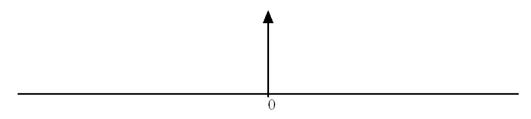

Don’t worry, I *don’t* want to disabuse you of these ideas, or of the picture. I just want to refine things somewhat.

As an approximation to $\delta$ through functions in $\mathcal{S}$ one might consider the family of Gaussians

$$
g(x,t) = \frac{1}{\sqrt{2\pi t}} e^{-x^2/2t}, \quad t > 0\,.
$$

We remarked earlier that the Gaussians are rapidly decreasing functions.

Here’s a plot of some functions in the family for $t = 2$, 1, 0.5, 0.1, 0.05 and 0.01. The smaller the value of $t$, the more sharply peaked the function is at 0 (it’s more and more “concentrated” there), while away from 0 the functions are hugging the axis more and more closely. These are the properties we’re trying to capture, approximately.

As an idealization of a function concentrated at $x = 0$, $\delta$ should then be a limit

$$
\delta(x) = \lim_{t \to 0} g(x,t)\,.
$$

This limit doesn’t make sense as a pointwise statement — it doesn’t define a function — but it begins to make sense when one shows how the limit works *operationally* when “paired” with other functions. The pairing, by definition, is by integration, and to anticipate the second approach to distributions, we’ll write this as

$$
\langle g(x,t), \varphi \rangle = \int_{-\infty}^{\infty} g(x,t)\varphi(x)\,dx\,.
$$

(Don’t think of this as an inner product. The angle bracket notation is just a good notation for pairing.[^4-11]) The fundamental result — what it means for the $g(x,t)$ to be “concentrated at 0” as $t \to 0$ — is

$$
\lim_{t \to 0} \int_{-\infty}^{\infty} g(x,t)\varphi(x)\,dx = \varphi(0)\,.
$$

[^4-11]: Like one pairs “bra” vectors with “ket” vectors in quantum mechanics to make a $\langle A|B \rangle$ — a bracket.

Now, whereas you’ll have a hard time making sense of $\lim_{t \to 0} g(x,t)$ alone, there’s no trouble making sense of the limit of the integral, and, in fact, no trouble proving the statement just above. Do observe, however, that the statement: “The limit of the integral is the integral of the limit.” is thus not true in this case. The limit of the integral makes sense but not the integral of the limit.[^4-12]

[^4-12]: If you read the Appendix on integrals from the preceding lecture, where the validity of such a result is stated as a variant of the Lebesgue Dominated Convergence theorem, what goes wrong here is that $g(t,x)\varphi(x)$ will not be dominated by an integrable function since $g(0,t)$ is tending to $\infty$.

We can and will define the distribution $\delta$ by this result, and write

$$
\langle \delta, \varphi \rangle = \lim_{t \to 0} \int_{-\infty}^{\infty} g(x,t)\varphi(x)\,dx = \varphi(0)\,.
$$

I won’t go through the argument for this here, but see Section 4.6.1 for other ways of getting to $\delta$ and for a general result along these lines.

The Gaussians tend to $\infty$ at $x = 0$ as $t \to 0$, and that’s why writing simply $\delta(x) = \lim_{t \to 0} g(x,t)$ doesn’t make sense. One would have to say (and people *do* say, though I have a hard time with it) that the delta function has these properties:

- $\delta(x) = 0$ for $x \neq 0$

- $\delta(0) = \infty$

- $\displaystyle\int_{-\infty}^{\infty} \delta(x)\,dx = 1$

These reflect the corresponding (genuine) properties of the $g(x,t)$:

- $\displaystyle\lim_{t \to 0} g(x,t) = 0$ if $x \neq 0$

- $\displaystyle\lim_{t \to 0} g(0,t) = \infty$

- $\displaystyle\int_{-\infty}^{\infty} g(x,t)\,dx = 1$

The third property is our old friend, the second is clear from the formula, and you can begin to believe the first from the shape of the graphs. The first property is the flip side of “concentrated at a point”, namely to be zero *away* from the point where the function is concentrated.

---

The limiting process also works with convolution:

$$
\lim_{t \to 0}(g * \varphi)(a) = \lim_{t \to 0} \int_{-\infty}^{\infty} g(a - x, t)\varphi(x)\,dx = \varphi(a)\,.
$$

This is written

$$
(\delta * \varphi)(a) = \varphi(a)
$$

as shorthand for the limiting process that got us there, and the notation is then pushed so far as to write the delta function itself under the integral, as in

$$
(\delta * \varphi)(a) = \int_{-\infty}^{\infty} \delta(a - x)\varphi(x)\,dx = \varphi(a)\,.
$$

Let me declare now that I am *not* going to try to talk you out of writing this.

---

The equation

$$
(\delta * \varphi)(a) = \varphi(a)
$$

completes the analogy: “$\delta$ is to 1 as convolution is to multiplication”.

**Why concentrate?** Why would one want a function concentrated at a point in the first place? We’ll certainly have *plenty* of applications of delta functions very shortly, and you’ve probably already seen a variety through classes on systems and signals in EE or on quantum mechanics in physics. Indeed, it would be wrong to hide the origin of the delta function. Heaviside used $\delta$ (without the notation) in his applications and reworking of Maxwell’s theory of electromagnetism. In EE applications, starting with Heaviside, you find the “unit impulse” used, as an idealization, in studying how systems respond to sharp, sudden inputs. We’ll come back to this latter interpretation when we talk about linear systems. The symbolism, and the three defining properties of $\delta$ listed above, were introduced later by P. Dirac in the service of calculations in quantum mechanics. Because of Dirac’s work, $\delta$ is often referred to as the “Dirac $\delta$ function”.

For the present, let’s take a look back at the heat equation and how the delta function comes in there. We’re perfectly set up for that.

We have seen the family of Gaussians

$$
g(x,t) = \frac{1}{\sqrt{2\pi t}} e^{-x^2/2t}, \quad t > 0
$$

before. They arose in solving the heat equation for an “infinite rod”. Recall that the temperature $u(x,t)$ at a point $x$ and time $t$ satisfies the partial differential equation

$$
u_t = \tfrac{1}{2} u_{xx}\,.
$$

When an infinite rod (the real line, in other words) is given an initial temperature $f(x)$ then $u(x,t)$ is given by the convolution with $g(x,t)$:

$$
u(x,t) = g(x,t) * f(x) = \frac{1}{\sqrt{2\pi t}} e^{-x^2/2t} * f(x) = \int_{-\infty}^{\infty} \frac{1}{\sqrt{2\pi t}} e^{-(x-y)^2/2t} f(y)\,dy\,.
$$

One thing I didn’t say at the time, knowing that this day would come, is how one recovers the initial temperature $f(x)$ *from* this formula. The initial temperature is at $t = 0$, so this evidently requires that we take the limit:

$$
\lim_{t \to 0^+} u(x,t) = \lim_{t \to 0^+} g(x,t) * f(x) = (\delta * f)(x) = f(x)\,.
$$

Out pops the initial temperature. Perfect. (Well, there have to be some assumptions on $f(x)$, but that’s another story.)

### 4.4.2 Distributions as linear functionals

**Farewell to vacuum tubes** The approach to distributions we’ve just followed, illustrated by defining $\delta$, can be very helpful in particular cases and where there’s a natural desire to have everything look as “classical” as possible. Still and all, I maintain that adopting this approach wholesale to defining and working with distributions is using technology from a bygone era. I haven’t yet defined the collection of tempered distributions $\mathcal{T}$ which is supposed to be the answer to all our Fourier prayers, and I don’t know how to do it from a purely “distributions as limits” point of view. It’s time to transistorize.

In the preceding discussion we did wind up by considering a distribution, at least $\delta$, in terms of how it acts when paired with a Schwartz function. We wrote

$$
\langle \delta, \varphi \rangle = \varphi(0)
$$

as shorthand for the result of taking the limit of the pairing

$$
\langle g(x,t), \varphi(x) \rangle = \int_{-\infty}^{\infty} g(x,t)\varphi(x)\,dx\,.
$$

The second approach to defining distributions takes this idea — “the outcome” of a distribution acting on a test function — as a starting point rather than as a conclusion. The question to ask is what aspects of “outcome”, as present in the approach via limits, do we try to capture and incorporate in the basic definition?
---

Mathematical functions defined on $\mathbf{R}$, “live at points”, to use the hip phrase. That is, you plug in a particular point from $\mathbf{R}$, the domain of the function, and you get a particular value in the range, as for instance in the simple case when the function is given by an algebraic expression and you plug values into the expression. Generalized functions — distributions — do not live at points. The domain of a generalized function is not a set of numbers. The value of a generalized function is not determined by plugging in a number from $\mathbf{R}$ and determining a corresponding number. Rather, a particular value of a distribution is determined by how it “operates” on a particular *test function*. The domain of a generalized function is a set of test functions. As they say in Computer Science, helpfully:

- You pass a distribution a test function and it returns a number.

That’s not so outlandish. There are all sorts of operations you’ve run across that take a signal as an argument and return a number. The terminology of “distributions” and “test functions”, from the dawn of the subject, is even supposed to be some kind of desperate appeal to physical reality to make this reworking of the earlier approaches more appealing and less “abstract”. See label 4.5 for a weak attempt at this, but I can only keep up that physical pretense for so long.

Having come this far, but still looking backward a little, recall that we asked which properties of a pairing — integration, as we wrote it in a particular case in the first approach — do we want to subsume in the general definition. To get all we need, we need remarkably little. Here’s the definition:

**Tempered distributions** A *tempered distribution* $T$ is a complex-valued continuous linear functional on the collection $\mathcal{S}$ of Schwartz functions (called *test functions*). We denote the collection of all tempered distributions by $\mathcal{T}$.

That’s the complete definition, but we can unpack it a bit:

1. If $\varphi$ is in $\mathcal{S}$ then $T(\varphi)$ is a complex number. (You pass a distribution a Schwartz function, it returns a complex number.)

   - We often write this action of $T$ on $\varphi$ as $\langle T, \varphi \rangle$ and say that $T$ is *paired* with $\varphi$. (This terminology and notation are conventions, not commandments.)

2. A tempered distribution is linear operating on test functions:

   $$
   T(\alpha_1\varphi_1 + \alpha_2\varphi_2) = \alpha_1 T(\varphi_1) + \alpha_2 T(\varphi_2)
   $$

   or, in the other notation,

   $$
   \langle T, \alpha_1\varphi_1 + \alpha_2\varphi_2 \rangle = \alpha_1\langle T, \varphi_1 \rangle + \alpha_2\langle T, \varphi_2 \rangle,
   $$

   for test functions $\varphi_1$, $\varphi_2$ and complex numbers $\alpha_1$, $\alpha_2$.

3. A tempered distribution is continuous: if $\varphi_n$ is a sequence of test functions in $\mathcal{S}$ with $\varphi_n \to \varphi$ in $\mathcal{S}$ then

   $$
   T(\varphi_n) \to T(\varphi)\,, \quad \text{also written} \quad \langle T, \varphi_n \rangle \to \langle T, \varphi \rangle\,.
   $$

Also note that two tempered distributions $T_1$ and $T_2$ are equal if they agree on all test functions:

$$
T_1 = T_2 \quad \text{if} \quad T_1(\varphi) = T_2(\varphi) \quad (\langle T_1, \varphi \rangle = \langle T_2, \varphi \rangle) \quad \text{for all } \varphi \text{ in } \mathcal{S}\,.
$$

This isn’t part of the definition, it’s just useful to write down.

**There’s a catch** There is one hard part in the definition, namely, what it means for a sequence of test functions in $\mathcal{S}$ to converge in $\mathcal{S}$. To say that $\varphi_n \to \varphi$ in $\mathcal{S}$ is to control the convergence of $\varphi_n$ together with all its derivatives. We won’t enter into this, and it won’t be an issue for us. If you look in standard mathematics books on the theory of distributions you will find long, difficult discussions of the appropriate topologies on spaces of functions that must be used to talk about convergence. And you will be discouraged from going any further. Don’t go there.

It’s another question to ask *why* continuity is included in the definition. Let me just say that this is important when one considers limits of distributions and approximations to distributions.

**Other classes of distributions** This settles the question of what a tempered distribution *is*: it’s a continuous linear functional on $\mathcal{S}$. For those who know the terminology, $\mathcal{T}$ is the *dual space* of the space $\mathcal{S}$. In general, the dual space to a vector space is the set of continuous linear functionals on the vector space, the catch being to define continuity appropriately. From this point of view one can imagine defining types of distributions other than the tempered distributions. They arise by taking the dual spaces of collections of test functions other than $\mathcal{S}$. Though we’ll state things for tempered distributions, most general facts (those not pertaining to the Fourier transform, yet to come) also hold for other types of distributions. We’ll discuss this in the last section.

### 4.4.3 Two important examples of distributions

Let us now understand:

1. How $\mathcal{T}$ somehow includes the functions we’d like it to include for the purposes of extending the Fourier transform.

2. How $\delta$ fits into this new scheme.

The first item is a general construction and the second is an example of a specific distribution defined in this new way.

**How functions determine tempered distributions, and why the tempered distributions include the functions we want.** Suppose $f(x)$ is a function for which

$$
\int_{-\infty}^{\infty} f(x)\varphi(x)\,dx
$$

exists for all Schwartz functions $\varphi(x)$. This is not asking too much, considering that Schwartz functions decrease so rapidly that they’re plenty likely to make a product $f(x)\varphi(x)$ integrable. We’ll look at some examples, below.

In this case the function $f(x)$ *determines* (“defines” or “induces” or “corresponds to” — pick your preferred descriptive phrase) a tempered distribution $T_f$ *by means of the formula*

$$
T_f(\varphi) = \int_{-\infty}^{\infty} f(x)\varphi(x)\,dx\,.
$$

In words, $T_f$ acts on a test function $\varphi$ by integration of $\varphi$ against $f$. Alternatively, we say that the function $f$ determines a distribution $T_f$ through the pairing

$$
\langle T_f, \varphi \rangle = \int_{-\infty}^{\infty} f(x)\varphi(x)\,dx\,, \quad \varphi \text{ a test function.}
$$

This is just what we considered in the earlier approach that led to $\delta$, pairing Gaussians with a Schwartz function. In the present terminology we would say that the Gaussian $g(x,t)$ determines a distribution $T_g$ according to the formula

$$
\langle T_g, \varphi \rangle = \int_{-\infty}^{\infty} g(x,t)\varphi(x)\,dx\,.
$$

Let’s check that the pairing $\langle T_f, \varphi \rangle$ meets the standard of the definition of a distribution. The pairing is linear because integration is linear:

$$
\begin{aligned}
\langle T_f, \alpha_1\varphi_1 + \alpha_2\varphi_2 \rangle &= \int_{-\infty}^{\infty} f(x)(\alpha_1\varphi_1(x) + \alpha_2\varphi_2(x))\,dx \\
&= \int_{-\infty}^{\infty} f(x)\alpha_1\varphi_1(x)\,dx + \int_{-\infty}^{\infty} f(x)\alpha_2\varphi_2(x)\,dx \\
&= \alpha_1\langle T_f, \varphi_1 \rangle + \alpha_2\langle T_f, \varphi_2 \rangle
\end{aligned}
$$

What about continuity? We have to take a sequence of Schwartz functions $\varphi_n$ converging to a Schwartz function $\varphi$ and consider the limit

$$
\lim_{n \to \infty} \langle T_f, \varphi_n \rangle = \lim_{n \to \infty} \int_{-\infty}^{\infty} f(x)\varphi_n(x)\,dx\,.
$$

Again, we haven’t said anything precisely about the meaning of $\varphi_n \to \varphi$, but the standard results on taking the limit inside the integral will apply in this case and allow us to conclude that

$$
\lim_{n \to \infty} \int_{-\infty}^{\infty} f(x)\varphi_n(x)\,dx. = \int_{-\infty}^{\infty} f(x)\varphi(x)\,dx
$$

i.e., that

$$
\lim_{n \to \infty} \langle T_f, \varphi_n \rangle = \langle T_f, \varphi \rangle\,.
$$

This is continuity.

---

Using a function $f(x)$ to determine a distribution $T_f$ this way is a very common way of constructing distributions. We will use it frequently. Now, you might ask yourself whether different functions can give rise to the same distribution. That is, if $T_{f_1} = T_{f_2}$ as distributions, then must we have $f_1(x) = f_2(x)$? Yes, fortunately, for if $T_{f_1} = T_{f_2}$ then for all test functions $\varphi(x)$ we have

$$
\int_{-\infty}^{\infty} f_1(x)\varphi(x)\,dx = \int_{-\infty}^{\infty} f_2(x)\varphi(x)\,dx
$$

hence

$$
\int_{-\infty}^{\infty} (f_1(x) - f_2(x))\varphi(x)\,dx = 0\,.
$$

Since this holds for all test functions $\varphi(x)$ we can conclude that $f_1(x) = f_2(x)$.

Because a function $f(x)$ determines a *unique* distribution, it’s natural to “identify” the function $f(x)$ with the corresponding distribution $T_f$. Sometimes we then write just $f$ for the corresponding distribution rather than writing $T_f$, and we write the pairing as

$$
\langle f, \varphi \rangle = \int_{-\infty}^{\infty} f(x)\varphi(x)\,dx
$$

rather than as $\langle T_f, \varphi \rangle$.
- It is in this sense — identifying a function $f$ with the distribution $T_f$ it determines— that a class of distributions “contains” classical functions.

Let’s look at some examples.

**Examples** The sinc function defines a tempered distribution, because, though sinc is not integrable, $(\operatorname{sinc} x)\varphi(x)$ *is* integrable for any Schwartz function $\varphi(x)$. Remember that a Schwartz function $\varphi(x)$ dies off faster than any power of $x$ and that’s more than enough to pull sinc down rapidly enough at $\pm\infty$ to make the integral exist. I’m not going to prove this but I have no qualms asserting it. For example, here’s a plot of $e^{-x^2}$ times the sinc function on the interval $-3.5 \le x \le 3.5$:

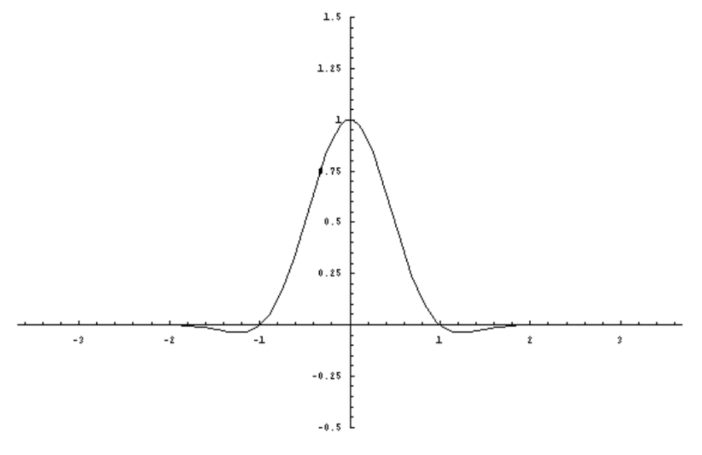

For the same reason any complex exponential, and also sine and cosine, define tempered distributions. Here’s a plot of $e^{-x^2}$ times $\cos 2\pi x$ on the range $-3.5 \le x \le 3.5$:

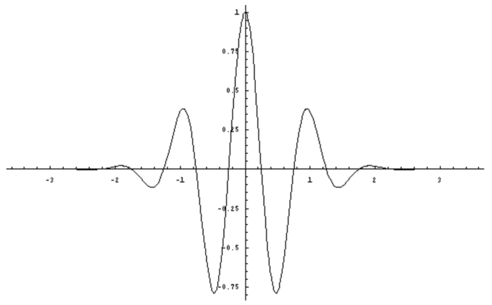

Take two more examples, the Heaviside unit step $H(x)$ and the unit ramp $u(x)$:

$$
H(x) = \begin{cases} 0 & x < 0 \\ 1 & x \ge 0 \end{cases} \qquad u(x) = \begin{cases} 0 & x \le 0 \\ x & x \ge 0 \end{cases}
$$

Neither function is integrable; indeed, $u(x)$ even tends to $\infty$ as $x \to \infty$, but it does so only to the first power (exactly) of $x$. Multiplying by a Schwartz function brings $H(x)$ and $u(x)$ down, and they each determine tempered distributions. Here are plots of $e^{-x^2}$ times $H(x)$ and $u(x)$, respectively:

The upshot is that the sinc, complex exponentials, the unit step, the unit ramp, and many others, can all be considered to *be* tempered distributions. This is a good thing, because we’re aiming to define the Fourier transform *of a tempered distribution*, and we want to be able to apply it to the signals society needs. (We’ll also get back to our good old formula $\mathcal{F}\operatorname{sinc} = \Pi$, and all will be right with the world.)

---

Do all tempered distributions “come from functions” in this way? In the next section we’ll define $\delta$ as a (tempered) distribution, i.e., as a linear functional. $\delta$ does not come from a function in the way we’ve just described (or in any way). This adds to the feeling that we really have defined something new, that “generalized functions” *include* many (classical) functions but go beyond the classical functions.

Two final points. As we’ve just remarked, not every distribution comes from a function and so the nature of the pairing of a given tempered distribution $T$ with a Schwartz function $\varphi$ is unspecified, so to speak. By that I mean, *don’t* think that $\langle T, \varphi \rangle$ is an integral, as in

$$
\langle T, \varphi \rangle = \int_{-\infty}^{\infty} T(x)\varphi(x)\,dx
$$

for any old tempered distribution $T$.[^4-13] The pairing *is* an integral when the distribution comes from a function, but there’s more to tempered distributions than that.

[^4-13]: For one thing it doesn’t make sense, strictly speaking, even to write $T(x)$; you don’t pass a distribution a number $x$ to evaluate, you pass it a function.

Finally a note of caution. Not *every* function determines a tempered distribution. For example $e^{x^2}$ doesn’t.[^4-14] It doesn’t because $e^{-x^2}$ is a Schwartz function and

$$
\int_{-\infty}^{\infty} e^{x^2} e^{-x^2}\,dx = \int_{-\infty}^{\infty} 1\,dx = \infty\,.
$$

[^4-14]: It does determine other kinds of distributions, ones based on other classes of test functions. See Section 4.20.

**$\boldsymbol{\delta}$ as a tempered distribution** The limiting approach to the delta function culminated with our writing

$$
\langle \delta, \varphi \rangle = \varphi(0)
$$

as the result of

$$
\lim_{t \to 0} \int_{-\infty}^{\infty} g(x,t)\varphi(x)\,dx = \varphi(0)\,.
$$

Now with our second approach, tempered distributions as linear functionals on $\mathcal{S}$, we can simply *define* the tempered distribution $\delta$ by how it should operate on a function $\varphi$ in $\mathcal{S}$ so as to *achieve this outcome*, and obviously what we want is

$$
\delta(\varphi) = \varphi(0), \quad \text{or in the bracket notation} \quad \langle \delta, \varphi \rangle = \varphi(0);
$$

you pass $\delta$ a test function and it returns the value of the test function at 0.

Let’s check the definition. For linearity,

$$
\begin{aligned}
\langle \delta, \varphi_1 + \varphi_2 \rangle &= \varphi_1(0) + \varphi_2(0) = \langle \delta, \varphi_1 \rangle + \langle \delta, \varphi_2 \rangle \\
\langle \delta, \alpha\varphi \rangle &= \alpha\varphi(0) = \alpha\langle \delta, \varphi \rangle\,.
\end{aligned}
$$

For continuity, if $\varphi_n(x) \to \varphi(0)$ then in particular $\varphi_n(0) \to \varphi(0)$ and so

$$
\langle \delta, \varphi_n \rangle = \varphi_n(0) \to \varphi(0) = \langle \delta, \varphi \rangle\,.
$$

---

So the mysterious $\delta$, clouded in controversy by statements like

$$
\begin{aligned}
&\delta(x) = 0 \text{ for } x \neq 0 \\
&\delta(0) = \infty \\
&\int_{-\infty}^{\infty} \delta(x)\,dx = 1
\end{aligned}
$$

now emerges as *the simplest possible nontrivial tempered distribution* — it’s just the functional described in words by “evaluate at 0”!

---

There was a second identity that we had from the “$\delta$ as limit” development, namely

$$
(\delta_a * \varphi) = \varphi(a)\,.
$$

as a result of

$$
\lim_{t \to 0} \int_{-\infty}^{\infty} g(a - x, t)\varphi(x)\,dx = \varphi(a)
$$

We’ll get back to convolution with distributions, but there’s another way we can capture this outcome without mentioning convolution. We define a tempered distribution $\delta_a$ (the $\delta$ function based at $a$) by the formula

$$
\langle \delta_a, \varphi \rangle = \varphi(a)\,.
$$

In words, you pass $\delta_a$ a test function and it returns the value of the test function at $a$. I won’t check that $\delta_a$ satisfies the definition — it’s the same argument as for $\delta$.

$\delta$ and $\delta_a$ are two different distributions (for $a \neq 0$). Classically, if that word makes sense here, one would write $\delta_a$ as $\delta(x - a)$, just a shifted $\delta$. We’ll get to that, and use that notation too, but a bit later. As tempered distributions, $\delta$ and $\delta_a$ are *defined* to have the property we want them to have. It’s air tight — no muss, no fuss. That’s $\delta$. That’s $\delta_a$.

---

Would we have come upon this simple, direct definition without having gone through the “distributions as limits” approach? Would we have the transistor without first having vacuum tubes? Perhaps so, perhaps not. That first approach via limits provided the basic insights that allowed people, Schwartz in particular, to reinvent the theory of distributions based on linear functionals as we have done here (as he did).

### 4.4.4 Other types of distributions

We have already seen that the functions in $\mathcal{S}$ work well for Fourier transforms. We’ll soon see that the tempered distributions $\mathcal{T}$ based on $\mathcal{S}$ are the right objects to be operated on by a generalized Fourier transform. However, $\mathcal{S}$ isn’t the only possible collection of test functions and $\mathcal{T}$ isn’t the only possible collection of distributions.

Another useful set of test functions are the smooth functions that are timelimited, to use terminology from EE. That is, we let $\mathcal{C}$ be the set of infinitely differentiable functions which are identically zero beyond a point:

> $\varphi(x)$ is in $\mathcal{C}$ if $\varphi(x)$ has derivatives of all orders and if $\varphi(x) = 0$ for $|x| \ge x_0$ (where $x_0$ can depend on $\varphi$).

The mathematical terminology for such a function is that it has *compact support*. The *support* of a function is the complement of the largest set where the function is identically zero. (The letter $\mathcal{C}$ is supposed to connote “compact”.)

The continuous linear functionals on $\mathcal{C}$ also form a collection of distributions, denoted by $\mathcal{D}$. In fact, when most people use the term “distribution” (without the adjective tempered) they are usually thinking of an element of $\mathcal{D}$. We use the same notation as before for the pairing: $\langle T, \varphi \rangle$ for $T$ in $\mathcal{D}$ and $\varphi$ in $\mathcal{C}$.

---

$\delta$ and $\delta_a$ belong to $\mathcal{D}$ as well as to $\mathcal{T}$, and the definition is the same:

$$
\langle \delta, \varphi \rangle = \varphi(0) \quad \text{and} \quad \langle \delta_a, \varphi \rangle = \varphi(a)\,.
$$

It’s the same $\delta$. It’s not a new distribution, it’s only operating on a different class of test functions.

---

$\mathcal{D}$ is a bigger collection of distributions than $\mathcal{T}$ because $\mathcal{C}$ is a smaller collection of test functions than $\mathcal{S}$. The latter point should be clear to you: To say that $\varphi(x)$ is smooth and *vanishes* identically outside some interval is a stronger condition than requiring merely that it *decays at* infinity (albeit faster than any power of $x$). Thus if $\varphi(x)$ is in $\mathcal{C}$ then it’s also in $\mathcal{S}$. Why is $\mathcal{D}$ bigger than $\mathcal{T}$? Since $\mathcal{C}$ is contained in $\mathcal{S}$, a continuous linear functional on $\mathcal{S}$ is automatically a continuous linear functional on $\mathcal{C}$. That is, $\mathcal{T}$ is contained in $\mathcal{D}$.

---

Just as we did for $\mathcal{T}$, we say that a function $f(x)$ determines a distribution in $\mathcal{D}$ if

$$
\int_{-\infty}^{\infty} f(x)\varphi(x)\,dx
$$

exists for all test functions $\varphi$ in $\mathcal{C}$. As before, we write $T_f$ for the distribution induced by a function $f$, and the pairing as

$$
\langle T_f, \varphi \rangle = \int_{-\infty}^{\infty} f(x)\varphi(x)\,dx\,.
$$

As before, a function determines a unique distribution in this way, so we identify $f$ with $T_f$ and write the pairing as

$$
\langle f, \varphi \rangle = \int_{-\infty}^{\infty} f(x)\varphi(x)\,dx\,.
$$

It’s easier to satisfy the integrability condition for $\mathcal{C}$ than for $\mathcal{S}$ because multiplying $f(x)$ by a function in $\mathcal{C}$ kills it off completely outside some interval, rather than just bringing it smoothly down to zero at infinity as would happen when multiplying by a function in $\mathcal{S}$. This is another reason why $\mathcal{D}$ is a bigger class of distributions than $\mathcal{T}$ — more functions determine distributions. For example, we observed that the function $e^{x^2}$ doesn’t determine a tempered distribution, but it *does* determine an element of $\mathcal{D}$.
## 4.5 A Physical Analogy for Distributions

Think of heat distributed over a region in space. A number associated with heat is temperature, and we want to measure the temperature at a point using a thermometer. But does it really make sense to ask for the temperature “at a point”? What kind of test instrument could possibly measure the temperature at a point?

What makes more sense is that a thermometer registers some overall value of the temperature near a point. That is, the temperature is whatever the thermometer says it is, and is determined by a pairing of the heat (the distribution) with the thermometer (a test function or test device). The more “concentrated” the thermometer (the more sharply peaked the test function) the more accurate the measurement, meaning the closer the reading is to being the temperature “at a point”.

A pairing of a test function with the heat is somehow supposed to model how the thermometer responds to the distribution of heat. One particular way to model this is to say that if $f$ is the heat and $\varphi$ is the test function, then the reading on the thermometer is

$$
\int f(x)\varphi(x)\,dx\,,
$$

an integrated, average temperature. I’ve left limits off the integral to suggest that it is taken over some region of space where the heat is distributed.

Such measurements (temperature or other sorts of physical measurements) are supposed to obey laws of superposition (linearity) and the like, which, in this model case, translates to

$$
\int f(x)(\alpha_1\varphi_1(x) + \alpha_2(x)\varphi_2(x))\,dx = \alpha_1 \int f(x)\varphi_1(x)\,dx + \alpha_2 \int f(x)\varphi_2(x)\,dx
$$

for test functions $\varphi_1$ and $\varphi_2$. That’s why we incorporate linearity into the definition of distributions. With enough wishful thinking you can pass from this motivation to the general definition. Sure you can.

## 4.6 Limits of Distributions

There’s a very useful general result that allows us to define distributions by means of limits. The statement goes:

> Suppose that $T_n$ is a sequence of tempered distributions and that $\langle T_n, \varphi \rangle$ (a sequence of numbers) converges for every Schwartz function $\varphi$. Then $T_n$ converges to a tempered distribution $T$ and
>
> $$
> \langle T, \varphi \rangle = \lim_{n \to \infty} \langle T_n, \varphi \rangle
> $$

Briefly, distributions can be defined by taking limits of sequences of distributions, and the result says that if the parings converge then the distributions converge. This is by no means a trivial fact, the key issue being the proper notion of convergence of distributions, and that’s hard. We’ll have to be content with the statement and let it go at that.

You might not spot it from the statement, but one practical consequence of this result is that if different converging sequences have the same effect on test functions then they must be converging to the same distribution. More precisely, if $\lim_{n \to \infty} \langle S_n, \varphi \rangle$ and $\lim_{n \to \infty} \langle T_n, \varphi \rangle$ both exist and are equal for every test function $\varphi$ then $S_n$ and $T_n$ both converge to the same distribution. That’s certainly possible — different sequences can have the same limit, after all.

To illustrate just why this is helpful to know, let’s consider different ways of approximating $\delta$.

### 4.6.1 Other Approximating Sequences for δ

Go back to the idea that $\delta$ is an idealization of an impulse concentrated at a point. Earlier we used a family of Gaussians to approach $\delta$, but there are many other ways we could try to approximate this characteristic behavior of $\delta$ in the limit. For example, take the family of scaled $\Pi$ functions

$$
R_\epsilon(x) = \frac{1}{\epsilon}\Pi_\epsilon(x) = \frac{1}{\epsilon}\Pi\left(\frac{x}{\epsilon}\right) = \begin{cases} \frac{1}{\epsilon} & |x| < \frac{\epsilon}{2} \\ 0 & |x| \ge \frac{\epsilon}{2} \end{cases}
$$

where $\epsilon$ is a positive constant. Here’s a plot of $R_\epsilon(x)$ for $\epsilon = 2$, 1, 0.5, 0.1, some of the same values we used for the parameter in the family of Gaussians.

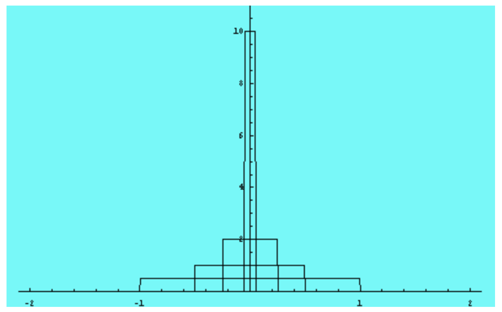

What happens if we integrate $R_\epsilon(x)$ against a test function $\varphi(x)$? The function $\varphi(x)$ could be a Schwartz function, if we wanted to stay within the class of tempered distributions, or an element of $\mathcal{C}$. In fact, all that we require is that $\varphi(x)$ is smooth near the origin so that we can use a Taylor approximation (and we could get away with less than that). We write

$$
\begin{aligned}
\langle R_\epsilon, \varphi \rangle &= \int_{-\infty}^{\infty} R_\epsilon(x)\varphi(x)\,dx = \frac{1}{\epsilon}\int_{-\epsilon/2}^{\epsilon/2} \varphi(x)\,dx \\
&= \frac{1}{\epsilon}\int_{-\epsilon/2}^{\epsilon/2} (\varphi(0) + \varphi''(0)x + O(x^2))\,dx = \varphi(0) + \frac{1}{\epsilon}\int_{-\epsilon/2}^{\epsilon/2} O(x^2)\,dx = \varphi(0) + O(\epsilon^2)\,.
\end{aligned}
$$

If we let $\epsilon \to 0$ we obtain

$$
\lim_{\epsilon \to 0} \langle R_\epsilon, \varphi \rangle = \varphi(0)\,.
$$

In the limit, the result of pairing the $R_\epsilon$ with a test function is the same as pairing a Gaussian with a test function:

$$
\lim_{\epsilon \to 0} \langle R_\epsilon, \varphi \rangle = \varphi(0) = \lim_{t \to 0} \langle g(x,t), \varphi(x) \rangle\,.
$$

Thus the distributions defined by $R_\epsilon$ and by $g(x,t)$ each converge and to the same distribution, namely $\delta$.[^4-15]

[^4-15]: Note that the convergence isn’t phrased in terms of a sequential limit with $n \to \infty$, but that’s not important — we could have set, for example, $\epsilon_n = 1/n$, $t_n = 1/n$ and let $n \to \infty$ to get $\epsilon \to 0$, $t \to 0$.

**A general way to get to $\boldsymbol{\delta}$** There’s a general, flexible and simple approach to getting to $\delta$ by a limit. It can be useful to know this if one model approximation might be preferred to another in a particular computation or application. Start with a function $f(x)$ having

$$
\int_{-\infty}^{\infty} f(x)\,dx = 1
$$

and form

$$
f_p(x) = pf(px)\,, \quad p > 0\,.
$$

Then one has

$$
f_p \to \delta\,.
$$

How does $f_p$ compare with $f$? As $p$ increases, the scaled function $f(px)$ concentrates near $x = 0$, that is, the graph is squeezed in the horizontal direction. Multiplying by $p$ to form $pf(px)$ then stretches the values in the vertical direction. Nevertheless

$$
\int_{-\infty}^{\infty} f_p(x)\,dx = 1
$$

as we see by making the change of variable $u = px$.

To show that $f_p$ converges to $\delta$, we pair $f_p(x)$ with a test function $\varphi(x)$ via integration and show

$$
\lim_{p \to \infty} \int_{-\infty}^{\infty} f_p(x)\varphi(x)\,dx = \varphi(0) = \langle \delta, \varphi \rangle\,.
$$

There is a nice argument to show this. Write

$$
\begin{aligned}
\int_{-\infty}^{\infty} f_p(x)\varphi(x)\,dx &= \int_{-\infty}^{\infty} f_p(x)(\varphi(x) - \varphi(0) + \varphi(0))\,dx \\
&= \int_{-\infty}^{\infty} f_p(x)(\varphi(x) - \varphi(0))\,dx + \varphi(0)\int_{-\infty}^{\infty} f_p(x)\,dx \\
&= \int_{-\infty}^{\infty} f_p(x)(\varphi(x) - \varphi(0))\,dx + \varphi(0) \\
&= \int_{-\infty}^{\infty} f(x)(\varphi(x/p) - \varphi(0))\,dx + \varphi(0),
\end{aligned}
$$

where we have used that the integral of $f_p$ is 1 and have made a change of variable in the last integral.

The object now is to show that the integral of $f(x)(\varphi(x/p) - \varphi(0))$ goes to zero as $p \to \infty$. There are two parts to this. Since the integral of $f(x)(\varphi(x/p) - \varphi(0))$ is finite, the tails at $\pm\infty$ are arbitrarily small, meaning, more formally, that for any $\epsilon > 0$ there is an $a > 0$ such that

$$
\left|\int_a^{\infty} f(x)(\varphi(x/p) - \varphi(0))\,dx\right| + \left|\int_{-\infty}^{-a} f(x)(\varphi(x/p) - \varphi(0))\,dx\right| < \epsilon\,.
$$

This didn’t involve letting $p$ tend to $\infty$; that comes in now. Fix $a$ as above. It remains to work with the integral

$$
\int_{-a}^{a} f(x)(\varphi(x/p) - \varphi(0))\,dx
$$

and show that this too can be made arbitrarily small. Now

$$
\int_{-a}^{a} |f(x)|\,dx
$$

is a fixed number, say $M$, and we can take $p$ so large that $|\varphi(x/p) - \varphi(0)| < \epsilon/M$ for $|x/p| \le a$. With this,

$$
\left|\int_{-a}^{a} f(x)(\varphi(x/p) - \varphi(0))\,dx\right| \le \int_{-a}^{a} |f(x)|\,|\varphi(x/p) - \varphi(0)|\,dx < \epsilon\,.
$$

Combining the three estimates we have

$$
\left|\int_{-\infty}^{\infty} f(x)(\varphi(x/p) - \varphi(0))\,dx\right| < 2\epsilon\,,
$$

and we’re done.

We’ve already seen two applications of this construction, to

$$
f(x) = \Pi(x)
$$

and, originally, to

$$
f(x) = \frac{1}{\sqrt{2\pi}} e^{x^2/2}\,, \quad \text{take } p = 1/\sqrt{t}\,.
$$

Another possible choice, believe it or not, is

$$
f(x) = \operatorname{sinc} x\,.
$$

This works because the integral

$$
\int_{-\infty}^{\infty} \operatorname{sinc} x\,dx
$$

is the Fourier transform of sinc at 0, and you’ll recall that we stated the true fact that

$$
\int_{-\infty}^{\infty} e^{-2\pi i s t} \operatorname{sinc} t\,dt = \begin{cases} 1 & |t| < \frac{1}{2} \\ 0 & |t| > \frac{1}{2} \end{cases}
$$

## 4.7 The Fourier Transform of a Tempered Distribution

It’s time to show how to generalize the Fourier transform to tempered distributions.[^4-16] It will take us one or two more steps to get to the starting line, but after that it’s a downhill race passing effortlessly (almost) through all the important gates.

[^4-16]: In other words, it’s time to put up, or shut up.

**How to extend an operation from functions to distributions: Try a function first.** To define a distribution $T$ is to say what it does to a test function. You give me a test function $\varphi$ and I have to tell you $\langle T, \varphi \rangle$ — how $T$ operates on $\varphi$. We have done this in two cases, one particular and one general. In particular, we defined $\delta$ directly by

$$
\langle \delta, \varphi \rangle = \varphi(0)\,.
$$

In general, we showed how a function $f$ determines a distribution $T_f$ by

$$
\langle T_f, \varphi \rangle = \int_{-\infty}^{\infty} f(x)\varphi(x)\,dx
$$

provided that the integral exists for every test function. We also say that the distribution *comes from* a function. When no confusion can arise we identify the distribution $T_f$ with the function $f$ it comes from and write

$$
\langle f, \varphi \rangle = \int_{-\infty}^{\infty} f(x)\varphi(x)\,dx\,.
$$

---

When we want to extend an operation from functions to distributions — e.g., when we want to define the Fourier transform of a distribution, or the reverse of distribution, or the shift of a distribution, or the derivative of a distribution — we take our cue from the way functions determine distributions and ask how the operation works in the case when the pairing is given by integration. What we hope to see is an outcome that suggests a direct definition (as happened with $\delta$, for example). This is a procedure to follow. It’s something to try. See Appendix 1 for a discussion of why this is really the natural thing to do, but for now let’s see how it works for *the* operation we’re most interested in.

### 4.7.1 The Fourier transform defined

Suppose $T$ is a tempered distribution. Why should such an object have a Fourier transform, and how on earth shall we define it? It can’t be an integral, because $T$ isn’t a function so there’s nothing to integrate. If $\mathcal{F}T$ is to be itself a tempered distribution (just as $\mathcal{F}\varphi$ is again a Schwartz function if $\varphi$ is a Schwartz function) then we have to say how $\mathcal{F}T$ *pairs* with a Schwartz function, because that’s what tempered distributions do. So how?

We have a toe-hold here. If $\psi$ is a Schwartz function then $\mathcal{F}\psi$ is again a Schwartz function and we can ask: How does the Schwartz function $\mathcal{F}\psi$ pair with another Schwartz function $\varphi$? What is the outcome of $\langle \mathcal{F}\psi, \varphi \rangle$? We know how to pair a distribution that comes from a function ($\mathcal{F}\psi$ in this case) with a Schwartz function; it’s

$$
\langle \mathcal{F}\psi, \varphi \rangle = \int_{-\infty}^{\infty} \mathcal{F}\psi(x)\varphi(x)\,dx\,.
$$

But we can work with the right hand side:

$$
\begin{aligned}
\langle \mathcal{F}\psi, \varphi \rangle &= \int_{-\infty}^{\infty} \mathcal{F}\psi(x)\varphi(x)\,dx \\
&= \int_{-\infty}^{\infty}\left(\int_{-\infty}^{\infty} e^{-2\pi i x y}\psi(y)\,dy\right)\varphi(x)\,dx \\
&= \int_{-\infty}^{\infty}\int_{-\infty}^{\infty} e^{-2\pi i x y}\psi(y)\varphi(x)\,dy\,dx \\
&= \int_{-\infty}^{\infty}\left(\int_{-\infty}^{\infty} e^{-2\pi i x y}\varphi(x)\,dx\right)\psi(y)\,dy \\
&\qquad \text{(the interchange of integrals is justified because } \varphi(x)e^{-2\pi i s x} \\
&\qquad \text{and } \psi(x)e^{-2\pi i s x} \text{ are integrable)} \\
&= \int_{-\infty}^{\infty} \mathcal{F}\varphi(y)\psi(y)\,dy \\
&= \langle \psi, \mathcal{F}\varphi \rangle
\end{aligned}
$$

The outcome of pairing $\mathcal{F}\psi$ with $\varphi$ is:

$$
\langle \mathcal{F}\psi, \varphi \rangle = \langle \psi, \mathcal{F}\varphi \rangle\,.
$$

This tells us how we should make the definition in general:

- Let $T$ be a tempered distribution. The *Fourier transform* of $T$, denoted by $\mathcal{F}(T)$ or $\widehat{T}$, is the tempered distribution defined by

  $$
  \langle \mathcal{F}T, \varphi \rangle = \langle T, \mathcal{F}\varphi \rangle\,.
  $$

  for any Schwartz function $\varphi$.

This definition makes sense because when $\varphi$ is a Schwartz function so is $\mathcal{F}\varphi$; it is only then that the pairing $\langle T, \mathcal{F}\varphi \rangle$ is even defined.

---

We define the inverse Fourier transform by following the same recipe:

- Let $T$ be a tempered distribution. The *inverse Fourier transform* of $T$, denoted by $\mathcal{F}^{-1}(T)$ or $\check{T}$, is defined by

  $$
  \langle \mathcal{F}^{-1}T, \varphi \rangle = \langle T, \mathcal{F}^{-1}\varphi \rangle\,.
  $$

  for any Schwartz function $\varphi$.

Now all of a sudden we have

**Fourier inversion**:

$$
\mathcal{F}^{-1}\mathcal{F}T = T \quad \text{and} \quad \mathcal{F}\mathcal{F}^{-1}T = T
$$

for any tempered distribution $T$.

It’s a cinch. Watch. For any Schwartz function $\varphi$,

$$
\begin{aligned}
\langle \mathcal{F}^{-1}(\mathcal{F}T), \varphi \rangle &= \langle \mathcal{F}T, \mathcal{F}^{-1}\varphi \rangle \\
&= \langle T, \mathcal{F}(\mathcal{F}^{-1}\varphi) \rangle \\
&= \langle T, \varphi \rangle \quad \text{(because Fourier inversion works for Schwartz functions)}
\end{aligned}
$$

This says that $\mathcal{F}^{-1}(\mathcal{F}T)$ and $T$ have the same value when paired with any Schwartz function. Therefore they are the same distribution: $\mathcal{F}^{-1}\mathcal{F}T = T$. The second identity is derived in the same way.

Done. The most important result in the subject, done, in a few lines.

---

In Section 4.10 we’ll show that we’ve gained, and haven’t lost. That is, the generalized Fourier transform “contains” the original, classical Fourier transform in the same sense that tempered distributions contain classical functions.

### 4.7.2 A Fourier transform hit parade

With the definition in place it’s time to reap the benefits and find some Fourier transforms explicitly. We note one general property

- $\mathcal{F}$ is linear on tempered distributions.

This means that

$$
\mathcal{F}(T_1 + T_2) = \mathcal{F}T_1 + \mathcal{F}T_2 \quad \text{and} \quad \mathcal{F}(\alpha T) = \alpha\mathcal{F}T\,,
$$

$\alpha$ a number. These follow directly from the definition. To wit:

$$
\begin{aligned}
\langle \mathcal{F}(T_1 + T_2), \varphi \rangle &= \langle T_1 + T_2, \mathcal{F}\varphi \rangle = \langle T_1, \mathcal{F}\varphi \rangle + \langle T_2, \mathcal{F}\varphi \rangle = \langle \mathcal{F}T_1, \varphi \rangle + \langle \mathcal{F}T_2, \varphi \rangle = \langle \mathcal{F}T_1 + \mathcal{F}T_2, \varphi \rangle \\
\langle \mathcal{F}(\alpha T), \varphi \rangle &= \langle \alpha T, \mathcal{F}\varphi \rangle = \alpha\langle T, \mathcal{F}\varphi \rangle = \alpha\langle \mathcal{F}T, \varphi \rangle = \langle \alpha\mathcal{F}T, \varphi \rangle
\end{aligned}
$$

**The Fourier transform of $\boldsymbol{\delta}$** As a first illustration of computing with the generalized Fourier transform we’ll find $\mathcal{F}\delta$. The result is:

- The Fourier transform of $\delta$ is

  $$
  \mathcal{F}\delta = 1\,.
  $$

This must be understood as an equality between distributions, i.e., as saying that $\mathcal{F}\delta$ and 1 produce the same values when paired with any Schwartz function $\varphi$. Realize that “1” is the constant function, and this defines a tempered distribution via integration:

$$
\langle 1, \varphi \rangle = \int_{-\infty}^{\infty} 1 \cdot \varphi(x)\,dx
$$

That integral converges because $\varphi(x)$ is integrable (it’s much more than integrable, but it’s certainly integrable).

We derive the formula by appealing to the definition of the Fourier transform and the definition of $\delta$. On the one hand,

$$
\langle \mathcal{F}\delta, \varphi \rangle = \langle \delta, \mathcal{F}\varphi \rangle = \mathcal{F}\varphi(0) = \int_{-\infty}^{\infty} \varphi(x)\,dx\,.
$$

On the other hand, as we’ve just noted,

$$
\langle 1, \varphi \rangle = \int_{-\infty}^{\infty} 1 \cdot \varphi(x)\,dx = \int_{-\infty}^{\infty} \varphi(x)\,dx\,.
$$

The results are the same, and we conclude that $\mathcal{F}\delta = 1$ as distributions. According to the inversion theorem we can also say that $\mathcal{F}^{-1}1 = \delta$.

---

We can also show that

$$
\mathcal{F}1 = \delta\,.
$$

Here’s how. By definition,

$$
\langle \mathcal{F}1, \varphi \rangle = \langle 1, \mathcal{F}\varphi \rangle = \int_{-\infty}^{\infty} \mathcal{F}\varphi(s)\,ds\,.
$$

But we recognize the integral as giving the *inverse* Fourier transform of $\mathcal{F}\varphi$ at 0:

$$
\mathcal{F}^{-1}\mathcal{F}\varphi(t) = \int_{-\infty}^{\infty} e^{2\pi i s t}\,\mathcal{F}\varphi(s)\,ds \quad \text{and at } t = 0 \quad \mathcal{F}^{-1}\mathcal{F}\varphi(0) = \int_{-\infty}^{\infty} \mathcal{F}\varphi(s)\,ds\,.
$$

And now by Fourier inversion on $\mathcal{S}$,

$$
\mathcal{F}^{-1}\mathcal{F}\varphi(0) = \varphi(0)\,.
$$

Thus

$$
\langle \mathcal{F}1, \varphi \rangle = \varphi(0) = \langle \delta, \varphi \rangle
$$

and we conclude that $\mathcal{F}1 = \delta$. (We’ll also get this by duality and the evenness of $\delta$ once we introduce the reverse of a distribution.)

---

The equations $\mathcal{F}\delta = 1$ and $\mathcal{F}1 = \delta$ are the extreme cases of the trade-off between timelimited and bandlimited signals. $\delta$ is the idealization of the most concentrated function possible — it’s the ultimate timelimited signal. The function 1, on the other hand, is uniformly spread out over its domain.

It’s rather satisfying that the simplest tempered distribution, $\delta$, has the simplest Fourier transform, 1. (Simplest other than the function that is identically zero.) Before there were tempered distributions, however, there was $\delta$, and before there was the Fourier transform of tempered distributions there was $\mathcal{F}\delta = 1$. In the vacuum tube days this had to be established by limiting arguments, accompanied by an uneasiness (among some) over the nature of the limit and what exactly it produced. Our computation of $\mathcal{F}\delta = 1$ is simple and direct and leaves nothing in question about the meaning of all the quantities involved. Whether it is conceptually simpler than the older approach is something you will have to decide for yourself.

**The Fourier transform of $\boldsymbol{\delta_a}$** Recall the distribution $\delta_a$ is defined by

$$
\langle \delta_a, \varphi \rangle = \varphi(a)\,.
$$

What is the Fourier transform of $\delta_a$? One way to obtain $\mathcal{F}\delta_a$ is via a generalization of the shift theorem, which we’ll develop later. Even without that we can find $\mathcal{F}\delta_a$ directly from the definition, as follows.

The calculation is along the same lines as the one for $\delta$. We have

$$
\langle \mathcal{F}\delta_a, \varphi \rangle = \langle \delta_a, \mathcal{F}\varphi \rangle = \mathcal{F}\varphi(a) = \int_{-\infty}^{\infty} e^{-2\pi i a x}\varphi(x)\,dx\,.
$$

This last integral, which is nothing but the definition of the Fourier transform of $\varphi$, can also be interpreted as the pairing of the function $e^{-2\pi i a x}$ with the Schwartz function $\varphi(x)$. That is,

$$
\langle \mathcal{F}\delta_a, \varphi \rangle = \langle e^{-2\pi i a x}, \varphi \rangle
$$

hence

$$
\mathcal{F}\delta_a = e^{-2\pi i s a}\,.
$$

To emphasize once again what all is going on here, $e^{-2\pi i a x}$ is *not* integrable, but it defines a tempered distribution through

$$
\int_{-\infty}^{\infty} e^{-2\pi i a x}\varphi(x)\,dx
$$

which exists because $\varphi(x)$ is integrable. So, again, the equality of $\mathcal{F}\delta_a$ and $e^{-2\pi i s a}$ means they have the same effect when paired with a function in $\mathcal{S}$.

---

To complete the picture, we can also show that

$$
\mathcal{F}e^{2\pi i x a} = \delta_a\,.
$$

(There’s the usual notational problem here with variables, writing the variable $x$ on the left hand side. The “variable problem” doesn’t go away in this more general setting.) This argument should look familiar: if $\varphi$ is in $\mathcal{S}$ then

$$
\begin{aligned}
\langle \mathcal{F}e^{2\pi i x a}, \varphi \rangle &= \langle e^{2\pi i x a}, \mathcal{F}\varphi \rangle \\
&= \int_{-\infty}^{\infty} e^{2\pi i x a}\,\mathcal{F}\varphi(x)\,dx \quad \text{(the pairing here is with respect to } x\text{)}
\end{aligned}
$$

But this last integral is the inverse Fourier transform of $\mathcal{F}\varphi$ at $a$, and so we get back $\varphi(a)$. Hence

$$
\langle \mathcal{F}e^{2\pi i x a}, \varphi \rangle = \varphi(a) = \langle \delta_a, \varphi \rangle
$$

whence

$$
\mathcal{F}e^{2\pi i x a} = \delta_a\,.
$$

**Remark on notation** You might be happier using the more traditional notation $\delta(x)$ for $\delta$ and $\delta(x - a)$ for $\delta_a$ (and $\delta(x + a)$ for $\delta_{-a}$). I don’t have any objection to this — it *is* a useful notation for many problems — but try to remember that the $\delta$-function is not a function and, really, it is not to be evaluated “at points”; the notation $\delta(x)$ or $\delta(x - a)$ doesn’t really make sense from the distributional point of view.

In this notation the results so far appear as:

$$
\mathcal{F}\delta(x \pm a) = e^{\pm 2\pi i s a}\,, \quad \mathcal{F}e^{\pm 2\pi i x a} = \delta(s \mp a)
$$
Careful how the $+$ and $-$ enter.

You may also be happier writing

$$
\int_{-\infty}^{\infty} \delta(x)\varphi(x)\,dx = \varphi(0) \quad \text{and} \quad \int_{-\infty}^{\infty} \delta(a - x)\varphi(x)\,dx = \varphi(a)\,.
$$

I want you to be happy.

**The Fourier transform of sine and cosine** We can combine the results above to find the Fourier transform pairs for the sine and cosine.

$$
\mathcal{F}\left(\tfrac{1}{2}(\delta_a + \delta_{-a})\right) = \tfrac{1}{2}(e^{-2\pi i s a} + e^{2\pi i s a}) = \cos 2\pi s a\,.
$$

I’ll even write the results “at points”:

$$
\mathcal{F}\left(\tfrac{1}{2}(\delta(x - a) + \delta(x + a))\right) = \cos 2\pi s a\,.
$$

Going the other way,

$$
\mathcal{F}\cos 2\pi a x = \mathcal{F}\left(\tfrac{1}{2}(e^{2\pi i x a} + e^{-2\pi i x a})\right) = \tfrac{1}{2}(\delta_a + \delta_{-a})\,.
$$

Also written as

$$
\mathcal{F}\cos 2\pi a x = \tfrac{1}{2}(\delta(s - a) + \delta(s + a)))\,.
$$

The Fourier transform of the cosine is often represented graphically as:

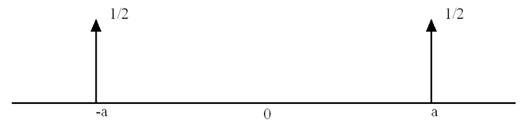

I tagged the spikes with $1/2$ to indicate that they have been scaled.[^4-17]

[^4-17]: Of course, the height of a $\delta_a$ is infinite, if height means anything at all, so scaling the height doesn’t mean much. Sometimes people speak of $\alpha\delta$, for example, as a $\delta$-function “of strength $\alpha$”, meaning just $\langle \alpha\delta, \varphi \rangle = \alpha\varphi(0)$.

For the sine function we have, in a similar way,

$$
\mathcal{F}\left(\frac{1}{2i}(\delta(x + a) - \delta(x - a))\right) = \frac{1}{2i}(e^{2\pi i s a} - e^{-2\pi i s a}) = \sin 2\pi s a\,,
$$

and

$$
\mathcal{F}\sin 2\pi a x = \mathcal{F}\left(\frac{1}{2i}(e^{2\pi i x a} - e^{-2\pi i x a})\right) = \frac{1}{2i}(\delta(s - a) - \delta(s + a))\,.
$$

The picture of $\mathcal{F}\sin 2\pi x$ is

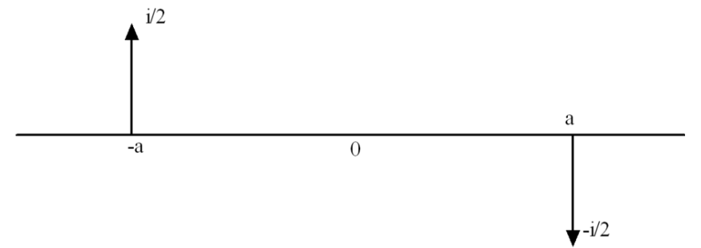

Remember that $1/i = -i$. I’ve tagged the spike $\delta_a$ with $-i/2$ and the spike $\delta_{-a}$ with $i/2$.

---

We’ll discuss symmetries of the generalized Fourier transform later, but you can think of $\mathcal{F}\cos 2\pi a x$ as real and even and $\mathcal{F}\sin 2\pi a x$ as purely imaginary and odd.

---

We should reflect a little on what we’ve done here and not be too quick to move on. The sine and cosine do not have Fourier transforms in the original, classical sense. It is impossible to do anything with the integrals

$$
\int_{-\infty}^{\infty} e^{-2\pi i s x} \cos 2\pi x\,dx \quad \text{or} \quad \int_{-\infty}^{\infty} e^{-2\pi i s x} \sin 2\pi x\,dx\,.
$$

To find the Fourier transform of such basic, important functions we *must* abandon the familiar, classical terrain and plant some spikes in new territory. It’s worth the effort.

## 4.8 Fluxions Finis: The End of Differential Calculus

I will continue the development of the generalized Fourier transform and its properties later. For now let’s show how introducing distributions “completes” differential calculus; how we can define the derivative of a distribution, and consequently how we can differentiate functions you probably thought had no business being differentiated. We’ll make use of this for Fourier transforms, too.

The motivation for how to bring about this remarkable state of affairs goes back to integration by parts, a technique we’ve used often in our calculations with the Fourier transform. If $\varphi$ is a test function and $f$ is a function for which $f(x)\varphi(x) \to 0$ as $x \to \pm\infty$ (not too much to ask), and *if* $f$ is differentiable *then* we can use integration by parts to write

$$
\begin{aligned}
\int_{-\infty}^{\infty} f'(x)\varphi(x)\,dx &= \Big[f(x)\varphi(x)\Big]_{-\infty}^{\infty} - \int_{-\infty}^{\infty} f(x)\varphi'(x)\,dx \quad (u = \varphi\,,\ dv = f'(x)\,dx) \\
&= -\int_{-\infty}^{\infty} f(x)\varphi'(x)\,dx.
\end{aligned}
$$

The derivative has shifted from $f$ to $\varphi$.

We can find similar formulas for higher derivatives. For example, supposing that the boundary terms in the integration by parts tend to 0 as $x \to \pm\infty$, we find that

$$
\begin{aligned}
\int_{-\infty}^{\infty} f''(x)\varphi(x)\,dx &= \Big[f'(x)\varphi(x)\Big]_{-\infty}^{\infty} - \int_{-\infty}^{\infty} f'(x)\varphi'(x)\,dx \quad (u = \varphi(x)\,,\ dv = f''(x)\,dx) \\
&= -\int_{-\infty}^{\infty} f'(x)\varphi'(x)\,dx \\
&= -\left(\Big[f(x)\varphi'(x)\Big]_{-\infty}^{\infty} - \int_{-\infty}^{\infty} f(x)\varphi''(x)\,dx\right) \quad (u = \varphi'(x)\,,\ dv = f'(x)\,dx) \\
&= \int_{-\infty}^{\infty} f(x)\varphi''(x)\,dx\,.
\end{aligned}
$$

Watch out — there’s no minus sign out front when we’ve shifted the *second* derivative from $f$ to $\varphi$.

We’ll concentrate just on the formula for the first derivative. Let’s write it again:

$$
\int_{-\infty}^{\infty} f'(x)\varphi(x)\,dx = -\int_{-\infty}^{\infty} f(x)\varphi'(x)\,dx\,.
$$

The right hand side may make sense even if the left hand side does not, that is, we can view the right hand side as a way of saying how the derivative of $f$ *would* act if it had a derivative. Put in terms of our “try a function first” procedure, if a distribution comes from a function $f(x)$ then this formula tells us how the “derivative” $f'(x)$ *as a distribution*, should be paired with a test function $\varphi(x)$. It should be paired according to the equation above:

$$
\langle f', \varphi \rangle = -\langle f, \varphi' \rangle\,.
$$

Turning this outcome into a definition, as our general procedure tells us we should do when passing from functions to distributions, we *define* the derivative of a distribution *as another* distribution according to:

- If $T$ is a distribution, then its derivative $T'$ is the distribution defined by

  $$
  \langle T', \varphi \rangle = -\langle T, \varphi' \rangle
  $$

Naturally, $(T_1 + T_2)' = T_1' + T_2'$ and $(\alpha T)' = \alpha T'$. However, there is *no* product rule in general because there’s no way to multiply two distributions. I’ll discuss this later in connection with convolution.

You can go on to define derivatives of higher orders in a similar way, and I’ll let you write down what the general formula for the pairing should be. The striking thing is that you don’t have to stop: *distributions are infinitely differentiable*!

---

Let’s see how differentiating a distribution works in practice.

**Derivative of the unit step function** The *unit step function*, also called the Heaviside function[^4-18] is defined by[^4-19]

$$
H(x) = \begin{cases} 0 & x \le 0 \\ 1 & x > 0 \end{cases}
$$

[^4-18]: After Oliver Heaviside (1850–1925), whose work we have mentioned several times before.

[^4-19]: There’s a school of thought that says $H(0)$ should be $1/2$.
$H(x)$ determines a tempered distribution because for any Schwartz function $\varphi$ the paring

$$
\langle H, \varphi \rangle = \int_{-\infty}^{\infty} H(x)\varphi(x)\,dx = \int_0^{\infty} \varphi(x)\,dx
$$

makes sense ($\varphi$ is integrable).

From the definition of the derivative of a distribution, if $\varphi(x)$ is any test function then

$$
\langle H', \varphi \rangle = -\langle H, \varphi' \rangle = -\int_{-\infty}^{\infty} H(x)\varphi'(x)\,dx = -\int_0^{\infty} 1 \cdot \varphi'(x)\,dx = -(\varphi(\infty) - \varphi(0)) = \varphi(0)\,.
$$

We see that pairing $H'$ with a test function produces the same result as if we had paired $\delta$ with a test function:

$$
\langle H', \varphi \rangle = \varphi(0) = \langle \delta, \varphi \rangle\,.
$$

We conclude that

$$
H' = \delta\,.
$$

**Derivative of the unit ramp** The *unit ramp* function is defined by

$$
u(x) = \begin{cases} 0 & x \le 0 \\ x & x > 0 \end{cases}
$$

If this were an introductory calculus class and you were asked “What is the derivative of $u(x)$?” you might have said, “It’s 0 if $x \le 0$ and 1 if $x > 0$, so it looks like the unit step $H(x)$ to me.” You’d be right, but your jerk of a teacher would probably say you were wrong because, according to the rigor police, $u(x)$ is not differentiable at $x = 0$. But now that you know about distributions, here’s why you were right. For a test function $\varphi(x)$,

$$
\begin{aligned}
\langle u'(x), \varphi(x) \rangle &= -\langle u(x), \varphi'(x) \rangle = -\int_{-\infty}^{\infty} u(x)\varphi'(x)\,dx = -\int_0^{\infty} x\varphi'(x)\,dx \\
&= -\left(\Big[x\varphi(x)\Big]_0^{\infty} - \int_0^{\infty} \varphi(x)\,dx\right) = \int_0^{\infty} \varphi(x)\,dx \\
&\qquad (x\varphi(x) \to 0 \text{ as } x \to \infty \text{ because } \varphi(x) \text{ decays faster than any power of } x) \\
&= \langle H, \varphi \rangle
\end{aligned}
$$

Since $\langle u'(x), \varphi(x) \rangle = \langle H, \varphi \rangle$ we conclude that $u' = H$ as distributions. Then of course, $u'' = \delta$.

**Derivative of the signum (or sign) function** The *signum (or sign) function* is defined by

$$
\operatorname{sgn}(x) = \begin{cases} +1 & x > 0 \\ -1 & x < 0 \end{cases}
$$

Note that sgn is not defined at $x = 0$, but that’s not an issue in the derivation to follow.

Let $\varphi(x)$ be any test function. Then

$$
\begin{aligned}
\langle \operatorname{sgn}', \varphi \rangle = -\langle \operatorname{sgn}, \varphi' \rangle &= -\int_{-\infty}^{\infty} \operatorname{sgn}(x)\varphi'(x)\,dx \\
&= -\left(\int_{-\infty}^{0} (-1)\varphi'(x)\,dx + \int_0^{\infty} (+1)\varphi'(x)\,dx\right) \\
&= (\varphi(0) - \varphi(-\infty)) - (\varphi(\infty) - \varphi(0)) = 2\varphi(0)
\end{aligned}
$$

The result of pairing $\operatorname{sgn}'$ with $\varphi$ is the same as if we had paired $\varphi$ with $2\delta$;

$$
\langle \operatorname{sgn}', \varphi \rangle = 2\varphi(0) = \langle 2\delta, \varphi \rangle
$$

Hence

$$
\operatorname{sgn}' = 2\delta\,.
$$

Observe that $H(x)$ has a unit jump up at 0 and its derivative is $\delta$, whereas sgn jumps up by 2 at 0 and its derivative is $2\delta$.

**Derivative of $\boldsymbol{\delta}$** To find the derivative of the $\delta$-function we have, for any test function $\varphi$,

$$
\langle \delta', \varphi \rangle = -\langle \delta, \varphi' \rangle = -\varphi'(0)\,.
$$

That’s really as much of a formula as we can write. $\delta$ itself acts by pulling out the value of a test function at 0, and $\delta'$ acts by pulling out *minus* the value of the derivative of the test function at 0. I’ll let you determine the higher derivatives of $\delta$.

**Derivative of $\boldsymbol{\ln|x|}$** Remember that famous formula from calculus:

$$
\frac{d}{dx}\ln|x| = \frac{1}{x}\,.
$$

Any chance of something like that being true for distributions? Yes, *with the proper interpretation*. This is an important example because it leads to the *Hilbert transform*, a tool that communications engineers use everyday. For your information, the Hilbert transform is given by convolution of a signal with $1/\pi x$. Once we learn how to take the Fourier transform of $1/x$, which is coming up, we’ll then see that the Hilbert transform is a filter with the interesting property that magnitudes of the spectral components are unchanged but their phases are shifted by $\pm\pi/2$.

Because of their usefulness in applications it’s worth going through the analysis of the distributions $\ln|x|$ and $1/x$. This takes more work than the previous examples, however, so I’ve put the details in Section 4.21.

## 4.9 Approximations of Distributions and Justifying the “Try a Function First” Principle

We started off by enunciating the principle that to see how to extend an operation from functions to distributions one should start by considering the case when the distribution comes from a function (and hence that the pairing is by integration). Let me offer a justification of why this works.

It’s true that not every distribution comes from a function ($\delta$ doesn’t), but it’s also true that any distribution can be approximated by ones that comes from functions. The statement is:

> If $T$ is any tempered distribution then there are Schwartz functions $f_n$ such that $T_{f_n}$ converge to $T$.

This says that for any Schwartz function $\varphi$

$$
\langle T_{f_n}, \varphi \rangle = \int_{-\infty}^{\infty} f_n(x)\varphi(x)\,dx \to \langle T, \varphi \rangle\,,
$$

that is, the pairing of any tempered distribution with a Schwartz function can be expressed as a limit of the natural pairing with approximating functions via integration. We’re not saying that $T_{f_n} \to T_f$ for some function $f$, because it’s not the Schwartz functions $f_n$ that are converging to a function, it’s the *associated distributions* that are converging to a distribution. You *don’t* necessarily have $T = T_f$ for some function $f$. (Also, this result doesn’t say how you’re supposed to find the approximating functions, just that they exist.)

Consider how we might apply this to justify our approach to defining the Fourier transform of a tempered distribution. According to the approximation result, any tempered distribution $T$ is a limit of distributions that come from Schwartz functions, and we would have, say,

$$
\langle T, \varphi \rangle = \lim_{n \to \infty} \langle \psi_n, \varphi \rangle\,.
$$

Then if $\mathcal{F}T$ is to make sense we might understand it to be given by

$$
\langle \mathcal{F}T, \varphi \rangle = \lim_{n \to \infty} \langle \mathcal{F}\psi_n, \varphi \rangle = \lim_{n \to \infty} \langle \psi_n, \mathcal{F}\varphi \rangle = \langle T, \mathcal{F}\varphi \rangle\,.
$$

There’s our definition.

## 4.10 The Generalized Fourier Transform Includes the Classical Fourier Transform

Remember that we identify a function $f$ with the distribution $T_f$ it defines and it is in this way we say that the tempered distributions contain many of the classical functions. Now suppose a function $f(x)$ defines a distribution and that $f(x)$ has a (classical) Fourier transform $\mathcal{F}f(s)$ which also defines a distribution, i.e.,

$$
\int_{-\infty}^{\infty} \mathcal{F}f(s)\varphi(s)\,ds
$$

exists for every Schwartz function $\varphi$ (which isn’t asking too much). Writing $T_{\mathcal{F}f}$ for the tempered distribution determined by $\mathcal{F}f$,

$$
\begin{aligned}
\langle T_{\mathcal{F}f}, \varphi \rangle &= \int_{-\infty}^{\infty} \mathcal{F}f(s)\varphi(s)\,ds \\
&= \int_{-\infty}^{\infty}\left(\int_{-\infty}^{\infty} e^{-2\pi i s x} f(x)\,dx\right)\varphi(s)\,ds = \int_{-\infty}^{\infty}\int_{-\infty}^{\infty} e^{-2\pi i s x} f(x)\varphi(s)\,ds\,dx \\
&= \int_{-\infty}^{\infty}\left(\int_{-\infty}^{\infty} e^{-2\pi i s x}\varphi(s)\,ds\right) f(x)\,dx = \int_{-\infty}^{\infty} \mathcal{F}\varphi(x)f(x)\,dx = \langle T_f, \mathcal{F}\varphi \rangle
\end{aligned}
$$

But now, by our definition of the generalized Fourier transform

$$
\langle T_f, \mathcal{F}\varphi \rangle = \langle \mathcal{F}T_f, \varphi \rangle\,.
$$

Putting this together with the start of the calculation we obtain

$$
\langle T_{\mathcal{F}f}, \varphi \rangle = \langle \mathcal{F}T_f, \varphi \rangle\,,
$$

whence

$$
T_{\mathcal{F}f} = \mathcal{F}T_f\,.
$$

In words, if the classical Fourier transform of a function defines a distribution ($T_{\mathcal{F}f}$), then that distribution is the Fourier transform of the distribution that the function defines ($\mathcal{F}T_f$). This is a precise way of saying that the generalized Fourier transform “includes” the classical Fourier transform.

## 4.11 Operations on Distributions and Fourier Transforms

We want to relive our past glories — duality between $\mathcal{F}$ and $\mathcal{F}^{-1}$, evenness and oddness, shifts and stretches, convolution — in the more general setting we’ve developed. The new versions of the old results will ultimately look the same as they did before; it’s a question of setting things up properly to apply the new definitions. There will be some new results, however. Among them will be formulas for the Fourier transform of $\operatorname{sgn} x$, $1/x$, and the unit step $H(x)$, to take a representative sample. None of these would have been possible before. We’ll also point out special properties of $\delta$ along the way. Pay particular attention to these because we’ll be using them a lot in applications.

---

Before you dive in, let me offer a reader’s guide. There’s a lot of material in here — *way* more than you need to know for your day-to-day working life. Furthermore, almost all the results are accompanied by some necessary extra notation; the truth is that it’s somewhat more cumbersome to define operations on distributions than on functions, and there’s no way of getting around it. We *have* to have this material *in some fashion* but you should probably treat the sections to follow mostly as a reference. Feel free to use the formulas you need when you need them, and remember that our aim is to recover the formulas we know from earlier work in pretty much the same shape as you first learned them.

## 4.12 Duality, Changing Signs, Evenness and Oddness

One of the first things we observed about the Fourier transform and its inverse is that they’re pretty much the same thing except for a change in sign; see Chapter 2. The relationships are

$$
\begin{aligned}
\mathcal{F}f(-s) &= \mathcal{F}^{-1}f(s) \\
\mathcal{F}^{-1}f(-t) &= \mathcal{F}f(t)
\end{aligned}
$$

We had similar results when we changed the sign of the variable first and then took the Fourier transform. The relationships are

$$
\begin{aligned}
\mathcal{F}(f(-t)) &= \mathcal{F}^{-1}f(s) \\
\mathcal{F}^{-1}(f(-s)) &= \mathcal{F}f(s)
\end{aligned}
$$

We referred to these collectively as the “duality” between Fourier transform pairs, and we’d like to have similar duality formulas when we take the Fourier transforms of distributions.

The problem is that for distributions we don’t really have “variables” to change the sign of. We don’t really write $\mathcal{F}T(s)$, or $\mathcal{F}T(-s)$, or $T(-s)$, because distributions don’t operate on points $s$ — they operate on test functions. What we can do easily is to define a “reversed distribution”, and once this is done the rest is plain sailing.

**Reversed distributions** Recall that we introduced the reversed signal of a signal $f(x)$ by means of

$$
f^-(x) = f(-x)
$$

and this helped us to write clean, “variable free” versions of the duality results. Using this notation the above results become

$$
(\mathcal{F}f)^- = \mathcal{F}^{-1}f, \quad (\mathcal{F}^{-1}f)^- = \mathcal{F}f\,, \quad \mathcal{F}f^- = \mathcal{F}^{-1}f, \quad \mathcal{F}^{-1}f^- = \mathcal{F}f\,.
$$

A variant version is to apply $\mathcal{F}$ or $\mathcal{F}^{-1}$ twice, resulting in

$$
\mathcal{F}\mathcal{F}f = f^-, \quad \mathcal{F}^{-1}\mathcal{F}^{-1}f = f^-\,.
$$

My personal favorites among formulas of this type are:

$$
\mathcal{F}f^- = (\mathcal{F}f)^-, \quad \mathcal{F}^{-1}f^- = (\mathcal{F}^{-1}f)^-\,.
$$

What can “sign change”, or “reversal” mean for a distribution $T$? Our standard approach is first to take the case when the distribution comes from a function $f(x)$. The pairing of $T_f$ with a test function $\varphi$ is

$$
\langle T_f, \varphi \rangle = \int_{-\infty}^{\infty} f(x)\varphi(x)\,dx\,.
$$

We might well believe that reversing $T_f$ (i.e., a possible definition of $(T_f)^-$) should derive from reversing $f$, that is, integrating $f^-$ against a test function. The paring of $T_{f^-}$ with $\varphi$ is

$$
\begin{aligned}
\langle T_{f^-}, \varphi \rangle &= \int_{-\infty}^{\infty} f(-x)\varphi(x)\,dx \\
&= \int_{\infty}^{-\infty} f(u)\varphi(-u)\,(-du) \quad \text{(making the change of variable } u = -x\text{)} \\
&= \int_{-\infty}^{\infty} f(u)\varphi(-u)\,du.
\end{aligned}
$$

This says that $f^-$ is paired with $\varphi(x)$ in the same way as $f$ is paired with $\varphi^-$, more precisely:

$$
\langle T_{f^-}, \varphi \rangle = \langle T_f, \varphi^- \rangle\,.
$$

Wouldn’t it then make sense to say we have found a meaning for $(T_f)^-$ (i.e., have defined $(T_f)^-$) via the formula

$$
\langle (T_f)^-, \varphi \rangle = \langle T_f, \varphi^- \rangle \quad \text{(the right-hand-side is defined because } \varphi^- \text{ is defined)}\,.
$$

The “outcome” — how this result should be turned into a general definition — is before our eyes:

- If $T$ is a distribution we define the reversed distribution $T^-$ according to

  $$
  (T^-, \varphi) = (T, \varphi^-)\,.
  $$

Note that with this definition we have, quite agreeably,

$$
(T_f)^- = T_{f^-}\,.
$$

If you understand what’s just been done you’ll understand this last equation. Understand it.

**Duality** It’s now easy to state the duality relations between the Fourier transform and its inverse. Adopting the notation, above, we want to look at $(\mathcal{F}T)^-$ and how it compares to $\mathcal{F}^{-1}T$. For a test function $\varphi$,

$$
\begin{aligned}
((\mathcal{F}T)^-, \varphi) &= (\mathcal{F}T, \varphi^-) \\
&= (T, \mathcal{F}(\varphi^-)) \quad \text{(that’s how the Fourier transform is defined)} \\
&= (T, \mathcal{F}^{-1}\varphi) \quad \text{(because of duality for ordinary Fourier transforms)} \\
&= (\mathcal{F}^{-1}T, \varphi) \quad \text{(that’s how the inverse Fourier transform is defined)}
\end{aligned}
$$

Pretty slick, really. We can now write simply

$$
(\mathcal{F}T)^- = \mathcal{F}^{-1}T\,.
$$

We also then have

$$
\mathcal{F}T = (\mathcal{F}^{-1}T)^-\,.
$$

Same formulas as in the classical setting.

To take one more example,

$$
\langle \mathcal{F}(T^-), \varphi \rangle = \langle T^-, \mathcal{F}\varphi \rangle = \langle T, (\mathcal{F}\varphi)^- \rangle = \langle T, \mathcal{F}^{-1}\varphi \rangle = \langle \mathcal{F}^{-1}T, \varphi \rangle\,,
$$

and there’s the identity

$$
\mathcal{F}(T^-) = \mathcal{F}^{-1}T
$$

popping out. Finally, we have

$$
\mathcal{F}^{-1}(T^-) = \mathcal{F}T\,.
$$

Combining these,

$$
\mathcal{F}T^- = (\mathcal{F}T)^-, \quad \mathcal{F}^{-1}T^- = (\mathcal{F}^{-1}T)^-\,.
$$

Applying $\mathcal{F}$ or $\mathcal{F}^{-1}$ twice leads to

$$
\mathcal{F}\mathcal{F}T = T^-, \quad \mathcal{F}^{-1}\mathcal{F}^{-1}T = T^-\,.
$$

That’s all of them.

**Even and odd distributions: $\boldsymbol{\delta}$ is even** Now that we know how to reverse a distribution we can define what it means for a distribution to be even or odd.

- A distribution $T$ is *even* if $T^- = T$. A distribution is *odd* if $T^- = -T$.

Observe that if $f(x)$ determines a distribution $T_f$ and if $f(x)$ is even or odd then $T_f$ has the same property. For, as we noted earlier,

$$
(T_f)^- = T_{f^-} = T_{\pm f} = \pm T_f\,.
$$

Let’s next establish the useful fact:

- $\delta$ is even.

This is quick:

$$
\langle \delta^-, \varphi \rangle = \langle \delta, \varphi^- \rangle = \varphi^-(0) = \varphi(-0) = \varphi(0) = \langle \delta, \varphi \rangle
$$

Let’s now use this result plus duality to rederive $\mathcal{F}1 = \delta$. This is quick, too:

$$
\mathcal{F}1 = (\mathcal{F}^{-1}1)^- = \delta^- = \delta\,.
$$

$\delta_a + \delta_{-a}$ is even. $\delta_a - \delta_{-a}$ is odd. Any distribution is the sum of an even and an odd distribution.

You can now show that *all* of our old results on evenness and oddness of a signal and its Fourier transform extend in like form to the Fourier transform of distributions. For example, if $T$ is even then so is $\mathcal{F}T$, for

$$
(\mathcal{F}T)^- = \mathcal{F}T^- = \mathcal{F}T\,,
$$

and if $T$ is odd then

$$
(\mathcal{F}T)^- = \mathcal{F}T^- = \mathcal{F}(-T) = -\mathcal{F}T\,,
$$

thus $\mathcal{F}T$ is odd.

Notice how this works for the cosine (even) and the sine (odd) and their respective Fourier transforms:

$$
\begin{aligned}
\mathcal{F}\cos 2\pi a x &= \tfrac{1}{2}(\delta_a + \delta_{-a}) \\
\mathcal{F}\sin 2\pi a x &= \frac{1}{2i}(\delta_a - \delta_{-a})
\end{aligned}
$$

I’ll let you define what it means for a distribution to be real, or purely imaginary.

**Fourier transform of sinc**

$$
\begin{aligned}
\mathcal{F}\operatorname{sinc} &= \mathcal{F}(\mathcal{F}\Pi) \\
&= \Pi^- \quad \text{(one of the duality equaltions)} \\
&= \Pi \quad (\Pi \text{ is even})
\end{aligned}
$$

At last. To be really careful here: $\mathcal{F}\operatorname{sinc}$ makes sense only as a tempered distribution. So the equality $\mathcal{F}\operatorname{sinc} = \Pi$ has to be understood as an equation between distributions, meaning that $\mathcal{F}\operatorname{sinc}$ and $\Pi$ give the same result when paired with any Schwartz function. But you should lose no sleep over this. From now on, write $\mathcal{F}\operatorname{sinc} = \Pi$, think in terms of functions, and start your company.

## 4.13 A Function Times a Distribution Makes Sense

There’s no way to define the product of two distributions that works consistently with all the rest of the definitions and properties — try as you might, it just won’t work. However, it is possible (and easy) to define the product of a function and a distribution.

Say $T$ is a distribution and $g$ is a function. What is $gT$ as a distribution? I have to tell you what $\langle gT, \varphi \rangle$ is for a test function $\varphi$. We take our usual approach to looking for the outcome when $T$ comes from a function, $T = T_f$. The pairing of $gT_f$ and $\varphi$ is given by

$$
\langle gT_f, \varphi \rangle = \int_{-\infty}^{\infty} g(x)f(x)\varphi(x)\,dx = \int_{-\infty}^{\infty} f(x)(g(x)\varphi(x))\,dx
$$

As long as $g\varphi$ is still a test function (so, certainly, $g$ has to be infinitely differentiable) this last integral is the pairing $\langle T_f, g\varphi \rangle$. The outcome is $\langle gT_f, \varphi \rangle = \langle T_f, g\varphi \rangle$. We thus make the following definition:

- Let $T$ be a distribution. If $g$ is a smooth function such that $g\varphi$ is a test function whenever $\varphi$ is a test function, then $gT$ is the distribution defined by

  $$
  \langle gT, \varphi \rangle = \langle T, g\varphi \rangle\,.
  $$

This looks as simple as can be, and it is. You may wonder why I even singled out this operation for comment. In fact, some funny things can happen, as we’ll now see.

### 4.13.1 A function times δ

Watch what happens if we multiply $\delta$ by $g(x)$:

$$
\langle g\delta, \varphi \rangle = \langle \delta, g\varphi \rangle = g(0)\varphi(0)
$$

This is the same result as if we had paired $g(0)\delta$ with $\varphi$. Thus

$$
g(x)\delta = g(0)\delta
$$

*In particular* if $g(0) = 0$ then the result is 0! For example

$$
x\delta = 0
$$

or for that matter

$$
x^n\delta = 0
$$

for any positive power of $x$.

Along with $g\delta = g(0)\delta$ we have

$$
g(x)\delta_a = g(a)\delta_a\,.
$$

To show this:

$$
\langle g\delta_a, \varphi \rangle = \langle \delta_a, g\varphi \rangle = g(a)\varphi(a) = g(a)\langle \delta_a, \varphi \rangle = \langle g(a)\delta_a, \varphi \rangle\,.
$$

If you want to write this identity more classically, it is

$$
g(x)\delta(x - a) = g(a)\delta(x - a)\,.
$$

We’ll use this property in many applications, for example when we talk about sampling.

**More on a function times $\boldsymbol{\delta}$** There’s a converse to one of the above properties that’s interesting in itself and that we’ll use in the next section when we find some particular Fourier transforms.

- If $T$ is a distribution and $xT = 0$ then $T = c\delta$ for some constant $c$.

I’ll show you the proof of this, but you can skip it if you want. The argument is more involved than the simple statement might suggest, but it’s a nice example, and a fairly typical example, of the kind of tricks that are used to prove things in this area. Each to their own tastes.

Knowing where this is going, let me start with an innocent observation.[^4-20] If $\psi$ is a smooth function then

$$
\begin{aligned}
\psi(x) &= \psi(0) + \int_0^x \psi'(t)\,dt \\
&= \psi(0) + \int_0^1 x\psi'(xu)\,du \quad \text{(using the substitution } u = t/x\text{)} \\
&= \psi(0) + x\int_0^1 \psi'(xu)\,du\,.
\end{aligned}
$$

[^4-20]: This innocent observation is actually the beginning of deriving Taylor series “with remainder”.

Let

$$
\Psi(x) = \int_0^1 \psi'(xu)\,du
$$

so that

$$
\psi(x) = \psi(0) + x\Psi(x)\,.
$$

We’ll now use this innocent observation in the case when $\psi(0) = 0$, for then

$$
\psi(x) = x\Psi(x)\,.
$$

It’s clear from the definition of $\Psi$ that $\Psi$ is as smooth as $\psi$ is and that if, for example, $\psi$ is rapidly decreasing then so is $\Psi$. Put informally, we’ve shown that if $\psi(0) = 0$ we can “factor out an $x$” and still have a function that’s as good as $\psi$.

Now suppose $xT = 0$, meaning that

$$
\langle xT, \varphi \rangle = 0
$$

for *every* test function $\varphi$. Fix a smooth windowing function $\varphi_0$ that is identically 1 on an interval about $x = 0$, goes down to zero smoothly and is identically zero far enough away from $x = 0$; we mentioned smooth windows earlier — see Section 4.20, below.

Since $\varphi_0$ is fixed in this argument, $T$ operating on $\varphi_0$ gives some fixed number, say

$$
\langle T, \varphi_0 \rangle = c\,.
$$

Now write

$$
\varphi(x) = \varphi(0)\varphi_0(x) + (\varphi(x) - \varphi(0)\varphi_0(x)) = \varphi(0)\varphi_0(x) + \psi(x)
$$

where, by this clever way of writing $\varphi$, the function $\psi(x) = \varphi(x) - \varphi(0)\varphi_0(x)$ has the property that

$$
\psi(0) = \varphi(0) - \varphi(0)\varphi_0(0) = \varphi(0) - \varphi(0) = 0
$$

because $\varphi_0(0) = 1$. This means that we can factor out an $x$ and write

$$
\psi(x) = x\Psi(x)
$$

where $\Psi$ is again a test function, and then

$$
\varphi(x) = \varphi(0)\varphi_0(x) + x\Psi(x)\,.
$$

But now

$$
\begin{aligned}
\langle T, \varphi(x) \rangle &= \langle T, \varphi(0)\varphi_0 + x\Psi \rangle \\
&= \langle T, \varphi(0)\varphi_0 \rangle + \langle T, x\Psi \rangle \\
&= \varphi(0)\langle T, \varphi_0 \rangle + \langle T, x\Psi \rangle \quad \text{(linearity)} \\
&= \varphi(0)\langle T, \varphi_0 \rangle + \langle xT, \Psi \rangle \quad \text{(that’s how mutiplying } T \text{ by the smooth function } x \text{ works)} \\
&= \varphi(0)\langle T, \varphi_0 \rangle + 0 \quad \text{(because } \langle xT, \Psi \rangle = 0!\text{)} \\
&= c\varphi(0) \\
&= \langle c\delta, \varphi \rangle
\end{aligned}
$$

We conclude that

$$
T = c\delta\,.
$$

## 4.14 The Derivative Theorem

Another basic property of the Fourier transform is how it behaves in relation to differentiation — “differentiation becomes multiplication” is the shorthand way of describing the situation. We know how to differentiate a distribution, and it’s an easy step to bring the Fourier transform into the picture. We’ll then use this to *find* the Fourier transform for some common functions that heretofore we have not been able to treat.

Let’s recall the formulas for functions, best written:

$$
f'(t) \rightleftharpoons 2\pi i s F(s) \quad \text{and} \quad -2\pi i t f(t) \rightleftharpoons F'(s)
$$

where $f(t) \rightleftharpoons F(s)$.

We first want to find $\mathcal{F}T'$ for a distribution $T$. For any test function $\varphi$,

$$
\begin{aligned}
\langle \mathcal{F}T', \varphi \rangle &= \langle T', \mathcal{F}\varphi \rangle = -\langle T, (\mathcal{F}\varphi)' \rangle \\
&= -\langle T, \mathcal{F}(-2\pi i s\varphi) \rangle \quad \text{(from the second formula above)} \\
&= -\langle \mathcal{F}T, -2\pi i s\varphi \rangle \quad \text{(moving } \mathcal{F} \text{ back over to } T\text{)} \\
&= \langle 2\pi i s\mathcal{F}T, \varphi \rangle \\
&\qquad \text{(cancelling minus signs and moving the smooth function } 2\pi i s \text{ back onto } \mathcal{F}T\text{)}
\end{aligned}
$$

So the second formula for functions has helped us derive the version of the first formula for distributions:

$$
\mathcal{F}T' = 2\pi i s\,\mathcal{F}T\,.
$$

On the right hand side, that’s the smooth function $2\pi i s$ times the distribution $\mathcal{F}T$.

Now let’s work with $(\mathcal{F}T)'$:

$$
\begin{aligned}
\langle (\mathcal{F}T)', \varphi \rangle &= -\langle \mathcal{F}T, \varphi' \rangle = -\langle T, \mathcal{F}(\varphi') \rangle \\
&= -\langle T, 2\pi i s\mathcal{F}\varphi \rangle \quad \text{(from the first formula for functions)} \\
&= \langle -2\pi i s T, \mathcal{F}\varphi \rangle \\
&= \langle \mathcal{F}(-2\pi i s T), \varphi \rangle
\end{aligned}
$$

Therefore

$$
(\mathcal{F}T)' = \mathcal{F}(-2\pi i s T)\,.
$$

### 4.14.1 Fourier transforms of sgn, 1/x, and the unit step

We can put the derivative formula to use to find the Fourier transform of the sgn function, and from that the Fourier transform of the unit step.

On the one hand, $\operatorname{sgn}' = 2\delta$, from an earlier calculation, so $\mathcal{F}\operatorname{sgn}' = 2\mathcal{F}\delta = 2$. On the other hand, using the derivative theorem,

$$
\mathcal{F}\operatorname{sgn}' = 2\pi i s\,\mathcal{F}\operatorname{sgn}\,.
$$

Hence

$$
2\pi i s\,\mathcal{F}\operatorname{sgn} = 2\,.
$$

We’d like to say that

$$
\mathcal{F}\operatorname{sgn} = \frac{1}{\pi i s}
$$

where $1/s$ is the Cauchy principal value distribution. In fact this *is* the case, but it requires a little more of an argument. From $2\pi i s\,\mathcal{F}\operatorname{sgn} = 2$ we can say that

$$
\mathcal{F}\operatorname{sgn} = \frac{1}{\pi i s} + c\delta
$$

where $c$ is a constant. Why the extra $\delta$ term? We need it for generality. If $T$ is such that $sT = 0$ then $2\pi i s\,\mathcal{F}\operatorname{sgn}$ and $2 + sT$, will have the same effect when paired with a test function. But earlier we showed that such a $T$ must be $c\delta$ for some constant $c$. Thus we write

$$
\mathcal{F}\operatorname{sgn} = \frac{1}{\pi i s} + c\delta\,.
$$

Now, sgn is odd and so is its Fourier transform, and so is $1/2\pi i s$. But $\delta$ is even, and the only way $1/\pi i s + c\delta$ can be odd is to have $c = 0$.

To repeat, we have now found

$$
\mathcal{F}\operatorname{sgn} = \frac{1}{\pi i s}\,.
$$

Gray and Goodman p. 217 (and also Bracewell) give a derivation of this result using limiting arguments.

---

By duality we also now know the Fourier transform of $1/x$. The distributions are odd, hence

$$
\mathcal{F}\left(\frac{1}{x}\right) = -\pi i \operatorname{sgn} s\,.
$$

Having found $\mathcal{F}\operatorname{sgn}$ it’s easy to find the Fourier transform of the unit step $H$. Indeed,

$$
H(t) = \tfrac{1}{2}(1 + \operatorname{sgn} t)
$$

and from this

$$
\mathcal{F}H = \tfrac{1}{2}\left(\delta + \frac{1}{\pi i s}\right).
$$

## 4.15 Shifts and the Shift Theorem

Let’s start with shifts. What should we make of $T(x \pm b)$ for a distribution $T$ when, once again, it doesn’t make sense to evaluate $T$ at a point $x \pm b$? We use the same strategy as before, starting by assuming that $T$ comes from a function $f$ and asking how we should pair, say, $f(x - b)$ with a test function $\varphi(x)$. For that, we want

$$
\int_{-\infty}^{\infty} f(x - b)\varphi(x)\,dx = \int_{-\infty}^{\infty} f(u)\varphi(u + b)\,du \quad \text{(making the substitution } u = x - b\text{.)}
$$

As we did when we analyzed “changing signs” our work on shifts is made easier (really) if we introduce a notation.
**The shift or delay operator** It’s pretty common to let $\tau_b$ stand for “translate by $b$”, or “delay by $b$”. That is, for any function $\varphi$ the delayed signal, $\tau_b\varphi$, is the new function defined by

$$
(\tau_b\varphi)(x) = \varphi(x - b)\,.
$$

Admittedly there’s some awkwardness in the notation here; one has to remember that $\tau_b$ corresponds to $x - b$.

---

In terms of $\tau_b$ the integrals above can be written (using $x$ as a variable of integration in both cases):

$$
\langle \tau_b f, \varphi \rangle = \int_{-\infty}^{\infty} (\tau_b f)(x)\varphi(x)\,dx = \int_{-\infty}^{\infty} f(x)(\tau_{-b}\varphi)(x)\,dx = \langle f, \tau_{-b}\varphi \rangle\,.
$$

Note that on the left hand side $f$ is shifted by $b$ while on the right hand side $\varphi$ is shifted by $-b$. This result guides us in making the general definition:

- If $T$ is a distribution we define $\tau_b T$ ($T$ delayed by $b$) by

  $$
  \langle \tau_b T, \varphi \rangle = \langle T, \tau_{-b}\varphi \rangle\,.
  $$

You can check that for a distribution $T_f$ coming from a function $f$ we have

$$
\tau_b T_f = T_{\tau_b f}\,.
$$

**$\boldsymbol{\delta_a}$ is a shifted $\boldsymbol{\delta}$** To close the loop on some things we said earlier, watch what happens when we delay $\delta$ by $a$:

$$
\begin{aligned}
\langle \tau_a\delta, \varphi \rangle &= \langle \delta, \tau_{-a}\varphi \rangle \\
&= (\tau_{-a}\varphi)(0) \\
&= \varphi(a) \quad \text{(remember, } \tau_{-a}\varphi(x) = \varphi(x + a)\text{)} \\
&= \langle \delta_a, \varphi \rangle
\end{aligned}
$$

We have shown that

$$
\tau_a\delta = \delta_a\,.
$$

This is the variable-free way of writing $\delta(x - a)$.

**The shift theorem:** We’re now ready for the general form of the shift theorem:

> If $T$ is a distribution then
>
> $$
> \mathcal{F}(\tau_b T) = e^{-2\pi i b x}\mathcal{F}T\,.
> $$

To verify this, first

$$
\langle \mathcal{F}(\tau_b T), \varphi \rangle = \langle \tau_b T, \mathcal{F}\varphi \rangle = \langle T, \tau_{-b}\mathcal{F}\varphi \rangle\,.
$$

We can evaluate the test function in the last term:

$$
\begin{aligned}
\tau_{-b}(\mathcal{F}\varphi)(s) &= \mathcal{F}\varphi(s + b) \\
&= \int_{-\infty}^{\infty} e^{-2\pi i (s+b) x}\varphi(x)\,dx \\
&= \int_{-\infty}^{\infty} e^{-2\pi i s x} e^{-2\pi i b x}\varphi(x)\,dx = \mathcal{F}(e^{-2\pi i b x}\varphi)(s)
\end{aligned}
$$

Now plug this into what we had before:

$$
\begin{aligned}
\langle \mathcal{F}(\tau_b T), \varphi \rangle &= \langle T, \tau_{-b}\mathcal{F}\varphi \rangle \\
&= \langle T, \mathcal{F}(e^{-2\pi i b x}\varphi) \rangle \\
&= \langle \mathcal{F}T, e^{-2\pi i b x}\varphi \rangle = \langle e^{-2\pi i b x}\mathcal{F}T, \varphi \rangle
\end{aligned}
$$

Thus, keeping track of what we’re trying to show,

$$
\langle \mathcal{F}(\tau_b T), \varphi \rangle = \langle e^{-2\pi i b x}\mathcal{F}T, \varphi \rangle
$$

for all test functions $\varphi$, and hence

$$
\mathcal{F}(\tau_b T) = e^{-2\pi i b x}\mathcal{F}T\,.
$$

---

As one quick application of this let’s see what happens to the shifted $\delta$. By the shift theorem

$$
\mathcal{F}\tau_a\delta = e^{-2\pi i a s}\mathcal{F}\delta = e^{-2\pi i s a}
$$

in accord with what we found earlier for $\mathcal{F}\delta_a$ directly from the definitions of $\delta_a$ and $\mathcal{F}$.

## 4.16 Scaling and the Stretch Theorem

To find the appropriate form of the Stretch Theorem, or Similarity Theorem, we first have to consider how to define $T(ax)$. Following our now usual procedure, we check what happens when $T$ comes from a function $f$. We need to look at the pairing of $f(ax)$ with a test function $\varphi(x)$, and we find for $a > 0$ that

$$
\int_{-\infty}^{\infty} f(ax)\varphi(x)\,dx = \int_{-\infty}^{\infty} f(u)\varphi(u/a)\frac{1}{a}\,du\,,
$$

making the substitution $u = ax$, and for $a < 0$ that

$$
\int_{-\infty}^{\infty} f(ax)\varphi(x)\,dx = \int_{\infty}^{-\infty} f(u)\varphi(u/a)\frac{1}{a}\,du = -\int_{-\infty}^{\infty} f(u)\varphi(u/a)\frac{1}{a}\,du\,.
$$

We combine the cases and write

$$
\int_{-\infty}^{\infty} f(ax)\varphi(x)\,dx = \int_{-\infty}^{\infty} f(u)\frac{1}{|a|}\varphi(u/a)\,du\,.
$$

**The scaling operator** As we did to write shifts in a variable-free way, we do the same for similarities. We let $\sigma_a$ stand for the operator “scale by $a$”. That is,

$$
(\sigma_a\varphi)(x) = \varphi(ax)\,.
$$

The integrals above can then be written as

$$
\langle \sigma_a f\, \varphi \rangle = \int_{-\infty}^{\infty} (\sigma_a f)(x)\varphi(x)\,dx = \int_{-\infty}^{\infty} f(x)\frac{1}{|a|}(\sigma_{1/a}\varphi)(x)\,dx = \langle f, \frac{1}{|a|}(\sigma_{1/a}\varphi) \rangle\,.
$$

Thus for a general distribution:

- If $T$ is a distribution we define $\sigma_a T$ via

  $$
  \langle \sigma_a T, \varphi \rangle = \langle T, \frac{1}{|a|}\sigma_{1/a}\varphi \rangle\,.
  $$

Note also that then

$$
\langle \frac{1}{|a|}\sigma_{1/a}T, \varphi \rangle = \langle T, \sigma_a\varphi \rangle\,.
$$

For a distribution $T_f$ coming from a function $f$ the relation is

$$
\sigma_a T_f = T_{\sigma_a f}\,.
$$

**Scaling $\boldsymbol{\delta}$** Since $\delta$ is concentrated at a point, however you want to interpret that, you might not think that scaling $\delta(x)$ to $\delta(ax)$ should have any effect. But it does:

$$
\begin{aligned}
\langle \sigma_a\delta, \varphi \rangle &= \langle \delta, \frac{1}{|a|}\sigma_{1/a}\varphi \rangle = \frac{1}{|a|}(\sigma_{1/a}\varphi)(0) \\
&= \frac{1}{|a|}\varphi(0/a) = \frac{1}{|a|}\varphi(0) = \langle \frac{1}{|a|}\delta, \varphi \rangle
\end{aligned}
$$

Hence

$$
\sigma_a\delta = \frac{1}{|a|}\delta\,.
$$

This is most often written “at points”, as in

$$
\delta(ax) = \frac{1}{|a|}\delta(x)
$$

The effect of “scaling the variable” is to “scale the strength” of $\delta$ by the reciprocal amount.

**The stretch theorem** With the groundwork we’ve done it’s now not difficult to state and derive the general stretch theorem:

> If $T$ is a distribution then
>
> $$
> \mathcal{F}(\sigma_a T) = \frac{1}{|a|}\sigma_{1/a}(\mathcal{F}T)\,.
> $$

To check this,

$$
\langle \mathcal{F}(\sigma_a T), \varphi \rangle = \langle \sigma_a T, \mathcal{F}\varphi \rangle = \langle T, \frac{1}{|a|}\sigma_{1/a}\mathcal{F}\varphi \rangle\,.
$$

But now by the stretch theorem for functions

$$
\frac{1}{|a|}(\sigma_{1/a}\mathcal{F}\varphi)(s) = \frac{1}{|a|}\mathcal{F}\varphi\left(\frac{s}{a}\right) = \mathcal{F}(\sigma_a\varphi)(s)\,.
$$

Plug this back into what we had:

$$
\langle \mathcal{F}(\sigma_a T), \varphi \rangle = \langle T, \frac{1}{|a|}\sigma_{1/a}\mathcal{F}\varphi \rangle = \langle T, \mathcal{F}(\sigma_a\varphi) \rangle = \langle \mathcal{F}T, \sigma_a\varphi \rangle = \langle \frac{1}{|a|}\sigma_{1/a}(\mathcal{F}T), \varphi \rangle\,.
$$

This proves that

$$
\mathcal{F}(\sigma_a T) = \frac{1}{|a|}\sigma_{1/a}(\mathcal{F}T)\,.
$$

## 4.17 Convolutions and the Convolution Theorem

Convolution of distributions presents some special problems and we’re not going to go into this too deeply. It’s not so hard figuring out formally how to define $S * T$ for distributions $S$ and $T$, it’s setting up conditions under which the convolution exists that’s somewhat tricky. This is related to the fact of nature that it’s impossible to define (in general) the product of two distributions, for we also want to have a convolution theorem that says $\mathcal{F}(S * T) = (\mathcal{F}S)(\mathcal{F}T)$ and both sides of the formula should make sense.

What works easily is the convolution of a distribution with a test function. This goes through as you might expect (with a little twist) but in case you want to skip the following discussion I am pleased to report right away that the convolution theorem on Fourier transforms continues to hold: If $\psi$ is a test function and $T$ is a distribution then

$$
\mathcal{F}(\psi * T) = (\mathcal{F}\psi)(\mathcal{F}T)\,.
$$

The right hand side is the product of a test function and a distribution, which *is* defined.

---

Here’s the discussion that supports the development of convolution in this setting. First we consider how to define convolution of $\psi$ and $T$. As in every other case of extending operations from functions to distributions, we suppose first that a distribution $T$ comes from a function $f$. If $\psi$ is a test function we want to look at the pairing of $\psi * f$ with a test function $\varphi$. This is

$$
\begin{aligned}
\langle \psi * f, \varphi \rangle &= \int_{-\infty}^{\infty} (\psi * f)(x)\varphi(x)\,dx \\
&= \int_{-\infty}^{\infty}\left(\int_{-\infty}^{\infty} \psi(x - y)f(y)\,dy\right)\varphi(x)\,dx \\
&= \int_{-\infty}^{\infty}\int_{-\infty}^{\infty} \psi(x - y)\varphi(x)f(y)\,dy\,dx \\
&= \int_{-\infty}^{\infty}\left(\int_{-\infty}^{\infty} \psi(x - y)\varphi(x)\,dx\right) f(y)\,dy
\end{aligned}
$$

(The interchange of integration in the last line is justified because every function in sight is as nice as can be.) We *almost* see a convolution $\psi * \varphi$ in the inner integral — but the sign is wrong. However, bringing back our notation $\psi^-(x) = \psi(-x)$, we *can* write the inner integral as the convolution $\psi^- * \varphi$ (or as $\psi * \varphi^-$ by a change of variable). That is

$$
\langle \psi * f, \varphi \rangle = \int_{-\infty}^{\infty} (\psi * f)(x)\varphi(x)\,dx = \int_{-\infty}^{\infty} (\psi^- * \varphi)(x)f(x)\,dx = \langle f, \psi^- * \varphi \rangle\,.
$$

This tells us what to do in general:

- If $T$ is a distribution and $\psi$ is a test function then $\psi * T$ is defined by

  $$
  \langle \psi * T, \varphi \rangle = \langle T, \psi^- * \varphi \rangle\,.
  $$

**Convolution property of $\boldsymbol{\delta}$** Let’s see how this works to establish the basic convolution property of the $\delta$-function:

$$
\psi * \delta = \psi
$$

where on the right hand side we regard $\psi$ as a distribution. To check this:

$$
\begin{aligned}
\langle \psi * \delta, \varphi \rangle &= \langle \delta, \psi^- * \varphi \rangle = (\psi^- * \varphi)(0) \\
&= \int_{-\infty}^{\infty} \psi^-(-y)\varphi(y)\,dy = \int_{-\infty}^{\infty} \psi(y)\varphi(y)\,dy = \langle \psi, \varphi \rangle\,.
\end{aligned}
$$

Look at this carefully, or rather, simply. It says that $\psi * \delta$ has the same outcome as $\psi$ does when paired with $\phi$. That is, $\psi * \delta = \psi$. Works like a charm. Air tight.

As pointed out earlier, it’s common practice to write this property of $\delta$ as an integral,

$$
\psi(x) = \int_{-\infty}^{\infty} \delta(x - y)\psi(y)\,dy\,.
$$

This is sometimes called the *sifting property* of $\delta$. Generations of distinguished engineers and scientists have written this identity in this way, and no harm seems to have befallen them.

We can even think of Fourier inversion as a kind of convolution identity, in fact as exactly the sifting property of $\delta$. The inversion theorem is sometimes presented in this way (proved, according to some people, though it’s circular reasoning). We need to write (formally)

$$
\int_{-\infty}^{\infty} e^{2\pi i s x}\,ds = \delta(x)
$$

viewing the left hand side as the inverse Fourier transform of 1, and then, shifting,

$$
\int_{-\infty}^{\infty} e^{2\pi i s x} e^{-2\pi i s t}\,ds = \delta(x - t)\,.
$$

And now, shamelessly,

$$
\begin{aligned}
\mathcal{F}^{-1}\mathcal{F}\varphi(x) &= \int_{-\infty}^{\infty} e^{2\pi i s x}\left(\int_{-\infty}^{\infty} e^{-2\pi i s t}\varphi(t)\,dt\right) ds \\
&= \int_{-\infty}^{\infty}\int_{-\infty}^{\infty} e^{2\pi i s x} e^{-2\pi i s t}\varphi(t)\,dt\,dt \\
&= \int_{-\infty}^{\infty}\left(\int_{-\infty}^{\infty} e^{2\pi i s x} e^{-2\pi i s t}\,ds\right)\varphi(t)\,dt = \int_{-\infty}^{\infty} \delta(x - t)\varphi(t)\,dt = \varphi(x)\,.
\end{aligned}
$$

At least these manipulations didn’t lead to a contradiction! I don’t mind if you think of the inversion theorem in this way, as long as you know what’s behind it, and as long as you don’t tell anyone where you saw it.

**The convolution theorem** Having come this far, we can now derive the convolution theorem for the Fourier transform:

$$
\begin{aligned}
\langle \mathcal{F}(\psi * T), \varphi \rangle &= \langle \psi * T, \mathcal{F}\varphi \rangle = \langle T, \psi^- * \mathcal{F}\varphi \rangle \\
&= \langle T, \mathcal{F}\mathcal{F}\psi * \mathcal{F}\varphi \rangle \quad \text{(using the identity } \mathcal{F}\mathcal{F}\psi = \psi^-\text{)} \\
&= \langle T, \mathcal{F}(\mathcal{F}\psi \cdot \varphi) \rangle \\
&\qquad \text{(for functions the convolution of the Fourier transfoms is} \\
&\qquad \text{the Fourier transform of the product)} \\
&= \langle \mathcal{F}T, \mathcal{F}\psi \cdot \varphi \rangle \quad \text{(bringing } \mathcal{F} \text{ back to } T\text{)} \\
&= \langle (\mathcal{F}\psi)(\mathcal{F}T), \varphi \rangle \quad \text{(how multiplication by a function is defined)}
\end{aligned}
$$

Comparing where we started and where we ended up:

$$
\langle \mathcal{F}(\psi * T), \varphi \rangle = \langle (\mathcal{F}\psi)(\mathcal{F}T), \varphi \rangle\,.
$$

that is,

$$
\mathcal{F}(\psi * T) = (\mathcal{F}\psi)(\mathcal{F}T)\,.
$$

Done.

One can also show the dual identity:

$$
\mathcal{F}(\psi T) = \mathcal{F}\psi * \mathcal{F}T
$$

Pay attention to how everything makes sense here and has been previously defined. The product of the Schwartz function $\psi$ and the distribution $T$ is defined, and as a tempered distribution it has a Fourier transform. Since $\psi$ is a Schwartz function so is its Fourier transform $\mathcal{F}\psi$, and hence $\mathcal{F}\psi * \mathcal{F}T$ is defined.

---

I’ll leave it to you to check that the algebraic properties of the convolution continue to hold for distributions, whenever all the quantities are defined.

---

Note that the convolution identities are consistent with $\psi * \delta = \psi$, and with $\psi\delta = \psi(0)\delta$. The first of these convolution identities says that

$$
\mathcal{F}(\psi * \delta) = \mathcal{F}\psi\mathcal{F}\delta = \mathcal{F}\psi\,,
$$

since $\mathcal{F}\delta = 1$, and that jibes with $\psi * \delta = \psi$. The other identity is a little more interesting. We have

$$
\mathcal{F}(\psi\delta) = \mathcal{F}\psi * \mathcal{F}\delta = \mathcal{F}\psi * 1 = \int_{-\infty}^{\infty} 1 \cdot \mathcal{F}\psi(x)\,dx = \mathcal{F}^{-1}\mathcal{F}\psi(0) = \psi(0)\,.
$$

This is consistent with $\mathcal{F}(\psi\delta) = \mathcal{F}(\psi(0)\delta) = \psi(0)\mathcal{F}\delta = \psi(0)$.

**Convolution in general** I said earlier that convolution can’t be defined for every pair of distributions. I want to say a little more about this, but only a little, and give a few examples of cases when it works out OK.

At the beginning of this section we considered, as we always do, what convolution looks like for distributions in the case when the distribution comes from a function. With $f$ playing the role of the distribution and $\psi$ a Schwartz function we wrote

$$
\begin{aligned}
\langle \psi * f, \varphi \rangle &= \int_{-\infty}^{\infty} (\psi * f)(x)\varphi(x)\,dx \\
&= \int_{-\infty}^{\infty}\left(\int_{-\infty}^{\infty} \psi(x - y)f(y)\,dy\right)\varphi(x)\,dx \\
&= \int_{-\infty}^{\infty}\int_{-\infty}^{\infty} \psi(x - y)\varphi(x)f(y)\,dy\,dy \\
&= \int_{-\infty}^{\infty}\left(\int_{-\infty}^{\infty} \psi(x - y)\varphi(x)\,dx\right) f(y)\,dy\,.
\end{aligned}
$$

At this point we stopped and wrote this as the pairing

$$
\langle \psi * f, \varphi \rangle = \langle f, \psi^- * \varphi \rangle
$$

so that we could see how to define $\psi * T$ when $T$ is a distribution.

This time, and for a different reason, I want to take the inner integral one step further and write

$$
\int_{-\infty}^{\infty} \psi(x - y)\varphi(x)\,dx = \int_{-\infty}^{\infty} \psi(u)\varphi(u + y)\,du \quad \text{(using the substituion } u = x - y\text{).}
$$

This latter integral is the pairing $\langle \psi(x), \varphi(x + y) \rangle$, where I wrote the variable of the paring (the integration variable) as $x$ and I included it in the notation for pairing to indicate that what results from the pairing is a function $y$. In fact, what we see from this is that $\langle \psi * f, \varphi \rangle$ can be written as a “nested” pairing, namely

$$
\langle \psi * f, \varphi \rangle = \langle f(y), \langle \psi(x), \varphi(x + y) \rangle \rangle
$$

where I included the variable $y$ in the outside pairing to keep things straight and to help recall that in the end everything gets integrated away and the result of the nested pairing is a number.

Now, this nested pairing tells us how we might define the convolution $S * T$ of two distributions $S$ and $T$. It is, with a strong proviso:

> **Convolution of two distributions** If $S$ and $T$ are two distributions then their convolution is the distribution $S * T$ defined by
>
> $$
> \langle S * T, \varphi \rangle = \langle S(y), \langle T(x), \varphi(x + y) \rangle \rangle
> $$
>
> provided the right-hand-side exists.
>
> We’ve written $S(y)$ and $T(x)$ “at points” to keep straight what gets paired with what; $\varphi(x + y)$ makes sense, is a function of $x$ and $y$, and it’s necessary to indicate which variable $x$ or $y$ is getting hooked up with $T$ in the inner pairing and then with $S$ in the outer pairing.

Why the proviso? Because the inner paring $\langle T(x), \varphi(x + y) \rangle$ produces a function of $y$ which *might not be a test function*. Sad, but true. One can state some general conditions under which $S * T$ exists, but this requires a few more definitions and a little more discussion.[^4-21] Enough is enough. It can be dicey, but we’ll play a little fast and loose with existence of convolution and applications of the convolution theorem. Tell the rigor police to take the day off.

[^4-21]: It inevitably brings in questions about associativity of convolution, which might not hold in general, as it turns out, and, a more detailed treatment of the convolution theorem.

**Convolving $\boldsymbol{\delta}$ with itself.** For various applications you may find yourself wanting to use the identity

$$
\delta * \delta = \delta\,.
$$

By all means, use it. In this case the convolution makes sense and the formula follows:

$$
\begin{aligned}
\langle \delta * \delta, \varphi \rangle &= \langle \delta(y), \langle \delta(x), \varphi(x + y) \rangle \rangle \\
&= \langle \delta(y), \varphi(y) \rangle = \varphi(0) = \langle \delta, \varphi \rangle\,.
\end{aligned}
$$

A little more generally, we have

$$
\delta_a * \delta_b = \delta_{a+b}\,,
$$

a nice formula! We can derive this easily from the definition:

$$
\begin{aligned}
\langle \delta_a * \delta_b, \varphi \rangle &= \langle \delta_a(y), \langle \delta_b(x), \varphi(x + y) \rangle \rangle \\
&= \langle \delta_a(y), \varphi(b + y) \rangle = \varphi(b + a) = \langle \delta_{a+b}, \varphi \rangle\,.
\end{aligned}
$$

It would be more common to write this identity as

$$
\delta(x - a) * \delta(x - b) = \delta(x - a - b)\,.
$$

In this notation, here’s the down and dirty version of what we just did (so you know how it looks):

$$
\begin{aligned}
\delta(x - a) * \delta(x - b) &= \int_{-\infty}^{\infty} \delta(y - a)\delta(x - b - y)\,dy \\
&= \int_{-\infty}^{\infty} \delta(u - b - a)\delta(x - u)\,du \quad \text{(using } u = b + y\text{)} \\
&= \delta(x - b - a) \quad \text{(by the sifting property of } \delta\text{).}
\end{aligned}
$$

**Convolution really is a “smoothing operation” (most of the time)** I want to say a little more about general properties of convolution (first for functions) and why convolution is a smoothing operation. In fact, it’s often taken as a maxim when working with convolutions that:

- The function $f * g$ has the good properties of $f$ and $g$.

This maxim is put to use through a result called the *derivative theorem for convolutions*:

$$
(f * g)'(x) = (f * g')(x) = (f' * g)(x)\,.
$$

On the left hand side is the derivative of the convolution, while on the right hand side we put the derivative on whichever factor *has* a derivative.

We allow ourselves to differentiate under the integral sign — sometimes a delicate business, but set that aside — and the derivation is easy. If $g$ is differentiable, then

$$
\begin{aligned}
(f * g)'(x) &= \frac{d}{dx}\int_{-\infty}^{\infty} f(u)g(x - u)\,du \\
&= \int_{-\infty}^{\infty} f(u)\frac{d}{dx}g(x - u)\,du = \int_{-\infty}^{\infty} f(u)g'(x - u)\,du = (f * g')(x)
\end{aligned}
$$

The second formula follows similarly if $f$ is differentiable.

The importance of this is that the convolution of two functions may have more smoothness than the individual factors. We’ve seen one example of this already, where it’s not smoothness but continuity that’s improved. Remember $\Pi * \Pi = \Lambda$; the convolution of the rectangle function with itself is the triangle function. The rectangle function is not continuous — it has jump discontinuities at $x = \pm 1/2$ — but the convolved function *is* continuous.[^4-22] We also saw that repeated convolution of a function with itself will lead to a Gaussian.

[^4-22]: In fact, it’s a general result that if $f$ and $g$ are merely integrable then $f * g$ is already continuous.

The derivative theorem is saying: If $f$ is rough, but $g$ is smooth then $f * g$ will be smoother than $f$ because we can differentiate the convolution *by putting the derivative on $g$*. We can also compute higher order derivatives in the same way. If $g$ is $n$-times differentiable then

$$
(f * g)^{(n)}(x) = (f * g^{(n)})(x)\,.
$$

Thus convolving a rough function $f$ with an $n$-times differentiable function $g$ produces an $n$-times differentiable function $f * g$. It is in this sense that convolution is a “smoothing” operation.

The technique of smoothing by convolution can also be applied to distributions. There one works with $\psi * T$ where $\psi$ is, for example, a Schwartz function. Using the family of Gaussians $g_t(x) = (1/\sqrt{2\pi t})e^{-x^2/2t}$ to form $g_t * T$ produces the so-called *regularization* of $T$. This is the basis of the theorem on approximating a general distribution by a sequence of distributions that come from Schwartz functions.

---

The distribution $\delta$ is the breakeven point for smoothing by convolution — it doesn’t do any smoothing, it leaves the function alone, as in

$$
\delta * f = f\,.
$$

Going further, convolving a differentiable function with derivatives of $\delta$ produces derivatives of the function, for example,

$$
\delta' * f = f'\,.
$$

You can derive this from scratch using the definition of the derivative of a distribution and the definition of convolution, or you can also think of

$$
\delta' * f = \delta * f' = f'\,.
$$

(Careful here: This is $\delta'$ *convolved* with $f$, not $\delta'$ *paired* with $f$.) A similar result holds for higher derivatives:

$$
\delta^{(n)} * f = f^{(n)}\,.
$$

Sometimes one thinks of taking a derivative as making a function less smooth, so counterbalancing the maxim that convolution is a smoothing operation, one should add that convolving with derivatives of $\delta$ may roughen a function up.

## 4.18 δ Hard at Work

We’ve put a lot of effort into general theory and now it’s time to see a few applications. They range from finishing some work on filters, to optics and diffraction, to X-ray crystallography. The latter will even lead us toward the sampling theorem. The one thing all these examples have in common is their use of $\delta$’s.

The main properties of $\delta$ we’ll need, along with its Fourier transform, are what happens with convolution with a function $\varphi$ and with multiplication by a function $\varphi$:

$$
\delta * \varphi = \varphi \quad \text{and} \quad \varphi\delta = \varphi(0)\delta\,.
$$

We’ll tend to “write the variables” in this section, so these identities appear as

$$
\int_{-\infty}^{\infty} \delta(x - y)\varphi(y)\,dy = \varphi(x) \quad \text{and} \quad \varphi(x)\delta(x) = \varphi(0)\delta(x)\,.
$$

(I can live with it.) There are useful variations of these formulas for a shifted $\delta$:

$$
\begin{aligned}
\delta(x - b) * \varphi(x) &= \varphi(x - b) \\
\delta(x - b)\varphi(x) &= \varphi(b)\delta(x - b)
\end{aligned}
$$

We also need to recall the Fourier transform for a scaled rect:

$$
\mathcal{F}\Pi_a(x) = \mathcal{F}\Pi(x/a) = a\operatorname{sinc} a\,.
$$
### 4.18.1 Filters, redux

One of our first applications of convolution was to set up and study some simple filters. Let’s recall the terminology and some work left undone; see Section3.4. The input $v(t)$ and the output $w(t)$ are related via convolution with the *impulse response* $h(t)$:

$$
w(t) = (h * v)(t)\,.
$$

(We’re not quite ready to explain why $h$ is called the impulse response.) The action of the filter is easier to understand in the frequency domain, for there, by the convolution theorem, it acts by multiplication

$$
W(s) = H(s)V(s)
$$

where

$$
W = \mathcal{F}w, \quad H = \mathcal{F}h, \quad \text{and} \quad V = \mathcal{F}v\,.
$$

$H(s)$ is called the *transfer function*.

The simplest example, out of which the others can be built, is the low-pass filter with transfer function

$$
\text{Low}(s) = \Pi_{2\nu_c}(s) = \Pi\left(\frac{s}{2\nu_c}\right) = \begin{cases} 1 & |s| < \nu_c \\ 0 & |s| \ge \nu_c \end{cases}
$$

The impulse response is

$$
\text{low}(t) = 2\nu_c \operatorname{sinc}(2\nu_c t)
$$

a scaled sinc function.[^4-23]

[^4-23]: What do you think of this convention of using “Low” for the transfer function (uppercase) and “low” for the impulse response (lower case)? Send me your votes.

**High-pass filter** Earlier we saw the graph of the transfer function for an ideal high pass filter:

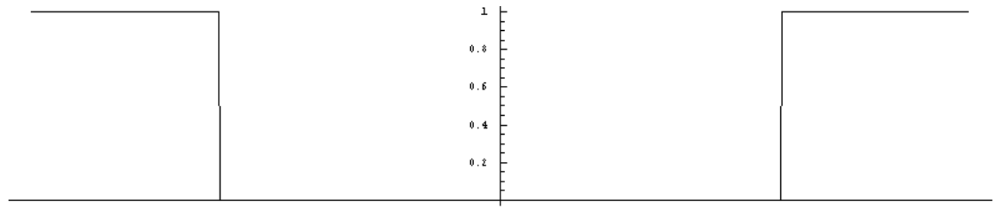

and a formula for the transfer function

$$
\text{High}(s) = 1 - \text{Low}(s) = 1 - \Pi_{2\nu_c}(s)
$$

where $\nu_c$ is the cut-off frequency. At the time we couldn’t finish the analysis because we didn’t have $\delta$. Now we do. The impulse response is

$$
\text{high}(t) = \delta(t) - 2\nu_c \operatorname{sinc}(2\nu_c t)\,.
$$

For an input $v(t)$ the output is then

$$
\begin{aligned}
w(t) &= (\text{high} * v)(t) \\
&= \big(\delta(t) - 2\nu_c \operatorname{sinc}(2\nu_c t)\big) * v(t) \\
&= v(t) - 2\nu_c \int_{-\infty}^{\infty} \operatorname{sinc}(2\nu_c(t - s))v(s)\,ds\,.
\end{aligned}
$$

The role of the convolution property of $\delta$ in this formula shows us that the high pass filter literally subtracts part of the signal away.

**Notch filter** The transfer function for the notch filter is just $1 -$ (transfer function for band pass filter) and it looks like this:

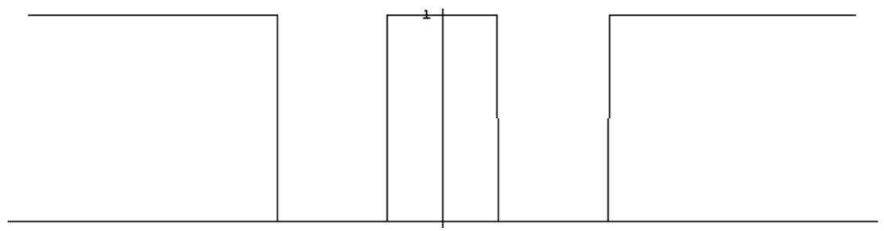

Frequencies in the “notch” are filtered out and all others are passed through unchanged. Suppose that the notches are centered at $\pm\nu_0$ and that they are $\nu_c$ wide. The formula for the transfer function, in terms of transfer function for the low-pass filter with cutoff frequency $\nu_c$, is

$$
\text{Notch}(s) = 1 - \big(\text{Low}(s - \nu_0) + \text{Low}(s + \nu_0)\big)\,.
$$

For the impulse response we obtain

$$
\begin{aligned}
\text{notch}(t) &= \delta(t) - (e^{-2\pi i \nu_0 t}\,\text{low}(t) + e^{2\pi i \nu_0 t}\,\text{low}(t)) \\
&= \delta(t) - 4\nu_c \cos(2\pi\nu_0 t)\operatorname{sinc}(2\nu_c t)\,.
\end{aligned}
$$

Thus

$$
\begin{aligned}
w(t) &= (\delta(t) - 4\nu_c \cos(2\pi\nu_0 t)\operatorname{sinc}(2\nu_c t)) * v(t) \\
&= v(t) - 4\nu_c \int_{-\infty}^{\infty} \cos(2\pi\nu_0(t - s))\operatorname{sinc}(2\nu_c(t - s))\,v(s)\,ds\,,
\end{aligned}
$$

and again we see the notch filter subtracting away part of the signal.
### 4.18.2 Diffraction: The sinc function, live and in pure color

Some of the most interesting applications of the Fourier transform are in the field of optics, understood broadly to include most of the electromagnetic spectrum in its purview. An excellent book on the subject is *Fourier Optics*, by Stanford’s own J. W. Goodman — highly recommended.

The fundamental phenomenon associated with the wave theory of light is *diffraction* or *interference*. Sommerfeld says that diffraction is “any deviation of light rays from rectilinear paths which cannot be interpreted as reflection or refraction.” Very helpful. Is there a difference between diffraction and interference? In his *Lectures on Physics*, Feynman says “No one has ever been able to define the difference between interference and diffraction satisfactorily. It is just a question of usage, and there is no specific, important physical difference between them.” He does go on to say that “interference” is usually associated with patterns caused by a few radiating sources, like two, while “diffraction” is due to many sources. Whatever the definition, or nondefinition, you probably know what the picture is:

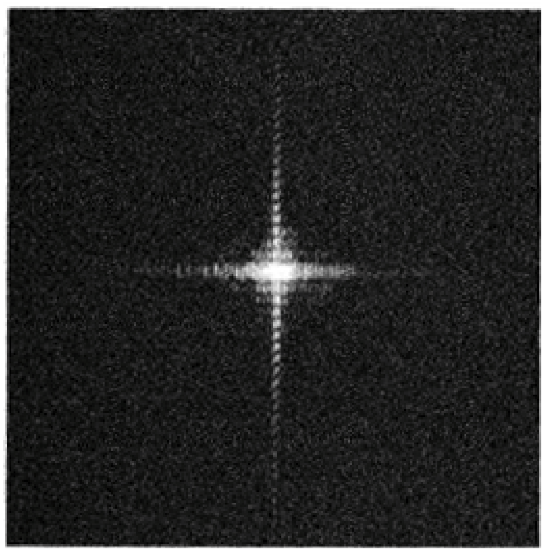

Such pictures, most notably the “Two Slits” experiments of Thomas Young (1773–1829), which we’ll analyze, below, were crucial in tipping the balance away from Newton’s corpuscular theory to the wave theory propounded by Christiaan Huygens (1629–1695). The shock of the diffraction patterns when first seen was that light + light could be dark. Yet the experiments were easy to perform. Spoke Young in 1803 to the Royal Society: ”The experiments I am about to relate … may be repeated with great ease, whenever the sun shines, and without any other apparatus than is at hand to every one.”[^4-24]

[^4-24]: Young also did important work in studying Egyptian hieroglyphics, completely translating a section of the Rosetta Stone.

We are thus taking sides in the grand battle between the armies of “light is a wave” and those of “light is a particle”. It may be that light is truly like nothing you’ve ever seen before, but for this discussion it’s a wave. Moreover, jumping ahead to Maxwell, we assume that light is an electromagnetic wave, and for our discussion we assume further that the light in our problems is:

- Monochromatic
  - Meaning that the periodicity in time is a single frequency, so described by a simple sinusoid.
- Linearly polarized
  - Meaning that the electric field vector stays in a plane as the wave moves. (Hence so too does the magnetic field vector.)

With this, the diffraction problem can be stated as follows:

> Light — an electromagnetic wave — is incident on an (opaque) screen with one or more apertures (transparent openings) of various shapes. What is the intensity of the light on a screen some distance from the diffracting screen?

We’re going to consider only a case where the analysis is fairly straightforward, the *Fraunhofer approximation*, or *Fraunhofer diffraction*. This involves a number of simplifying assumptions, but the results are used widely. Before we embark on the analysis let me point out that reasoning very similar to what we’ll do here is used to understand the radiation patterns of antennas. For this take on the subject see Bracewell, Chapter 15.

**Light waves** We can describe the properties of light that satisfy the above assumptions by a *scalar*-valued function of time and position. We’re going to discuss “scalar” diffraction theory, while more sophisticated treatments handle the “vector” theory. The function is the *magnitude* of the electric field vector, say a function of the form

$$
u(x,y,z,t) = a(x,y,z)\cos(2\pi\nu t - \phi(x,y,z))
$$

Here, $a(x,y,z)$ is the amplitude as a function only of position in space, $\nu$ is the (single) frequency, and $\phi(x,y,z)$ is the phase at $t = 0$, also as a function only of position.[^4-25]

[^4-25]: It’s also common to refer to the whole argument of the cosine, $2\pi\nu t - \phi$, simply as “the phase”.

The equation

$$
\phi(x,y,z) = \text{constant}
$$

describes a surface in space. At a fixed time, all the points on such a surface have the same phase, by definition, or we might say equivalently that the traveling wave reaches all points of such a surface $\phi(x,y,z) = \text{constant}$ at the same time. Thus any one of the surfaces $\phi(x,y,z) = \text{constant}$ is called a *wavefront*. In general, the wave propagates through space in a direction normal to the wavefronts.

The function $u(x,y,z,t)$ satisfies the 3-dimensional wave equation

$$
\Delta u = \frac{1}{c^2}\frac{\partial^2 u}{\partial t^2}
$$

where

$$
\Delta = \frac{\partial^2}{\partial x^2} + \frac{\partial^2}{\partial y^2} + \frac{\partial^2}{\partial z^2}
$$

is the Laplacian and $c$ is the speed of light in vacuum. For many problems it’s helpful to separate the spatial behavior of the wave from its temporal behavior and to introduce the *complex amplitude*, defined to be

$$
u(x,y,z) = a(x,y,z)e^{i\phi(x,y,z)}\,.
$$

Then we get the time-dependent function $u(x,y,z,t)$ as

$$
u(x,y,z,t) = \operatorname{Re}\left(\overline{u(x,y,z)}\,e^{2\pi i\nu t}\right).
$$

If we know $u(x,y,z)$ we can get $u(x,y,z,t)$. It turns out that $u(x,y,z)$ satisfies the differential equation

$$
\Delta u(x,y,z) + k^2 u(x,y,z) = 0
$$

where $k = 2\pi\nu/c$. This is called the Helmholtz equation, and the fact that it is time independent makes it simpler than the wave equation.

**Fraunhofer diffraction** We take a sideways view of the situation. Light is coming from a source at a point $O$ and hits a plane $S$. We assume that the source is so far away from $S$ that the magnitude of the electric field associated with the light is constant on $S$ and has constant phase, i.e., $S$ is a wavefront and we have what is called a *plane wave field*. Let’s say the frequency is $\nu$ and the wavelength is $\lambda$. Recall that $c = \lambda\nu$, where $c$ is the speed of light. (We’re also supposing that the medium the light is passing through is isotropic, meaning that the light is traveling at velocity $c$ in any direction, so there are no special effects from going through different flavors of jello or something like that.)

Set up coordinates so that the $z$-axis is perpendicular to $S$ and the $x$-axis lies in $S$, perpendicular to the $z$-axis. (In most diagrams it is traditional to have the $z$-axis be horizontal and the $x$-axis be vertical.)

In $S$ we have one or more rectangular apertures. We allow the length of the side of the aperture along the $x$-axis to vary, but we assume that the other side (perpendicular to the plane of the diagram) has length 1. A large distance from $S$ is another parallel plane. Call this the image plane.

The diffraction problem is:

- What is the electric field at a point $P$ in the image plane?

The derivation I’m going to give to answer this question is not as detailed as is possible (for details see Goodman’s book), but we’ll get the correct form of the answer and the point is to see how the Fourier transform enters.

The basis for analyzing diffraction is *Huygens’ principle* which states, roughly, that the apertures on $S$ (which is a wavefront of the original source) may be regarded as (secondary) sources, and the field at $P$ is the sum (integral) of the fields coming from these sources on $S$. Putting in a little more symbolism, if $E_0$ is the strength of the electric field on $S$ then an aperture of area $dS$ is a source of strength $dE = E_0\,dS$. At a distance $r$ from this aperture the field strength is $dE'' = E_0\,dS/r$, and we get the electric field at this distance by integrating over the apertures the elements $dE''$, “each with its proper phase”. Let’s look more carefully at the phase.

The wave leaves a point on an aperture in $S$, a new source, and arrives at $P$ sometime later. Waves from different points on $S$ will arrive at $P$ at different times, and hence there will be a phase difference between the arriving waves. They also drop off in amplitude like one over the distance to $P$, and so by different amounts, but if, as we’ll later assume, the size of the apertures on $S$ are small compared to the distance between $S$ and the image plane then this is not as significant as the phase differences. Light is moving so fast that even a small differences between locations of secondary point sources on $S$ may lead to significant differences in the phases when the waves reach $P$.

The phase on $S$ is constant and we might as well assume that it’s zero. Then we write the electric field on $S$ in complex form as

$$
E = E_0 e^{2\pi i\nu t}
$$

where $E_0$ is constant and $\nu$ is the frequency of the light. Suppose $P$ is at a distance $r$ from a point $x$ on $S$. Then the phase change from $x$ to $P$ depends on how big $r$ is compared to the wavelength $\lambda$ — how many wavelengths (or fractions of a wavelength) the wave goes through in going a distance $r$ from $x$ to $P$. This is $2\pi(r/\lambda)$. To see this, the wave travels a distance $r$ in a time $r/c$ seconds, and in that time it goes through $\nu(r/c)$ cycles. Using $c = \lambda\nu$ that’s $\nu r/c = r/\lambda$. This is $2\pi r/\lambda$ radians, and that’s the phase shift.

Take a thin slice of width $dx$ at a height $x$ above the origin of an aperture on $S$. Then the field at $P$ due to this source is, on account of the phase change,

$$
dE = E_0 e^{2\pi i\nu t} e^{2\pi i r/\lambda}\,dx\,.
$$

The total field at $P$ is

$$
E = \int_{\text{apertures}} E_0 e^{2\pi i\nu t} e^{2\pi i r/\lambda}\,dx = E_0 e^{2\pi i\nu t}\int_{\text{apertures}} e^{2\pi i r/\lambda}\,dx
$$

There’s a Fourier transform coming, but we’re not there yet.

The key assumption that is now made in this argument is to suppose that

$$
r \gg x\,,
$$

that is, the distance between the plane $S$ and the image plane is much greater than any $x$ in any aperture, in particular $r$ is large compared to any aperture size. This assumption is what makes this *Fraunhofer diffraction*; it’s also referred to as *far field* diffraction. With this assumption we have, approximately,

$$
r = r_0 - x\sin\theta\,,
$$

where $r_0$ is the distance between the origin of $S$ to $P$ and $\theta$ is the angle between the $z$-axis and $P$.

Plug this into the formula for $E$:

$$
E = E_0 e^{2\pi i\nu t} e^{2\pi i r_0/\lambda}\int_{\text{apertures}} e^{-2\pi i x\sin\theta/\lambda}\,dx
$$

Drop that constant out front — as you’ll see, it won’t be important for the rest of our considerations.

We describe the apertures on $S$ by a function $A(x)$, which is zero most of the time (the opaque parts of $S$) and 1 some of the time (apertures). Thus we can write

$$
E \propto \int_{-\infty}^{\infty} A(x)e^{-2\pi i x\sin\theta/\lambda}\,dx
$$

It’s common to introduce the variable

$$
p = \frac{\sin\theta}{\lambda}
$$

and hence to write

$$
E \propto \int_{-\infty}^{\infty} A(x)e^{-2\pi i p x}\,dx\,.
$$

There you have it. With these approximations (the *Fraunhofer approximations*) the electric field (up to a multiplicative constant) is the Fourier transform of the aperture! Note that the variables in the formula are $x$, a spatial variable, and $p = \sin\theta/\lambda$, in terms of an angle $\theta$. It’s the $\theta$ that’s important, and one always speaks of diffraction “through an angle.”

**Diffraction by a single slit** Take the case of a single rectangular slit of width $a$, thus described by $A(x) = \Pi_a(x)$. Then the field at $P$ is

$$
E \propto a\operatorname{sinc} ap = a\operatorname{sinc}\left(\frac{a\sin\theta}{\lambda}\right).
$$

Now, the *intensity* of the light, which is what we see and what photodetectors register, is proportional to the energy of $E$, i.e., to $|E|^2$. (This is why we dropped the factors $E_0 e^{2\pi i\nu t} e^{2\pi i r_0/\lambda}$ multiplying the integral. They have magnitude 1.) So the diffraction pattern you see from a single slit, those alternating bright and dark bands, is

$$
\text{intensity} = a^2\operatorname{sinc}^2\left(\frac{a\sin\theta}{\lambda}\right).
$$

Pretty good. The sinc function, or at least its square, live and in color. Just as promised.

We’ve seen a plot of $\operatorname{sinc}^2$ before, and you may very well have seen it, without knowing it, as a plot of the intensity from a single slit diffraction experiment. Here’s a plot for $a = 2$, $\lambda = 1$ and $-\pi/2 \le \theta \le \pi/2$:

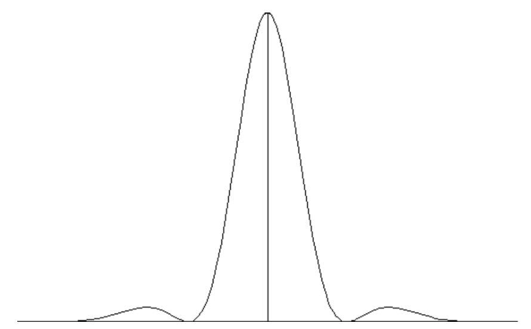

**Young’s experiment** As mentioned earlier, Thomas Young observed diffraction caused by light passing through two slits. To analyze his experiment using what we’ve derived we need an expression for the apertures that’s convenient for taking the Fourier transform.

Suppose we have two slits, each of width $a$, centers separated by a distance $b$. We can model the aperture function by the sum of two shifted rect functions,

$$
A(x) = \Pi_a(x - b/2) + \Pi_a(x + b/2)\,.
$$

(Like the transfer function of a bandpass filter.) That’s fine, but we can also shift the $\Pi_a$’s by convolving with shifted $\delta$’s, as in

$$
\begin{aligned}
A(x) &= \delta(x - b/2) * \Pi_a(x) + \delta(x + b/2) * \Pi_a(x) \\
&= (\delta(x - b/2) + \delta(x + b/2)) * \Pi_a(x)\,,
\end{aligned}
$$

and the advantage of writing $A(x)$ in this way is that the convolution theorem applies to help in computing the Fourier transform. Namely,

$$
\begin{aligned}
E(p) &\propto (2\cos\pi bp)(a\operatorname{sinc} ap) \\
&= 2a\cos\left(\frac{\pi b\sin\theta}{\lambda}\right)\operatorname{sinc}\left(\frac{a\sin\theta}{\lambda}\right)
\end{aligned}
$$

Young saw the intensity, and so would we, which is then

$$
\text{intensity} = 4a^2\cos^2\left(\frac{\pi b\sin\theta}{\lambda}\right)\operatorname{sinc}^2\left(\frac{a\sin\theta}{\lambda}\right)
$$

Here’s a plot for $a = 2$, $b = 6$, $\lambda = 1$ for $-\pi/2 \le \theta \le \pi/2$:

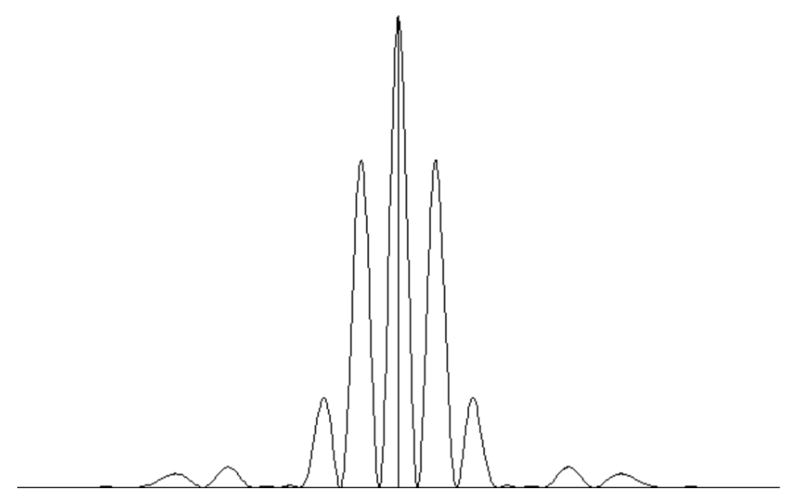

This is quite different from the diffraction pattern for one slit.

**Diffraction by two point-sources** Say we have two point-sources — the apertures — and that they are at a distance $b$ apart. In this case we can model the apertures by a pair of $\delta$-functions:

$$
A(x) = \delta(x - b/2) + \delta(x + b/2)\,.
$$

Taking the Fourier transform then gives

$$
E(p) \propto 2\cos\pi bp = 2\cos\left(\frac{\pi b\sin\theta}{\lambda}\right).
$$

and the intensity as the square magnitude:

$$
\text{intensity} = 4\cos^2\left(\frac{\pi b\sin\theta}{\lambda}\right).
$$

Here’s a plot of this for $b = 6$, $\lambda = 1$ for $-\pi/2 \le \theta \le \pi/2$:

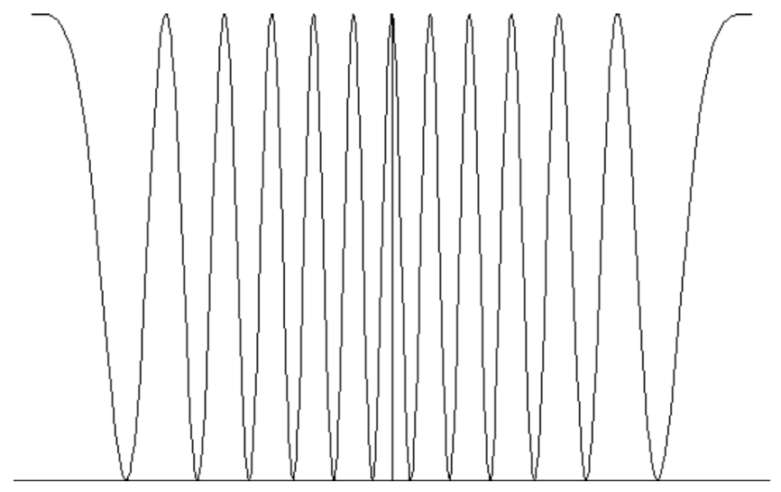

Incidentally, two radiating point sources covers the case of two antennas “transmitting in phase from a single oscillator”.

**An optical interpretation of $\boldsymbol{\mathcal{F}\delta = 1}$** What if we had light radiating from a single point source? What would the pattern be on the image plane in this circumstance? For a single point source there is no diffraction (a *point source*, not a circular aperture of some definite radius) and the image plane is illuminated uniformly. Thus the strength of the field is constant on the image plane. On the other hand, if we regard the aperture as $\delta$ and plug into the formula we have the Fourier transform of $\delta$,

$$
E \propto \int_{-\infty}^{\infty} \delta(x)e^{-2\pi i p x}\,dx
$$

This gives a physical reason why the Fourier transform of $\delta$ should be constant (if not 1).

Also note what happens to the intensity as $b \to 0$ of the diffraction due to two point sources at a distance $b$. Physically, we have a single point source (of strength 2) and the formula gives

$$
\text{intensity} = 4\cos^2\left(\frac{\pi b\sin\theta}{\lambda}\right) \to 4\,.
$$

## 4.19 Appendix: The Riemann-Lebesgue lemma

The result of this section, a version of what is generally referred to as the Riemann-Lebesgue lemma, is:

- If $\displaystyle\int_{-\infty}^{\infty} |f(t)|\,dt < \infty$ then $|\mathcal{F}f(s)| \to 0$ as $s \to \pm\infty$.

We showed that $\mathcal{F}f$ is continuous given that $f$ is integrable; that was pretty easy. It’s a much stronger statement to say that $\mathcal{F}f$ tends to zero at infinity.

We’ll derive the result from another important fact, which we won’t prove and which you may find interesting. It says that a function in $L^1(\mathbf{R})$ can be approximated in the $L^1(\mathbf{R})$ norm by functions in $\mathcal{S}$, the rapidly decreasing functions. Now, functions in $L^1(\mathbf{R})$ can be quite wild and functions in $\mathcal{S}$ are about as nice as you can imagine so this is quite a useful statement, not to say astonishing. We’ll use it in the following way. Let $f$ be in $L^1(\mathbf{R})$ and choose a sequence of functions $f_n$ in $\mathcal{S}$ so that

$$
\|f - f_n\|_1 = \int_{-\infty}^{\infty} |f(t) - f_n(t)|\,dt < \tfrac{1}{n}\,.
$$

We then use an earlier result that the Fourier transform of a function is bounded by the $L^1(\mathbf{R})$-norm of the function, so that

$$
|\mathcal{F}f(s) - \mathcal{F}f_n(s)| \le \|f - f_n\|_1 < \tfrac{1}{n}\,.
$$

Therefore

$$
|\mathcal{F}f(s)| \le |\mathcal{F}f_n(s)| + \tfrac{1}{n}\,.
$$

But since $f_n$ is rapidly decreasing, so is $\mathcal{F}f_n$, and hence $\mathcal{F}f_n(s)$ tends to zero as $s \to \pm\infty$. Thus

$$
\lim_{s \to \infty} |\mathcal{F}f(s)| < \tfrac{1}{n}
$$

for all $n \ge 1$. Now let $n \to \infty$.

## 4.20 Appendix: Smooth Windows

One way of cutting off a function is simply to multiply by a rectangle function. For example, we can cut a function $f(x)$ off outside the interval $[-n/2, +n/2]$ via

$$
\Pi(x/n)f(x) = \begin{cases} f(x) & |x| < n/2 \\ 0 & |x| \ge n/2 \end{cases}
$$

We can imagine letting $n \to \infty$ and in this way approximate $f(x)$ by functions which are nonzero only in a finite interval. The problem with this particular way of cutting off is that we may introduce discontinuities in the cut-off.

There are smooth ways of bringing a function down to zero. Here’s a model for doing this, sort of a smoothed version of the rectangle function. It’s amazing that you can write it down, and if any of you are ever looking for smooth windows here’s one way to get them. The function

$$
g(x) = \begin{cases} 0 & x \le 0 \\ \exp\left(-\left(\dfrac{1}{2x}\right)\exp\left(\dfrac{1}{2x - 1}\right)\right) & 0 < x < \frac{1}{2} \\ 1 & x \ge \frac{1}{2} \end{cases}
$$

is a smooth function, i.e., infinitely differentiable! It goes from the constant value 0 to the constant value 1 smoothly on the interval from 0 to $1/2$.

![Graph of g(x), rising smoothly from 0 to 1 on [0, 1/2]](figures/p213.png)

Then the function $g(1 + x)$ goes up smoothly from 0 to 1 over the interval from $-1$ to $-1/2$ and the function $g(1 - x)$ goes down smoothly from 1 to 0 over the interval from $1/2$ to 1. Their product

$$
c(x) = g(1 + x)g(1 - x)
$$

is 1 on the interval from $-1/2$ to $1/2$, goes down smoothly to 0 between $\pm 1/2$ and $\pm 1$, and is zero for $x \le -1$ and for $x \ge 1$. Here’s the graph of $c(x)$, the one we had earlier in the notes.

The function $c(x)$ is a smoothed rectangle function. By scaling, say to $c_n(x) = c(x/n)$, we can smoothly cut off a function to be zero outside a given interval $[-n/2, n/2]$ via $c_n(x)f(x)$. As we let the interval become larger and larger we see we are approximating a general (smooth) infinite function by a sequence of smooth functions that are zero beyond a certain point.

For example, here’s a function and its smooth window (to be identically 0 after $\pm 3$):

![A function on [−3, 3]](figures/p214.png)

Here’s a blow-up near the endpoint 3 so you can see that it really is coming into zero smoothly.

## 4.21 Appendix: 1/x as a Principal Value Distribution

We want to look at the formula

$$
\frac{d}{dx}\ln|x| = \frac{1}{x}\,.
$$

from a distributional point of view. First, does $\ln|x|$ — much less its derivative — even make sense as a distribution? It has an infinite discontinuity at the origin, so there’s a question about the existence of the integral

$$
\langle \ln|x|, \varphi \rangle = \int_{-\infty}^{\infty} \ln|x|\,\varphi(x)\,dx
$$

when $\varphi$ is a Schwartz function. Put another way, $\ln|x|$ can be defined as a distribution if we can define a pairing with test functions (that satisfies the linearity and continuity requirements). Is the pairing by simple integration, as above? Yes, but it takes some work.

The problem is at the origin not at $\pm\infty$, since $\varphi(x)\ln|x|$ will go down to zero fast enough to make the tails of the integral converge. To analyze the integral near zero, let me remind you of some general facts: When a function $f(x)$ has a discontinuity (infinite or not) at a finite point, say at 0, then

$$
\int_a^b f(x)\,dx, \quad a < 0,\ b > 0
$$

is an *improper integral* and has to be defined via a limit

$$
\lim_{\epsilon_1 \to 0} \int_a^{\epsilon_1} f(x)\,dx + \lim_{\epsilon_2 \to 0} \int_{\epsilon_2}^b f(x)\,dx
$$

with $\epsilon_1$ and $\epsilon_2$ tending to zero separately. If both limits exist then so does the integral — this is the definition, i.e., you first have to take the separate limits, then add the results. If neither or only one of the limits exists then the integral does not exist.

What’s the situation for $\int_{-\infty}^{\infty} \ln|x|\,\varphi(x)\,dx$? We’ll need to know two facts:

1. An antiderivative of $\ln x$ is $x\ln x - x$.

2. $\lim_{|x| \to 0} |x|^k \ln|x| = 0$ for any $k > 0$.

   This is so because while $\ln|x|$ is tending to $-\infty$ as $x \to 0$, it’s doing so slowly enough that multiplying it by any positive power of $x$ will force the product to go to zero. (You can check this with L’Hospital’s rule, for instance.)

Now write

$$
\begin{aligned}
&\int_{-\infty}^{-\epsilon_1} \ln(-x)\varphi(x)\,dx + \int_{\epsilon_2}^{\infty} \ln x\,\varphi(x)\,dx = \\
&\qquad \int_{-\infty}^{-1} \ln(-x)\varphi(x)\,dx + \int_{-1}^{-\epsilon_1} \ln(-x)\varphi(x)\,dx + \int_{\epsilon_2}^{1} \ln|x|\varphi(x)\,dx + \int_1^{\infty} \ln|x|\varphi(x)\,dx\,.
\end{aligned}
$$

To repeat what I said earlier, the integrals going off to $\pm\infty$ aren’t a problem and only the second and third integrals need work. For these, use a Taylor approximation to $\varphi(x)$, writing $\varphi(x) = \varphi(0) + O(x)$, where $O(x)$ is a term of order $x$ for $|x|$ small. Then

$$
\begin{aligned}
&\int_{-1}^{-\epsilon_1} \ln(-x)(\varphi(0) + O(x))\,dx + \int_{\epsilon_2}^{1} \ln x(\varphi(0) + O(x))\,dx \\
&\quad = \varphi(0)\left(\int_{-1}^{-\epsilon_1} \ln(-x)\,dx + \int_{\epsilon_2}^{1} \ln x\,dx\right) + \int_{-1}^{-\epsilon_1} O(x)\ln(-x)\,dx + \int_{\epsilon_2}^{1} O(x)\ln x\,dx \\
&\quad = \varphi(0)\left(\int_{\epsilon_1}^{1} \ln x\,dx + \int_{\epsilon_2}^{1} \ln x\,dx\right) + \int_{-1}^{-\epsilon_1} O(x)\ln(-x)\,dx + \int_{\epsilon_2}^{1} O(x)\ln x\,dx
\end{aligned}
$$

We want to let $\epsilon_1 \to 0$ and $\epsilon_2 \to 0$. You can now use Point 1, above, to check that the limits of the first pair of integrals exist, and by Point 2 the second pair of integrals aren’t even improper. We’ve shown that

$$
\int_{-\infty}^{\infty} \ln|x|\,\varphi(x)\,dx
$$

exists, hence $\ln|x|$ is a distribution. (The pairing, by integration, is obviously linear. We haven’t checked continuity, but we never check continuity.)

Now the derivative of $\ln|x|$ is $1/x$, but how does the latter define a distribution? This is trickier. We would have to understand the pairing as a limit

$$
\langle \frac{1}{x}, \varphi \rangle = \lim_{\epsilon_1 \to 0} \int_{-\infty}^{\epsilon_1} \frac{\varphi(x)}{x}\,dx + \lim_{\epsilon_2 \to 0} \int_{\epsilon_2}^{\infty} \frac{\varphi(x)}{x}\,dx
$$

and this limit *need not exist*. What *is* true is that the symmetric sum

$$
\int_{-\infty}^{-\epsilon} \frac{\varphi(x)}{x}\,dx + \int_{\epsilon}^{\infty} \frac{\varphi(x)}{x}\,dx
$$

has a limit as $\epsilon \to 0$. This limit is called the *Cauchy principal value* of the improper integral, and one writes

$$
\langle \frac{1}{x}, \varphi(x) \rangle = \text{pr.v.}\int_{-\infty}^{\infty} \frac{\varphi(x)}{x}\,dx
$$

(There’s not a universal agreement on the notation for a principal value integral.)

Why does the principal value exist? The analysis is much the same as we did for $\ln|x|$. As before, write

$$
\begin{aligned}
\text{pr.v.}\int_{-\infty}^{\infty} \frac{\varphi(x)}{x}\,dx &= \lim_{\epsilon \to 0}\left(\int_{-\infty}^{-\epsilon} \frac{\varphi(x)}{x}\,dx + \int_{\epsilon}^{\infty} \frac{\varphi(x)}{x}\,dx\right) \\
&= \lim_{\epsilon \to 0}\left(\int_{-\infty}^{-1} \frac{\varphi(x)}{x}\,dx + \int_{-1}^{-\epsilon} \frac{\varphi(x)}{x}\,dx + \int_{\epsilon}^{1} \frac{\varphi(x)}{x}\,dx + \int_1^{\infty} \frac{\varphi(x)}{x}\,dx\right) \\
&= \int_{-\infty}^{-1} \frac{\varphi(x)}{x}\,dx + \int_1^{\infty} \frac{\varphi(x)}{x}\,dx + \lim_{\epsilon \to 0}\left(\int_{-1}^{-\epsilon} \frac{\varphi(x)}{x}\,dx + \int_{\epsilon}^{1} \frac{\varphi(x)}{x}\,dx\right)
\end{aligned}
$$

To take the limit we do the same thing we did before and use $\varphi(x) = \varphi(0) + O(x)$. The terms that matter are

$$
\int_{-1}^{-\epsilon} \frac{\varphi(0)}{x}\,dx + \int_{\epsilon}^{1} \frac{\varphi(0)}{x}\,dx
$$

and this sum is zero.

To summarize, $1/x$ does define a distribution, but the pairing of $1/x$ with a test function is via the Cauchy Principal Value, not just direct, uncommented upon integration. The distribution $1/x$ is thus often referred to as the “Principal Value Distribution”.
