# Chapter 5: III, Sampling, and Interpolation

## 5.1 X-Ray Diffraction: Through a Glass Darkly1

Diffraction is not only an interesting phenomenon to look at, it is an important experimental tool, the tool being diffraction gratings. A diffraction grating is an aperture plane with a large number of parallel slits, closely spaced. See, for example http://hyperphysics.phy-astr.gsu.edu/hbase/phyopt/grating.html.

Diffraction gratings are used to separate light of different wavelengths, and to measure wavelengths. I want to look briefly at this latter application.

X-rays were discovered by William Roentgen in 1895. It was not known whether they were particles or waves, but the wave hypothesis put their wavelength at about 10^{−8} cm. Using diffraction gratings was out of the question for experiments on X-rays because diffraction effects are only seen if the width of the slits is comparable to the wavelength. It was possible to build such gratings for experiments on visible light, where the wavelengths are between 400 and 700 nanometers (10^{−7} cm), but that extra order of magnitude to get to X-rays couldn’t be done.

A related set of mysteries had to do with the structure of crystals. It was thought that the macroscopic structure of crystals could be explained by a periodic arrangement of atoms, but there was no way to test this. In 1912 Max von Laue proposed that the purported periodic structure of crystals could be used to diffract X-rays, just as gratings diffracted visible light. He thus had three hypotheses:

1. X-rays are waves.

2. Crystals are periodic.

3. The spacing between atoms is of the order 10^{−8} cm.

Friedrich and Kniping carried out experiments that confirmed von Laue’s hypotheses and the subject of X-ray crystallography was born.

But you need to know some math.

1 1 Corinthians 13: When I was a child, I spake as a child, I understood as a child, I thought as a child: but when I became a man, I put away childish things. For now we see through a glass, darkly, but then face to face: now I know in part; but then shall I know even as also I am known.

Electron density distribution An important quantity to consider in crystallography is how the electrons are distributed among the atoms in the crystal. This is usually referred to as the electron density distribution of the crystal. We want to see how we might represent this as a function, and consider what happens to the function in the course of an X-ray diffraction experiment.

Let’s take the one-dimensional case as an illustration; we’ll look at the (more realistic) higher dimensional case later in the course. We view a one-dimensional crystal as an evenly spaced collection of atoms along a line. In fact, for purposes of approximation, we suppose that an infinite number of them are strung out along a line. If we describe the electron density distribution of a single atom by a function $ρ(x)$ then the electron density distribution of the crystal with spacing $p$ is the periodic function

$$
ρ_{p}(x) = \sum_{k=−∞}^{∞} ρ(x− kp).
$$

As our discussion of diffraction might indicate, the Fourier transform of $ρ_{p}(x)$ is proportional to the “scattered amplitude” of X-rays diffracted by the crystal. Thus we want to write $ρ_{p}(x)$ in a form that’s amenable to taking the Fourier transform. (Incidentally, it’s not unreasonable to suppose that $ρ$ is rapidly decreasing — the electron density of a single atom dies off as we move away from the atom.) As we’ll see, it’s convenient to write the periodized density as a convolution with a sum of shifted $δ$’s:

$$
δ(x − kp)∗ ρ(x) = (
$$

$$
δ(x− kp))
$$

$$
\sum_{k=−∞}^{∞}
$$

$$
\sum_{k=−∞}^{∞}
$$

$$
\sum_{k=−∞}^{∞}
$$

$$
∗ ρ(x).
$$

$$
ρ_{p}(x) = ρ(x − pk) =
$$

Now introduce

$$
\sum_{k=−∞}^{∞} δ(x− kp),
$$

III$p(x)$ =

so that, simply,

$ρ_{p}$ = III$p ∗ρ.$ III$p$ is the star of the show. Bracewell calls it the “shah function”, after the Cyrillic letter, and this has caught on. It’s also referred to as the Dirac comb (with spacing $p)$.

Using the convolution theorem, we have

$\mathcal{F}ρ_{p}$ = $\mathcal{F}ρ· \mathcal{F}$III$p.$

What is $\mathcal{F}$III$p$? That’s a really interesting question.

## 5.2 The III Distribution

We want to develop the properties of III$p,$ particularly its Fourier transform. In fact, we met this distribution earlier, in Chapter 1. Rather, we met its Fourier transform — it’s the continuous buzz signal, as we’ll discuss further, below.

As a “standard” we take the spacing $p$ to be 1, so we sum over the integer points and define

$$
\sum_{k=−∞}^{∞}
$$

$$
\sum_{k=−∞}^{∞}
$$

$$
δ(x − k)
$$

III($x)$ =

or III =

$$
δ_{k} .
$$

As above, for a series of $δ$’s spaced $p$ apart we write

$$
\sum_{k=−∞}^{∞}
$$

$$
\sum_{k=−∞}^{∞}
$$

$$
δ(x− kp)
$$

III$p(x)$ =

or III$p$ =

$$
δ_{kp} .
$$

I’ll mostly write $δ$’s “at points” in this section. It seems the more natural thing to do.

To see that the series for III$p$ makes sense as a distribution, let $ϕ$ be a test function; then

$$
\sum_{k=−∞}^{∞}
$$

$$
\sum_{k=−∞}^{∞} ⟨_{kp}δ ,ϕ⟩ = \sum_{k=−∞}^{∞}
$$

$⟨$III$p,ϕ⟩ =$

$$
δ_{kp},ϕ =
$$

$$
ϕ(kp).
$$

This sum converges because of the rapid decrease of $ϕ$ at $±∞$.

There are two facets to the III’s versatility: periodizing and sampling. We’ll consider each in turn.

## 5.2.1 Periodizing with III

Our first application of III was as above, to write the periodization of the electron density function $ρ$ of a single atom in a crystal as a convolution. The purpose was to periodize $ρ$ to reflect the physical structure of the crystal. This is a general procedure. The III function furnishes a handy way of generating and working with periodic functions and distributions. Take that as an aphorism.

If $f$ is a function or distribution for which convolution with III makes sense, then

$$
\sum_{k=−∞}^{∞}
$$

($f ∗$III$p)(t)$ =

$$
f(t − pk)
$$

is periodic with period $p$. Note that

$$
\sum_{k=−∞}^{∞}
$$

$f(at$ + $b)∗$ III$p(t)$ =

$$
f(at + b − apk)
$$

also has period $p,$ and this can just as well be written in terms of a shifted III:

$$
\sum_{k=−∞}^{∞}
$$

$f(at$ + $b− apk)$ = $f(at) ∗$ III$p(t$ + $\frac{b}{a}).$ Convolving with III$p$ now emerges as the basic, familiar way to produce a periodic function. However, some care must be taken; convolving with III to periodize doesn’t shift the graph and link them up, it shifts the graph and adds them up.

In many cases the series

$$
\sum_{k=−∞}^{∞} f(t − pk)
$$

will converge in some reasonable sense, often at least to define a periodic distribution (see Section 5.4). A common application is to form $f ∗$III$p$ when $f$ is zero for $|t| ≥ p/2$. In this case the convolution exists and we naturally say that $f ∗$ III$p$ is the $p-$periodic extension of $f$.

I want to look at this operation in a little more detail, one reason being that it will make the discussion of sampling and aliasing, soon to come, much cleaner and easier. Recall the scaled rect function

$$
Πp(x) = (1 |x| < p/2
$$

$$
0 |x| ≥ p/2
$$

If $f$ is zero when $|t| ≥ p/2$ (note the $≥$ not $>)$ then

$$
Πpf = f
$$

and

$f$ = Π$p(f ∗$ III$p).$ In fact these two conditions are equivalent. That should be clear if you have the geometric picture in mind.

For example, shown below are the graphs of a function $f(x)$ that is zero outside of $|t| < p/2$ and of three cycles of its periodization; that’s $f(x$ + $p)$ + $f(x)$ + $f(x − p)$ = $f(x)∗ \sum_{k=−1}^{1} δ(x − kp)$.

Here are the algebraic details that go from the picture to the formulas. If Π$pf$ = $f$ then Π$p(t)(f ∗$III$p)(t)$ = Π$p(t)(($Π$pf) ∗$ III$p)(t)$ = Π$p(t) \sum_{k=−∞}^{∞}$ Π$p(t − kp)f(t − kp)$

$$
\sum_{k=−∞}^{∞}
$$

Π$p(t)$Π$p(t − kp)f(t − kp)$ = Π$p(t)f(t)$ = $f(t)$

=

since

$$
(Πp(t) k = 0
$$

Π$p(t)$Π$p(t − kp)$ =

$$
0 k\neq 0
$$

On the other hand, if $f$ = Π$p(f ∗$ III$p)$ then Π$pf$ = Π$p($Π$p(f ∗$ III$p))$ = Π$2p(f ∗$ III$p)$ = Π$p(f ∗$ III$p)$ = $f .$ If we had defined Π$p$ differently at $±p/2$ (in other cultures either Π$p(±p/2)$ = 1 or Π$p(±p/2)$ = $1/2$ are typical) then the calculations and results above would hold except for the translates of $±p/2,$ a discrete set of points. Such an exceptional set generally poses no problems in applications.

This all seems pretty innocent, but cutting off a distribution by Π$p$ (a discontinuous function) is not part of the theory. We only defined the product of a distribution and a smooth function. In general we’ll proceed as though all is well, though careful justifications can take some work (which we won’t do). Be not afraid.

## 5.2.2 Sampling with III

The flip side of periodizing with III is sampling with III. Here’s what this means. Suppose we multiply III by a function $f$. Then as a distribution

$$
\sum_{k=−∞}^{∞} f(x)δ(x− k) = \sum_{k=−∞}^{∞} f(k)δ(x− k).
$$

$f(x)$III($x)$ = Multiplying III by $f$ “samples” $f$ at the integer points, in the sense that it “records” the values of $f$ at those points in the sum.

There’s nothing sacred about sampling at the integers of course. Sampling using III$p$ means

$$
\sum_{k=−∞}^{∞} f(kp)δ(x− kp),
$$

$f(x)$III$p(x)$ = so $f$ is sampled at the points $kp$. Scaled or not, the thing to keep in mind about the shah function is that it takes evenly spaced samples of a function $f$.

To summarize:

- Convolving a function with III (with III$p)$ produces a periodic function with period 1 (with period $p)$.

- Multiplying a function by III (by III$p)$ samples the function at the integer points (at the points $pk)$.

## 5.2.3 Scaling identity for IIIp

There’s a simple scaling identity for III$p$ that comes up often enough in formulas and derivations to make it worth pointing out. We’ve defined

$$
\sum_{k=−∞}^{∞} δ(x− kp),
$$

III$p(x)$ = scaling the spacing of the impulses by $p,$ but it’s also natural to consider

$$
\sum_{k=−∞}^{∞} δ(px − k).
$$

III($px)$ =

Now recall the scaling property of $δ;$ for $p >$ 0,

$$
δ(px) = \frac{1}{p}δ(x).
$$

Plugging this into the formula for III($px)$ gives

$$
\sum_{k=−∞}^{∞} δ(px − k)
$$

III($px)$ =

$$
= \sum_{k=−∞}^{∞} δ (p(x − \frac{k}{p}))
$$

$$
= \sum_{k=−∞}^{∞} (x − \frac{k}{p})
$$

= $\frac{1}{p}$III$1/p(x)$

$$
\frac{1}{p}δ
$$

To give it its own display:

III($px)$ = $\frac{1}{p}$III$1/p(x)$ (It would be a good exercise to derive this in a variable-free environment, using the delay operator $τ_{p}$ and the scaling operator $σ_{p}$.) By the same token,

$$
(\frac{1}{p}x) .
$$

III$p(x)$ = $\frac{1}{p}$III

## 5.3 The Fourier Transform of III, or, The deepest fact about the inte-

gers is well known to every electrical engineer and spectroscopist The most interesting thing about III is what happens when we take its Fourier transform. If we start with the definition

$$
\sum_{k=−∞}^{∞} δ(x − k).
$$

III($x)$ = and apply what we know about the Fourier transform of $δ$ (it’s 1) plus the shift theorem, we obtain

$$
\sum_{k=−∞}^{∞}
$$

$\mathcal{F}$III($s)$ =

$$
e^{−2πiks} .
$$

Since we’re summing over all positive and negative $k$ we can write this as

$$
\sum_{k=−∞}^{∞}
$$

$\mathcal{F}$III($s)$ =

$$
e^{2πiks} .
$$

which looks more like a Fourier series. We did see this when we introduced the buzz signal. It sounds like a signal with every harmonic present in equal amounts. It sounds terrible.

The expression

$$
\sum_{k=−∞}^{∞} e^{2πiks}
$$

actually does make sense as a distribution, as we’ll see, but it’s not yet a helpful expression. Instead, to find the Fourier transform of III we go back to the definition in terms of tempered distributions. If $ϕ$ is a Schwartz function then $⟨\mathcal{F}$III$,ϕ⟩ = ⟨$III$,\mathcal{F}ϕ⟩.$ On the right hand side,

$$
\sum_{k=−∞}^{∞}
$$

$$
\sum_{k=−∞}^{∞}
$$

$$
\sum_{k=−∞}^{∞}
$$

$⟨$III$,\mathcal{F}ϕ⟩ =$

$$
⟨_{k}δ ,\mathcal{F}ϕ⟩ =
$$

$$
δ_{k},\mathcal{F}ϕ
$$

$$
\mathcal{F}ϕ(k)
$$

=

And now we have something absolutely remarkable.

The Poisson summation formula: Let $ϕ$ be a Schwartz function. Then

$$
\sum_{k=−∞}^{∞} \mathcal{F}ϕ(k) = \sum_{k=−∞}^{∞} ϕ(k)
$$

This result actually holds for other classes of functions (the Schwartz class was certainly not known to Poisson!) but that’s not important for us.

The Poisson summation formula is the deepest fact known about the integers. It’s known to every electrical engineer and every spectroscopist because of what it says about the Fourier transform of $\mathcal{F}$III. We’ll settle that now and come back to the derivation of the formula afterward.

We pick up our calculation of $\mathcal{F}$III where we left off:

$$
\sum_{k=−∞}^{∞}
$$

$⟨\mathcal{F}$III$,ϕ⟩ =$

$$
\mathcal{F}ϕ(k)
$$

$$
= \sum_{k=−∞}^{∞}
$$

$ϕ(k) ($because of the Poisson summation formula)

$$
= \sum_{k=−∞}^{∞} ⟨_{k}δ ,ϕ⟩
$$

(definition of $δ_{k})$

$$
= \sum_{k=−∞}^{∞} δ_{k},ϕ
$$

= $⟨$III$,ϕ⟩.$

Comparing where we started to where we ended up, we conclude that

$\mathcal{F}$III = III$.$ Outstanding. The III distribution is its own Fourier transform. (See also Section 5.10.) Proof of the Poisson Summation Formula The proof of the Poisson summation formula is an excellent example of the power of having two different representations of the same thing, an idea certainly at the heart of Fourier analysis. Remember the maxim: If you can evaluate an expression in two different ways it’s likely you’ve done something significant.

Given a test function $ϕ(t)$ we periodize to Φ($t)$ of period 1:

$$
\sum_{k=−∞}^{∞}
$$

Φ($t)$ = ($ϕ∗$ III)($t)$ =

$$
ϕ(t − k).
$$

As a periodic function, Φ has a Fourier series:

$$
\sum_{m=−∞}^{∞}
$$

Φˆ($m)e^{2πimt}.$

$$
Φ(t) =
$$

Let’s find the Fourier coefficients of Φ($t)$.

$$
\int_{0}^{1}
$$

Φˆ($m)$ = $e^{−2πimt}$Φ($t)dt$

$$
= \int_{0 k}^{1} \sum_{=−∞}^{∞} e^{−2πimt}ϕ(t − k)dt = \sum_{k=−∞ 0}^{∞} \int^{1} e^{−2πimt}ϕ(t − k)dt
$$

$$
= \sum_{k=−∞ −k}^{∞} \int^{−k+1} e^{−2πim(t+k)}ϕ(t)dt
$$

$$
\sum_{k=∞−∞ −k}^{∞} \int^{−k+1}
$$

$e^{−2πimt}e^{−2πimk}ϕ(t)dt ($using $e^{−2πimk}$ = 1)

=

$$
= \int_{−∞} e^{−2πimt}ϕ(t)dt
$$

$$
= \mathcal{F}ϕ(m).
$$

Therefore

$$
Φ(t) = \sum_{m=−∞}^{∞} \mathcal{F}ϕ(m)e^{2πimt}.
$$

(We’ve actually seen this calculation before, in a disguised form; look back to Section 3.5 on the relationship between the solutions of the heat equation on the line and on the circle.) Since Φ is a smooth function, the Fourier series converges. Now compute Φ(0) two ways, one way from plugging into its definition and the other from plugging into its Fourier series:

$$
Φ(0) = \sum_{k=−∞}^{∞} ϕ(−k) = \sum_{k=−∞}^{∞} ϕ(k)
$$

$$
Φ(0) = \sum_{k=−∞}^{∞} \mathcal{F}ϕ(k)e^{2πin0} = \sum_{k=−∞}^{∞} \mathcal{F}ϕ(k)
$$

Done.

The Fourier transform of III$p$ From $\mathcal{F}$III = III we can easily deduce the formula for $\mathcal{F}$III$p$. Using the identities

$$
(\frac{1}{p}x)
$$

III($px)$ = $\frac{1}{p}$

III

and

III$1/p(x).$

III$p(x)$ = $\frac{1}{p}$

we have

$$
( (\frac{x}{p}))
$$

$\mathcal{F}$III$p(s)$ = $\frac{1}{p}\mathcal{F}$ III

= $\frac{1}{p}p\mathcal{F}$III($ps) ($stretch theorem)

= III($ps)$

= $\frac{1}{p}$III$1/p(s)$

## 5.3.1 Crystal gazing

Let’s return now to the setup for X-ray diffraction for a one-dimensional crystal. We described the electron density distribution of a single atom by a function $ρ(x)$ and the electron density distribution of the crystal with spacing $p$ as

$$
\sum_{k=−∞}^{∞}
$$

$ρ(x− kp)$ = ($ρ∗$ III$p)(x).$

$$
ρ_{p}(x) =
$$

Then

$\mathcal{F}ρ_{p}(s)$ = $\mathcal{F}(ρ∗$III$p)(s)$

= ($\mathcal{F}ρ·\mathcal{F}$III$p)(s)$

= $\mathcal{F}ρ(s)\frac{1}{p}$III$1/p(s)$

$$
= \sum_{k=−∞}^{∞} \frac{1}{p}\mathcal{F}ρ(\frac{k}{p})δ(s − \frac{k}{p})
$$

Here’s the significance of this. In an X-ray diffraction experiment what you see on the X-ray film is a bunch of spots, corresponding to $\mathcal{F}ρ_{p}$. The intensity of each spot is proportional to the magnitude of the Fourier transform of the electron density $ρ$ and the spots are spaced a distance $1/p$ apart, not $p$ apart. If you were an X-ray crystallographer and didn’t know your Fourier transforms, you might assume that there is a relation of direct proportion between the spacing of the dots on the film and the atoms in the crystal, but it’s a reciprocal relation — kiss your Nobel prize goodbye. Every spectroscopist knows this.

We’ll see a similar relation when we consider higher dimensional Fourier transforms and higher dimensional III-functions. A III-function will be associated with a lattice and the Fourier transform will be a III-function associated with the reciprocal or dual lattice. This phenomenon has turned out to be important in image processing; see, for example, Digital Video Processing by A. M. Tekalp.

## 5.4 Periodic Distributions and Fourier series

I want to collect a few facts about periodic distributions and Fourier series, and show how we can use III as a convenient tool for “classical” Fourier series.

Periodicity The notion of periodicity for distributions is invariance under the delay operator $τ_{p},$ i.e., a distribution (or a function, for that matter) is periodic with period $p$ if

$$
τ_{p}S = S .
$$

This is the “variable free” definition, since we’re not supposed to write $S(x− p)$ = $S(x)$ or $S(x$ + $p)$ = $S(x)$ which is the usual way of expressing periodicity. It’s a pleasure to report that III$p$ is periodic with period $p$.

You can see that most easily by doing what we’re not supposed to do:

$$
\sum_{k=−∞}^{∞} δ(x + p − kp) = \sum_{k=−∞}^{∞} δ(x − (k − 1)p) = \sum_{k=−∞}^{∞}
$$

$δ(x − kp)$ = III$p(x).$

III$p(x$ + $p)$ = It’s also easy to give a variable-free demonstration, which amounts to the same thing:

$$
\sum_{k=−∞}^{∞}
$$

$$
\sum_{k=−∞}^{∞}
$$

$$
\sum_{k=−∞ (k+1)}^{∞}
$$

$$
\sum_{k=−∞}^{∞}
$$

$τ_{p}$III$p$ =

$$
τ_{p}δ_{kp} = δ_{kp+p} = δ_{p} =
$$

$δ_{kp}$ = III$p .$

When we periodize a test function $ϕ$ by forming the convolution,

Φ($x)$ = ($ϕ∗$ III$p)(x),$ it’s natural to view the periodicity of Φ as a consequence of the periodicity of III$p$. By this I mean we can appeal to:

- If $S$ or $T$ is periodic of period $p$ then $S ∗ T$ (when it is defined) is periodic of period $p$.

Let me show this for functions (something we could have done way back) and I’ll let you establish the general result. Suppose $f$ is periodic of period $p$. Consider ($f ∗ g)(x$ + $p)$. We have

$$
(f ∗ g)(x + p) = \int_{−∞}^{∞} f(x + p − y)g(y)dy = \int_{−∞}^{∞} f(x − y)g(y)dy = (f ∗ g)(x).
$$

The same argument works if instead $g$ is periodic.

So, on the one hand, convolving with III$p$ produces a periodic function. On the other hand, suppose Φ is periodic of period $p$ and we cut out one period of it by forming Π$p$Φ. We get Φ back, in toto, by forming the convolution with III$p;$ that is, Φ = $ϕ ∗$ III$p$ = (Π$p$Φ) $∗$ III$p$ (Well, this is almost right. The cut-off Π$p$Φ is zero at $±p/2$ while Φ($±p/2)$ certainly may not be zero.

These “exceptions” at the end-points won’t affect the discussion here in any substantive way.2) The upshot of this is that something is periodic if and only if it is a convolution with III$p$. This is a nice point of view. I’ll take this up further in Section 5.10.

2 We can either: (a) ignore this problem; (b) jigger the definition of Π$p$ to make it really true, which has other problems; or (c) say that the statement is true as an equality between distributions, and tell ourselves that modifying the functions at a discrete set of points will not affect that equality.

Fourier series for III Taking the Fourier series of III term by term we arrived at

$$
\sum_{k=−∞}^{∞}
$$

$\mathcal{F}$III =

$$
e^{2πikt} ,
$$

and if we next use $\mathcal{F}$III = III we would then have

$$
\sum_{k=−∞}^{∞}
$$

III =

$$
e^{2πikt} .
$$

The series

$$
\sum_{k=−∞}^{∞} e^{2πikt}
$$

does define a distribution, for

$$
\sum_{k=−∞}^{∞} e^{2πikt},ϕ = \int_{−∞}^{∞} \sum_{k=−∞}^{∞} e^{2πikt}ϕ(t)dt
$$

exists for any test function $ϕ$ because $ϕ$ is rapidly decreasing. There’s a pretty straightforward development of Fourier series for tempered distributions, and while we won’t enter into it, suffice it to say we do indeed have

$$
\sum_{k=−∞}^{∞}
$$

III =

$$
e^{2πikt} .
$$

The right hand side really is the Fourier series for III. But, by the way, you can’t prove this without proving the Poisson summation formula and that $\mathcal{F}$III = III, so Fourier series isn’t a shortcut to the latter in this case.

Remember that we saw the finite version of the Fourier series for III back in Fourier series section:

$$
D_{N}(t) = \sum_{n=−N}^{N} e^{2πint} = \frac{\sin(π(2N + 1)t)}{\sin(πt)} .
$$

Here’s the graph for $N$ = 20:

It’s now really true that

$D_{N} →$ III

as $N → ∞,$ where the convergence is in the sense of distributions.

Fourier transform of a Fourier series When we first started to work with tempered distributions, I said that we would be able to take the Fourier transform of functions that didn’t have one, i.e., functions for which the integral defining the (classical) Fourier transform does not exist. We’ve made good on that promise, including complex exponentials, for which

$$
\mathcal{F}e^{2πikt/p} = δ(s − \frac{k}{p}) .
$$

With this we can now find the Fourier transform of a Fourier series. If

$$
ϕ(t) = \sum_{k=−∞}^{∞} c_{k}e^{2πikt/p}
$$

then

$$
\mathcal{F}ϕ(s) = \sum_{k=−∞}^{∞} c_{k}\mathcal{F}e^{2πikt/p} = \sum_{k=−∞}^{∞} c_{k}δ(s − \frac{k}{p})
$$

It may well be that the series $\sum_{k=−∞}^{∞}$ $c_{k}e^{2πikt/p}$ converges to define a tempered distribution — that’s not asking too much3 — even if it doesn’t converge pointwise to $ϕ(t)$. Then it still makes sense to consider its Fourier transform and the formula, above, is OK.

Rederiving Fourier series for a periodic function We can turn this around and rederive the formula for Fourier series as a consequence of our work on Fourier transforms. Suppose Φ is periodic of period $p$ and write, as we know we can, Φ = $ϕ∗$ III$p$ where $ϕ$ is one period of Φ, say $ϕ$ = Π$p$Φ. Take the Fourier transform of both sides and boldly invoke the convolution theorem:

$\mathcal{F}$Φ = $\mathcal{F}(ϕ∗$ III$p)$ = $\mathcal{F}ϕ·\mathcal{F}$III$p$ = $\mathcal{F}ϕ· \frac{1}{p}$III$1/p,$ or, at points, $( ))$ $( ) ( )$

$$
\sum_{k=−∞}^{∞}
$$

$$
\sum_{k=−∞}^{∞}
$$

$$
\mathcal{F}Φ(s) = \mathcal{F}ϕ(s) \frac{1}{p}
$$

$$
s − \frac{k}{p}
$$

$$
s − \frac{k}{p}
$$

$$
= \frac{1}{p} \mathcal{F}ϕ
$$

$$
δ
$$

$$
δ
$$

$$
.
$$

$$
\frac{k}{p}
$$

Now boldly take the inverse Fourier transform:

$$
(\frac{k}{p})
$$

$$
\frac{1}{p}\mathcal{F}ϕ(\frac{k}{p})
$$

$$
\sum_{k=−∞}^{∞}
$$

(the $\mathcal{F}ϕ$

$$
Φ(t) =
$$

$$
e^{2πikt/p}
$$

are constants)$.$

But

$$
\frac{1}{p}\mathcal{F}ϕ(\frac{k}{p}) = \frac{1}{p} \int_{−∞}^{∞} e^{−2πi(k/p)t}ϕ(t)dt
$$

$$
\int_{−∞}^{∞}
$$

$$
\int_{−p/2}^{p/2}
$$

= $\frac{1}{p} e^{−2πi(k/p)t}$ Π$p(t)$Φ($t)dt$ = $\frac{1}{p}$

$$
e^{−2πi(k/p)t} Φ(t)dt,
$$

3 For example, if $ϕ$ is integrable so that the coefficients $ck$ tend to zero. Or even less than that will do, just as long as the coefficients don’t grow too rapidly.

and this is the $k-$th Fourier coefficient $c_{k}$ of Φ. We’ve rederived

$$
\int_{−p/2}^{p/2}
$$

$$
\sum_{k=−∞}^{∞}
$$

$$
c_{k} = \frac{1}{p} e^{−2πi(k/p)t} Φ(t)dt.
$$

$$
Φ(t) =
$$

$c_{k}e^{2πikt/p},$ where

## 5.5 Sampling Signals

In the previous lecture we studied three properties of III that make it so useful in many applications. They are:

- Periodizing

$◦$ Convolving with III periodizes a function.

- Sampling

$◦$ Multiplying by III samples a function.

- The Fourier transform of III is III.

$◦$ Convolving and multiplying are themselves flip sides of the same coin via the convolution theorem for Fourier transforms.

We are now about to combine all of these ideas in a spectacular way to treat the problem of “sampling and interpolation”. Let me state the problem this way:

- Given a signal $f(t)$ and a collection of samples of the signal, i.e., values of the signal at a set of points

$f(t_{0}), f(t_{1}), f(t_{2}),$ . . . , to what extent can one interpolate the values $f(t)$ at other points from the sample values?

This is an old question, and a broad one, and it would appear on the surface to have nothing to do with III’s or Fourier transforms, or any of that. But we’ve already seen some clues, and the full solution is set to unfold.

## 5.5.1 Sampling sines and bandlimited signals

Why should we expect to be able to do interpolation at all? Imagine putting down a bunch of dots — maybe even infinitely many — and asking someone to pass a curve through them that agrees everywhere exactly with a predetermined mystery function passing through those dots. Ridiculous. But it’s not ridiculous. If a relatively simple hypothesis is satisfied then interpolation can be done! Here’s one way of getting some intuitive sense of the problem and what that hypothesis should be.

Suppose we know a signal is a single sinusoid. A sinusoid repeats, so if we have enough information to pin it down over one period, or cycle, then we know the whole thing. How many samples — how many values of the function — within one period do we need to know to know which sinusoid we have? We need three samples strictly within one cycle. You can think of the graph, or you can think of the equation: A general sinusoid is of the form $A \sin(2πνt + φ)$. There are three unknowns, the amplitude $A,$ the frequency $ν$ and the phase $φ$. We would expect to need three equations to find the unknowns, hence we need values of the function at three points, three samples.

What if the signal is a sum of sinusoids, say

$$
\sum_{n=1}^{N}
$$

$$
A_{n} \sin(2πnνt + φ_{n}).
$$

Sample points for the sum are “morally” sample points for the individual harmonics, though not explicitly.

We need to take enough samples to get sufficient information to determine all of the unknowns for all of the harmonics. Now, in the time it takes for the combined signal to go through one cycle, the individual harmonics will have gone through several cycles, the lowest frequency harmonic through one cycle, the lower frequency harmonics through a few cycles, say, and the higher frequency harmonics through many.

We have to take enough samples of the combined signal so that as the individual harmonics go rolling along we’ll be sure to have at least three samples in some cycle of every harmonic.

To simplify and standardize we assume that we take evenly spaced samples (in $t)$. Since we’ve phrased things in terms of cycles per second, to understand how many samples are enough it’s then also better to think in terms of “sampling rate”, i.e., samples/sec instead of “number of samples”. If we are to have at least three samples strictly within a cycle then the sample points must be strictly less than a half-cycle apart. A sinusoid of frequency $ν$ goes through a half-cycle in $1/2ν$ seconds so we want spacing between samples = $\frac{number of seconds}{number of samples} <$

$$
\frac{1}{2ν} .
$$

The more usual way of putting this is

sampling rate = samples/$\sec(> 2ν .)$ This is the rate at which we should sample a given sinusoid of frequency $ν$ to guarantee that a single cycle will contain at least three sample points. Furthermore, if we sample at this rate for a given frequency, we will certainly have more than three sample points in some cycle of any harmonic at a lower frequency.

Note that the sampling rate has units 1/seconds and that sample points are 1/(sampling rate) seconds apart.

For the combined signal — a sum of harmonics — the higher frequencies are driving up the sampling rate; specifically, the highest frequency is driving up the rate. To think of the interpolation problem geometrically, high frequencies cause more rapid oscillations, i.e., rapid changes in the function over small intervals, so to hope to interpolate such fluctuations accurately we’ll need a lot of sample points and thus a high sampling rate. For example, here’s a picture of the sum of two sinusoids one of low frequency and one of high frequency.

If we sample at too low rate we might miss the wiggles entirely. We might mistakenly think we had only the low frequency sinusoid, and, moreover, if all we had to go on were the samples we wouldn’t even know we’d made a mistake! We’ll come back to just this problem a little later.

If we sample at a rate greater than twice the highest frequency, our sense is that we will be sampling often enough for all the lower harmonics as well, and we should be able to determine everything. The problem here is if the spectrum is unbounded. If, as for a square wave, we have a full Fourier series and not just a finite sum of sinusoids, then we have no hope of sampling frequently enough to determine the combined signal from the samples. For a square wave, for example, there is no “highest frequency”. That’s trouble.

It’s time to define ourselves out of this trouble.

Bandlimited signals From the point of view of the preceding discussion, the problem for interpolation, is high frequencies, and the best thing a signal can be is a finite Fourier series. The latter is much too restrictive for applications, of course, so what’s the “next best” thing a signal can be? It’s one for which there is a highest frequency. These are the bandlimited signals — signals whose Fourier transforms are identically zero outside of a finite interval. Such a signal has a bounded spectrum; there is a “highest frequency”.

More formally:

- A signal $f(t)$ is bandlimited if there is a finite number $p$ such that $\mathcal{F}f(s)$ = 0 for all $|s| ≥ p/2$. The

smallest number $p$ for which this is true is called the bandwidth of $f(t)$.

There’s a question about having $\mathcal{F}f$ be zero at the endpoints $±p/2$ as part of the definition. For the following discussion on sampling and interpolation, it’s easiest to assume this is the case, and treat separately some special cases when it isn’t. For those who want to know more, read the next paragraph.

Some technical remarks If $f(t)$ is an integrable function then $\mathcal{F}f(s)$ is continuous, so if $\mathcal{F}f(s)$ = 0 for all $|s| > p/2$ then $\mathcal{F}f(±p/2)$ = 0 as well. On the other hand, it’s also common first to define the support of a function (integrable or not) as the complement of the largest open set on which the function is identically zero. (This definition can also be given for distributions.) This makes the support closed, being the complement of an open set. For example, if $\mathcal{F}f(s)$ is identically zero for $|s| > p/2,$ and on no larger open set, then the support of $\mathcal{F}f$ is the closed interval [$−p/2,$ +$p/2]$. Thus, with this definition, even if $\mathcal{F}f(±p/2)$ = 0 the endpoints $±p/2$ are included in the support of $\mathcal{F}f$.

One then says, as an alternate definition, that $f$ is bandlimited if the support of $\mathcal{F}f$ is closed and bounded.

In mathematical terms, a closed, bounded set (in R$n)$ is said to be compact, and so the shorthand definition of bandlimited is that $\mathcal{F}f$ has compact support. A typical compact set is a closed interval, like [$−p/2,$ +$p/2],$ but we could also take finite unions of closed intervals. This definition is probably the one more often given, but it’s a little more involved to set up, as you’ve just witnessed. Whichever definition of bandlimited one adopts there are always questions about what happens at the endpoints anyway, as we’ll see.

## 5.6 Sampling and Interpolation for Bandlimited Signals

We’re about to solve the interpolation problem for bandlimited signals. We’ll show that interpolation is possible by finding an explicit formula that does the job. Before going through the solution, however, I want to make a general observation that’s independent of the interpolation problem but is important to it.

It is unphysical to consider a signal as lasting forever in time. A physical signal $f(t)$ is naturally “timelimited”, meaning that $f(t)$ is identically zero on $|t| ≥ q/2$ for some $q$ — there just isn’t any signal beyond

a point. On the other hand, it is very physical to consider a bandlimited signal, one with no frequencies beyond a certain point, or at least no frequencies that our instruments can register. Well, we can’t have both, at least not in the ideal world of mathematics. Here is where mathematical description meets physical expectation — and they disagree. The fact is:

- A signal cannot be both timelimited and bandlimited.

What this means in practice is that there must be inaccuracies in a mathematical model of a phenomenon that assumes a signal is both timelimited and bandlimited. Such a model can be at best an approximation, and one has to be prepared to estimate the errors as they may affect measurements and conclusions.

Here’s one argument why the statement is true; I’ll give a more complete proof of a more general statement in Appendix 1. Suppose $f$ is bandlimited, say $\mathcal{F}f(s)$ is zero for $|s| ≥ p/2$. Then

$$
\mathcal{F}f = Πp · \mathcal{F}f .
$$

Take the inverse Fourier transform of both sides to obtain

$$
f(t) = p \operatorname{sinc}(pt ∗ f(t) .)
$$

Now $\operatorname{sinc}(pt “)$goes on forever”; it decays but it has nonzero values all the way out to $±∞$. Hence the convolution with $f$ also goes on forever; it is not timelimited.

sinc as a “convolution identity” There’s an interesting observation that goes along with the argument we just gave. We’re familiar with $δ$ acting as an “identity element” for convolution, meaning

$$
f ∗ δ = f .
$$

This important property of $δ$ holds for all signals for which the convolution is defined. We’ve just seen for the more restricted class of bandlimited functions, with spectrum from $−p/2$ to +$p/2,$ that the sinc function also has this property:

$$
p \operatorname{sinc}(pt ∗ f(t)) = f(t).
$$

The Sampling Theorem Ready to solve the interpolation problem? It uses all the important properties of III, but it goes so fast that you might miss the fun entirely if you read too quickly.

Suppose $f(t)$ is bandlimited with $\mathcal{F}f(s)$ identically zero for $|s| ≥ p/2$. We periodize $\mathcal{F}f$ using III$p$ and then cut off to get $\mathcal{F}f$ back again:

$\mathcal{F}f$ = Π$p(\mathcal{F}f ∗$ III$p).$

This is the crucial equation.

Now take the inverse Fourier transform:

$f(t)$ = $\mathcal{F}^{−1}\mathcal{F}f(t)$ = $\mathcal{F}^{−1}($Π$p(\mathcal{F}f ∗$ III$p))(t)$ = $\mathcal{F}^{−1}$Π$p(t) ∗ \mathcal{F}^{−1}(\mathcal{F}f ∗$III$p)(t)$ (taking $\mathcal{F}^{−1}$ turns multiplication into convolution) = $\mathcal{F}^{−1}$Π$p(t) ∗ (\mathcal{F}^{−1}\mathcal{F}f(t)· \mathcal{F}^{−1}$III$p(t))$ (ditto, except it’s convolution turning into multiplication)

$$
= p \operatorname{sinc}(pt ∗ (f(t) · \frac{1}{p}III1/p(t)))
$$

$$
\sum_{k=−∞}^{∞} (\frac{k}{p}) (t − \frac{k}{p})
$$

$$
= \operatorname{sinc}(pt ∗)
$$

$$
δ
$$

(the sampling property of III$p)$

$$
f
$$

$$
\sum_{k=−∞}^{∞} (\frac{k}{p})
$$

$$
\operatorname{sinc}(pt ∗ δ (t − \frac{k}{p} ))
$$

$$
= f
$$

$$
= \sum_{k=−∞}^{∞} f ( ) (t − \frac{k}{p})
$$

$$
\operatorname{sinc}(p)
$$

(the sifting property of $δ)$

$$
\frac{k}{p}
$$

We’ve just established the classic “Sampling Theorem”, though it might be better to call it the “interpolation theorem”. Here it is as a single statement:

- If $f(t)$ is a signal with $\mathcal{F}f(s)$ identically zero for $|s| ≥ p/2$ then

$$
f(t) = \sum_{k=−∞}^{∞} (\frac{k}{p}) (t − \frac{k}{p})
$$

$$
\operatorname{sinc}(p)
$$

$$
.
$$

$$
f
$$

Some people write the formula as

$$
\sum_{k=−∞}^{∞} (\frac{k}{p})
$$

$$
\operatorname{sinc}(pt − k),
$$

$$
f(t) = f
$$

but I generally prefer to emphasize the sample points

$$
t_{k} = \frac{k}{p}
$$

and then to write the formula as

$$
\sum_{k=−∞}^{∞}
$$

$$
f(t_{k}) \operatorname{sinc}(p(t − t_{k}) .)
$$

$$
f(t) =
$$

What does the formula do, once again? It computes any value of $f$ in terms of sample values. Here are a few general comments to keep in mind:

- The sample points are spaced $1/p$ apart — the reciprocal of the bandwidth.4

4 That sort of reciprocal phenomenon is present again in higher dimensional versions of the sampling formula. This will be a later topic for us.

- The formula involves infinitely many sample points — $k/p$ for $k$ = $0,±1,±2,...$.

So don’t think you’re getting away too cheaply, and realize that any practical implementation can only involve a finite number of terms in the sum, so will necessarily be an approximation.

$◦$ Since a bandlimited signal cannot be timelimited we should expect to have to take samples all the way out to $±∞$. However, sampling a bandlimited periodic signal, i.e., a finite Fourier series, requires only a finite number of samples. We’ll cover this, below.

Put the outline of the argument for the sampling theorem into your head — it’s important. Starting with a bandlimited signal, there are three parts:

- Periodize the Fourier transform.

- Cut off this periodic function to get back where you started.

- Take the inverse Fourier transform.

Cutting off in the second step, a multiplication, exactly undoes periodizing in the first step, a convolution, provided that $\mathcal{F}f$ = Π$p(\mathcal{F}f ∗$ III$p)$. But taking the inverse Fourier transform swaps multiplication with convolution and this is why something nontrivial happens. It’s almost obscene the way this works.

Sampling rates and the Nyquist frequency The bandwidth determines the minimal sampling rate we can use to reconstruct the signal from its samples. I’d almost say that the bandwidth is the minimal sampling rate except for the slight ambiguity about where the spectrum starts being identically zero (the “endpoint problem”). Here’s the way the situation is usually expressed: If the (nonzero) spectrum runs from $−ν_{max}$ to $ν_{max}$ then we need sampling rate $>$ $2ν_{max}$ to reconstruct the signal from its samples.

The number $2ν_{max}$ is often called the Nyquist frequency, after Harry Nyquist, God of Sampling, who was the first engineer to consider these problems for the purpose of communications. There are other names associated with this circle of ideas, most notably E. Whittaker, a mathematician, and C. Shannon, an all around genius and founder of Information Theory. The formula as we’ve given it is often referred to as the Shannon Sampling Theorem.

The derivation of the formula gives us some one-sided freedom, or rather the opportunity to do more work than we have to. We cannot take $p$ smaller than the length of the interval where $\mathcal{F}f$ is supported, the bandwidth, but we can take it larger. That is, if $p$ is the bandwidth and $q > p$ we can periodize $\mathcal{F}f$ to have period $q$ by convolving with III$q$ and we still have the fundamental equation $\mathcal{F}f$ = Π$q(\mathcal{F}f ∗$ III$q).$ (Draw a picture.) The derivation can then proceed exactly as above and we get

$$
\sum_{k=−∞}^{∞}
$$

$$
f(τ_{k}) \operatorname{sinc}(q(t − τ_{k}))
$$

$$
f(t) =
$$

where the sample points are

$$
τ_{k} = \frac{k}{q} .
$$

These sample points are spaced closer together than the sample points $t_{k}$ = $k/p$. The sampling rate is higher than we need. We’re doing more work than we have to.

## 5.7 Interpolation a Little More Generally

Effective approximation and interpolation of signals raises a lot of interesting and general questions. One approach that provides a good framework for many such questions is to bring in orthogonality. It’s very much analogous to the way we looked at Fourier series.

Interpolation and orthogonality We begin with still another amazing property of sinc functions — they form an orthonormal collection. Specifically, the family of sinc functions ${\operatorname{sinc}(t − n)$ : $n$ = $0,±1,±2,...}$ is orthonormal with respect to the usual inner product on $L^{2}($R). Recall that the inner product is

$$
(f,g) = \int_{−∞}^{∞} f(t)\overline{g(t)}dt.
$$

The calculation to establish the orthonormality property of the sinc functions uses the general Parseval identity,

$$
\int_{−∞}^{∞} f(t)\overline{g(t)}dt = \int_{−∞}^{∞} \mathcal{F}f(s)\overline{\mathcal{F}g(s)}ds.
$$

We then have

$$
\int_{−∞}^{∞}
$$

$$
\int_{−∞}^{∞}
$$

$$
\operatorname{sinc}(t − n) \operatorname{sinc}(t − m)dt = (e^{−2πisn}Π(s))\overline{(e^{−2πism}Π(s))}ds
$$

$$
\int_{−∞}^{∞}
$$

$$
\int_{−1/2}^{1/2}
$$

= $e^{2πis(m−n)}$Π($s)$Π($s)ds$ =

$$
e^{2πis(m−n)} ds
$$

From here direct integration will give you that this is 1 when $n$ = $m$ and 0 when $n\neq m$.

In case you’re fretting over it, the sinc function is in $L^{2}($R) and the product of two sinc functions is integrable. Parseval’s identity holds for functions in $L^{2}($R), though we did not establish this.

Now let’s consider bandlimited signals $g(t),$ and to be definite let’s suppose the spectrum is contained in $−1/2 ≤ s ≤$ 1$/2$. Then the Nyquist sampling rate is 1, i.e., we sample at the integer points, and the interpolation formula takes the form

$$
\sum_{n=−∞}^{∞}
$$

$$
g(n) \operatorname{sinc}(t − n).
$$

$$
g(t) =
$$

Coupled with the result on orthogonality, this formula suggest that the family of sinc functions forms an orthonormal basis for the space of bandlimited signals with spectrum in [$−1/2,$ $1/2],$ and that we’re expressing $g(t)$ in terms of this basis. To see that this really is the case, we interpret the coefficients (the

sample values $g(n))$ as the inner product of $g(t)$ with $\operatorname{sinc}(t − n)$. We have, again using Parseval,

$$
\int_{−∞∞}^{∞}
$$

$$
(g(t), \operatorname{sinc}(t − n)) = g(t) \operatorname{sinc}(t − n)dt
$$

$$
\int_{−∞∞}
$$

= $\mathcal{F}g(s)\mathcal{F}(\operatorname{sinc}(t − n))ds ($by Parseval)

$$
= \int_{−∞} \mathcal{F}g(s)\overline{(e^{−2πisn}Π(s))}ds
$$

$$
= \int_{−1/2}^{1/2} \mathcal{F}g(s)e^{2πins}ds
$$

$$
\int_{−∞}^{∞}
$$

= $\mathcal{F}g(s)e^{2πins}ds ($because $g$ is bandlimited)

= $g(n) ($by Fourier inversion) It’s perfect! The interpolation formula says that $g(t)$ is written in terms of an orthonormal basis, and the coefficient $g(n),$ the $n-$th sampled value of $g(t),$ is exactly the projection of $g(t)$ onto the $n-$th basis element:

$$
\sum_{n=−∞}^{∞}
$$

$$
\sum_{n=−∞}^{∞} (
$$

$$
g(t), \operatorname{sinc}(t − n))
$$

$$
\operatorname{sinc}(t − n).
$$

$$
g(n) \operatorname{sinc}(t − n) =
$$

$$
g(t) =
$$

Lagrange interpolation Certainly for computational questions, going way back, it is desirable to find reasonably simple approximations of complicated functions, particularly those arising from solutions to differential equations.5 The classic way to approximate is to interpolate. That is, to find a simple function that, at least, assumes the same values as the complicated function at a given finite set of points. Curve fitting, in other words. The classic way to do this is via polynomials. One method, presented here just for your general background and know-how, is due to Lagrange.

Suppose we have $n$ points $t_{1}, t_{2},..., t_{n}$. We want a polynomial of degree $n −$ 1 that assumes given values at the $n$ sample points. (Why degree $n −$ 1?) For this, we start with an $n-$th degree polynomial that vanishes exactly at those points. This is given by

$$
p(t) = (t − t_{1})(t − t_{2})···(t − t_{n}).
$$

Next put

$$
p_{k}(t) = \frac{p(t)}{t − t_{k}} .
$$

Then $p_{k}(t)$ is a polynomial of degree $n −$ 1; we divide out the factor ($t − t_{k})$ and so $p_{k}(t)$ vanishes at the same points as $p(t)$ except at $t_{k}$. Next consider the quotient

$$
\frac{p_{k}(t)}{p_{k}(t_{k})} .
$$

This is again a polynomial of degree $n −$ 1. The key property is that $p_{k}(t)/p_{k}(t_{k})$ vanishes at the sample points $t_{j}$ except at the point $t_{k}$ where the value is 1; i.e.,

$$
(1 j = k
$$

$$
\frac{p_{k}(t_{j})}{p_{k}(t_{k})} = 0 j\neq k
$$

5 The sinc function may not really qualify as an “easy approximation”. How is it computed, really?

To interpolate a function by a polynomial (to fit a curve through a given set of points) we just scale and add. That is, suppose we have a function $g(t)$ and we want a polynomial that has values $g(t_{1}), g(t_{2}),...,$ $g(t_{n})$ at the points $t_{1}, t_{2},..., t_{n}$. We get this by forming the sum

$$
p(t) = \sum_{k=1}^{n}g(t_{k})\frac{p_{k}(t)}{p_{k}(t_{k})} .
$$

This does the trick. It is known as the Lagrange Interpolation Polynomial. Remember, unlike the sampling formula we’re not reconstructing all the values of $g(t)$ from a set of sample values. We’re approximating $g(t)$ by a polynomial that has the same values as $g(t)$ at a prescribed set of points.

The sinc function is an analog of the $p_{k}(t)/p_{k}(t_{k})$ for “Fourier interpolation”, if we can call it that. With

$$
\operatorname{sinc}(t) = \frac{\sin(πt)}{πt} .
$$

we recall some properties, analogous to the polynomials we built above:

- $\operatorname{sinc}(t) =$ 1 when $t$ = 0

- $\operatorname{sinc}(t) =$ 0 at nonzero integer points $t$ = $±1,±2,...$.

Now shift this and consider

$$
\operatorname{sinc}(t − k) = \frac{\sin(π(t − k))}{π(t − k)} .
$$

This has the value 1 at $t$ = $k$ and is zero at the other integers.

Suppose we have our signal $g(t)$ and the sample points $...,g(−2), g(−1), g(0), g(1), g(2),...$. So, again, we’re sampling at evenly spaced points, and we’ve taken the sampling rate to be 1 just to simplify. To interpolate these values we would then form the sum

$$
\sum_{n=−∞}^{∞}
$$

$$
g(k) \operatorname{sinc}(t − k).
$$

There it is again — the general interpolation formula. In the case that $g(t)$ is bandlimited (bandwidth 1 in this example) we know we recover all values of $g(t)$ from the sample values.

## 5.8 Finite Sampling for a Bandlimited Periodic Signal

We started this whole discussion of sampling and interpolation by arguing that one ought to be able to interpolate the values of a finite sum of sinusoids from knowledge of a finite number of samples. Let’s see how this works out, but rather than starting from scratch let’s use what we’ve learned about sampling for general bandlimited signals.

As always, it’s best to work with the complex form of a sum of sinusoids, so we consider a real signal given by

$$
f(t) = \sum_{k=−N}^{N} c_{k}e^{2πikt/q}, c_{−k} = \overline{c_{k}} .
$$

$f(t)$ is periodic of period $q$. Recall that $c_{−k}$ = $\overline{c_{k}}$. Some of the coefficients may be zero, but we assume that $c_{N}̸$ = 0.

There are $2N$ + 1 terms in the sum (don’t forget $k$ = 0) and it should take $2N$ + 1 sampled values over one period to determine $f(t)$ completely. You might think it would take twice this many sampled values

becaus$\frac{e t}{c_{k}in}$ he values of $f(t)$ are real and we have to determine complex coefficients. But remember that $c_{−k}$ = , so if we know $c_{k}$ we know $c_{−k}$. Think of the $2N$ + 1 sample values as enough information to determ e the real number $c_{0}$ and the $N$ complex numbers $c_{1}, c_{2},$ . . . , $c_{N}$.

The Fourier transform of $f$ is

$$
\mathcal{F}f(s) = \sum_{k=−N}^{N} c_{k}δ(s − \frac{k}{q})
$$

and the spectrum goes from $−N/q$ to $N/q$. The sampling formula applies to $f(t),$ and we can write an equation of the form

$$
\sum_{k=−∞}^{∞}
$$

$$
f(t_{k}) \operatorname{sinc}(p(t − t_{k})),
$$

$$
f(t) =
$$

but it’s a question of what to take for the sampling rate, and hence how to space the sample points.

We want to make use of the known periodicity of $f(t)$. If the sample points $t_{k}$ are a fraction of a period apart, say $q/M$ for an $M$ to be determined, then the values $f(t_{k})$ with $t_{k}$ = $kq/M, k$ = $0,±1,±2,...$ will repeat after $M$ samples. We’ll see how this collapses the interpolation formula.

To find the right sampling rate, $p,$ think about the derivation of the sampling formula, the first step being: “periodize $\mathcal{F}f$”. The Fourier transform $\mathcal{F}f$ is a bunch of $δ$’s spaced $1/q$ apart (and scaled by the coefficients $c_{k})$. The natural periodization of $\mathcal{F}f$ is to keep the spacing $1/q$ in the periodized version, essentially making the periodized $\mathcal{F}f$ a scaled version of III$1/q$. We do this by convolving $\mathcal{F}f$ with III$p$ where $p/2$ is the midpoint between $N/q,$ the last point in the spectrum of $\mathcal{F}f,$ and the point ($N$ + 1)$/q,$ which is the next point $1/q$ away. Here’s a picture.

1

0 1/ q

N/q p/2

-1/ q

-p/2 - N / q

-( N +1)/ q

(N+1)/ q

Thus we find $p$ from

$$
(\frac{N}{q} + \frac{N + 1}{q} ) = \frac{(2N + 1)}{2q}
$$

$$
p = \frac{2N + 1}{q}
$$

$$
\frac{p}{2} = \frac{1}{2}
$$

$,$ or

$$
.
$$

We periodize $\mathcal{F}f$ by III$p$ (draw yourself a picture of this!), cut off by Π$p,$ then take the inverse Fourier transform. The sampling formula back in the time domain is

$$
\sum_{k=−∞}^{∞}
$$

$$
f(t_{k}) \operatorname{sinc}(p(t − t_{k}))
$$

$$
f(t) =
$$

with

$$
t_{k} = \frac{k}{p} .
$$

With our particular choice of $p$ let’s now see how the $q-$periodicity of $f(t)$ comes into play. Write

$$
M = 2N + 1,
$$

so that

$$
t_{k} = \frac{k}{p} = \frac{kq}{M} .
$$

Then, to repeat what we said earlier, the sample points are spaced a fraction of a period apart, $q/M,$ and after $f(t_{0}), f(t_{1}),$ . . . , $f(t_{M−1})$ the sample values repeat, e.g., $f(t_{M})$ = $f(t_{0}), f(t_{M+1})$ = $f(t_{1})$ and so on.

More succinctly,

$$
t_{k+k M}′ = t_{k} + k^{′}q,
$$

and so

$$
f(t_{k+k M}′ ) = f(t_{k} + k^{′}q) = f(t_{k}),
$$

for any $k$ and $k^{′}$. Using this periodicity of the coefficients in the sampling formula, the single sampling sum splits into $M$ sums as:

$$
\sum_{k=−∞}^{∞}
$$

$$
f(t_{k}) \operatorname{sinc}(p(t − t_{k}))
$$

$$
\sum_{m=−∞}^{∞}
$$

$$
\sum_{m=−∞}^{∞}
$$

$$
= f(t_{0}) \operatorname{sinc}(pt − mM) + f(t_{1}) \operatorname{sinc}(pt − (1 + mM)) +
$$

$$
\sum_{m=−∞}^{∞}
$$

$$
\sum_{M−1 m=−∞}^{∞}
$$

$$
f(t_{2}) \operatorname{sinc}(pt − (2 + mM)) + ··· + f(t ) \operatorname{sinc}(pt − (M − 1 + mM))
$$

Those sums of sincs on the right are periodizations of $\operatorname{sinc}(pt)$ and, remarkably, they have a simple closed form expression. The $k-$th sum is

$$
\sum_{m=−∞}^{∞}
$$

$$
\frac{\sin(pt − k))}{\operatorname{sinc}( (pt − k))}\frac{c1(}{M} = \frac{\operatorname{sinc}(p(t − t_{k}))}{\operatorname{sinc}( (t − t_{k}))}
$$

$\operatorname{sinc}(pt − k − mM)$ = $\operatorname{sinc}(pt − k) ∗$ III$M/p(t)$ =

$$
\frac{1}{q} .
$$

(I’ll give a derivation of this at the end of this section.) Using these identities, we find that the sampling formula to interpolate

$$
f(t) = \sum_{k=−N}^{N} c_{k}e^{2πikt/q}
$$

from $2N$ + 1 = $M$ sampled values is

$$
\sum_{k=0}^{2N}
$$

$f(t)$ = $f(t_{k}) \frac{\operatorname{sinc}(p(t − t_{k}))}{\operatorname{sinc}( (t − t_{k}))}$ where $p$ = $\frac{2N + 1}{q} , t_{k}$ = $\frac{k}{p}$ =

$$
\frac{kq}{2N + 1} .
$$

$$
\frac{1}{q} ,
$$

This is the “finite sampling theorem” for periodic functions.

It might also be helpful to write the sampling formula in terms of frequencies. Thus, if the lowest frequency is $ν_{min}$ = $1/q$ and the highest frequency is $ν_{max}$ = $Nν_{min}$ then

$$
\sum_{k=0}^{2N}
$$

$$
f(t_{k})\operatorname{sinc}((2ν_{max} + ν_{min})(t − t_{k}))
$$

$$
f(t) =
$$

$,$ where $t_{k}$ =

$$
\frac{kq}{2N + 1} .
$$

$$
\operatorname{sinc}(ν_{min}(t − t_{k}))
$$

The sampling rate is

sampling rate = $2ν_{max}$ + $ν_{min} .$

Compare this to

sampling rate $>$ $2ν_{max}$

for a general bandlimited function.

Here’s a simple example of the formula. Take $f(t)$ = $\cos(2πt)$. There’s only one frequency, and $ν_{min}$ = $ν_{max}$ = 1. Then $N$ = 1, the sampling rate is 3 and the sample points are $t_{0}$ = 0, $t_{1}$ = $1/3,$ and $t_{2}$ = $2/3$.

The formula says

$$
) \frac{\operatorname{sinc}(3(t − ))}{\operatorname{sinc}(t − )}\frac{1}{3}
$$

$$
) \frac{\operatorname{sinc}(3(t − ))}{\operatorname{sinc}(t − )}\frac{2}{3}
$$

$$
(\frac{2π}{3}
$$

$$
(\frac{4π}{3}
$$

$\cos(2πt) = \frac{\operatorname{sinc}(3t)}{\operatorname{sinc}(t)}$ + cos + cos

$$
.
$$

$$
\frac{1}{3}
$$

$$
\frac{2}{3}
$$

Does this really work? I’m certainly not going to plow through the trig identities needed to check it!

However, here’s a plot of the right hand side.

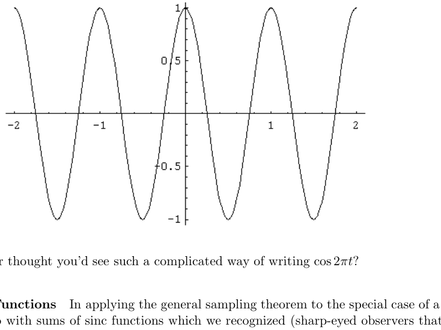

Any questions? Eve

Periodizing sinc F

periodic

signal, we wound up we are) to be periodizations. Then, out of nowhere, came a closed form expression for such periodizations as a ratio of sinc functions. Here’s where this comes from, and here’s a fairly general result that covers it.

Lemma Let $p, q >$ 0 and let $N$ be the largest integer strictly less than $pq/2$. Then

$$
\sum_{k=−∞}^{∞}
$$

$$
\frac{\sin((2N + 1)πt/q)}{\sin(πt/q)}
$$

$\operatorname{sinc}(pt − kpq)$ = $\operatorname{sinc}(pt) ∗$ III$q(t)$ = $\frac{1}{pq}$

$$
.
$$

There’s a version of this lemma with $N ≤ pq/2,$ too, but that’s not important for us. In terms of sinc functions the formula is

$$
\frac{\operatorname{sinc}((2N + 1)t/q)}{\operatorname{sinc}(t/q)}
$$

$\operatorname{sinc}(pt) ∗$ III$q(t)$ = $\frac{2N + 1}{pq}$

$$
.
$$

It’s then easy to extend the lemma slightly to include periodizing a shifted sinc function, $\operatorname{sinc}(pt + b),$ namely

$$
\frac{\operatorname{sinc}(pt + b)}{\operatorname{sinc}(pt + b))}(\frac{2N+1}{(pq} )
$$

$$
\sum_{k=−∞}^{∞}
$$

$\operatorname{sinc}(pt + b − kpq)$ = $\operatorname{sinc}(pt + b)∗$ III$q(t)$ = $\frac{2N + 1}{pq}$

$$
\frac{1}{pq}
$$

This is what is needed in the last part of the derivation of the finite sampling formula.

Having written this lemma down so grandly I now have to admit that it’s really only a special case of the general sampling theorem as we’ve already developed it, though I think it’s fair to say that this is only “obvious” in retrospect. The fact is that the ratio of sine functions on the right hand side of the equation is a bandlimited signal (we’ve seen it before, see below) and the sum for $\operatorname{sinc}(pt)∗$III$q(t)$ is just the sampling formula applied to that function. One usually thinks of the sampling theorem as going from the signal to the series of sampled values, but it can also go the other way. This admission notwithstanding, I still want to go through the derivation, from scratch.

One more thing before we do that. If $p$ = $q$ = 1, so that $N$ = 0, the formula in the lemma gives

$$
\sum_{n=−∞}^{∞}
$$

$\operatorname{sinc}(t − n)$ = $\operatorname{sinc}(t ∗)$ III1($t)$ = $1.$ Striking. Still don’t believe it? Here’s a plot of

$$
\sum_{n=−100}^{100}
$$

$$
\operatorname{sinc}(t − n).
$$

Note the Gibbs-like phenomena at the edges. This means there’s some issue with what kind of convergence is involved, which is the last thing I want to worry about.

We proceed with the derivation of the formula

$$
\frac{\sin((2N + 1)πt/q)}{\sin(πt/q)}
$$

$\operatorname{sinc}(pt)∗$ III$q(t)$ = $\frac{1}{pq}$ This will look awfully familiar; indeed I’ll really just be repeating the derivation of the general sampling formula for this special case. Take the Fourier transform of the convolution:

$$
\sum_{n=−N}^{N}
$$

$\mathcal{F}(\operatorname{sinc}(pt)∗$ III$q(t))$ = $\mathcal{F}(\operatorname{sinc}(pt))· \mathcal{F}$III$q(t)$ = $\frac{1}{p}$Π$p(s) · \frac{1}{q}$ III$1/q(s)$ = $\frac{1}{pq}$

$$
δ(s − \frac{n}{q} )
$$

See the figure below.

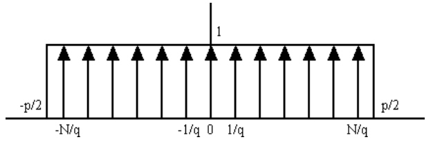

And now take the inverse Fourier transform:

$$
\mathcal{F}^{−1}(\frac{1}{pq} \sum_{n=−N}^{N} δ(s − \frac{n}{q})) = \frac{1}{pq} \sum_{n=−N}^{N} e^{2πint/q} = \frac{1}{pq} \frac{\sin(π(2N + 1)t/q))}{\sin(πt/q)} .
$$

There it is. One reason I wanted to go through this is because it is another occurrence of the sum of exponentials and the identity

$$
\sum_{n=−N}^{N} e^{2πint/q} = \frac{\sin(π(2N + 1)t/q))}{\sin(πt/q)} ,
$$

which we’ve now seen on at least two other occasions. Reading the equalities backwards we have

$$
(\frac{\sin(π(2N + 1)t/q))}{\sin(πt/q)} ) (
$$

$$
e^{2πint/q}) = δ
$$

$$
(s − \frac{n}{q})
$$

$$
\sum_{n=−N}^{N}
$$

$$
\sum_{n=−N}^{N}
$$

$$
\mathcal{F}
$$

$$
= \mathcal{F}
$$

$$
.
$$

This substantiates the earlier claim that the ratio of sines is bandlimited, and hence we could have appealed to the sampling formula directly instead of going through the argument we just did. But who would have guessed it?

## 5.9 Troubles with Sampling

In Section 5.6 we established a remarkable result on sampling and interpolation for bandlimited functions:

- If $f(t)$ is a bandlimited signal whose Fourier transform is identically zero for $|s| ≥ p/2$ then

$$
\sum_{k=−∞}^{∞}
$$

$$
f(t_{k}) \operatorname{sinc}(p(t − t_{k})),
$$

$$
f(t) =
$$

where $t_{k}$ = $\frac{k}{p} .$ The bandwidth, a property of the signal in the frequency domain, is the minimal sampling rate and is the reciprocal of the spacing of the sample points, a construction in the time domain.

We have had our day of triumph. Now, we’ll be visited by troubles. Actually we’ll study just one type of trouble and the havoc it can wreak with our wondrous formula. This is meant to be a brief encounter. Any one of these examples can be treated in much greater depth depending on the particular area where they typically arise, e.g., digital audio and computer music, computer graphics, imaging and image compression.

Before we get into things, here’s a picture of the sampling formula in action. The first figure shows a function and a set of evenly spaced sample points. The second figure is the function together with the sinc interpolation based on these samples (plotted as a thinner curve).

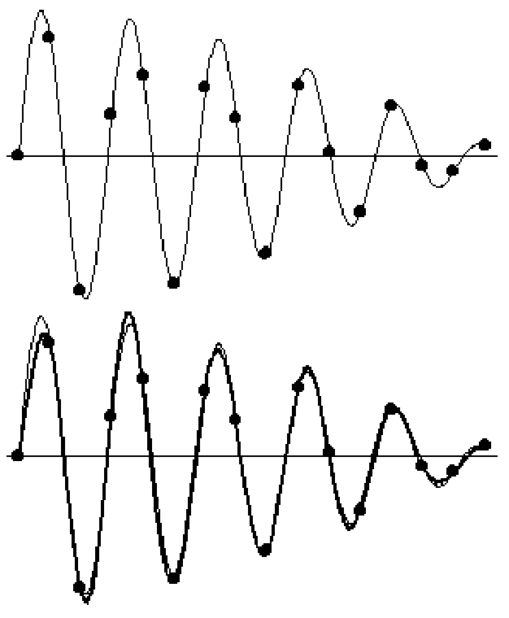

Of course, the fit is not exact because we’re only working with a finite set of samples and the sampling formula asks for the sample values at all the points $k/p, k$ = $0,±1,±2,...$. But it’s pretty close.

Think about the trade-offs here. If the signal is timelimited, as in the above graph, then it cannot be bandlimited and so the sampling theorem doesn’t even apply. At least it doesn’t apply perfectly — it may be that the spectrum decays to a small enough level that the sinc interpolation is extremely accurate.

On the other hand, if a signal is bandlimited then it cannot be timelimited, but any interpolation for real-world, computational purposes has to be done with a finite set of samples, so that interpolation must be only an approximation. These problems are absolutely inevitable. The approaches are via filters, first low pass filters done before sampling to force a signal to be bandlimited, and then other kinds of filters (smoothing) following whatever reconstruction is made from the samples. Particular kinds of filters are designed for particular kinds of signals, e.g., sound or images.

## 5.9.1 The trouble with undersampling — aliasing

What if we work a little less hard than dictated by the bandwidth. What if we “undersample” a bit and try to apply the interpolation formula with a little lower sampling rate, with the sample points spaced a little farther apart. Will the interpolation formula produce “almost” a good fit, good enough to hear or to see? Maybe yes, maybe no. A disaster is a definite possibility.

Sampling sines, redux Let’s revisit the question of sampling and interpolation for a simple sine function and let’s work with an explicit example. Take the signal given by

$$
f(t) = \cos(\frac{9π}{2} t .)
$$

The frequency of this signal is $9/4$ Hz. If we want to apply our formula for finite sampling we should take a sampling rate of 2 $×$ ($9/4)$ + $9/4$ = 2$7/4$ = $6.75$ samples/$\sec(. (If we want to apply the general sampling)$ formula we can take the sampling rate to be anything $>$ $9/2$ = $4.5$.) Suppose our sampler is stuck in low and we can take only one sample every second. Then our samples have values

$$
\cos(\frac{9π}{2} n), n = 0, 1, 2, 3,... .
$$

There is another, lower frequency signal that has the same samples. To find it, take away from $9π/2$ the largest multiple of $2π$ that leaves a remainder of less than $π$ in absolute value (so there’s a spread of less than $2π$ — one full period — to the left and right). You’ll see what I mean as the example proceeds. Here we have

$$
\frac{9π}{2} = 4π + \frac{π}{2}
$$

Then

$$
\cos(\frac{9π}{2} n) = \cos((4π + \frac{π}{2} ) n) = \cos(\frac{π}{2} n .)
$$

So the signal $f(t)$ has the same samples at 0, 1, 2, and so on, as the signal

$$
g(t) = \cos(\frac{π}{2} t)
$$

whose frequency is only $1/4$. The two functions are not the same everywhere, but their samples at the integers are equal.

Here are plots of the original signal $f(t)$ and of $f(t)$ and $g(t)$ plotted together, showing how the curves match up at the sample points. The functions $f(t)$ and $g(t)$ are called aliases of each other. They are indistinguishable as far as their sample values go.

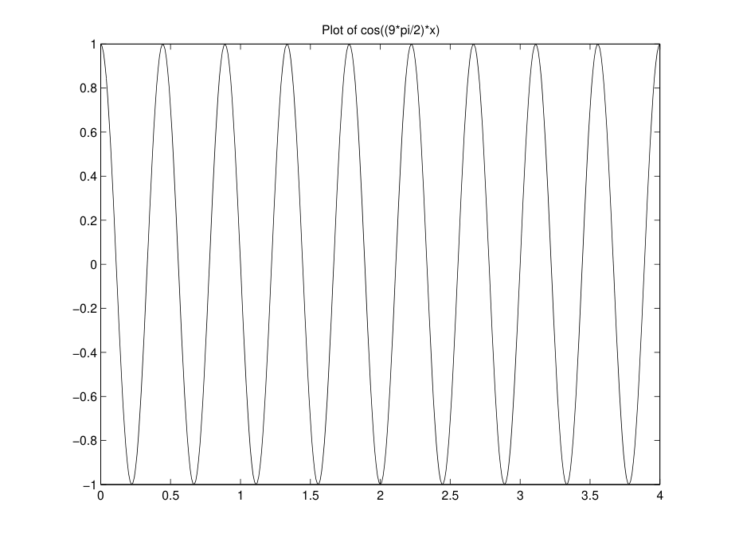

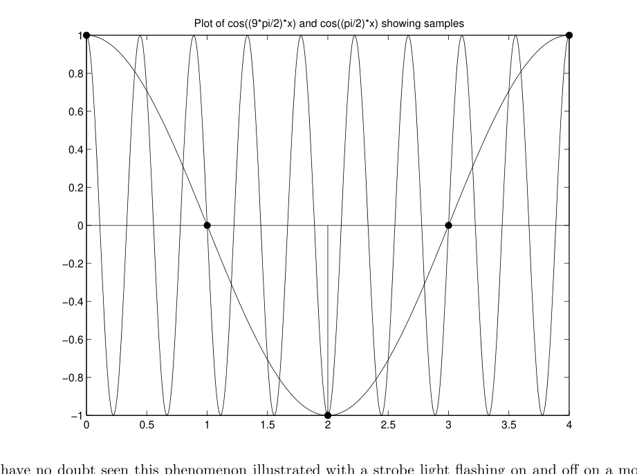

You ving

fan, for example. Explain that illustration to yourself.

Now let’s analyze this example in the frequency domain, essentially repeating the derivation of the sampling formula for this particular function at the particular sampling rate of 1 Hz. The Fourier transform of $f(t)$ = $\cos(9πt/2)$ is

$$
\mathcal{F}f(s) = \frac{1}{2} (δ (s − \frac{9}{4}) + δ (s + \frac{9}{4})) .
$$

To “sample at $p$ = 1Hz” means, first off, that in the frequency domain we:

- Periodize $\mathcal{F}f$ by III1

- Cut off by Π1

After that we take the inverse Fourier transform and, by definition, this gives the interpolation to $f(t)$ using the sample points $f(0),f(±1),f(±2),...$. The question is whether this interpolation gives back $f(t)$ — we know it doesn’t, but what goes wrong?

The Fourier transform of $\cos(9πt/2)$ looks like

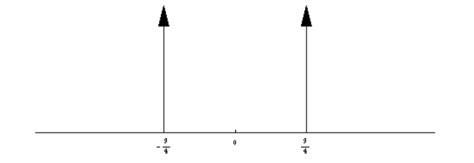

For the periodization step we have by direct calculation,

$$
[ ( ) ( )] \sum_{k=−∞}^{∞}
$$

$\mathcal{F}f(s)∗$ III1($s)$ = $\frac{1}{2}$

$$
∗
$$

$$
s − \frac{9}{4}
$$

$$
δ(s − k)
$$

$$
s + \frac{9}{4}
$$

$$
δ
$$

$$
+ δ
$$

$$
\sum_{2 k=−∞}^{∞} ( ( )
$$

$$
δ s − \frac{9}{4} ∗ δ(s − k) + δ (s + \frac{9}{4}) ∗ δ(s − k))
$$

= 1

$$
\sum_{2 k=−∞}^{∞} ( (
$$

$$
− k))
$$

$$
) (s + \frac{9}{4}
$$

= 1

$$
− k
$$

$$
s − \frac{9}{4}
$$

(remember the formula $δ_{a} ∗ δ_{b}$ = $δ_{a+b})$

$$
δ
$$

$$
+ δ
$$

Multiplying by Π$(^{1}$ cuts off$)$outside$($ ($−1/2,$ +$1)/2),$ and we get $δ$’s within $−1/2 < s <$ $1/2$ if, working separately with $δ s − \frac{9}{4}$

$$
− k
$$

$$
− k
$$

and $δ s$ + $\frac{9}{4} ,$ we have:

$$
−\frac{1}{2} < −\frac{9}{4} − k < \frac{1}{2} −\frac{1}{2} < \frac{9}{4} − k < \frac{1}{2}
$$

$$
\frac{7}{4} < −k <^{11}
$$

$$
\frac{−^{11}}{4} < k < −\frac{7}{4}
$$

$$
\overline{4}
$$

$$
\frac{−^{11}}{4} < k < −\frac{7}{4}
$$

$$
\frac{7}{4} < k <^{11}_{\overline{4}}
$$

Thus we get $δ$’s within $−1/2 < s <$ $1/2$ if $k$ = $−2$ and the term $δ (s − \frac{9}{4} − (−2) = δ s$ + $\frac{1}{4} ,$ $) ( )$ and $k$ = 2 and the term $δ(s$ + $\frac{9}{4} −$ 2 = $δ s − \frac{1}{4} .$ $) ( )$ All other $δ$’s in $\mathcal{F}f(s)∗$ III1($s)$ will be outside the range $−1/2 < s <$ $1/2$ and so

$$
(δ(s + \frac{1}{4}) + δ(s − \frac{1}{4}))
$$

Π($s)(\mathcal{F}f(s)∗$ III1($s))$ = $\frac{1}{2}$

We do not have

Π1($\mathcal{F}f ∗$ III1) = $\mathcal{F}f .$ So if we take the inverse Fourier transform of Π1($\mathcal{F}f ∗$III1) we do not get $f$ back. We can take the inverse Fourier transform of Π1($\mathcal{F}f ∗$ III1) anyway, and this produces

$$
\mathcal{F}^{−1}( \frac{1}{2} ( ( ) ( )))
$$

$$
\frac{1}{2}(e^{πit/2} + e^{−πit/2}) = \cos(\frac{π}{2})
$$

$$
δ s − \frac{1}{4} + δ s + \frac{1}{4} =
$$

$$
t
$$

There’s the aliased signal!

$$
g(t) = \cos(\frac{π}{2} t)
$$

Why is $g(t)$ an “alias” of the original signal $f(t)$? It’s still quite right to think of $\mathcal{F}^{−1}($Π1($\mathcal{F}f ∗$ III1) as an interpolation based on sampling $f(t)$ at 1 Hz. That’s exactly what it is, it’s just not a good one. The sampling formula is

$$
\sum_{k=−∞}^{∞}
$$

$\mathcal{F}^{−1}($Π1($\mathcal{F}f ∗$ III1))($t)$ = $\operatorname{sinc}(t ∗ (f(t) · III1(t))) = \operatorname{sinc}(t ∗) f(t)δ(t − k)$

$$
\sum_{k=−∞}^{∞}
$$

$$
\sum_{k=−∞}^{∞}
$$

$$
\sum_{k=−∞}^{∞}
$$

$$
= \operatorname{sinc}(t ∗)
$$

$$
\frac{9πk}{2} \operatorname{sinc}(t − k).
$$

$$
f(k)δ(t − k) =
$$

$$
f(k) \operatorname{sinc}(t − k) =
$$

cos But this sum of sincs provided by the sampling formula isn’t $f(t)$ = $\cos(t)$. It’s $g(t)$ = $\cos(\frac{π}{2} t (though)$ you’d never know that just from the formula). Interpolating the samples o$\frac{9π}{f2}f$ according to the formula at

the sampling rate of 1 Hz — too low a sampling rate — has not produced $f$ it has produced $g,$ an alias of $f$. Cool.

Before we leave this example let’s look a little more at

$$
\sum_{2 k=−∞}^{∞} ( (
$$

$$
δ s − \frac{9}{4} − k) + δ (s + \frac{9}{4} − k)) .
$$

$\mathcal{F}f(s)∗$ III1($s)$ = 1 Being a convolution with III1 this is periodic of period 1, but, actually, it has a smaller period. To find it, write

$$
\sum_{2 k=−∞}^{∞}
$$

$$
\frac{9}{4} − k) + δ(s + \frac{9}{4} − k)) = \frac{1}{2} ( ((s − \frac{9}{4}
$$

$)$ + I$)$II1 $($

$$
(δ(s −
$$

$$
(s + \frac{9}{4}))
$$

$($III1

1

$$
s )+) 2 + \frac{1}{4}))
$$

$$
s − 2 − \frac{1}{4}
$$

III1

+ III1

$$
= \frac{1}{2}
$$

$)$ + III1

$$
(s − \frac{1}{4}
$$

$$
(s + \frac{1}{4}
$$

$($III1

$$
= \frac{1}{2}
$$

(because III1 is periodic of period 1)

This last expression is periodic of period $1/2,$ for

$)) ( ( ) ( ))$

$$
\frac{1}{2} ( (s − \frac{1}{4} + \frac{1}{2}
$$

$$
) (s + \frac{1}{4} + \frac{1}{2} = \frac{1}{2} s + \frac{1}{4}
$$

$$
s + \frac{3}{4}
$$

III1

+ III1

III1

+ III1

$( ( ) ($ = $\frac{1}{2}$ III1 $s$ + $\frac{1}{4} +$ III1 $s$ + 1 $− \frac{1}{4}))$ $( ( ) ( ))$ = $\frac{1}{2}$ III1 $s$ + $\frac{1}{4} +$ III1 $s − \frac{1}{4}$ (using the periodicity of III1) You can also see the “reduced” periodicity of ($1/2)($III($s −$ 9$/4)$ + III($s$ + $9/4))$ graphically from the way III1($s −$ 9$/4)$ and III1($s$ + $9/4)$ line up, but this is a little trickier. Here’s a plot of

$$
1 \sum_{2 k=−8}^{8} δ (s − k − \frac{9}{4}) .
$$

Here’s a plot of

$$
1 \sum_{2 k=−8}^{8} δ (s − k + \frac{9}{4}) .
$$

Here’s a plot of the sum of the two:

You see the periodicity starting to show up, but it’s only there completely when we take the sum of the two, full, shifted III’s.

I encourage you to work with $\cos(9π/2)$ in the frequency domain using other sampling rates — see what periodizations look like and what happens when you cut off.

## 5.9.2 Trouble at the endpoints?

When talking about the technical definition of what it means for a signal to be bandlimited I mentioned “the endpoint problem”, whether or not the Fourier transform is zero there, and how this sometimes requires special consideration. Here’s what I had in mind. Take two very simple signals, $f(t)$ = $\sin(2πt),$ and $g(t)$ = $\cos(2πt),$ each of period 1. The Fourier transforms are

$$
\mathcal{F}f(s) =
$$

$$
\mathcal{F}g(s) =
$$

$$
\frac{1}{2i} (δ(s − 1)− δ(s + 1))
$$

$$
\frac{1}{2} (δ(s − 1) + δ(s + 1)) .
$$

and The bandwidth is 2 for each signal and the Fourier transforms are not zero at the endpoints $±p/2$ = $±1$.

If we apply the sampling formula with $p$ = 2 to $\sin(2πt)$ we get the upsetting news that

$$
\sum_{k=−∞}^{∞}
$$

$$
\sum_{k=−∞}^{∞}
$$

$$
\frac{2πk}{2} \operatorname{sinc}(2t − k) =
$$

$$
\sin(kπ)\operatorname{sinc}(2t − k) = 0.
$$

$$
\sin(2πt) =
$$

sin On the other hand, for $\cos(2πt)$ the formula gives, again with $p$ = 2,

$$
\sum_{k=−∞}^{∞}
$$

$$
\frac{2πk}{2} \operatorname{sinc}(2t − k)
$$

$$
\cos(2πt) =
$$

cos

$$
\sum_{k=−∞}^{∞}
$$

$$
\sum_{k=−∞}^{∞}
$$

$$
\sum_{k=−∞}^{∞}
$$

$$
\operatorname{sinc}(2t − 2k) −
$$

$$
\operatorname{sinc}(2t − 2k − 1),
$$

$$
\cos(kπ)\operatorname{sinc}(2t − k) =
$$

= which we might like to believe — at least both the series of sinc functions have period 1. Here’s a plot of

$$
\sum_{k=−50}^{50}
$$

$$
\cos(kπ)\operatorname{sinc}(2t − k)
$$

for some further encouragement.

It’s easy to see what goes wrong with the sampling formula in the example of $\sin(2πt)$. The first step in the derivation is to periodize the Fourier transform, and for $\sin(2πt)$ this results in

$$
\sum_{k=−∞}^{∞}
$$

$\mathcal{F}f ∗$ III2 = $\frac{1}{2i}(δ_{1} − δ_{−1})∗$

$$
δ_{2k}
$$

$$
= \frac{1}{2i} \sum_{k=−∞}^{∞} (δ_{2k+1} − δ_{2k−1}) = 0
$$

because the series telescopes and the terms cancel. (I’m using the notation $δ_{a}$ = $δ(t − a)$ here.) For $\cos(2πt)$ we find something different:

$$
\sum_{k=−∞}^{∞}
$$

$\mathcal{F}g ∗$ III2 = $\frac{1}{2}(δ_{1}$ + $δ_{−1}) ∗$

$$
δ_{2k}
$$

$$
= \frac{1}{2} \sum_{k=−∞}^{∞} (δ_{2k+1} + δ_{2k−1}) = \sum_{k=−∞}^{∞} δ_{2k+1}
$$

because the series telescopes and the terms add. So far so good, but is it true that $\mathcal{F}g$ = Π2($\mathcal{F}g ∗$ III2) as needed in the second step of the derivation of the sampling formula? We are asking whether

$$
\sum_{n=−∞}^{∞}
$$

Π2 $·$ III$2n+1$ = Π2 $·$

$$
δ_{2n+1} = \frac{1}{2}(δ_{1} + δ_{−1}),
$$

This is correct — cutting off a $δ$ “at the edge” by a Π results in half the $δ,$ as in the above. Stated generally,

$$
Π1δ_{1/2} = \frac{1}{2}δ_{1/2}.
$$

This property of cutting off $δ$’s requires some extra justification and we won’t go into it. But it works.

I chose $\sin(2πt)$ and $\cos(2πt)$ as simple examples illustrating the problems with the sampling rate right at the bandwidth. This is the extreme case. The signal $\sin(2πt)$ is aliased to zero while $\cos(2πt)$ is reconstructed

without a problem.6 I’m hesitant to formulate a general principle here. I think it’s best to say, as I did earlier, that any particular “endpoint problem” should call for special considerations.

Aliasing in general Aliasing is the “natural phenomenon” associated with the sampling formula. “Aliasing” is a somewhat generic term that refers to the following situation. Let $f(t)$ be a given signal. We sample $f(t)$ at a rate $q$ samples/sec and write down the sampling series based on the sample values $f(t_{k}), t_{k}$ = $k/q:$

$$
\sum_{k=−∞}^{∞}
$$

$$
f(t_{k}) \operatorname{sinc}(q(t − t_{k}) .)
$$

$$
g(t) =
$$

I’m calling this signal $g$ because, while the series produces some signal, if the sampling rate $q$ is too slow (less than the bandwidth) it will not be the original signal $f$. However, remember that the sinc function satisfies

$$
\operatorname{sinc}(q(t_{j} − t_{k})) = \frac{\sin(qπ(t_{j} − t_{k}))}{qπ(t_{j} − t_{k})}
$$

$$
= \frac{\sin(π(j − k))}{π(j − k)}
$$

(using $t_{j}$ = $\frac{j}{q}, t_{k}$ = $\frac{k}{q}$ )

$$
= (1 j = k
$$

$$
0 j\neq k
$$

and hence $g(t)$ does have the same sample values as $f(t):$

$$
\sum_{k=−∞}^{∞}
$$

$$
f(t_{k}) \operatorname{sinc}(q(t_{j} − t_{k})) = f(t_{j}).
$$

$$
g(t_{j}) =
$$

In this case we say that $f$ and $g$ are aliases. They cannot be distinguished based on their sampled values at the points $t_{k}$ = $k/q$.

We saw some examples of how aliasing comes about for a signal of a single frequency. How does it come about in general? Just as we analyzed the phenomenon in the preceding examples, it’s best to understand aliasing in general as a breakdown in the derivation of the sampling formula.

Here’s what goes wrong if the sampling rate $q$ is too low. Given a signal $f(t)$ the first step is to periodize $\mathcal{F}f$ by convolving it with III$q$. To say the sampling rate is too slow is to say that $q$ is less than the bandwidth, so here’s a picture of the Fourier transform $\mathcal{F}f$ of a generic signal and a superimposed III$q$ — no convolution yet, just $\mathcal{F}f$ and III$q$. The arrows are spaced $q$ apart. The bandwidth is about $4q$ (about 4 arrows worth).

6 As an exercise, you can show that the result produced for the latter by the interpolation formula works:

$$
∞
$$

$$
∞
$$

X

X $\operatorname{sinc}(2t − 2k)− \operatorname{sinc}(2t − 2k − 1)$ = $\cos(2πt),$ really$.$

$$
k=−∞
$$

$$
k=−∞
$$

You can apply the sinc periodization lemma from the previous lecture.

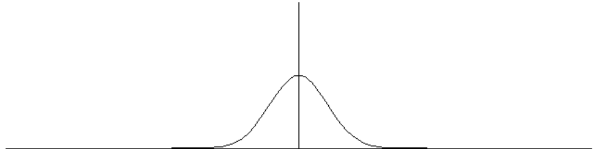

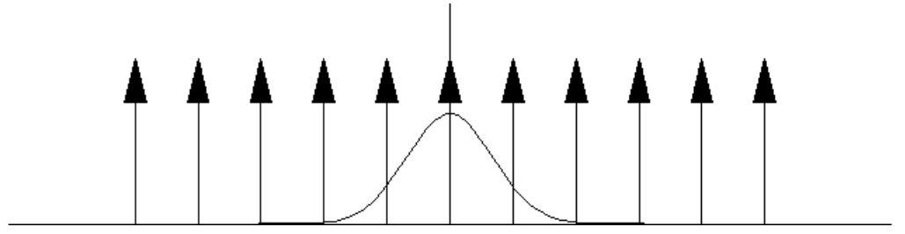

Now

$$
\sum_{k=−∞}^{∞} \mathcal{F}f(s− kq)
$$

($\mathcal{F}f ∗$III$q)(s)$ = and here’s a plot of $\mathcal{F}f(s$ + $2q), \mathcal{F}f(s$ + $q), \mathcal{F}f(s), \mathcal{F}f(s− q), \mathcal{F}f(s−$ 2$q)$.

Here’s a plot of the sum:

Finally, here’s a plot of the cut-off Π$q(\mathcal{F}f ∗$ III$q):$

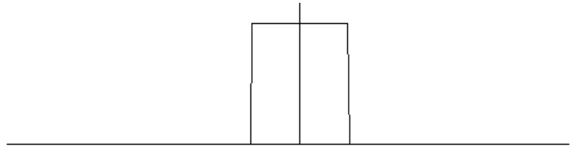

That’s right, it looks pretty much like Π$q$ itself, because for $−q/2 < s < q/2$ the convolution $\mathcal{F}f ∗$ III$q$ is pretty much equal to 1. It sure doesn’t look like the original $\mathcal{F}f$. We sure don’t have $\mathcal{F}f$ = Π$q(\mathcal{F}f ∗$ III$q),$ so taking the inverse Fourier transform sure isn’t going to give back $f$. (It will give something that looks more like $q \operatorname{sinc}(qt),$ in fact.) What went wrong? You saw it in one of the pictures, above. See that little tail of $\mathcal{F}f$ roughly between the $δ$’s at $±q$ and $±2q$. Parts of that tail get shifted into the interval between $−q/2$ and $q/2$ by convolving $\mathcal{F}f$ with shifted $δ$’s, and convolving $\mathcal{F}f$ with III$q$ adds up all those shifts. This is how aliasing happens.

Just so you have another picture of when sampling works, here’s $\mathcal{F}f$ with III$p$ superimposed where $p$ is the bandwidth. (Remember, the support of $\mathcal{F}f$ is between $−p/2$ and +$p/2$ — that’s $±p$ over 2 — while the $δ$’s in III$p$ are spaced $p$ apart:

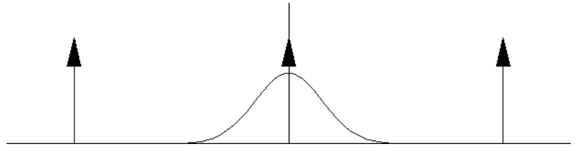

And here’

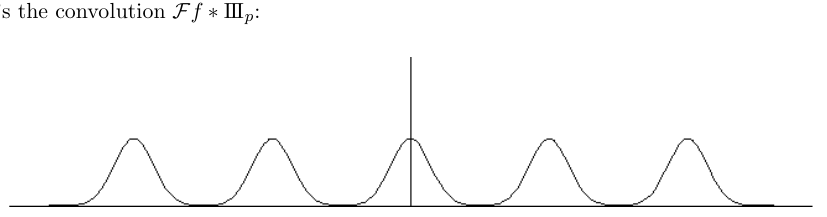

Cutting this off by Π$p$ will give back $\mathcal{F}f$. Taking the inverse Fourier transform will give back $f$ in terms of its sampling series.

## 5.10 Appendix: How Special is III?

I’d like to elaborate on III as a kind of “fundamental object” in discussing periodicity. To begin with, let’s show:

- If $S$ is a periodic, tempered distribution of period 1 with $\mathcal{F}S$ = $S$ then $S$ = $c$III for a constant $c ∈$ R.

The argument goes like this. First we observe that $S$ is even, for

$$
\mathcal{F}S^{−} = \mathcal{F}^{−1}S = S = \mathcal{F}S,
$$

whence

$$
S^{−} = S .
$$

Now expand $S$ in a Fourier series

$$
S = \sum_{n=−∞}^{∞} c_{n}e^{2πint} .
$$

This is perfectly legit for periodic tempered distributions. Since $S$ is even the coefficients $c_{n}$ are real, and moreover $c_{−n}$ = $c_{n}$. Using $\mathcal{F}S$ = $S$ we may write

$$
\sum_{n=−∞}^{∞} c_{n}e^{2πint} = S = \mathcal{F}S = \sum_{n=−∞}^{∞} c_{n}δ_{n} .
$$

We’ll prove by induction that

$c_{n}$ = $c_{0}$ for all $n ≥$ 0$,$

and hence that

$$
S = c_{0} \sum_{n=−∞}^{∞}
$$

$δ_{n}$ = $c_{0}$III1 $.$ The assertion is trivial for $n$ = 0. Suppose it has been proved for $n ≤ N −1$. Let $p$ = $2N$ + 1 and consider the cut-off Π$p\mathcal{F}S$. Then on the one hand

$$
\sum_{n=−(N−1)}^{N−1}
$$

$$
\sum_{n=−(N−1)}^{N−1}
$$

$$
Πp\mathcal{F}S =
$$

$$
c_{n}δ_{n} + (c_{N}δ_{N} + c_{−N}δ_{−N}) = c_{0} δ_{n} + c_{N}(δ_{N} + δ_{−N})
$$

using the induction hypothesis. On the other hand,

$$
\sum_{n=−∞}^{∞}
$$

Π$p\mathcal{F}S$ = Π$pS$ =

$$
c_{n}Πpe^{2πins}.
$$

Integrate both sides from $−∞$ to $∞ ($or pair with an appropriate test function — however you’d like to say it.) This results in

$$
(2N − 1)c_{0} + 2\_{N}c = \sum_{n=−∞}^{∞} c_{n}\int_{−N−1}^{N+1} 2 e^{2πins} ds = (2N + 1)c_{0} = (2N − 1)c_{0} + 2\_{0}c .
$$

2

Thus

$$
c_{N} = c_{0},
$$

completing the induction.

Remark The hypothesis that the period is 1 is necessary, since III($2x)+ \frac{1}{2}$III($x/2)$ is periodic of period two and is its own Fourier transform. (In general, if $f$ is even, then $f$ + $\mathcal{F}f$ is its own Fourier transform.) The preceding result coupled with the existence result $\mathcal{F}$III = III provided by the Poisson summation formula, and with a normalization tacked on, results in:

Theorem There is exactly one periodic, tempered distribution of period 1 that is equal to its Fourier transform and has Fourier coefficient $c_{0}$ = 1 .

This is one of those happy “there is exactly one of these” theorems that indicate what one might take to be the essential building blocks of a subject. It’s a little late in the day to decide to base all discussion of periodic functions on III, but there might be some things to do.

## 5.11 Appendix: Timelimited vs. Bandlimited Signals

Here’s a more careful treatment of the result that a bandlimited signal cannot be timelimited. We’ll actually prove a more general statement and perhaps I should have said that no interesting signal can be both timelimited and bandlimited, because here’s what we’ll show precisely:

- Suppose $f(t)$ is a bandlimited signal. If there is some interval $a < t < b$ on which $f(t)$ is identically

zero, then $f(t)$ is identically zero for all $t$.

This is a tricky argument. $f$ is bandlimited so $\mathcal{F}f(s)$ is zero, say, for $|s| ≥ p/2$. The Fourier inversion formula says

$$
f(t) = \int_{−∞}^{∞} \mathcal{F}f(s)e^{2πist}ds = \int_{−p/2}^{p/2} \mathcal{F}f(s)e^{2πist}ds.
$$

(We assume the signal is such that Fourier inversion holds. You can take $f$ to be a Schwartz function, but some more general signals will do.) Suppose $f(t)$ is zero for $a < t < b$. Then for $t$ in this range,

$$
\int_{−p/2}^{p/2} \mathcal{F}f(s)e^{2πist}ds = 0.
$$

Differentiate with respect to $t$ under the integral. If we do this $n-$times we get

$$
0 = \int_{−p/2}^{p/2} \mathcal{F}f(s)(2πis^{n}) e^{2πist} ds = (2πi^{n}) \int_{−p/2}^{p/2} \mathcal{F}f(s)s^{n}e^{2πist} ds,
$$

so that

$$
\int_{−p/2}^{p/2} \mathcal{F}f(s)s^{n}e^{2πist} ds = 0.
$$

Again, this holds for all $t$ with $a < t < b;$ pick one, say $t_{0}$. Then

$$
\int_{−p/2}^{p/2} \mathcal{F}f(s)s^{n}e^{2πist0} ds = 0.
$$

But now for any $t$ (anywhere, not just between $a$ and $b)$ we can write

$$
f(t) = \int_{−p/2}^{p/2} \mathcal{F}f(s)e^{2πist}ds = \int_{−p/2}^{p/2} \mathcal{F}f(s)e^{2πis(t−t0)}e^{2πist0} ds
$$

$$
= \int_{−p/2}^{p/2} \sum_{n=0}^{∞} \frac{(2πi(t − t_{0}))n}{n!}s^{n}e^{2πist0}\mathcal{F}f(s)ds
$$

(using the Taylor series expansion for $e^{2πis(t−t0)}$ )

$$
\int_{−p/2}^{n p/2}
$$

$$
\sum_{n=0}^{∞}
$$

$$
\sum_{n=0}^{∞}
$$

$$
\frac{(2πi(t − t_{0}))}{n!}
$$

$$
s^{n}e^{2πist0}\mathcal{F}f(s)ds = \frac{(2πi(t − t_{0}))n}{n!}
$$

=

$$
0 = 0.
$$

Hence $f(t)$ is zero for all $t$.

The same argument mutatis mutandis will show:

- If $f(t)$ is timelimited and if $\mathcal{F}f(s)$ is identically zero on any interval $a < s < b$ then $\mathcal{F}f(s)$ is identically

zero for all $s$.

Then $f(t)$ is identically zero, too, by Fourier inversions.

Remark 1, for eager seekers of knowledge This bandlimited vs. timelimited result is often proved by establishing a relationship between timelimited signals and analytic functions (of a complex variable), and then appealing to results from the theory of analytic functions. That connection opens up an important direction for applications of the Fourier transform, but we can’t go there and the direct argument we just gave makes this approach unnecessary.

Remark 2, for overwrought math students and careful engineers Where in the preceding argument did we use that $p < ∞$? It’s needed in switching integration and summation, in the line

$$
\int_{−p/2}^{p/2}
$$

$$
\int_{−p/2}^{n p/2}
$$

$$
\sum_{n=0}^{∞}
$$

$$
\sum_{n=0}^{∞}
$$

$$
\frac{(2πi(t − t_{0}))n}{n!}
$$

$$
\frac{(2πi(t − t_{0}))}{n!}
$$

$$
s^{n}e^{2πist0}\mathcal{F}f(s)ds
$$

$$
s^{n}e^{2πist0}\mathcal{F}f(s)ds =
$$

The theorems that tell us “the integral of the sum is the sum of the integral” require as an essential hypothesis that the series converges uniformly. “Uniformly” means, loosely, that if we plug a particular value into the converging series we can estimate the rate at which the series converges independent of that particular value.7 In the sum-and-integral expression, above, the variable $s$ ranges over a finite interval, from $−p/2$ to +$p/2$. Over such a finite interval the series for the exponential converges uniformly, essentially because the terms can only get so big — so they can be estimated uniformly — when $s$ can only get so big. We can switch integration and summation in this case. If, however, we had to work with

$$
\int_{−∞}^{∞} \sum_{n=0}^{∞} \frac{(2πi(t − t_{0}))n}{n!}s^{n}e^{2πist0}\mathcal{F}f(s)ds,
$$

i.e., if we did not have the assumption of bandlimitedness, then we could not make uniform estimates for the convergence of the series and switching integration and summation is not justified.

It’s not only unjustified, it’s really wrong. If we could drop the assumption that the signal is bandlimited we’d be “proving” the statement: If $f(t)$ is identically zero on an interval then it’s identically zero. Think 7 We can make “uniform” estimates, in other words. We saw this sort of thing in the notes on convergence of Fourier series.

of the implications of such a dramatic statement. In a phone conversation if you paused for a few seconds to collect your thoughts your signal would be identically zero on that interval of time, and therefore you would have nothing to say at all, ever again. Be careful.8 8 However, if $f(t)$ is a real analytic signal, that is if it is given by a convergent power series at each point in its domain, then the implication: “$f(t)$ identically zero on an interval $⇒ f(t)$ identically zero everywhere” is true.
