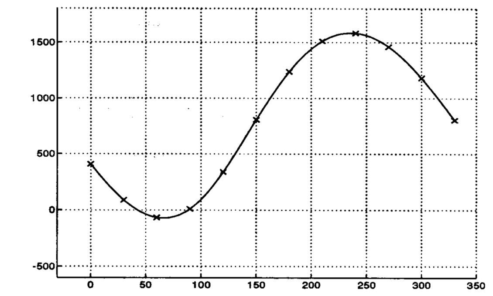
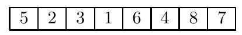
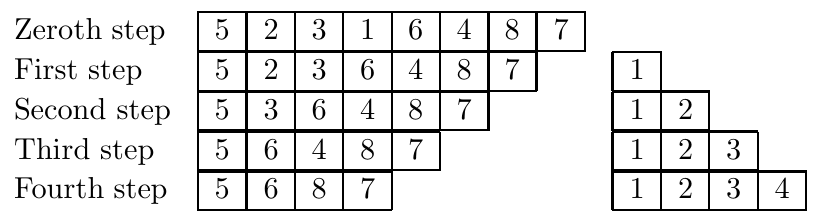
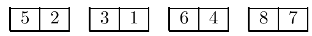
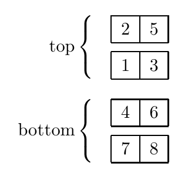
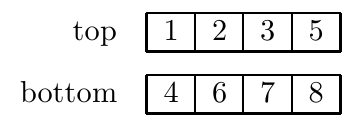
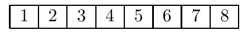
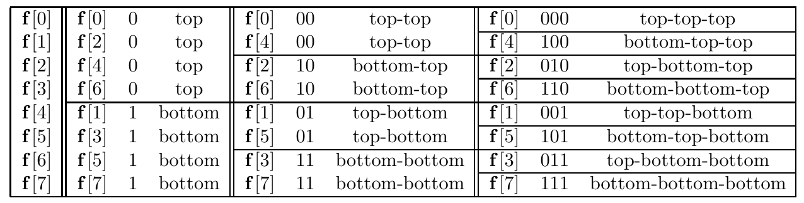

# Chapter 6: Discrete Fourier Transform

## The Modern World

According to some, the modern world began in 1965 when J. Cooley and J. Tukey published their account of an efficient method for numerical computation of the Fourier transform.[^6-1] According to some others, the method was known to Gauss in the mid 1800s; the idea that lies at the heart of the algorithm is clearly present in an unpublished paper that appeared posthumously in 1866. Take your pick.

[^6-1]: Incidentally, Tukey is also credited with coining the term “bit” as an abbreviation for “binary digit” — how about that for immortality!

Whatever the history, the present and future demands are that we process continuous signals by discrete methods. Computers and digital processing systems can work with finite sums only. To turn the continuous into the discrete and finite requires that a signal be both time-limited and band-limited, something we know cannot be true, and that we take a finite number of samples, something we know cannot suffice. But it works. At least such approximations work to the extent that a large fraction of the world’s economy depends upon them, and that’s not a bad measure of success.

Some would argue that one shouldn’t think in terms of “turning the continuous into the discrete”, but rather that measurements and data in the real world come to us in discrete form, and that’s how we should understand the world and work with it. Period. For some, “discrete” versus “continuous” rises to the level of a religious war, and this battle can be fought out in the different approaches to the discrete Fourier transform. I’m taking sides, at least initially, in favor of “from continuous to discrete” as a way of motivating the definition. For one thing, we have built up a lot of intuition and understanding for the Fourier transform, its properties, and its uses, and I hope some of that intuition can transfer as we now work with the discrete Fourier transform. My choice for now is to make the discrete look as similar to the continuous as possible.

## 6.1 From Continuous to Discrete

Start with a signal $f(t)$ and its Fourier transform $\mathcal{F}f(s)$, both functions of a continuous variable. We want to:

- Find a discrete version of $f(t)$ that’s a reasonable approximation of $f(t)$.

- Find a discrete version of $\mathcal{F}f(s)$ that’s a reasonable approximation of $\mathcal{F}f(s)$.

- Find a way that the discrete version of $\mathcal{F}f(s)$ is related to the discrete version of $f(t)$ that’s a reasonable approximation to the way $\mathcal{F}f(s)$ is related to $f(t)$.

Good things to try for, but it’s not quite straightforward. Here’s the setup.

We suppose that $f(t)$ is zero outside of $0 \le t \le L$. We also suppose that the Fourier transform $\mathcal{F}f(s)$ is zero, or effectively zero (beyond our ability to measure, negligible energy, whatever) outside of $0 < s < 2B$. I’m taking the support of $\mathcal{F}f$ to be the interval from $0$ to $2B$ instead of $-B$ to $B$ because it will make the initial indexing of the sample points easier; this will not be an issue in the end. We’ll also take $L$ and $B$ to both be integers so we don’t have to round up or down in any of the considerations that follow; you can think of that as our first concession to the discrete.

Thus we are regarding $f(t)$ as both time-limited and band-limited, with the knowledge that this can only be approximately true. Remember, however, that we’re ultimately going to come up with a definition of a discrete Fourier transform that will make sense in and of itself regardless of these shaky initial assumptions. After the definition is written down we could erase all that came before it, or merely cast a brief glance backwards from the discrete to the continuous with a few comments on how the former approximates the latter. Many treatments of the discrete Fourier transform that start with the discrete and stay with the discrete do just that. We’re trying not to do that.

---

According to the sampling theorem (misapplied here, but play along), we can reconstruct $f(t)$ perfectly from its samples if we sample at the rate $2B$ samples per second. Since $f(t)$ is defined on an interval of length $L$ and the samples are $1/2B$ apart, that means that we want a total of

$$
N = \frac{L}{1/2B} = 2BL \quad \text{(note that } N \text{ is therefore even)}
$$

evenly spaced samples, at the points

$$
t_0 = 0,\ t_1 = \frac{1}{2B},\ t_2 = \frac{2}{2B},\ \dots,\ t_{N-1} = \frac{N-1}{2B}\,.
$$

To know the values $f(t_k)$ is to know $f(t)$, reasonably well. Thus we state:

- The discrete version of $f(t)$ is the list of sampled values $f(t_0), f(t_1), \dots, f(t_{N-1})$.

Next, represent the discrete version of $f(t)$ (the list of sampled values) “continuously” with the aid of a finite impulse train (a finite $\text{III}$-function) at the sample points:

$$
\sum_{n=0}^{N-1} \delta(t - t_n)
$$

that is,

$$
f_{\text{discrete}}(t) = f(t) \sum_{n=0}^{N-1} \delta(t - t_n) = \sum_{n=0}^{N-1} f(t_n)\,\delta(t - t_n)\,.
$$

This is what we have considered previously as the sampled form of $f(t)$. The Fourier transform of $f_{\text{discrete}}$ is

$$
\mathcal{F}f_{\text{discrete}}(s) = \sum_{n=0}^{N-1} f(t_n)\,\mathcal{F}\delta(t - t_n) = \sum_{n=0}^{N-1} f(t_n)\,e^{-2\pi i s t_n}\,.
$$

This is close to what we want — it’s the continuous Fourier transform of the sampled form of $f(t)$.

Now let’s change perspective and look at things in the frequency domain. The function $f(t)$ is limited to $0 \le t \le L$, and this determines a sampling rate for reconstructing $\mathcal{F}f(s)$ from *its* samples in the *frequency* domain. The sampling rate is $1/L$. (*Not* $2/L$: think about how you would derive the sampling formula when the function is nonzero over an interval from $0$ to $p/2$ rather than $-p/2$ to $+p/2$.) We sample $\mathcal{F}f(s)$ over the interval from $0$ to $2B$ in the frequency domain at points spaced $1/L$ apart. The number of sample points is

$$
\frac{2B}{1/L} = 2BL = N
$$

the same number of sample points as for $f(t)$. The sample points for $\mathcal{F}f(s)$ are of the form $m/L$, and there are $N$ of them:

$$
s_0 = 0,\ s_1 = \frac{1}{L},\ \dots,\ s_{N-1} = \frac{N-1}{L}\,.
$$

---

The discrete version of $\mathcal{F}f(s)$ that we take is *not* $\mathcal{F}f(s)$ evaluated at these sample points $s_m$. Rather, it is $\mathcal{F}f_{\text{discrete}}(s)$ evaluated at the sample points. We base the approximation of $\mathcal{F}f(s)$ on the discrete version of $f(t)$. To ease the notation write $F(s)$ for $\mathcal{F}f_{\text{discrete}}(s)$. Then:

- The discrete version of $\mathcal{F}f(s)$ is the list of values

$$
F(s_0) = \sum_{n=0}^{N-1} f(t_n)\,e^{-2\pi i s_0 t_n},\ F(s_1) = \sum_{n=0}^{N-1} f(t_n)\,e^{-2\pi i s_1 t_n},\ \dots,\ F(s_{N-1}) = \sum_{n=0}^{N-1} f(t_n)\,e^{-2\pi i s_{N-1} t_n}\,.
$$

By this definition, we now have a way of going from the discrete version of $f(t)$ to the discrete version of $\mathcal{F}f(s)$, namely,

$$
F(s_m) = \sum_{n=0}^{N-1} f(t_n)\,e^{-2\pi i s_m t_n}\,.
$$

These sums, one for each $m$ from $m = 0$ to $m = N-1$, are supposed to be an approximation to the Fourier transform going from $f(t)$ to $\mathcal{F}f(s)$. In what sense is this a discrete approximation to the Fourier transform? Here’s one way of looking at it. Since $f(t)$ is timelimited to $0 \le t \le L$, we have

$$
\mathcal{F}f(s) = \int_0^L e^{-2\pi i s t} f(t)\,dt\,.
$$

Thus at the sample points $s_m$,

$$
\mathcal{F}f(s_m) = \int_0^L e^{-2\pi i s_m t} f(t)\,dt\,.
$$

and to know the values $\mathcal{F}f(s_m)$ is to know $\mathcal{F}f(s)$ reasonably well. Now use the sample points $t_k$ for $f(t)$ to write a Riemann sum approximation for the integral. The spacing $\Delta t$ of the points is $1/2B$, so

$$
\mathcal{F}f(s_m) = \int_0^L f(t)\,e^{-2\pi i s_n t}\,dt \approx \sum_{n=0}^{N-1} f(t_n)\,e^{-2\pi i s_m t_n}\,\Delta t = \frac{1}{2B}\sum_{n=0}^{N-1} f(t_n)\,e^{-2\pi i s_m t_n} = \frac{1}{2B}F(s_m)\,.
$$

This is the final point:

- Up to the factor $1/2B$, the values $F(s_m)$ provide an approximation to the values $\mathcal{F}f(s_m)$.

Writing a Riemann sum as an approximation to the integral defining $\mathcal{F}f(s_m)$ essentially discretizes the integral, and this is an alternate way of getting to the expression for $F(s_n)$, up to the factor $2B$. We short-circuited this route by working directly with $\mathcal{F}f_{\text{discrete}}(s)$.

You may find the “up to the factor $1/2B$” unfortunate in this part of the discussion, but it’s in the nature of the subject. In fact, back in Chapter 2 we encountered a similar kind of “up to the factor …” phenomenon when we obtained the Fourier transform as a limit of the Fourier coefficients for a Fourier series.

We are almost ready for a definition, but there’s one final comment to clear the way for that. Use the definition of the sample points

$$
t_n = \frac{n}{2B}\,, \qquad s_m = \frac{m}{L}
$$

to write

$$
F(s_m) = \sum_{n=0}^{N-1} f(t_n)\,e^{-2\pi i s_m t_n} = \sum_{n=0}^{N-1} f(t_n)\,e^{-2\pi i nm/2BL} = \sum_{n=0}^{N-1} f(t_n)\,e^{-2\pi i nm/N}\,.
$$

This form of the exponential, $e^{-2\pi i nm/N}$, puts more emphasis on the index of the inputs ($n$) and outputs ($m$) and on the number of points ($N$) and “hides” the sample points themselves. That’s the last step toward the discrete.

## 6.2 The Discrete Fourier Transform (DFT)

This development in the previous section suggests a general definition. Instead of thinking in terms of sampled values of a continuous signal and sampled value of its Fourier transform, we may think of the discrete Fourier transform as an operation that accepts as input a list of $N$ numbers and returns as output a list of $N$ numbers.

There are actually a number of things to say about the inputs and outputs of this operation, and we won’t try to say them all at once. For the present, suffice it to say that we’ll generally use the vector and “discrete signal” notation and write $N$-tuples as

$$
\mathbf{f} = (\mathbf{f}[0], \mathbf{f}[1], \dots, \mathbf{f}[N-1)])\,.
$$

I’ll write vectors in boldface. If you want to use another notation, that’s fine, but pick something — for much of this chapter you really will need a notation to distinguish a vector from a scalar. Note that the indexing goes from $0$ to $N-1$ rather than from $1$ to $N$. This is one of the things we’ll comment on later.

Here’s the definition of the discrete Fourier transform.

- Let $\mathbf{f} = (\mathbf{f}[0], \mathbf{f}[1], \dots, \mathbf{f}[N-1])$ be an $N$-tuple. The *discrete Fourier transform (DFT)* of $\mathbf{f}$ is the $N$-tuple $\mathbf{F} = (\mathbf{F}[0], \mathbf{F}[1], \dots, \mathbf{F}[N-1])$ defined by

$$
\mathbf{F}[m] = \sum_{n=0}^{N-1} \mathbf{f}[n]\,e^{-2\pi i mn/N}\,, \quad m = 0, 1, \dots, N-1\,.
$$

It’s perfectly legitimate to let the inputs $\mathbf{f}[n]$ be complex numbers, though for applications to signals they’ll typically be real. The computed values $\mathbf{F}[m]$ are complex, being sums of complex exponentials.

### 6.2.1 Notation and conventions 1

I said that I wanted to set things up to look as much like the continuous case as possible. A little notation can go a long way here.

First off, I want to take Matlab seriously. Part of Matlab’s usefulness is to formulate operations and commands in terms of vectors and to operate componentwise on vectors with many of the ordinary rules of arithmetic. We’ll do the same here. So, for example, if

$$
\mathbf{x} = (\mathbf{x}[0], \mathbf{x}[1], \dots, \mathbf{x}[N-1]) \quad \text{and} \quad \mathbf{y} = (\mathbf{y}[0], \mathbf{y}[1], \dots, \mathbf{y}[N-1])
$$

then, by definition,

$$
\begin{aligned}
&\mathbf{x}\,\mathbf{y} = (\mathbf{x}[0]\mathbf{y}[0], \mathbf{x}[1]\mathbf{y}[1], \dots, \mathbf{x}[N-1]\mathbf{y}[N-1]) \\
&\qquad\qquad \text{(componentwise product of the vectors, not to be confused with the dot product)} \\
&\frac{\mathbf{x}}{\mathbf{y}} = \Big(\frac{\mathbf{x}[0]}{\mathbf{y}[0]}, \frac{\mathbf{x}[1]}{\mathbf{y}[1]}, \dots, \frac{\mathbf{x}[N-1]}{\mathbf{y}[N-1]}\Big) \quad \text{when the individual quotients make sense} \\
&\mathbf{x}^p = (\mathbf{x}[0]^p, \mathbf{x}[1]^p, \dots, \mathbf{x}[N-1]^p) \quad \text{when the individual powers make sense}
\end{aligned}
$$

and so on. These operations are all standard in Matlab. We even allow a function of one variable (think sine or cosine, for example) to operate *on a vector* componentwise via

$$
f\big((\mathbf{x}[0], \mathbf{x}[1], \dots, \mathbf{x}[N-1])\big) = \big(f(\mathbf{x}[0]), f(\mathbf{x}[1]), \dots, f(\mathbf{x}[N-1])\big)\,.
$$

We also use the Matlab notation $[r:s]$ for the tuple of numbers $(r, r+1, r+2, \dots, s)$ —very useful for indexing. Finally, we’ll also write

$$
\mathbf{0} = (0, 0, \dots, 0)
$$

for the zero vector.

**Vector complex exponential** The definition of the discrete Fourier transform — like that of the continuous Fourier transform — involves a complex exponential. We’ll write

$$
\omega = e^{2\pi i/N}
$$

and occasionally we’ll decorate this to

$$
\omega_N = e^{2\pi i/N}
$$

when we want to emphasize the $N$ in a particular formula. Note that

$$
\operatorname{Re}\omega_N = \cos 2\pi/N\,, \quad \operatorname{Im}\omega_N = \sin 2\pi/N\,.
$$

We have seen $\omega_N$ in various places in our work. It’s an $N$-th root of unity, meaning

$$
\omega_N^N = e^{2\pi i N/N} = e^{2\pi i} = 1\,.
$$

Then for any integer $n$

$$
\omega_N^{Nn} = 1
$$

and in general, for any integers $n$ and $k$

$$
\omega_N^{Nn+k} = \omega_N^k\,.
$$

This comes up often enough that it’s worth pointing out. Also note that when $N$ is even

$$
\omega_N^{N/2} = e^{2\pi i N/2N} = e^{i\pi} = -1 \quad \text{and hence} \quad \omega_N^{kN/2} = (-1)^k\,.
$$

Finally, some people write $\omega_N = e^{-2\pi i n/N}$ (minus instead of plus in the exponential) and $W = e^{2\pi i n/N}$. Be aware of that if you peruse the literature.

For the discrete Fourier transform, where vectors are naturally involved, it’s helpful to introduce a complex exponential vector. There are $N$ distinct $N$-th roots of unity, corresponding to the $N$ powers of $\omega_N$:

$$
1 = \omega_N^0, \omega_N^1, \omega_N^2, \dots, \omega_N^{N-1}\,.
$$

We let

$$
\boldsymbol{\omega} = (1, \omega, \omega^2, \dots, \omega^{N-1})
$$

be the vector in $\mathbf{C}^N$ consisting of the $N$ distinct powers of $\omega$. (Drop the subscript $N$ now — it’s understood.) Be careful to keep the underline notation here (or whatever notation you like).

The vector real and imaginary parts of $\boldsymbol{\omega}$ are

$$
\operatorname{Re}\boldsymbol{\omega} = \cos\Big(\frac{2\pi}{N}[0:N-1]\Big)\,, \quad \operatorname{Im}\boldsymbol{\omega} = \sin\Big(\frac{2\pi}{N}[0:N-1]\Big)\,.
$$

See how that works:

$$
\cos\Big(\frac{2\pi}{N}[0:N-1]\Big) \quad \text{is short for} \quad \Big(1, \cos\frac{2\pi}{N}, \cos\frac{4\pi}{N}, \dots, \cos\frac{2\pi(N-1)}{N}\Big)\,.
$$

---

Also important are the powers of $\boldsymbol{\omega}$. We write

$$
\boldsymbol{\omega}^k = (1, \omega^k, \omega^{2k}, \dots, \omega^{(N-1)k})
$$

for the vector of $k$-th powers. Then also

$$
\boldsymbol{\omega}^{-k} = (1, \omega^{-k}, \omega^{-2k}, \dots, \omega^{-(N-1)k})\,.
$$

Note how we write the components:

$$
\boldsymbol{\omega}^k[m] = \omega^{km}\,, \quad \boldsymbol{\omega}^{-k}[m] = \omega^{-km}\,.
$$

(You can see why it’s important here to use notations that, while similar, can distinguish a vector from a scalar.)

Taking powers of $\boldsymbol{\omega}$ is cyclic of order $N$, meaning that

$$
\boldsymbol{\omega}^N = (1^N, e^{2\pi i N/N}, e^{4\pi i N/N}, \dots, e^{2\pi i(N-1)N/N}) = (1, 1, 1, \dots, 1)
$$

For shorthand, we’ll write

$$
\mathbf{1} = (1, 1, \dots, 1)
$$

for the vector of all 1’s. Then, compactly,

$$
\boldsymbol{\omega}^N = \mathbf{1}\,.
$$

and

$$
\boldsymbol{\omega}^{nN} = \mathbf{1} \quad \text{and} \quad \boldsymbol{\omega}^{nN+k} = \boldsymbol{\omega}^k
$$

for any integers $n$ and $k$.

Along with making the discrete case look like the continuous case goes making vector calculations look like scalar calculations.

**The DFT in vector form** Introducing the vector complex exponential allows us to write the formula defining the discrete Fourier transform in a way, and with a notation, that really looks like a discrete version of the continuous transform. The DFT is given by (defined by)

$$
\underline{\mathcal{F}}\,\mathbf{f} = \sum_{k=0}^{N-1} \mathbf{f}[k]\,\boldsymbol{\omega}^{-k}\,.
$$

I’ve underlined the $\mathcal{F}$ to show its vector character. We’ll write $\underline{\mathcal{F}}_N$ if we need to call attention to the $N$.

To emphasize once again its nature, *the DFT of a vector is another vector.* The components of $\underline{\mathcal{F}}\,\mathbf{f}$ are the values of $\underline{\mathcal{F}}\,\mathbf{f}$ at the points $m = 0, 1, \dots, N-1$:

$$
\underline{\mathcal{F}}\,\mathbf{f}[m] = \sum_{k=0}^{N-1} \mathbf{f}[k]\,\boldsymbol{\omega}^{-k}[m] = \sum_{k=0}^{N-1} \mathbf{f}[k]\,\omega^{-km} = \sum_{k=0}^{N-1} \mathbf{f}[k]\,e^{-2\pi i km/N}\,.
$$

We note one special value:

$$
\underline{\mathcal{F}}\,\mathbf{f}[0] = \sum_{k=0}^{N-1} \mathbf{f}[k]\,\boldsymbol{\omega}^{-k}[0] = \sum_{k=0}^{N-1} \mathbf{f}[k]
$$

the sum of the components of the input $\mathbf{f}$. For this reason some people define the DFT with a $1/N$ in front, so that the zeroth component of the output is the average of the components of the input, like the zeroth Fourier coefficient of a periodic function is the average of the function over one period. We’re not doing this.

**The DFT in matrix form** The DFT takes vectors to vectors, and it does so *linearly*. To state this formally as a property:

$$
\underline{\mathcal{F}}\,(\mathbf{f}_1 + \mathbf{f}_2) = \underline{\mathcal{F}}\,\mathbf{f}_1 + \underline{\mathcal{F}}\,\mathbf{f}_2 \quad \text{and} \quad \underline{\mathcal{F}}\,(\alpha\mathbf{f}) = \alpha\underline{\mathcal{F}}\,\mathbf{f}\,.
$$

Showing this is easy, and make sure you see why it’s easy; e.g.,

$$
\begin{aligned}
\underline{\mathcal{F}}\,(\mathbf{f}_1 + \mathbf{f}_2) &= \sum_{k=0}^{N-1} (\mathbf{f}_1 + \mathbf{f}_2)[k]\,\boldsymbol{\omega}^{-k} = \sum_{k=0}^{N-1} (\mathbf{f}_1[k] + \mathbf{f}_2[k])\,\boldsymbol{\omega}^{-k} \\
&= \sum_{k=0}^{N-1} \mathbf{f}_1[k]\,\boldsymbol{\omega}^{-k} + \sum_{k=0}^{N-1} \mathbf{f}_2[k]\,\boldsymbol{\omega}^{-k} = \underline{\mathcal{F}}\,\mathbf{f}_1 + \underline{\mathcal{F}}\,\mathbf{f}_2\,.
\end{aligned}
$$

As a linear transformation from $\mathbf{C}^N$ to $\mathbf{C}^N$, the DFT, $\mathbf{F} = \underline{\mathcal{F}}\,\mathbf{f}$, is exactly the matrix equation

$$
\begin{pmatrix} F[0] \\ F[1] \\ F[2] \\ \vdots \\ F[N-1] \end{pmatrix}
=
\begin{pmatrix}
1 & 1 & 1 & \cdots & 1 \\
1 & \omega^{-1\cdot 1} & \omega^{-1\cdot 2} & \cdots & \omega^{-(N-1)} \\
1 & \omega^{-2\cdot 1} & \omega^{-2\cdot 2} & \cdots & \omega^{-2(N-1)} \\
\vdots & \vdots & \vdots & \ddots & \vdots \\
1 & \omega^{-(N-1)\cdot 1} & \omega^{-(N-1)\cdot 2} & \cdots & \omega^{-(N-1)^2}
\end{pmatrix}
\begin{pmatrix} f[0] \\ f[1] \\ f[2] \\ \vdots \\ f[N-1] \end{pmatrix}.
$$

That is, the discrete Fourier transform is the big old $N \times N$ matrix

$$
\underline{\mathcal{F}} =
\begin{pmatrix}
1 & 1 & 1 & \cdots & 1 \\
1 & \omega^{-1} & \omega^{-2} & \cdots & \omega^{-(N-1)} \\
1 & \omega^{-2} & \omega^{-4} & \cdots & \omega^{-2(N-1)} \\
\vdots & \vdots & \vdots & \ddots & \vdots \\
1 & \omega^{-(N-1)} & \omega^{-2(N-1)} & \cdots & \omega^{-(N-1)^2}
\end{pmatrix}.
$$

Again notice that we take the indices for $\mathbf{f}$ and $\mathbf{F}$ to go from $0$ to $N-1$ instead of from $1$ to $N$. This is a standard convention in the subject, but it clashes with the conventions of matrix terminology, where for an $N \times N$ matrix we usually write the indices from $1$ to $N$. Tough break, but it seems to be etched in stone — *be careful*.

**Positive and negative frequencies** The heading of this section may seem a little odd, since for $\mathbf{F} = \underline{\mathcal{F}}\,\mathbf{f}$ we index the output $\mathbf{F} = (\mathbf{F}[0], \mathbf{F}[1], \dots, \mathbf{F}[N-1])$, and hence the points in the spectrum, from $0$ to $N-1$ — no negative indices in sight. It will seem less odd when we discuss reindexing, but this requires a little more preparation. For now, and for use in the example to follow, there is something important to point out about the values of $\underline{\mathcal{F}}\,\mathbf{f}$ that is analogous to $\mathcal{F}f(-s) = \overline{\mathcal{F}f(s)}$ in the continuous case when $f(t)$ is real.

Suppose that $N$ is even. (This was the case in our derivation of the formula for the DFT, and it’s often assumed, though it’s not necessary for the ultimate definition of $\underline{\mathcal{F}}$.) Suppose also that we consider real inputs $\mathbf{f} = (\mathbf{f}[0], \mathbf{f}[1], \dots, \mathbf{f}[N-1])$. Something special happens at the midpoint, $N/2$, of the spectrum. We find

$$
\begin{aligned}
\underline{\mathcal{F}}\,\mathbf{f}[N/2] &= \sum_{k=0}^{N-1} \mathbf{f}[k]\,\boldsymbol{\omega}^{-k}[N/2] = \sum_{k=0}^{N-1} \mathbf{f}[k]\,\omega^{-kN/2} \\
&= \sum_{k=0}^{N-1} \mathbf{f}[k]\,e^{-\pi i k} = \sum_{k=0}^{N-1} (-1)^{-k}\,\mathbf{f}[k] \quad (\text{using } \omega^{N/2} = -1)
\end{aligned}
$$

The value of the transform at $N/2$ is $\underline{\mathcal{F}}\,\mathbf{f}[N/2]$ and is an alternating sum of the components of the input vector $\mathbf{f}$. In particular, $\underline{\mathcal{F}}\,\mathbf{f}[N/2]$ is *real*.

More than $\underline{\mathcal{F}}\,\mathbf{f}[N/2]$ being real, though, is that the spectrum “splits” at $N/2$. For a start, look at $\underline{\mathcal{F}}\,\mathbf{f}[(N/2)+1]$ and $\underline{\mathcal{F}}\,\mathbf{f}[(N/2)-1]$:

$$
\begin{aligned}
\underline{\mathcal{F}}\,\mathbf{f}[\tfrac{N}{2}+1] &= \sum_{k=0}^{N-1} \mathbf{f}[k]\,\boldsymbol{\omega}^{-k}[\tfrac{N}{2}+1] = \sum_{k=0}^{N-1} \mathbf{f}[k]\,\omega^{-k}\omega^{-Nk/2} = \sum_{k=0}^{N-1} \mathbf{f}[k]\,\omega^{-k}(-1)^{-k} \\
\underline{\mathcal{F}}\,\mathbf{f}[\tfrac{N}{2}-1] &= \sum_{k=0}^{N-1} \mathbf{f}[k]\,\boldsymbol{\omega}^{-k}[\tfrac{N}{2}-1] = \sum_{k=0}^{N-1} \mathbf{f}[k]\,\omega^{k}\omega^{-Nk/2} = \sum_{k=0}^{N-1} \mathbf{f}[k]\,\omega^{k}(-1)^{-k}
\end{aligned}
$$

Comparing the two calculations we see that

$$
\underline{\mathcal{F}}\,\mathbf{f}[\tfrac{N}{2}+1] = \overline{\underline{\mathcal{F}}\,\mathbf{f}[\tfrac{N}{2}-1]}\,.
$$

Similarly, we get

$$
\underline{\mathcal{F}}\,\mathbf{f}[\tfrac{N}{2}+2] = \sum_{k=0}^{N-1} \mathbf{f}[k]\,\omega^{-2k}(-1)^{-k}\,, \qquad \underline{\mathcal{F}}\,\mathbf{f}[\tfrac{N}{2}-2] = \sum_{k=0}^{N-1} \mathbf{f}[k]\,\omega^{2k}(-1)^{-k}
$$

so that

$$
\underline{\mathcal{F}}\,\mathbf{f}[\tfrac{N}{2}+2] = \overline{\underline{\mathcal{F}}\,\mathbf{f}[\tfrac{N}{2}-2]}\,.
$$

This pattern persists down to

$$
\underline{\mathcal{F}}\,\mathbf{f}[1] = \sum_{k=0}^{N-1} \mathbf{f}[k]\,\omega^{-k}
$$

and

$$
\underline{\mathcal{F}}\,\mathbf{f}[N-1] = \sum_{k=0}^{N-1} \mathbf{f}[k]\,\omega^{-k(N-1)} = \sum_{k=0}^{N-1} \mathbf{f}[k]\,\omega^{k}\omega^{-kN} = \sum_{k=0}^{N-1} \mathbf{f}[k]\,\omega^{k}
$$

i.e., to

$$
\underline{\mathcal{F}}\,\mathbf{f}[1] = \overline{\underline{\mathcal{F}}\,\mathbf{f}[N-1]}\,.
$$

Here’s where it stops; recall that $\underline{\mathcal{F}}\,\mathbf{f}[0]$ is the sum of the components of $\mathbf{f}$.

Because of this result (with an alternate explanation later in this chapter), when the spectrum is indexed from $0$ to $N-1$ the convention is to say that the frequencies from $m = 1$ to $m = N/2-1$ are the positive frequencies and those from $N/2+1$ to $N-1$ are the negative frequencies. Whatever adjectives one uses, the important upshot is that, for a real input $\mathbf{f}$, all the information in the spectrum is in the first component $\underline{\mathcal{F}}\,\mathbf{f}[0]$ (the “DC” component, the sum of components of the input), the components $\underline{\mathcal{F}}\,\mathbf{f}[1], \underline{\mathcal{F}}\,\mathbf{f}[2], \dots, \underline{\mathcal{F}}\,\mathbf{f}[N/2-1]$, and the special value $\underline{\mathcal{F}}\,\mathbf{f}[N/2]$ (the alternating sum of the components of the input). The remaining components of $\underline{\mathcal{F}}\,\mathbf{f}$ are just the complex conjugates of those from $1$ to $N/2-1$. As we’ll see, this has practical importance.

## 6.3 Two Grids, Reciprocally Related

Refer back to our understanding that the DFT finds the sampled Fourier transform of a sampled signal. We have a grid of points in the time domain and a grid of points in the frequency domain where the discrete version of the signal and the discrete version of its Fourier transform are known. More precisely, shifting to the discrete point of view, the values of the signal at the points in the time domain are all we know about the signal and the values we compute according to the DFT formula are all we know about its transform.

In the time domain the signal is limited to an interval of length $L$. In the frequency domain the transform is limited to an interval of length $2B$. When you plot the discrete signal and its DFT (or rather, e.g., the magnitude of its DFT since the DFT is complex), you should (probably) plot over these intervals (but your software might not give you this for the DFT). The grid points in the time domain are spaced $1/2B$ apart. The grid points in the frequency domain are spaced $1/L$ apart, so note (again) that the spacing in one domain is determined by properties of the function in the other domain. The two grid spacings are related to the third quantity in the setup, the number of sample points, $N$. The equation is

$$
N = 2BL
$$

Any two of these quantities — $B$, $L$, or $N$ — determine the third via this relationship. The equation is often written another way, in terms of the grid spacings. If $\Delta t = 1/2B$ is the grid spacing in the time domain and $\Delta\nu = 1/L$ is the grid spacing in the frequency domain, then

$$
\frac{1}{N} = \Delta t\,\Delta\nu\,.
$$

These two (equivalent) equations are referred to as the *reciprocity relations*. A thing to put into your head is that for a fixed number of sample points $N$ making $\Delta t$ small means making $\Delta\nu$ large, and vice versa.

---

Here’s why all this is important. For a given problem you want to solve — for a given signal you want to analyze by taking the Fourier transform — you typically either *know* or *choose* two of:

- How long the signal lasts, i.e., how long you’re willing to sit there taking measurements — that’s $L$.

- How many measurements you make — that’s $N$.

- How often you make a measurement — that’s $\Delta t$.

Once two of these are determined everything else is set.

## 6.4 Appendix: Gauss’s Problem

Finally, here’s the problem Gauss considered on representing the orbit of an asteroid by a finite Fourier series. Gauss was interested in astronomy, as he was in everything else, and occupied himself for a period in calculating orbits of recently discovered asteroids. This led to two great computational techniques. One was taken up right away (least squares curve fitting) and the other was forgotten (the algorithm for efficient computation of Fourier coefficients — the fast Fourier transform — as mentioned above).

It was in calculating the orbit of Pallas that Gauss introduced methods that became the FFT algorithm. He had twelve data points for the orbit, relating the “ascension” $\theta$, measured in degrees, and the “declination” $X$, measured in minutes of arc. It appears from the data that $X$ depends periodically on $\theta$, so the problem is to interpolate a finite Fourier series based on the twelve samples. Gauss considered a sum of the form

$$
X = f(\theta) = a_0 + \sum_{k=1}^{5}\left[a_k \cos\left(\frac{2\pi k\theta}{360}\right) + b_k \sin\left(\frac{2\pi k\theta}{360}\right)\right] + a_6 \cos\left(\frac{12\pi\theta}{360}\right).
$$

Here’s the data:

| $\theta$ | 0 | 30 | 60 | 90 | 120 | 150 | 180 | 210 | 240 | 270 | 300 | 330 |
|---|---|---|---|---|---|---|---|---|---|---|---|---|
| $X$ | 408 | 89 | $-66$ | 10 | 338 | 807 | 1238 | 1511 | 1583 | 1462 | 1183 | 804 |

How to determine the 12 unknown coefficients based on the samples $X_n = f(\theta_n)$? Want to take a whack at it? It requires solving 12 linear equations in 12 unknowns, something Gauss could have done by hand. Nevertheless, he was enough taken by the symmetries inherent in using sines and cosines to devise a scheme that rearranges the algebra in a way to reduce the total number of steps — essentially introducing a collection of easier subproblems whose solutions are later recombined to give the desired grand solutions. That rearrangement is what we’ll talk about later, and I won’t attempt to reconstruct Gauss’s solution.

Here are the coefficients, as found by a modern FFT routine:

| $k$ | 0 | 1 | 2 | 3 | 4 | 5 | 6 |
|---|---|---|---|---|---|---|---|
| $a_k$ | 780.6 | $-411.0$ | 43.4 | $-4.3$ | $-1.1$ | 0.3 | 0.1 |
| $b_k$ | $-$ | $-720.2$ | $-2.2$ | 5.5 | $-1.0$ | $-0.3$ | $-$ |

More impressive is the graph, shown in the following figure.

## 6.5 Getting to Know Your Discrete Fourier Transform

We introduced the discrete Fourier transform (DFT) as a discrete approximation of the usual Fourier transform. The DFT takes an $N$-tuple $\mathbf{f} = (\mathbf{f}[0], \mathbf{f}[1], \dots, \mathbf{f}[N-1])$ (the input) and returns an $N$-tuple $\mathbf{F} = (\mathbf{F}[0], \mathbf{F}[1], \dots, \mathbf{F}[N-1])$ (the output) via the formula

$$
\mathbf{F} = \underline{\mathcal{F}}\,\mathbf{f} = \sum_{k=0}^{N-1} \mathbf{f}[k]\,\boldsymbol{\omega}^{-k}
$$

where $\boldsymbol{\omega}$ is the vector complex exponential,

$$
\boldsymbol{\omega} = (1, \omega, \omega^2, \dots, \omega^{N-1})\,, \quad \text{where} \quad \omega = e^{2\pi i/N}\,.
$$

Evaluating $\underline{\mathcal{F}}\,\mathbf{f}$ at an index $m$ gives the $m$-th component of the output

$$
\mathbf{F}[m] = \sum_{k=0}^{N-1} \mathbf{f}[k]\,\omega^{-km} = \sum_{k=0}^{N-1} \mathbf{f}[k]\,e^{-2\pi i km/N}
$$

We also write $\underline{\mathcal{F}}$ as the $N \times N$ matrix,

$$
\underline{\mathcal{F}} =
\begin{pmatrix}
1 & 1 & 1 & \cdots & 1 \\
1 & \omega^{-1} & \omega^{-2} & \cdots & \omega^{-(N-1)} \\
1 & \omega^{-2} & \omega^{-4} & \cdots & \omega^{-2(N-1)} \\
\vdots & \vdots & \vdots & \ddots & \vdots \\
1 & \omega^{-(N-1)} & \omega^{-2(N-1)} & \cdots & \omega^{-(N-1)^2}
\end{pmatrix}.
$$

The $(m, n)$ entry is just $\omega^{-mn}$ where the rows and columns are indexed from $0$ to $N-1$.

We want to develop some general properties of the DFT, much as we did when we first introduced the continuous Fourier transform. Most properties of the DFT correspond pretty directly to properties of the continuous Fourier transform, though there are differences. You should try to make the most of these correspondences, if only to decide for yourself when they are close and when they are not. Use what you know!

Derivations using the DFT are often easier than those for the Fourier transform because there are no worries about convergence, but discrete derivations can have their own complications. The skills you need are in manipulating sums, particularly sums of complex exponentials, and in manipulating matrices. In both instances it’s often a good idea to first calculate a few examples, say for DFTs of size three or four, to see what the patterns are.[^6-2] We’ll find formulas that are interesting and that are very important in applications.

[^6-2]: One thing to be mindful of in deriving formulas in the general case, in particular when working with sums, is what you call the “index of summation” (analogous to the “variable of integration”) and not to get it confused or in conflict with other variables that are in use. Derivations might also involve “changing the variable of summation”, analogous to “changing the variable of integration”, a procedure that seems easier in the case of integrals than in sums, maybe just because of all the practice we’ve had with integrals.

## 6.6 Periodicity, Indexing, and Reindexing

Let me begin by highlighting a *difference* between the discrete and continuous cases rather than a similarity. The definition of the DFT suggests, even compels, some additional structure to the outputs and inputs. The output values $\mathbf{F}[m]$ are defined initially only for $m = 0$ to $m = N-1$, but their definition as

$$
\mathbf{F}[m] = \sum_{k=0}^{N-1} \mathbf{f}[k]\,\omega^{-km}
$$

implies a periodicity property. Since

$$
\omega^{-k(m+N)} = \omega^{-km}
$$

we have

$$
\sum_{k=0}^{N-1} \mathbf{f}[k]\,\omega^{-k(m+N)} = \sum_{k=0}^{N-1} \mathbf{f}[k]\,\omega^{-km} = \mathbf{F}[m]\,.
$$

If we consider the left hand side as the DFT formula producing an output, then that output would be $\mathbf{F}[m+N]$. More generally, and by the same kind of calculation, we would have

$$
\mathbf{F}[m + nN] = \mathbf{F}[m]
$$

for any integer $n$. Thus, instead of just working with $\mathbf{F}$ as an $N$-tuple it’s natural to “extend” it to be a periodic sequence of period $N$. For example, if we start off with $N = 4$ and the values $(\mathbf{F}[0], \mathbf{F}[1], \mathbf{F}[2], \mathbf{F}[3])$ then, by definition, the periodic extension of $\mathbf{F}$ has $\mathbf{F}[4] = F[0]$, $\mathbf{F}[5] = \mathbf{F}[1]$, $\mathbf{F}[6] = \mathbf{F}[2]$, and so on, and going in the other direction, $\mathbf{F}[-1] = \mathbf{F}[3]$, $\mathbf{F}[-2] = \mathbf{F}[2]$, and so on. In general,

$$
\mathbf{F}[p] = \mathbf{F}[q] \quad \text{if } p - q \text{ is a multiple of } N\text{, positive or negative.}
$$

or put another way

$$
\mathbf{F}[p] = \mathbf{F}[q] \quad \text{if } p \equiv q \bmod N.
$$

We then have the formula

$$
\mathbf{F}[m] = \sum_{k=0}^{N-1} \mathbf{f}[k]\,\omega^{-km}
$$

for *all* integers $m$.

Because of these observations, and unless instructed otherwise:

- We will always assume that $\mathbf{F}$ is a periodic sequence of period $N$.

Once we define the inverse DFT it will emerge that an input $\mathbf{f}$ to the DFT also extends naturally to be a periodic sequence of period $N$. We’ll also assume that, starting now.

- We will always assume that $\mathbf{f}$ is a periodic sequence of period $N$.

So, briefly, we assume that *all* our discrete signals are periodic. To take an important example, if, according to this dictum, we consider the vector complex exponential not just as a vector but as a periodic discrete signal then we can define it simply by

$$
\boldsymbol{\omega}[n] = \omega^n, \quad n \text{ an integer.}
$$

As for how this differs from the continuous case, we certainly *can* consider periodicity — that’s what the subject of Fourier series is all about, after all — but when working with the Fourier transform we don’t *have* to consider periodicity. In the discrete case we really do. Some things just don’t work (e.g., convolution) if we don’t work with periodic inputs and outputs.

If we were developing the DFT from a purely mathematical point of view, we would probably incorporate periodicity as part of the initial definition, and this is sometimes done. It would make some parts of the mathematical development a little smoother (though no different in substance), but I think on balance it’s a mistake. It’s extra baggage early on and can make the tie in with physical applications more awkward.

### 6.6.1 Notation and conventions 2

Having extended the inputs and outputs to be periodic sequences, it’s mostly a matter of taste, or a preferred point of view, whether one then wants to think of an input to the DFT as a vector in $\mathbf{C}^N$ that is to be “extended periodically”, as a discrete signal $\mathbf{f} : \mathbf{Z} \to \mathbf{C}$ that is periodic of period $N$, where $\mathbf{Z}$ stands for the integers. Each of these viewpoints can be helpful. For example, vectors are helpful if one wants to think of the DFT as a matrix, or when inner products are involved.

When confusion arises — and it does arise — it usually comes from the vector or $N$-tuple stance, and from questions and conventions on how vectors are indexed, whether from $0$ to $N-1$ or from $1$ to $N$, or other choices. In fact, indexing and reindexing the components of a DFT is something that just seems to come up — it certainly comes up in varied implementations of the DFT, and it’s something you *have* to be able to handle if you use different packages or program any of these formulas.

The definition of the DFT that we’ve given is pretty standard, and it’s the one we’ll use. One sometimes finds an alternate definition of the DFT, used especially in imaging problems, where $N$ is assumed to be even and the index set for *both* the inputs $\mathbf{f}$ and the outputs $\mathbf{F}$ is taken to be $[-(N/2)+1 : N/2] = (-(N/2)+1, -(N/2)+2, \dots, -1, 0, 1, \dots, N/2)$. The definition of the DFT is then:

$$
\underline{\mathcal{F}}\,\mathbf{f} = \sum_{k=-N/2+1}^{N/2} \mathbf{f}[k]\,\boldsymbol{\omega}^{-k} \quad \text{or in components} \quad \mathbf{F}[m] = \sum_{k=-N/2+1}^{N/2} \mathbf{f}[k]\,\omega^{-km}\,.
$$

We would be led to this indexing of the inputs and outputs if, in the sampling-based derivation we gave of the DFT in the previous lecture, we sampled on the time interval from $-L/2$ to $L/2$ and on the frequency interval from $-B$ to $B$. Then, using the index set $[-(N/2)+1 : N/2]$, the sample points in the time domain would be of the form

$$
t_{-N/2+1} = -\frac{L}{2} + \frac{1}{2B} = \frac{-N/2+1}{2B}\,,\ t_{-N/2+2} = \frac{-N/2+2}{2B}\,, \dots,\ t_{N/2} = \frac{-N/2+N}{2B} = \frac{N/2}{2B} = \frac{L}{2}\,,
$$

and in the frequency domain of the form

$$
s_{-N/2+1} = -B + \frac{1}{L} = \frac{-N/2+1}{L}\,,\ s_{-N/2+2} = \frac{-N/2+2}{L}\,, \dots,\ s_{N/2} = \frac{-N/2+N}{L} = \frac{N/2}{L} = B\,.
$$

(Maybe you can see why I didn’t want to set things up this way for our first encounter.)

The “new” definition, above, of the DFT is completely equivalent to the first definition *because* of periodicity. There’s a phrase one sees that’s supposed to alleviate the tension over this and other similar sorts of things. It goes something like:

> “The DFT can be defined over any set of $N$ consecutive indices.”

What this means most often in practice is that we can write

$$
\underline{\mathcal{F}}\,\mathbf{f} = \sum_{k=p}^{p+N-1} \mathbf{f}[k]\,\boldsymbol{\omega}^{-k}\,.
$$

We’ll explain this thoroughly in a later section. It’s tedious, but not difficult. If you think of an input (or output) $\mathbf{f}$ as a periodic discrete signal (something your software package can’t really do) then you don’t have to worry about “how it’s indexed”. It goes on forever, and any block of $N$ consecutive values, $\mathbf{f}[p], \mathbf{f}[p+1], \dots, \mathbf{f}[p+N-1]$, should be as good as any other because the values of $\mathbf{f}$ repeat. You still have to establish the quoted remark, however, to be assured that finding the DFT gives the same result on any such block you need. This is essentially a discrete form of the statement for continuous periodic functions that the Fourier coefficients can be calculated by integrating over any period.

**Positive and negative frequencies, again** Let’s tie up a loose end and see how periodicity makes honest negative frequencies correspond to negative frequencies “by convention”. Suppose we have a periodic input $\mathbf{f}$ and output $\mathbf{F} = \underline{\mathcal{F}}\,\mathbf{f}$ indexed from $-(N/2)+1$ to $N/2$. We would certainly say in this case that the negative frequencies go from $-(N/2)+1$ to $-1$, with corresponding outputs $\mathbf{F}[-(N/2)+1]$, $\mathbf{F}[-(N/2)+2]$, … $\mathbf{F}[-1]$. Where do these frequencies go if we “reindex” from $0$ to $N-1$? Using periodicity,

$$
\begin{aligned}
&\mathbf{F}[-\tfrac{N}{2}+1] = \mathbf{F}[-\tfrac{N}{2}+1+N] = \mathbf{F}[\tfrac{N}{2}+1] \\
&\mathbf{F}[-\tfrac{N}{2}+2] = \mathbf{F}[-\tfrac{N}{2}+2+N] = \mathbf{F}[\tfrac{N}{2}+2] \\
&\qquad \text{and so on up to} \\
&\mathbf{F}[-1] = \mathbf{F}[-1+N]
\end{aligned}
$$

The “honest” negative frequencies at $-(N/2)+1, \dots, -1$, are by periodicity the “negative frequencies by convention” at $N/2+1, \dots, N-1$.

## 6.7 Inverting the DFT and Many Other Things Along the Way

By now it should be second nature to you to expect that any (useful) transform ought to have an inverse transform. The DFT is no exception. The DFT does have an inverse, and the formula for the inverse is quite simple and is very similar to the formula for the DFT itself, (almost) just like the continuous case. The key to inversion is the “discrete orthogonality” of the complex exponentials. We’re going to look at the problem of finding $\underline{\mathcal{F}}^{-1}$ from both the vector point of view and the matrix point of view, with more emphasis on the former. You can take your pick which you prefer, but it’s helpful to know both.

### 6.7.1 The discrete $\delta$

Good news! No need to go through the theory of distributions to define a $\delta$ in the discrete case. We can do it directly and easily by setting

$$
\boldsymbol{\delta}_0 = (1, 0, \dots, 0)\,.
$$

In words, there’s a 1 in the zeroth slot and 0’s in the remaining $N-1$ slots. $\boldsymbol{\delta}_0$ is really just the first basis vector of $\mathbf{C}^N$ under an assumed name (the way we’re indexing vectors from $0$ to $N-1$), but to make comparisons to the continuous case we prefer to accord it independent status. We didn’t specify $N$, and so, strictly speaking, there’s a $\boldsymbol{\delta}_0$ for each $N$, but since $\boldsymbol{\delta}_0$ will always arise in a context where the $N$ is otherwise specified we’ll set aside that detail. As a periodic signal the definition of $\boldsymbol{\delta}_0$ is

$$
\boldsymbol{\delta}_0[m] = \begin{cases} 1 & m \equiv 0 \bmod N, \\ 0 & \text{otherwise} \end{cases}
$$

For the DFT of $\boldsymbol{\delta}_0$ we have

$$
\underline{\mathcal{F}}\,\boldsymbol{\delta}_0 = \sum_{k=0}^{N-1} \boldsymbol{\delta}_0[k]\,\boldsymbol{\omega}^{-k} = \boldsymbol{\omega}^0 = \mathbf{1}\,.
$$

Great — just like $\mathcal{F}\delta = 1$, and no tempered distributions in sight!

If we think of applying the DFT as matrix multiplication, then $\underline{\mathcal{F}}\,\boldsymbol{\delta}_0$ pulls out the first column, which is $\mathbf{1}$. (We may drop the subscript $0$ on $\boldsymbol{\delta}_0$ if it’s clear from the context.)

---

The shifted discrete $\boldsymbol{\delta}$ is just what you think it is,

$$
\boldsymbol{\delta}_k = (0, \dots, 0, 1, 0, \dots, 0)
$$

with a 1 in the $k$-th slot and zeros elsewhere. That is, the lowly $k$-th natural basis vector of $\mathbf{C}^N$ is now masquerading as the important $\boldsymbol{\delta}_k$ and we can write for an arbitrary vector $\mathbf{f}$,

$$
\mathbf{f} = \sum_{k=0}^{N-1} \mathbf{f}[k]\,\boldsymbol{\delta}_k\,.
$$

As a periodic discrete signal

$$
\boldsymbol{\delta}_k[m] = \begin{cases} 1 & m \equiv k \bmod N \\ 0 & \text{otherwise}\,. \end{cases}
$$

Note, then, that if $\mathbf{f}$ is a periodic discrete signal we can still write

$$
\mathbf{f} = \sum_{k=0}^{N-1} \mathbf{f}[k]\,\boldsymbol{\delta}_k\,.
$$

The $\boldsymbol{\delta}_k$’s can be viewed as a basis for $\mathbf{C}^N$ and also as a basis for the $N$-periodic discrete signals.

For the DFT of $\boldsymbol{\delta}_k$ we have

$$
\underline{\mathcal{F}}\,\boldsymbol{\delta}_k = \sum_{n=0}^{N-1} \boldsymbol{\delta}_k[n]\,\boldsymbol{\omega}^{-n} = \boldsymbol{\omega}^{-k}
$$

From the matrix point of view, taking the DFT of $\boldsymbol{\delta}_k$ pulls out the $k$-th column of the DFT matrix, and that’s $\boldsymbol{\omega}^{-k}$.

---

These are our first explicit transforms, and if we believe that the discrete case can be made to look like the continuous case, the results are encouraging. We state them again.

- The DFTs of the discrete $\boldsymbol{\delta}$ and shifted $\boldsymbol{\delta}$ are:

$$
\underline{\mathcal{F}}\,\boldsymbol{\delta}_0 = \mathbf{1} \quad \text{and} \quad \underline{\mathcal{F}}\,\boldsymbol{\delta}_k = \boldsymbol{\omega}^{-k}\,.
$$

We’ll establish other properties of discrete $\boldsymbol{\delta}_k$’s (convolution, sampling) later.

**To know $\underline{\mathcal{F}}$ on a basis** Notice that the linearity of $\underline{\mathcal{F}}$ and the knowledge that $\underline{\mathcal{F}}\,\boldsymbol{\delta}_k = \boldsymbol{\omega}^{-k}$ recovers the general formula for $\underline{\mathcal{F}}$. Indeed,

$$
\mathbf{f} = \sum_{k=0}^{N-1} \mathbf{f}[k]\,\boldsymbol{\delta}_k \ \Rightarrow\ \underline{\mathcal{F}}\,\mathbf{f} = \sum_{k=0}^{N-1} \mathbf{f}[k]\,\underline{\mathcal{F}}\,\boldsymbol{\delta}_k = \sum_{k=0}^{N-1} \mathbf{f}[k]\,\boldsymbol{\omega}^{-k}\,.
$$

### 6.7.2 Orthogonality of the vector complex exponentials

Having introduced the vector complex exponential

$$
\boldsymbol{\omega} = (1, \omega, \omega^2, \dots, \omega^{N-1})
$$

and its $k$-th power

$$
\boldsymbol{\omega}^k = (1, \omega^k, \omega^{2k}, \dots, \omega^{(N-1)k})
$$

it is easy to formulate a key property:

If $k$ and $\ell$ are any integers then

$$
\boldsymbol{\omega}^k \cdot \boldsymbol{\omega}^\ell = \begin{cases} 0 & k \not\equiv \ell \bmod N \\ N & k \equiv \ell \bmod N \end{cases}
$$

Thus the powers of the vector complex exponentials are “almost” orthonormal. We could make them orthonormal by considering instead

$$
\frac{1}{\sqrt{N}}(1, \omega^k, \omega^{2k}, \dots, \omega^{(N-1)k})\,,
$$

but we won’t do this.

In the continuous case the analogous result is that the family of functions $(1/\sqrt{T})e^{2\pi i nt/T}$ are orthonormal with respect to the inner product on $L^2([0,T])$:

$$
\int_0^T \frac{1}{\sqrt{T}}e^{2\pi i mt/T}\frac{1}{\sqrt{T}}e^{-2\pi i nt/T}\,dt = \frac{1}{T}\int_0^T e^{2\pi i(m-n)t/T}\,dt = \begin{cases} 1 & m = n \\ 0 & m \ne n \end{cases}
$$

Orthogonality in the continuous case is actually easier to establish than in the discrete case, because, sometimes, integration is easier than summation. However, you pretty much established the result in the discrete case on your first problem set this quarter: the problem of adding up roots of unity is exactly what’s involved, which is why I asked you to do that question way back then.

There are two things we’ll need for the derivation. The first is that $\omega^{kN} = 1$ where $k$ is any integer. The second is the sum of a finite geometric series, something we have used repeatedly:

$$
1 + z + z^2 + \cdots + z^{N-1} = \begin{cases} \dfrac{1 - z^N}{1 - z} & z \ne 1 \\[2mm] N & z = 1 \end{cases}
$$

We’ll use this formula for $z = \omega$. In that case,

$$
1 + \omega + \omega^2 + \ldots + \omega^{N-1} = \frac{1 - \omega^N}{1 - \omega} = \frac{0}{1 - \omega} = 0
$$

which is the exercise you did on the first problem set. More generally, if $k$ is not an integer multiple of $N$, so that $\omega^k \ne 1$ while $\omega^{kN} = 1$, then

$$
1 + \omega^k + \omega^{2k} + \ldots \omega^{(N-1)k} = \frac{1 - \omega^{kN}}{1 - \omega^k} = 0\,,
$$

while if $k$ is an integer multiple of $N$ then $\omega^k = 1$ and

$$
1 + \omega^k + \omega^{2k} + \ldots \omega^{(N-1)k} = 1 + 1 + \ldots + 1 = N\,.
$$

Succinctly,

$$
1 + \omega^k + \omega^{2k} + \cdots + \omega^{(N-1)k} = \begin{cases} 0 & k \not\equiv 0 \bmod N \\ N & k \equiv 0 \bmod N \end{cases}
$$

Let’s compute the inner product $\boldsymbol{\omega}^k \cdot \boldsymbol{\omega}^\ell$:

$$
\begin{aligned}
\boldsymbol{\omega}^k \cdot \boldsymbol{\omega}^\ell &= \sum_{n=0}^{N-1} \boldsymbol{\omega}^k[n]\,\overline{\boldsymbol{\omega}^\ell[n]} \\
&= \sum_{n=0}^{N-1} \boldsymbol{\omega}^k[n]\,\boldsymbol{\omega}^{-\ell}[n] \quad \text{(taking Matlab seriously)} \\
&= \sum_{n=0}^{N-1} \boldsymbol{\omega}^{k-\ell}[n] \quad \text{(ditto)} \\
&= \sum_{n=0}^{N-1} \omega^{(k-\ell)n} = \begin{cases} 0 & k - \ell \not\equiv 0 \bmod N \\ N & k - \ell \equiv 0 \bmod N \end{cases} = \begin{cases} 0 & k \not\equiv \ell \bmod N \\ N & k \equiv \ell \bmod N \end{cases}
\end{aligned}
$$

Done.

**Remark** From this result we conclude that the $N$ distinct vectors $\mathbf{1}, \boldsymbol{\omega}^{-1}, \boldsymbol{\omega}^{-2}, \dots, \boldsymbol{\omega}^{-(N-1)}$ are a basis of $\mathbf{C}^N$ (and so are $\mathbf{1}, \boldsymbol{\omega}, \boldsymbol{\omega}^2, \dots, \boldsymbol{\omega}^{N-1}$). From the earlier result that $\underline{\mathcal{F}}\,\boldsymbol{\delta}_k = \boldsymbol{\omega}^{-k}$ we then know that $\underline{\mathcal{F}}$ is invertible. This doesn’t tell us what the inverse is, however. We have to work a little harder for that.

**The DFT of the vector complex exponential** With the orthogonality of the vector complex exponentials established, a number of other important results are now within easy reach. For example, we can now find $\underline{\mathcal{F}}\,\boldsymbol{\omega}^k$.

By definition,

$$
\underline{\mathcal{F}}\,\boldsymbol{\omega}^k = \sum_{n=0}^{N-1} \boldsymbol{\omega}^k[n]\,\boldsymbol{\omega}^{-n}
$$

and its $\ell$-th component is then

$$
\begin{aligned}
\underline{\mathcal{F}}\,\boldsymbol{\omega}^k[\ell] &= \sum_{n=0}^{N-1} \boldsymbol{\omega}^k[n]\,\boldsymbol{\omega}^{-n}[\ell] \\
&= \sum_{n=0}^{N-1} \omega^{kn}\omega^{-n\ell} = \boldsymbol{\omega}^k \cdot \boldsymbol{\omega}^\ell = \begin{cases} 0 & k \not\equiv \ell \bmod N \\ N & k \equiv \ell \bmod N \end{cases}
\end{aligned}
$$

We recognize this, and we are pleased.

- The discrete Fourier transform of $\boldsymbol{\omega}^k$ is

$$
\underline{\mathcal{F}}\,\boldsymbol{\omega}^k = N\boldsymbol{\delta}_k
$$

Perhaps, we are *almost* pleased. There’s a factor of $N$ that comes in that we don’t see, in any way, in the continuous case. Here it traces back, ultimately, to $\|\boldsymbol{\omega}\|^2 = N$.

The appearance of a factor $N$ or $1/N$ in various formulas, *always* wired somehow to $\|\boldsymbol{\omega}\|^2 = N$, is one thing that makes the discrete case appear different from the continuous case, and it’s a pain in the neck to keep straight. Be careful.

### 6.7.3 Reversed signals and their DFTs

For a discrete signal, $\mathbf{f}$, defined on the integers, periodic or not, the corresponding reversed signal, $\mathbf{f}^-$, is defined by

$$
\mathbf{f}^-[m] = \mathbf{f}[-m]\,.
$$

If $\mathbf{f}$ is periodic of period $N$, as we henceforth again assume, and we write it as the vector

$$
\mathbf{f} = (\mathbf{f}[0], \mathbf{f}[1], \dots, \mathbf{f}[N-1])\,.
$$

Then

$$
\mathbf{f}^- = (\mathbf{f}[N], \mathbf{f}[N-1], \dots, \mathbf{f}[1]) \quad (\text{using } \mathbf{f}[N] = \mathbf{f}[0])
$$

which makes the description of $\mathbf{f}^-$ as “reversed” even more apt (though, as in many irritating instances, the indexing is a little off). Defined directly in terms of its components this is

$$
\mathbf{f}^-[n] = \mathbf{f}[N-n]
$$

and this formula is good for all integers $n$. This description of $\mathbf{f}^-$ is often quite convenient. Note that reversing a signal satisfies the principle of superposition (is linear as an operation on signals):

$$
(\mathbf{f} + \mathbf{g})^- = \mathbf{f}^- + \mathbf{g}^- \quad \text{and} \quad (\alpha\mathbf{f})^- = \alpha\mathbf{f}^-\,.
$$

It’s even more than that — we have

$$
(\mathbf{f}\,\mathbf{g})^- = (\mathbf{f}^-)(\mathbf{g}^-)\,.
$$

Let’s consider two special cases of reversed signals. First, clearly

$$
\boldsymbol{\delta}_0^- = \boldsymbol{\delta}_0
$$

and though we’ll pick up more on evenness and oddness later, this says that $\boldsymbol{\delta}_0$ is even. For the shifted $\boldsymbol{\delta}$,

$$
\boldsymbol{\delta}_k^- = \boldsymbol{\delta}_{-k}\,.
$$

I’ll let you verify that. With this result we can write

$$
\mathbf{f}^- = \Big(\sum_{k=0}^{N-1} \mathbf{f}[k]\,\boldsymbol{\delta}_k\Big)^- = \sum_{k=0}^{N-1} \mathbf{f}[k]\,\boldsymbol{\delta}_{-k}\,.
$$

One might say that the $\boldsymbol{\delta}_k$ are a basis for the forward signals and the $\boldsymbol{\delta}_{-k}$ are a basis for the reversed signals.

---

Next let’s look at $\boldsymbol{\omega}$. First we have,

$$
\boldsymbol{\omega}^- = (\boldsymbol{\omega}[N], \boldsymbol{\omega}[N-1], \boldsymbol{\omega}[N-2], \dots, \boldsymbol{\omega}[1]) = (1, \omega^{N-1}, \omega^{N-1}, \omega^{N-2}, \dots, \omega)\,.
$$

But now notice (as we could have noticed earlier) that

$$
\omega^{N-1}\omega = \omega^N = 1 \ \Rightarrow\ \omega^{N-1} = \omega^{-1}\,.
$$

Likewise

$$
\omega^{N-2}\omega^2 = \omega^N = 1 \ \Rightarrow\ \omega^{N-2} = \omega^{-2}\,.
$$

Continuing in this way we see, very attractively,

$$
\boldsymbol{\omega}^- = (1, \omega^{-1}, \omega^{-2}, \dots, \omega^{-(N-1)}) = \boldsymbol{\omega}^{-1}\,.
$$

In the same way we find, equally attractively,

$$
(\boldsymbol{\omega}^k)^- = \boldsymbol{\omega}^{-k}\,.
$$

Of course then also

$$
(\boldsymbol{\omega}^{-k})^- = \boldsymbol{\omega}^k\,.
$$

---

This has an important consequence for the DFT — our first discrete “duality result”. (Though we haven’t yet introduced the inverse DFT, which is how one usually thinks about duality. It’s the inverse DFT that we’re pointing toward). Let’s consider $\underline{\mathcal{F}}\,\mathbf{f}^-$, the DFT of the reversed signal. To work with the expression for $\underline{\mathcal{F}}\,\mathbf{f}^-$ we’ll need to use periodicity of $\mathbf{f}$ and do a little fancy foot work changing the variable of summation in the definition of the DFT. Here’s how it goes

$$
\begin{aligned}
\underline{\mathcal{F}}\,\mathbf{f}^- &= \sum_{k=0}^{N-1} \mathbf{f}^-[k]\,\boldsymbol{\omega}^{-k} \\
&= \sum_{k=0}^{N-1} \mathbf{f}[N-k]\,\boldsymbol{\omega}^{-k} \quad (\text{reversing } \mathbf{f}) \\
&= \sum_{\ell=N}^{1} \mathbf{f}[\ell]\,\boldsymbol{\omega}^{\ell-N} \quad (\text{letting } \ell = N-k) \\
&= \sum_{\ell=N}^{1} \mathbf{f}[\ell]\,\boldsymbol{\omega}^{\ell} \quad (\text{since } \boldsymbol{\omega}^{-N} = 1)
\end{aligned}
$$

But using $\mathbf{f}[N] = \mathbf{f}[0]$ and $\boldsymbol{\omega}^N = \boldsymbol{\omega}^0 = \mathbf{1}$ we can clearly write

$$
\begin{aligned}
\sum_{\ell=N}^{1} \mathbf{f}[\ell]\,\boldsymbol{\omega}^\ell &= \sum_{\ell=0}^{N-1} \mathbf{f}[\ell]\,\boldsymbol{\omega}^\ell \\
&= \Big(\sum_{\ell=0}^{N-1} \mathbf{f}[\ell]\,\boldsymbol{\omega}^{-\ell}\Big)^- = (\underline{\mathcal{F}}\,\mathbf{f})^-\,.
\end{aligned}
$$

We have shown $\underline{\mathcal{F}}\,\mathbf{f}^- = (\underline{\mathcal{F}}\,\mathbf{f})^-$ Cool. A little drawn out, but cool.

This then tells us that

$$
\underline{\mathcal{F}}\,\boldsymbol{\omega}^{-k} = (\underline{\mathcal{F}}\,\boldsymbol{\omega}^k)^- = (N\boldsymbol{\delta}_k)^- = N\boldsymbol{\delta}_{-k}\,.
$$

In turn, from here we get a second duality result. Start with

$$
\underline{\mathcal{F}}\,\mathbf{f} = \sum_{k=0}^{N-1} \mathbf{f}[k]\,\boldsymbol{\omega}^{-k}
$$

and apply $\underline{\mathcal{F}}$ *again*. This produces

$$
\underline{\mathcal{F}}\,\underline{\mathcal{F}}\,\mathbf{f} = \sum_{k=0}^{N-1} \mathbf{f}[k]\,\underline{\mathcal{F}}\,\boldsymbol{\omega}^{-k} = N\sum_{k=0} \mathbf{f}[k]\,\boldsymbol{\delta}_{-k} = N\mathbf{f}^-
$$

To give the two results their own display:

- Duality relations for the DFT are:

$$
\underline{\mathcal{F}}\,\mathbf{f}^- = (\underline{\mathcal{F}}\,\mathbf{f})^- \quad \text{and} \quad \underline{\mathcal{F}}\,\underline{\mathcal{F}}\,\mathbf{f} = N\mathbf{f}^-\,.
$$

We’ll do more on reversed signals, evenness and oddness, etc., but we’ve waited long enough for the big moment.

### 6.7.4 The inverse DFT

We take our cue for finding $\underline{\mathcal{F}}^{-1}$ from the duality results in the continuous case that say

$$
\mathcal{F}^{-1}f = \mathcal{F}f^- = (\mathcal{F}f)^-\,.
$$

The only thing we don’t have in the discrete case is the definition of $\underline{\mathcal{F}}^{-1}$, and this equation tells us how we might try defining it. There’s actually a factor of $N$ coming in, and because I know what’s going to happen I’ll put it in now and *define*

$$
\underline{\mathcal{F}}^{-1}\mathbf{f} = \frac{1}{N}\underline{\mathcal{F}}\,\mathbf{f}^-
$$

and so equivalently

$$
\underline{\mathcal{F}}^{-1}\mathbf{f} = \frac{1}{N}(\underline{\mathcal{F}}\,\mathbf{f})^- \quad \text{and also} \quad \underline{\mathcal{F}}^{-1}\mathbf{f} = \frac{1}{N}\sum_{n=0}^{N-1} \mathbf{f}[n]\,\boldsymbol{\omega}^n\,.
$$

Let’s see why this really does give us an inverse of $\underline{\mathcal{F}}$.

It’s clear that $\underline{\mathcal{F}}^{-1}$ as defined this way is linear. We also need to know,

$$
\begin{aligned}
\underline{\mathcal{F}}^{-1}\boldsymbol{\omega}^{-k} &= \frac{1}{N}\underline{\mathcal{F}}\,(\boldsymbol{\omega}^{-k})^- \quad (\text{definition of } \underline{\mathcal{F}}^{-1}) \\
&= \frac{1}{N}\underline{\mathcal{F}}\,\boldsymbol{\omega}^k \quad (\text{using } (\boldsymbol{\omega}^{-k})^- = \boldsymbol{\omega}^k) \\
&= \frac{1}{N}N\boldsymbol{\delta}_k = \boldsymbol{\delta}_k\,.
\end{aligned}
$$

With this,

$$
\begin{aligned}
\underline{\mathcal{F}}^{-1}\underline{\mathcal{F}}\,\mathbf{f} &= \underline{\mathcal{F}}^{-1}\Big(\sum_{k=0}^{N-1} \mathbf{f}[k]\,\boldsymbol{\omega}^{-k}\Big) \\
&= \sum_{k=0}^{N-1} \mathbf{f}[k]\,\underline{\mathcal{F}}^{-1}\boldsymbol{\omega}^{-k} = \sum_{k=0}^{N-1} \mathbf{f}[k]\,\boldsymbol{\delta}_k = \mathbf{f}\,.
\end{aligned}
$$

A similar calculation shows that

$$
\underline{\mathcal{F}}\,\underline{\mathcal{F}}^{-1}\mathbf{f} = \mathbf{f}\,.
$$

Good show. We have shown that $\underline{\mathcal{F}}^{-1}$ really does give an inverse to $\underline{\mathcal{F}}$.

---

Most developments introduce the definition

$$
\underline{\mathcal{F}}^{-1}\mathbf{f}[n] = \frac{1}{N}\sum_{k=0}^{N-1} \mathbf{f}[k]\,\omega^{kn}
$$

directly, as a *deus ex machina*, and then proceed to discover the discrete orthogonality of the complex exponentials along the way to showing that this definition does give an inverse to $\underline{\mathcal{F}}$. There’s nothing wrong with that — it sure saves time — but we took the longer route to see all those signposts marking the way that said “The discrete corresponds to the continuous. Use what you know.”

**Periodicity of the inputs** We can now resolve the issue of the periodicity of the inputs to the DFT, something we left hanging. Remember that if $\mathbf{F} = \underline{\mathcal{F}}\,\mathbf{f}$ then the formula for the DFT pretty much forces us to extend $\mathbf{F}$ to be an $N$-periodic sequence. But now, since

$$
\mathbf{f} = \underline{\mathcal{F}}^{-1}\mathbf{F}
$$

it’s clear that we *must* also consider the inputs $\mathbf{f}$ to be periodic. Which we’ve been doing. Enough said.

### 6.7.5 The inverse DFT in matrix form

It’s possible to develop the properties of the DFT, and to obtain the inverse DFT, from the point of view of matrices. We won’t do that — once is enough! — but it’s worth pointing out what happens for $\underline{\mathcal{F}}^{-1}$ as a matrix.

We need to recall some notions from linear algebra. To give the definitions it’s first necessary to remember that the transpose of a matrix $A$, denoted by $A^T$, is obtained by interchanging the rows and columns of $A$. If $A$ is an $M \times N$ matrix then $A^T$ is an $N \times M$ matrix, and in the case of a square matrix ($M = N$) taking the transpose amounts to reflecting the entries across the main diagonal. As a linear transformation, if $A : \mathbf{R}^N \to \mathbf{R}^M$ then $A^T : \mathbf{R}^M \to \mathbf{R}^N$. If, for shorthand, we write $A$ generically in terms of its entries, as in $A = (a_{ij})$, then we write $A^T = (a_{ji})$; note that the diagonal entries $a_{ii}$, where $i = j$, are unaffected by taking the transpose.

Square matrices can have a special property with respect to taking the transpose — they get to be symmetric: A square matrix $A$ is *symmetric* if

$$
A^T = A\,.
$$

In words, interchanging the rows and columns gives back the same matrix — it’s symmetric across the main diagonal. (The diagonal entries need not be equal to each other!)

A different notion also involving a matrix and its transpose is orthogonality. A square matrix is *orthogonal* if

$$
A^TA = I\,,
$$

where $I$ is the identity matrix. Now, be careful; “symmetric” and “orthogonal” are *independent notions* for matrices. A matrix can be one and not the other.

For matrices with complex entries (operating on real or complex vectors) the more appropriate notion corresponding to simple symmetry in the real case is *Hermitian symmetry*. For this we form the transpose and take the complex conjugate of the entries. If $A$ is a complex matrix then we use $A^*$ to denote the conjugate transpose. A square matrix $A$ is *Hermitian* if

$$
A^* = A\,.
$$

Finally, a square matrix is *unitary* if

$$
A^*A = I\,.
$$

Once again, “Hermitian” and “unitary” are independent notions for complex matrices. A matrix is unitary if and only if its columns (or rows) are orthonormal with respect to the complex dot product, and hence form an orthonormal basis.

It’s this last point that is of relevance to the DFT. The DFT as a matrix is

$$
\underline{\mathcal{F}} =
\begin{pmatrix}
1 & 1 & 1 & \cdots & 1 \\
1 & \omega^{-1} & \omega^{-2} & \cdots & \omega^{-(N-1)} \\
1 & \omega^{-2} & \omega^{-4} & \cdots & \omega^{-2(N-1)} \\
\vdots & \vdots & \vdots & \ddots & \vdots \\
1 & \omega^{-(N-1)} & \omega^{-2(N-1)} & \cdots & \omega^{-(N-1)^2}
\end{pmatrix}
$$

and the columns (and rows) are just the vectors $\boldsymbol{\omega}^k$ for $k$ from $0$ to $N-1$. But we know that the powers of the vector complex exponential are orthogonal, and nearly orthonormal up to the factor $N$. Thus $\underline{\mathcal{F}}$, as a matrix, is “nearly unitary”, meaning that

$$
\underline{\mathcal{F}}^*\,\underline{\mathcal{F}} = NI\,.
$$

This identifies the inverse DFT as $(1/N)$ times the conjugate transpose of the DFT:

$$
\underline{\mathcal{F}}^{-1} = \frac{1}{N}\underline{\mathcal{F}}^*\,.
$$

As a matrix,

$$
\begin{aligned}
\frac{1}{N}\underline{\mathcal{F}}^* &= \frac{1}{N}
\begin{pmatrix}
1 & 1 & 1 & \cdots & 1 \\
1 & \bar{\omega}^{-1} & \bar{\omega}^{-2} & \cdots & \bar{\omega}^{-(N-1)} \\
1 & \bar{\omega}^{-2} & \bar{\omega}^{-4} & \cdots & \bar{\omega}^{-2(N-1)} \\
\vdots & \vdots & \vdots & \ddots & \vdots \\
1 & \bar{\omega}^{-(N-1)} & \bar{\omega}^{-2(N-1)} & \cdots & \bar{\omega}^{-(N-1)^2}
\end{pmatrix}^{*} \\
&= \frac{1}{N}
\begin{pmatrix}
1 & 1 & 1 & \cdots & 1 \\
1 & \omega^{1} & \omega^{2} & \cdots & \omega^{(N-1)} \\
1 & \omega^{2} & \omega^{4} & \cdots & \omega^{2(N-1)} \\
\vdots & \vdots & \vdots & \ddots & \vdots \\
1 & \omega^{(N-1)} & \omega^{2(N-1)} & \cdots & \omega^{(N-1)^2}
\end{pmatrix}.
\end{aligned}
$$

And if we look at the matrix product

$$
\frac{1}{N}
\begin{pmatrix}
1 & 1 & 1 & \cdots & 1 \\
1 & \omega^{1} & \omega^{2} & \cdots & \omega^{(N-1)} \\
1 & \omega^{2} & \omega^{4} & \cdots & \omega^{2(N-1)} \\
\vdots & \vdots & \vdots & \ddots & \vdots \\
1 & \omega^{(N-1)} & \omega^{2(N-1)} & \cdots & \omega^{(N-1)^2}
\end{pmatrix}
\begin{pmatrix} F[0] \\ F[1] \\ F[2] \\ \vdots \\ F[N-1] \end{pmatrix}
=
\begin{pmatrix} f[0] \\ f[1] \\ f[2] \\ \vdots \\ f[N-1] \end{pmatrix}
$$

we get back the earlier formula for the inverse,

$$
\mathbf{f}[n] = \frac{1}{N}\sum_{k=0}^{N-1} \mathbf{F}[k]\,\omega^{kn}\,.
$$

## 6.8 Properties of the DFT

We now want to go through a series of basic properties and formulas for the DFT that are analogous to those in the continuous case. This will mostly be a listing of results, often without much additional discussion. Use it as a reference.

**Parseval’s Identity** There’s a version of Parseval’s identity for the DFT, featuring an extra factor of $N$ that one has to keep track of:

$$
\underline{\mathcal{F}}\,\mathbf{f} \cdot \underline{\mathcal{F}}\,\mathbf{g} = N(\mathbf{f} \cdot \mathbf{g})\,.
$$

The derivation goes like this, using properties of the complex inner product and the orthogonality of the vector exponentials.

$$
\begin{aligned}
\underline{\mathcal{F}}\,\mathbf{f} \cdot \underline{\mathcal{F}}\,\mathbf{g} &= \Big(\sum_{k=0}^{N-1} \mathbf{f}[k]\,\boldsymbol{\omega}^{-k}\Big) \cdot \Big(\sum_{\ell=0}^{N-1} \mathbf{g}[\ell]\,\boldsymbol{\omega}^{-\ell}\Big) \\
&= \sum_{k=0}^{N-1}\sum_{\ell=0}^{N-1} \mathbf{f}[k]\,\overline{\mathbf{g}[\ell]}\,(\boldsymbol{\omega}^{-k} \cdot \boldsymbol{\omega}^{-\ell}) = N\sum_{k=0}^{N-1} \mathbf{f}[k]\,\overline{\mathbf{g}[k]} = N(\mathbf{f} \cdot \mathbf{g})\,.
\end{aligned}
$$

If $\mathbf{f} = \mathbf{g}$ then the identity becomes

$$
\|\underline{\mathcal{F}}\,\mathbf{f}\|^2 = N\|\mathbf{f}\|^2\,.
$$

Parseval’s identity is still another way of saying that $\underline{\mathcal{F}}$ is almost unitary as a matrix. A unitary matrix $A$ has the property that

$$
A\mathbf{f} \cdot A\mathbf{g} = \mathbf{f} \cdot \mathbf{g}\,,
$$

that is, it *preserves* the inner product. $\underline{\mathcal{F}}$ almost does this.

**Shifts and the shift theorem** In formulating the shift theorem for the DFT it’s helpful to introduce the delay operator for a discrete signal $\mathbf{f}$. For an integer $p$ we define the signal $\tau_p\mathbf{f}$ by

$$
\tau_p\mathbf{f}[n] = \mathbf{f}[n-p]\,.
$$

The version of the shift theorem for the DFT looks just like its continuous cousin:

$$
\underline{\mathcal{F}}\,(\tau_p\mathbf{f}) = \boldsymbol{\omega}^{-p}\,\underline{\mathcal{F}}\,\mathbf{f}\,.
$$

The verification of this is a homework problem. Note that we need $\mathbf{f}$ to be periodic for shifting and the shift theorem to make sense.

**The modulation theorem** Modulation also works as in the continuous case. The modulation of a discrete signal $\mathbf{f}$ is, by definition, a signal

$$
\begin{aligned}
\boldsymbol{\omega}^n\,\mathbf{f} &= (1, \omega^n, \omega^{2n}, \dots, \omega^{(N-1)n})\,(\mathbf{f}[0], \mathbf{f}[1], \mathbf{f}[2], \dots, \mathbf{f}[N-1]) \quad \text{(componentwise product!)} \\
&= (\mathbf{f}[0], \omega^n\mathbf{f}[1], \omega^{2n}\mathbf{f}[2], \dots, \omega^{(N-1)n}\mathbf{f}[N-1])\,.
\end{aligned}
$$

We can find $\underline{\mathcal{F}}\,(\boldsymbol{\omega}^n\,\mathbf{f})$ directly from the definition:

$$
\underline{\mathcal{F}}\,(\boldsymbol{\omega}^n\mathbf{f}) = \sum_{k=0}^{N-1} \mathbf{f}[k]\,\omega^{kn}\boldsymbol{\omega}^{-k}
$$

and so the $m$-th component is

$$
\underline{\mathcal{F}}\,(\boldsymbol{\omega}^n\mathbf{f})[m] = \sum_{k=0}^{N-1} \mathbf{f}[k]\,\omega^{kn}\boldsymbol{\omega}^{-km} = \sum_{k=0}^{N-1} \mathbf{f}[k]\,\omega^{-k(m-n)}\,.
$$

But if we shift $\underline{\mathcal{F}}\,\mathbf{f}$ by $n$ we obtain

$$
\tau_n(\underline{\mathcal{F}}\,\mathbf{f}) = \tau_n\Big(\sum_{k=0}^{N-1} \mathbf{f}[k]\,\boldsymbol{\omega}^{-k}\Big) = \sum_{k=0}^{N-1} \mathbf{f}[k]\,\tau_n\boldsymbol{\omega}^{-k}\,,
$$

and the $m$-th component of the right hand side is

$$
\Big(\sum_{k=0}^{N-1} \mathbf{f}[k]\,\tau_n\boldsymbol{\omega}^{-k}\Big)[m] = \sum_{k=0}^{N-1} \mathbf{f}[k]\,(\tau_n\boldsymbol{\omega}^{-k})[m] = \sum_{k=0}^{N-1} \mathbf{f}[k]\,\omega^{-k(m-n)}\,,
$$

just as we had above. We conclude that

$$
\underline{\mathcal{F}}\,(\boldsymbol{\omega}^n\mathbf{f}) = \tau_n(\underline{\mathcal{F}}\,\mathbf{f})\,.
$$

This is the modulation theorem.

### 6.8.1 Convolution

Convolution and its use with the DFT is the basis of digital filtering. In considering how things should be defined, let me ask again the same question we asked in the continuous case: How can we use one signal to modify another? In the continuous case we discovered convolution in the time domain by looking at multiplication in the frequency domain, and we’ll do the same thing now.

Given $\mathbf{F}$ and $\mathbf{G}$, we can consider their componentwise product $\mathbf{F}\,\mathbf{G}$. The question is:

- If $\mathbf{F} = \underline{\mathcal{F}}\,\mathbf{f}$ and $\mathbf{G} = \underline{\mathcal{F}}\,\mathbf{g}$ is there an $\mathbf{h}$ so that $\mathbf{F}\,\mathbf{G} = \underline{\mathcal{F}}\,\mathbf{h}$?

The technique to analyze this is to “interchange the order of summation”, much as we often interchanged the order of integration (e.g., $dx\,dy$ instead of $dy\,dx$) in deriving formulas for Fourier integrals. We did exactly that in the process of coming up with convolution in the continuous setting.

For the DFT and the question we have posed:

$$
\begin{aligned}
(\underline{\mathcal{F}}^{-1}(\mathbf{F}\,\mathbf{G}))[m] &= \frac{1}{N}\sum_{n=0}^{N-1} \mathbf{F}[n]\,\mathbf{G}[n]\,\omega^{mn} \\
&= \frac{1}{N}\sum_{n=0}^{N-1}\Big[\sum_{k=0}^{N-1} \mathbf{f}[k]\,\omega^{-kn}\Big]\Big[\sum_{\ell=0}^{N-1} \mathbf{g}[\ell]\,\omega^{-\ell n}\Big]\omega^{mn} \\
&\qquad \text{(we collect the powers of } \omega\text{, all of which have an } n) \\
&= \sum_{k=0}^{N-1} \mathbf{f}[k] \sum_{\ell=0}^{N-1} \mathbf{g}[\ell]\Big[\frac{1}{N}\sum_{n=0}^{N-1} \omega^{-kn}\omega^{-\ell n}\omega^{mn}\Big] = \sum_{k=0}^{N-1} \mathbf{f}[k] \sum_{\ell=0}^{N-1} \mathbf{g}[\ell]\Big[\frac{1}{N}\sum_{n=0}^{N-1} \omega^{n(m-k-\ell)}\Big]
\end{aligned}
$$

Now look at the final sum in brackets. As in earlier calculations, this is a finite geometric series whose sum is $N$ when $m - k - \ell \equiv 0 \bmod N$ and is zero if $m - k - \ell \not\equiv 0 \bmod N$. This takes the periodicity of the inputs and outputs into account, and we really must work modulo $N$ in order to do that because $m - k - \ell$ could be less than $0$ or bigger than $N-1$. Thus the final line above becomes

$$
\sum_{k=0}^{N-1} \mathbf{f}[k]\,\mathbf{g}[m-k]\,.
$$

Therefore, if

$$
\mathbf{h}[m] = \sum_{k=0}^{N-1} \mathbf{f}[k]\,\mathbf{g}[m-k]\,, \quad m = 0, \dots, N-1\,,
$$

then $\underline{\mathcal{F}}\,\mathbf{h} = \mathbf{F}\,\mathbf{G}$. Again notice that the periodicity of $\mathbf{g}$ has to be used in defining $\mathbf{h}$, because the index on $\mathbf{g}$ will be negative for $m < k$. Also notice that $\mathbf{h}$ is periodic.

---

To summarize:

- **Convolution of discrete signals** Let $\mathbf{f}$ and $\mathbf{g}$ be periodic discrete signals. Define the *convolution* of $\mathbf{f}$ and $\mathbf{g}$ to be the periodic discrete signal $\mathbf{f} * \mathbf{g}$ where

$$
(\mathbf{f} * \mathbf{g})[m] = \sum_{k=0}^{N-1} \mathbf{f}[k]\,\mathbf{g}[m-k]\,.
$$

Then

$$
\underline{\mathcal{F}}\,(\mathbf{f} * \mathbf{g}) = (\underline{\mathcal{F}}\,\mathbf{f})(\underline{\mathcal{F}}\,\mathbf{g})\,.
$$

The product on the right hand side is the componentwise product of the DFT components.

You can verify (if you have the patience) the various algebraic properties of convolution, namely linearity, commutatively and associativity.

- It’s also true that the DFT turns a product into a convolution:

$$
\underline{\mathcal{F}}\,(\mathbf{f}\,\mathbf{g}) = \frac{1}{N}(\underline{\mathcal{F}}\,\mathbf{f} * \underline{\mathcal{F}}\,\mathbf{g})
$$

(An extra factor of $1/N$. Agony.)

This equation can be derived from the first convolution property using duality. Let $\mathbf{F} = \underline{\mathcal{F}}^{-1}\mathbf{f}$ and $\mathbf{G} = uFT^{-1}\mathbf{g}$. Then $\mathbf{f} = \underline{\mathcal{F}}\,\mathbf{F}$, $\mathbf{g} = \underline{\mathcal{F}}\,\mathbf{G}$ and

$$
\mathbf{f}\,\mathbf{g} = (\underline{\mathcal{F}}\,\mathbf{F})(\underline{\mathcal{F}}\,\mathbf{G}) = \underline{\mathcal{F}}\,(\mathbf{F} * \mathbf{G})\,.
$$

Hence

$$
\underline{\mathcal{F}}\,(\mathbf{f}\,\mathbf{g}) = \underline{\mathcal{F}}\,\underline{\mathcal{F}}\,(\mathbf{F} * \mathbf{G}) = N(\mathbf{F} * \mathbf{G})^- = N\Big(\frac{1}{N}(\underline{\mathcal{F}}\,\mathbf{f})^- * \frac{1}{N}(\underline{\mathcal{F}}\,\mathbf{g})^-\Big)^- = \frac{1}{N}(\underline{\mathcal{F}}\,\mathbf{f} * \underline{\mathcal{F}}\,\mathbf{g})\,.
$$

**Shifts and convolution** We note one general property combining convolution with delays, namely that the discrete shift works with discrete convolution just as it does in the continuous case:

$$
\begin{aligned}
((\tau_p\mathbf{f}) * \mathbf{g})[n] &= \sum_{k=0}^{N-1} \tau_p\mathbf{f}[n-k]\,\mathbf{g}[k] \\
&= \sum_{k=0}^{N-1} \mathbf{f}[n-k-p]\,\mathbf{g}[k] = (\mathbf{f} * \mathbf{g})[n-p] = \tau_p(\mathbf{f} * \mathbf{g})[n]\,.
\end{aligned}
$$

Thus, since convolution is commutative,

$$
(\tau_p\mathbf{f}) * \mathbf{g} = \tau_p(\mathbf{f} * \mathbf{g}) = \mathbf{f} * (\tau_p\mathbf{g})\,.
$$

### 6.8.2 More properties of $\delta$

Two of the most useful properties of the continuous $\delta$ — if we can use the term “continuous” in connection with $\delta$ — are what it does when multiplied or convolved with a smooth function. For the discrete $\boldsymbol{\delta}$ we have similar results. For multiplication:

$$
\mathbf{f}\,\boldsymbol{\delta}_0 = (\mathbf{f}[0]\cdot 1,\ \mathbf{f}[1]\cdot 0,\ \dots,\ \mathbf{f}[N-1]\cdot 0) = (\mathbf{f}[0], 0, \dots, 0) = \mathbf{f}[0]\,\boldsymbol{\delta}_0\,.
$$

For convolution:

$$
(\mathbf{f} * \boldsymbol{\delta}_0)[m] = \sum_{n=0}^{N-1} \mathbf{f}[m-n]\,\boldsymbol{\delta}_0[n]\,.
$$

There are analogous properties for the shifted discrete $\boldsymbol{\delta}$.[^6-3] For multiplication:

[^6-3]: Observe, incidentally, that $\boldsymbol{\delta}_k = \tau_k\boldsymbol{\delta}_0$, $\boldsymbol{\delta}_k[m] = \boldsymbol{\delta}_0[m-k]$ so a shifted discrete $\boldsymbol{\delta}$ really does appear as $\boldsymbol{\delta}$ delayed by $k$.

$$
\mathbf{f}\,\boldsymbol{\delta}_k = \mathbf{f}[k]\,\boldsymbol{\delta}_k\,.
$$

For convolution:

$$
\mathbf{f} * \boldsymbol{\delta}_k = \mathbf{f} * \tau_k\boldsymbol{\delta}_0 = \tau_k(\mathbf{f} * \boldsymbol{\delta}_0) = \tau_k\mathbf{f}\,,
$$

or in components

$$
\mathbf{f} * \boldsymbol{\delta}_k[m] = \mathbf{f}[m-k]\,,
$$

again in agreement with what we would expect from the continuous case.

---

There’s more. Note that

$$
\boldsymbol{\delta}_p\boldsymbol{\delta}_q = \begin{cases} \boldsymbol{\delta}_p & p = q \\ \mathbf{0} & p \ne q \end{cases}
$$

and that

$$
\boldsymbol{\delta}_p * \boldsymbol{\delta}_q = \boldsymbol{\delta}_{p+q}\,.
$$

The former operation, multiplying $\delta$’s, is against the law in the continuous cases, but not in the discrete case. A cute observation making use of the convolution theorem is that

$$
\boldsymbol{\omega}^p * \boldsymbol{\omega}^q = \begin{cases} N\boldsymbol{\omega}^p & p = q, \\ \mathbf{0} & p \ne q \end{cases}
$$

Of course you can also see this directly, but it might not occur to you to look.

## 6.9 Different Definitions for the DFT

In this section I want to understand what is meant by the statement:

> “The DFT can be defined over any set of $N$ consecutive indices.”

For periodic functions $f(t)$ in the continuous setting, say of period 1, the $n$-th Fourier coefficient is

$$
\hat{f}(n) = \int_0^1 e^{-2\pi i nt} f(t)\,dt\,.
$$

The periodicity of $f$ implies that $\hat{f}(n)$ can be obtained by integrating over any interval of length 1, however, and, morally, we’re looking for the discrete version of that.

Take a good backward glance at what’s been done, and “start over” now by giving a more general definition of the DFT:

We consider discrete signals $\mathbf{f} : \mathbf{Z} \to \mathbf{C}$ that are periodic of period $N$. Let $\mathcal{P}$ and $\mathcal{Q}$ be “index sets” of $N$ consecutive integers, say

$$
\mathcal{P} = [p : p+N-1], \quad \mathcal{Q} = [q : q+N-1]\,.
$$

The DFT based on $\mathcal{P}$ and $\mathcal{Q}$ (the $(\mathcal{P}, \mathcal{Q})$-DFT) is defined by

$$
\underline{\mathcal{G}}\mathbf{f}[m] = \sum_{k\in\mathcal{P}} \mathbf{f}[k]\,\omega^{-km} = \sum_{k=p}^{p+N-1} \mathbf{f}[k]\,\omega^{-km}\,, \quad m \in \mathcal{Q}\,.
$$

I’ve called the transform $\underline{\mathcal{G}}$ to distinguish it from $\underline{\mathcal{F}}$, which, in the present setup, is determined by the special choice of index sets $\mathcal{P} = \mathcal{Q} = [0 : N-1]$.

The corresponding inverse transform is defined correspondingly — we’ll work just with the forward transform.

Since $\mathbf{f}$ is periodic of period $N$, knowing $\mathbf{f}$ on any set of $N$ consecutive numbers determines it everywhere, and the same should be true of a transform of $\mathbf{f}$. Thus one wants to establish that the definition of $\underline{\mathcal{G}}$ is independent of the choice of $\mathcal{P}$ and $\mathcal{Q}$. This is a sharper version of the informal statement in the first quote, above, but we have to say what “independent of the choice of $\mathcal{P}$” means.

For this, as a first step we extend $\underline{\mathcal{G}}\mathbf{f}$ to be periodic of period $N$. Since the exponentials in the definition of the $(\mathcal{P}, \mathcal{Q})$-transform are periodic of period $N$, the extension of $\underline{\mathcal{G}}\mathbf{f}$ to be defined at any $m \in \mathbf{Z}$ is again given by the formula for $\underline{\mathcal{G}}\mathbf{f}$. To wit: Let $m \in \mathbf{Z}$ and write $m = n + kN$. Then

$$
\begin{aligned}
\sum_{\ell=p}^{p+N-1} \mathbf{f}[\ell]\,\omega^{-m\ell} &= \sum_{\ell=p}^{p+N-1} \mathbf{f}[\ell]\,\omega^{-(n+kN)\ell} \\
&= \sum_{\ell=p}^{p+N-1} \mathbf{f}[\ell]\,\omega^{-n\ell} = \underline{\mathcal{G}}\mathbf{f}[n] = \underline{\mathcal{G}}\mathbf{f}[n+kN] = \underline{\mathcal{G}}\mathbf{f}[m]
\end{aligned}
$$

The penultimate equality holds because we’ve extended $\underline{\mathcal{G}}\mathbf{f}$ to be periodic. Reading from bottom right to top left then shows that

$$
\underline{\mathcal{G}}\mathbf{f}[m] = \sum_{\ell=p}^{p+N-1} \mathbf{f}[\ell]\,\omega^{-m\ell}\,.
$$

for all $m \in \mathbf{Z}$. (All $m \in \mathbf{Z}$. Same formula. That’s the point.) And *now* we want to show that

$$
\underline{\mathcal{G}}\mathbf{f}[m] = \underline{\mathcal{F}}\,\mathbf{f}[m]
$$

for all $m \in \mathbf{Z}$. (Observe that $\underline{\mathcal{F}}\,\mathbf{f}[m]$ on the right-hand-side is defined for any $m \in \mathbf{Z}$, as we’ve just seen for a general transform.) In other words, *any* DFT is *the* DFT, the one given by $\underline{\mathcal{F}}$ defined using the index set $[0 : N-1]$. This, finally, is *the* precise meaning of the phrase “The DFT can be defined over any set of $N$ consecutive indices.” The point was to get to this statement — the claim that $\underline{\mathcal{G}}\mathbf{f}[m] = \underline{\mathcal{F}}\,\mathbf{f}[m]$ itself is pretty easy to establish.

Looking back on the development to this point, we haven’t yet made any use of the assumption that $\mathbf{f}$ is periodic. That comes in now, in the final part of the argument. Write $p = rN + s$, where $r$ and $s$ are integers and $s \in [0 : N-1]$. Then for any $m \in \mathbf{Z}$,

$$
\begin{aligned}
\underline{\mathcal{G}}\mathbf{f}[m] &= \sum_{k=p}^{p+N-1} \mathbf{f}[k]\,\omega^{-km} \\
&= \sum_{k=0}^{N-1} \mathbf{f}[k+p]\,\omega^{-(k+p)m} = \sum_{k=0}^{N-1} \mathbf{f}[k+s]\,\omega^{-(k+s)m} \quad (\text{using } p = rN + s \text{ and periodicity}) \\
&= \sum_{k=s}^{N-1} \mathbf{f}[k]\,\omega^{-km} + \sum_{k=N}^{N-1+s} \mathbf{f}[k]\,\omega^{-km} = \sum_{k=s}^{N-1} \mathbf{f}[k]\,\omega^{-km} + \sum_{k=0}^{s-1} \mathbf{f}[k]\,\omega^{-km} \quad \text{(periodicity again)} \\
&= \underline{\mathcal{F}}\,\mathbf{f}[m]
\end{aligned}
$$

Sorry for all of this, but it had to be said.

---

Of course, so too “the inverse DFT can be defined over any set of $N$ consecutive indices.” No argument there, from me or anyone else.

## 6.10 The FFT Algorithm

Before we look at further properties and applications of the DFT, I want to consider the practical problem of how it’s computed. Then we’ll go through the famous Cooley-Tukey Fast Fourier Transform algorithm.

You can’t beat the matrix form

$$
(\underline{\mathcal{F}})_{mn} = \omega^{-mn}\,, \quad m, n = 0, 1, \dots, N-1
$$

as a compact way of writing the DFT. It contains all you need to know. But you *can* beat it for minimizing the actual number of multiplications necessary to compute a given DFT. You can beat it by a lot, and that’s the point of the fast Fourier transform. The FFT is an algorithm for computing the DFT with fewer than $N^2$ multiplications, the number of multiplications that seems required to find $\mathbf{F} = \underline{\mathcal{F}}_N\mathbf{f}$ by multiplying $\mathbf{f}$ by the $N \times N$ matrix. Here’s how it works — from Gauss to Cooley and Tukey.

**Reducing calculations: merge and sort** To set the stage for a discussion of the FFT algorithm, I thought it first might be useful to see an example of a somewhat simpler but related idea, a way of reducing the total number of steps in a multistep calculation by a clever arranging and rearranging of the individual steps.

Consider the classic (and extremely important) problem of sorting $N$ numbers from smallest to largest. Say the numbers are

From this list we want to create a new list with the numbers ordered from 1 to 8. The direct assault on this problem is to search the entire list for the smallest number, remove that number from the list and put it in the first slot of the new list, then search the remaining original list for the smallest number, remove that number and put it in the second slot of the new list, and so on:

The successive steps each produce two lists, one that is unsorted and one that is sorted. The sorted list is created one number at a time and the final sorted list emerges in step 8.

In general, how many operations does such an algorithm require to do a complete sort? If we have $N$ numbers then each step requires roughly $N$ comparisons — true, the size of the list is shrinking, but the number of comparisons is *of the order* $N$ — and we have to repeat this procedure $N$ times. (There are $N$ steps, not counting the zeroth step which just inputs the initial list.) Thus the number of operations used to sort $N$ numbers by this procedure is of the order $N^2$, or, as it’s usually written $O(N^2)$ ( read “Big Oh”).

The problem with this simple procedure is that the $(n+1)$-st step doesn’t take into account the comparisons done in the $n$-th step. All that work is wasted, and it’s wasted over and over. An alternate approach, one that makes use of intermediate comparisons, is to sort sublists of the original list, merge the results and sort again. Here’s how it goes — we’ll assess the efficiency after we see how the method works.

Start by going straight through the list and breaking it up into sublists that have just two elements; say that’s step zero.

Step one is to sort each of these (four) 2-lists, producing two sets of 2-lists, called “top” lists and “bottom” lists just to keep then straight (and we’ll also use top and bottom in later work on the FFT):

(This step requires four comparisons.)

Step two merges these 2-lists into two sorted 4-lists (again called top and bottom). Here’s the algorithm, applied separately to the top and bottom 2-lists. The numbers in the first slots of each 2-list are the smaller of those two numbers. Compare these two numbers and promote the smaller of the two to the first slot of the top (respectively, bottom) 4-list. That leaves a 1-list and a 2-list. Compare the single element of the 1-list to the first element of the 2-list and promote the smaller to the second slot of the top (resp. bottom) 4-list. We’re down to two numbers — compare them and put them in the three and four slots of the top (resp. bottom) 4-list. For the example we’re working with this results in the two 4-lists:

(With this example this step requires five comparisons.)

Following this same sort procedure, step three is to merge the top and bottom sorted 4-lists into a single sorted 8-list:

(With this example this step requires five comparisons.)

In this process we haven’t cut down (much) the number of comparisons we have to make at each step, but we have cut down the number of steps from 8 to 3.[^6-4] In general how many operations are involved in getting to the final list of sorted numbers? It’s not hard to see that the number of comparisons involved in merging two sublists is of the order of the total length of the sublists. Thus with $N$ numbers total (at the start) the number of comparisons in any merge-sort is $O(N)$:

[^6-4]: It wasn’t an accident that I took eight numbers here. The procedure is most natural when we have a power of 2 numbers to sort, something we’ll see again when we look at the FFT.

$$
\text{number of comparisons in a merge-sort} = O(N)\,.
$$

How many merge-sort steps are there? At each stage we halve the number of sublists, or, working the other way, from the final sorted list each step “up” doubles the number of sublists. Thus if there are $n$ doublings ($n$ steps) then $2^n = N$, or

$$
\text{number of merge-sort steps} = \log_2 N\,.
$$

We conclude that

$$
\text{number of steps to sort } N \text{ numbers} = O(N \log N)\,.
$$

(We can take the log in any base since this only changes the log by a constant factor, and that’s thrown into the “big Oh”.) If $N$ is large this is a *huge* savings in steps from the $O(N^2)$ estimate for the simple sort that we did first. For example, if $N$ is one million then $O(N^2)$ is a million million or $10^{12}$ steps while $N\log_{10}N = 10^6 \times 6$, a mere six million operations.

That’s a correct accounting of the number of operations involved, but *why* is there a savings in using merge-sort rather than a straight comparison? By virtue of the sorting of sublists we only need to compare first elements of the sublists in the merge part of the algorithm. In this way the $(n+1)$-st step takes advantage of the comparisons made in the $n$-th step, the thing that is not done in the straight comparison method.

**A sample calculation of the DFT** As we consider how we might calculate the DFT more efficiently than by straight matrix multiplication, let’s do a sample calculation with $N = 4$ so we have on record what the answer is and what we’re supposed to come up with by other means. The DFT matrix is

$$
\underline{\mathcal{F}}_4 = \begin{pmatrix}
1 & 1 & 1 & 1 \\
1 & \omega_4^{-1} & \omega_4^{-2} & \omega_4^{-3} \\
1 & \omega_4^{-2} & \omega_4^{-4} & \omega_4^{-6} \\
1 & \omega_4^{-3} & \omega_4^{-6} & \omega_4^{-9}
\end{pmatrix}.
$$

We want to reduce this as much as possible, “reduction” being somewhat open to interpretation.

Using $\omega_4 = e^{2\pi i/4}$ and $\omega_4^{-4} = 1$ we have

$$
\omega_4^{-6} = \omega_4^{-4}\omega_4^{-2} = \omega_4^{-2} \quad \text{and} \quad \omega_4^{-9} = \omega_4^{-8}\omega_4^{-1} = \omega_4^{-1}\,.
$$

In general, to simplify $\omega_4$ to a power we take the remainder of the exponent on dividing by 4, that is, we “reduce modulo 4”. With these reductions $\underline{\mathcal{F}}_4$ becomes

$$
\begin{pmatrix}
1 & 1 & 1 & 1 \\
1 & \omega_4^{-1} & \omega_4^{-2} & \omega_4^{-3} \\
1 & \omega_4^{-2} & \omega_4^{-4} & \omega_4^{-6} \\
1 & \omega_4^{-3} & \omega_4^{-6} & \omega_4^{-9}
\end{pmatrix}
=
\begin{pmatrix}
1 & 1 & 1 & 1 \\
1 & \omega_4^{-1} & \omega_4^{-2} & \omega_4^{-3} \\
1 & \omega_4^{-2} & 1 & \omega_4^{-2} \\
1 & \omega_4^{-3} & \omega_4^{-2} & \omega_4^{-1}
\end{pmatrix}.
$$

But we don’t stop there. Note that

$$
\omega_4^{-2} = (e^{2\pi i/4})^{-2} = e^{-\pi i} = -1\,,
$$

also a worthy simplification. (We have called attention to this $N/2$-th power of $\omega_N$ before.) So, finally,

$$
\underline{\mathcal{F}}_4 = \begin{pmatrix}
1 & 1 & 1 & 1 \\
1 & \omega_4^{-1} & \omega_4^{-2} & \omega_4^{-3} \\
1 & \omega_4^{-2} & \omega_4^{-4} & \omega_4^{-6} \\
1 & \omega_4^{-3} & \omega_4^{-6} & \omega_4^{-9}
\end{pmatrix}
=
\begin{pmatrix}
1 & 1 & 1 & 1 \\
1 & \omega_4^{-1} & -1 & -\omega_4^{-1} \\
1 & -1 & 1 & -1 \\
1 & -\omega_4^{-1} & -1 & \omega_4^{-1}
\end{pmatrix}.
$$

Therefore we find

$$
\underline{\mathcal{F}}_4\mathbf{f} = \begin{pmatrix}
1 & 1 & 1 & 1 \\
1 & \omega_4^{-1} & -1 & -\omega_4^{-1} \\
1 & -1 & 1 & -1 \\
1 & -\omega_4^{-1} & -1 & \omega_4^{-1}
\end{pmatrix}
\begin{pmatrix} \mathbf{f}[0] \\ \mathbf{f}[1] \\ \mathbf{f}[2] \\ \mathbf{f}[3] \end{pmatrix}
=
\begin{pmatrix}
\mathbf{f}[0] + \mathbf{f}[1] + \mathbf{f}[2] + \mathbf{f}[3] \\
\mathbf{f}[0] + \mathbf{f}[1]\omega_4^{-1} - \mathbf{f}[2] - \mathbf{f}[3]\omega_4^{-1} \\
\mathbf{f}[0] - \mathbf{f}[1] + \mathbf{f}[2] - \mathbf{f}[3] \\
\mathbf{f}[0] - \mathbf{f}[1]\omega_4^{-1} - \mathbf{f}[2] + \mathbf{f}[3]\omega_4^{-1}
\end{pmatrix}.
$$

The matrix looks simpler, true, but it still took 16 multiplications to get the final answer. You can see those two special components that we called attention to earlier, the sum of the inputs in the zero slot and the alternating sum of the inputs in the $N/2 = 2$ slot.

This is about as far as we can go without being smart. Fortunately, there have been some smart people on the case.

### 6.10.1 Half the work is twice the fun: the Fast Fourier Transform

We agree that the DFT has a lot of structure. The trick to a faster computation of a DFT of order $N$ is to use that structure to rearrange the products to bring in DFT’s of order $N/2$. Here’s where we use that $N$ is even; in fact, to make the algorithm most efficient in being applied repeatedly we’ll eventually want to assume that $N$ is a power of 2.

We need a few elementary algebraic preliminaries on the $\omega_N$, all of which we’ve used before. We also need to introduce some temporary(!) notation or we’ll sink in a sea of subscripts and superscripts. Let’s write powers of $\omega$ with two arguments:

$$
\omega[p, q] = \omega_p^q\,.
$$

I think this will help. It can’t hurt. For our uses $p$ will be $N$, $N/2$, etc.

First notice that

$$
\omega[N/2, -1] = e^{-2\pi i/(N/2)} = e^{-4\pi i/N} = \omega[N, -2]\,.
$$

Therefore powers of $\omega[N/2, -1]$ are *even* powers of $\omega[N, -1] = \omega_N^{-1}$:

$$
\omega[N/2, -n] = \omega[N, -2n]
$$

and in general,

$$
\omega[N, -2nm] = \omega[N/2, -nm]\,.
$$

What about odd powers of $\omega_N^{-1} = \omega[N, -1]$? An odd power is of the form $\omega[N, -(2n+1)]$ and so

$$
\omega[N, -(2n+1)] = \omega[N, -1]\,\omega[N, -2n] = \omega[N, -1]\,\omega[N/2, -n]\,.
$$

Thus also

$$
\omega[N, -(2n+1)m] = \omega[N, -m]\,\omega[N/2, -nm]
$$

Finally, recall that

$$
\omega[N, -N/2] = e^{(-2\pi i/N)(N/2)} = e^{-\pi i} = -1\,.
$$

**Splitting the sums** Here’s how we’ll use this. For each $m$ we want to split the single sum defining $\mathbf{F}[m]$ into two sums, one over the even indices and one over the odd indices:

$$
\begin{aligned}
\mathbf{F}[m] &= \sum_{n=0}^{N-1} \mathbf{f}[n]\,\omega[N, -nm] \\
&= \sum_{n=0}^{N/2-1} \mathbf{f}[2n]\,\omega[N, -(2n)m] + \sum_{n=0}^{N/2-1} \mathbf{f}[2n+1]\,\omega[N, -(2n+1)m]\,.
\end{aligned}
$$

Everything is accounted for here, all the terms are there — make sure you see that. Also, although both sums go from $0$ to $N/2-1$, notice that for the first sum the first and last terms are $\mathbf{f}[0]$ and $\mathbf{f}[N-2]\,\omega[N, -(N-2)m]$, and for the second they are $\mathbf{f}[1]\omega[N, -m]$ and $\mathbf{f}[N-1]\,\omega[N, -(N-1)m]$.

---

Next, according to our observations on powers of $\omega$ we can also write $\mathbf{F}[m]$ as

$$
\begin{aligned}
\mathbf{F}[m] &= \sum_{n=0}^{N/2-1} \mathbf{f}[2n]\,\omega[N/2, -nm] + \sum_{n=0}^{N/2-1} \mathbf{f}[2n+1]\,\omega[N/2, -nm]\,\omega[N, -m] \\
&= \sum_{n=0}^{N/2-1} \mathbf{f}[2n]\,\omega[N/2, -nm] + \omega[N, -m]\sum_{n=0}^{N/2-1} \mathbf{f}[2n+1]\,\omega[N/2, -nm]\,.
\end{aligned}
$$

Let’s study these sums more closely. There are $N/2$ even indices and $N/2$ odd indices and we appear, in each sum, *almost* to be taking a DFT of order $N/2$ of the $N/2$-tuples $\mathbf{f}[\text{even}]$ and $\mathbf{f}[\text{odd}]$. Why “almost”? The DFT of order $N/2$ accepts as input an $N/2$-tuple *and returns* an $N/2$-tuple. But the sums above give all $N$ entries of the $N$-tuple $\mathbf{F}$ as $m$ goes from $0$ to $N-1$. We’re going to do two things to bring in $\underline{\mathcal{F}}_{N/2}$.

- First, if we take $m$ to go from $0$ to $N/2-1$ then we get the first $N/2$ outputs $\mathbf{F}[m]$, and we write, informally,

$$
\mathbf{F}[m] = (\underline{\mathcal{F}}_{N/2}\,\mathbf{f}_{\text{even}})[m] + \omega[N, -m]\,(\underline{\mathcal{F}}_{N/2}\,\mathbf{f}_{\text{odd}})[m]\,, \quad m = 0, 1, \dots, N/2-1\,.
$$

That makes sense; $N/2$-tuples go in and $N/2$-tuples comes out.

- Second, what is the story for an index $m$ in the second half of the range, from $N/2$ to $N-1$? Instead of letting $m$ go from $N/2$ to $N-1$ we can write these indices in the form $m + N/2$, where $m$ goes from $0$ to $N/2-1$ and we ask what forms the sums take for $\mathbf{F}[m + N/2]$.

Look at the powers of $\omega_{N/2}$. In both the sums, over even and over odd indices, we have the powers $\omega[N/2, -mn]$, and with $m + N/2$ instead of $m$ these are

$$
\omega[N/2, -(m + N/2)n] = \omega[N/2, -mn]\,\omega[N/2, -n(N/2)] = \omega[N/2, -mn]\,,
$$

since $\omega[N/2, -N/2] = 1$. So nothing’s changed in that part of the sums from what we first wrote. However, for the sum over the odd indices there’s also the factor $\omega[N, -m]$ out front, and this becomes

$$
\omega[N, -(m + N/2)] = \omega[N, -m]\,\omega[N, -N/2] = -\omega[N, -m]\,.
$$

Putting these observations together, the second half of the outputs $\mathbf{F}[m]$, from $\mathbf{F}[N/2]$ to $\mathbf{F}[N-1]$, are given by

$$
\mathbf{F}[m + N/2] = \sum_{n=0}^{N/2-1} \mathbf{f}[2n]\,\omega[N/2, -nm] - \omega[N, -m]\sum_{n=0}^{N/2-1} \mathbf{f}[2n+1]\,\omega[N/2, -nm]
$$

for $m = 0$ to $m = N/2-1$, and just as we did for the first half of the outputs we write this as

$$
\mathbf{F}[m + N/2] = (\underline{\mathcal{F}}_{N/2}\,\mathbf{f}_{\text{even}})[m] - \omega[N, -m]\,(\underline{\mathcal{F}}_{N/2}\,\mathbf{f}_{\text{odd}})[m]\,, \quad m = 0, 1, \dots, N/2-1\,.
$$

**The description of the FFT algorithm** It’s really very significant what we’ve done here. Let’s summarize:

- We started with an input $N$-tuple $\mathbf{f}$ and want to compute its $N$-tuple output $\mathbf{F} = \underline{\mathcal{F}}_N\,\mathbf{f}$.

- The steps we took served to compute the component outputs $\mathbf{F}[m]$ for $m = 0, 1, \dots, N-1$ by computing a DFT on two sequences, each of half the length, and arranging properly. That is:

    1. Separate $\mathbf{f}[n]$ into two sequences, the even and odd indices (0 is even), each of length $N/2$.
    2. Compute $\underline{\mathcal{F}}_{N/2}\,\mathbf{f}_{\text{even}}$ and $\underline{\mathcal{F}}_{N/2}\,\mathbf{f}_{\text{odd}}$.
    3. The outputs $\mathbf{F}[m]$ are obtained by arranging the results of this computation according to

$$
\begin{aligned}
\mathbf{F}[m] &= (\underline{\mathcal{F}}_{N/2}\,\mathbf{f}_{\text{even}})[m] + \omega[N, -m]\,(\underline{\mathcal{F}}_{N/2}\,\mathbf{f}_{\text{odd}})[m] \\
\mathbf{F}[m + N/2] &= (\underline{\mathcal{F}}_{N/2}\,\mathbf{f}_{\text{even}})[m] - \omega[N, -m]\,(\underline{\mathcal{F}}_{N/2}\,f_{\text{odd}})[m]
\end{aligned}
$$

for $m = 0, 1, \dots, N/2$.

**Another look at $\underline{\mathcal{F}}_4$** Let’s do the case $N = 4$ as an example, comparing it to our earlier calculation. The first step is to rearrange the inputs to group the even and odd indices. This is done by a *permutation matrix*

$$
M = \begin{pmatrix}
1 & 0 & 0 & 0 \\
0 & 0 & 1 & 0 \\
0 & 1 & 0 & 0 \\
0 & 0 & 0 & 1
\end{pmatrix}
$$

whose effect is

$$
\begin{pmatrix}
1 & 0 & 0 & 0 \\
0 & 0 & 1 & 0 \\
0 & 1 & 0 & 0 \\
0 & 0 & 0 & 1
\end{pmatrix}
\begin{pmatrix} \mathbf{f}[0] \\ \mathbf{f}[1] \\ \mathbf{f}[2] \\ \mathbf{f}[3] \end{pmatrix}
=
\begin{pmatrix} \mathbf{f}[0] \\ \mathbf{f}[2] \\ \mathbf{f}[1] \\ \mathbf{f}[3] \end{pmatrix}.
$$

$M$ is defined by what it does to the natural basis $\mathbf{e}_0$, $\mathbf{e}_1$, $\mathbf{e}_2$ and $\mathbf{e}_3$ of $\mathbf{R}^4$, namely $M\mathbf{e}_0 = \mathbf{e}_0$, $M\mathbf{e}_1 = \mathbf{e}_2$, $M\mathbf{e}_2 = \mathbf{e}_1$ and $M\mathbf{e}_3 = \mathbf{e}_3$.

Next, the even and odd indices are fed respectively to two DFT’s of order $4/2 = 2$. This is the crucial reduction in the FFT algorithm.

$$
\begin{pmatrix}
1 & 1 & 0 & 0 \\
1 & \omega_2^{-1} & 0 & 0 \\
0 & 0 & 1 & 1 \\
0 & 0 & 1 & \omega_2^{-1}
\end{pmatrix}
\begin{pmatrix} \mathbf{f}[0] \\ \mathbf{f}[2] \\ \mathbf{f}[1] \\ \mathbf{f}[3] \end{pmatrix}
=
\begin{pmatrix}
\mathbf{f}[0] + \mathbf{f}[2] \\
\mathbf{f}[0] + \mathbf{f}[2]\omega_2^{-1} \\
\mathbf{f}[1] + \mathbf{f}[3] \\
\mathbf{f}[1] + \mathbf{f}[3]\omega_2^{-1}
\end{pmatrix}
$$

On the left we have a “block diagonal” matrix. It’s a $4 \times 4$ matrix with the $2 \times 2$ $\underline{\mathcal{F}}_2$ matrices down the diagonal and zeros everywhere else. We saw this step, but we didn’t see the intermediate result written just above on the right because our formulas passed right away to the reassembly of the $\mathbf{F}[m]$’s. That reassembly is the final step.

So far we have

$$
\underline{\mathcal{F}}_2\,\mathbf{f}_{\text{even}} = \begin{pmatrix} f_0 + \mathbf{f}[2] \\ f_0 + \mathbf{f}[2]\omega_2^{-1} \end{pmatrix}, \quad \underline{\mathcal{F}}_2\,\mathbf{f}_{\text{odd}} = \begin{pmatrix} \mathbf{f}[1] + \mathbf{f}[3] \\ \mathbf{f}[1] + \mathbf{f}[3]\omega_2^{-1} \end{pmatrix}
$$

and in each case the indexing is $m = 0$ for the first entry and $m = 1$ for the second entry. The last stage, to get the $\mathbf{F}[m]$’s, is to recombine these half-size DFT’s in accordance with the even and odd sums we wrote down earlier. In putting the pieces together we want to leave the even indices alone, put a $+\omega_4^{-m}$ in front of the $m$-th component of the first half of the $\underline{\mathcal{F}}_2$ of the odds and a $-\omega_4^{-m}$ in front of the $m$-th component of the the $\underline{\mathcal{F}}_2$ of the second half of the odds. This is done by the matrix

$$
B_4 = \begin{pmatrix}
1 & 0 & 1 & 0 \\
0 & 1 & 0 & \omega_4^{-1} \\
1 & 0 & -1 & 0 \\
0 & 1 & 0 & -\omega_4^{-1}
\end{pmatrix}.
$$

It works like this:

$$
\begin{aligned}
\begin{pmatrix}
1 & 0 & 1 & 0 \\
0 & 1 & 0 & \omega_4^{-1} \\
1 & 0 & -1 & 0 \\
0 & 1 & 0 & -\omega_4^{-1}
\end{pmatrix}
\begin{pmatrix}
\mathbf{f}[0] + \mathbf{f}[2] \\
\mathbf{f}[0] + \mathbf{f}[2]\omega_2^{-1} \\
\mathbf{f}[1] + \mathbf{f}[3] \\
\mathbf{f}[1] + \mathbf{f}[3]\omega_2^{-1}
\end{pmatrix}
&=
\begin{pmatrix}
\mathbf{f}[0] + \mathbf{f}[2] + \mathbf{f}[1] + \mathbf{f}[3] \\
\mathbf{f}[0] + \mathbf{f}[2]\omega_2^{-1} + \mathbf{f}[1]\omega_4^{-1} + \mathbf{f}[3]\omega_4^{-1}\omega_2^{-1} \\
\mathbf{f}[0] + \mathbf{f}[2] - \mathbf{f}[1] - \mathbf{f}[3] \\
\mathbf{f}[0] + \mathbf{f}[2]\omega_2^{-1} - \mathbf{f}[1]\omega_4^{-1} - \mathbf{f}[3]\omega_4^{-1}\omega_2^{-1}
\end{pmatrix} \\
&=
\begin{pmatrix}
\mathbf{f}[0] + \mathbf{f}[1] + \mathbf{f}[2] + \mathbf{f}[3] \\
\mathbf{f}[0] + \mathbf{f}[1]\omega_4^{-1} - \mathbf{f}[2] - \mathbf{f}[3]\omega_4^{-1} \\
\mathbf{f}[0] - \mathbf{f}[1] + \mathbf{f}[2] - \mathbf{f}[3] \\
\mathbf{f}[0] - \mathbf{f}[1]\omega_4^{-1} - \mathbf{f}[2] + \mathbf{f}[3]\omega_4^{-1}
\end{pmatrix},
\end{aligned}
$$

where we (finally) used $\omega_2^{-1} = e^{-2\pi i/2} = -1$. This checks with what we got before.

One way to view this procedure is as a factorization of $\underline{\mathcal{F}}_4$ into simpler matrices. It looks like

$$
\begin{aligned}
\begin{pmatrix}
1 & 1 & 1 & 1 \\
1 & \omega_4^{-1} & \omega_4^{-2} & \omega_4^{-3} \\
1 & \omega_4^{-2} & \omega_4^{-4} & \omega_4^{-6} \\
1 & \omega_4^{-3} & \omega_4^{-6} & \omega_4^{-9}
\end{pmatrix}
&=
\begin{pmatrix}
1 & 1 & 1 & 1 \\
1 & \omega_4^{-1} & -1 & -\omega_4^{-1} \\
1 & -1 & 1 & -1 \\
1 & -\omega_4^{-1} & -1 & \omega_4^{-1}
\end{pmatrix} \\
&=
\begin{pmatrix}
1 & 0 & 1 & 0 \\
0 & 1 & 0 & \omega_4^{-1} \\
1 & 0 & -1 & 0 \\
0 & 1 & 0 & -\omega_4^{-1}
\end{pmatrix}
\begin{pmatrix}
1 & 1 & 0 & 0 \\
1 & \omega_2^{-1} & 0 & 0 \\
0 & 0 & 1 & 1 \\
0 & 0 & 1 & \omega_2^{-1}
\end{pmatrix}
\begin{pmatrix}
1 & 0 & 0 & 0 \\
0 & 0 & 1 & 0 \\
0 & 1 & 0 & 0 \\
0 & 0 & 0 & 1
\end{pmatrix} \\
&=
\begin{pmatrix}
1 & 0 & 1 & 0 \\
0 & 1 & 0 & \omega_4^{-1} \\
1 & 0 & -1 & 0 \\
0 & 1 & 0 & -\omega_4^{-1}
\end{pmatrix}
\begin{pmatrix}
1 & 1 & 0 & 0 \\
1 & -1 & 0 & 0 \\
0 & 0 & 1 & 1 \\
0 & 0 & 1 & -1
\end{pmatrix}
\begin{pmatrix}
1 & 0 & 0 & 0 \\
0 & 0 & 1 & 0 \\
0 & 1 & 0 & 0 \\
0 & 0 & 0 & 1
\end{pmatrix}.
\end{aligned}
$$

Look at all the zeros! There are 48 entries total in the three matrices that multiply together to give $\underline{\mathcal{F}}_4$, but only 20 entries are nonzero.

---

In the same way, the general shape of the factorization to get $DFT_N$ via $DFT_{N/2}$ is

$$
\underline{\mathcal{F}}_N = \begin{pmatrix} I_{N/2} & \Omega_{N/2} \\ I_{N/2} & -\Omega_{N/2} \end{pmatrix}
\begin{pmatrix} \underline{\mathcal{F}}_{N/2} & 0 \\ 0 & \underline{\mathcal{F}}_{N/2} \end{pmatrix}
\begin{pmatrix} \text{Sort the even} \\ \text{and odd indices} \end{pmatrix}
$$

$I_{N/2}$ is the $N/2 \times N/2$ identity matrix. $0$ is the zero matrix (of size $N/2 \times N/2$ in this case). $\Omega_{N/2}$ is the diagonal matrix with entries $1, \omega_N^{-1}, \omega_N^{-2}, \dots \omega_N^{-(N/2-1)}$ down the diagonal.[^6-5] $\underline{\mathcal{F}}_{N/2}$ is the DFT of half the order, and the permutation matrix puts the $N/2$ even indices first and the $N/2$ odd indices second.

[^6-5]: The notation $\Omega_{N/2}$ isn’t the greatest — it’s written with $N/2$ because of the dimensions of the matrix, though the entries are powers of $\omega_N$. Still, it will prove useful to us later on, and it appears in the literature.

Thus the way this factorization works is:

- The inputs are $\mathbf{f}[0], \mathbf{f}[1], \dots, \mathbf{f}[N-1]$.

- The matrix on the right is a permutation matrix that puts the even indices in the first $N/2$ slots and the odd indices in the second $N/2$ slots.

    - Alternatively, think of the operation as first starting with $\mathbf{f}[0]$ and taking every other $\mathbf{f}[n]$ — this collects $\mathbf{f}[0]$, $\mathbf{f}[2]$, $\mathbf{f}[4]$, and so on — and then starting back with $\mathbf{f}[1]$ and taking every other $\mathbf{f}[n]$ — this collects $\mathbf{f}[1]$, $\mathbf{f}[3]$, $\mathbf{f}[5]$, and so on. As we iterate the process, this will be a more natural way of thinking about the way the first matrix chooses how to send the inputs on to the second matrix.

- The outputs of the first matrix operation are a pair of $N/2$-vectors. The matrix in the middle accepts these as inputs. It computes half-size DFT’s on these half-size inputs and outputs two $N/2$-vectors, which are then passed along as inputs to the third matrix.

- The third matrix, on the left, reassembles the outputs from the half-size DFT’s and outputs the $\mathbf{F}[0]$, $\mathbf{F}[1]$, … $\mathbf{F}[N-1]$.

    - This is similar in spirit to a step in the “merge-sort” algorithm for sorting numbers. Operations (comparisons in that case, DFT’s in this case) are performed on smaller lists which are then merged to longer lists.

- The important feature, as far as counting the multiplications go, is that suddenly there are a lot of zeros in the matrices.

As to this last point, we can already assess some savings in the number of operations when the even/odd splitting is used versus the straight evaluation of the DFT from its original definition. If we compute $\mathbf{F} = \underline{\mathcal{F}}_N\mathbf{f}$ just as a matrix product there are $N^2$ multiplications and $N^2$ additions for a total of $2N^2$ operations. On the other hand, with the splitting the computations in the inner block matrix of two DFT’s of order $N/2$ require $2(N/2)^2 = N^2/2$ multiplications and $2(N/2)^2 = N^2/2$ additions. The sorting and recombining by the third matrix require another $N/2$ multiplications and $N$ additions — and this is *linear* in $N$. Thus the splitting method needs on the order of $N^2$ operations while the straight DFT needs $2N^2$. We’ve cut the work in half, pretty much, though it’s still of the same order. We’ll get back to this analysis later.

**Divide and conquer** At this point it’s clear what we’d like to do — repeat the algorithm, each time halving the size of the DFT. The factorization from $N$ to $N/2$ is the top level:

$$
\underline{\mathcal{F}}_N = \begin{pmatrix} I_{N/2} & \Omega_{N/2} \\ I_{N/2} & -\Omega_{N/2} \end{pmatrix}
\begin{pmatrix} \underline{\mathcal{F}}_{N/2} & 0 \\ 0 & \underline{\mathcal{F}}_{N/2} \end{pmatrix}
\begin{pmatrix} \text{Sort the even} \\ \text{and odd indices} \end{pmatrix}
$$

At the next level “down” we don’t do anything to the matrices on the ends, but we factor each of the two $\underline{\mathcal{F}}_{N/2}$’s the same way, into a permutation matrix on the right, a block matrix of $\underline{\mathcal{F}}_{N/4}$’s in the middle and a reassembly matrix on the left. (I’ll come back to the sorting — it’s the most interesting part.). That is,

$$
\underline{\mathcal{F}}_{N/2} = \begin{pmatrix} I_{N/4} & \Omega_{N/4} \\ I_{N/4} & -\Omega_{N/4} \end{pmatrix}
\begin{pmatrix} \underline{\mathcal{F}}_{N/4} & 0 \\ 0 & \underline{\mathcal{F}}_{N/4} \end{pmatrix}
\begin{pmatrix} \text{Sort } N/2\text{-lists to} \\ \text{two } N/4\text{-lists} \end{pmatrix}
$$

and putting this into the top level picture the operations become “nested” (or recursive):

$$
\begin{aligned}
\underline{\mathcal{F}}_N = {} & \begin{pmatrix} I_{N/2} & \Omega_{N/2} \\ I_{N/2} & -\Omega_{N/2} \end{pmatrix} \cdot \\
& \begin{pmatrix}
\begin{pmatrix} I_{N/4} & \Omega_{N/4} \\ I_{N/4} & -\Omega_{N/4} \end{pmatrix}
\begin{pmatrix} \underline{\mathcal{F}}_{N/4} & 0 \\ 0 & \underline{\mathcal{F}}_{N/4} \end{pmatrix}
\begin{pmatrix} N/2 \text{ to} \\ N/4 \text{ sort} \end{pmatrix} & 0 \\
0 & \begin{pmatrix} I_{N/4} & \Omega_{N/4} \\ I_{N/4} & -\Omega_{N/4} \end{pmatrix}
\begin{pmatrix} \underline{\mathcal{F}}_{N/4} & 0 \\ 0 & \underline{\mathcal{F}}_{N/4} \end{pmatrix}
\begin{pmatrix} N/2 \text{ to} \\ N/4 \text{ sort} \end{pmatrix}
\end{pmatrix} \cdot \\
& \begin{pmatrix} \text{Sort the } N/2\text{-even} \\ \text{and } N/2\text{-odd indices} \end{pmatrix}.
\end{aligned}
$$

To be able to repeat this, to keep halving the size of the DFT, we now see that we need to take $N$ to be a power of 2. The construction then continues, “going down” levels till we get from $\underline{\mathcal{F}}_N$ to $\underline{\mathcal{F}}_1$. Note that the DFT of order 1 takes a single input and returns it unchanged, i.e., it is the identity transform.

When the halving is all over here’s what happens. The work is in the initial sorting and in the reassembling, since the final DFT in the factorization is $\underline{\mathcal{F}}_1$ which leaves alone whatever it gets. Thus, reading from right to left, the initial inputs $(\mathbf{f}[0], \mathbf{f}[1], \dots, \mathbf{f}[N-1])$ are first sorted and then passed back up through a number of reassembly matrices, ultimately winding up as the outputs $(\mathbf{F}[0], \mathbf{F}[1], \dots, \mathbf{F}[N-1])$.

It’s clear, with the abundance of zeros in the matrices, that there should be a savings in the total number of operations, though it’s not clear how much. The *entire trip*, from $\mathbf{f}$’s to $\mathbf{F}$’s is called the Fast Fourier Transform (FFT). It’s fast because of the reduction in the number of operations. Remember, the FFT is not a new transform, *it is just computing the DFT of the initial inputs*.

### 6.10.2 Factoring the DFT matrix

Rather than trying now to describe the general process in more detail, let’s look at an example more thoroughly, and from the matrix point of view. One comment about this approach, a matrix factorization description versus other sorts of descriptions of the algorithm. Since the initial ideas of Cooley and Tukey there have been many other styles of FFT algorithms proposed and implemented, similar in some respects to Cooley & Tukey’s formulation and different in others. It became a mess. In a 1992 book, *Computational Frameworks for the Fast Fourier Transform*, Charles Van Loan showed how many of the ideas could be unified via a study of different matrix factorizations of the DFT. This is not the only way to organize the material, but it has been very influential.

---

Let’s take the case $N = 16$, just to live it up. Once again, the initial input is a 16-tuple (or vector) $\mathbf{f}$ and the final output is another 16-tuple, $\mathbf{F} = \underline{\mathcal{F}}_{16}\mathbf{f}$. At the top level, we can write this as

$$
\mathbf{F} = \underline{\mathcal{F}}_{16}\mathbf{f} = \begin{pmatrix} I_8 & \Omega_8 \\ I_8 & -\Omega_8 \end{pmatrix}
\begin{pmatrix} \underline{\mathcal{F}}_8 & 0 \\ 0 & \underline{\mathcal{F}}_8 \end{pmatrix}
\begin{pmatrix} \mathbf{f}_{\text{even}} \\ \mathbf{f}_{\text{odd}} \end{pmatrix}
= \begin{pmatrix} I_8 & \Omega_8 \\ I_8 & -\Omega_8 \end{pmatrix}
\begin{pmatrix} \mathbf{G} \\ \mathbf{H} \end{pmatrix}
$$

where $\mathbf{G}$ and $\mathbf{H}$ are the results of computing $\underline{\mathcal{F}}_8$ on $\mathbf{f}_{\text{even}}$ and $\mathbf{f}_{\text{odd}}$, respectively. Write this as

$$
\mathbf{F} = B_{16}\begin{pmatrix} \mathbf{G} \\ \mathbf{H} \end{pmatrix}, \quad B_{16} = \begin{pmatrix} I_8 & \Omega_8 \\ I_8 & -\Omega_8 \end{pmatrix}
$$

where B is supposed to stand for “butterfly” — more on this, later.

But how, in the nesting of operations, did we get to $\mathbf{G}$ and $\mathbf{H}$? The next level down (or in) has

$$
\mathbf{G} = \underline{\mathcal{F}}_8\mathbf{f}_{\text{even}} = \begin{pmatrix} I_4 & \Omega_4 \\ I_4 & -\Omega_4 \end{pmatrix}\begin{pmatrix} \mathbf{G}' \\ \mathbf{H}' \end{pmatrix} = B_8\begin{pmatrix} \mathbf{G}' \\ \mathbf{H}' \end{pmatrix}
$$

where $\mathbf{G}'$ and $\mathbf{H}'$ are the result of computing $\underline{\mathcal{F}}_4$’s on the even and odd subsets of $\mathbf{f}_{\text{even}}$. Got it? Likewise we write

$$
\mathbf{H} = \underline{\mathcal{F}}_8\mathbf{f}_{\text{odd}} = \begin{pmatrix} I_4 & \Omega_4 \\ I_4 & -\Omega_4 \end{pmatrix}\begin{pmatrix} \mathbf{G}'' \\ \mathbf{H}'' \end{pmatrix} = B_8\begin{pmatrix} \mathbf{G}'' \\ \mathbf{H}'' \end{pmatrix}
$$

where $\mathbf{G}''$ and $\mathbf{H}''$ are the result of computing $\underline{\mathcal{F}}_4$’s on the even and odd subsets of $\mathbf{f}_{\text{odd}}$.

Combining this with what we did first, we have

$$
\mathbf{F} = \underline{\mathcal{F}}_{16}\mathbf{f} = B_{16}\begin{pmatrix} B_8 & 0 \\ 0 & B_8 \end{pmatrix}\begin{pmatrix} \mathbf{G}' \\ \mathbf{H}' \\ \mathbf{G}'' \\ \mathbf{H}'' \end{pmatrix}
$$

Continue this for two more steps — it remains to find DFT’s of order 4 and 2. The result then looks like

$$
\begin{aligned}
\mathbf{F} &= \underline{\mathcal{F}}_{16}\mathbf{f} \\
&= B_{16}\begin{pmatrix} B_8 & 0 \\ 0 & B_8 \end{pmatrix}
\begin{pmatrix}
B_4 & 0 & 0 & 0 \\
0 & B_4 & 0 & 0 \\
0 & 0 & B_4 & 0 \\
0 & 0 & 0 & B_4
\end{pmatrix}
\begin{pmatrix}
B_2 & 0 & 0 & 0 & 0 & 0 & 0 & 0 \\
0 & B_2 & 0 & 0 & 0 & 0 & 0 & 0 \\
0 & 0 & B_2 & 0 & 0 & 0 & 0 & 0 \\
0 & 0 & 0 & B_2 & 0 & 0 & 0 & 0 \\
0 & 0 & 0 & 0 & B_2 & 0 & 0 & 0 \\
0 & 0 & 0 & 0 & 0 & B_2 & 0 & 0 \\
0 & 0 & 0 & 0 & 0 & 0 & B_2 & 0 \\
0 & 0 & 0 & 0 & 0 & 0 & 0 & B_2
\end{pmatrix}
\begin{pmatrix} 16 \times 16 \text{ permutation} \\ \text{matrix that sorts} \\ \text{the inputs} \end{pmatrix}\mathbf{f}\,.
\end{aligned}
$$

Note that

$$
B_2 = \begin{pmatrix} 1 & 1 \\ 1 & -1 \end{pmatrix}.
$$

Each $B_2$ receives a pair of inputs coming from a pair of $DFT_1$’s, and since the $DFT_1$’s don’t do anything, each $B_2$ receives a pair of the original inputs $\mathbf{f}[m]$, but shuffled from the ordering $\mathbf{f}[0], \mathbf{f}[1], \dots, f_{15}$. We’ll get back to the question of sorting the indices, but first let’s be sure that it’s worth it.

**And the point of this is, again?** There are lots of zeros in the factorization of the DFT. After the initial sorting of the indices (also lots of zeros in that matrix) there are 4 reassembly stages. In general, for $N = 2^n$ there are $n = \log_2 N$ reassembly stages after the initial sorting. The count $\log_2 N$ for the number of reassembly stages follows in the same way as the count for the number of merge-sort steps in the sorting algorithm, but I want to be a little more precise this time.

We now consider the “computational complexity” of the FFT algorithm in general. Let $C(N)$ denote the number of elementary operations involved in finding the DFT via the FFT algorithm; these include additions and multiplications. We reassemble $\underline{\mathcal{F}}_N$ from two $\underline{\mathcal{F}}_{N/2}$’s by another set of elementary operations. From our earlier considerations. or from the factorization, that number of operations can easily be shown to be proportional to $N$. Thus the basic recursion relationship is

$$
C(N) = 2C(N/2) + KN\,.
$$

We can solve this recurrence equation as follows. Let

$$
n = \log_2 N
$$

and let

$$
T(n) = \frac{C(N)}{N}
$$

so that

$$
C(N) = NT(n)\,.
$$

Then $n - 1 = \log_2(N/2)$ and thus

$$
T(n-1) = \frac{C(N/2)}{N/2} = 2\frac{C(N/2)}{N}, \quad \text{or} \quad NT(n-1) = 2C(N/2)\,.
$$

Substituting into the recurrence relationship for $C$ then gives

$$
NT(n) = NT(n-1) + KN
$$

or simply

$$
T(n) = T(n-1) + K\,.
$$

This already implies that $T(n)$ is linear. But $C(1)$ is obviously 0, because there aren’t any operations needed to compute the DFT of a single point. Hence $T(0) = C(1) = 0$, $T(1) = K$ and in general

$$
T(n) = Kn\,.
$$

In terms of $C$ this says

$$
C(N) = KN\log_2 N\,.
$$

Various implementations of the FFT try to make the constant $K$ as small as possible. The best one around now, I think, brings the number of multiplications down to $N\log_2 N$ and the number of additions down to $3\log_2 N$. Remember that this is for complex inputs. Restricting to real inputs cuts the number of operations in half.

---

As we pointed out when talking about the problem of sorting, when $N$ is large the reduction in computation from $N^2$ to $N\log_2 N$ is an enormous savings. For example, take $N = 1024 = 2^{10}$. Then $N^2 = 2^{20}$ is about a million while $2^{10}\log_2 2^{10}$, about ten thousand, or even cut down to five thousand for real signals. That’s a substantial reduction, and for larger $N$ it’s even more dramatic.

### 6.10.3 Sorting the indices

If we think of recursively factoring the inner DFT matrix, then in implementing the whole FFT the first thing that’s done is to sort and shuffle the inputs.[^6-6] It’s common to display a flow diagram for the FFT, and much of the pictorial splendor in many treatments of the FFT is in showing how the $\mathbf{f}[m]$’s are shuffled and passed on from stage to stage. The flow chart of the complete FFT algorithm is called a *butterfly diagram* — hence the naming of the matrices $B$. You can find butterfly diagrams in any of the standard works.

[^6-6]: Shuffling is actually an apt description: See, D. Knuth, *The Art of Computer Programming*, Vol. 3, p. 237.

The principle of sorting the inputs is as stated earlier. Start with the first input, $\mathbf{f}[0]$, and take every other one. Then start with the second input, $\mathbf{f}[1]$, (which was skipped over in the first pass) and take every other one. This produces $\mathbf{f}_{\text{even}}$ and $\mathbf{f}_{\text{odd}}$. The next sorting repeats the process *for the subsequences* $\mathbf{f}_{\text{even}}$ and $\mathbf{f}_{\text{odd}}$, and so on.

For $N = 8$ (I don’t have the stamina for $N = 16$ again) this looks like

![Successive sorting of f[0], …, f[7] for N = 8: into even and odd indices, then again within each half](figures/p296-v1.png)

Though there’s no more shuffling from the third to the fourth column we’ve written the last column to indicate that the inputs go in, one at a time, in that order to the waiting $B$’s.

The FFT algorithm with $N = 8$ is thus

$$
\mathbf{F} = B_8\begin{pmatrix} B_4 & 0 \\ 0 & B_4 \end{pmatrix}
\begin{pmatrix}
B_2 & 0 & 0 & 0 \\
0 & B_2 & 0 & 0 \\
0 & 0 & B_2 & 0 \\
0 & 0 & 0 & B_2
\end{pmatrix}
\begin{pmatrix} \mathbf{f}[0] \\ \mathbf{f}[4] \\ \mathbf{f}[2] \\ \mathbf{f}[6] \\ \mathbf{f}[1] \\ \mathbf{f}[5] \\ \mathbf{f}[3] \\ \mathbf{f}[7] \end{pmatrix}\,.
$$

The sorting can be described in a neat way via binary numbers. Each sort puts a collection of inputs into a “top” bin or a “bottom” bin. Let’s write 0 for top and 1 for bottom (as in 0 for even and 1 for odd). Assigning digits from right to left, the least significant bit is the first sort, the next most significant bit is the second sort and the most significant bit (for the three sorts needed when $N = 8$) is the final sort. We thus augment the table, above, to (read the top/bottom descriptions right to left):

The numbers in the final column are exactly the binary representations for $0, 4, 2, 6, 1, 5, 3, 7$.

Now notice that we get from the initial natural ordering

![The natural ordering f[0], …, f[7] with binary labels 000 to 111, “to the ordering that we feed in,” f[0], f[4], f[2], f[6], f[1], f[5], f[3], f[7] with labels 000, 100, 010, 110, 001, 101, 011, 111](figures/p297-v1.png)

by *reversing the binary representation* of the numbers in the first table.

What happens to $\mathbf{f}[6]$ in the sort, for example? 6 in binary is 110. That’s bottom-bottom-top: the first sort puts $\mathbf{f}[6]$ in the top 4-list, the second sort generates 4 “2-lists”, two top “2-lists” and two bottom “2-lists”, and puts $\mathbf{f}[6]$ (along with $\mathbf{f}[2]$) in the bottom of the two top 2-lists. The final sort puts $\mathbf{f}[6]$ just below $\mathbf{f}[2]$. The slot for $\mathbf{f}[6]$ in the final sort, corresponding to “bottom-bottom-top”, is the fourth one down — that’s 110, the reverse of binary 011 (the fourth slot in the original ordering).

---

This same procedure for sorting works for all $N$. That is:

1. Write the numbers $0$ to $N-1$ in binary. (With leading 0’s so all numbers have the same length.) That enumerates the slots from $0$ to $N-1$.

2. Reverse the binary digits of each slot number. For a binary number $m$ call this reversed number $\overleftarrow{m}$

3. The input $f_{\overleftarrow{m}}$ goes in slot $m$.

This step in the FFT algorithm is called *bit reversal*, for obvious reasons. In fact, people spend plenty of time coming up with efficient bit reversal algorithms.[^6-7] In running an FFT routine, like in Matlab, you don’t do the sorting, of course. The program takes care of that. If, in the likely case, you don’t happen to have $2^n$ samples in whatever data you’ve collected, then a common dodge is to add zeros to get up to the closest power of 2. This is referred to as “zero padding”, and some FFT routines will automatically do it for you. But, like anything else, it can be dangerous if used improperly. We discuss zero padding later, and you’ve had a homework problem on it.

[^6-7]: See P. Rosel, “Timing of some bit reversal algorithms”, *Signal Processing*, 18 (1989) 425–433 for a survey of 12 (!) different bit-reversal algorithms.

**Bit reversal via permutation matrices** To write down the permutation matrix that does this sorting you perform the “every other one” algorithm to the rows (or columns) of the $N \times N$ identity matrix, reorder the rows according to that, then repeat. Thus for $N = 8$ there are two steps

$$
\begin{aligned}
\begin{pmatrix}
1 & 0 & 0 & 0 & 0 & 0 & 0 & 0 \\
0 & 1 & 0 & 0 & 0 & 0 & 0 & 0 \\
0 & 0 & 1 & 0 & 0 & 0 & 0 & 0 \\
0 & 0 & 0 & 1 & 0 & 0 & 0 & 0 \\
0 & 0 & 0 & 0 & 1 & 0 & 0 & 0 \\
0 & 0 & 0 & 0 & 0 & 1 & 0 & 0 \\
0 & 0 & 0 & 0 & 0 & 0 & 1 & 0 \\
0 & 0 & 0 & 0 & 0 & 0 & 0 & 1
\end{pmatrix}
\ \text{sort and rearrange the rows} \longrightarrow\ &
\begin{pmatrix}
1 & 0 & 0 & 0 & 0 & 0 & 0 & 0 \\
0 & 0 & 1 & 0 & 0 & 0 & 0 & 0 \\
0 & 0 & 0 & 0 & 1 & 0 & 0 & 0 \\
0 & 0 & 0 & 0 & 0 & 0 & 1 & 0 \\
0 & 1 & 0 & 0 & 0 & 0 & 0 & 0 \\
0 & 0 & 0 & 1 & 0 & 0 & 0 & 0 \\
0 & 0 & 0 & 0 & 0 & 1 & 0 & 0 \\
0 & 0 & 0 & 0 & 0 & 0 & 0 & 1
\end{pmatrix} \\
\text{sort and rearrange top and bottom halves} \longrightarrow\ &
\begin{pmatrix}
1 & 0 & 0 & 0 & 0 & 0 & 0 & 0 \\
0 & 0 & 0 & 0 & 1 & 0 & 0 & 0 \\
0 & 0 & 1 & 0 & 0 & 0 & 0 & 0 \\
0 & 0 & 0 & 0 & 0 & 0 & 1 & 0 \\
0 & 1 & 0 & 0 & 0 & 0 & 0 & 0 \\
0 & 0 & 0 & 0 & 0 & 1 & 0 & 0 \\
0 & 0 & 0 & 1 & 0 & 0 & 0 & 0 \\
0 & 0 & 0 & 0 & 0 & 0 & 0 & 1
\end{pmatrix}
\end{aligned}
$$

And sure enough

$$
\begin{pmatrix}
1 & 0 & 0 & 0 & 0 & 0 & 0 & 0 \\
0 & 0 & 0 & 0 & 1 & 0 & 0 & 0 \\
0 & 0 & 1 & 0 & 0 & 0 & 0 & 0 \\
0 & 0 & 0 & 0 & 0 & 0 & 1 & 0 \\
0 & 1 & 0 & 0 & 0 & 0 & 0 & 0 \\
0 & 0 & 0 & 0 & 0 & 1 & 0 & 0 \\
0 & 0 & 0 & 1 & 0 & 0 & 0 & 0 \\
0 & 0 & 0 & 0 & 0 & 0 & 0 & 1
\end{pmatrix}
\begin{pmatrix} \mathbf{f}[0] \\ \mathbf{f}[1] \\ \mathbf{f}[2] \\ \mathbf{f}[3] \\ \mathbf{f}[4] \\ \mathbf{f}[5] \\ \mathbf{f}[6] \\ \mathbf{f}[7] \end{pmatrix} = \begin{pmatrix} \mathbf{f}[0] \\ \mathbf{f}[4] \\ \mathbf{f}[2] \\ \mathbf{f}[6] \\ \mathbf{f}[1] \\ \mathbf{f}[5] \\ \mathbf{f}[3] \\ \mathbf{f}[7] \end{pmatrix}.
$$

## 6.11 Zero Padding

As we have seen, the FFT algorithm for computing the DFT is set up to work with an input length that is a power of 2. While not all implementations of the FFT require input to be of that length, many programs only accept inputs of certain lengths, and when this is not met it’s common to add enough zeros to the end of the signal to bring the input up to the length required. This procedure is called *zero padding* and many programs will do it automatically (if needed) when you call an FFT.

Let $\mathbf{f} = (\mathbf{f}[0], \mathbf{f}[1], \dots, \mathbf{f}[N-1])$ be the original input. For an integer $M > N$, define

$$
\mathbf{g}[n] = \begin{cases} \mathbf{f}[n] & 0 \le n \le N-1 \\ 0 & N \le n \le M-1 \end{cases}
$$

Then

$$
\mathbf{G}[m] = \underline{\mathcal{F}}_M\mathbf{g}[m] = \sum_{n=0}^{M-1} \omega_M^{-mn}\mathbf{g}[n] = \sum_{n=0}^{N-1} \omega_M^{-mn}\mathbf{f}[n]
$$

Work a little bit with $\omega_M^{-mn}$:

$$
\omega_M^{-mn} = e^{-2\pi i mn/M} = e^{-2\pi i mnN/MN} = e^{-2\pi i n(mN/M)/N} = \omega_N^{n(mN/M)}\,.
$$

Thus whenever $mN/M$ is an integer we have

$$
\mathbf{G}[m] = \sum_{n=0}^{N-1} \omega_N^{-n(mN/M)}\mathbf{f}[n] = \mathbf{F}[mN/M]\,.
$$

We could also write this equation for $\mathbf{F}$ in terms of the $\mathbf{G}$ as

$$
\mathbf{F}[m] = \mathbf{G}[mM/N]
$$

whenever $mM/N$ is an integer. This is what we’re more interested in: the program computes the zero padded transform $\mathbf{G} = \underline{\mathcal{F}}_M\mathbf{g}$ and we’d like to know what the outputs $\mathbf{F}[m]$ of our original signal are in terms of the $\mathbf{G}$’s. The answer is the $m$-th component of $\mathbf{F}$ is the $mM/N$-th component of $\mathbf{G}$ whenever $mM/N$ is an integer.

Let’s pursue this a little, starting with getting rid of the stupid proviso that $mM/N$ is an integer. We can *choose* $M$ so let’s choose

$$
M = kN
$$

for some integer $k$; so $M$ is twice as large as $N$, or 3 times as large as $N$, or whatever. Then $mM/N = km$, always an integer, and

$$
\mathbf{F}[m] = \mathbf{G}[km]
$$

which is much easier to say in words:

- If $\mathbf{f}$ is zero padded to a signal $\mathbf{g}$ of length $M$, where $M = kN$, then the $m$-th component of $\mathbf{F} = \underline{\mathcal{F}}\,\mathbf{f}$ is the $km$-th component of $\mathbf{G} = \underline{\mathcal{F}}\,\mathbf{g}$.

---

Zero padding the inputs has an important consequence for the spacing of the grid points in the frequency domain. Suppose that the discrete signal $\mathbf{f} = (\mathbf{f}[0], \mathbf{f}[1], \dots, \mathbf{f}[N-1])$ comes from sampling a continuous signal at points $t_n$, so that $\mathbf{f}[n] = f(t_n)$. Suppose also that the $N$ sample points in the time domain of $f(t)$ are spaced $\Delta t$ apart. Then the length of the interval on which $f(t)$ is defined is $N\Delta t$ and the spectrum $\mathcal{F}f(s)$ is spread out over an interval of length $1/\Delta t$. Remember, knowing $N$ and $\Delta t$ determines everything. Going from $N$ inputs to $M = kN$ inputs by padding with zeros lengthens the interval in the time domain to $M\Delta t$ but it doesn’t change the spacing of the sample points, i.e., it doesn’t change the sampling rate in the time domain. What is the effect in the frequency domain? For the sample points associated with the discrete signals $\mathbf{f}$ and $\mathbf{F} = \underline{\mathcal{F}}_N\mathbf{f}$ we have

$$
\Delta t\,\Delta\nu_{\text{unpadded}} = \frac{1}{N}
$$

by the reciprocity relations (see Section 6.3), and for $\mathbf{g}$ and $\mathbf{G} = \underline{\mathcal{F}}_M\mathbf{g}$ we have

$$
\Delta t\,\Delta\nu_{\text{padded}} = \frac{1}{M} = \frac{1}{kN}\,.
$$

The $\Delta t$ in both equations is the same, so

$$
\frac{\Delta\nu_{\text{padded}}}{\Delta\nu_{\text{unpadded}}} = \frac{1}{k} \quad \text{or} \quad \Delta\nu_{\text{padded}} = \frac{1}{k}\Delta\nu_{\text{unpadded}}\,,
$$

that is, the spacing of the sample points *in the frequency domain* for the padded sequence has decreased by the factor $1/k$. At the same time, the total extent of the grid in the frequency domain has not changed because it is $1/\Delta t$ and $\Delta t$ has not changed. What this means is:

- Zero padding in the time domain *refines* the grid in the frequency domain.

There’s a warning that goes along with this. Using zero padding to refine the grid in the frequency domain is only a valid thing to do if the original continuous signal $f$ is already known to be zero outside of the original interval. If not then you’re killing off real data by filling $\mathbf{f}$ out with zeros.
