# Chapter 7: Linear Time-Invariant Systems

## 7.1 Linear Systems

A former Dean of Stanford’s School of Engineering used to joke that we didn’t really have departments of Electrical Engineering, Mechanical Engineering, Chemical Engineering, and so on, we had departments of large systems, small systems, mechanical systems, chemical systems, and so on. If “system” is a catch-all phrase describing the process of going from inputs to outputs then that’s probably as good a description of our organization as any, maybe especially as a way of contrasting engineering with fields that seem to be stuck on “input”.

For us, a *system* is a mapping from input *signals* to output signals, and we’ll typically write this as

$$
w(t) = L(v(t))
$$

or, without the variable, as

$$
w = L(v)\,.
$$

We often think of the signals as functions of time or of a spatial variable. The system operates on that signal in some way to produce another signal. This is the “continuous case”, where input and outputs are function of a continuous variable. The discrete case will often arise for us by sampling continuous functions.

To be precise we would have to define the domain of $L$, i.e., the space of signals that we can feed into the system as inputs. For example, maybe it’s only appropriate to consider $L$ as operating on finite energy signals (a natural restriction), or on band-limited signals, whatever. We might also have to spell out what kind of continuity properties $L$ has. These are genuine issues, but they aren’t so important for us in setting up the basic properties, and the mathematical difficulties can detract from the key ideas — it keeps us stuck at the inputs.[^7-1]

[^7-1]: Generally speaking, the problems come from working with infinite dimensional spaces of signals and settling on appropriate definitions of continuity etc.. However, just as we did for the infrastructure that supports the theory of distributions, we’re setting this aside for our work here. The area of mathematics that comes into play is called *functional analysis*.

With such an extreme degree of generality, one shouldn’t expect to be able to say anything terribly interesting — a system is some kind of operation that relates an incoming signal to an outgoing signal. Someway. Somehow. Great. Imposing more structure can make system a more interesting notion, and the simplest nontrivial extra assumption is that the system is linear.

The system is *linear* if $L$ is linear. This means exactly that for all signals $v$, $v_1$, $v_2$ and all scalars $\alpha$

$$
\begin{aligned}
L(v_1(t) + v_2(t)) &= L(v_1(t)) + L(v_2(t)) && (L \text{ is } \textit{additive}) \\
L(\alpha v(t)) &= \alpha L(v(t)) && (L \text{ is } \textit{homogeneous})
\end{aligned}
$$

Note that to define this notion we have to be able to add and scale inputs and outputs. Not all systems can be linear because, depending on the application, it just might not make sense to add inputs or to scale them. Ditto for the outputs. A system where you *can* add and scale inputs and outputs but where one or both of the properties, above, do not hold is generically referred to as *nonlinear*. By the way, a common notational convention when dealing with linear operators is to drop the parentheses when $L$ is acting on a single signal, that is, we write $Lv(t)$ instead of $L(v(t))$. This convention comes from the analogy of general linear systems to those given by multiplication by a matrix — more on that connection later.

One immediate comment. If the zero signal is the input to a linear system, then the output is also the zero signal, since

$$
L(0) = L(0 \cdot 0) = 0 \cdot L(0) = 0\,.
$$

If a system is nonlinear, it may not be that $L(0) = 0$; take, for example $L(v(t)) = v(t) + 1$.[^7-2]

[^7-2]: This may be the quickest mental checkoff to see if a system is *not* linear. Does the zero signal go to the zero signal? If not then the system *cannot* be linear.

---

An expression of the form $\alpha_1 v_1(t) + \alpha_2 v_2(t)$ is called a *linear combination* or a *superposition* of $v_1$ and $v_2$. Thus a linear systems is often said to satisfy the *principle of superposition* — adding the inputs results in adding the outputs and scaling the input scales the output by the same amount. One can extend these properties directly to finite sums and, with proper assumptions of continuity of $L$ and convergence of the sums, to infinite sums. That is,

$$
L\left(\sum_{n=0}^{N} v_n(t)\right) = \sum_{n=0}^{N} Lv_n(t) \quad \text{and} \quad L\left(\sum_{n=0}^{\infty} v_n(t)\right) = \sum_{n=0}^{\infty} Lv_n(t).
$$

We won’t make an issue of convergence and continuity for the kinds of things we want to do. However, don’t minimize the importance of these properties; if a signal can be written as a sum of its components (think Fourier series) and if we know the action of $L$ on the components (think complex exponentials) then we can find the action of $L$ on the composite signal.

## 7.2 Examples

Working with and thinking in terms of systems — and linear systems in particular — is as much an adopted attitude as it is an application of a collection of results. I don’t want to go so far as saying that any problem should be viewed through the lens of linear systems from start to finish, but it often provides, at the very least, a powerful organizing principle. As we develop some general properties of linear systems it will be helpful to have in mind some examples that led to those general properties, so you too can develop an attitude.

I’ll divide the examples into broad categories, but they really aren’t so neatly separated. There will be a fair amount of “this example has aspects of that example”; this is an important aspect of the subject and something you should look for.

### 7.2.1 Multiplying in the time domain

The most basic example of a linear system is the relationship of “$A$ is directly proportional to $B$”. Suitably interpreted (a slippery phrase), you see this in some form or function in almost all linear constructions.

Usually one thinks of “direct proportion” in terms of a “constant of proportionality”, as in “the voltage is proportional to the current, $V = RI$”, or “the acceleration is proportional to the force, $a = (1/m)F$”. The conclusions are of the type, “doubling the current corresponds to doubling the voltage”. But the “constant” can be a function, and the key property of linearity is still present: Fix a function $h(t)$ and define

$$
Lv(t) = h(t)v(t)\,.
$$

Then, to be formal about it, $L$ is linear because

$$
L(av_1(t) + bv_2(t)) = h(t)(av_1(t) + bv_2(t)) = ah(t)v_1(t) + bh(t)v_2(t) = aLv_1(t) + bLv_2(t)\,.
$$

This is such a common construction that it’s already come up many times, though not in the context of “linearity” per se. Here are two examples.

**Switching on and off is a linear system** Suppose we have a system consisting of a “switch”. When the switch is closed a signal goes through unchanged and when the switch is open the signal doesn’t go through at all (so by convention what comes out the other end is the zero signal). Suppose that the switch is closed for $-\frac{1}{2} \le x \le \frac{1}{2}$. Is this a linear system? Sure; it’s described precisely by

$$
Lv(t) = \Pi(t)v(t)\,,
$$

i.e., multiplication by $\Pi$.

We could modify this any number of ways:

- Switching on and off at various time intervals.
  - This is modeled by multiplication by a sum of shifted and scaled $\Pi$’s.
- Switching on and staying on, or switching off and staying off.
  - This is modeled by multiplication by the unit step $H(t)$ or by $1 - H(t)$.

All of these are linear systems, and you can come up with many other systems built on the same principle.

**Sampling is a linear system** Sampling is multiplication by $\text{III}$. To sample a signal $v(t)$ with sample points spaced $p$ apart is to form

$$
Lv(t) = v(t)\text{III}_p(t) = \sum_{k=-\infty}^{\infty} v(kp)\delta(t - kp)\,.
$$

It doesn’t hurt to say in words what the consequences of linearity are, namely: “Sampling the sum of two signals is the sum of the sampled signals.” It’s better if you say that fast.

### 7.2.2 Matrices and integrals

Similar to simple direct proportion, but one level up in sophistication, are linear systems defined by matrix multiplication and by integration.

**Matrix multiplication** The most basic example of a discrete linear system is multiplication by a matrix, i.e.,

$$
\mathbf{w} = A\mathbf{v}\,,
$$

where $\mathbf{v} \in \mathbf{R}^n$, $\mathbf{w} \in \mathbf{R}^m$, and $A$ is an $m \times n$ matrix. Written out,

$$
\mathbf{w}[i] = \sum_{j=1}^{n} a_{ij}\mathbf{v}[j]\,, \quad i = 1, \dots, m\,.
$$

The inputs are $n$-vectors and the outputs are $m$-vectors. The linear system might have special properties according to whether $A$ has special properties — symmetric, Hermitian, unitary. The DFT, for example, can thus be thought of as a linear system.

**Linear dynamical systems** Speaking of matrix multiplication, to mix the continuous and discrete, and for those taking EE 263, the linear system

$$
L\mathbf{v}(t) = e^{At}\mathbf{v}
$$

where $A$ is an $n \times n$ matrix and $\mathbf{v} \in \mathbf{R}^n$, is the linear system associated with the initial value problem

$$
\dot{\mathbf{x}}(t) = A\mathbf{x}\,, \quad \mathbf{x}(0) = \mathbf{v}\,.
$$

Here the matrix $e^{At}$ varies in time, and the system describes how the initial value $\mathbf{v}$ evolves over time.

**Linear systems via integrals** The case of a linear system defined via matrix multiplication is a model for more complicated situations. The continuous, infinite-dimensional version of matrix multiplication is the linear system given by an operation of the form

$$
w(x) = Lv(x) = \int_a^b k(x,y)v(y)\,dy\,.
$$

Here, $k(x,y)$ is called the *kernel* and one speaks of “integrating $v(y)$ against a kernel”. This is certainly a linear system, since

$$
\begin{aligned}
L(\alpha_1 v_1(x) + \alpha_2 v_2(x)) &= \int_a^b k(x,y)(\alpha_1 v_1(y) + \alpha_2 v_2(y))\,dy \\
&= \alpha_1 \int_a^b k(x,y)v_1(y)\,dy + \alpha_2 \int_a^b k(x,y)v_2(y)\,dy \\
&= \alpha_1 Lv_1(x) + \alpha_2 Lv_2(x).
\end{aligned}
$$

To imagine how this generalizes the (finite) matrix linear systems, think, if you dare, of the values of $v$ as being listed in an infinite column, $k(x,y)$ as an infinite (square) matrix, $k(x,y)v(y)$ as the product of the $(x,y)$-entry of $k$ with the $y$-th entry of $v$, and the integral

$$
w(x) = \int_a^b k(x,y)v(y)\,dy
$$

as summing the products $k(x,y)$ across the $x$-th row of $k$ with the entries of the column $v$, resulting in the $x$-th value of the output, $w(x)$. You really won’t be misleading yourself thinking this way, though, of course, there are questions of convergence in pursuing the analogy.

The system may have special properties according to whether the kernel $k(x,y)$ has special properties; symmetric ($k(x,y) = k(y,x)$) or Hermitian ($k(x,y) = \overline{k(y,x)}$). To push the analogy further, the adjoint (or transpose) of $L$ is usually defined to be $L^T v(y) = \int_a^b k(x,y)v(x)\,dx$; note that we’re integrating with respect to the *first* variable in $k(x,y)$ here. Thus if $k(x,y) = k(y,x)$ then $L^T = L$. Nice.

---

To take one quick example, as a linear system the Fourier transform is of this form:

$$
\mathcal{F}f(s) = \int_{-\infty}^{\infty} e^{-2\pi i st}f(t)\,dt = \int_{-\infty}^{\infty} k(s,t)f(t)\,dt
$$

In this case the kernel is $k(s,t) = e^{-2\pi i st}$.

### 7.2.3 Convolution: continuous and discrete

One example of a linear system defined by integrating against a kernel is convolution, but convolution is so important in applications that it rises above “special case” status in the list of examples. In the continuous realm, fix a signal $g(x)$ and define

$$
w(x) = Lv(x) = (g * v)(x)\,.
$$

In the category “linear systems via integration” this is, explicitly,

$$
w(x) = (g * v)(x) = \int_{-\infty}^{\infty} g(x-y)v(y)\,dy = \int_{-\infty}^{\infty} k(x,y)v(y)\,dy, \quad \text{where } k(x,y) = g(x-y)\,.
$$

**The discrete case** Convolution in the finite discrete case naturally involves periodic discrete signals. Fix a periodic sequence, say $\mathbf{h}$, and define $\mathbf{w} = L\mathbf{v}$ by convolution with $\mathbf{h}$:

$$
\mathbf{w}[m] = (\mathbf{h} * \mathbf{v})[m] = \sum_{n=0}^{N-1} \mathbf{h}[m-n]\mathbf{v}[n]\,,
$$

Just as continuous convolution fits into the framework of linear systems via integration, discrete convolution is an example of linear systems via matrix multiplication. Since the operation $\mathbf{w} = \mathbf{h} * \mathbf{v}$ from the input $\mathbf{v}$ to the output $\mathbf{w}$ is a linear transformation of $\mathbf{C}^N$ to itself, it must be given by multiplication by some $N \times N$ matrix:

$$
\mathbf{w} = \mathbf{h} * \mathbf{v} = L\mathbf{v}\,.
$$

What is the matrix $L$?

First, to be precise, it’s not really “the” matrix, because the matrix form of a linear transformation depends on the choice of bases for the inputs and outputs. But if we use the natural basis for $\mathbf{C}^n$ we quickly get an answer. Borrowing from our work with the DFT, we write the basis as the discrete $\boldsymbol{\delta}$’s, namely $\boldsymbol{\delta}_0$, $\boldsymbol{\delta}_1$, …, $\boldsymbol{\delta}_{N-1}$. The $n$-th column of the matrix $L$ is the vector $L\boldsymbol{\delta}_n$ (indexed from $n = 0$ to $n = N-1$). We know what happens when we convolve with $\boldsymbol{\delta}$’s, we shift the index — the $m$-th entry in the $n$-th column of $L$ is

$$
L\boldsymbol{\delta}_n[m] = (\mathbf{h} * \boldsymbol{\delta}_n)[m] = \mathbf{h}[m-n]\,,
$$

written simply as

$$
(L)_{mn} = \mathbf{h}[m-n]\,.
$$

The matrix $L$ is constant along the diagonals and is filled out, column by column, by the shifted versions of $\mathbf{h}$. Note again the crucial role played by periodicity.

To take an example, if

$$
\mathbf{h} = (\mathbf{h}[0], \mathbf{h}[1], \mathbf{h}[2], \mathbf{h}[3]) = (1, 2, 3, 4)
$$

then the matrix $L$ for which

$$
\mathbf{w} = \mathbf{h} * \mathbf{v} = L\mathbf{v}
$$

has columns

$$
\begin{pmatrix} \mathbf{h}[0] \\ \mathbf{h}[1] \\ \mathbf{h}[2] \\ \mathbf{h}[3] \end{pmatrix}, \quad
\begin{pmatrix} \mathbf{h}[-1] \\ \mathbf{h}[0] \\ \mathbf{h}[1] \\ \mathbf{h}[2] \end{pmatrix} = \begin{pmatrix} \mathbf{h}[3] \\ \mathbf{h}[0] \\ \mathbf{h}[1] \\ \mathbf{h}[2] \end{pmatrix}, \quad
\begin{pmatrix} \mathbf{h}[-2] \\ \mathbf{h}[-1] \\ \mathbf{h}[0] \\ \mathbf{h}[1] \end{pmatrix} = \begin{pmatrix} \mathbf{h}[2] \\ \mathbf{h}[3] \\ \mathbf{h}[0] \\ \mathbf{h}[1] \end{pmatrix}, \quad
\begin{pmatrix} \mathbf{h}[-3] \\ \mathbf{h}[-2] \\ \mathbf{h}[-1] \\ \mathbf{h}[0] \end{pmatrix} = \begin{pmatrix} \mathbf{h}[1] \\ \mathbf{h}[2] \\ \mathbf{h}[3] \\ \mathbf{h}[0] \end{pmatrix}
$$

which is

$$
L = \begin{pmatrix} 1 & 4 & 3 & 2 \\ 2 & 1 & 4 & 3 \\ 3 & 2 & 1 & 4 \\ 4 & 3 & 2 & 1 \end{pmatrix}.
$$

In general, square matrices that are constant along the diagonals (different constants for different diagonals allowed) are called *Toeplitz* matrices, after the mathematician Otto Toeplitz who singled them out for special study. They have all sorts of interesting properties. There’s even more structure to the Toeplitz matrices that correspond to convolution because of the (assumed) periodicity of the columns. This special class of Toeplitz matrices are called *circulant matrices*. We won’t pursue their features any farther, but see Chapter 4.7 of the book *Matrix Computation* by G. Golub and C. van Loan, and the references there.

### 7.2.4 Translation or shifting

Signals, whether functions of a continuous or discrete variable, can be delayed or advanced to produce new signals. The operation is this:

$$
Lv(t) = v(t - \tau)
$$

This is very familiar to us, to say the least.

Think of $t$ as time “now”, where now starts at $t = 0$, and $\tau$ as “time ago”. Think of $t - \tau$ as a delay in time by an amount $\tau$ — “delay” if $\tau > 0$, “advance” if $\tau < 0$. To delay a signal 24 hours from current time (“now”) is to consider the difference between current time and time 24 hours ago, i.e., $t - 24$. The signal $v$ delayed 24 hours is $v(t - 24)$ because it’s not until $t = 24$ that the signal “starts”.

**Convolving with $\delta$** We could show directly that translation in time (or in space, if that’s the physical variable) is a linear system. But we can also observe that translation in time is nothing other than convolving with a translated $\delta$. That is,

$$
v(t - \tau) = (\delta_\tau * v)(t)\,,
$$

and the same for a discrete signal:

$$
\mathbf{v}[m-n] = (\boldsymbol{\delta}_n * \mathbf{v})[m]\,.
$$

**Periodizing is a linear system** By the same token, we see that periodizing a signal is a linear system, since this amounts to convolution with a $\text{III}_p$. Thus

$$
w(t) = Lv(t) = (\text{III}_p * v)(t)
$$

is a linear system. In words, “the periodization of the sum of two signals is the sum of the periodizations”, with a similar statement for scaling by a constant.

## 7.3 Cascading Linear Systems

An important operation is to *compose* or *cascade* two (or more) linear systems. That is, if $L$ and $M$ are linear systems, then — as long as the operations make sense — $ML$ is also a linear system:

$$
\begin{aligned}
(ML)(\alpha_1 v_1 + \alpha_2 v_2) &= M(L(\alpha_1 v_1 + \alpha_2 v_2)) \\
&= M(\alpha_1 Lv_1 + \alpha_2 Lv_2) = \alpha_1 MLv_1 + \alpha_2 MLv_2
\end{aligned}
$$

In general we do *not* have $ML = LM$.

The phrase “as long as the operations make sense” means that we do have to pay attention to the domains and ranges of the individual systems. For example, if we start out with an integrable function $f(t)$ then $\mathcal{F}f$ makes sense but $\mathcal{F}\mathcal{F}f$ may not.[^7-3]

[^7-3]: If $f(t)$ is a Schwartz function, however, then we can keep applying $\mathcal{F}$. Duality results imply, however, that $\mathcal{F}\mathcal{F}\mathcal{F}\mathcal{F} = \text{identity}$, so cascading $\mathcal{F}$ doesn’t go on producing new signals forever.

---

Cascading linear systems defined by matrix multiplication amounts to multiplying the matrices. There’s a version of this in the important case of cascading two linear systems when one is given as an integral. If $L$ is the linear system given by

$$
Lv(x) = \int_a^b k(x,y)v(y)\,dy,
$$

and $M$ is another linear system (not necessarily given by an integral), then the composition $ML$ is the linear system

$$
MLv(x) = \int_a^b M(k(x,y))v(y)\,dy\,.
$$

What does this mean, and when is it true? First, $k(x,y)$ has to be a signal upon which $M$ can operate, and in writing $M(k(x,y))$ (and then integrating with respect to $y$) we intend that its operation on $k(x,y)$ is in its $x$-dependence. To bring $M$ inside the integral requires some continuity assumptions, but I won’t spell all this out. The restrictions are mild, and we can be safe in assuming that we can perform such operations for the applications we’re interested in.

To take an example, what does this look like if $M$ is also given by integration against a kernel? Say

$$
Mv(x) = \int_a^b \ell(x,y)v(y)\,dy\,.
$$

Then

$$
\begin{aligned}
MLv(y) &= \int_a^b \ell(x,y)Lv(y)\,dy \\
&= \int_a^b \ell(x,y)\left(\int_a^b k(y,z)v(z)\,dz\right)dy \\
&\qquad \text{(we introduced a new variable of integration)} \\
&= \int_a^b \int_a^b \ell(x,y)k(y,z)v(z)\,dz\,dy\,.
\end{aligned}
$$

Now if all the necessary hypotheses are satisfied, which is always the tasteful assumption, we can further write

$$
\int_a^b \int_a^b \ell(x,y)k(y,z)v(z)\,dz\,dy = \int_a^b \left(\int_a^b \ell(x,y)k(y,z)\,dy\right)v(z)\,dz\,.
$$

Thus the cascaded system $MLv$ is also given by integration against a kernel:

$$
MLv(x) = \int_a^b K(x,z)v(z)\,dz\,,
$$

where

$$
K(x,z) = \int_a^b \ell(x,y)k(y,z)\,dy\,.
$$

The formula for the kernel $K(x,z)$ should call to mind an analogy to a matrix product.

## 7.4 The Impulse Response, or, The deepest fact in the theory of distributions is well known to all electrical engineers

It’s not just that defining a (continuous) linear system by an integral is a nice example and a nice thing to do. It’s the *only* thing to do. Under very minimal assumptions, *all* linear systems are of this form. Here’s what I mean, and here’s how to think about such a statement.

We’re used to recovering the values of a signal by convolving with $\delta$. That is,

$$
v(x) = (\delta * v)(x) = \int_{-\infty}^{\infty} \delta(x-y)v(y)\,dy\,.
$$

Now suppose that $L$ is a linear system. Applying $L$ to $v(x)$ then gives

$$
w(x) = Lv(x) = \int_{-\infty}^{\infty} L\delta(x-y)v(y)\,dy\,.
$$

In the integrand only $\delta(x-y)$ depends on $x$, so that’s what $L$ operates on.

What we need to know is what $L$ does to $\delta$, or, as it’s usually put, how the system *responds* to the impulse $\delta(x-y)$. We’re ready for an important definition.

- Let $L$ be a linear system. The *impulse response* is

  $$
  h(x,y) = L\delta(x-y)\,.
  $$

What this means in practice is that we see how the system responds to a very short, very peaked signal. The limit of such responses is the impulse response. You will note the usual mathematical modus operandi — we answer the question of how a system responds to an impulse via a definition. I think credit for introducing the impulse response belongs to engineers, however.

---

Putting this into the earlier integral, we have what is sometimes called the

**Superposition Theorem** If $L$ is a linear system with impulse response $h(x,y)$, then

$$
w(x) = Lv(x) = \int_{-\infty}^{\infty} h(x,y)v(y)\,dy\,.
$$

In this way we have realized the linear system $L$ as integrating the input signal against a kernel. The kernel is the impulse response.

---

Can this be made more precise? What does it mean for $L$ to operate on $\delta(x-y)$? Is that a function or a distribution? And so on. The answer is yes, all of this can be made precise and it has a natural home in the context of distributions. The superposition theorem of electrical engineering is known as the Schwartz kernel theorem in mathematics, and the impulse response (which *is* a distribution) is known as the Schwartz kernel. Moreover, there is a uniqueness statement. It says, in the present context, that for each linear system $L$ there is a *unique* kernel $h(x,y)$ such that

$$
Lv(x) = \int_{-\infty}^{\infty} h(x,y)v(y)\,dy\,.
$$

The uniqueness is good to know — if you’ve somehow expressed a linear system as an integral with a kernel then you have *found* the impulse response. Thus, for example, the impulse response of the Fourier transform is $h(s,t) = e^{-2\pi i st}$ since

$$
\mathcal{F}f(s) = \int_{-\infty}^{\infty} e^{-2\pi i st}f(t)\,dt = \int_{-\infty}^{\infty} h(s,t)f(t)\,dt\,.
$$

We conclude from this that

$$
\mathcal{F}\delta(t-s) = e^{-2\pi i st}\,,
$$

which checks with what we know from earlier work.[^7-4]

[^7-4]: This isn’t circular reasoning, but neither is it a good way to find the Fourier transform of a shifted $\delta$-function; it’s hard to prove the Schwartz kernel theorem, but it’s easy (with distributions) to find the Fourier transform of $\delta$.

---

The Schwartz kernel theorem is considered probably the hardest result in the theory of distributions. So, by popular demand, we won’t take this any farther. We can, however, push the analogy with matrices a little more, and this might be helpful to you.

If you know how an $m \times n$ matrix $A$ acts on a basis for $\mathbf{C}^n$ (meaning you know the products of the matrix with the basis vectors), then you can figure out what it does to any vector by expressing that vector in terms of the basis and using linearity. To review this: Suppose $\mathbf{v}_1, \dots \mathbf{v}_n$ is a basis of $\mathbf{C}^n$ and $A$ is a linear transformation. And suppose you know $\mathbf{w}_1 = A\mathbf{v}_1$, …, $\mathbf{w}_n = A\mathbf{v}_n$. Every vector $\mathbf{v}$ can be written as a linear combination

$$
\mathbf{v} = \sum_{k=1}^{n} \alpha_k \mathbf{v}_k
$$

and therefore, by linearity,

$$
A\mathbf{v} = A\left(\sum_{k=1}^{n} \alpha_k \mathbf{v}_k\right) = \sum_{k=1}^{n} \alpha_k A\mathbf{v}_k = \sum_{k=1}^{n} \alpha_k \mathbf{w}_k\,.
$$

The continuous case is analogous. Think of

$$
v(x) = (\delta * v)(x) = \int_{-\infty}^{\infty} \delta(x-y)v(y)\,dy
$$

as a continuous version of expressing the signal $v$ as a “sum” (integral in this case) of its “components” (its values at all points $y$) times “basis signals” (the shifted delta functions $\delta(x-y)$). That is, the fact that we can write $v(x)$ in this way is some way of saying that the $\delta(x-y)$ are a “basis”; they’re analogous to the natural basis of $\mathbf{C}^n$, which, as we’ve seen, are exactly the shifted discrete $\boldsymbol{\delta}$’s.

Applying a linear system $L$ to $v(x)$ as expressed above then gives

$$
w(x) = Lv(x) = \int_{-\infty}^{\infty} L\delta(x-y)v(y)\,dy = \int_{-\infty}^{\infty} h(x,y)v(y)\,dy\,,
$$

where $h(x,y)$ is the impulse response. Thus $h(x,y)$ is the “matrix representation” for the linear system $L$ in terms of the basis signals $\delta(x-y)$.

**The discrete case** The discrete case is the same, but easier: no integrals, no distributions. A linear system in the discrete case is exactly matrix multiplication, and we did part of the analysis of this case just above. Here’s how to finish it. Suppose the linear system is

$$
\mathbf{w} = A\mathbf{v}\,,
$$

where the linear transformation $A$ is written as a matrix using the natural basis. This means that the columns of $A$ are exactly the products of $A$ and the basis $\boldsymbol{\delta}_0, \boldsymbol{\delta}_1, \dots, \boldsymbol{\delta}_{N-1}$. In this basis the matrix $A$ *is* the impulse response.

## 7.5 Linear Time-Invariant (LTI) Systems

If I run a program tomorrow I expect to get the same answers as I do when I run it today. Except I’ll get them tomorrow. The circuits that carry the currents and compute the 0’s and 1’s will behave (ideally) today just as they did yesterday and into the past, and just as they should tomorrow and into the future. We know that’s not true indefinitely, of course — components fail — but as an approximation this kind of time invariance is a natural assumption for many systems. When it holds it has important consequences for the mathematical (and engineering) analysis of the system.

The time-invariance property is that a shift in time of the inputs should result in an identical shift in time of the outputs. Notice that this kind of time invariance is spoken in terms of “shifts in time”, or “differences in time”, as in “it’s the same tomorrow as it is today”, implying that we’re looking at whether behavior changes over a time interval, or between two instants of time. “Absolute time” doesn’t make sense, but differences between two times does.

What is the mathematical expression of this? If $w(t) = Lv(t)$ is the output of the system at current time then to say that the system is *time invariant*, or is an LTI system, is to say that a delay of the input signal by an amount $\tau$ produces a delay of the output signal by the same amount, but no other changes. As a formula, this is

$$
Lv(t-\tau) = w(t-\tau)\,.
$$

Delaying the input signal by 24 hours produces a delay in the output by 24 hours, but that’s the only thing that happens. (Sometimes LTI is translated to read “Linear Translation Invariant” system, recognizing that the variable isn’t always time, but the operation is always translation. You also see LSI in use, meaning Linear Shift Invariant.)

What about the impulse response for an LTI system? For a general linear system the impulse response $h(t,\tau) = L\delta(t-\tau)$ depends independently on $t$ and $\tau$, i.e. the response can have different forms for impulses at different times. But this *isn’t the case* for an LTI system. Let’s say that

$$
L\delta(t) = h(t)\,,
$$

so this is the impulse response at $\tau = 0$. Then by the time invariance

$$
L\delta(t-\tau) = h(t-\tau)\,.
$$

That is, the impulse response does not depend independently on $t$ and $\tau$ but rather only on their difference, $t - \tau$. The character of the impulse response means that the superposition integral assumes the form of a convolution:

$$
w(t) = Lv(t) = \int_{-\infty}^{\infty} h(t-\tau)v(\tau)\,d\tau = (h * v)(t)\,.
$$

Conversely, let’s show that a linear system given by a convolution integral is time invariant. Suppose

$$
w(t) = Lv(t) = (g * v)(t) = \int_{-\infty}^{\infty} g(t-\tau)v(\tau)\,d\tau
$$

Then

$$
\begin{aligned}
L(v(t-t_0)) &= \int_{-\infty}^{\infty} g(t-\tau)v(\tau-t_0)\,d\tau \\
&\qquad \text{(make sure you understand how we substituted the shifted } v \\
&= \int_{-\infty}^{\infty} g(t-t_0-s)v(s)\,ds \quad (\text{substituting } s = \tau - t_0) \\
&= (g * v)(t-t_0) = w(t-t_0)\,.
\end{aligned}
$$

Thus $L$ is time invariant, as we wanted to show. Furthermore, we see that when $L$ is defined this way, by a convolution, $g(t-\tau)$ *must* be the impulse response, because for a time invariant system the impulse response is determined by

$$
L\delta(t) = (g * \delta)(t) = g(t)\,,
$$

that is,

$$
L\delta(t-\tau) = g(t-\tau)\,.
$$

This is a very satisfactory state of affairs. Let’s summarize what we have learned:

> If $L$ is a linear system, then
>
> $$
> Lv(x) = \int_{-\infty}^{\infty} h(x,y)v(y)\,dy\,,
> $$
>
> where $h(x,y)$ is the impulse response
>
> $$
> h(x,y) = L\delta(x-y)\,.
> $$
>
> The system is time invariant *if and only if* it is a convolution. The impulse response is a function of the difference $x - y$, and the convolution is with the impulse response,
>
> $$
> Lv(x) = \int_{-\infty}^{\infty} h(x-y)v(y)\,dy = (h * v)(x)\,.
> $$

This last result is another indication of how fundamental, and natural, the operation of convolution is.

**How to spot a discrete LTI system** A discrete system given by a convolution

$$
\mathbf{w} = \mathbf{h} * \mathbf{v}
$$

is time invariant, as you can check, and if a system is given to you in this form there’s not much to spot. But a general discrete linear system is given in terms of matrix multiplication, say,

$$
\mathbf{w} = L\mathbf{v}\,,
$$

Can you spot when this is time invariant?

We observed that the matrix $L$ associated to the system $\mathbf{w} = \mathbf{h} * \mathbf{v}$ is a circulant matrix, filled out column by column by the shifted versions of $\mathbf{h}$ (periodicity!). As an exercise you can show: If $L$ is a circulant matrix then $\mathbf{w} = L\mathbf{v}$ is an LTI system. In terms of convolution it is given by $\mathbf{w} = \mathbf{h} * \mathbf{v}$ where $\mathbf{h}$ is the first column of $L$.

**How to get a raise, if handled politely** Finally, we had a list of examples of linear systems, starting with the most basic example of direct proportion. How do those examples fare with regard to time invariance? Does “direct proportion” pass the test? Afraid not, except in the simplest case.

Suppose that

$$
Lv(t) = h(t)v(t) \quad \text{(multiplication, not convolution)}
$$

is time invariant. Then for any $\tau$, on the one hand,

$$
L(v(t-\tau)) = h(t)v(t-\tau)\,,
$$

and on the other hand

$$
L(v(t-\tau)) = (Lv)(t-\tau) = h(t-\tau)v(t-\tau)\,.
$$

Thus,

$$
h(t-\tau)v(t-\tau) = h(t)v(t-\tau)\,.
$$

This is to hold for every input $v$ and every $\tau$, and that can only happen if $h(t)$ is *constant*. Hence the relationship of direct proportion will only define a time-invariant linear system when the proportionality factor is constant (“genuine” direct proportion).

So, if your boss comes to you and says: “I want to build a set of switches and I want you to model that for me by convolution, because although I don’t know what convolution means I know it’s an important idea.” you will have to say: “That cannot be done because while switches can be modeled as a linear system, the simple (even for you, boss) relation of direct proportion that we would use does not define a time-invariant system, as convolution must.” You win.

Later, however, your boss comes back and says; “OK, no convolution, but find the impulse response of my switch system and find it fast.” This you can do. To be definite, take the case of a single switch system modeled by

$$
Lv(t) = \Pi(t)v(t)\,.
$$

Then

$$
h(t,\tau) = L\delta(t-\tau) = \Pi(t)\delta(t-\tau) = \Pi(\tau)\delta(t-\tau)\,.
$$

Sure enough, the impulse response is *not* a function of $t - \tau$ only.

For extra credit, you also offer your boss the superposition integral, and you show him that it works:

$$
\begin{aligned}
Lv(t) &= \int_{-\infty}^{\infty} h(t,\tau)v(\tau)\,d\tau \\
&= \int_{-\infty}^{\infty} \Pi(\tau)\delta(t-\tau)v(\tau)\,d\tau \quad \text{(this is the superposition integral)} \\
&= \Pi(t)v(t).
\end{aligned}
$$

It works. You take the rest of the day off.

## 7.6 Appendix: The Linear Millennium

It’s been quite a 1000 years, and I feel some obligation to contribute to the millennial reminiscences before we get too far into the new century. I propose *linearity* as one of the most important themes of mathematics and its applications in times past and times present.

Why has linearity been so successful? I offer three overall reasons.

1. On a small scale, smooth functions are approximately linear.

   This is the basis of calculus, of course, but it’s a very general idea. Whenever one quantity changes smoothly (differentiably) with another, small changes in one quantity produce, approximately, directly proportional changes in the other.

2. There’s a highly developed, highly successful assortment of existence and uniqueness results for linear problems, and existence and uniqueness are related for linear problems.

   When does an equation have a solution? If it has one, does it have more than one? These are fundamental questions. Think of solving systems of linear equations as the model here. Understanding the structure of the space of solutions to linear systems in the finite dimensional, discrete case (i.e., matrices) is important in itself, and it has served as the model of what to look for in the infinite dimensional case, discrete and continuous alike.

   When people studied the “classical differential equations of mathematical physics” like the heat equation, the wave equation, and Laplace’s equation, they all knew that they satisfied the “principle of superposition” and they all knew that this was important. The change in point of view was to take this “linear structure” of the space of solutions as the starting point; one could add solutions and get another solution *because* the differential equations themselves defined linear systems.

3. There’s generally some group structure associated with linear problems.

   This mixes the analysis with algebra and geometry and contributes to all of those perspectives. It brings out symmetries in the problem and symmetries in the solutions. This has turned out to be very important in sorting out many phenomena in Fourier analysis.

Finally, I’m willing to bet (but not large sums) that “linearity” won’t hold sway too far into the new millennium, and that nonlinear phenomena will become increasingly more central. Nonlinear problems have always been important, but it’s the *computational* power now available that is making them more accessible to analysis.

## 7.7 Appendix: Translating in Time and Plugging into $L$

From my own bitter experience, I can report that knowing when and how to plug the time shifts into a formula is not always easy. So I’d like to return briefly to the definition of time invariance and offer a streamlined, mathematical way of writing this, and also a way to think of it in terms of cascading systems (and block diagrams). For me, at least, because I’m used to thinking in these terms, this helps to settle the issue of what gets “plugged in” to $L$.

The first approach is to write the act of shifting by an amount $b$ as an operation on a signal.[^7-5] That is, bring back the “translate by $b$” operator and define

$$
(\tau_b v)(x) = v(x-b)\,.
$$

[^7-5]: We did this when we talked about the shift theorem for distributions — we really had to in that case.

(Now I must write my variables as $x$ and $y$ instead of $t$ and $\tau$ — it’s always something.) If $w(x) = Lv(x)$ then

$$
w(x-b) = (\tau_b w)(x)\,,
$$

and the time invariance property then says that

$$
L(\tau_b v) = \tau_b(Lv), \quad \text{without writing the variable } x,
$$

or

$$
L(\tau_b v)(x) = \tau_b(Lv)(x) = (Lv)(x-b), \quad \text{writing the variable } x.
$$

It’s the placement of parentheses here that means everything — it says that translating by $x$ and then applying $L$ (the left hand side) has the same effect as applying $L$ and then translating by $\tau$ (the right hand side). One says that an LTI system $L$ “commutes” with translation. Most succinctly

$$
L\,\tau_b = \tau_b\,L\,.
$$

In fact, “commuting” is just the way to look at time invariance from a second point of view. We already observed that “translation by $b$” is itself a linear system. Then the combination of $\tau_b$ and $L$, in that order, produces the output $L(v(x-b))$. To say that $L$ is an LTI system is to say that the system $\tau_b$ followed by $L$ produces the same result as the system $L$ followed by $\tau_b$.

Now go back to that plugging in we did earlier in the convolution:

$$
Lv(x) = (g * v)(x) = \int_{-\infty}^{\infty} g(x-y)v(y)\,dy
$$

Then

$$
L(v(x-x_0)) = \int_{-\infty}^{\infty} g(x-y)v(y-x_0)\,dy\,.
$$

We can show this carefully by writing

$$
\begin{aligned}
L(\tau_{x_0}v)(x) &= \int_{-\infty}^{\infty} g(x-y)\tau_{x_0}v(y)\,dy \\
&\qquad \text{(it’s the } \textit{translated} \text{ signal } \tau_{x_0}v \text{ that’s getting convolved)} \\
&= \int_{-\infty}^{\infty} g(x-y)v(y-x_0)\,dy \\
&= \int_{-\infty}^{\infty} g(x-x_0-s)v(s)\,ds \quad (\text{substituting } s = y - x_0) \\
&= (g * v)(x-x_0) \;=\; \tau_{x_0}(g * v)(x) \;=\; \tau_{x_0}(Lv)(x)\,.
\end{aligned}
$$

## 7.8 The Fourier Transform and LTI Systems

The fact that LTI systems are identical with linear systems defined by convolution should trip the Fourier transform switch in your head. Given the LTI system

$$
w(t) = (h * v)(t)
$$

we take Fourier transforms and write

$$
W(s) = H(s)V(s)\,,
$$

turning convolution in the time domain to multiplication in the frequency domain. Recall that $H(s)$ is called the *transfer* function of the system. We introduced the transfer function earlier, in Chapter 3, and I refer you there for a quick review. The extra terminology is that the system $w = h * v$ is called a *filter* (or an LTI filter) and sometimes the impulse response $h$ is called the filter function.

One catch phrase used to describe LTI filters is that they “add no new frequencies”. Rather than say what that means, here’s an example of a system that does add new frequencies. Consider

$$
Lv(t) = v(t)^2\,.
$$

This is nonlinear. If for example we feed in $v(t) = \cos 2\pi t$ we get out

$$
w(t) = Lv(t) = \cos^2 2\pi t = \tfrac{1}{2} + \tfrac{1}{2}\cos 4\pi t\,.
$$

Although the input has a single frequency at 1 Hz, the output has a DC component of $1/2$ and a frequency component at 2 Hz.

### 7.8.1 Complex exponentials are eigenfunctions

We want to pursue further properties of the transfer function. Consider an LTI system’s response to a complex exponential of frequency $\nu$, called the *frequency response* of the system. To find $L(e^{2\pi i\nu t})$ we work in the frequency domain.

$$
\begin{aligned}
W(s) &= H(s)\mathcal{F}(e^{2\pi i\nu t}) \\
&= H(s)\delta(s-\nu) \quad (\text{using the Fourier transform pairing } \delta(s-\nu) \rightleftharpoons e^{2\pi i\nu t}) \\
&= H(\nu)\delta(s-\nu) \quad (\text{using the property of a function times } \delta)
\end{aligned}
$$

Now take the inverse transform. Because $H(\nu)$ is a *constant* we find that

$$
L(e^{2\pi i\nu t}) = H(\nu)e^{2\pi i\nu t}\,.
$$

This is quite an important discovery. We already know that $L$ is a linear operator. This equation says that

- The exponentials $e^{2\pi i\nu t}$ are *eigenfunctions* of $L$; that is, the output is a scalar mulitple of these inputs.
- The corresponding eigenvalues are the values of the transfer function $H(\nu)$.

This is *the* reason that complex exponentials are fundamental for studying LTI systems.

Contrast this fact to what happens to a sine or cosine signal under an LTI system $L$ with a real-valued impulse response. For example, feed in a cosine signal $\cos(2\pi\nu t)$. What is the response? We have

$$
v(t) = \cos(2\pi\nu t) = \tfrac{1}{2}e^{2\pi i\nu t} + \tfrac{1}{2}e^{-2\pi i\nu t}\,.
$$

Hence

$$
\begin{aligned}
Lv(t) &= \tfrac{1}{2}H(\nu)e^{2\pi i\nu t} + \tfrac{1}{2}H(-\nu)e^{-2\pi i\nu t} \\
&= \tfrac{1}{2}H(\nu)e^{2\pi i\nu t} + \tfrac{1}{2}\overline{H(\nu)}e^{-2\pi i\nu t} \quad (H(-\nu) = \overline{H(\nu)} \text{ because } h(t) \text{ is real-valued}) \\
&= \tfrac{1}{2}\left(H(\nu)e^{2\pi i\nu t} + \overline{H(\nu)e^{2\pi i\nu t}}\right) \\
&= \operatorname{Re} H(\nu)e^{2\pi i\nu t} \\
&= |H(\nu)|\cos(2\pi\nu t + \phi_H(\nu)),
\end{aligned}
$$

where

$$
H(\nu) = |H(\nu)|e^{i\phi_H(\nu)}\,.
$$

The response is a cosine of the same frequency, but with a changed amplitude and phase. We would find a similar result for the response to a sine signal.

This shows that *neither the cosine nor the sine are themselves eigenfunctions of $L$*. It is only the *complex exponential* that is an eigenfunction. We are (sort of) back to where we started in the course — with complex exponentials as a basis for decomposing a signal, and now for decomposing an operator.

---

Let’s take this one step further. Suppose again that $L$ has a real-valued impulse response $h(t)$. Suppose also that we input a real periodic signal, which we represent as a Fourier series

$$
v(t) = \sum_{n=-\infty}^{\infty} c_n e^{2\pi int}\,.
$$

Recall that because $v(t)$ is real the Fourier coefficients $c_n = \hat{v}(n)$ satisfy

$$
c_{-n} = \overline{c_n}\,.
$$

If we apply $L$ to $v(t)$ we find

$$
Lv(t) = \sum_{n=-\infty}^{\infty} c_n Le^{2\pi int} = \sum_{n=-\infty}^{\infty} c_n H(n)e^{2\pi int}\,.
$$

But the fact that $h(t)$ is real valued implies that

$$
H(-n) = \overline{H(n)}\,,
$$

the same symmetry as the Fourier coefficients. That is, if

$$
C_n = c_n H(n)
$$

then $C_{-n} = \overline{C_n}$ and the output $w(t)$ is also a real, periodic function with Fourier series

$$
w(t) = \sum_{n=-\infty}^{\infty} C_n e^{2\pi int}\,.
$$

**The discrete case** The situation for discrete LTI filters is entirely analogous. Suppose the system is given by

$$
\mathbf{w} = L\mathbf{v} = \mathbf{h} * \mathbf{v}\,.
$$

Take $\mathbf{v} = \boldsymbol{\omega}^k$ as input and take the discrete Fourier transform of both sides of $\mathbf{w} = \mathbf{h} * \boldsymbol{\omega}^k$:

$$
\begin{aligned}
\underline{\mathcal{F}}\,\mathbf{w}[m] &= \underline{\mathcal{F}}\,\mathbf{h}[m]\,\underline{\mathcal{F}}\,\boldsymbol{\omega}^k[m] \\
&= \underline{\mathcal{F}}\,\mathbf{h}[m]\,N\boldsymbol{\delta}[m-k] \quad \text{(remember the extra factor } N) \\
&= \mathbf{H}[m]\,N\boldsymbol{\delta}[m-k] \\
&= \mathbf{H}[k]\,N\boldsymbol{\delta}[m-k]
\end{aligned}
$$

Now take the inverse DFT of both sides (remembering that $\underline{\mathcal{F}}\,\boldsymbol{\delta}_k = (1/N)\boldsymbol{\omega}^k$):

$$
\mathbf{w} = \mathbf{H}[k]\,\boldsymbol{\omega}^k\,.
$$

Hence

$$
L\boldsymbol{\omega}^k = \mathbf{H}[k]\,\boldsymbol{\omega}^k
$$

and we see that $\boldsymbol{\omega}^k$ is an eigenvector of $L$ for $k = 0, 1, \dots, N-1$ with eigenvalue $\mathbf{H}[k]$.

**Remark** We already know that $\mathbf{1}$, $\boldsymbol{\omega}$, $\boldsymbol{\omega}^2$, …, $\boldsymbol{\omega}^{N-1}$ are an orthogonal basis for $\mathbf{C}^N$. This is the orthogonality of the vector complex exponentials — the basis for much of the theory of the DFT. This new result says that if $L$ is a discrete LTI system then the complex exponentials are an orthogonal basis for $\mathbf{C}^N$ consisting of eigenvectors of $L$. They “diagonalize” $L$, meaning that if the matrix of $L$ is expressed in this basis it is a diagonal with diagonal entries $\mathbf{H}[k]$.

## 7.9 Matched Filters

LTI systems are used extensively in the study of communications systems, where a fundamental concern is to distinguish the signal from noise and to design a filter that will do the job. That is, the filter should “respond strongly” to one particular signal and only to that signal. This is *not* a question of recovering or extracting a particular signal from the noise, it’s a question of *detecting* whether the signal is present — think radar. If the filtered signal rises above a certain threshold an alarm goes off, so to speak, and we believe that the signal we want is there.

Here’s a *highly* condensed discussion of this central problem, but even a condensed version fits naturally with what we’re doing. With $w(t) = (h * v)(t)$, and $W(s) = H(s)V(s)$, we’ll try to design the transfer function $H(s)$ so that the system responds strongly (a term still to be defined) to a particular signal $v_0(t)$.

Let’s begin with some general observations. Suppose an incoming signal is of the form $v(t) + p(t)$ where $p(t)$ is “noise”. Then the output is $h(t) * (v(t) + p(t)) = w(t) + q(t)$, where $q(t)$, the contribution of the noise to the output, has total energy

$$
\int_{-\infty}^{\infty} |q(t)|^2\,dt\,,
$$

which, using Parseval’s theorem and the transfer function, we can write as

$$
\int_{-\infty}^{\infty} |q(t)|^2\,dt = \int_{-\infty}^{\infty} |Q(s)|^2\,ds = \int_{-\infty}^{\infty} |H(s)|^2|P(s)|^2\,ds\,.
$$

Now we make an assumption about the nature of the noise. Take the special case of “white noise”. A reasonable definition of that term — one that translates into a workable condition — is that $p(t)$ should have *equal power in all frequencies*.[^7-6] This means simply that $|P(s)|$ is *constant*, say $|P(s)| = C$, and so the output energy of the noise is

$$
E_{\text{noise}} = C^2\int_{-\infty}^{\infty} |H(s)|^2\,ds\,.
$$

[^7-6]: There are other ways to get to this definition, e.g., the autocorrelation of $p(t)$ should be zero.

We can compare the energy of the noise output to the strength of the output signal $w(t) = (h * v)(t)$. Using Fourier inversion we write

$$
w(t) = \int_{-\infty}^{\infty} W(s)e^{2\pi ist}\,ds = \int_{-\infty}^{\infty} H(s)V(s)e^{2\pi ist}\,ds\,.
$$

Long dormant since our discussion of Fourier series, used briefly in a problem on autocorrelation, just waiting for this moment, the Cauchy-Schwarz inequality now makes its triumphant reappearance.[^7-7] According to Cauchy-Schwarz,

$$
\begin{aligned}
|w(t)|^2 &= \left|\int_{-\infty}^{\infty} H(s)V(s)e^{2\pi ist}\,ds\right|^2 \\
&\le \int_{-\infty}^{\infty} |H(s)|^2\,ds \int_{-\infty}^{\infty} |V(s)|^2\,ds \quad (\text{we also used } |e^{2\pi ist}| = 1)
\end{aligned}
$$

[^7-7]: It says, in the form we’re going to use it, $\left|\int f\overline{g}\,dt\right| \le \left(\int |f|^2\,dt\right)^{1/2}\left(\int |g|^2\,dt\right)^{1/2}$. With equality if and only if $f$ is a constant multiple of $\overline{g}$

That is,

$$
\frac{|w(t)|^2}{E_{\text{noise}}} \le \frac{1}{C^2}\int_{-\infty}^{\infty} |V(s)|^2\,ds\,.
$$

By definition, the fraction $|w(t)|^2/E_{\text{noise}}$ is the *signal-to-noise* ratio, abbreviated SNR. The biggest the SNR can be is when there is equality in the Cauchy-Schwarz inequality. Thus the filter that gives the strongest response, meaning largest SNR, when a given signal $v_0(t)$ is part of a combined noisy signal $v_0(t) + p(t)$ is the one with transfer function proportional to $\overline{V_0(s)e^{2\pi ist}}$, where $V_0(s) = \mathcal{F}v(t)$.

This result is sometimes referred to as the *matched filter theorem*:

- To design a filter that has the strongest response to a particular signal $v_0(t)$, in the sense of having the largest signal-to-noise ratio, design it so the transfer function $H(s)$ “has the same shape” as $\overline{V_0(s)}$.

To recapitulate, when the filter is designed this way, then

$$
\begin{aligned}
|w_0(t)|^2 &= \left|\int_{-\infty}^{\infty} H(s)V_0(s)e^{2\pi ist}\,ds\right|^2 \\
&= \frac{1}{C^2}E_{\text{noise}}\int_{-\infty}^{\infty} |V_0(s)|^2\,ds = \frac{1}{C^2}E_{\text{noise}}\int_{-\infty}^{\infty} |v_0(t)|^2\,dt \quad \text{(by Parseval)}
\end{aligned}
$$

Thus the SNR is

$$
\frac{|w_0(t)|^2}{E_{\text{noise}}} = \frac{1}{C^2}\int_{-\infty}^{\infty} |v_0(t)|^2\,dt = \frac{1}{C^2}(\text{Energy of } v(t))\,.
$$

## 7.10 Causality

In the words of our own Ron Bracewell: “It is well known that effects never precede their causes.” This commonsense sentiment, put into action for systems, and for inputs and outputs, is referred to as *causality*. In words, we might describe causality as saying that the past determines the present but not vice versa. More precisely, if $L$ is a system and $Lv(t) = w(t)$ then the value of $w(t)$ for $t = t_0$ depends only on the values of $v(t)$ for $t < t_0$. More precisely still:

> If $v_1(t) = v_2(t)$ for $t < t_0$ then $Lv_1(t) = Lv_2(t)$ for $t < t_0$, and this holds for all $t_0$.

At first glance you may be puzzled by the statement, or wonder if there’s any statement at all: If two signals are the same then mustn’t their outputs be the same? But the signals $v_1(t)$ and $v_2(t)$ are assumed to exist for all time, and the system $L$ might produce outputs based not only on the values of the inputs up to a certain time, $t_0$, but on times “into the future” as well. Thus it is a nontrivial requirement that a system be causal — that the values of the output depend only on the values of the input “up to the present”.

The definition given above is the general definition for a system $L$ to be causal.[^7-8] One often sees other versions of the definition, depending on additional assumptions on the system, and it’s worthwhile sorting these out.

[^7-8]: One also sees the definition stated with “$<$“ replaced by “$\le$”, i.e., to include “the present”. I gave the definition with “$<$” because it’s more standard, especially in connection with the characterization of causality via the impulse response, which we’ll soon see.

For example, we can formulate the causality condition a little more compactly, and a little more conveniently, when $L$ is linear (which, if you notice, I didn’t assume above). First, if $L$ is linear *and causal* then $v(t) = 0$ for $t < t_0$ implies that $w(t) = 0$ for $t < t_0$. Why? Watch the logic here. Let $u(t) \equiv 0$ be the zero signal. Then $Lu(t) = 0$ because $L$ is linear. Causality means that $v(t) = 0 = u(t)$ for $t < t_0$ implies $w(t) = Lv(t) = Lu(t) = 0$ for $t < 0$.

Conversely, suppose that $L$ is linear and that $v(t) = 0$ for $t < t_0$ implies $w(t) = 0$ for $t < t_0$, where $w(t) = Lv(t)$, as usual. We claim that $L$ is causal. For this, if $v_1(t) = v_2(t)$ for $t < t_0$ then $v(t) = v_1(t) - v_2(t) = 0$ for $t < t_0$, so, by the hypothesis on $L$, if $t < t_0$ then $0 = Lv(t) = L(v_1(t) - v_2(t)) = Lv_1(t) - Lv_2(t)$, i.e. $Lv_1(t) = Lv_2(t)$ for $t < t_0$. These arguments together show that:

- A linear system is causal if and only if $v(t) = 0$ for $t < t_0$ implies $w(t) = 0$ for $t < t_0$.

Finally, for an LTI system one $t_0$ is as good as the next, so to speak, and we can simplify the definition of causality even further. If $L$ is linear and causal then $v(t) = 0$ for $t < 0$ implies $w(t) = 0$ for $t < 0$. (Note: $t < 0$ here, not $t < t_0$.) Conversely, suppose $L$ is an LTI system such that $v(t) = 0$ for $t < 0$ implies $Lv(t) = 0$ for $t < 0$. We claim that $L$ is causal. For this, suppose that $v(t)$ is zero for $t < t_0$ and let $w(t) = Lv(t)$. The signal $u(t) = v(t + t_0)$ is zero for $t < 0$ and hence $Lu(t) = 0$ for $t < 0$. But by time invariance $Lu(t) = Lv(t + t_0) = w(t + t_0)$. Thus $w(t + t_0) = 0$ for $t < 0$, i.e. $w(t) = 0$ for $t < t_0$. The conclusion is:

- An LTI system is causal if and only if $v(t) = 0$ for $t < 0$ implies $w(t) = 0$ for $t < 0$.

In many treatments of causal systems it is only this last definition that is presented, with the assumptions, sometimes taken tacitly, that linearity and time invariance are in force. In fact, one often runs directly into the following two definitions, usually given without the preceding motivation:

- A function $v(t)$ is *causal* if it is zero for $t < 0$.
- An LTI system is *causal* if causal inputs go to causal outputs.

That’s a fine definition, but it seems a little stark.

Still another definition of causality for LTI systems can be given in terms of the impulse response. Since $\delta(t) = 0$ for $t < 0$ the impulse response $h(t) = L\delta(t)$ of a causal LTI system satisfies $h(t) = 0$ for $t < 0$. Conversely, if the impulse response for an LTI system satisfies this condition, and if $v(t)$ is a signal with $v(t) = 0$ for $t < 0$ then the output $w(t) = (v * h)(t)$ is zero for $t < 0$, too. Thus $L$ is causal. This is the definition one finds in Bracewell’s book, to cite one example:

- An LTI system is causal if and only if its impulse response $h(t)$ is zero for $t < 0$.

Many systems are causal and many aren’t, and as an exercise you should look over the examples we’ve already had and decide which is which. Causality is sometimes called the condition of “physical realizability” because of its “past determines the present” interpretation. Many systems governed by differential equations are causal (current in RC circuits, for example). Indeed, the idea that a differential equation plus initial conditions determines the solution uniquely is another way causality is often put to use.[^7-9]

[^7-9]: I’m not even going to *touch* what happens to causality in quantum mechanics.

If causality seems naturally to apply to a system where “time is running” and “past” and “present” make sense, it’s important to realize that causality may not apply where “everything is there already”. For example, optical systems may not be causal. The variable is typically not time but rather may represent some kind of spatial relation. The input may be an object and the output an image. There is no past and present, all the information that there is and ever will be is present. Or to take an example when time is still the relevant variable, one may want to *design* a noncausal system to filter *prerecorded* music. In the case of prerecorded music the full signal is known, and one may *want* to take into account past, present and future values of the input to decide on what the output should sound like.

## 7.11 The Hilbert Transform

Let’s now consider a causal LTI system given to us as a convolution

$$
w(t) = (h * v)(t)\,.
$$

Taking the Fourier transform,

$$
W(s) = H(s)V(s)\,.
$$

Owing to the fact that $h(t)$ is causal, the transfer function $H(s)$ has some special properties that are important in many applications.

To analyze $H(s)$ it is convenient to use the unit step function

$$
u(t) = \begin{cases} 0 & t < 0 \\ 1 & t \ge 0 \end{cases}
$$

We’ve modified this slightly from how we first defined it. For one thing we are calling it $u$ instead of $H$, since we’re using $H$ for the transfer function, and for another it’s more natural to have $u(t) = 0$ for $t < 0$ instead of for $t \le 0$ for use in connection with causality as we’ve defined it. No big deal.

Recall that the Fourier transform of $u(t)$ is

$$
U(s) = \tfrac{1}{2}\left(\delta(s) + \frac{1}{\pi is}\right).
$$

Since $h(t) = 0$ for $t < 0$, we can write

$$
h(t) = u(t)h(t)\,.
$$

Therefore

$$
\begin{aligned}
H(s) &= U(s) * H(s) \\
&= \tfrac{1}{2}\left(\delta(s) + \frac{1}{\pi is}\right) * H(s) \\
&= \tfrac{1}{2}(\delta * H)(s) + \frac{1}{2\pi is} * H(s) = \tfrac{1}{2}H(s) + \frac{1}{2\pi is} * H(s)\,.
\end{aligned}
$$

Thus we have the weird looking result

$$
\tfrac{1}{2}H(s) = \frac{1}{2\pi is} * H(s) \quad \text{or} \quad H(s) = \frac{1}{\pi is} * H(s)\,.
$$

Let’s work with this a little more.

Split $H(s)$ into its real and imaginary parts, writing, for the time being,

$$
H(s) = R(s) + iI(s)\,,
$$

where

$$
R(s) = \operatorname{Re} H(s)\,, \quad I(s) = \operatorname{Im} H(s)\,.
$$

Then

$$
\begin{aligned}
R(s) + iI(s) &= \frac{1}{\pi is} * \big(R(s) + iI(s)\big) \\
&= \frac{1}{\pi is} * R(s) + \frac{1}{\pi s} * I(s) = \frac{1}{\pi s} * I(s) - i\frac{1}{\pi s} * R(s) \quad (\text{using } 1/i = -i).
\end{aligned}
$$

Now equate real and imaginary parts on the two sides of the equation. We see that

$$
\begin{aligned}
\operatorname{Re} H(s) &= \frac{1}{\pi s} * \operatorname{Im} H(s) \\
\operatorname{Im} H(s) &= -\frac{1}{\pi s} * \operatorname{Re} H(s)
\end{aligned}
$$

The real and imaginary parts of the transfer function $H(s)$ are “paired” with each other; we get one from the other via a convolution with $1/\pi s$. Ordinarily, the real and imaginary parts of a complex-valued function have nothing to do with each other, but in this case they are very strongly related — if we know one then we know the other. It’s as if we get all of $H(s)$ by knowing only half of it. This merits some additional discussion.

**The Hilbert transform as an operator** Way back in Chaper 4 I threatened to look at a convolution with $1/x$. The time has come. The *Hilbert transform*[^7-10] of a function $v(x)$ is defined by

$$
\mathcal{H}v(x) = -\frac{1}{\pi x} * v(x) = -\frac{1}{\pi}\int_{-\infty}^{\infty} \frac{v(y)}{x-y}\,dy = \frac{1}{\pi}\int_{-\infty}^{\infty} \frac{v(y)}{y-x}\,dy\,.
$$

[^7-10]: Named after David Hilbert, (1862–1943). Hilbert made fundamental contributions to a great many areas of mathematics, including number theory, geometry, logic, and differential and integral equations. The Hilbert transform comes up in several areas of harmonic analysis, but I think it may well be true that more engineers know more about its properties than many mathematicians.

A few comments. The integral is improper since the denominator in the integrand is zero when $y = x$.[^7-11] As we discussed in Chapter 4 (and we’ll do no more now), for functions $v(x)$ that we typically work with, the integral exists as a *Cauchy principal value*. That is, it exists, and is defined, via taking a *symmetric* limit:

$$
\mathcal{H}v(x) = \frac{1}{\pi}\text{pr.v.}\int_{-\infty}^{\infty} \frac{v(y)}{y-x}\,dy = \frac{1}{\pi}\lim_{\epsilon \to 0}\left(\int_{-\infty}^{x-\epsilon} \frac{v(y)}{y-x}\,dy + \int_{x+\epsilon}^{\infty} \frac{v(y)}{y-x}\,dy\right)
$$

[^7-11]: It’s also improper because it has limits $\pm\infty$, but that’s the kind of improper integral we’re used to working with.

Having said this once I won’t say it again, and I won’t write “pr.v.” in front of the integral anymore.

In Chapter 4 we found the Fourier transform of $1/x$ to be

$$
\mathcal{F}\left(\frac{1}{x}\right) = -\pi i \operatorname{sgn} s\,,
$$

where

$$
\operatorname{sgn}(x) = \begin{cases} +1 & x > 0 \\ -1 & x < 0 \end{cases}
$$

Thus

$$
\mathcal{F}\left(-\frac{1}{\pi x}\right) = i \operatorname{sgn} s\,,
$$

and

$$
\mathcal{F}(\mathcal{H}v)(s) = \mathcal{F}\Big(-\frac{1}{\pi x} * v(x)\Big) = i \operatorname{sgn} s\,V(s)\,.
$$

For right now we want to draw just one conclusion from the calculation of the Fourier transform. If we apply $\mathcal{H}$ *twice* to a function then, on taking the Fourier transform,

$$
\mathcal{F}(\mathcal{H}(\mathcal{H}v))(s) = \mathcal{F}\left(\Big(-\frac{1}{\pi x}\Big) * \Big(-\frac{1}{\pi x}\Big) * v(x)\right) = (i \operatorname{sgn} s)(i \operatorname{sgn} s)V(s) = -\operatorname{sgn}^2 s\,V(s) = -V(s)\,.
$$

Taking the inverse Fourier transform we see that

$$
\mathcal{H}(\mathcal{H}v(x)) = -v(x)\,.
$$

Hence the Hilbert transform is *invertible* and its inverse is just its negative:

$$
\mathcal{H}^{-1}v(x) = -\mathcal{H}v(x) = \frac{1}{\pi x} * v(x)\,,
$$

a result that’s far from obvious.

---

Let’s now use the Hilbert transform and its inverse to recast the results on the real and imaginary parts of the transfer function for a causal LTI system:

> If $L$ is a causal LTI system with transfer function $H(s)$, then
>
> $$
> \begin{aligned}
> \operatorname{Im} H(s) &= \mathcal{H}(\operatorname{Re} H(s)) \\
> \operatorname{Re} H(s) &= \mathcal{H}^{-1}(\operatorname{Im} H(s))
> \end{aligned}
> $$

Sorry if I can’t make this statement more thrilling at this point, but it turns out to be quite significant. The Hilbert transform comes up in many applications, especially in communications. We’ll examine a few more of its properties.

**The Hilbert transform as an LTI system** Since it’s a convolution, we can view the Hilbert transform as an LTI system:

$$
w(t) = (\mathcal{H}v)(t) = -\frac{1}{\pi t} * v(t)\,.
$$

However, though $\mathcal{H}$ is naturally associated with causal systems, $w = \mathcal{H}v$ is *not* a causal system since its impulse response is $-1/\pi t$.

As a filter, this convolution is a rather strange operation. We can write it in terms of Fourier transforms as

$$
W(s) = i \operatorname{sgn} s\,V(s)\,,
$$

or, in terms of amplitude and phase,

$$
|W(s)|e^{i\phi_W(s)} = e^{i\pi/2}\operatorname{sgn} s\,|V(s)|\,e^{i\phi_V(s)}\,.
$$

The amplitudes of the spectrum are unchanged but the phases are rotated. The phases corresponding to positive frequencies are rotated by $+\pi/2$, since $\operatorname{sgn} s = 1$ for $s > 0$. The phases corresponding to negative frequencies are rotated by $-\pi/2$, since $\operatorname{sgn} s = -1$ for $s < 0$, and

$$
-1 \cdot e^{i\pi/2} = e^{-i\pi}e^{i\pi/2} = e^{-i\pi/2}\,.
$$

In summary

$$
W(s) = \begin{cases} |V(s)|e^{i(\phi_V(s) + \pi/2)} & s > 0 \\ |V(s)|e^{i(\phi_V(s) - \pi/2)} & s < 0 \end{cases}
$$

For this reason $\mathcal{H}v(t)$ is referred to as the *quadrature function* of $v(t)$ in some literature. Among the various definitions, the term “quadrature” means the process of making something square, and in astronomy it refers to “any configuration in which the angular separation of two celestial bodies, as measured from a third, is $90^\circ$.”

---

Suppose we pass a cosine through the Hilbert LTI filter. Take $v(t) = \cos 2\pi at$, $a > 0$, for example. Then $V(s) = (1/2)(\delta(s-a) + \delta(s+a))$ and the Fourier transform of the output $w(t)$ is

$$
\begin{aligned}
W(s) &= \frac{i}{2}\operatorname{sgn} s(\delta(s-a) + \delta(s+a)) \\
&= \frac{i}{2}(\operatorname{sgn} a\,\delta(s-a) + \operatorname{sgn}(-a)\delta(s+a)) \\
&= \frac{i}{2}(\delta(s-a) - \delta(s+a)) = -\frac{1}{2i}(\delta(s-a) - \delta(s+a))
\end{aligned}
$$

We recognize this last expression as the Fourier transform of $-\sin 2\pi at$. Thus

$$
\mathcal{H}\cos 2\pi at = -\sin 2\pi at\,.
$$

Using $\mathcal{H}^{-1} = -\mathcal{H}$ we then also see that

$$
\mathcal{H}\sin 2\pi at = \cos 2\pi at\,.
$$

Personally, I can’t think of a more complicated way to turn a sine into a cosine than convolving with $1/\pi t$, but there you are.

For another example, direct integration gives the Hilbert transform of the rectangle function:

$$
\mathcal{H}\Pi(x) = \frac{1}{\pi}\int_{-\infty}^{\infty} \frac{\Pi(y)}{y-x}\,dy = \frac{1}{\pi}\int_{-1/2}^{1/2} \frac{1}{y-x}\,dy = \frac{1}{\pi}\ln\left|\frac{x - \frac{1}{2}}{x + \frac{1}{2}}\right|
$$

And in case you’re wondering, in the Section 7.13 I’ll give the calculations that show

$$
\mathcal{H}\operatorname{sinc} t = -\frac{\pi t}{2}\operatorname{sinc}^2\frac{t}{2}\,.
$$

The graph is:

**The Hilbert transform and analytic signals** Those of you who have had courses in circuits are well aware of how much using “phasors” (also known as complex exponentials) can simplify the analysis. In this course we have likewise seen many examples of the benefits of using complex exponentials to represent real signals, but the one drawback of introducing complex exponentials is that they seem inevitably to require that we consider negative and positive frequencies in representing real signals. This manifests itself in the spectrum of a real signal having two sidebands due to the relationship $\mathcal{F}f(-s) = \overline{\mathcal{F}f(s)}$. However, the use of the Hilbert transform allows one to complete a real signal to an “analytic signal” — a complex-valued form of the signal that involves only *positive* frequencies. This representation can simplify results and methods in some cases, especially in applications to communications systems. In the present notes we’ll just go through the basic construction — take a course, any course, on communications to see this in daily use.

To take an example, the real signal $\cos 2\pi at$ can be written directly, as usual, as

$$
\cos 2\pi at = \tfrac{1}{2}(e^{2\pi iat} + e^{-2\pi iat})\,.
$$

The right hand side includes both the frequencies $a$ and $-a$. But it’s also natural to recover the real signal as the real part of the complex or “analytic signal”

$$
\cos 2\pi at = \operatorname{Re}(\cos 2\pi at + i\sin 2\pi at) = \operatorname{Re} e^{2\pi iat}\,,
$$

which involves only positive frequencies. In this example the real and imaginary parts are a Hilbert transform pair, $\sin 2\pi at = -\mathcal{H}\cos 2\pi at$. The pairing of real and imaginary parts via the Hilbert transform is what’s done in general. Here’s how.

Take a real-valued signal $v(t)$ and denote its Fourier transform by $V(s)$, as usual. Since $v(t)$ is real valued, $V(s)$ has the symmetry property

$$
V(-s) = \overline{V(s)}\,,
$$

so, in particular, $v$ has positive and negative frequencies in its spectrum. Cut off the negative frequencies by multiplying $V(s)$ by the unit step function $u(s)$ (*not* the Fourier transform of $u$, just $u$). Actually, as we’ll see, it’s best to consider $2u(s)V(s)$.

Now form

$$
\mathcal{Z}(t) = \mathcal{F}^{-1}(2u(s)V(s))\,.
$$

By construction $\mathcal{Z}(t)$ has no negative frequencies in its spectrum. Watch how it’s related to the original signal $v(t)$. We can write $2u(s) = 1 + \operatorname{sgn} s$, hence

$$
\begin{aligned}
\mathcal{F}^{-1}(2u(s)V(s)) &= \mathcal{F}^{-1}((1 + \operatorname{sgn} s)V(s)) \\
&= \mathcal{F}^{-1}(V(s) + \operatorname{sgn} s\,V(s)) \\
&= \mathcal{F}^{-1}(V(s)) + \mathcal{F}^{-1}(\operatorname{sgn} s\,V(s)) \;=\; v(t) - i(\mathcal{H}v)(t)
\end{aligned}
$$

$\mathcal{Z}(t)$ is called the *analytic signal* associated with $v(t)$.

To summarize, let $v(t)$ be a real-valued signal with Fourier transform $V(s)$. Let $\mathcal{Z}(t) = \mathcal{F}^{-1}(2u(s)V(s))$. Then

1. $\mathcal{Z}(t) = v(t) - i(\mathcal{H}v)(t)$, so that $v(t) = \operatorname{Re}\mathcal{Z}(t)$.
2. $\mathcal{Z}(t)$ has no negative frequencies in its spectrum.
3. Briefly, to get the spectrum of $\mathcal{Z}(t)$ cut off the negative frequencies of $v(t)$ and double the amplitudes of the positive frequencies.

Two examples of this where we’ve already computed the Hilbert transform are:

$$
\begin{aligned}
v(t) = \cos 2\pi at \;&\Rightarrow\; \mathcal{Z}(t) = \cos 2\pi at + i\sin 2\pi at \\
v(t) = \operatorname{sinc} t \;&\Rightarrow\; \mathcal{Z}(t) = \operatorname{sinc} t + \frac{i\pi t}{2}\operatorname{sinc}^2\frac{t}{2}
\end{aligned}
$$

**An example: Narrowband signals** Let’s look at just one application of the analytic signal, to the representation of *narrowband signals*. Without giving a precise definition, a narrowband signal might look something like this:

And its spectrum might look something like this:

The idea is that the spectrum is concentrated in two islands, roughly centered about some frequencies $\pm s_0$, and that the spread about $\pm s_0$ is much less than $s_0$. Often such a signal is of the form

$$
v(t) = A(t)\cos(2\pi s_0 t + \phi(t))\,,
$$

where the amplitude $A(t)$ and the phase $\phi(t)$ are *slowly varying*. Write $v(t)$ as

$$
v(t) = \tfrac{1}{2}A(t)\left(e^{2\pi is_0 t + i\phi(t)} + e^{-(2\pi is_0 t + i\phi(t))}\right) = \tfrac{1}{2}A(t)e^{i\phi(t)}e^{2\pi is_0 t} + \tfrac{1}{2}A(t)e^{-i\phi(t)}e^{-2\pi is_0 t}\,.
$$

Remember that we get the analytic signal corresponding to $v(t)$ by cutting off the negative frequencies and doubling the amplitudes of the positive frequencies. So to the extent that the spectral islands of $v(t)$ are really separated, and the amplitude and phase are slowly varying functions, we are justified in saying that, approximately,

$$
\mathcal{Z}(t) = A(t)e^{i\phi(t)}e^{2\pi is_0 t}\,.
$$

In terms of $\mathcal{Z}(t)$ the envelope of the signal $v(t)$ is

$$
A(t) = |\mathcal{Z}(t)|
$$

and the phase is

$$
\psi(t) = \arg\mathcal{Z}(t) = 2\pi s_0 t + \phi(t)\,.
$$

In this context it is common to introduce the *instantaneous frequency*

$$
s_{\text{inst}} = \frac{1}{2\pi}\frac{d\psi}{dt} = s_0 + \frac{1}{2\pi}\frac{d\phi}{dt}\,.
$$

## 7.12 Appendix: The Hilbert Transform of sinc

To find the Hilbert transform of the sinc function, we start in the frequency domain. That is,

$$
\mathcal{F}(\mathcal{H}\operatorname{sinc})(s) = i\operatorname{sgn} s\,\mathcal{F}\operatorname{sinc}(s) = i\operatorname{sgn} s\,\Pi(s)\,.
$$

The graph of $\operatorname{sgn} s\,\Pi(s)$ looks like this:

How do we find the inverse Fourier transform of something like that? Here’s one way to do it. Remember the triangle function, defined by

$$
\Lambda(x) = \begin{cases} 1 - |x| & |x| \le 1 \\ 0 & \text{otherwise} \end{cases}
$$

The graph is

Its Fourier transform is

$$
\mathcal{F}\Lambda(s) = \operatorname{sinc}^2 s\,.
$$

If we scale this to $\frac{1}{2}\Lambda(2x)$, which has the following graph,

then it’s clear that

$$
\operatorname{sgn} x\,\Pi(x) = -\frac{d}{dx}\frac{1}{2}\Lambda(2x)\,.
$$

Thus

$$
\mathcal{F}^{-1}(i\operatorname{sgn} s\,\Pi(s)) = \mathcal{F}^{-1}\Big(-i\frac{d}{ds}\frac{1}{2}\Lambda(2s)\Big)
$$

and we can find the right hand side using the derivative theorem (and the stretch theorem). This gives

$$
\mathcal{F}^{-1}\Big(-i\frac{d}{ds}\frac{1}{2}\Lambda(2s)\Big) = -i(-2\pi it)\frac{1}{4}\operatorname{sinc}^2\frac{t}{2} = -\frac{\pi t}{2}\operatorname{sinc}^2\frac{t}{2}
$$

and the final result

$$
\mathcal{H}\operatorname{sinc} t = -\frac{\pi t}{2}\operatorname{sinc}^2\frac{t}{2}\,.
$$

## 7.13 Filters Finis

We now want to live and work in the discrete world and discuss some typical digital filters and their uses. There are entire books and courses on digital filters (e.g., EE 264 and EE 265), so we’ll touch on only a few aspects, enough, I hope to give you a sense of how digital filters work and to encourage you to find out more.

The set up is a discrete LTI system, given by

$$
\mathbf{w} = \mathbf{h} * \mathbf{v}\,,
$$

where $\mathbf{v}$, $\mathbf{h}$, $\mathbf{w}$ are $N$-vectors, periodized, and $\mathbf{h}$ is the impulse response. Taking the DFT we write

$$
\mathbf{W} = \mathbf{H}\,\mathbf{V}\,.
$$

### 7.13.1 Averaging in the time domain

A common use of filters is to “smooth” data. The procedure starts out as a least squares fit, which turns into a running average, which is then realized to be a digital filter, which is finally refined by analysis in the frequency domain. We’ve spoken many times of convolution as a smoothing operation, and here it is quite explicitly.

Suppose we have a list of data, typically arising as samples of some function $f(x)$, say $(x_0, f(x_0))$, $(x_1, f(x_1))$, …, $(x_n, f(x_n))$. We suppose that we’ve sampled at evenly spaced points. We plot the data and join successive points to make a continuous curve. It’s continuous but it looks too jagged, perhaps, and we suspect too much noise in the measurements, whatever. We set out to smooth the data.

**Averaging and least squares** Let $g(x)$ be the smoothed version of $f(x)$. A first attempt to define $g(x)$ is this:

- Instead of taking the points two at a time and joining successively to make a graph, start by taking the first three data points $(x_0, f(x_0))$, $(x_1, f(x_1))$, $(x_2, f(x_2))$ and find the line that best fits these three points according to the method of least squares.
- As the first new data point, take the midpoint of the least squares fit. Since the $x$’s are evenly spaced the midpoint has $x$-coordinate $x_1$, and $g(x_1)$ is then defined to be the corresponding $y$-coordinate on the line, i.e., the midpoint of the least squares fit is $(x_1, g(x_1))$.
- Repeat this procedure using the triple of original data points $(x_1, f(x_1))$, $(x_2, f(x_2))$, $(x_3, f(x_3))$. This gives the second new data point $(x_2, g(x_2))$.
- Then work with $(x_2, f(x_2))$, $(x_3, f(x_3))$, $(x_4, f(x_4))$ to get the third new data point, $(x_3, g(x_3))$ and so on through the list up to the triple $(x_{n-2}, f(x_{n-2}))$, $(x_{n-1}, f(x_{n-1}))$, $(x_n, f(x_n))$ producing the final new data point $(x_{n-1}, g(x_{n-1}))$.

Note that this procedure “drops” the original left endpoint and the right endpoint, i.e., the new data points run from $(x_1, g(x_1))$ up to $(x_{n-1}, g(x_{n-1}))$.

Let’s find a formula for $g(x_i)$, and let’s switch to writing things in terms of discrete signals. Say we have taken $N$ data points, which we write as a vector $\mathbf{f}$. For reasons of symmetry, especially later when we switch to the frequency domain, it’s a little more convenient to write

$$
\mathbf{f} = \Big(\mathbf{f}\big[-\tfrac{N}{2} + 1\big], \dots, \mathbf{f}[0], \dots, \mathbf{f}\big[\tfrac{N}{2}\big]\Big)\,,
$$

letting the index range from $m = -N/2 + 1$ to $m = N/2$. We consider the samples $\mathbf{f}[m]$ to be tagged by the index $m$ and the data points to be $(m, \mathbf{f}[m])$ (rather than $(x_m, f(x_m))$) and we want to find the new points $(m, \mathbf{g}[m])$ determined by the least squares method just described. The formula for least squares (which I won’t derive here — see EE 263) gives a very simple answer to this:

$$
\mathbf{g}[m] = \tfrac{1}{3}(\mathbf{f}[m-1] + \mathbf{f}[m] + \mathbf{f}[m+1])
$$

In words, the new value $\mathbf{g}[m]$ is the average of the old value $\mathbf{f}[m]$ with its adjacent values on either side, $\mathbf{f}[m-1]$ and $\mathbf{f}[m+1]$.

The formula for $\mathbf{g}$ is often called a *running average* because the point $\mathbf{f}[m]$ is replaced by the average of itself and its neighbors, and the neighboring points overlap. Note, however, that it’s always the original data that’s getting averaged, not a combination of old and new data[^7-12].

[^7-12]: This is the difference between a *nonrecursive filter*, such as we have here, and a *recursive filter*, when the new values involve the old values together with previously computed new values.

Using $\boldsymbol{\delta}$’s it’s very easy to express $\mathbf{g}$ as a convolution,

$$
\mathbf{g} = \tfrac{1}{3}(\boldsymbol{\delta}_1 + \boldsymbol{\delta}_0 + \boldsymbol{\delta}_{-1}) * \mathbf{f}\,,
$$

for we have

$$
\begin{aligned}
\mathbf{g}[m] &= \tfrac{1}{3}((\boldsymbol{\delta}_1 * \mathbf{f})[m] + (\boldsymbol{\delta}_0 * \mathbf{f})[m] + (\boldsymbol{\delta}_{-1} * \mathbf{f})[m]) \\
&= \tfrac{1}{3}(\mathbf{f}[m-1] + \mathbf{f}[m] + \mathbf{f}[m+1])\,,
\end{aligned}
$$

just as advertised. This is an appealing and useful way to think of the operation, and very suitable to computation, but convolution comes at a cost — there are a few consequences of the formula that we must sort out.

**Modified averaging** If we let $m$ run from $-N/2 + 2$ to $N/2 - 1$, dropping the left and right endpoints, then we have described algebraically what we originally described geometrically, no more, no less. But if we let convolution be convolution, then it’s natural (essential if the DFT comes into the picture) that the inputs be periodic, and with $m$ running from $-N/2 - 1$ to $N/2$ the endpoints do come in and something funny happens there.

At the left endpoint $m = -N/2 + 1$ we have, using periodicity,

$$
\begin{aligned}
\mathbf{g}\big[-\tfrac{N}{2} + 1\big] &= \tfrac{1}{3}\Big(\mathbf{f}\big[-\tfrac{N}{2}\big] + \mathbf{f}\big[-\tfrac{N}{2} + 1\big] + \mathbf{f}\big[-\tfrac{N}{2} + 2\big]\Big) \\
&= \tfrac{1}{3}\Big(\mathbf{f}\big[\tfrac{N}{2}\big] + \mathbf{f}\big[-\tfrac{N}{2} + 1\big] + \mathbf{f}\big[-\tfrac{N}{2} + 2\big]\Big) \\
&\qquad \Big(\text{the left index changed from } -\frac{N}{2} \text{ to } -\frac{N}{2} + N = \frac{N}{2}\Big)\,.
\end{aligned}
$$

And at the right endpoint $m = N/2$, again using periodicity, we have,

$$
\begin{aligned}
\mathbf{g}\big[\tfrac{N}{2}\big] &= \tfrac{1}{3}\Big(\mathbf{f}\big[\tfrac{N}{2} - 1\big] + \mathbf{f}\big[\tfrac{N}{2}\big] + \mathbf{f}\big[\tfrac{N}{2} + 1\big]\Big) \\
&= \tfrac{1}{3}\Big(\mathbf{f}\big[\tfrac{N}{2} - 1\big] + \mathbf{f}\big[\tfrac{N}{2}\big] + \mathbf{f}\big[-\tfrac{N}{2} + 1\big]\Big) \\
&\qquad \Big(\text{the right index changed from } \frac{N}{2} + 1 \text{ to } \frac{N}{2} + 1 - N = -\frac{N}{2} + 1\Big)\,.
\end{aligned}
$$

We see that in computing the value of the new left endpoint the operation of convolution has averaged in the old value at the *right* endpoint, a value at the opposite end of the original data! The corresponding thing happens in computing the new right endpoint. This is certainly not what was called for in the original description of smoothing as the least squares line fit of three adjacent points, or put differently, it doesn’t seem much like “smoothing” to average together data from opposite ends of the sampled values.

There are several things we could do.

- As mentioned first, we could run the convolution as is, and then just drop the computed values at the left and right endpoints. That would be in keeping with the original description as a moving least squares fit of three adjacent data points.
- Or before convolving we could replace both the original left endpoint and original right endpoint values by the average of the two, that is, the first *and* last values of the input $\mathbf{f}$ are modified to be

  $$
  A = \tfrac{1}{2}\Big(\mathbf{f}\big[-\tfrac{N}{2} + 1\big] + \mathbf{f}\big[\tfrac{N}{2}\big]\Big)\,.
  $$

  This sort of thing is done quite often in DFT calculations, and although we won’t pursue it here the more you work with the DFT the more you will run into the dictum: replace the values at a jump by the average. The idea derives from the phenomenon that the Fourier series of a discontinuous function converges to the average value of the endpoints at a jump discontinuity.

What’s most often done is to modify the filter function $h$ rather than the data, and it’s done for more than one reason. In the original running average filter the coefficients of the filter function all have weight $1/3$. Rather then doing that, we take the neighbors, $\mathbf{f}[m-1]$ and $\mathbf{f}[m+1]$, to have half the weight of the midpoint $\mathbf{f}[m]$. This “modified running average filter” (or modified least squares filter) is thus defined by

$$
\mathbf{g} = \big(\tfrac{1}{4}\boldsymbol{\delta}_1 + \tfrac{1}{2}\boldsymbol{\delta}_0 + \tfrac{1}{4}\boldsymbol{\delta}_{-1}\big) * \mathbf{f}\,,
$$

or

$$
\mathbf{g}[m] = \tfrac{1}{4}\mathbf{f}[m-1] + \tfrac{1}{2}\mathbf{f}[m] + \tfrac{1}{4}\mathbf{f}[m+1]\,.
$$

---

We’ll analyze the effects of this filter in the frequency domain, but first a confession. We did the three-point running average because it was easy to describe and easy to write out. It’s more common to take a *five-point* running average. The least squares interpretation is as before: take the least squares fit to five consecutive data points and take the new data point to be the midpoint of this fit. With that description, the filter is

$$
\mathbf{g} = \tfrac{1}{5}\big(\boldsymbol{\delta}_2 + \boldsymbol{\delta}_1 + \boldsymbol{\delta}_0 + \boldsymbol{\delta}_{-1} + \boldsymbol{\delta}_{-2}\big) * \mathbf{f}\,,
$$

or

$$
\mathbf{g}[m] = \tfrac{1}{5}(\mathbf{f}[m-2] + \mathbf{f}[m-1] + \mathbf{f}[m] + \mathbf{f}[m+1] + \mathbf{f}[m+2])\,.
$$

Once again, to address the endpoint problem, this is usually modified so that the two end values are given half the weight of the interior values. This results in the modified 5-point running average filter:

$$
\mathbf{g} = \big(\tfrac{1}{8}\boldsymbol{\delta}_2 + \tfrac{1}{4}\boldsymbol{\delta}_1 + \tfrac{1}{4}\boldsymbol{\delta}_0 + \tfrac{1}{4}\boldsymbol{\delta}_{-1} + \tfrac{1}{8}\boldsymbol{\delta}_{-2}\big) * \mathbf{f} = \mathbf{h} * \mathbf{f}
$$

or

$$
\mathbf{g}[m] = \tfrac{1}{8}\mathbf{f}[m-2] + \tfrac{1}{4}\mathbf{f}[m-1] + \tfrac{1}{4}\mathbf{f}[m] + \tfrac{1}{4}\mathbf{f}[m+1] + \tfrac{1}{8}\mathbf{f}[m+2]\,.
$$

Here’s an example of the five-point filter in action. The old data, $\mathbf{f}$, is a list of 24 samples of the sum of three sinusoids. The picture is this:

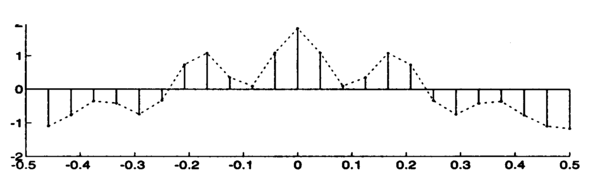

The new data, the output $\mathbf{g}$, is also sequence of 24 data points, and here’s a picture of that.

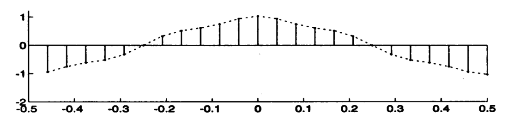

It’s clear that the old data has been smoothed, and it appears as though the higher frequencies have been eliminated. Whether this smoothing has lost something essential in the data is up to you and your scientific conscience to sort out.

### 7.13.2 Analysis in the frequency domain

How have the higher frequencies been eliminated? That’s where the picture in the frequency domain comes in.

Take the DFT, of order 24, of $\mathbf{g} = \mathbf{h} * \mathbf{f}$ and write it as

$$
\mathbf{G} = \mathbf{H}\,\mathbf{F}\,.
$$

Here’s the plot of $\mathbf{F}$ showing spikes at the three frequencies (positive and negative) in the signal.

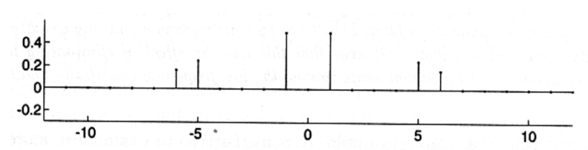

Here’s the plot of the transfer function $\mathbf{H}$.

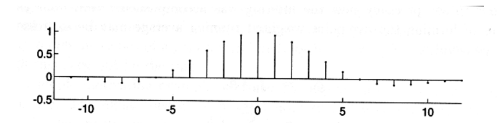

Taking the product, $\mathbf{H}\,\mathbf{F}$, of these two sequences to produce $\mathbf{G}$ has the effect of diminishing the higher frequencies in the original signal $\mathbf{f}$ while leaving the magnitude of the lower frequency components largely unchanged. Here’s a plot of $\mathbf{G}$, showing exactly this phenomenon.

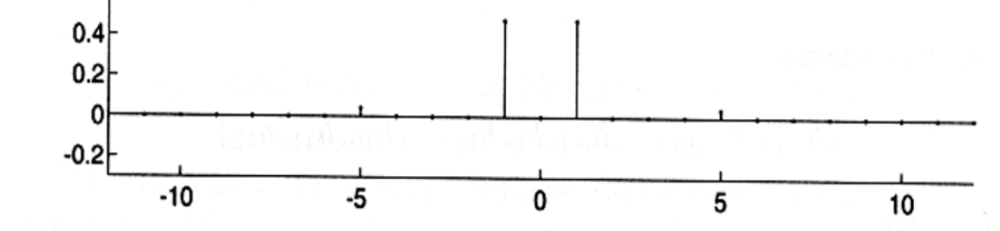

The pictures of the transfer functions in the frequency domain shed more light on the difference between the straight running average, where all values are weighted equally, and the modified running average, where the end values are given half the weight of the interior values. Here’s a plot of the transfer function for running average filters of 3 points, 5 points, 7 points, and 9 points. (The transfer functions are even, so only the plots for positive frequencies are shown. These plots come from the book *Digital Filters* by R. Hamming.) Remember, the effect of the filter is to modify the input by *multiplying* its spectrum by the transfer function.

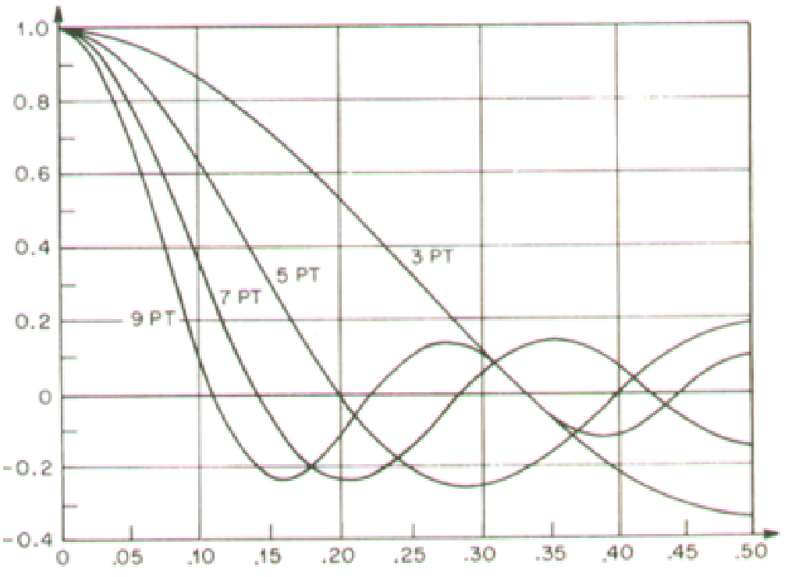

For each plot there are two features to note. In each case the transfer function has a “center lobe” from its maximum down to its first minimum (the plot for the 3 point filter doesn’t go out far enough to show this), and then there are “sidelobes” where the transfer function oscillates. The frequencies close to the center are passed through pretty much unchanged, and the ones that are in the side lobe regions are decreased. The sidelobes die out, so the farther out we go the more the frequencies in those regions are eliminated, but it’s a question of how fast the sidelobes are dying out.

Now here’s a plot of the transfer functions for the modified running average.

The center lobes are wider here than they are for the unmodified running average, so more frequencies in the center are passed through, but more important is that for the modified running average the sidelobes damp down much more quickly. Thus frequencies outside the center lobe are decreased much more dramatically. The result is “smoother” data (fewer high frequencies) back in the time domain.

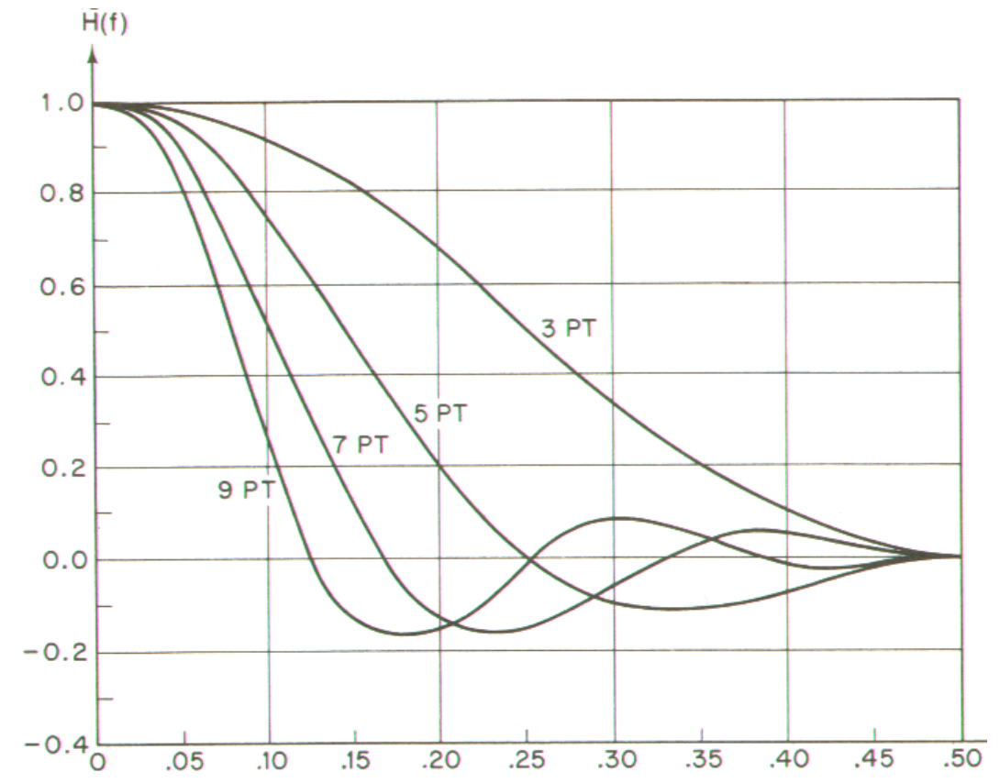

---

One word of caution. Although the modified running average as we’ve defined it is in widespread use, it’s not the only way to smooth data. I hope one consequence of the discussion so far is that you can imagine designing and analyzing your own filters.

**It’s faster in frequency** It’s worth pausing to remember the gains in computational efficiency provided by the FFT algorithm for calculating the DFT, and realizing what this means for filtering, as above. Calculating the convolution of two (periodic) sequences of length $N$ requires on the order of $N^2$ operations. On the other hand, using the FFT on the inputs ($O(N\log_2 N)$ operations), multiplying *componentwise* the results ($N$ operations), and then inverting (another $O(N\log_2 N)$ operations) requires a total of $O(N\log_2 N)$ operations. Filtering by passing to the frequency domain gives a considerable savings.

### 7.13.3 Find that filter

Let’s finish our very brief discussion of digital filters with the discrete form of lowpass and bandpass filters. You can get highpass and notch filters directly from these.

**Lowpass filters** The example of finding a running average had us convolving in the time domain and multiplying in the frequency domain, and the effect was to eliminate, or at least attenuate, the higher frequencies. If we start in the frequency domain instead, and just cut off higher frequencies, we wind up with a lowpass filter. We discussed this in Chapter 3, strictly in the continuous case, and it might help to review that briefly here.

An ideal low-pass filter sets all frequencies above a certain amount $\nu_c$ to zero and lets all frequencies below $\nu_c$ pass through unchanged. If we write, as usual,

$$
w(t) = (h * v)(t), \quad W(s) = H(s)V(s)\,,
$$

then we want the transfer function

$$
H(s) = \Pi_{2\nu_c}(s) = \begin{cases} 1 & |s| \le \nu_c \\ 0 & |s| > \nu_c \end{cases}
$$

That is, the transfer function is just a scaled rect function. In the time domain the impulse response is

$$
h(t) = 2\nu_c \operatorname{sinc}(2\nu_c t)\,.
$$

In the discrete case with $N$-points, going, say, from $-N/2 + 1$ to $N/2$, the transfer function is defined to be

$$
\mathbf{H}[m] = \begin{cases} 1 & |m| < m_c \\ \frac{1}{2} & |m| = m_c \\ 0 & m_c < |m| \le \frac{N}{2} \end{cases}
$$

Here $m_c$ is the index associated with the frequency where we want to cut off. We take the value to be $1/2$ at the endpoints. This choice comes from the “take the average at a jump discontinuity” principle.

In Section 7.15 I’ll derive the explicit formula for the (discrete) impulse response:

$$
\mathbf{h}[m] = \frac{\cos(\pi m/N)\sin(2\pi m m_c/N)}{\sin(\pi m/N)}
$$

Here are plots of $\mathbf{H}[m]$ and $\mathbf{h}[m]$ with $N = 64$ and $m_c = 32$:

![Plot of the discrete lowpass transfer function H[m]](figures/p334-v1.png)

![Plot of the discrete lowpass impulse response h[m]](figures/p334-v2.png)

Notice again the sidelobes in the time domain, i.e. the many, small oscillations. These are less pronounced for this definition of $\mathbf{h}$, i.e., with $\mathbf{H}$ defined to be $1/2$ at the endpoints, than they would be if $\mathbf{H}$ jumped straight from 0 to 1, but even so, using this filter with a signal that itself has “edges” can cause some unwanted effects, called *ringing*. To counteract such effects one sometimes brings the transfer function down to zero more gradually. One example of how to do this is

$$
\mathbf{H}[m] = \begin{cases} 1 & |m| \le m_c - m_0 \\ \sin\left(\frac{\pi(m_c - m)}{2m_0}\right) & m_c - m_0 < |m| \le m_c \\ 0 & m_c < |m| \end{cases}
$$

where, again, $m_c$ is where you want the frequencies cut off, and $m_0$ is where you start bringing the transfer function down.

Here is the picture in frequency — the transfer function, $\mathbf{H}$:

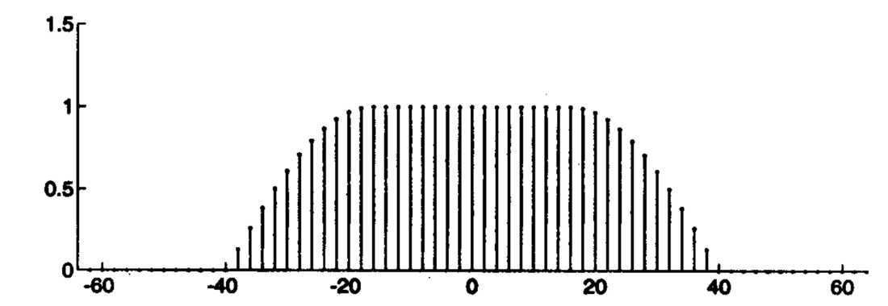

And here is the picture in time — the impulse response, $\mathbf{h}$:

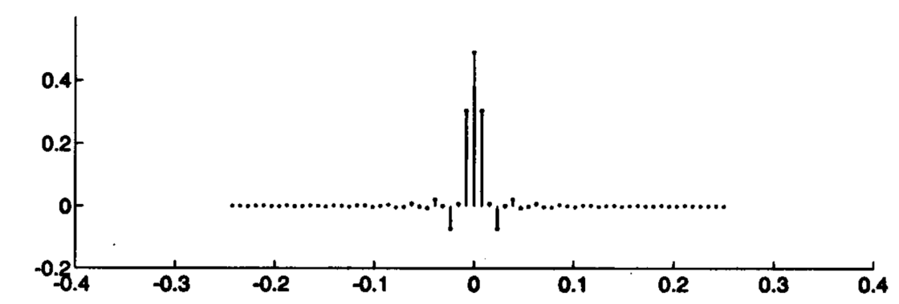

The sidelobes are definitely less pronounced.

**Bandpass filters** We also looked earlier at *bandpass filters*, filters that pass a particular band of frequencies through unchanged and eliminate all others. The transfer function $B(s)$ for a bandpass filter can be constructed by shifting and combining the transfer function $H(s)$ for the lowpass filter.

We center our bandpass filter at $\pm\nu_0$ and cut off frequencies more than $\nu_c$ above and below $\nu_0$. That is, we define

$$
\begin{aligned}
B(s) &= \begin{cases} 1 & \nu_0 - \nu_c \le |s| \le \nu_0 + \nu_c \\ 0 & |s| < \nu_0 - \nu_c \text{ or } |s| > \nu_0 + \nu_c \end{cases} \\
&= H(s - \nu_0) + H(s + \nu_0)\,.
\end{aligned}
$$

From the representation of $B(s)$ in terms of $H(s)$ it’s easy to find the impulse response, $b(t)$:

$$
\begin{aligned}
b(t) &= h(t)e^{2\pi i\nu_0 t} + h(t)e^{-2\pi i\nu_0 t} \quad \text{(using the shift theorem)} \\
&= 2h(t)\cos(2\pi\nu_0 t).
\end{aligned}
$$

Here’s a picture of the discrete version of a bandpass filter in the frequency and time domains. Once again you notice the sidelobes. As before, it’s possible to mollify this.

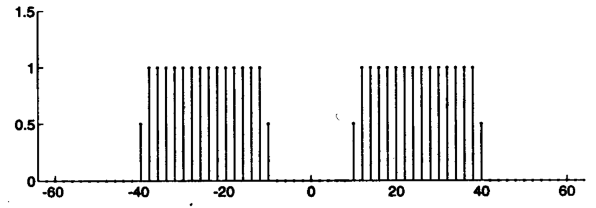

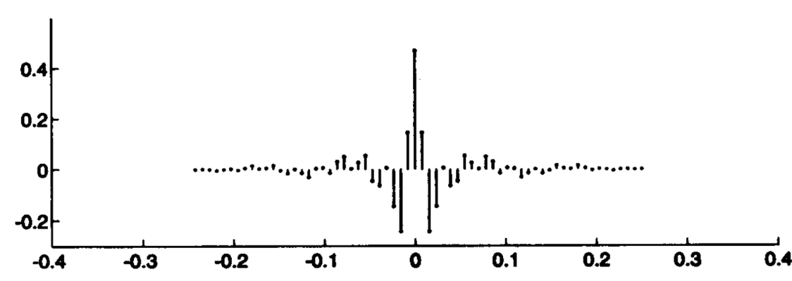

## 7.14 Appendix: Geometric Series of the Vector Complex Exponentials

There are times when explicit, closed form expressions for discrete filters are helpful, say if one wants to do a careful analysis of “endpoint effects” and related phenomena, or try out modifications in particular situations. The formulas also work out nicely, by and large, and further advance the notion that the discrete case can be made to look like the continuous case (and thus allow us to use what we know from the latter).

Such undertakings always seem to depend on calculations with the vector complex exponentials. One particular calculation that comes up a lot is a formula for a geometric sum of the $\boldsymbol{\omega}$, a sum of the form

$$
\mathbf{1} + \boldsymbol{\omega} + \boldsymbol{\omega}^2 + \cdots + \boldsymbol{\omega}^{q-1}\,,
$$

or more generally

$$
\mathbf{1} + \boldsymbol{\omega}^p + \boldsymbol{\omega}^{2p} + \cdots + \boldsymbol{\omega}^{(q-1)p}\,.
$$

We take $1 \le q \le N$, and for the second sum the case that will be of interest is when $pq = N$. It’s easy enough to work out these sums componentwise, but it’s also interesting to proceed as in the scalar case. Thus if we write

$$
\mathbf{S} = \mathbf{1} + \boldsymbol{\omega} + \boldsymbol{\omega}^2 + \cdots + \boldsymbol{\omega}^{q-1}
$$

then

$$
\boldsymbol{\omega}\,\mathbf{S} = \boldsymbol{\omega} + \boldsymbol{\omega}^2 + \boldsymbol{\omega}^3 + \cdots + \boldsymbol{\omega}^q\,,
$$

and

$$
(\mathbf{1} - \boldsymbol{\omega})\mathbf{S} = \mathbf{1} - \boldsymbol{\omega}^q\,.
$$

On the left hand side, $\mathbf{1} - \boldsymbol{\omega}$ has a 0 in the slot 0 and nowhere else. On the right hand side, $\mathbf{1} - \boldsymbol{\omega}^q$ is also zero in the slot 0, and possibly in other slots. We thus have to determine the zeroth slot of $\mathbf{S}$ directly, and it’s just the sum of $q$ 1’s. We can write

$$
\mathbf{S} = q\boldsymbol{\delta}_0 + \mathbf{T}\,,
$$

where $\mathbf{T}$ is 0 in the zeroth slot. The remaining components of $\mathbf{T}$ are the components from 1 to $N-1$ in $(\mathbf{1} - \boldsymbol{\omega}^q)/(\mathbf{1} - \boldsymbol{\omega})$ understood as the componentwise quotient. All of the quotients are defined, and some of them may be zero. If $q = N$ then $\mathbf{1} - \boldsymbol{\omega}^N$ is identically zero. A rather precise way of writing the final answer is

$$
\mathbf{1} + \boldsymbol{\omega} + \boldsymbol{\omega}^2 + \cdots + \boldsymbol{\omega}^{q-1} = \mathbf{S} = q\delta_0 + (\mathbf{1} - \boldsymbol{\delta}_0)\frac{\mathbf{1} - \boldsymbol{\omega}^q}{\mathbf{1} - \boldsymbol{\omega}}\,,
$$

but I’m tempted to write the formula for the sum as

$$
\mathbf{1} + \boldsymbol{\omega} + \boldsymbol{\omega}^2 + \cdots + \boldsymbol{\omega}^{q-1} = \frac{\mathbf{1} - \boldsymbol{\omega}^q}{\mathbf{1} - \boldsymbol{\omega}}
$$

with an understanding, between grown-ups, that the indeterminate form $0/0$ in the zero slot calls for special evaluation. See that — it looks just like the scalar case. (Suggestions of how better to express these understandings are welcome.)

The situation for

$$
\mathbf{S} = \mathbf{1} + \boldsymbol{\omega}^p + \boldsymbol{\omega}^{2p} + \cdots + \boldsymbol{\omega}^{(q-1)p}
$$

is a little different. As above we find

$$
(\mathbf{1} - \boldsymbol{\omega}^p)\mathbf{S} = 1 - \boldsymbol{\omega}^{pq}\,.
$$

Suppose that $pq = N$. Then the right hand side is the zero vector. Now,

$$
\boldsymbol{\omega}^p = (1, \omega^p, \omega^{2p}, \dots, \omega^{(N-1)p}) = (1, \omega^{N/q}, \omega^{2N/q}, \dots, \omega^{(N-1)N/q})\,,
$$

and so $\mathbf{1} - \boldsymbol{\omega}^p$ will have zeros in the slots $0$, $q$, $2q$, …, $(p-1)q$ and nowhere else. Therefore $\mathbf{S}$ must have zeros *other* than in these slots, and we see that the value of $\mathbf{S}$ is $q$ in each of the slots $0$, $q$, $2q$, …, $(p-1)q$. This shows that

$$
\mathbf{1} + \boldsymbol{\omega}^p + \boldsymbol{\omega}^{2p} + \cdots + \boldsymbol{\omega}^{(q-1)p} = q\boldsymbol{\delta}_0 + q\boldsymbol{\delta}_q + q\boldsymbol{\delta}_{2q} + \ldots + q\boldsymbol{\delta}_{(p-1)q}\,,
$$

or more compactly

$$
\sum_{k=0}^{q-1} \boldsymbol{\omega}^{kp} = q\sum_{k=0}^{p-1} \boldsymbol{\delta}_{kq}\,, \quad \text{where } pq = N\,.
$$

Note that this includes the special case when $p = 1$ and $q = N$.

We’ll only use the first geometric sum formula and not the one just above. The second comes up in defining and working with a discrete $\text{III}$ function.[^7-13]

[^7-13]: For those interested, I have extra notes on this, together with a discussion of a discrete sampling formula that we’re developing for applications to medical imaging problems. Current stuff.

## 7.15 Appendix: The Discrete Rect and its DFT

We defined the discrete rect function to be indexed from $-N/2 + 1$ to $N/2$, so we assume here that $N$ is even. Suppose $p$ is also even where $0 < p < N/2$. For any real number $\alpha$, define

$$
\underline{\Pi}_p^{\alpha} = \alpha(\boldsymbol{\delta}_{p/2} + \boldsymbol{\delta}_{-p/2}) + \sum_{k=-p/2+1}^{p/2-1} \boldsymbol{\delta}_k\,.
$$

Why the extra parameter $\alpha$ in setting the value at the endpoints $\pm p/2$? In the continuous case one also encounters different normalizations of the rect function at the points of discontinuity, but it hardly makes a difference in any formulas and calculations; most of the time there’s an integral involved and changing the value of a function at a few points has no effect on the value of the integral. Not so in the discrete case, where sums instead of integrals are the operators that one encounters. So with an eye toward flexibility in applications, we’re allowing an $\alpha$.

For work on digital filters, $\underline{\Pi}_p^{\alpha}$ is typically (part of) a transfer function and we want to know the impulse response, i.e., the inverse DFT. By duality it suffices to work with the forward transform, so we’ll find $\underline{\mathcal{F}}\,\underline{\Pi}_p^{\alpha}$.

Just as $\underline{\Pi}_p^{\alpha}$ comes in two parts, so too does its Fourier transform:. The first part is easy:

$$
\underline{\mathcal{F}}\,(\alpha(\boldsymbol{\delta}_{p/2} + \boldsymbol{\delta}_{-p/2})) = \alpha(\boldsymbol{\omega}^{p/2} + \boldsymbol{\omega}^{-p/2}) = 2\alpha\operatorname{Re}\{\boldsymbol{\omega}^{p/2}\} = 2\alpha\cos\left(\frac{\pi p}{N}[-\tfrac{N}{2}+1 : \tfrac{N}{2}]\right).
$$

The second part takes more work:

$$
\underline{\mathcal{F}}\left(\sum_{k=-p/2+1}^{p/2-1} \boldsymbol{\delta}_k\right) = \sum_{k=-p/2+1}^{p/2-1} \boldsymbol{\omega}^k = \sum_{k=0}^{p/2-1} \left(\boldsymbol{\omega}^k + \boldsymbol{\omega}^{-k}\right) - \mathbf{1} = 2\operatorname{Re}\left(\sum_{k=0}^{p/2-1} \boldsymbol{\omega}^k\right) - \mathbf{1}
$$

Take the zero slot first. We find directly that

$$
\underline{\mathcal{F}}\,\underline{\Pi}_p^{\alpha}[0] = 2\alpha + p - 1\,.
$$

For the nonzero slots we use the formula for the geometric series,

$$
\sum_{k=0}^{p/2-1} \boldsymbol{\omega}^k = \frac{p}{2}\boldsymbol{\delta}_0 + \frac{\mathbf{1} - \boldsymbol{\omega}^{p/2}}{\mathbf{1} - \boldsymbol{\omega}}\,.
$$

Now, with the understanding that we’re omitting the zero slot,

$$
\frac{1}{\mathbf{1} - \boldsymbol{\omega}} = \frac{1}{2}\mathbf{1} + \frac{1}{2}\frac{\mathbf{1} + \boldsymbol{\omega}}{\mathbf{1} - \boldsymbol{\omega}} = \frac{1}{2}\mathbf{1} - \frac{i}{2}\frac{\cos(\frac{\pi}{N}[-\tfrac{N}{2}+1 : \tfrac{N}{2}])}{\sin(\frac{\pi}{N}[-\tfrac{N}{2}+1 : \tfrac{N}{2}])}\,.
$$

Thus

$$
\begin{aligned}
2\operatorname{Re}\left(\sum_{k=0}^{p/2-1} \boldsymbol{\omega}^k\right) - \mathbf{1} &= 2\operatorname{Re}\left(\left(\frac{1}{2}\mathbf{1} - \frac{i}{2}\frac{\cos(\frac{\pi}{N}[-\tfrac{N}{2}+1 : \tfrac{N}{2}])}{\sin(\frac{\pi}{N}[-\tfrac{N}{2}+1 : \tfrac{N}{2}])}\right)(\mathbf{1} - \boldsymbol{\omega}^{p/2})\right) - \mathbf{1} \\
&= -\operatorname{Re}\{\boldsymbol{\omega}^{p/2}\} - \frac{\cos(\frac{\pi}{N}[-\tfrac{N}{2}+1 : \tfrac{N}{2}])}{\sin(\frac{\pi}{N}[-\tfrac{N}{2}+1 : \tfrac{N}{2}])}\operatorname{Im}\{\boldsymbol{\omega}^{p/2}\} \\
&= -\cos\Big(\frac{\pi p}{N}[-\tfrac{N}{2}+1 : \tfrac{N}{2}]\Big) + \frac{\cos(\frac{\pi}{N}[-\tfrac{N}{2}+1 : \tfrac{N}{2}])\sin(\frac{\pi p}{N}[-\tfrac{N}{2}+1 : \tfrac{N}{2}])}{\sin(\frac{\pi}{N}[-\tfrac{N}{2}+1 : \tfrac{N}{2}])} \\
&= \frac{\sin(\frac{\pi(p-1)}{N}[-\tfrac{N}{2}+1 : \tfrac{N}{2}])}{\sin(\frac{\pi}{N}[-\tfrac{N}{2}+1 : \tfrac{N}{2}])}\,.
\end{aligned}
$$

Combining this with the first part of the calculation gives

$$
\underline{\mathcal{F}}\,\underline{\Pi}_p^{\alpha} = \begin{cases} 2\alpha + p - 1 & \text{in slot } 0 \\[4pt] 2\alpha\cos(\frac{\pi p}{N}[-\tfrac{N}{2}+1 : \tfrac{N}{2}]) + \frac{\sin(\frac{\pi(p-1)}{N}[-\tfrac{N}{2}+1 : \tfrac{N}{2}])}{\sin(\frac{\pi}{N}[-\tfrac{N}{2}+1 : \tfrac{N}{2}])} & \text{otherwise} \end{cases}
$$

Not to put too fine a point on it, but slot 0 of

$$
\frac{\sin(\frac{\pi(p-1)}{N}[-\tfrac{N}{2}+1 : \tfrac{N}{2}])}{\sin(\frac{\pi}{N}[-\tfrac{N}{2}+1 : \tfrac{N}{2}])}
$$

does make sense as a limit and its value is $p - 1$. I wouldn’t object to writing the formula for $\underline{\mathcal{F}}\,\underline{\Pi}_p^{\alpha}$ simply as

$$
\underline{\mathcal{F}}\,\underline{\Pi}_p^{\alpha} = 2\alpha\cos\Big(\frac{\pi p}{N}[-\tfrac{N}{2}+1 : \tfrac{N}{2}]\Big) + \frac{\sin(\frac{\pi(p-1)}{N}[-\tfrac{N}{2}+1 : \tfrac{N}{2}])}{\sin(\frac{\pi}{N}[-\tfrac{N}{2}+1 : \tfrac{N}{2}])}
$$

At a point $m \in \mathbf{Z}$,

$$
\underline{\mathcal{F}}\,\underline{\Pi}_p^{\alpha}[m] = 2\alpha\cos\Big(\frac{\pi pm}{N}\Big) + \frac{\sin(\frac{\pi(p-1)m}{N})}{\sin(\frac{\pi m}{N})}\,.
$$

Since $p$ is even, and $p - 1$ is odd, we observe that $\underline{\mathcal{F}}\,\underline{\Pi}_p^{\alpha}$ is periodic of period $N$, which it had better be. (Because $p - 1$ is odd both the numerator and the denominator of the second term change sign if $m$ is replaced by $m + N$, while, because $p$ is even, the cosine term is unchanged.)

The most common choices of $\alpha$ are 0, 1, and $1/2$. The corresponding Fourier transforms are

$$
\begin{aligned}
\underline{\mathcal{F}}\,\underline{\Pi}_p^{0} &= \frac{\sin(\frac{(p-1)\pi}{N}[-\tfrac{N}{2}+1 : \tfrac{N}{2}])}{\sin(\frac{\pi}{N}[-\tfrac{N}{2}+1 : \tfrac{N}{2}])}\,, \quad \underline{\mathcal{F}}\,\underline{\Pi}_p^{0}[0] = p - 1 \\[4pt]
\underline{\mathcal{F}}\,\underline{\Pi}_p^{1} &= \frac{\sin(\frac{(p+1)\pi}{N}[-\tfrac{N}{2}+1 : \tfrac{N}{2}])}{\sin(\frac{\pi}{N}[-\tfrac{N}{2}+1 : \tfrac{N}{2}])}\,, \quad \underline{\mathcal{F}}\,\underline{\Pi}_p^{1}[0] = p + 1 \\
&\qquad \text{(use the addition formula for sines to write} \\
&\qquad 2\cos(\pi pm/N)\sin(\pi m/N) + \sin\pi(p-1)m/N = \sin(\pi(p+1)m/N)) \\[4pt]
\underline{\mathcal{F}}\,\underline{\Pi}_p^{1/2} &= \tfrac{1}{2}(\underline{\mathcal{F}}\,\underline{\Pi}_p^{1} + \underline{\mathcal{F}}\,\underline{\Pi}_p^{0}) \\
&= \frac{\cos(\frac{\pi}{N}[-\tfrac{N}{2}+1 : \tfrac{N}{2}])\sin(\frac{\pi p}{N}[-\tfrac{N}{2}+1 : \tfrac{N}{2}])}{\sin(\frac{\pi}{N}[-\tfrac{N}{2}+1 : \tfrac{N}{2}])}\,, \quad \underline{\mathcal{F}}\,\underline{\Pi}_p^{1/2}[0] = p
\end{aligned}
$$

This last formula is the one we had earlier in the notes for the impulse response of the discrete lowpass filter. In the notation there, $p/2 = m_c$ and

$$
\mathbf{h}[m] = \frac{\cos(\pi m/N)\sin(2\pi m m_c/N)}{\sin(\pi m/N)}\,.
$$
