# Chapter 8: n-dimensional Fourier Transform

## 8.1 Space, the Final Frontier

To quote Ron Bracewell from p. 119 of his book *Two-Dimensional Imaging*, “In two dimensions phenomena are richer than in one dimension.” True enough, working in two dimensions offers many new and rich possibilities. Contemporary applications of the Fourier transform are just as likely to come from problems in two, three, and even higher dimensions as they are in one — imaging is one obvious and important example. To capitalize on the work we’ve already done, however, as well as to highlight differences between the one-dimensional case and higher dimensions, we want to mimic the one-dimensional setting and arguments as much as possible. It is a measure of the naturalness of the fundamental concepts that the extension to higher dimensions of the basic ideas and the mathematical definitions that we’ve used so far proceeds almost automatically. However much we’ll be able to do in class and in these notes, you should be able to read more on your own with some assurance that you won’t be reading anything too much different from what you’ve already read.

**Notation** The higher dimensional case looks most like the one-dimensional case when we use vector notation. For the sheer thrill of it, I’ll give many of the definitions in $n$ dimensions, but to raise the comfort level we’ll usually look at the special case of two dimensions in more detail; two and three dimensions are where most of our examples will come from.

We’ll write a point in $\mathbf{R}^n$ as an $n$-tuple, say

$$
\mathbf{x} = (x_1, x_2, \dots, x_n)\,.
$$

Note that we’re going back to the usual indexing from 1 to $n$. (And no more periodic extensions of the $n$-tuples either!) We’ll be taking Fourier transforms and may want to assign a physical meaning to our variables, so we often think of the $x_i$’s as coordinates in space, with the dimension of length, and $\mathbf{x}$ as the “spatial variable”. We’ll then also need an $n$-tuple of “frequencies”, and without saying yet what “frequency” means, we’ll (typically) write

$$
\boldsymbol{\xi} = (\xi_1, \xi_2, \dots, \xi_n)
$$

for those variables “dual to $\mathbf{x}$”. Recall that the dot product of vectors in $\mathbf{R}^n$ is given by

$$
\mathbf{x}\cdot\boldsymbol{\xi} = x_1\xi_1 + x_2\xi_2 + \cdots + x_n\xi_n\,.
$$

The geometry of $\mathbf{R}^n$ is governed by the dot product, and using it will greatly help our understanding as well as streamline our notation.

### 8.1.1 The Fourier transform

We started this course with Fourier series and periodic phenomena and went on from there to define the Fourier transform. There’s a place for Fourier series in higher dimensions, but, carrying all our hard won experience with us, we’ll proceed directly to the higher dimensional Fourier transform. I’ll save Fourier series for a later section that includes a really interesting application to random walks.

How shall we define the Fourier transform? We consider real- or complex-valued functions $f$ defined on $\mathbf{R}^n$, and write $f(\mathbf{x})$ or $f(x_1, \dots, x_n)$, whichever is more convenient in context. The Fourier transform of $f(\mathbf{x})$ is the function $\mathcal{F}f(\boldsymbol{\xi})$, or $\hat{f}(\boldsymbol{\xi})$, defined by

$$
\mathcal{F}f(\boldsymbol{\xi}) = \int_{\mathbf{R}^n} e^{-2\pi i\mathbf{x}\cdot\boldsymbol{\xi}} f(\mathbf{x})\,d\mathbf{x}\,.
$$

The inverse Fourier transform of a function $g(\boldsymbol{\xi})$ is

$$
\mathcal{F}^{-1}g(\mathbf{x}) = \int_{\mathbf{R}^n} e^{2\pi i\mathbf{x}\cdot\boldsymbol{\xi}} g(\boldsymbol{\xi})\,d\boldsymbol{\xi}\,.
$$

The Fourier transform, or the inverse transform, of a real-valued function is (in general) complex valued.

The exponential now features the dot product of the vectors $\mathbf{x}$ and $\boldsymbol{\xi}$; this is the key to extending the definitions from one dimension to higher dimensions and making it look like one dimension. The integral is over all of $\mathbf{R}^n$, and as an $n$-fold multiple integral all the $x_j$’s (or $\xi_j$’s for $\mathcal{F}^{-1}$) go from $-\infty$ to $\infty$. Realize that because the dot product of two vectors is a number, we’re integrating a scalar function, not a vector function. Overall, the shape of the definitions of the Fourier transform and the inverse transform are *the same* as before.

The kinds of functions to consider and how they enter into the discussion — Schwartz functions, $L^1$, $L^2$, etc. — is entirely analogous to the one-dimensional case, and so are the definitions of these types of functions. Because of that we don’t have to redo distributions et al. (good news), and I’ll seldom point out when this aspect of the general theory is (or must be) invoked.

Written out in coordinates, the definition of the Fourier transform reads:

$$
\mathcal{F}f(\xi_1, \xi_2, \dots, \xi_n) = \int_{\mathbf{R}^n} e^{-2\pi i(x_1\xi_1 + \cdots + x_n\xi_n)} f(x_1, \dots, x_n)\,dx_1 \dots dx_n\,,
$$

so for two dimensions,

$$
\mathcal{F}f(\xi_1, \xi_2) = \int_{-\infty}^{\infty}\int_{-\infty}^{\infty} e^{-2\pi i(x_1\xi_1 + x_2\xi_2)} f(x_1, x_2)\,dx_1\,dx_2\,.
$$

The coordinate expression is manageable in the two-dimensional case, but I hope to convince you that it’s almost always *much* better to use the vector notation in writing formulas, deriving results, and so on.

---

Arithmetic with vectors, including the dot product, is pretty much just like arithmetic with numbers. Consequently, all of the familiar algebraic properties of the Fourier transform are present in the higher dimensional setting. We won’t go through them all, but, for example,

$$
\mathcal{F}f(-\boldsymbol{\xi}) = \int_{\mathbf{R}^n} e^{-2\pi i\mathbf{x}\cdot(-\boldsymbol{\xi})} f(\mathbf{x})\,d\mathbf{x} = \int_{\mathbf{R}^n} e^{2\pi i\mathbf{x}\cdot\boldsymbol{\xi}} f(\mathbf{x})\,d\mathbf{x} = \mathcal{F}^{-1}f(\boldsymbol{\xi})\,,
$$

which is one way of stating the duality between the Fourier and inverse Fourier transforms. Here, recall that if $\boldsymbol{\xi} = (\xi_1, \dots, \xi_n)$ then

$$
-\boldsymbol{\xi} = (-\xi_1, \dots, -\xi_n)\,.
$$

To be neater, we again use the notation

$$
f^-(\boldsymbol{\xi}) = f(-\boldsymbol{\xi})\,,
$$

and with this definition the duality results read exactly as in the one-dimensional case:

$$
\mathcal{F}f^- = (\mathcal{F}f)^-, \quad (\mathcal{F}f)^- = \mathcal{F}^{-1}f
$$

In connection with these formulas, I have to point out that changing variables, one of our prized techniques in one dimension, can be more complicated for multiple integrals. We’ll approach this on a need to know basis.

It’s still the case that the complex conjugate of the integral is the integral of the complex conjugate, so when $f(\mathbf{x})$ is real valued,

$$
\mathcal{F}f(-\xi) = \overline{\mathcal{F}f(\xi)}\,.
$$

Finally, evenness and oddness are defined exactly as in the one-dimensional case. That is:

> $f(\mathbf{x})$ is *even* if $f(-\mathbf{x}) = f(\mathbf{x})$, or without writing the variables, if $f^- = f$.
>
> $f(\mathbf{x})$ is *odd* $f(-\boldsymbol{\xi}) = -f(\boldsymbol{\xi})$, or $f^- = -f$.

Of course, we no longer have quite the easy geometric interpretations of evenness and oddness in terms of a graph in the higher dimensional case as we have in the one-dimensional case. But as algebraic properties of a function, these conditions do have the familiar consequences for the higher dimensional Fourier transform, e.g., if $f(\mathbf{x})$ is even then $\mathcal{F}f(\boldsymbol{\xi})$ is even, if $f(\mathbf{x})$ is real and even then $\mathcal{F}f(\boldsymbol{\xi})$ is real and even, *etc.* You could write them all out. I won’t.

---

Soon enough we’ll calculate the Fourier transform of some model functions, but first let’s look a little bit more at the complex exponentials in the definition and get a better sense of what “the spectrum” means in higher dimensions.

**Harmonics, periodicity, and spatial frequencies** The complex exponentials are again the building blocks — the harmonics — for the Fourier transform and its inverse in higher dimensions. Now that they involve a dot product, is there anything special we need to know?

As mentioned just above, we tend to view $\mathbf{x} = (x_1, \dots, x_n)$ as a *spatial* variable and $\boldsymbol{\xi} = (\xi_1, \dots, \xi_n)$ as a *frequency* variable. It’s not hard to imagine problems where one would want to specify $n$ spatial dimensions each with the unit of distance, but it’s not so clear what an $n$-tuple of frequencies should mean. One thing we can say is that if the spatial variables $(x_1, \dots, x_n)$ do have the dimension of distance then the corresponding frequency variables $(\xi_1, \dots, \xi_n)$ have the dimension 1/distance. For then

$$
\mathbf{x}\cdot\boldsymbol{\xi} = x_1\xi_1 + \cdots + x_n\xi_n
$$

is dimensionless and $\exp(-2\pi i\mathbf{x}\cdot\boldsymbol{\xi})$ makes sense. This corresponds to dimensions of time and 1/time in the one-dimensional time domain and frequency domain picture.

---

For some further insight let’s look at the two-dimensional case. Consider

$$
\exp(\pm 2\pi i\mathbf{x}\cdot\boldsymbol{\xi}) = \exp(\pm 2\pi i(x_1\xi_1 + x_2\xi_2))\,.
$$

(It doesn’t matter for the following discussion whether we take $+$ or $-$ in the exponent.) The exponent equals 1 whenever $\mathbf{x}\cdot\boldsymbol{\xi}$ is an integer, that is, when

$$
\xi_1x_1 + \xi_2x_2 = n, \quad n \text{ an integer}\,.
$$

With $\boldsymbol{\xi} = (\xi_1, \xi_2)$ fixed this is a condition on $(x_1, x_2)$, and one says that the complex exponential has *zero phase* whenever $\xi_1x_1 + \xi_2x_2$ is an integer. This terminology comes from optics.

There’s a natural geometric interpretation of the zero phase condition that’s very helpful in understanding the most important properties of the complex exponential. For a fixed $\boldsymbol{\xi}$ the equations

$$
\xi_1x_1 + \xi_2x_2 = n
$$

determine a family of parallel lines in the $(x_1, x_2)$-plane (or in the *spatial domain* if you prefer that phrase). Take $n = 0$. Then the condition on $x_1$ and $x_2$ is

$$
\xi_1x_1 + \xi_2x_2 = 0
$$

and we recognize this as the equation of a line through the origin with $(\xi_1, \xi_2)$ as a normal vector to the line.[^8-1] (Remember your vectors!) Then $(\xi_1, \xi_2)$ is a normal to *each* of the parallel lines in the family. One could also describe the geometry of the situation by saying that the lines each make an angle $\theta$ with the $x_1$-axis satisfying

[^8-1]: Note that $(\xi_1, \xi_2)$ isn’t assumed to be a unit vector, so it’s not the unit normal.

$$
\tan\theta = \frac{\xi_2}{\xi_1}\,,
$$

but I think it’s much better to think in terms of normal vectors to specify the direction — the vector point of view generalizes readily to higher dimensions, as we’ll discuss.

Furthermore, the family of lines $\xi_1x_1 + \xi_2x_2 = n$ are evenly spaced as $n$ varies; in fact, the distance between the line $\xi_1x_1 + \xi_2x_2 = n$ and the line $\xi_1x_1 + \xi_2x_2 = n + 1$ is

$$
\text{distance} = \frac{1}{\|\boldsymbol{\xi}\|} = \frac{1}{\sqrt{\xi_1^2 + \xi_2^2}}\,.
$$

I’ll let you derive that. This is our first hint, in two dimensions, of a reciprocal relationship between the spatial and frequency variables:

- The spacing of adjacent lines of zero phase is the reciprocal of the length of the frequency vector.

Drawing the family of parallel lines with a fixed normal $\boldsymbol{\xi}$ also gives us some sense of the periodic nature of the harmonics $\exp(\pm 2\pi i\,\mathbf{x}\cdot\boldsymbol{\xi})$. The frequency vector $\boldsymbol{\xi} = (\xi_1, \xi_2)$, as a normal to the lines, determines how the harmonic is oriented, so to speak, and the magnitude of $\boldsymbol{\xi}$, or rather its reciprocal, $1/\sqrt{\xi_1^2 + \xi_2^2}$ determines the period of the harmonic. To be precise, start at any point $(a, b)$ and move in the direction of the *unit* normal, $\boldsymbol{\xi}/\|\boldsymbol{\xi}\|$. That is, move from $(a, b)$ along the line

$$
\mathbf{x}(t) = (x_1(t), x_2(t)) = (a, b) + t\frac{\boldsymbol{\xi}}{\|\boldsymbol{\xi}\|} \quad\text{or}\quad x_1(t) = a + t\frac{\xi_1}{\|\boldsymbol{\xi}\|},\ x_2(t) = b + t\frac{\xi_2}{\|\boldsymbol{\xi}\|}
$$

at unit speed. The dot product of $\mathbf{x}(t)$ and $\boldsymbol{\xi}$ is

$$
\mathbf{x}(t)\cdot\boldsymbol{\xi} = (x_1(t), x_2(t))\cdot(\xi_1, \xi_2) = a\xi_1 + b\xi_2 + t\frac{\xi_1^2 + \xi_2^2}{\|\boldsymbol{\xi}\|} = a\xi_1 + b\xi_2 + t\|\boldsymbol{\xi}\|\,,
$$

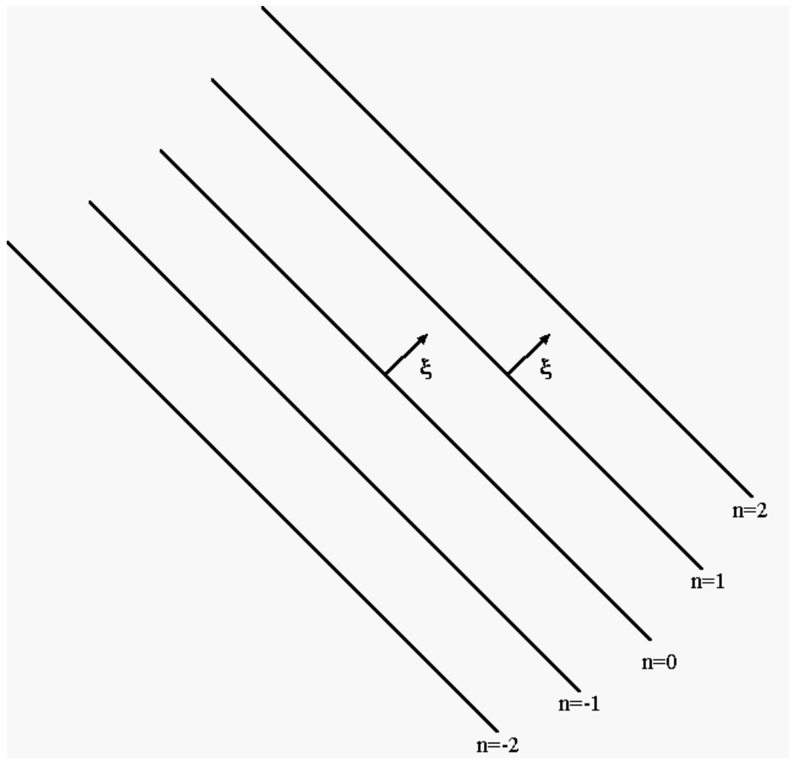

and the complex exponential is a function of $t$ along the line:

$$
\exp(\pm 2\pi i\,\mathbf{x}\cdot\boldsymbol{\xi}) = \exp(\pm 2\pi i(a\xi_1 + b\xi_2))\,\exp(\pm 2\pi i t\|\boldsymbol{\xi}\|)\,.
$$

The factor $\exp(\pm 2\pi i(a\xi_1 + b\xi_2))$ doesn’t depend on $t$ and the factor $\exp(\pm 2\pi i t\|\boldsymbol{\xi}\|)$ is periodic with period $1/\|\boldsymbol{\xi}\|$, the spacing between the lines of zero phase. Now, if $\xi_1$ or $\xi_2$ is large, then the spacing of the lines is close and, by the same token, if $\xi_1$ and $\xi_2$ are small then the lines are far apart. Thus although “frequency” is now a vector quantity we still tend to speak in terms of a “high frequency” harmonic, when the lines of zero phase are spaced close together and a “low frequency” harmonic when the lines of zero phase are spaced far apart (“high” and “low” are relatively speaking, of course). Half way between the lines of zero phase, when $t = 1/2\|\boldsymbol{\xi}\|$, we’re on lines where the exponential is $-1$, so $180^\circ$ out of phase with the lines of zero phase.

One often sees pictures like the following.

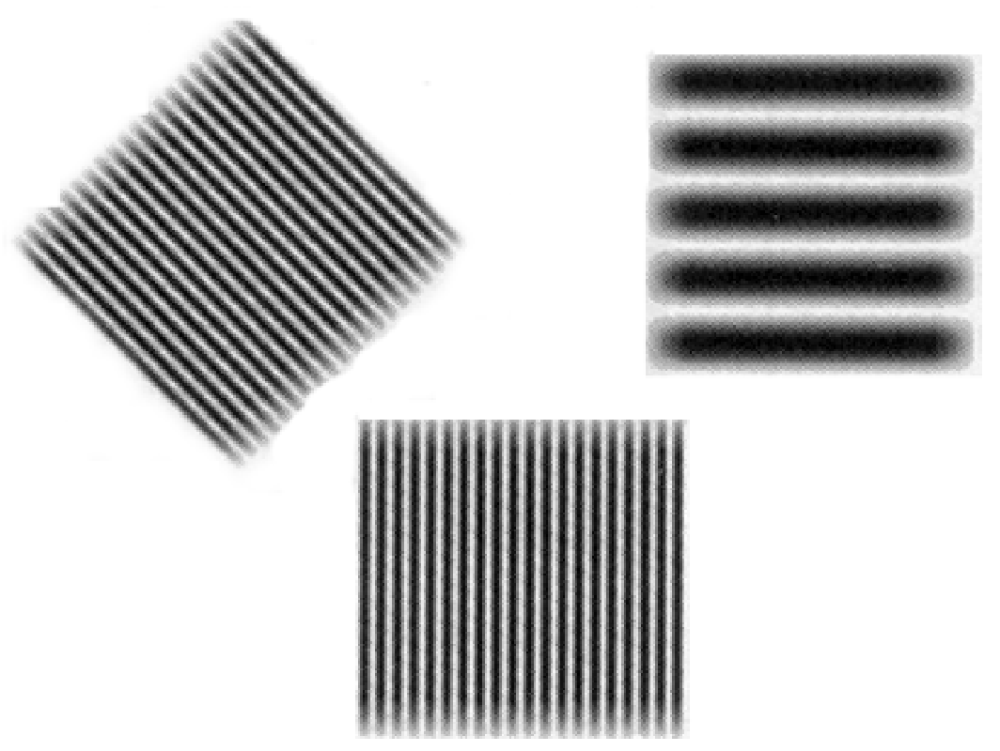

Here’s what you’re looking at: The function $e^{2\pi i\mathbf{x}\cdot\boldsymbol{\xi}}$ is complex valued, but consider its real part

$$
\begin{aligned}
\operatorname{Re} e^{2\pi i\mathbf{x}\cdot\boldsymbol{\xi}} &= \tfrac{1}{2}\big(e^{2\pi i\mathbf{x}\cdot\boldsymbol{\xi}} + e^{-2\pi i\mathbf{x}\cdot\boldsymbol{\xi}}\big) \\
&= \cos 2\pi i\mathbf{x}\cdot\boldsymbol{\xi} = \cos 2\pi(\xi_1x_1 + \xi_2x_2)
\end{aligned}
$$

which has the same periodicity and same lines of zero phase as the complex exponential. Put down white stripes where $\cos 2\pi(\xi_1x_1 + \xi_2x_2) \ge 0$ and black stripes where $\cos 2\pi(\xi_1x_1 + \xi_2x_2) < 0$, or, if you want to get fancy, use a gray scale to go from pure white on the lines of zero phase, where the cosine is 1, down to pure black on the lines $180^\circ$ out of phase, where the cosine is $-1$, and back up again. This gives a sense of a periodically varying intensity, and the slowness or rapidity of the changes in intensity indicate low or high spatial frequencies.

**The spectrum** The Fourier transform of a function $f(x_1, x_2)$ finds the spatial frequencies $(\xi_1, \xi_2)$. The set of all spatial frequencies is called the *spectrum*, just as before. The inverse transform recovers the function from its spectrum, adding together the corresponding spatial harmonics, each contributing an amount $\mathcal{F}f(\xi_1, \xi_2)$. As mentioned above, when $f(x_1, x_2)$ is real we have

$$
\mathcal{F}f(-\xi_1, -\xi_2) = \overline{\mathcal{F}f(\xi_1, \xi_2)}\,,
$$

so that if a particular $\mathcal{F}f(\xi_1, \xi_2)$ is not zero then there is also a contribution from the “negative frequency” $(-\xi_1, -\xi_2)$. Thus for a real signal, the spectrum, as a set of points in the $(\xi_1, \xi_2)$-plane, is symmetric about the origin.[^8-2] If we think of the exponentials of corresponding positive and negative frequency vectors adding up to give the signal then we’re adding up (integrating) a bunch of cosines and the signal really does seem to be made of a bunch of a stripes with different spacings, different orientations, and different intensities (the magnitudes $|\mathcal{F}f(\xi_1, \xi_2)|$). It may be hard to imagine that an image, for example, is such a sum of stripes, but, then again, why is music the sum of a bunch of sine curves?

[^8-2]: *N.b.*: It’s not the *values* $\mathcal{F}f(\xi_1, \xi_2)$ that are symmetric, just the set of points $(\xi_1, \xi_2)$ of contributing frequencies.

In the one-dimensional case we are used to drawing a picture of the magnitude of the Fourier transform to get some sense of how the energy is distributed among the different frequencies. We can do a similar thing in the two-dimensional case, putting a bright (or colored) dot at each point $(\xi_1, \xi_2)$ that is in the spectrum, with a brightness proportional to the magnitude $|\mathcal{F}f(\xi_1, \xi_2)|$. This, the *energy spectrum* or the *power spectrum*, *is* symmetric about the origin because $|\mathcal{F}f(\xi_1, \xi_2)| = |\mathcal{F}f(-\xi_1, -\xi_2)|$.

Here are pictures of the spatial harmonics we showed before and their respective spectra.

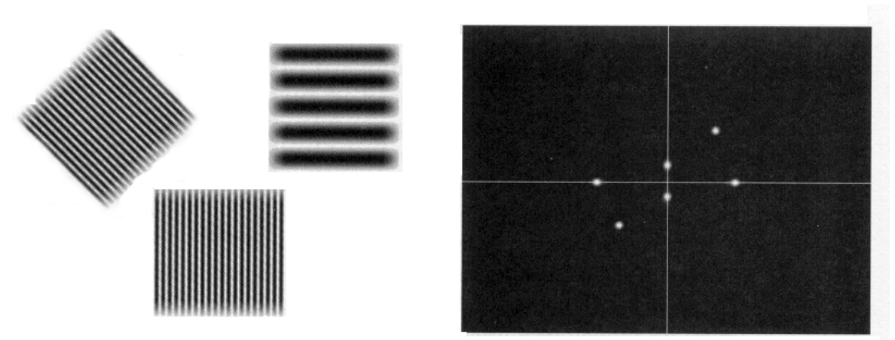

Which is which? The stripes have an orientation (and a spacing) determined by $\boldsymbol{\xi} = (\xi_1, \xi_2)$ which is normal to the stripes. The horizontal stripes have a normal of the form $(0, \xi_2)$ and they are of lower frequency so $\xi_2$ is small. The vertical stripes have a normal of the form $(\xi_1, 0)$ and are of a higher frequency so $\xi_1$ is large, and the oblique stripes have a normal of the form $(\xi, \xi)$ with a spacing about the same as for the vertical stripes

Here’s a more interesting example.[^8-3]

[^8-3]: I showed this picture to the class a few years ago and someone yelled : “That’s Natalie!”

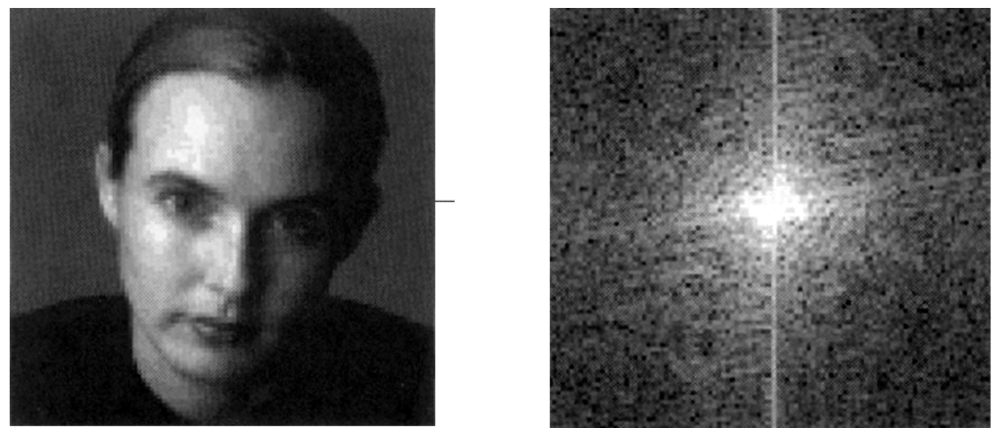

For the picture of the woman, what is the function we are taking the Fourier transform *of*? The function $f(x_1, x_2)$ is the intensity of light at each point $(x_1, x_2)$ — that’s what a black-and-white image *is* for the purposes of Fourier analysis. Incidentally, because the dynamic range (the range of intensities) can be so large in images it’s common to light up the pixels in the spectral picture according to the *logarithm* of the intensity.

Here’s a natural application of filtering in the frequency domain for an image.

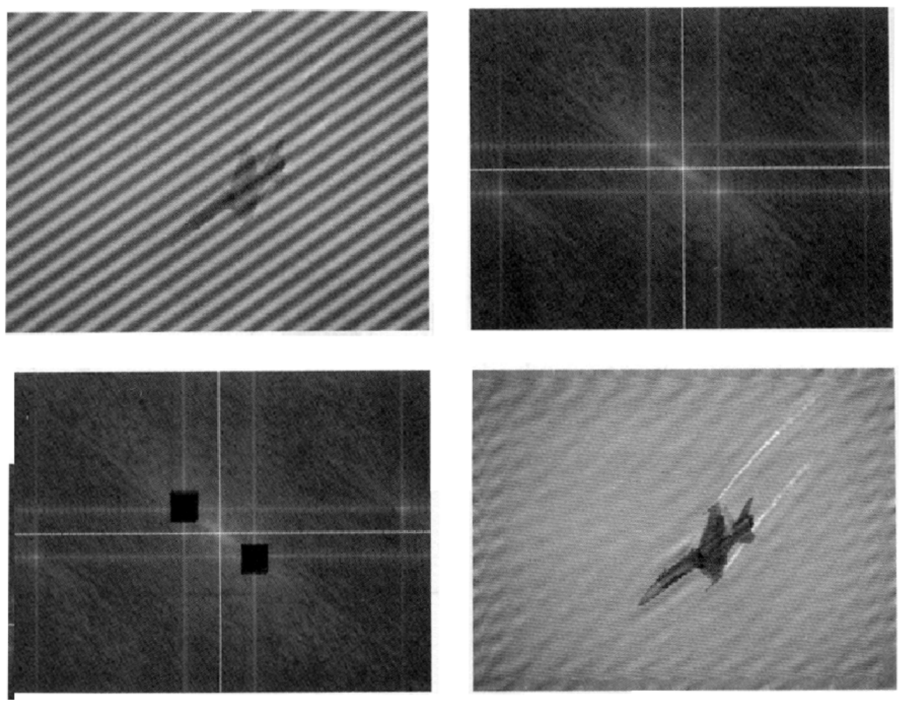

The first picture shows periodic noise that appears quite distinctly in the frequency spectrum. We eliminate those frequencies and take the inverse transform to show the plane more clearly.[^8-4]

[^8-4]: All of these examples are taken from the book *Digital Image Processing* by G. Baxes.

Finally, there are reasons to *add* things to the spectrum as well as take them away. An important and relatively new application of the Fourier transform in imaging is *digital watermarking*. Watermarking is an old technique to authenticate printed documents. Within the paper an image is imprinted (somehow — I don’t know how this is done!) that only becomes visible if held up to a light or dampened by water. The idea is that someone trying to counterfeit the document will not know of or cannot replicate the watermark, but that someone who knows where to look can easily verify its existence and hence the authenticity of the document. The newer US currency now uses watermarks, as well as other anticounterfeiting techniques.

For electronic documents a *digital watermark* is added by adding to the spectrum. Insert a few extra harmonics here and there and keep track of what you added. This is done in a way to make the changes in the image undetectable (you hope) and so that no one else could possibly tell what belongs in the spectrum and what you put there (you hope). If the receivers of the document know where to look in the spectrum they can find your mark and verify that the document is legitimate.

**Higher dimensions** In higher dimensions the words to describe the harmonics and the spectrum are pretty much the same, though we can’t draw the pictures[^8-5]. The harmonics are the complex exponentials $e^{\pm 2\pi i\mathbf{x}\cdot\boldsymbol{\xi}}$ and we have $n$ spatial frequencies, $\boldsymbol{\xi} = (\xi_1, \xi_2, \dots, \xi_n)$. Again we single out where the complex exponentials are equal to 1 (zero phase), which is when $\boldsymbol{\xi}\cdot\mathbf{x}$ is an integer. In three-dimensions a given $(\xi_1, \xi_2, \xi_3)$ defines a family $\boldsymbol{\xi}\cdot\mathbf{x} = \text{integer}$ of parallel planes (of zero phase) in $(x_1, x_2, x_3)$-space. The normal to any of the planes is the vector $\boldsymbol{\xi} = (\xi_1, \xi_2, \xi_3)$ and adjacent planes are a distance $1/\|\boldsymbol{\xi}\|$ apart. The exponential is periodic in the direction $\boldsymbol{\xi}$ with period $1/\|\boldsymbol{\xi}\|$. In a similar fashion, in $n$ dimensions we have families of parallel hyperplanes ($(n-1)$-dimensional “planes”) with normals $\boldsymbol{\xi} = (\xi_1, \dots, \xi_n)$, and distance $1/\|\boldsymbol{\xi}\|$ apart.

[^8-5]: Any computer graphics experts out there care to add color and 3D-rendering to try to draw the spectrum?

### 8.1.2 Finding a few Fourier transforms: separable functions

There are times when a function $f(x_1, \dots, x_n)$ of $n$ variables can be written as a product of $n$ functions of one-variable, as in

$$
f(x_1, \dots, x_n) = f_1(x_1)f_2(x_2)\cdots f_n(x_n)\,.
$$

Attempting to do this is a standard technique in finding special solutions of partial differential equations — there it’s called the method of *separation of variables*. When a function can be factored in this way, its Fourier transform can be calculated as the product of the Fourier transform of the factors. Take $n = 2$ as a representative case:

$$
\begin{aligned}
\mathcal{F}f(\xi_1, \xi_2) &= \int_{\mathbf{R}^n} e^{-2\pi i\mathbf{x}\cdot\boldsymbol{\xi}} f(\mathbf{x})\,d\mathbf{x} \\
&= \int_{-\infty}^{\infty}\int_{-\infty}^{\infty} e^{-2\pi i(x_1\xi_1 + x_2\xi_2)} f(x_1, x_2)\,dx_1\,dx_2 \\
&= \int_{-\infty}^{\infty}\int_{-\infty}^{\infty} e^{-2\pi i\xi_1x_1} e^{-2\pi i\xi_2x_2} f_1(x_1)f_2(x_2)\,dx_1\,dx_2 \\
&= \int_{-\infty}^{\infty}\left(\int_{-\infty}^{\infty} e^{-2\pi i\xi_1x_1} f_1(x)\,dx_1\right) e^{-2\pi i\xi_2x_2} f_2(x_2)\,dx_2 \\
&= \mathcal{F}f_1(\xi_1)\int_{-\infty}^{\infty} e^{-2\pi i\xi_2x_2} f_2(x_2)\,dx_2 \\
&= \mathcal{F}f_1(\xi_1)\,\mathcal{F}f_2(\xi_2)
\end{aligned}
$$

In general, if $f(x_1, x_2, \dots, x_n) = f_1(x_1)f_2(x_2)\cdots f_n(x_n)$ then

$$
\mathcal{F}f(\xi_1, x_2, \dots \xi_n) = \mathcal{F}f_1(\xi_1)\mathcal{F}f_2(\xi_2)\cdots\mathcal{F}f_n(\xi_n)\,.
$$

If you really want to impress your friends and confound your enemies, you can invoke *tensor products* in this context. In mathematical parlance the separable signal $f$ is the tensor product of the functions $f_i$ and one writes

$$
f = f_1 \otimes f_2 \otimes \cdots \otimes f_n\,,
$$

and the formula for the Fourier transform as

$$
\mathcal{F}(f_1 \otimes f_2 \otimes \cdots \otimes f_n) = \mathcal{F}f_1 \otimes \mathcal{F}f_2 \otimes \cdots \otimes \mathcal{F}f_n\,.
$$

People run in terror from the $\otimes$ symbol. Cool.

**Higher dimensional rect functions** The simplest, useful example of a function that fits this description is a version of the rect function in higher dimensions. In two dimensions, for example, we want the function that has the value 1 on the square of side length 1 centered at the origin, and has the value 0 outside this square. That is,

$$
\Pi(x_1, x_2) = \begin{cases} 1 & -\frac{1}{2} < x_1 < \frac{1}{2},\ -\frac{1}{2} < x_2 < \frac{1}{2} \\ 0 & \text{otherwise} \end{cases}
$$

You can fight it out how you want to define things on the edges. Here’s a graph.

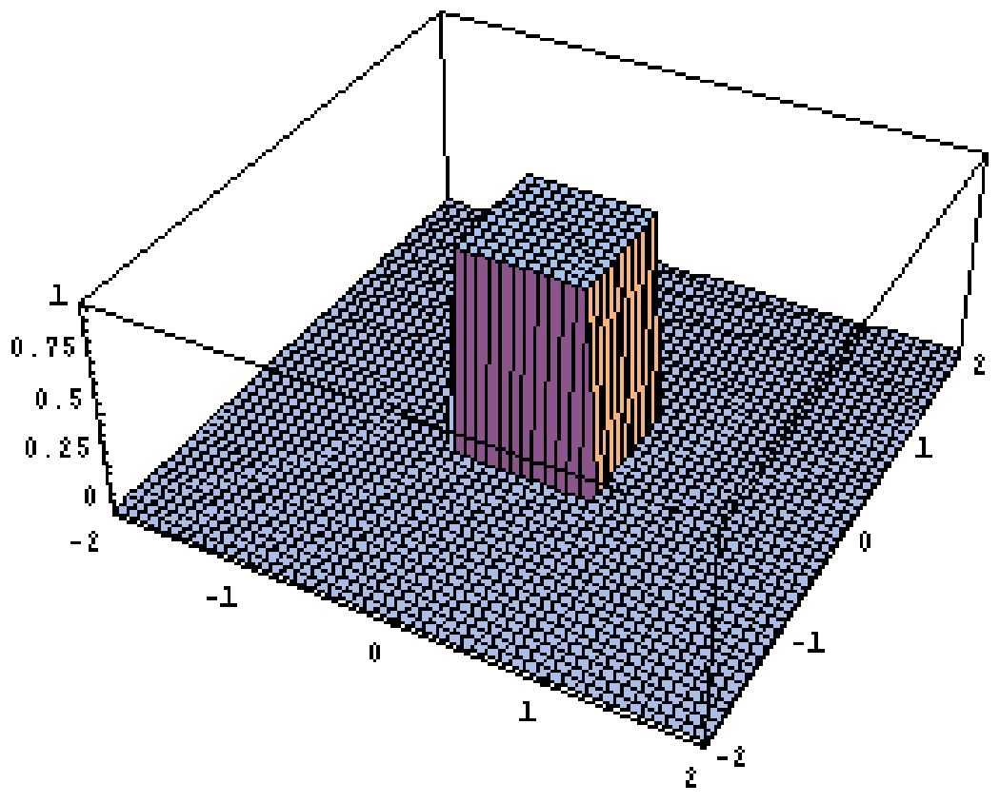

We can factor $\Pi(x_1, x_2)$ as the product of two one-dimensional rect functions:

$$
\Pi(x_1, x_2) = \Pi(x_1)\Pi(x_2)\,.
$$

(I’m using the same notation for the rect function in one or more dimensions because, in this case, there’s little chance of confusion.) The reason that we can write $\Pi(x_1, x_2)$ this way is because it is identically 1 if *all* the coordinates are between $-1/2$ and $1/2$ and it is zero otherwise — so it’s zero if *any* of the coordinates is outside this range. That’s exactly what happens for the product $\Pi(x_1)\Pi(x_2)$.

For the Fourier transform of the 2-dimensional $\Pi$ we then have

$$
\mathcal{F}\Pi(\xi_1, \xi_2) = \operatorname{sinc}\xi_1 \operatorname{sinc}\xi_2\,.
$$

Here’s what the graph looks like.

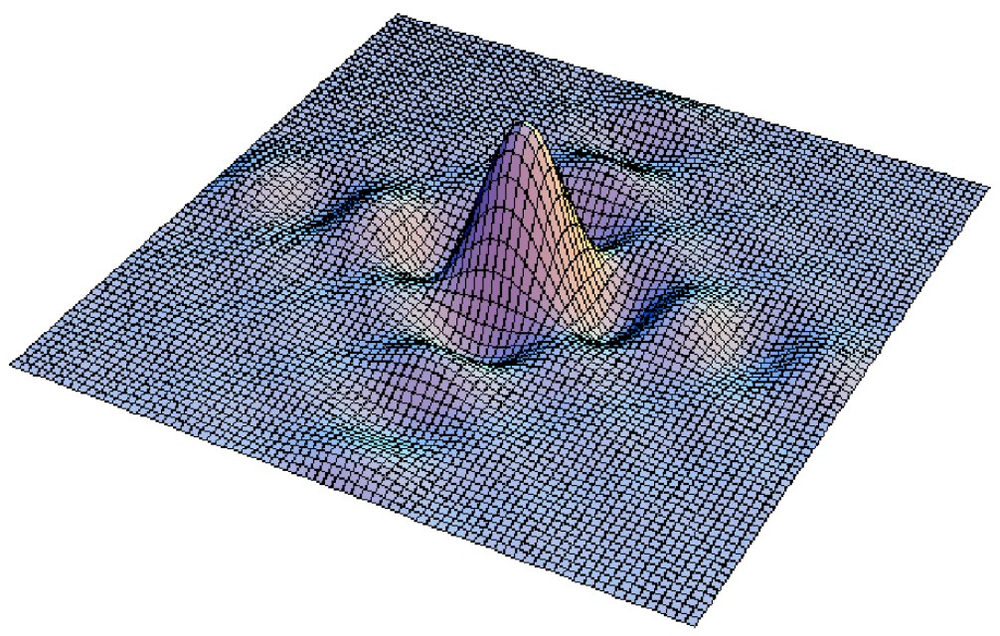

A helpful feature of factoring the rect function this way is the ability, easily, to change the widths in the different coordinate directions. For example, the function which is 1 in the rectangle $-a_1/2 < x_1 < a_1/2$, $-a_2/2 < x_2 < a_2/2$ and zero outside that rectangle is (in appropriate notation)

$$
\Pi_{a_1a_2}(x_1, x_2) = \Pi_{a_1}(x_1)\Pi_{a_2}(x_2)\,.
$$

The Fourier transform of this is

$$
\mathcal{F}\Pi_{a_1a_2}(\xi_1, \xi_2) = (a_1\operatorname{sinc} a_1\xi_1)(a_2\operatorname{sinc} a_2\xi_2)\,.
$$

Here’s a plot of $(2\operatorname{sinc} 2\xi_1)(4\operatorname{sinc} 4\xi_2)$. You can see how the shape has changed from what we had before.

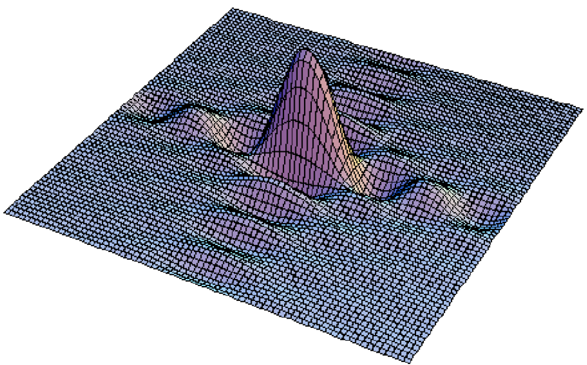

The direct generalization of the (basic) rect function to $n$ dimensions is

$$
\Pi(x_1, x_2, \dots, x_n) = \begin{cases} 1 & -\frac{1}{2} < x_k < \frac{1}{2}, \quad k = 1, \dots, n \\ 0 & \text{otherwise} \end{cases}
$$

which factors as

$$
\Pi(x_1, x_2, \dots, x_n) = \Pi(x_1)\Pi(x_2)\cdots\Pi(x_n)\,.
$$

For the Fourier transform of the $n$-dimensional $\Pi$ we then have

$$
\mathcal{F}\Pi(\xi_1, \xi_2, \dots, \xi_n) = \operatorname{sinc}\xi_1 \operatorname{sinc}\xi_2 \cdots \operatorname{sinc}\xi_n\,.
$$

It’s obvious how to modify higher-dimensional $\Pi$ to have different widths on different axes.

**Gaussians** Another good example of a separable function — one that often comes up in practice — is a Gaussian. By analogy to the one-dimensional case, the most natural Gaussian to use in connection with Fourier transforms is

$$
g(\mathbf{x}) = e^{-\pi|\mathbf{x}|^2} = e^{-\pi(x_1^2 + x_2^2 + \cdots + x_n^2)}\,.
$$

This factors as a product of $n$ one-variable Gaussians:

$$
g(x_1, \dots, x_n) = e^{-\pi(x_1^2 + x_2^2 + \cdots + x_n^2)} = e^{-\pi x_1^2} e^{-\pi x_2^2} \cdots e^{-\pi x_n^2} = h(x_1)h(x_2)\cdots h(x_n)\,,
$$

where

$$
h(x_k) = e^{-\pi x_k^2}\,.
$$

Taking the Fourier transform and applying the one-dimensional result (and reversing the algebra that we did above) gets us

$$
\mathcal{F}g(\boldsymbol{\xi}) = e^{-\pi\xi_1^2} e^{-\pi\xi_2^2} \cdots e^{-\pi\xi_n^2} = e^{-\pi(\xi_1^2 + \xi_2^2 + \cdots + \xi_n^2)} = e^{-\pi|\boldsymbol{\xi}|^2}\,.
$$

As for one dimension, we see that $g$ is its own Fourier transform.

Here’s a plot of the two-dimensional Gaussian.

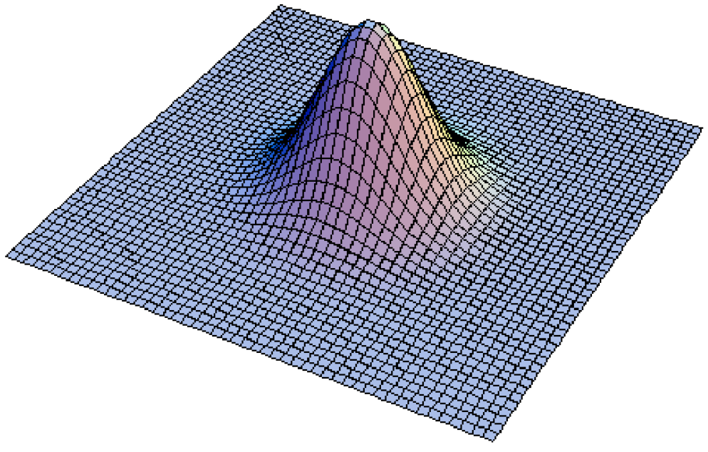

## 8.2 Getting to Know Your Higher Dimensional Fourier Transform

You already know a lot about the higher dimensional Fourier transform because you already know a lot about the one-dimensional Fourier transform — that’s the whole point. Still, it’s useful to collect a few of the basic facts. If some result corresponding to the one-dimensional case isn’t mentioned here, that doesn’t mean it doesn’t hold, or isn’t worth mentioning — it only means that the following is a very quick and very partial survey. Sometimes we’ll work in $\mathbf{R}^n$, for any $n$, and sometimes just in $\mathbf{R}^2$; nothing should be read into this for or against $n = 2$.

### 8.2.1 Linearity

Linearity is obvious:

$$
\mathcal{F}(\alpha f + \beta g)(\boldsymbol{\xi}) = \alpha\mathcal{F}f(\boldsymbol{\xi}) + \beta\mathcal{F}g(\boldsymbol{\xi})\,.
$$

### 8.2.2 Shifts

In one dimension a shift in time corresponds to a phase change in frequency. The statement of this is the shift theorem:

- If $f(x) \rightleftharpoons F(s)$ then $f(x \pm b) \rightleftharpoons e^{\pm 2\pi isb}F(s)$.

It looks a little slicker (to me) if we use the delay operator $(\tau_b f)(x) = f(x - b)$, for then we can write

$$
\mathcal{F}(\tau_b f)(s) = e^{-2\pi isb}\mathcal{F}f(s)\,.
$$

(Remember, $\tau_b$ involves $-b$.) Each to their own taste.

The shift theorem in higher dimensions can be made to look just like it does in the one-dimensional case. Suppose that a point $\mathbf{x} = (x_1, x_2, \dots, x_n)$ is shifted by a displacement $\mathbf{b} = (b_1, b_2, \dots, b_n)$ to $\mathbf{x} + \mathbf{b} = (x_1 + b_1, x_2 + b_2, \dots, x_n + b_n)$. Then the effect on the Fourier transform is:

- **The Shift Theorem** If $f(\mathbf{x}) \rightleftharpoons F(\boldsymbol{\xi})$ then $f(\mathbf{x} \pm \mathbf{b}) \rightleftharpoons e^{\pm 2\pi i\mathbf{b}\cdot\boldsymbol{\xi}}F(\boldsymbol{\xi})$.

Vectors replace scalars and the dot product replaces multiplication, but the formulas look much the same.

Again we can introduce the delay operator, this time “delaying” by a vector:

$$
\tau_{\mathbf{b}} f(\mathbf{x}) = f(\mathbf{x} - \mathbf{b})\,,
$$

and the shift theorem then takes the form

$$
\mathcal{F}(\tau_{\mathbf{b}} f)(\boldsymbol{\xi}) = e^{-2\pi i\mathbf{b}\cdot\boldsymbol{\xi}}\mathcal{F}f(\boldsymbol{\xi})\,.
$$

(Remember, $\tau_{\mathbf{b}}$ involves a $-\mathbf{b}$.) Each to their own taste, again.

If you’re more comfortable writing things out in coordinates, the result, in two dimensions, would read:

$$
\mathcal{F}f(x_1 \pm b_1, x_2 \pm b_2) = e^{2\pi i(\pm\xi_1b_1 \pm \xi_2b_2)}\mathcal{F}f(\xi_1, \xi_2)\,.
$$

The only advantage in writing it out this way (and you certainly wouldn’t do so for any dimension higher than two) is a more visible reminder that in shifting $(x_1, x_2)$ to $(x_1 \pm b_1, x_2 \pm b_2)$ we shift the variables independently, so to speak. This independence is also (more) visible in the Fourier transform if we break up the dot product and multiply the exponentials:

$$
\mathcal{F}f(x_1 \pm b_1, x_2 \pm b_2) = e^{\pm 2\pi i\xi_1b_1} e^{\pm 2\pi i\xi_2b_2}\mathcal{F}f(\xi_1, \xi_2)\,.
$$

The derivation of the shift theorem is pretty much as in the one-dimensional case, but let me show you how the change of variable works. We’ll do this for $n = 2$, and, yes, we’ll write it out in coordinates. Let’s just take the case when we’re adding $b_1$ and $b_2$. First off

$$
\mathcal{F}(f(x_1 + b_2, x_2 + b_2)) = \int_{-\infty}^{\infty}\int_{-\infty}^{\infty} e^{-2\pi i(x_1\xi_1 + x_2\xi_2)} f(x_1 + b_1, x_2 + b_2)\,dx_1\,dx_2
$$

We want to make a change of variable, turning $f(x_1 + b_1, x_2 + b_2)$ into $f(u, v)$ by the substitutions $u = x_1 + b_1$ and $v = x_2 + b_2$ (or equivalently $x_1 = u - b_1$ and $x_2 = v - b_2$). You have two choices at this point. The general change of variables formula for a multiple integral (stay with it for just a moment) immediately produces.

$$
\begin{aligned}
&\int_{-\infty}^{\infty}\int_{-\infty}^{\infty} e^{-2\pi i(x_1\xi_1 + x_2\xi_2)} f(x_1 + b_1, x_2 + b_2)\,dx_1\,dx_2 \\
&\qquad = \int_{-\infty}^{\infty}\int_{-\infty}^{\infty} e^{-2\pi i((u - b_1)\xi_1 + (v - b_2)\xi_2)} f(u, v)\,du\,dv \\
&\qquad = \int_{-\infty}^{\infty}\int_{-\infty}^{\infty} e^{2\pi ib_1\xi_1} e^{2\pi ib_2\xi_2} e^{-2\pi i(u\xi_2 + v\xi_2)} f(u, v)\,du\,dv \\
&\qquad = e^{2\pi i(b_1\xi_1 + b_2\xi_2)}\int_{-\infty}^{\infty}\int_{-\infty}^{\infty} e^{-2\pi i(u\xi_2 + v\xi_2)} f(u, v)\,du\,dv \\
&\qquad = e^{2\pi i(b_1\xi_1 + b_2\xi_2)}\mathcal{F}f(\xi_1, \xi_2)\,,
\end{aligned}
$$

and there’s our formula.

If you know the general change of variables formula then the shift formula *and* its derivation really are just like the one-dimensional case, but this doesn’t do you much good if you don’t know the change of variables formula for a multiple integral. So, for completeness, let me show you an alternative derivation that works because the change of variables $u = x_1 + b_1$, $v = x_2 + b_2$ changes $x_1$ and $x_2$ separately.

$$
\begin{aligned}
\mathcal{F}f(x_1 + b_2, x_2 + b_2) &= \int_{-\infty}^{\infty}\int_{-\infty}^{\infty} e^{-2\pi i(x_1\xi_1 + x_2\xi_2)} f(x_1 + b_1, x_2 + b_2)\,dx_1\,dx_2 \\
&= \int_{-\infty}^{\infty} e^{2\pi ix_1\xi_1}\left(\int_{-\infty}^{\infty} e^{2\pi ix_2\xi_2} f(x_1 + b_1, x_2 + b_2)\,dx_2\right)dx_1 \\
&= \int_{-\infty}^{\infty} e^{2\pi ix_1\xi_1}\left(\int_{-\infty}^{\infty} e^{-2\pi i(v - b_2)\xi_2} f(x_1 + b_1, v)\,dv\right)dx_1 \\
&\phantom{=}\ \text{(substituting } v = x_2 + b_2\text{)} \\
&= e^{2\pi ib_2\xi_2}\int_{-\infty}^{\infty} e^{-2\pi ix_1\xi_1}\left(\int_{-\infty}^{\infty} e^{-2\pi iv\xi_2} f(x_1 + b_1, v)\,dv\right)dx_1 \\
&= e^{2\pi ib_2\xi_2}\int_{-\infty}^{\infty} e^{-2\pi iv\xi_2}\left(\int_{-\infty}^{\infty} e^{-2\pi ix_1\xi_1} f(x_1 + b_1, v)\,dx_1\right)dv \\
&= e^{2\pi ib_2\xi_2}\int_{-\infty}^{\infty} e^{-2\pi iv\xi_2}\left(\int_{-\infty}^{\infty} e^{-2\pi i(u - b_1)\xi_1} f(u, v)\,du\right)dv \\
&\phantom{=}\ \text{(substituting } u = x_1 + b_1\text{)} \\
&= e^{2\pi ib_2\xi_2} e^{2\pi ib_1\xi_1}\int_{-\infty}^{\infty} e^{-2\pi iv\xi_2}\left(\int_{-\infty}^{\infty} e^{-2\pi iu\xi_1} f(u, v)\,du\right)dv \\
&= e^{2\pi ib_2\xi_2} e^{2\pi ib_1\xi_1}\int_{-\infty}^{\infty}\int_{-\infty}^{\infty} e^{-2\pi i(u\xi_1 + v\xi_2)} f(u, v)\,du\,dv \\
&= e^{2\pi ib_2\xi_2} e^{2\pi ib_1\xi_1}\,\mathcal{F}f(\xi_1, \xi_2) \\
&= e^{2\pi i(b_2\xi_2 + b_1\xi_1)}\,\mathcal{F}f(\xi_1, \xi_2)\,.
\end{aligned}
$$

And there’s our formula, again.

The good news is, we’ve certainly derived the shift theorem! The bad news is, you may be saying to yourself: “This is not what I had in mind when you said the higher dimensional case is just like the one-dimensional case.” I don’t have a quick comeback to that, except that I’m trying to make honest statements about the similarities and the differences in the two cases and, if you want, you can assimilate the formulas and just skip those derivations in the higher dimensional case that bug your sense of simplicity. I will too, mostly.

### 8.2.3 Stretches

There’s really only one stretch theorem in higher dimensions, but I’d like to give two versions of it. The first version can be derived in a manner similar to what we did for the shift theorem, making separate changes of variable. This case comes up often enough that it’s worth giving it its own moment in the sun. The second version (which includes the first) needs the general change of variables formula for the derivation.

- **Stretch Theorem, first version**

  $$
  \mathcal{F}(f(a_1x_1, a_2x_2)) = \frac{1}{|a_1||a_2|}\mathcal{F}(f)\left(\frac{\xi_1}{a_1}, \frac{\xi_2}{a_2}\right).
  $$

  There is an analogous statement in higher dimensions.

I’ll skip the derivation.

---

The reason that there’s a second version of the stretch theorem is because there’s something new that can be done by way of transformations in higher dimensions that doesn’t come up in the one-dimensional setting. We can look at a *linear change of variables* in the spatial domain. In two dimensions we write this as

$$
\begin{pmatrix} u_1 \\ u_2 \end{pmatrix} = \begin{pmatrix} a & b \\ c & d \end{pmatrix}\begin{pmatrix} x_1 \\ x_2 \end{pmatrix}
$$

or, written out,

$$
\begin{aligned}
u_1 &= ax_1 + bx_2 \\
u_2 &= cx_1 + dx_2
\end{aligned}
$$

The simple, “independent” stretch is the special case

$$
\begin{pmatrix} u_1 \\ u_2 \end{pmatrix} = \begin{pmatrix} a_1 & 0 \\ 0 & a_2 \end{pmatrix}\begin{pmatrix} x_1 \\ x_2 \end{pmatrix}.
$$

For a general linear transformation the coordinates can get mixed up together instead of simply changing independently.

A linear change of coordinates is not at all an odd a thing to do — think of linearly distorting an image, for whatever reason. Think also of rotation, which we’ll consider below. Finally, a linear transformation as a linear change of coordinates isn’t much good if you can’t change the coordinates back. Thus it’s natural to work only with invertible transformations here, i.e., those for which $\det A \ne 0$.

The general stretch theorem answers the question of what happens to the spectrum when the spatial coordinates change linearly — what is $\mathcal{F}(f(u_1, u_2)) = \mathcal{F}(f(ax_1 + bx_2, cx_1 + dx_2))$? The nice answer is most compactly expressed in matrix notation, in fact just as easily for $n$ dimensions as for two. Let $A$ be an $n \times n$ *invertible* matrix. We introduce the notation

$$
A^{-\mathsf{T}} = (A^{-1})^{\mathsf{T}}\,,
$$

the transpose of the inverse of $A$. You can check that also $A^{-\mathsf{T}} = (A^{\mathsf{T}})^{-1}$, i.e., $A^{-\mathsf{T}}$ can be defined either as the transpose of the inverse or as the inverse of the transpose. ($A^{-\mathsf{T}}$ will also come up naturally when we apply the Fourier transform to lattices and “reciprocal lattices”, i.e., to crystals.)

We can now state:

- **Stretch Theorem, general version**

  $$
  \mathcal{F}(f(A\mathbf{x})) = \frac{1}{|\det A|}\mathcal{F}f(A^{-\mathsf{T}}\boldsymbol{\xi})\,.
  $$

There’s another way of writing this that you might prefer, depending (as always) on your tastes. Using $\det A^{\mathsf{T}} = \det A$ and $\det A^{-1} = 1/\det A$ we have

$$
\frac{1}{|\det A|} = |\det A^{-\mathsf{T}}|
$$

so the formula reads

$$
\mathcal{F}(f(A\mathbf{x})) = |\det A^{-\mathsf{T}}|\,\mathcal{F}f(A^{-\mathsf{T}}\boldsymbol{\xi})\,.
$$

Finally, I’m of a mind to introduce the general *scaling* operator defined by

$$
(\sigma_A f)(\mathbf{x}) = f(A\mathbf{x})\,,
$$

where $A$ is an invertible $n \times n$ matrix. Then I’m of a mind to write

$$
\mathcal{F}(\sigma_A f)(\boldsymbol{\xi}) = \frac{1}{|\det A|}\mathcal{F}f(A^{-\mathsf{T}}\boldsymbol{\xi})\,.
$$

Your choice. I’ll give a derivation of the general stretch theorem in Section 8.2.7.

---

Let’s look at the two-dimensional case in a little more detail. To recover the first version of the stretch theorem we apply the general version to the diagonal matrix

$$
A = \begin{pmatrix} a_1 & 0 \\ 0 & a_2 \end{pmatrix} \quad\text{with}\quad \det A = a_1a_2 \ne 0\,.
$$

Then

$$
A^{-1} = \begin{pmatrix} 1/a_1 & 0 \\ 0 & 1/a_2 \end{pmatrix} \;\Rightarrow\; A^{-\mathsf{T}} = \begin{pmatrix} 1/a_1 & 0 \\ 0 & 1/a_2 \end{pmatrix}.
$$

This gives

$$
\mathcal{F}(f(a_1x_1, a_2x_2)) = \mathcal{F}(f(A\mathbf{x})) = \frac{1}{|\det A|}\mathcal{F}f(A^{-\mathsf{T}}\boldsymbol{\xi}) = \frac{1}{|a_1||a_2|}\mathcal{F}f\left(\frac{\xi_1}{a_1}, \frac{\xi_2}{a_2}\right).
$$

Works like a charm.

---

An important special case of the stretch theorem is when $A$ is a rotation matrix:

$$
A = \begin{pmatrix} \cos\theta & -\sin\theta \\ \sin\theta & \cos\theta \end{pmatrix}
$$

A rotation matrix is *orthogonal*, meaning that $AA^{\mathsf{T}} = I$:

$$
AA^{\mathsf{T}} = \begin{pmatrix} \cos\theta & -\sin\theta \\ \sin\theta & \cos\theta \end{pmatrix}\begin{pmatrix} \cos\theta & \sin\theta \\ -\sin\theta & \cos\theta \end{pmatrix} = \begin{pmatrix} \cos^2\theta + \sin^2\theta & 0 \\ 0 & \cos^2\theta + \sin^2\theta \end{pmatrix} = \begin{pmatrix} 1 & 0 \\ 0 & 1 \end{pmatrix}.
$$

Thus $A^{-1} = A^{\mathsf{T}}$ so that

$$
A^{-\mathsf{T}} = (A^{-1})^{\mathsf{T}} = (A^{\mathsf{T}})^{\mathsf{T}} = A\,.
$$

Also

$$
\det A = \cos^2\theta + \sin^2\theta = 1\,.
$$

The consequence of all of this for the Fourier transform is that if $A$ is a rotation matrix then

$$
\mathcal{F}(f(A\mathbf{x})) = \mathcal{F}f(A\boldsymbol{\xi}),.
$$

In words:

- A rotation in the spatial domain corresponds to an identical rotation in the frequency domain.

This result is used all the time in imaging problems.

---

Finally, it’s worth knowing that for a $2 \times 2$ matrix we can write down $A^{-\mathsf{T}}$ explicitly:

$$
\begin{pmatrix} a & b \\ c & d \end{pmatrix}^{-1} = \frac{1}{\det A}\begin{pmatrix} d & -b \\ -c & a \end{pmatrix} \quad\text{so the transpose of this is}\quad \begin{pmatrix} a & b \\ c & d \end{pmatrix}^{-\mathsf{T}} = \frac{1}{\det A}\begin{pmatrix} d & -c \\ -b & a \end{pmatrix}
$$

This jibes with what we found for a rotation matrix.

**The indicator function for a parallelogram** As an exercise in using the stretch theorem you can show the following. Consider a parallelogram centered at $(0, 0)$:

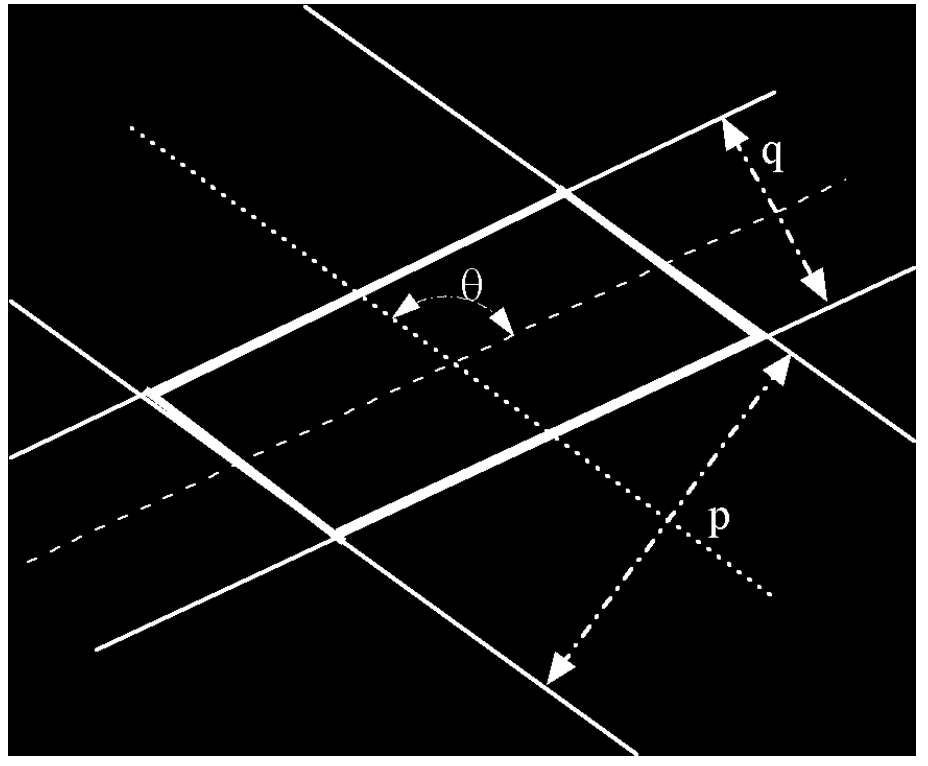

One set of data that describes the parallelogram are the distances between sides, $p$ and $q$, and the vectors that give the directions of the sides. Let $\mathbf{u}$ be a unit vector in the direction of the sides that are $p$ apart and let $\mathbf{v}$ be a unit vector in the direction of the sides that are $q$ apart.

The *indicator* function $P$ for the parallelogram is the function that is equal to 1 on the parallelogram and equal to 0 outside the parallelogram. The Fourier transform of $P$ can be shown to be

$$
\mathcal{F}P(\boldsymbol{\xi}) = \frac{pq}{|\sin\theta|}\operatorname{sinc}\left(\frac{p(\mathbf{u}\cdot\boldsymbol{\xi})}{\sin\theta}\right)\operatorname{sinc}\left(\frac{q(\mathbf{v}\cdot\boldsymbol{\xi})}{\sin\theta}\right).
$$

**Shift and stretch** As an example of using the general formula, let’s combine a shift with a stretch and show:

$$
\mathcal{F}(f(A\mathbf{x} + \mathbf{b})) = \exp(2\pi i\mathbf{b}\cdot A^{-\mathsf{T}}\boldsymbol{\xi})\frac{1}{|\det A|}\mathcal{F}f(A^{-\mathsf{T}}\boldsymbol{\xi})
$$

(I think the exponential is a little crowded to write it as $e$ to a power here.) Combining shifts and stretches seems to cause a lot of problems for people (even in one dimension), so let me do this in several ways.

As a first approach, and to keep the operations straight, write

$$
g(\mathbf{x}) = f(\mathbf{x} + b)\,,
$$

and then

$$
f(A\mathbf{x} + b) = g(A\mathbf{x})\,.
$$

Using the stretch theorem first,

$$
\mathcal{F}(g(A\mathbf{x})) = \frac{1}{|\det A|}\mathcal{F}g(A^{-\mathsf{T}}\boldsymbol{\xi})
$$

Applying the shift theorem next gives

$$
(\mathcal{F}g)(A^{-\mathsf{T}}\boldsymbol{\xi}) = \exp(2\pi i\mathbf{b}\cdot A^{-\mathsf{T}}\boldsymbol{\xi})\mathcal{F}f((A^{-\mathsf{T}}\boldsymbol{\xi})\,.
$$

Putting these together gives the final formula for $\mathcal{F}(f(A\mathbf{x} + \mathbf{b}))$.

Another way around is instead to write

$$
g(\mathbf{x}) = f(A\mathbf{x})
$$

and then

$$
f(A\mathbf{x} + \mathbf{b}) = f(A(\mathbf{x} + A^{-1}\mathbf{b})) = g(\mathbf{x} + A^{-1}\mathbf{b})\,.
$$

Now use the shift theorem first to get

$$
\mathcal{F}(g(\mathbf{x} + A^{-1}\mathbf{b})) = \exp(2\pi iA^{-1}\mathbf{b}\cdot\boldsymbol{\xi})\,(\mathcal{F}g)(\boldsymbol{\xi}) = \exp(2\pi i\mathbf{b}\cdot A^{-\mathsf{T}}\boldsymbol{\xi})\,(\mathcal{F}g)(\boldsymbol{\xi})\,.
$$

The stretch theorem comes next and it produces

$$
\mathcal{F}g(\boldsymbol{\xi}) = \mathcal{F}(f(A\mathbf{x})) = \frac{1}{|\det A|}\mathcal{F}f(A^{-\mathsf{T}}\boldsymbol{\xi})\,.
$$

This agrees with what we had before, as if there was any doubt.

Finally, by popular demand, I do this one more time by expressing $f(A\mathbf{x} + \mathbf{b})$ using the delay and scaling operators. It’s a question of which comes first, and parallel to the first derivation above we can write:

$$
f(A\mathbf{x} + \mathbf{b}) = \sigma_A(\tau_{-\mathbf{b}}f)(\mathbf{x}) = (\sigma_A\tau_{-\mathbf{b}}f)(\mathbf{x})\,,
$$

which we verify by

$$
(\sigma_A\tau_{-\mathbf{b}}f)(\mathbf{x}) = (\tau_{-\mathbf{b}}f)(A\mathbf{x}) = f(A\mathbf{x} + \mathbf{b})\,.
$$

And now we have

$$
\mathcal{F}(\sigma_A(\tau_{-\mathbf{b}}f))(\boldsymbol{\xi}) = \frac{1}{|\det A|}\mathcal{F}(\tau_{-\mathbf{b}}f)(A^{-\mathsf{T}}\boldsymbol{\xi}) = \frac{1}{|\det A|}\exp(2\pi iA^{-\mathsf{T}}\boldsymbol{\xi}\cdot\mathbf{b})\mathcal{F}f(A^{-\mathsf{T}}\boldsymbol{\xi})\,.
$$

I won’t give a second version of the second derivation.

### 8.2.4 Convolution

What about convolution? For two real-valued functions $f$ and $g$ on $\mathbf{R}^n$ the definition is

$$
(f * g)(\mathbf{x}) = \int_{\mathbf{R}^n} f(\mathbf{x} - \mathbf{y})g(\mathbf{y})\,d\mathbf{y}\,.
$$

Written out in coordinates this looks much more complicated. For $n = 2$, for example,

$$
(f * g)(x_1, x_2) = \int_{-\infty}^{\infty}\int_{-\infty}^{\infty} f(x_1 - y_1, x_2 - y_2)g(y_1, y_2)\,dy_1\,dy_2\,.
$$

The intelligent person would not write out the corresponding coordinatized formula for higher dimensions unless absolutely pressed. The intelligent person would also not try too hard to flip, drag or otherwise visualize a convolution in higher dimensions. The intelligent person would be happy to learn, however, that once again

$$
\mathcal{F}(f * g)(\boldsymbol{\xi}) = \mathcal{F}f(\boldsymbol{\xi})\mathcal{F}g(\boldsymbol{\xi}) \quad\text{and}\quad \mathcal{F}(fg)(\boldsymbol{\xi}) = (\mathcal{F}f * \mathcal{F}g)(\boldsymbol{\xi})\,.
$$

The typical interpretations of convolution — smoothing, averaging, etc. — continue to apply, when applied by an intelligent person.

### 8.2.5 A little $\delta$ now, more later

We’ll see that things get more interesting in higher dimensions for delta functions, but the definition of the plain vanilla $\delta$ is the same as before. To give the distributional definition, I’ll pause, just for a moment, to define what it means for a function of several variables to be a Schwartz function.

**Schwartz functions** The theory and practice of tempered distributions works the same in higher dimensions as it does in one. The basis of the treatment is via the Schwartz functions as the class of test functions. The condition that a function of several variables be rapidly decreasing is that all partial derivatives (including mixed partial derivatives) decrease faster than any power of any of the coordinates. This can be stated in any number of equivalent forms. One way is to require that

$$
|\mathbf{x}|^p\,|\partial^q\varphi(\mathbf{x})| \to 0 \quad\text{as}\quad |\mathbf{x}| \to \infty\,.
$$

I’ll explain the funny notation — it’s an example of the occasional awkwardness that sets in when writing formulas in higher dimensions. $p$ is a positive integer, so that just gives a power of $|\mathbf{x}|$, and $q$ is a *multi-index*. This means that $q = (q_1, \dots, q_n)$, each $q_i$ a positive integer, so that $\partial^q$ is supposed to mean

$$
\frac{\partial^{q_1 + \cdots + q_n}}{(\partial x_1)^{q_1}(\partial x_2)^{q_2}\cdots(\partial x_n)^{q_n}}\,.
$$

There’s no special font used to indicate multi-indices — you just have to intuit it.

From here, the definitions of tempered distributions, the Fourier transform of a tempered distribution, and everything else, goes through just as before. Shall we leave it alone? I thought so.

**$\delta$ in higher dimensions** The $\delta$-function is the distribution defined by the pairing

$$
\langle\delta, \varphi\rangle = \varphi(0, \dots, 0) \quad\text{or}\quad \langle\delta, \varphi\rangle = \varphi(\mathbf{0}) \quad\text{in vector notation}
$$

where $\varphi(x_1, , \dots, x_n)$ is a Schwartz function.[^8-6] As is customary, we also write this in terms of integration as:

[^8-6]: Actually, $\delta$ is in a larger class than the tempered distributions. It is defined by the pairing $\langle\delta, \varphi\rangle = \varphi(0)$ when $\varphi$ is any smooth function of compact support.

$$
\int_{\mathbf{R}^n} \varphi(\mathbf{x})\delta(\mathbf{x})\,d\mathbf{x} = \varphi(\mathbf{0})
$$

You can show that $\delta$ is even as a distribution (once you’ve reminded yourself what it means for a distribution to be even).

As before, one has

$$
f(\mathbf{x})\delta(\mathbf{x}) = f(\mathbf{0})\delta(\mathbf{x})\,,
$$

when $f$ is a smooth function, and for convolution

$$
(f * \delta)(\mathbf{x}) = f(\mathbf{x})\,.
$$

The shifted delta function $\delta(\mathbf{x} - \mathbf{b}) = \delta(x_1 - b_1, x_2 - b_2, , \dots, x_n - b_n)$ or $\delta_{\mathbf{b}} = \tau_{\mathbf{b}}\delta$, has the corresponding properties

$$
f(\mathbf{x})\delta(\mathbf{x} - \mathbf{b}) = f(\mathbf{b})\delta(\mathbf{x} - \mathbf{b}) \quad\text{and}\quad f * \delta(\mathbf{x} - \mathbf{b}) = f(\mathbf{x} - \mathbf{b})\,.
$$

In some cases it is useful to know that we can “factor” the delta function into one-dimensional deltas, as in

$$
\delta(x_1, x_2, \dots, x_n) = \delta_1(x_1)\delta_2(x_2)\cdots\delta_n(x_n)\,.
$$

I’ve put subscripts on the $\delta$’s on the right hand side just to tag them with the individual coordinates — there are some advantages in doing this. Though it remains true, as a general rule, that multiplying distributions is not (and cannot be) defined, this is one case where it makes sense. The formula holds because of how each side acts on a Schwartz function.[^8-7] Let’s just check this in the two-dimensional case, and play a little fast and loose by writing the pairing as an integral. Then, on the one hand,

[^8-7]: The precise way to do this is through the use of tensor products of distributions, something we have not discussed, and will not.

$$
\int_{\mathbf{R}^2} \varphi(\mathbf{x})\delta(\mathbf{x})\,d\mathbf{x} = \varphi(0, 0)
$$

by definition of the 2-dimensional delta function. On the other hand,

$$
\begin{aligned}
\int_{\mathbf{R}^2} \varphi(x_1, x_2)\delta_1(x_1)\delta_2(x_2)\,dx_1\,dx_2 &= \int_{-\infty}^{\infty}\left(\int_{-\infty}^{\infty} \varphi(x_1, x_2)\delta_1(x_1)\,dx_1\right)\delta_2(x_2)\,dx_2 \\
&= \int_{-\infty}^{\infty} \varphi(0, x_2)\delta_2(x_2)\,dx_2 = \varphi(0, 0).
\end{aligned}
$$

So $\delta(x_1, x_2)$ and $\delta_1(x_1)\delta_2(x_2)$ have the same effect when integrated against a test function.

**The Fourier transform of $\delta$** And finally — the Fourier transform of the delta function is, of course, 1 (that’s the constant function 1). The argument is the same as in the one-dimensional case. By duality, the Fourier transform of 1 is $\delta$. One can then shift to get

$$
\delta(\mathbf{x} - \mathbf{b}) \rightleftharpoons e^{-2\pi i\mathbf{b}\cdot\boldsymbol{\xi}} \quad\text{or}\quad \mathcal{F}\delta_{\mathbf{b}} = e^{-2\pi i\mathbf{b}\cdot\boldsymbol{\xi}}\,.
$$

You can now see (again) where those symmetrically paired dots come from in looking at the spectral picture for alternating black and white stripes. It comes from the Fourier transforms of $\cos(2\pi\,\mathbf{x}\cdot\boldsymbol{\xi}_0) = \operatorname{Re}\exp(2\pi i\,\mathbf{x}\cdot\boldsymbol{\xi}_0)$ for $\boldsymbol{\xi}_0 = (\xi_1, 0)$, $\boldsymbol{\xi}_0 = (0, \xi_2)$, and $\boldsymbol{\xi}_0 = (\xi_3, \xi_3)$, since

$$
\mathcal{F}\cos(2\pi\,\mathbf{x}\cdot\boldsymbol{\xi}_0) = \tfrac{1}{2}(\delta(\boldsymbol{\xi} - \boldsymbol{\xi}_0) + \delta(\boldsymbol{\xi} + \boldsymbol{\xi}_0))\,.
$$

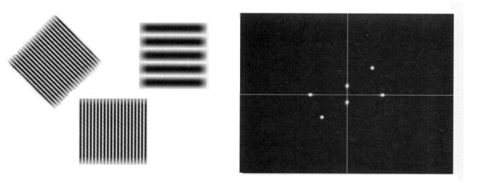

**Scaling delta functions** Recall how a one-dimensional delta function scales:

$$
\delta(ax) = \frac{1}{|a|}\delta(x)\,.
$$

Writing a higher dimensional delta function as a product of one-dimensional delta functions we get a corresponding formula. In two dimensions:

$$
\begin{aligned}
\delta(a_1x_1, a_2x_2) &= \delta_1(a_1x_1)\delta_2(a_2x_2) \\
&= \frac{1}{|a_1|}\delta_1(x_1)\frac{1}{|a_2|}\delta_2(x_2) \\
&= \frac{1}{|a_1|\,|a_2|}\delta_1(x_1)\delta_2(x_2) = \frac{1}{|a_1a_2|}\delta(x_1, x_2),
\end{aligned}
$$

and in $n$-dimensions

$$
\delta(a_1x_1, \dots, a_nx_n) = \frac{1}{|a_1\cdots a_n|}\delta(x_1, \dots, x_n)\,.
$$

---

It’s also possible (and useful) to consider $\delta(A\mathbf{x})$ when $A$ is an invertible matrix. The result is

$$
\delta(A\mathbf{x}) = \frac{1}{|\det A|}\delta(\mathbf{x})\,.
$$

See Section 8.2.7 for a derivation of this. This formula bears the same relationship to the preceding formula as the general stretch theorem bears to the first version of the stretch theorem.

### 8.2.6 The Fourier transform of a radial function

For use in many applications, we’re going to consider one further aspects of the 2-dimensional case. A function on $\mathbf{R}^2$ is *radial* (also called *radially symmetric* or *circularly symmetric*) if it depends only on the distance from the origin. In polar coordinates the distance from the origin is denoted by $r$, so to say that a function is radial is to say that it depends only on $r$ (and that it does not depend on $\theta$, writing the usual polar coordinates as $(r, \theta)$).

The definition of the Fourier transform is set up in Cartesian coordinates, and it’s clear that we’ll be better off writing it in polar coordinates if we work with radial functions. This is actually *not* so straightforward, or, at least, it involves introducing some special functions to write the formulas in a compact way.

We have to convert

$$
\int_{\mathbf{R}^2} e^{-2\pi i\mathbf{x}\cdot\boldsymbol{\xi}} f(\mathbf{x})\,d\mathbf{x} = \int_{-\infty}^{\infty}\int_{-\infty}^{\infty} e^{-2\pi i(x_1\xi_1 + x_2\xi_2)} f(x_1, x_2)\,dx_1\,dx_2
$$

to polar coordinates. There are several steps: To say that $f(\mathbf{x})$ is a radial function means that it becomes $f(r)$. To describe all of $\mathbf{R}^2$ in the limits of integration, we take $r$ going from 0 to $\infty$ and $\theta$ going from 0 to $2\pi$. The area element $dx_1\,dx_2$ becomes $r\,dr\,d\theta$. Finally, the problem is the inner product $\mathbf{x}\cdot\boldsymbol{\xi} = x_1\xi_1 + x_2\xi_2$ in the exponential and how to write it in polar coordinates. If we identify $(x_1, x_2) = (r, \theta)$ (varying over the $(x_1, x_2)$-plane) and put $(\xi_1, \xi_2) = (\rho, \phi)$ (fixed in the integral) then

$$
\mathbf{x}\cdot\boldsymbol{\xi} = \|\mathbf{x}\|\,\|\boldsymbol{\xi}\|\cos(\theta - \phi) = r\rho\cos(\theta - \phi)\,.
$$

The Fourier transform of $f$ is thus

$$
\int_{-\infty}^{\infty}\int_{-\infty}^{\infty} e^{-2\pi i\mathbf{x}\cdot\boldsymbol{\xi}} f(\mathbf{x})\,d\mathbf{x} = \int_0^{2\pi}\int_0^{\infty} f(r)e^{-2\pi ir\rho\cos(\theta - \phi)}\,r\,dr\,d\theta\,.
$$

There’s more to be done. First of all, because $e^{-2\pi ir\rho\cos(\theta - \phi)}$ is periodic (in $\theta$) of period $2\pi$, the integral

$$
\int_0^{2\pi} e^{-2\pi ir\rho\cos(\theta - \phi)}\,d\theta
$$

*does not depend on $\phi$*.[^8-8] Consequently,

[^8-8]: We’ve applied this general fact implicitly or explicitly on earlier occasions when working with periodic functions, namely if $g$ is periodic with period $2\pi$ then
    $$
    \int_0^{2\pi} g(\theta - \phi)\,d\theta = \int_0^{2\pi} g(\theta)\,d\theta
    $$
    Convince yourself of this; for instance let $G(\phi) = \int_0^{2\pi} g(\theta - \phi)\,d\theta$ and show that $G''(\phi) \equiv 0$. Hence $G(\phi)$ is constant, so $G(\phi) = G(0)$.

$$
\int_0^{2\pi} e^{-2\pi ir\rho\cos(\theta - \phi)}\,d\theta = \int_0^{2\pi} e^{-2\pi ir\rho\cos\theta}\,d\theta\,.
$$

The next step is to define ourselves out of trouble. We introduce the function

$$
J_0(a) = \frac{1}{2\pi}\int_0^{2\pi} e^{-ia\cos\theta}\,d\theta\,.
$$

We give this integral a name, $J_0(a)$, because, try as you might, there is no simple closed form expression for it, so we take the integral as defining a new function. It is called the zero order Bessel function of the first kind. Sorry, but Bessel functions, of whatever order and kind, always seem to come up in problems involving circular symmetry; ask any physicist.

Incorporating $J_0$ into what we’ve done,

$$
\int_0^{2\pi} e^{-2\pi ir\rho\cos\theta}\,d\theta = 2\pi J_0(2\pi r\rho)
$$

and the Fourier transform of $f(r)$ is

$$
2\pi\int_0^{\infty} f(r)J_0(2\pi r\rho)\,r\,dr
$$

Let’s summarize:

- If $f(\mathbf{x})$ is a radial function then its Fourier transform is

  $$
  F(\rho) = 2\pi\int_0^{\infty} f(r)J_0(2\pi r\rho)\,r\,dr
  $$

- In words, the important conclusion to take away from this is that the Fourier transform of a radial function is also radial.

The formula for $F(\rho)$ in terms of $f(r)$ is sometimes called the zero order *Hankel transform* of $f(r)$ but, again, we understand that it is nothing other than the Fourier transform of a radial function.

**Circ and Jinc** A useful radial function to define, sort of a radially symmetric analog of the rectangle function, is

$$
\operatorname{circ}(r) = \begin{cases} 1 & r < 1 \\ 0 & r \ge 1 \end{cases}
$$

(And one can argue about the value at the rim $r = 1$.) Here’s the graph.

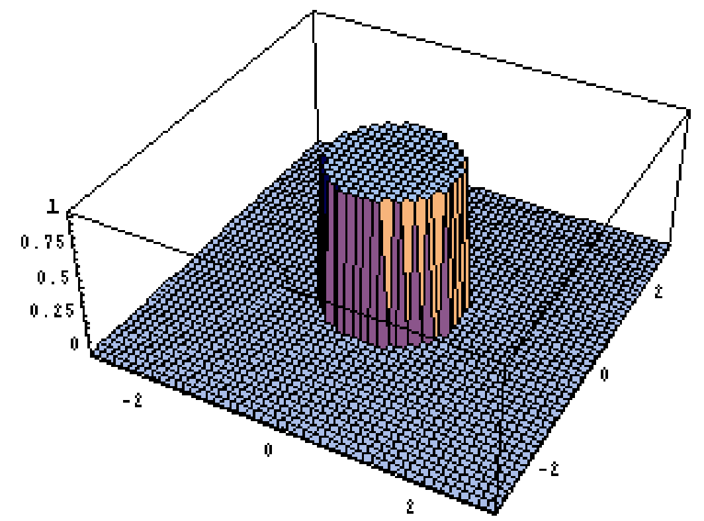

For its Fourier transform the limits of integration on $r$ go only from 0 to 1, and so we have simply

$$
\mathcal{F}\operatorname{circ}(\rho) = 2\pi\int_0^1 J_0(2\pi r\rho)\,r\,dr\,.
$$

We make a change of variable, $u = 2\pi r\rho$. Then $du = 2\pi\rho\,dr$ and the limits of integration go from $u = 0$ to $u = 2\pi\rho$. The integral becomes

$$
\mathcal{F}\operatorname{circ}(\rho) = \frac{1}{2\pi\rho^2}\int_0^{2\pi\rho} uJ_0(u)\,du\,.
$$

We write the integral this way because, you will now be ecstatic to learn, there is an identity that brings in the first-order Bessel function of the first kind. That identity goes

$$
\int_0^x uJ_0(u)\,du = xJ_1(x)\,.
$$

In terms of $J_1$ we can now write

$$
\mathcal{F}\operatorname{circ}(\rho) = \frac{J_1(2\pi\rho)}{\rho}
$$

It is customary to introduce the jinc function, defined by

$$
\operatorname{jinc}(\rho) = \frac{J_1(\pi\rho)}{2\rho}\,.
$$

In terms of this,

$$
\mathcal{F}\operatorname{circ}(\rho) = 4\operatorname{jinc}(2\rho)\,.
$$

The graph of $\mathcal{F}\operatorname{circ}$ is:

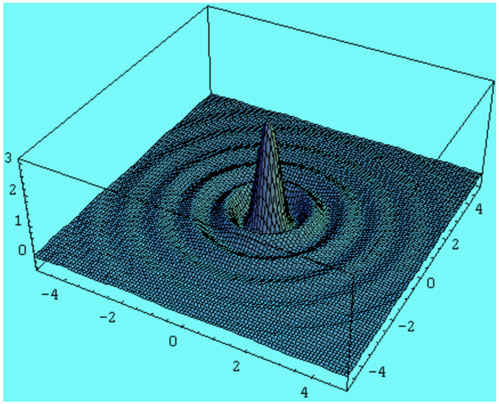

I could plot this because Bessel functions are so common (really) that they are built into many mathematical software packages, such as Matlab or Mathematica. If you think the jinc function looks like some kind of radially symmetric version of the sinc function you’d be right. But it’s not obvious just how one goes from sinc to jinc, and we’ll have to pass on this.[^8-9]

[^8-9]: There’s a symmetrization process at work involving repeated convolutions. I have notes on this. . .

### 8.2.7 A Derivation of the General Stretch Theorem

The general stretch theorem says that if $A$ is an invertible $n \times n$ matrix then

$$
\mathcal{F}(f(A\mathbf{x})) = \frac{1}{|\det A|}\mathcal{F}f(A^{-\mathsf{T}}\boldsymbol{\xi})\,.
$$

To derive this let’s start with the left hand side:

$$
\mathcal{F}(f(A\mathbf{x})) = \int_{\mathbf{R}^n} e^{-2\pi i\boldsymbol{\xi}\cdot\mathbf{x}} f(A\mathbf{x})\,d\mathbf{x}\,.
$$

Our object is to make a change of variable, $\mathbf{u} = A\mathbf{x}$. For this, we need to use the change of variables formula for multiple integrals. In the form we need it, we can state:

> If $A$ is an invertible $n \times n$ matrix and $\mathbf{u} = A\mathbf{x}$ then
>
> $$
> \int_{\mathbf{R}^n} g(A\mathbf{x})\,|\det A|\,d\mathbf{x} = \int_{\mathbf{R}^n} g(\mathbf{u})\,d\mathbf{u}\,.
> $$
>
> for an integrable function $g$.

Want to feel good (or at least OK) about this in a familiar setting? Take the case $n = 1$. Then

$$
\int_{-\infty}^{\infty} g(ax)\,|a|dx = \int_{-\infty}^{\infty} g(u)\,du\,,
$$

making the substitution $u = ax$. The transformation $u = ax$ of $\mathbf{R}$ scales lengths, and the scaling factor is $a$. ($du = a\,dx$). That’s if $a$ is positive; the absolute value of $a$ is in there in case $a$ is negative — thus “sense reversing”. In $n$-dimensions the transformation $\mathbf{u} = A\mathbf{x}$ scales $n$-dimensional *volumes*, and the scaling factor is $\det A$. ($d\mathbf{u} = \det A\,d\mathbf{x}$.) The absolute value $|\det A|$ is in there because a matrix $A$ with $\det A > 0$ is sense preserving on $\mathbf{R}^n$, and it is sense reversing if $\det A < 0$. Thus, in general,

$$
d\mathbf{u} = |\det A|\,d\mathbf{x}
$$

so the substitution $\mathbf{u} = A\mathbf{x}$ leads right to the formula

$$
\int_{\mathbf{R}^n} g(A\mathbf{x})\,|\det A|\,d\mathbf{x} = \int_{\mathbf{R}^n} g(\mathbf{u})\,d\mathbf{u}\,.
$$

To apply this to the Fourier transform of $f(A\mathbf{x})$ we have

$$
\begin{aligned}
\int_{\mathbf{R}^n} e^{-2\pi i\xi\cdot\mathbf{x}} f(A\mathbf{x})\,d\mathbf{x} &= \int_{\mathbf{R}^n} e^{-2\pi i\xi\cdot A^{-1}(A\mathbf{x})} f(A\mathbf{x})\frac{1}{|\det A|}|\det A|\,d\mathbf{x} \\
&= \frac{1}{|\det A|}\int_{\mathbf{R}^n} e^{-2\pi i\xi\cdot A^{-1}(A\mathbf{x})} f(A\mathbf{x})\,|\det A|\,d\mathbf{x} \quad \text{(now substitute } \mathbf{u} = A\mathbf{x}\text{)} \\
&= \frac{1}{|\det A|}\int_{\mathbf{R}^n} e^{-2\pi i\xi\cdot A^{-1}\mathbf{u}} f(\mathbf{u})\,d\mathbf{u}
\end{aligned}
$$

If you think this looks complicated *imagine* writing it out in coordinates!

Next we use an identity for what happens to the dot product when there’s a matrix operating on one of the vectors, namely, for a matrix $B$ and any vectors $\boldsymbol{\xi}$ and $\mathbf{u}$,

$$
\boldsymbol{\xi}\cdot B\mathbf{u} = B^{\mathsf{T}}\boldsymbol{\xi}\cdot\mathbf{u}\,.
$$

We take $B = A^{-1}$ and then

$$
\boldsymbol{\xi}\cdot A^{-1}\mathbf{u} = A^{-\mathsf{T}}\boldsymbol{\xi}\cdot\mathbf{u}\,.
$$

With this:

$$
\frac{1}{|\det A|}\int_{\mathbf{R}^n} e^{-2\pi i\xi\cdot A^{-1}\mathbf{u}} f(\mathbf{u})\,d\mathbf{u} = \frac{1}{|\det A|}\int_{\mathbf{R}^n} e^{-2\pi iA^{-\mathsf{T}}\xi\cdot\mathbf{u}} f(\mathbf{u})\,d\mathbf{u}.
$$

But this last integral is exactly $\mathcal{F}(f)(A^{-\mathsf{T}}\boldsymbol{\xi})$. We have shown that

$$
\mathcal{F}(f(A\mathbf{x})) = \frac{1}{|\det A|}\mathcal{F}(f)(A^{-\mathsf{T}}\boldsymbol{\xi})\,,
$$

as desired.

**Scaling the delta function** The change of variables formula also allows us to derive

$$
\delta(A\mathbf{x}) = \frac{1}{|\det A|}\delta(\mathbf{x})\,.
$$

Writing the pairing of $\delta(A\mathbf{x})$ with a test function $\varphi$ via integration —not strictly legit, but it helps to organize the calculation —leads to

$$
\begin{aligned}
\int_{\mathbf{R}^n} \delta(A\mathbf{x})\varphi(\mathbf{x})\,d\mathbf{x} &= \int_{\mathbf{R}^n} \delta(A\mathbf{x})\varphi(A^{-1}A\mathbf{x})\frac{1}{|\det A|}|\det A|\,d\mathbf{x} \\
&= \frac{1}{|\det A|}\int_{\mathbf{R}^n} \delta(\mathbf{u})\varphi(A^{-1}\mathbf{u})\,d\mathbf{u} \quad \text{(making the change of variables } \mathbf{u} = A\mathbf{x}\text{)} \\
&= \frac{1}{|\det A|}\varphi(A^{-1}\mathbf{0}) \quad \text{(by how the delta function acts)} \\
&= \frac{1}{|\det A|}\varphi(0) \quad (A^{-1}\mathbf{0} = \mathbf{0} \text{ because } A^{-1} \text{ is linear})
\end{aligned}
$$

Thus $\delta(A\mathbf{x})$ has the same effect as $\dfrac{1}{|\det A|}\delta$ when paired with a test function, so they must be equal.

## 8.3 Higher Dimensional Fourier Series

It’s important to know that most of the ideas and constructions for Fourier series carry over directly to periodic functions in two, three, or higher dimensions. Here we want to give just the basic setup so you can see that the situation, and even the notation, is very similar to what we’ve already encountered. After that we’ll look at a fascinating problem where higher dimensional Fourier series are central to the solution, but in a far from obvious way.

**Periodic Functions** The definition of periodicity for real-valued functions of several variables is much the same as for functions of one variable except that we allow for different periods in different slots. To take the two-dimensional case, we say that a function $f(x_1, x_2)$ is $(p_1, p_2)$-periodic if

$$
f(x_1 + p_1, x_2) = f(x_1, x_2) \quad\text{and}\quad f(x_1, x_2 + p_2) = f(x_1, x_2)
$$

for all $x_1$ and $x_2$. It follows that

$$
f(x_1 + p_1, x_2 + p_2) = f(x_1, x_2)
$$

and more generally that

$$
f(x_1 + n_1p_1, x_2 + n_2p_2) = f(x_1, x_2)
$$

for all integers $n_1$, $n_2$.

There’s a small but important point associated with the definition of periodicity having to do with properties of $f(x_1, x_2)$ “one variable at a time” or “both variables together”. The condition

$$
f(x_1 + n_1p_1, x_2 + n_2p_2) = f(x_1, x_2)
$$

for all integers $n_1$, $n_2$ *can* be taken as the definition of periodicity, but the condition $f(x_1 + p_1, x_2 + p_2) = f(x_1, x_2)$ alone is *not* the appropriate definition. The former implies that $f(x_1 + p_1, x_2) = f(x_1, x_2)$ and $f(x_1, x_2 + p_2) = f(x_1, x_2)$ by taking $(n_1, n_2)$ to be $(1, 0)$ and $(0, 1)$, respectively, and this “independent periodicity” is what we want. The latter condition does not imply independent periodicity.

---

For our work now it’s enough to assume that the period in each variable is 1, so the condition is

$$
f(x_1 + 1, x_2) = f(x_1, x_2) \quad\text{and}\quad f(x_1, x_2 + 1) = f(x_1, x_2)\,,
$$

or

$$
f(x_1 + n_1, x_2 + n_2) = f(x_1, x_2) \quad \text{for all integers } n_1,\ n_2\,.
$$

If we use vector notation and write $\mathbf{x}$ for $(x_1, x_2)$ and (why not) $\mathbf{n}$ for the pair $(n_1, n_2)$ of integers, then we can write the condition as

$$
f(\mathbf{x} + \mathbf{n}) = f(\mathbf{x})\,,
$$

and, except for the typeface, it looks like the one-dimensional case.

Where is $f(x_1, x_2)$ defined? For a periodic function (of period 1) it is enough to know the function for $x_1 \in [0, 1]$ and $x_2 \in [0, 1]$. We write this as

$$
(x_1, x_2) \in [0, 1]^2\,.
$$

We can thus consider $f(x_1, x_2)$ to be defined on $[0, 1]^2$ and then extended to be defined on all of $\mathbf{R}^2$ via the periodicity condition.

---

We can consider periodicity of functions in any dimension. To avoid conflicts with other notation, in this discussion I’ll write the dimension as $d$ rather than $n$. Let $\mathbf{x} = (x_1, x_2, \dots, x_d)$ be a vector in $\mathbf{R}^d$ and let $\mathbf{n} = (n_1, n_2, \dots, n_d)$ be an $d$-tuple of integers. Then $f(\mathbf{x}) = f(x_1, x_2, \dots, x_d)$ is periodic (of period 1 in each variable) if

$$
f(\mathbf{x} + \mathbf{n}) = f(\mathbf{x}) \quad \text{for all } \mathbf{n}\,.
$$

In this case we consider the natural domain of $f(\mathbf{x})$ to be $[0, 1]^d$, meaning the set of points $(x_1, x_2, \dots, x_d)$ where $0 \le x_j \le 1$ for each $j = 1, 2, \dots, d$.

**Complex exponentials, again** What are the building blocks for periodic functions in higher dimensions? We simply multiply simple complex exponentials of one variable. Taking again the two-dimensional case as a model, the function

$$
e^{2\pi ix_1}e^{2\pi ix_2}
$$

is periodic with period 1 in each variable. Note that once we get beyond one dimension it’s not so helpful to think of periodicity “in time” and to force yourself to write the variable as $t$.

In $d$ dimensions the corresponding exponential is

$$
e^{2\pi ix_1}e^{2\pi ix_2}\cdots e^{2\pi ix_d}
$$

You may be tempted to use the usual rules and write this as

$$
e^{2\pi ix_1}e^{2\pi ix_2}\cdots e^{2\pi ix_d} = e^{2\pi i(x_1 + x_2 + \cdots + x_d)}\,.
$$

Don’t do that yet.

**Higher harmonics, Fourier series, et al.** Can a periodic function $f(x_1, x_2, \dots, x_d)$ be expressed as a Fourier series using multidimensional complex exponentials? The answer is yes and the formulas and theorems are virtually identical to the one-dimensional case. First of all, the natural setting is $L^2([0, 1]^d)$. This is the space of square integrable functions:

$$
\int_{[0,1]^d} |f(\mathbf{x})|^2\,d\mathbf{x} < \infty
$$

This is meant as a multiple integral, e.g., in the case $d = 2$ the condition is

$$
\int_0^1\int_0^1 |f(x_1, x_2)|^2\,dx_1\,dx_2 < \infty\,.
$$

The inner product of two (complex-valued) functions is

$$
(f, g) = \int_0^1\int_0^1 f(x_1, x_2)\overline{g(x_1, x_2)}\,dx_1\,dx_2\,.
$$

I’m not going to relive the greatest hits of Fourier series in the higher dimensional setting. The only thing I want us to know now is *what the expansions look like*. It’s nice — watch. Let’s do the two-dimensional case as an illustration. The general higher harmonic is of the form

$$
e^{2\pi in_1x_1}e^{2\pi in_2x_2}\,,
$$

where $n_1$ and $n_2$ are integers. We would then imagine writing the Fourier series expansion as

$$
\sum_{n_1, n_2} c_{n_1n_2}e^{2\pi in_1x_1}e^{2\pi in_2x_2}\,,
$$

where the sum is over all integers $n_1$, $n_2$. More on the coefficients in a minute, but first let’s find a more attractive way of writing such sums.

Instead of working with the product of separate exponentials, it’s *now* time to combine them and see what happens:

$$
\begin{aligned}
e^{2\pi in_1x_1}e^{2\pi in_2x_2} &= e^{2\pi i(n_1x_1 + n_2x_2)} \\
&= e^{2\pi i\,\mathbf{n}\cdot\mathbf{x}} \quad \text{(dot product in the exponent!)}
\end{aligned}
$$

where we use vector notation and write $\mathbf{n} = (n_1, n_2)$. The Fourier series expansion then looks like

$$
\sum_{\mathbf{n}} c_{\mathbf{n}}e^{2\pi i\mathbf{n}\cdot\mathbf{x}}\,.
$$

The dot product in two dimensions has replaced ordinary multiplication in the exponent in one dimension, but the formula *looks the same*. The sum has to be understood to be over all points $(n_1, n_2)$ with integer coefficients. We mention that this set of points in $\mathbf{R}^2$ is called the two-dimensional *integer lattice*, written $\mathbf{Z}^2$. Using this notation we would write the sum as

$$
\sum_{\mathbf{n}\in\mathbf{Z}^2} c_{\mathbf{n}}e^{2\pi i\,\mathbf{n}\cdot\mathbf{x}}\,.
$$

What are the coefficients? The argument we gave in one dimension extends easily to two dimensions (and more) and one finds that the coefficients are given by

$$
\begin{aligned}
\int_0^1\int_0^1 e^{-2\pi in_1x_1}e^{-2\pi in_2x_2}f(x_1, x_2)\,dx_1\,dx_2 &= \int_0^1\int_0^1 e^{-2\pi i(n_1x_1 + n_2x_2)}f(x_1, x_2)\,dx_1\,dx_2 \\
&= \int_{[0,1]^2} e^{-2\pi i\,\mathbf{n}\cdot\mathbf{x}}f(\mathbf{x})\,d\mathbf{x}
\end{aligned}
$$

Thus the Fourier coefficients $\hat{f}(\mathbf{n})$ are defined by the integral

$$
\hat{f}(\mathbf{n}) = \int_{[0,1]^2} e^{-2\pi i\,\mathbf{n}\cdot\mathbf{x}}f(\mathbf{x})\,d\mathbf{x}
$$

It should now come as no shock that the Fourier series for a periodic function $f(\mathbf{x})$ in $\mathbf{R}^d$ is

$$
\sum_{\mathbf{n}} \hat{f}(\mathbf{n})e^{2\pi i\,\mathbf{n}\cdot\mathbf{x}}\,,
$$

where the sum is over all points $\mathbf{n} = (n_1, n_2, \dots, n_d)$ with integer entries. (This set of points is the integer lattice in $\mathbf{R}^d$, written $\mathbf{Z}^d$.) The Fourier coefficients are defined to be

$$
\hat{f}(\mathbf{n}) = \int_{[0,1]^d} e^{-2\pi i\,\mathbf{n}\cdot\mathbf{x}}f(\mathbf{x})\,d\mathbf{x}\,.
$$

Coming up next is an *extremely* cool example of higher dimensional Fourier series in action. Later we’ll come back to higher dimensional Fourier series and their application to crystallography.

### 8.3.1 The eternal recurrence of the same?[^8-9b]

[^8-9b]: With apologies to F. Nietzsche

For this example we need to make some use of notions from probability, but nothing beyond what we used in discussing the Central Limit Theorem in Chapter 3. For this excursion, and your safe return, you will need:

- To remember what “probability” means.
- To know that for independent events the probabilities multiply, i.e., $\operatorname{Prob}(A, B) = \operatorname{Prob}(A)\operatorname{Prob}(B)$, meaning that the probability of $A$ *and* $B$ occuring (together) is the product of the separate probabilities of $A$ and $B$ occuring.
- To use *expected value*, which we earlier called the *mean*.

Though the questions we’ll ask may be perfectly natural, you may find the answers surprising.

---

Ever hear of a “random walk”? It’s closely related to “Brownian motion” and can also be described as a “Markov process”. We won’t take either of these latter points of view, but if — or rather, *when* — you encounter these ideas in other courses, *you have been warned*.

Here’s the setup for a random walk along a line:

> You’re at home at the *origin* at time $n = 0$ and you take a step, left or right chosen with equal probability; flip a coin; — heads you move right, tails you move left. Thus at time $n = 1$ you’re at one of the points $+1$ or $-1$. Again you take a step, left or right, chosen with equal probability. You’re either back home at the origin or at $\pm 2$. And so on.
>
> - As you take more and more steps, will you get home (to the origin)?
> - With what probability?

We can formulate the same question in two, three, or any number of dimensions. We can also tinker with the probabilities and assume that steps in some directions are more probable than in others, but we’ll stick with the equally probable case.

Random walks, Markov processes, et al. are used everyday by people who study queuing problems, for example. More recently they have been applied in mathematical finance. A really interesting treatment is the book *Random Walks and Electrical Networks* by P. Doyle and J. L. Snell.

---

To answer the questions it’s necessary to give some precise definitions, and that will be helped by fixing some notation. Think of the space case $d = 3$ as an example. We’ll write the location of a point with reference to Cartesian coordinates. Start at the origin and start stepping. Each step is by a unit amount in one of six possible directions, and the directions are chosen with equal probability, e.g., throw a single die and have each number correspond to one of six directions. Wherever you go, you get there by adding to where you are one of the six unit steps

$$
(\pm 1, 0, 0), \quad (0, \pm 1, 0), \quad (0, 0, \pm 1)\,.
$$

Denote any of these “elementary” steps, or more precisely the random process of choosing any of these steps, by $\mathbf{step}$; to take a step is to choose one of the triples, above, and each choice is made with probability $1/6$. Since we’re interested in walks more than we are individual steps, let’s add an index to $\mathbf{step}$ and write $\mathbf{step}_1$ for the choice in taking the first step, $\mathbf{step}_2$ for the choice in taking the second step, and so on. We’re also assuming that each step is a new adventure — the choice at the $n$-th step is made independently of the previous $n - 1$ steps. In $d$ dimensions there are $2d$ directions each chosen with probability $1/2d$, and $\mathbf{step}_n$ is defined in the same manner.

The process $\mathbf{step}_n$ is a discrete random variable. To be precise:

- The domain of $\mathbf{step}_n$ is the set of all possible walks and the value of $\mathbf{step}_n$ on a particular walk is the $n$’th step in that walk.

(Some people would call $\mathbf{step}_n$ a *random vector* since its values are $d$-tuples.) We’re assuming that distribution of values of $\mathbf{step}_n$ is uniform (each particular step is taken with probability $1/2d$, in general) and that the steps are independent. Thus, in the parlance we’ve used in connection with the Central Limit Theorem, $\mathbf{step}_1$, $\mathbf{step}_2$, …, $\mathbf{step}_n$ are independent, identically distributed random variables.

- The possible random walks of $n$ steps are described exactly as

  $$
  \mathbf{walk}_n = \mathbf{step}_1 + \mathbf{step}_2 + \cdots + \mathbf{step}_n, \quad \text{or, for short, just} \quad \mathbf{w}_n = \mathbf{s}_1 + \mathbf{s}_2 + \cdots + \mathbf{s}_n\,.
  $$

I’m using the vector notation for $\mathbf{w}$ and $\mathbf{s}$ to indicate that the action is in $\mathbf{R}^d$.

Here’s a picture in $\mathbf{R}^3$.

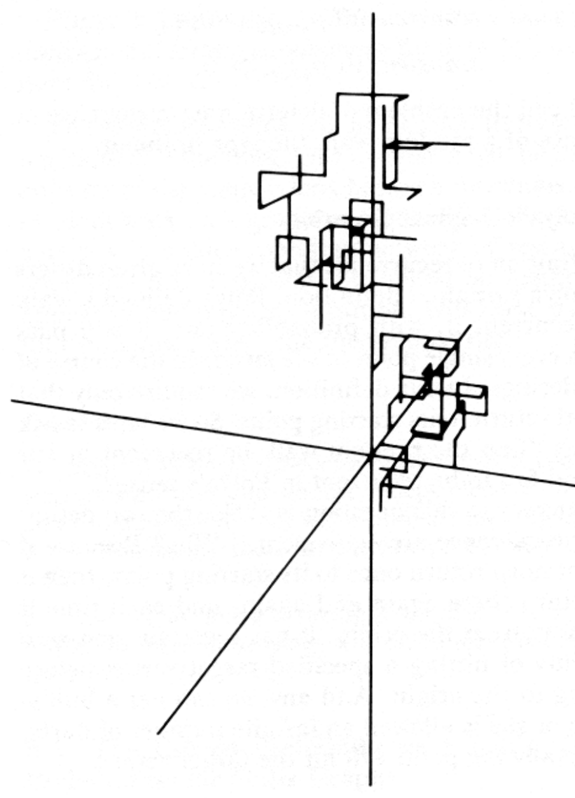

After a walk of $n$ steps, $n \ge 1$, you are at a lattice point in $\mathbf{R}^d$, i.e., a point with integer coordinates. We now ask two questions:

1. Given a particular lattice point $\mathbf{l}$, what is the probability after $n$ steps that we are at $\mathbf{l}$?
2. How does $\mathbf{walk}_n$ behave as $n \to \infty$?

These famous questions were formulated and answered by G. Pólya in 1921. His brilliant analysis resulted in the following result.

> **Theorem** In dimensions 1 and 2, with probability 1, the walker visits the origin infinitely often; in symbols
>
> $$
> \operatorname{Prob}(\mathbf{walk}_n = 0 \text{ infinitely often}) = 1\,.
> $$
>
> In dimensions $\ge 3$, with probability 1, the walker escapes to infinity:
>
> $$
> \operatorname{Prob}\left(\lim_{n\to\infty} |\mathbf{walk}_n| = \infty\right) = 1\,.
> $$

One says that a random walk along a line or in the plane is *recurrent* and that a random walk in higher dimensions is *transient*.

---

Here’s the idea — very cunning and, frankly, rather unmotivated, but who can account for genius? For each $\mathbf{x} \in \mathbf{R}^d$ consider

$$
\Phi_n = e^{2\pi i\,\mathbf{w}_n\cdot\mathbf{x}}\,,
$$

where, as above, $\mathbf{w}_n$ is a walk of $n$ steps. For a given $n$ the possible values of $\mathbf{w}_n$, as a sum of steps corresponding to different walks, lie among the lattice points, and if $\mathbf{w}_n$ lands on a lattice point $\mathbf{l}$ then the value of $\Phi_n$ for that walk is $e^{2\pi i\,\mathbf{l}\cdot\mathbf{x}}$. What is the expected value of $\Phi_n$ over all walks of $n$ steps? It is the mean, i.e., the weighted average of the values of $\Phi_n$ over the possible (random) walks of $n$ steps, each value weighted by the probability of its occurrence. That is,

$$
\text{Expected value of } \Phi_n = \sum_{\mathbf{l}} \operatorname{Prob}(\mathbf{w}_n = \mathbf{l})e^{2\pi i\,\mathbf{l}\cdot\mathbf{x}}\,.
$$

This is actually a finite sum because in $n$ steps we can have reached only a finite number of lattice points, or, put another way, $\operatorname{Prob}(\mathbf{w}_n = \mathbf{l})$ is zero for all but finitely many lattice points $\mathbf{l}$.

From this expression you can see (finite) Fourier series coming into the picture, but put that off for the moment.[^8-10] We can compute this expected value, based on our assumption that steps are equally probable and independent of each other. First of all, we can write

[^8-10]: Also, though it’s not in the standard form, i.e., a power series, I think of Pólya’s idea here as writing down a *generating function* for the sequence of probabilities $\operatorname{Prob}(\mathbf{w}_n = \mathbf{l})$. For an appreciation of this kind of approach to a great variety of problems — pure and applied — see the book *Generatingfunctionology* by H. Wilf. The first sentence of Chapter One reads: “A generating function is a clothesline on which we hang up a sequence of numbers for display.” Seems pretty apt for the problem at hand.

$$
\Phi_n = e^{2\pi i\,\mathbf{w}_n\cdot\mathbf{x}} = e^{2\pi i(\mathbf{s}_1 + \mathbf{s}_2 + \cdots + \mathbf{s}_n)\cdot\mathbf{x}} = e^{2\pi i\,\mathbf{s}_1\cdot\mathbf{x}}e^{2\pi i\,\mathbf{s}_2\cdot\mathbf{x}}\cdots e^{2\pi i\,\mathbf{s}_n\cdot\mathbf{x}}\,.
$$

So we want to find the expected value of the product of exponentials. At this point we could appeal to a standard result in probability, stating that the expected value of the product of *independent* random variables is the product of their expected values. You might be able to think about this directly, however: The expected value of $e^{2\pi i\,\mathbf{s}_1\cdot\mathbf{x}}e^{2\pi i\mathbf{s}_2\cdot\mathbf{x}}\cdots e^{2\pi i\mathbf{s}_n\cdot\mathbf{x}}$ is, as above, the weighted average of the values that the function assumes, weighted by the probabilities of those values occuring. In this case we’d be summing over all steps $s_1, s_2, \dots, s_n$ of the values $e^{2\pi is_1\cdot\mathbf{x}}e^{2\pi is_2\cdot\mathbf{x}}\cdots e^{2\pi is_n\cdot\mathbf{x}}$ weighted by the appropriate probabilities. But now the fact that the steps are independent means

$$
\begin{aligned}
\operatorname{Prob}(\mathbf{s}_1 = s_1, \mathbf{s}_2 = s_2, \dots, \mathbf{s}_n = s_n) &= \operatorname{Prob}(\mathbf{s}_1 = s_1)\operatorname{Prob}(\mathbf{s}_2 = s_2)\cdots\operatorname{Prob}(\mathbf{s}_n = s_n) \\
&\phantom{=}\ \text{(probabilities \textit{multiply} for independent events)} \\
&= \frac{1}{(2d)^n},
\end{aligned}
$$

and then

$$
\begin{aligned}
\text{Expected value of } \Phi_n &= \text{Expected value of } e^{2\pi is_1\cdot\mathbf{x}}e^{2\pi is_2\cdot\mathbf{x}}\cdots e^{2\pi is_n\cdot\mathbf{x}} \\
&= \sum_{s_1}\sum_{s_2}\cdots\sum_{s_n} \operatorname{Prob}(\mathbf{s}_1 = s_1, \mathbf{s}_2 = s_2, \dots, \mathbf{s}_n = s_n)e^{2\pi i\,s_1\cdot\mathbf{x}}e^{2\pi is_2\cdot\mathbf{x}}\cdots e^{2\pi is_n\cdot\mathbf{x}} \\
&= \sum_{s_1}\sum_{s_2}\cdots\sum_{s_n} \frac{1}{(2d)^n}e^{2\pi i\,s_1\cdot\mathbf{x}}e^{2\pi i\,s_2\cdot\mathbf{x}}\cdots e^{2\pi i\,s_n\cdot\mathbf{x}}\,.
\end{aligned}
$$

The sums go over all possible choices of $s_1, s_2, \dots, s_n$. Now, these sums are “uncoupled”, and so the nested sum is the product of

$$
\sum_{s_1}\frac{1}{2d}e^{2\pi i\,s_1\cdot\mathbf{x}}\ \sum_{s_2}\frac{1}{2d}e^{2\pi i\,s_2\cdot\mathbf{x}}\ \cdots\ \sum_{s_n}\frac{1}{2d}e^{2\pi i\,s_n\cdot\mathbf{x}}\,.
$$

But the sums are, respectively, the expected values of $e^{2\pi is_j\cdot\mathbf{x}}$, $j = 1, \dots, n$, and *these expected values are all the same.* (The steps are independent and identically distributed). So all the sums are equal, say, to the first sum, and we may write

$$
\text{Expected value of } \Phi_n = \left(\frac{1}{2d}\sum_{s_1} e^{2\pi i\,s_1\cdot\mathbf{x}}\right)^n
$$

A further simplification is possible. The first step $s_1$, as a $d$-tuple has exactly one slot with a $\pm 1$ and the rest 0’s. Summing over these $2d$ possibilities allows us to combine “positive and negative terms”. Check the case $d = 2$, for which the choices of $s_1$ are

$$
(1, 0)\,, \quad (-1, 0)\,, \quad (0, 1)\,, \quad (0, -1)\,.
$$

This leads to a sum with four terms:

$$
\begin{aligned}
\sum_{s_1}\frac{1}{2\cdot 2}e^{2\pi i\,s_1\cdot\mathbf{x}} &= \sum_{s_1}\frac{1}{2\cdot 2}e^{2\pi i\,s_1\cdot(x_1, x_2)} \\
&= \tfrac{1}{2}\big(\tfrac{1}{2}e^{2\pi ix_1} + \tfrac{1}{2}e^{-2\pi ix_1} + \tfrac{1}{2}e^{2\pi ix_2} + \tfrac{1}{2}e^{-2\pi ix_2}\big) \\
&= \tfrac{1}{2}(\cos 2\pi x_1 + \cos 2\pi x_2)
\end{aligned}
$$

The same thing happens in dimension $d$, and our final formula is

$$
\sum_{\mathbf{l}} \operatorname{Prob}(\mathbf{w}_n = \mathbf{l})e^{2\pi i\,\mathbf{l}\cdot\mathbf{x}} = \left(\frac{1}{d}(\cos 2\pi x_1 + \cos 2\pi x_2 + \cdots + \cos 2\pi x_d)\right)^n\,.
$$

Let us write

$$
\phi_d(\mathbf{x}) = \frac{1}{d}(\cos 2\pi x_1 + \cos 2\pi x_2 + \cdots + \cos 2\pi x_d)\,.
$$

Observe that $|\phi_d(\mathbf{x})| \le 1$, since $\phi_d(\mathbf{x})$ is the sum of $d$ cosines by $d$ and $|\cos 2\pi x_j| \le 1$ for $j = 1, 2, \dots, d$.

This has been quite impressive already. But there’s more! Let’s get back to Fourier series and consider the sum of probabilities times exponentials, above, *as a function of* $\mathbf{x}$; i.e., let

$$
f(\mathbf{x}) = \sum_{\mathbf{l}} \operatorname{Prob}(\mathbf{w}_n = \mathbf{l})\,e^{2\pi i\,\mathbf{l}\cdot\mathbf{x}}\,.
$$

This is a (finite) Fourier series for $f(\mathbf{x})$ and as such the coefficients *must be* the Fourier coefficients,

$$
\operatorname{Prob}(\mathbf{w}_n = \mathbf{l}) = \hat{f}(\mathbf{l})\,.
$$

But according to our calculation, $f(\mathbf{x}) = \phi_d(\mathbf{x})^n$, and so this must also be the Fourier coefficient of $\phi_d(\mathbf{x})^n$, that is,

$$
\operatorname{Prob}(\mathbf{w}_n = \mathbf{l}) = \hat{f}(\mathbf{l}) = \widehat{(\phi_d)^n}(\mathbf{l}) = \int_{[0,1]^d} e^{-2\pi i\,\mathbf{l}\cdot\mathbf{x}}\phi_d(\mathbf{x})^n\,d\mathbf{x}\,.
$$

In particular, the probability that the walker visits the origin, $\mathbf{l} = 0$, in $n$ steps is

$$
\operatorname{Prob}(\mathbf{w}_n = 0) = \int_{[0,1]^d} \phi_d(\mathbf{x})^n\,d\mathbf{x}\,.
$$

Then the expected number of times the walker visits the origin for a random walk of infinite length is

$$
\sum_{n=0}^{\infty} \operatorname{Prob}(\mathbf{w}_n = 0)\,,
$$

and we can figure this out.[^8-11] Here’s how we do this. We’d like to say that

[^8-11]: For those more steeped in probability, here’s a further argument why this sum is the expected number of visits to the origin. Let $V_n$ be the random variable which is 1 if the walker returns to the origin in $n$ steps and is zero otherwise. The expected value of $V_n$ is then $\operatorname{Prob}(\mathbf{w}_n = 0)\cdot 1$, the value of the function, 1, times the probability of that value occurring. Now set $V = \sum_{n=0}^{\infty} V_n$. The expected value of $V$ is what we want and it is the sum of the expected values of the $V_n$, i.e. $\sum_{n=0}^{\infty}\operatorname{Prob}(\mathbf{w}_n = 0)$.

$$
\begin{aligned}
\sum_{n=0}^{\infty} \operatorname{Prob}(\mathbf{w}_n = 0) &= \sum_{n=0}^{\infty}\int_{[0,1]^d} \phi_d(\mathbf{x})^n\,d\mathbf{x} \\
&= \int_{[0,1]^d}\left(\sum_{n=0}^{\infty} \phi_d(x)^n\right)d\mathbf{x} = \int_{[0,1]^d} \frac{1}{1 - \phi_d(\mathbf{x})}\,d\mathbf{x}
\end{aligned}
$$

using the formula for adding a geometric series. The final answer is correct, but the derivation isn’t quite legitimate: The formula for the sum of a geometric series is

$$
\sum_{n=0}^{\infty} r^n = \frac{1}{1 - r}
$$

provided that $|r|$ is strictly less than 1. In our application we know only that $|\phi_d(\mathbf{x})| \le 1$. To get around this difficulty, let $\alpha < 1$, and write

$$
\begin{aligned}
\sum_{n=0}^{\infty} \operatorname{Prob}(\mathbf{w}_n = 0) &= \lim_{\alpha\to 1}\sum_{n=0}^{\infty} \alpha^n\operatorname{Prob}(\mathbf{w}_n = 0) = \lim_{\alpha\to 1}\int_{[0,1]^d}\left(\sum_{n=0}^{\infty} \alpha^n\phi_d(x)^n\right)d\mathbf{x} \\
&= \lim_{\alpha\to 1}\int_{[0,1]^d} \frac{1}{1 - \alpha\phi_d(\mathbf{x})}\,d\mathbf{x} = \int_{[0,1]^d} \frac{1}{1 - \phi_d(\mathbf{x})}\,d\mathbf{x}
\end{aligned}
$$

(Pulling the limit inside the integral is justified by convergence theorems in the theory of Lebesgue integration, specifically, dominated convergence. Not to worry.)

- The crucial question now concerns the integral

  $$
  \int_{[0,1]^d} \frac{1}{1 - \phi_d(\mathbf{x})}\,d\mathbf{x}\,.
  $$

  Is it finite or infinite?

*This depends on the dimension* — and this is exactly where the dimension $d$ enters the picture.

Using some calculus (think Taylor series) it is not difficult to show (I won’t) that if $|\mathbf{x}|$ is small then

$$
1 - \phi_d(\mathbf{x}) \sim c|\mathbf{x}|^2\,,
$$

for a constant $c$. Thus

$$
\frac{1}{1 - \phi_d(\mathbf{x})} \sim \frac{1}{c|\mathbf{x}|^2}\,,
$$

and the convergence of the integral we’re interested in depends on that of the “power integral”

$$
\int_{x \text{ small}} \frac{1}{|\mathbf{x}|^2}\,d\mathbf{x} \quad \text{in dimension } d\,.
$$

It is an important mathematical fact of nature (something you should file away for future use) that

- The power integral diverges for $d = 1, 2$.
- The power integral converges for $d \ge 3$

Let me illustrate why this is so for $d = 1, 2, 3$. For $d = 1$ we have an ordinary improper integral,

$$
\int_0^a \frac{dx}{x^2}, \quad \text{for some small } a > 0\,,
$$

and this diverges by direct integration. For $d = 2$ we have a double integral, and to check its properties we introduce polar coordinates $(r, \theta)$ and write

$$
\int_{|\mathbf{x}| \text{ small}} \frac{dx_1\,dx_2}{x_1^2 + x_2^2} = \int_0^{2\pi}\int_0^a \frac{r\,dr\,d\theta}{r^2} = \int_0^{2\pi}\left(\int_0^a \frac{dr}{r}\right)d\theta\,.
$$

The inner integral diverges. In three dimensions we introduce spherical coordinates $(\rho, \theta, \varphi)$, and something different happens. The integral becomes

$$
\int_{|\mathbf{x}| \text{ small}} \frac{dx_1\,dx_2\,dx_3}{x_1^2 + x_2^2 + x_3^2} = \int_0^{\pi}\int_0^{2\pi}\int_0^a \frac{\rho^2\sin\phi\,d\rho\,d\theta\,d\varphi}{\rho^2}\,.
$$

This time the $\rho^2$ in the denominator cancels with the $\rho^2$ in the numerator and the $\rho$-integral is *finite*. The same phenomenon persists in higher dimensions, for the same reason (introducing higher dimensional polar coordinates).

---

Let’s take stock. We have shown that

$$
\text{Expected number of visits to the origin} = \sum_{n=0}^{\infty} \operatorname{Prob}(\mathbf{w}_n = 0) = \int_{[0,1]^d} \frac{1}{1 - \phi_d(\mathbf{x})}\,d\mathbf{x}
$$

and that this number is infinite in dimensions 1 and 2 and finite in dimension 3. From here we can go on to prove Pólya’s theorem as he stated it:

> $\operatorname{Prob}(\mathbf{walk}_n = 0 \text{ infinitely often}) = 1$ in dimensions 1 and 2.
>
> $\operatorname{Prob}(\lim_{n\to\infty} |\mathbf{walk}_n| = \infty) = 1$ in dimensions $\ge 3$.

For the case $d \ge 3$, we know that the expected number of times that the walker visits the origin is finite. This can only be true if the actual number of visits to the origin is finite with probability 1. Now the origin is not special in any way, so the same must be true of any lattice point. But this means that for any $R > 0$ the walker eventually stops visiting the ball $|\mathbf{x}| \le R$ of radius $R$ with probability 1, and this is exactly saying that $\operatorname{Prob}(\lim_{n\to\infty} |\mathbf{walk}_n| = \infty) = 1$.

---

To settle the case $d \le 2$ we formulate a lemma that you might find helpful in this discussion.[^8-12]

[^8-12]: We haven’t had many lemmas in this class, but I think I can get away with one or two.

> **Lemma** Let $p_n$ be the probability that a walker visits the origin *at least* $n$ times and let $q_n$ be the probability that a walker visits the origin *exactly* $n$ times. Then $p_n = p_1^n$ and $q_n = p_1^n(1 - p_1)$

To show this we argue as follows. Note first that $p_0 = 1$ since the walker starts at the origin. Then

$$
\begin{aligned}
p_{n+1} &= \operatorname{Prob}(\text{visit origin at least } n + 1 \text{ times}) \\
&= \operatorname{Prob}(\text{visit origin at least } n + 1 \text{ times given visit at least } n \text{ times})\cdot\operatorname{Prob}(\text{visit at least } n \text{ times}) \\
&= \operatorname{Prob}(\text{visit origin at least 1 time given visit at least 0 times})\cdot p_n \\
&\qquad \text{(using independence and the definition of } p_n\text{)} \\
&= \operatorname{Prob}(\text{visit at least 1 time})\cdot p_n \\
&= p_1\cdot p_n
\end{aligned}
$$

From $p_0 = 1$ and $p_{n+1} = p_1\cdot p_n$ it follows (by induction) that $p_n = p_1^n$.

For the second part,

$$
\begin{aligned}
q_n &= \operatorname{Prob}(\text{exactly } n \text{ visits to origin}) \\
&= \operatorname{Prob}(\text{visits at least } n \text{ times}) - \operatorname{Prob}(\text{visits at least } n + 1 \text{ times}) \\
&= p_n - p_{n+1} = p_1^n(1 - p_1)
\end{aligned}
$$

---

Now, if $p_1$ were less than 1 then the expected number of visits to the origin would be

$$
\begin{aligned}
\sum_{n=0}^{\infty} nq_n &= \sum_{n=0}^{\infty} np_1^n(1 - p_1) = (1 - p_1)\sum_{n=0}^{\infty} np_1^n \\
&= (1 - p_1)\frac{p_1}{(1 - p_1)^2} \quad \left(\text{Check that identity by differentiating identity } \frac{1}{1 - x} = \sum_{n=0}^{\infty} x^n\right) \\
&= \frac{p_1}{1 - p_1} < \infty
\end{aligned}
$$

But this contradicts the fact we established earlier, namely

$$
\text{Expected visits to the origin} = \int_{[0,1]^2} \frac{1}{1 - \phi_2(\mathbf{x})}\,d\mathbf{x} = \infty\,.
$$

Thus we must have $p_1 = 1$, that is, the probability of returning to the origin is 1, and hence $\mathbf{walk}_n$ must equal 0 infinitely often with probability 1.
## 8.4 III, Lattices, Crystals, and Sampling

Our derivation of the sampling formula in Chapter **???** was a direct application and combination of the important properties of the $\text{III}$ function,

$$
\text{III}_p(t) = \sum_{k=-\infty}^{\infty} \delta(t - kp)\,.
$$

Without redoing the whole argument here, short as it is, let me remind you what it is about $\text{III}$ that made things work.

- $\delta$’s being what they are, $\text{III}_p$ is *the* tool to use for periodizing and for sampling:

  $$
  \begin{aligned}
  (f * \text{III}_p)(t) &= \sum_{k=-\infty}^{\infty} f(t - kp) \\
  f(t)\text{III}_p(t) &= \sum_{k=-\infty}^{\infty} f(kp)\delta(t - kp)\,.
  \end{aligned}
  $$

- For the Fourier transform,

  $$
  \mathcal{F}\text{III}_p = \frac{1}{p}\text{III}_{1/p}\,.
  $$

- It is through this property of the Fourier transform that periodizing in one domain corresponds to sampling in the other domain. Pay particular attention here to the reciprocity in spacing between $\text{III}_p$ and its Fourier transform.

The sampling formula itself says that if $\mathcal{F}f(s)$ is identically 0 for $|s| \ge p/2$ then

$$
f(t) = \sum_{k=-\infty}^{\infty} f\left(\frac{k}{p}\right)\operatorname{sinc}(pt - k)\,.
$$

---

We now want to see how things stand in two dimensions; there isn’t much difference in substance between the two-dimensional case and higher dimensions, so we’ll stick pretty much to the plane.

### 8.4.1 The two-dimensional III

The formula $\mathcal{F}\text{III}_p = (1/p)\text{III}_{1/p}$ depends crucially on the fact that $\text{III}_p$ is a sum of impulses *at evenly spaced points* — this is an aspect of periodicity. We’ve already defined a two-dimensional $\delta$, so to introduce a $\text{III}$ that goes with it we need to define what “evenly spaced” means for points in $\mathbf{R}^2$. One way of spacing points evenly in $\mathbf{R}^2$ is to take all pairs $(k_1, k_2)$, $k_1$, $k_2$ integers. The corresponding $\text{III}$-function is then defined to be

$$
\text{III}(x_1, x_2) = \sum_{k_1, k_2 = -\infty}^{\infty} \delta(x_1 - k_1, x_2 - k_2)\,.
$$

Bracewell, and others, sometimes refer to this as the “bed of nails”.

The points $\mathbf{k} = (k_1, k_2)$ with integer coordinates are said to form a *lattice* in the plane. We denote this particular lattice, called the *integer lattice*, by $\mathbf{Z}^2$; we’ll have more general lattices in a short while. As a model of a physical system, you can think of such an array as a two-dimensional crystal, where there’s an atom at every lattice point.

Since we prefer to write things in terms of vectors, another way to describe $\mathbf{Z}^2$ is to use the standard basis of $\mathbf{R}^2$, the vectors $\mathbf{e}_1 = (1, 0)$, $\mathbf{e}_2 = (0, 1)$, and write the points in the lattice as

$$
\mathbf{k} = k_1\mathbf{e}_1 + k_2\mathbf{e}_2\,.
$$

We can thus think of the elements of a lattice either as points or as vectors, and observe that the sum of two lattice points is another lattice point and that an integer multiple of a lattice point is another lattice point. The $\text{III}$-function can be written

$$
\text{III}_{\mathbf{Z}^2}(\mathbf{x}) = \sum_{k_1, k_2 = -\infty}^{\infty} \delta(\mathbf{x} - k_1\mathbf{e}_1 - k_2\mathbf{e}_2) = \sum_{\mathbf{k}\in\mathbf{Z}^2} \delta(\mathbf{x} - \mathbf{k})\,.
$$

It is easy to show that $\text{III}_{\mathbf{Z}^2}$ is even.

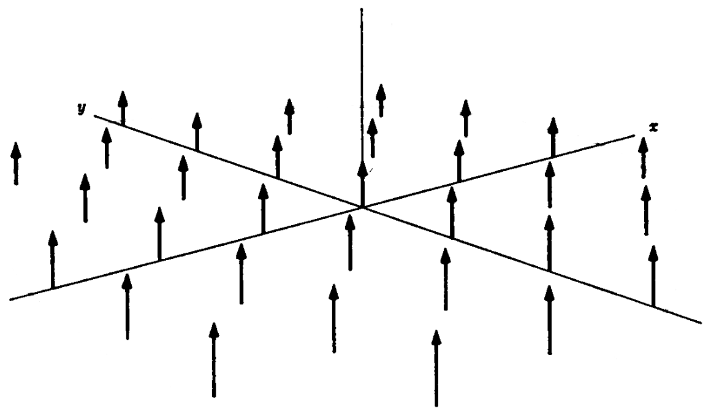

**Periodicity on $\mathbf{Z}^2$ and $\mathcal{F}\text{III}_{\mathbf{Z}^2}$** As in the one-dimensional case, $\text{III}_{\mathbf{Z}^2}$ is the tool to use to work with periodicity. If we form

$$
\Phi(\mathbf{x}) = (\varphi * \text{III}_{\mathbf{Z}^2})(\mathbf{x}) = \sum_{\mathbf{k}\in\mathbf{Z}^2} \varphi(\mathbf{x} - \mathbf{k})\,,
$$

assuming that the sum converges, then $\Phi$ is periodic *on the lattice* $\mathbf{Z}^2$, or briefly, is $\mathbf{Z}^2$-periodic. This means that

$$
\Phi(\mathbf{x} + \mathbf{n}) = \Phi(\mathbf{x})
$$

for all $\mathbf{x}$ and for any lattice point $\mathbf{n} \in \mathbf{Z}^2$, and this is true because

$$
\Phi(\mathbf{x} + \mathbf{n}) = \sum_{\mathbf{k}\in\mathbf{Z}^2} \varphi(\mathbf{x} + \mathbf{n} - \mathbf{k}) = \sum_{\mathbf{k}\in\mathbf{Z}^2} \varphi(\mathbf{x} - \mathbf{k}) = \Phi(\mathbf{x})\,;
$$

the sum (or difference) of two lattice points, $\mathbf{n} - \mathbf{k}$, is a lattice point, so we’re still summing over $\mathbf{Z}^2$ and we get back $\Phi$.

Using periodicity, and the fact that $\mathbf{Z}^2$ is particularly “evenly spaced” as a set of points in $\mathbf{R}^2$ leads to the important and remarkable formula

$$
\mathcal{F}\text{III}_{\mathbf{Z}^2} = \text{III}_{\mathbf{Z}^2}
$$

corresponding precisely to the one-dimensional case. I’ll put the details of the derivation of this in Section 8.4.4. It’s also true that

$$
\mathcal{F}^{-1}\text{III}_{\mathbf{Z}^2} = \text{III}_{\mathbf{Z}^2}
$$

because $\text{III}_{\mathbf{Z}^2}$ is even.

---

At this point the most basic version of the two-dimensional sampling formula is already easily within reach. It’s much more interesting, however, as well as ultimately much more useful to allow for some greater generality.

### 8.4.2 Lattices in general

$\mathbf{Z}^2$ isn’t the only example of a set of evenly spaced points in the plane, though perhaps it’s the example of the most evenly spaced points. It’s easy to imagine “oblique” lattices, too. Not all crystals are square, after all, or even rectangular, and we want to be able to use general lattices to model crystals. We’ll now consider such oblique arrangements, but be warned that the subject of lattices can go on forever; the effort here is to be brief to the point.

We adopt the vector point of view for defining a general lattice. Take any basis $\mathbf{u}_1$, $\mathbf{u}_2$ of $\mathbf{R}^2$ and consider all the points (or vectors) that are *integer* linear combinations of the two. These form:

$$
\text{Lattice points} = \mathbf{p} = p_1\mathbf{u}_1 + p_2\mathbf{u}_2, \quad p_1, p_2 = 0, \pm 1, \pm 2, \dots
$$

We’ll denote such a lattice by $\mathcal{L}$. The sum and difference of two lattice points is again a lattice point, as is any integer times a lattice point.[^8-13]

[^8-13]: In mathematical terminology a lattice is a *module* over $\mathbf{Z}$; a module is like a vector space except that you can’t divide by the scalars (the integers in this case) only add and multiply them. For a module, as opposed to a vector space, the scalars form a ring, not a field.

The vectors $\mathbf{u}_1$ and $\mathbf{u}_2$ are said to be a *basis* for the lattice. Other vectors can also serve as a basis, and two bases for the same lattice are related by a $2 \times 2$ matrix with integer entries having determinant 1. (I won’t go through the derivation of this.) The parallelogram determined by the basis vectors (any basis vectors) is called a *fundamental parallelogram* for the lattice, or, in crystallographers” terms, a *unit cell.* A fundamental parallelogram for $\mathbf{Z}^2$ is the square $0 \le x_1 < 1$, $0 \le x_2 < 1$.[^8-14] By convention, one speaks of the *area of a lattice* in terms of the area of a fundamental parallelogram for the lattice, and we’ll write

[^8-14]: It’s a common convention to define a fundamental parallelogram to be “half open”, including two sides ($x_1 = 0$ and $x_2 = 0$ in this case) and excluding two ($x_1 = 1$ and $x_2 = 1$). This won’t be an issue for our work.

$$
\operatorname{Area}(\mathcal{L}) = \text{Area of a fundamental parallelogram}\,.
$$

Two fundamental parallelograms for the same lattice have the same area since the bases are related by a $2 \times 2$ integer matrix with determinant 1 and the area scales by the determinant.

If we take the natural basis vectors $\mathbf{e}_1 = (1, 0)$ and $\mathbf{e}_2 = (0, 1)$ for $\mathbf{R}^2$ we get the integer lattice $\mathbf{Z}^2$ as before. We can see that *any* lattice $\mathcal{L}$ can be *obtained* from $\mathbf{Z}^2$ via an invertible linear transformation $A$, the one that takes $\mathbf{e}_1$ and $\mathbf{e}_2$ to a basis $\mathbf{u}_1 = A\mathbf{e}_1$ and $\mathbf{u}_2 = A\mathbf{e}_2$ that defines $\mathcal{L}$. This is so precisely because $A$ is linear: if

$$
\mathbf{p} = p_1\mathbf{u}_1 + p_2\mathbf{u}_2, \quad p_1, p_2 \quad \text{integers}\,,
$$

is any point in $\mathcal{L}$ then

$$
\mathbf{p} = p_1(A\mathbf{e}_1) + p_2(A\mathbf{e}_2) = A(p_1\mathbf{e}_1 + p_2\mathbf{e}_2)\,,
$$

showing that $\mathbf{p}$ is the image of a point in $\mathbf{Z}^2$. We write

$$
\mathcal{L} = A(\mathbf{Z}^2)
$$

A fundamental parallelogram for $\mathcal{L}$ is determined by $\mathbf{u}_1$ and $\mathbf{u}_2$, and so

$$
\operatorname{Area}(\mathcal{L}) = \text{Area of the parallelogram determined by } \mathbf{u}_1 \text{ and } \mathbf{u}_2 = |\det A|\,.
$$

Here, for example, is the lattice obtained from $\mathbf{Z}^2$ by applying

$$
A = \begin{pmatrix} 3 & -1 \\ 1 & 2 \end{pmatrix}
$$

A basis is $\mathbf{u}_1 = (3, 1)$, $\mathbf{u}_2 = (-1, 2)$ (Draw the basis on the lattice!) The area of the lattice is 7.

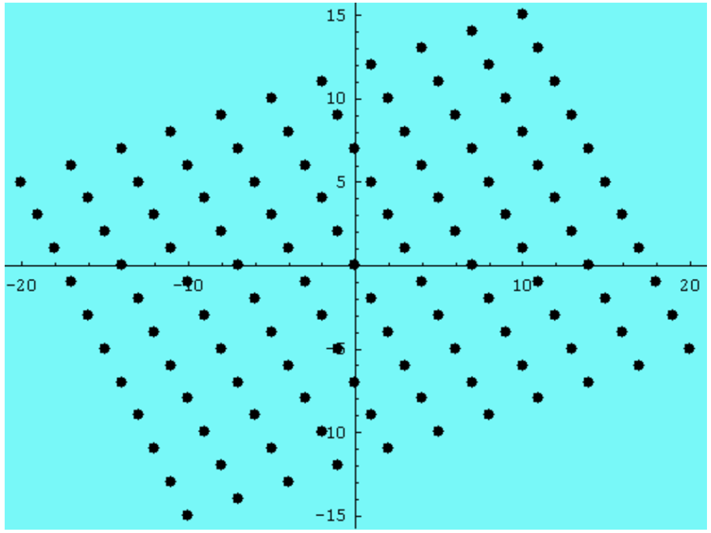
### 8.4.3 III for a lattice

It doesn’t take a great leap in imagination to think about introducing $\text{III}$ for a general lattice: If $\mathcal{L}$ is a lattice in $\mathbf{R}^2$ then the $\text{III}$ function associated with $\mathcal{L}$ is

$$
\text{III}_{\mathcal{L}}(\mathbf{x}) = \sum_{\mathbf{p}\in\mathcal{L}} \delta(\mathbf{x} - \mathbf{p})\,.
$$

So there’s your general “sum of delta functions at evenly spaced points”. We could also write the definition as

$$
\text{III}_{\mathcal{L}}(\mathbf{x}) = \sum_{k_1, k_2 = -\infty}^{\infty} \delta(\mathbf{x} - k_1\mathbf{u}_1 - k_2\mathbf{u}_2)\,.
$$

As $\mathcal{L}$ can be obtained from $\mathbf{Z}^2$ via some linear transformation so too can $\text{III}_{\mathcal{L}}$ be expressed in terms of $\text{III}_{\mathbf{Z}^2}$. If $\mathcal{L} = A(\mathbf{Z}^2)$ then

$$
\text{III}_{\mathcal{L}}(\mathbf{x}) = \sum_{\mathbf{p}\in\mathcal{L}} \delta(\mathbf{x} - \mathbf{p}) = \sum_{\mathbf{k}\in\mathbf{Z}^2} \delta(\mathbf{x} - A\mathbf{k})\,.
$$

Next, using the formula for $\delta(A\mathbf{x})$ from earlier in this chapter,

$$
\delta(\mathbf{x} - A\mathbf{k}) = \delta(A(A^{-1}\mathbf{x} - \mathbf{k})) = \frac{1}{|\det A|}\delta(A^{-1}\mathbf{x} - \mathbf{k})
$$

Therefore

$$
\text{III}_{\mathcal{L}}(\mathbf{x}) = \frac{1}{|\det A|}\text{III}_{\mathbf{Z}^2}(A^{-1}\mathbf{x})\,.
$$

Compare this to our earlier formulas on how the one-dimensional $\text{III}$-function scales: With

$$
\text{III}_p(x) = \sum_{k=-\infty}^{\infty} \delta(x - kp)
$$

and

$$
\text{III}(px) = \sum_{k=-\infty}^{\infty} \delta(px - k)
$$

we found that

$$
\text{III}(px) = \frac{1}{|p|}\text{III}_{1/p}(x)
$$

**Periodizing and sampling** Periodizing with $\text{III}_{\mathcal{L}}$ via convolution results in a function that is periodic with respect to the lattice. If

$$
\Phi(\mathbf{x}) = (\varphi * \text{III}_{\mathcal{L}})(\mathbf{x}) = \sum_{\mathbf{p}\in\mathcal{L}} \varphi(\mathbf{x} - \mathbf{p})
$$

then

$$
\Phi(\mathbf{x} + \mathbf{p}) = \Phi(\mathbf{x})
$$

for all $\mathbf{x} \in \mathbf{R}^2$ and all $\mathbf{p} \in \mathcal{L}$. Another way of saying this is that $\Phi$ has two “independent” periods, one each in the directions of any pair of basis vectors for the lattice. Thus if $\mathbf{u}_1$, $\mathbf{u}_2$ are a basis for $\mathcal{L}$ then

$$
\Phi(\mathbf{x} + k_1\mathbf{u}_1) = \Phi(\mathbf{x}) \quad\text{and}\quad \Phi(\mathbf{x} + k_2\mathbf{u}_2) = \Phi(\mathbf{x}), \quad k_1, k_2 \text{ any integers.}
$$

---

$\text{III}_{\mathcal{L}}$ is also the tool to use for sampling on a lattice, for

$$
(\varphi\,\text{III}_{\mathcal{L}})(\mathbf{x}) = \sum_{\mathbf{p}\in\mathcal{L}} \varphi(\mathbf{p})\delta(\mathbf{x} - \mathbf{p})\,.
$$

We’re almost ready to use this.

**Dual lattices and $\mathcal{F}\text{III}_{\mathcal{L}}$** Of the many (additional) interesting things to say about lattices, the one that’s most important for our concerns is how the Fourier transform of $\text{III}_{\mathcal{L}}$ depends on $\mathcal{L}$. This question leads to a fascinating phenomenon, one that is realized physically in x-ray diffraction images of crystals.

We mentioned earlier that for the integer lattice we have

$$
\mathcal{F}\text{III}_{\mathbf{Z}^2} = \text{III}_{\mathbf{Z}^2}\,.
$$

What about the Fourier transform of $\text{III}_{\mathcal{L}}$? We appeal to the general similarity theorem to obtain, for $\mathcal{L} = A\mathbf{Z}^2$,

$$
\begin{aligned}
\mathcal{F}\text{III}_{\mathcal{L}}(\boldsymbol{\xi}) &= \frac{1}{|\det A|}\mathcal{F}(\text{III}_{\mathbf{Z}^2}(A^{-1}\mathbf{x})) \\
&= \frac{1}{|\det A|}\frac{1}{|\det A^{-1}|}\mathcal{F}\text{III}_{\mathbf{Z}^2}(A^{\mathsf{T}}\boldsymbol{\xi}) \\
&\qquad \text{(we just get } A^{\mathsf{T}} \text{ on the inside because we’re already working with } A^{-1}\text{)} \\
&= \mathcal{F}\text{III}_{\mathbf{Z}^2}(A^{\mathsf{T}}\boldsymbol{\xi}) \\
&= \text{III}_{\mathbf{Z}^2}(A^{\mathsf{T}}\boldsymbol{\xi})
\end{aligned}
$$

There’s a much neater version of this last result, and one of genuine physical importance. But we need a new idea.

In crystallography it is common to introduce the *reciprocal lattice* associated to a given lattice. Given a lattice $\mathcal{L}$, the reciprocal lattice is the lattice $\mathcal{L}^*$ consisting of all points (or vectors) $\mathbf{q}$ such that

$$
\mathbf{q}\cdot\mathbf{p} = \text{an integer for every } \mathbf{p} \text{ in the lattice } L.
$$

In some other areas of applications, and in mathematics, the reciprocal lattice is known as the *dual lattice.* I’ll show my heritage and generally use the term dual lattice.

> **Warning** People in crystallography, those in Material Sciences for example, use the reciprocal lattice all the time and define it this way. However, in some fields and for some applications the reciprocal lattice is normalized differently to require that $\mathbf{q}\cdot\mathbf{p}$ be an integer multiple of $2\pi$. This alternate normalization is exactly tied up with the alternate ways of defining the Fourier transform, i.e., while we use $e^{-2\pi i\,\boldsymbol{\xi}\cdot\mathbf{x}}$, putting the $2\pi$ in the exponential, others do not put the $2\pi$ there and have to put a factor in front of the integral, and so on. I can do no more than to issue this warning and wish us all luck in sorting out the inconsistencies.

To develop the notion of the dual lattice a little, and to explain the terminology “reciprocal”, suppose we get the lattice $\mathcal{L}$ from $\mathbf{Z}^2$ by applying an invertible matrix $A$ to $\mathbf{Z}^2$. We’ll show that the reciprocal lattice $\mathcal{L}^*$ of $\mathcal{L}$ is given by

$$
\mathcal{L}^* = A^{-\mathsf{T}}(\mathbf{Z}^2)\,.
$$

There’s a maxim lurking here. Use of the Fourier transform always brings up “reciprocal” relations of some sort, and in higher dimensions more often than not:

- “Reciprocal” means inverse transpose.

Notice, by the way, that $(\mathbf{Z}^2)^* = \mathbf{Z}^2$, since $A$ in this case is the identity, i.e., $\mathbf{Z}^2$ is “self-dual” as a lattice. This, coupled with the discussion to follow, is another reason for saying that $\mathbf{Z}^2$ wins the award for most evenly spaced points in $\mathbf{R}^2$.

Here’s why $\mathcal{L}^* = A^{-\mathsf{T}}(\mathbf{Z}^2)$. Suppose $\mathbf{q} = A^{-\mathsf{T}}\mathbf{m}$ for some $\mathbf{m} = (m_1, m_2)$ in $\mathbf{Z}^2$. And suppose also, because $\mathcal{L} = A(\mathbf{Z}^2)$, that $\mathbf{p} = A\mathbf{m}'$ for some other $\mathbf{m}' = (m_1', m_2')$ in $\mathbf{Z}^2$. Then

$$
\begin{aligned}
\mathbf{q}\cdot\mathbf{p} &= A^{-\mathsf{T}}\mathbf{m}\cdot A\mathbf{m}' \\
&= \mathbf{m}\cdot A^{-1}(A\mathbf{m}') \quad \text{(because of how matrices operate with the dot product)} \\
&= \mathbf{m}\cdot\mathbf{m}' = m_1m_1' + m_2m_2' \quad \text{(an integer)}
\end{aligned}
$$

We want to draw two conclusions from the result that $\mathcal{L}^* = A^{-\mathsf{T}}(\mathbf{Z}^2)$. First, we see that

$$
\operatorname{Area}(\mathcal{L}^*) = |\det \mathrm{A}^{-\mathsf{T}}| = \frac{1}{|\det \mathrm{A}|} = \frac{1}{\operatorname{Area}(\mathcal{L})}\,.
$$

Thus the areas of $\mathcal{L}$ and $\mathcal{L}^*$ are reciprocals. This is probably the crystallographer’s main reason for using the term reciprocal.

The second conclusion, and the second reason to use the term reciprocal, has to do with bases of $\mathcal{L}$ and of $\mathcal{L}^*$. With $\mathcal{L} = A(\mathbf{Z}^2)$ let

$$
\mathbf{u}_1 = A\mathbf{e}_1, \quad \mathbf{u}_2 = A\mathbf{e}_2
$$

be a basis for $\mathcal{L}$. Since $\mathcal{L}^* = A^{-\mathsf{T}}(\mathbf{Z}^2)$, the vectors

$$
\mathbf{u}_1^* = A^{-\mathsf{T}}\mathbf{e}_1, \quad \mathbf{u}_2^* = A^{-\mathsf{T}}\mathbf{e}_2
$$

are a basis for $\mathcal{L}^*$. They have a special property with respect to $\mathbf{u}_1$ and $\mathbf{u}_2$, namely

$$
\mathbf{u}_i\cdot\mathbf{u}_j^* = \delta_{ij} \quad \text{(Kronecker delta)}\,.
$$

This is simple to show, after all we’ve been through:

$$
\mathbf{u}_i\cdot\mathbf{u}_j^* = A\mathbf{e}_i\cdot A^{-\mathsf{T}}\mathbf{e}_j = \mathbf{e}_i\cdot A^{\mathsf{T}}A^{-\mathsf{T}}\mathbf{e}_j = \mathbf{e}_i\cdot\mathbf{e}_j = \delta_{ij}\,.
$$

Now, in linear algebra — independent of any connection with lattices — bases $\{\mathbf{u}_1, \mathbf{u}_2\}$ and $\{\mathbf{u}_1^*, \mathbf{u}_2^*\}$ of $\mathbf{R}^2$ are called *dual* (or sometimes, *reciprocal*) if they satisfy

$$
\mathbf{u}_i\cdot\mathbf{u}_j^* = \delta_{ij} \quad \text{(Kronecker delta)}\,.
$$

We can therefore summarize what we’ve found by saying

- If $\{\mathbf{u}_1, \mathbf{u}_2\}$ is a basis for a lattice $\mathcal{L}$ and if $\{\mathbf{u}_1^*, \mathbf{u}_2^*\}$ is the dual basis to $\{\mathbf{u}_1, \mathbf{u}_2\}$, then $\{\mathbf{u}_1^*, \mathbf{u}_2^*\}$ is a basis for the dual lattice $\mathcal{L}^*$.

Lots of words here, true, but it’s worth your while understanding what we’ve just done. You’re soon to see it all in action in the sampling formula.

Here’s a picture of the dual lattice to the lattice pictured earlier. It’s obtained from $\mathbf{Z}^2$ by applying

$$
A^{-\mathsf{T}} = \begin{pmatrix} 2/7 & -1/7 \\ 1/7 & 3/7 \end{pmatrix}.
$$

As the scales on the axes show, the dual lattice is, in this case, much more “compressed” than the original lattice. Its area is $1/7$.

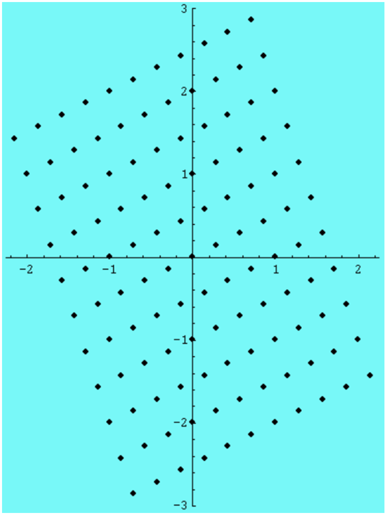

Back to the Fourier transform. We showed that if $\mathcal{L} = A(\mathbf{Z}^2)$ then

$$
\mathcal{F}\text{III}_{\mathcal{L}}(\boldsymbol{\xi}) = \text{III}_{\mathbf{Z}^2}(A^{\mathsf{T}}\boldsymbol{\xi})\,.
$$

We want to call forth the reciprocal lattice. For this,

$$
\begin{aligned}
\text{III}_{\mathbf{Z}^2}(A^{\mathsf{T}}\boldsymbol{\xi}) &= \sum_{\mathbf{n}\in\mathbf{Z}^2} \delta(A^{\mathsf{T}}\boldsymbol{\xi} - \mathbf{n}) \\
&= \sum_{\mathbf{n}\in\mathbf{Z}^2} \delta(A^{\mathsf{T}}(\boldsymbol{\xi} - A^{-\mathsf{T}}\mathbf{n})) \\
&= \frac{1}{|\det A^{\mathsf{T}}|}\sum_{\mathbf{n}\in\mathbf{Z}^2} \delta(\boldsymbol{\xi} - A^{-\mathsf{T}}\mathbf{n}) = \frac{1}{|\det A|}\sum_{\mathbf{n}\in\mathbf{Z}^2} \delta(\boldsymbol{\xi} - A^{-\mathsf{T}}\mathbf{n})\,.
\end{aligned}
$$

But this last expression is exactly a sum over points in the reciprocal lattice $\mathcal{L}^*$. We thus have

$$
\mathcal{F}(\text{III}_{\mathcal{L}})(\boldsymbol{\xi}) = \frac{1}{|\det A|}\text{III}_{\mathcal{L}^*}(\boldsymbol{\xi})\,.
$$

Bringing in the areas of fundamental parallelograms for $\mathcal{L}$ and $\mathcal{L}^*$ we can write this either in the form

$$
\mathcal{F}(\text{III}_{\mathcal{L}})(\boldsymbol{\xi}) = \operatorname{Area}(\mathcal{L}^*)\text{III}_{\mathcal{L}^*}(\boldsymbol{\xi}) \quad\text{or}\quad \operatorname{Area}(\mathcal{L})\mathcal{F}(\text{III}_{\mathcal{L}})(\boldsymbol{\xi}) = \text{III}_{\mathcal{L}^*}(\boldsymbol{\xi})\,.
$$

Interchanging the roles of $\mathcal{L}$ and $\mathcal{L}^*$, we likewise have

$$
\mathcal{F}(\text{III}_{\mathcal{L}^*})(\boldsymbol{\xi}) = \operatorname{Area}(\mathcal{L})\text{III}_{\mathcal{L}}(\boldsymbol{\xi}) \quad\text{or}\quad \operatorname{Area}(\mathcal{L}^*)\mathcal{F}(\text{III}_{\mathcal{L}^*})(\boldsymbol{\xi}) = \text{III}_{\mathcal{L}}(\boldsymbol{\xi})\,.
$$

Formulas for the inverse Fourier transforms look just like these because the $\text{III}$’s are even.

Compare these results to the formula in one dimension,

$$
\mathcal{F}\text{III}_p = \frac{1}{p}\text{III}_{1/p}\,,
$$

and now you’ll see why I said “Pay particular attention here to the reciprocity in spacing between $\text{III}_p$ and its Fourier transform” at the beginning of this section.

**Higher dimensions** Everything in the preceding discussion goes through in higher dimensions with *no significant changes*, e.g., “area” becomes “volume”. The only reason for stating definitions and results in two-dimensions was to picture the lattices a little more easily. But, certainly, lattices in three dimensions are common in applications and provide a natural framework for understanding crystals, for example. Let’s do that next.
### 8.4.4 The Poisson Summation Formula, again, and $\mathcal{F}\text{III}_{\mathbf{Z}^2}$

Back in Chapter 5 we derived the Poisson summation formula: if $\varphi$ is a Schwartz function then

$$
\sum_{k=-\infty}^{\infty} \mathcal{F}\varphi(k) = \sum_{k=-\infty}^{\infty} \varphi(k)\,.
$$

It’s a remarkable identity and it’s the basis for showing that

$$
\mathcal{F}\text{III} = \text{III}
$$

for the one-dimensional $\text{III}$. In fact, the Poisson summation formula is *equivalent* to the Fourier transform identity.

The situation in higher dimensions is completely analogous. All that we need is a little bit on higher dimensional Fourier series, which we’ll bring in here without fanfare; see the earlier section on “Higher dimensional Fourier series and random walks” for more background.

Suppose $\varphi$ is a Schwartz function on $\mathbf{R}^2$. We periodize $\varphi$ to be periodic on the integer lattice $\mathbf{Z}^2$ via

$$
\Phi(\mathbf{x}) = (\varphi * \text{III}_{\mathbf{Z}^2})(\mathbf{x}) = \sum_{\mathbf{n}\in\mathbf{Z}^2} \varphi(\mathbf{x} - \mathbf{n})\,.
$$

Then $\Phi$ has a two-dimensional Fourier series

$$
\Phi(\mathbf{x}) = \sum_{\mathbf{k}\in\mathbf{Z}^2} \widehat{\Phi}(\mathbf{k})e^{2\pi i\mathbf{k}\cdot\mathbf{x}}\,.
$$

Let’s see what happens with the Fourier coefficients.

$$
\begin{aligned}
\widehat{\Phi}(k_1, k_2) &= \int_0^1\int_0^1 e^{-2\pi i(k_1x_1 + k_2x_2)}\Phi(x_1, x_2)\,dx_1\,dx_2 \\
&= \int_0^1\int_0^1 e^{-2\pi i(k_1x_1 + k_2x_2)}\sum_{n_1, n_2 = -\infty}^{\infty} \varphi(x_1 - n_1, x_2 - n_2)\,dx_1\,dx_2 \\
&= \sum_{n_1, n_2 = -\infty}^{\infty}\int_0^1\int_0^1 e^{-2\pi i(k_1x_1 + k_2x_2)}\varphi(x_1 - n_1, x_2 - n_2)\,dx_1\,dx_2\,.
\end{aligned}
$$

Now we make the change of variables $u = x_1 - n_1$, $v = x_2 - n_2$. We can either do this “separately” (because the variables are changing separately) or together using the general change of variables formula.[^8-15] Either way, the result is

[^8-15]: Right here is where the property of $\mathbf{Z}^2$ as the “simplest” lattice comes in. If we were working with an “oblique” lattice we could not make such a simple change of variables. We would have to make a more general linear change of variables. This would lead to a more complicated result.

$$
\begin{aligned}
&\sum_{n_1, n_2 = -\infty}^{\infty}\int_0^1\int_0^1 e^{-2\pi i(k_1x_1 + k_2x_2)}\varphi(x_1 - n_1, x_2 - n_2)\,dx_1\,dx_2 \\
&\qquad = \sum_{n_1, n_2 = -\infty}^{\infty}\int_{-n_1}^{1-n_1}\int_{-n_2}^{1-n_2} e^{-2\pi i(k_1(u + n_1) + k_2(v + n_2))}\varphi(u, v)\,du\,dv \\
&\qquad = \sum_{n_1, n_2 = -\infty}^{\infty}\int_{-n_1}^{1-n_1}\int_{-n_2}^{1-n_2} e^{-2\pi i(k_1n_1 + k_2n_2)}e^{-2\pi i(k_1u + k_2v)}\varphi(u, v)\,du\,dv \\
&\qquad = \sum_{n_1, n_2 = -\infty}^{\infty}\int_{-n_1}^{1-n_1}\int_{-n_2}^{1-n_2} e^{-2\pi i(k_1u + k_2v)}\varphi(u, v)\,du\,dv \\
&\qquad = \int_{-\infty}^{\infty}\int_{-\infty}^{\infty} e^{-2\pi i(k_1u + k_2v)}\varphi(u, v)\,du\,dv \\
&\qquad = \mathcal{F}\varphi(k_1, k_2)\,.
\end{aligned}
$$

We have found, just as we did in one dimension, that the Fourier series for the $\mathbf{Z}^2$-periodization of $\varphi$ is

$$
\Phi(\mathbf{x}) = \sum_{\mathbf{k}\in\mathbf{Z}^2} \mathcal{F}\varphi(\mathbf{k})e^{2\pi i\,\mathbf{k}\cdot\mathbf{x}}\,.
$$

We now evaluate $\Phi(\mathbf{0})$ in two ways, plugging $\mathbf{x} = \mathbf{0}$ into its definition as the periodization of $\varphi$ and into its Fourier series. The result is

$$
\sum_{\mathbf{k}\in\mathbf{Z}^2} \mathcal{F}\varphi(\mathbf{k}) = \sum_{\mathbf{k}\in\mathbf{Z}^2} \varphi(\mathbf{k})\,.
$$

To wrap it all up, here’s the derivation of

$$
\mathcal{F}\text{III}_{\mathbf{Z}^2} = \text{III}_{\mathbf{Z}^2}
$$

based on the Poisson summation formula. For any Schwartz function $\psi$,

$$
\langle\mathcal{F}\text{III}_{\mathbf{Z}^2}, \psi\rangle = \langle\text{III}_{\mathbf{Z}^2}, \mathcal{F}\psi\rangle = \sum_{\mathbf{k}\in\mathbf{Z}^2} \mathcal{F}\psi(\mathbf{k}) = \sum_{\mathbf{k}\in\mathbf{Z}^2} \psi(\mathbf{k}) = \langle\text{III}_{\mathbf{Z}^2}, \psi\rangle\,.
$$

## 8.5 Crystals

In a few paragraphs, here’s one reason why all this stuff on dual lattices is so interesting. The physical model for a crystal is a three-dimensional lattice with atoms at the lattice points. An X-ray diffraction experiment scatters X-rays off the atoms in the crystal and results in spots on the X-ray film, of varying intensity, also located at lattice points. From this and other information the crystallographer attempts to deduce the structure of the crystal. The first thing the crystallographer has to know is that the lattice of spots on the film arising from diffraction is the *dual of the crystal lattice.* (In fact, it’s more complicated than that, for it is the projection onto the two-dimensional plane of the film of the three-dimensional dual lattice.)

We can explain this phenomenon — atoms on a lattice, spots on the dual lattice — via the Fourier transform. What the crystallographer ultimately wants to find is the electron density distribution for the crystal. The mathematical model for crystals puts a delta at each lattice point, one for each atom. If we describe the electron density distribution of a single atom by a function $\rho(\mathbf{x})$ then the electron density distribution of the crystal with atoms at points of a (three-dimensional) lattice $\mathcal{L}$ is

$$
\rho_{\mathcal{L}}(\mathbf{x}) = \sum_{\mathbf{p}\in\mathcal{L}} \rho(\mathbf{x} - \mathbf{p}) = (\rho * \text{III}_{\mathcal{L}})(\mathbf{x})\,.
$$

This is now a periodic function with three independent periods, one in the direction of each of the three basis vectors that determine $\mathcal{L}$. We worked with a one-dimensional version of this in Chapter 5.

The basic fact in X-ray crystallography is that the “scattered amplitude” of the X-rays diffracting off the crystal is proportional to the magnitude of the Fourier transform of the electron density distribution. This data, the results of X-ray diffraction, comes to us *directly in the frequency domain.* Now, we have

$$
\mathcal{F}\rho_{\mathcal{L}}(\boldsymbol{\xi}) = \mathcal{F}\rho(\boldsymbol{\xi})\mathcal{F}\text{III}_{\mathcal{L}}(\boldsymbol{\xi}) = \mathcal{F}\rho(\boldsymbol{\xi})\operatorname{Volume}(\mathcal{L}^*)\,\text{III}_{\mathcal{L}^*}(\boldsymbol{\xi})\,,
$$

where $\mathcal{L}^*$ is the dual lattice. Taking this one more step,

$$
\mathcal{F}\rho_{\mathcal{L}}(\boldsymbol{\xi}) = \operatorname{Volume}(\mathcal{L}^*)\sum_{\mathbf{q}\in\mathcal{L}^*} \mathcal{F}\rho(\mathbf{q})\delta(\boldsymbol{\xi} - \mathbf{q})\,.
$$

The important conclusion is that the diffraction pattern has peaks at the lattice points of the *reciprocal* lattice. The picture is not complete, however. The intensities of the spots are related to the magnitude of the Fourier transform of the electron density distribution, but for a description of the crystal it is also necessary to determine the phases, and this is a hard problem.

Here’s a picture of a macroscopic diffraction experiment. On the left is an array of pinholes and on the right is the diffraction pattern. The spots on the right are at the lattice points of the reciprocal lattice.

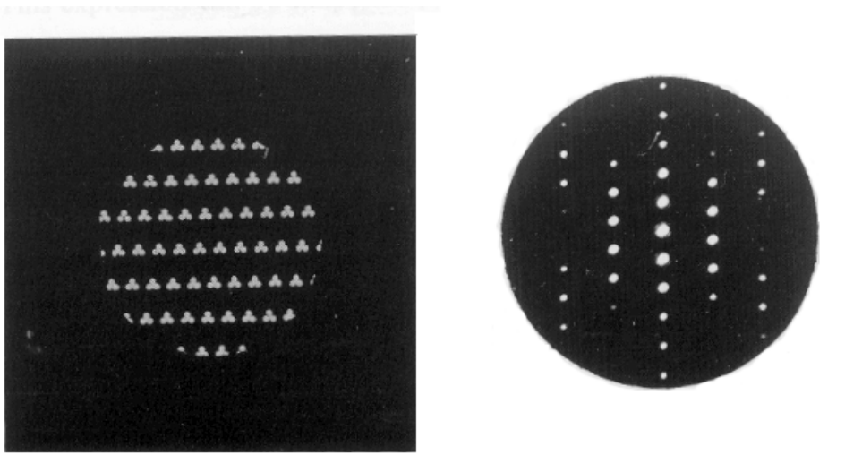

The goal of X-ray diffraction experiments is to determine the configuration of atoms from images of this type. Making the analysis even harder is that for 3D crystal lattices the images on an X-ray film are the projection onto the image plane of the 3D configuration. Just how difficult it may be to infer 3D structure from 2D projections is illustrated by a famous experiment: “Fun in Reciprocal Space” published in the distinguished American journal *The New Yorker*.

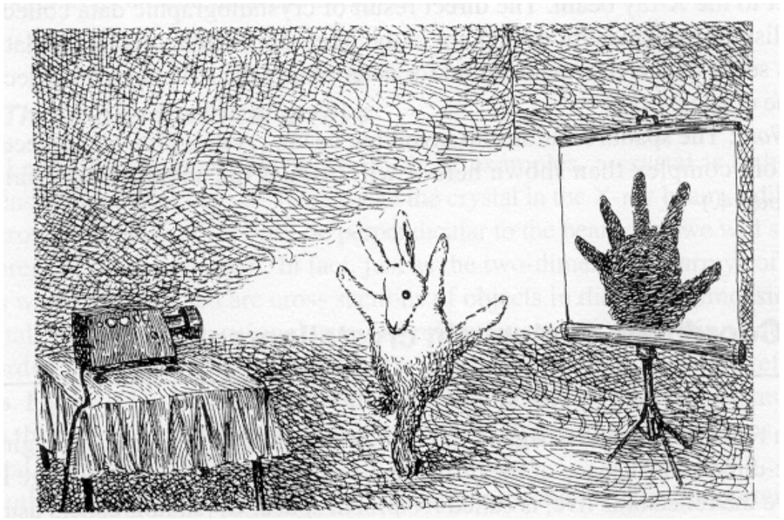

## 8.6 Bandlimited Functions on $\mathbf{R}^2$ and Sampling on a Lattice

Let’s develop the sampling formula in two dimensions. A function $f$ on $\mathbf{R}^2$ is bandlimited if $\mathcal{F}f$ is identically zero outside of some bounded region. We always assume that $f$ is real valued, and hence $\mathcal{F}f(-\boldsymbol{\xi}) = \overline{\mathcal{F}f(\boldsymbol{\xi})}$. Thus, as we’ve pointed out before, if $\mathcal{F}f(\boldsymbol{\xi}) \ne 0$ then $\mathcal{F}f(-\boldsymbol{\xi}) \ne 0$ and so, as a point set in $\mathbf{R}^2$, the spectrum is symmetric about the origin.

We want to derive a sampling formula associated with a lattice $\mathcal{L}$ by following the recipe of first periodizing $\mathcal{F}f$ via $\text{III}_{\mathcal{L}}$, then cutting off, and then taking the inverse Fourier transform. The result will be a sinc reconstruction of $f$ from its sampled values — but just where those sampled values are is what’s especially interesting and relevant to what we’ve just done.

To get the argument started we assume that the support of $\mathcal{F}f$ lies in a parallelogram. This parallelogram determines a fundamental parallelogram for a lattice $\mathcal{L}$, and the spectrum gets shifted parallel to itself and off itself through convolution with $\text{III}_{\mathcal{L}}$. This periodization is the first step and it’s analogous to the one-dimensional case when the spectrum lies in an interval, say from $-p/2$ to $p/2$, and the spectrum gets shifted around and off itself through convolution with $\text{III}_p$. Recall that the crucial limitation is that the spectrum only goes up to $p/2$ and down to $-p/2$, while $\text{III}_p$ has $\delta$’s spaced $p$ apart. The spacing of the $\delta$’s is big enough to shift the spectrum off itself and no smaller spacing will do. Correspondingly in two dimensions, the parallelogram containing the spectrum determines a lattice with “big enough spacing” for a $\text{III}$ based on the lattice to shift the spectrum off itself.

---

Using the general stretch theorem, we’ll be able to get the general result by first deriving a special case, when the spectrum lies in a square. Suppose, then, that $\mathcal{F}f(\boldsymbol{\xi})$ is identically zero *outside* the (open) square $|\xi_1| < 1/2$, $|\xi_2| < 1/2$. We work with the integer lattice $\mathbf{Z}^2$ with basis $\mathbf{e}_1$ and $\mathbf{e}_2$. The (open) fundamental parallelogram for $\mathbf{Z}^2$ is $0 < \xi_1 < 1$, $0 < \xi_2 < 1$ and the spectrum is inside the center fourth of four copies of it, as pictured.

Periodizing $\mathcal{F}f$ by $\text{III}_{\mathbf{Z}^2}$ shifts the spectrum off itself, and no smaller rectangular lattice will do for this.

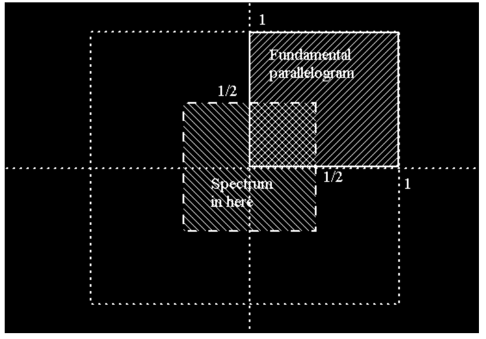

We then cut off by the two-dimensional rect function $\Pi(x_1, x_2) = \Pi(x_1)\Pi(x_2)$ and this gives back $\mathcal{F}f$:

$$
\mathcal{F}f(\boldsymbol{\xi}) = \Pi(\xi_1)\,\Pi(\xi_2)(\mathcal{F}f * \text{III}_{\mathbf{Z}^2})(\boldsymbol{\xi})\,.
$$

This is just as in the one-dimensional case, and now it’s time to take the inverse Fourier transform. Using $\mathcal{F}\text{III}_{\mathbf{Z}^2} = \text{III}_{\mathbf{Z}^2}$, or rather $\mathcal{F}^{-1}\text{III}_{\mathbf{Z}^2} = \text{III}_{\mathbf{Z}^2}$, and invoking the convolution theorem we obtain

$$
\begin{aligned}
f(\mathbf{x}) = f(x_1, x_2) &= (\operatorname{sinc} x_1 \operatorname{sinc} x_2) * (f(\mathbf{x})\cdot\text{III}_{\mathbf{Z}^2}(\mathbf{x})) \\
&= (\operatorname{sinc} x_1 \operatorname{sinc} x_2) * \Big(f(\mathbf{x})\cdot\sum_{k_1, k_2 = -\infty}^{\infty} \delta(\mathbf{x} - k_1\mathbf{e}_1 - k_2\mathbf{e}_2)\Big) \\
&= (\operatorname{sinc} x_1 \operatorname{sinc} x_2) * \sum_{k_1, k_2 = -\infty}^{\infty} f(k_1, k_2)\delta(x_1 - k_1, x_2 - k_2) \\
&= \sum_{k_1, k_2 = -\infty}^{\infty} f(k_1, k_2)\operatorname{sinc}(x_1 - k_1)\operatorname{sinc}(x_2 - k_2)\,.
\end{aligned}
$$

In solidarity with the general case soon to follow, let’s write this “square sampling formula” as

$$
f(\mathbf{x}) = \sum_{k_1, k_2 = -\infty}^{\infty} f(k_1\mathbf{e}_1 + k_2\mathbf{e}_2)\operatorname{sinc}(\mathbf{x}\cdot\mathbf{e}_1 - k_1)\operatorname{sinc}(\mathbf{x}\cdot\mathbf{e}_2 - k_2)\,.
$$

Now suppose that the spectrum of $\mathcal{F}f$ lies in the (open) parallelogram, as pictured, with $\mathbf{u}_1$ and $\mathbf{u}_2$ parallel to the sides and as long as the sides.

Let $A$ be the $2 \times 2$ matrix that takes $\mathbf{e}_1$ to $\mathbf{u}_1$ and $\mathbf{e}_2$ to $\mathbf{u}_2$, so that $A$ maps the lattice $\mathbf{Z}^2$ to the lattice $\mathcal{L}$ with basis $\mathbf{u}_1$ and $\mathbf{u}_2$. Let $B = A^{-\mathsf{T}}$ (hence $B^{-\mathsf{T}} = A$) and remember that $B$ takes $\mathbf{Z}^2$ to the dual lattice $\mathcal{L}^*$ of $\mathcal{L}$. A basis for $\mathcal{L}^*$ (the dual basis to $\mathbf{u}_1$ and $\mathbf{u}_2$) is

$$
\mathbf{u}_1^* = B\mathbf{e}_1, \quad \mathbf{u}_2^* = B\mathbf{e}_2\,.
$$

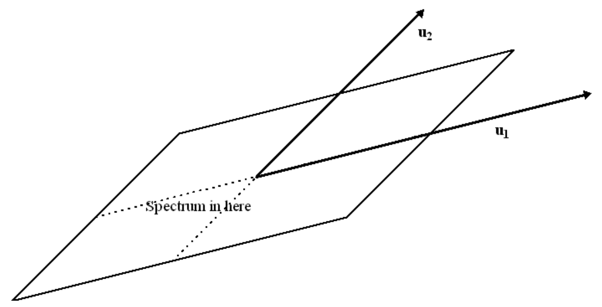

Next let

$$
g(\mathbf{x}) = f(B\mathbf{x})\,.
$$

According to the general stretch theorem,

$$
\mathcal{F}g(\boldsymbol{\xi}) = \frac{1}{|\det B|}\mathcal{F}f(B^{-\mathsf{T}}\boldsymbol{\xi}) = |\det A|\,\mathcal{F}f(A\boldsymbol{\xi})\,.
$$

The determinant factor out front doesn’t matter; what’s important is that the spectrum of $g$ is in the square $-1/2 < \xi_1 < 1/2$, $-1/2 < \xi_2 < 1/2$, since the corresponding points $A\boldsymbol{\xi}$ lie in the parallelogram containing the spectrum of $f$, i.e., $\mathcal{F}g$ is identically zero outside the square.

We now apply the square sampling formula to $g$ to write

$$
g(\mathbf{x}) = \sum_{k_1, k_2 = -\infty}^{\infty} g(k_1\mathbf{e}_1 + k_2\mathbf{e}_2)\operatorname{sinc}(\mathbf{x}\cdot\mathbf{e}_1 - k_1)\operatorname{sinc}(\mathbf{x}\cdot\mathbf{e}_2 - k_2)
$$

With $\mathbf{y} = B\mathbf{x}$ we can then say

$$
\begin{aligned}
f(\mathbf{y}) &= \sum_{k_1, k_2 = -\infty}^{\infty} f(B(k_1\mathbf{e}_1 + k_2\mathbf{e}_2))\operatorname{sinc}(B^{-1}\mathbf{y}\cdot\mathbf{e}_1 - k_1)\operatorname{sinc}(B^{-1}\mathbf{y}\cdot\mathbf{e}_2 - k_2) \\
&= \sum_{k_1, k_2 = -\infty}^{\infty} f(k_1B\mathbf{e}_1 + k_2B\mathbf{e}_2)\operatorname{sinc}(A^{\mathsf{T}}\mathbf{y}\cdot\mathbf{e}_1 - k_1)\operatorname{sinc}(A^{\mathsf{T}}\mathbf{y}\cdot\mathbf{e}_2 - k_2) \\
&= \sum_{k_1, k_2 = -\infty}^{\infty} f(k_1\mathbf{u}_1^* + k_2\mathbf{u}_2^*)\operatorname{sinc}(\mathbf{y}\cdot A\mathbf{e}_1 - k_1)\operatorname{sinc}(\mathbf{y}\cdot A\mathbf{e}_2 - k_2) \\
&= \sum_{k_1, k_2 = -\infty}^{\infty} f(k_1\mathbf{u}_1^* + k_2\mathbf{u}_2^*)\operatorname{sinc}(\mathbf{y}\cdot\mathbf{u}_1 - k_1)\operatorname{sinc}(\mathbf{y}\cdot\mathbf{u}_2 - k_2)\,.
\end{aligned}
$$

We’re done. Change $\mathbf{y}$ to $\mathbf{x}$ for psychological comfort, and the “lattice sampling formula” says that

$$
f(\mathbf{x}) = \sum_{k_1, k_2 = -\infty}^{\infty} f(k_1\mathbf{u}_1^* + k_2\mathbf{u}_2^*)\operatorname{sinc}(\mathbf{x}\cdot\mathbf{u}_1 - k_1)\operatorname{sinc}(\mathbf{x}\cdot\mathbf{u}_2 - k_2). \tag{8.1}
$$

This is a sinc reconstruction formula giving the function in terms of sample values on a lattice. But it’s the dual lattice! Here’s how to remember the highlights:

- The spectrum of $f$ lies in a parallelogram, which determines a lattice with basis $\mathbf{u}_1$ and $\mathbf{u}_2$.
- That lattice determines a dual lattice (in the spatial domain) with dual basis $\mathbf{u}_1^*$ and $\mathbf{u}_2^*$.
- The sincs use data from the lattice, while the sample points are exactly the points in the *dual* lattice.

Look back at the one-dimensional sampling formula and tell yourself what you see of this picture.

**Exercise** What should we mean by “sampling rate” vis à vis the two-dimensional lattice sampling formula?

---

The next topics on this path would be to investigate aliasing and to consider the case of a finite spectrum and finite sampling. Another time, another class.

## 8.7 Naked to the Bone

Our final topic in the course will be a quick development of the use of the Fourier transform in medical imaging. We’ll find that the two-dimensional Fourier transform is perfectly suited to the problem of recovering a *density* function — a function representing bones, internal organs, the whole lot — from the *projections* of that density obtained by passing parallel beams of X-rays through a two-dimensional cross section of the body. (For the discussion of the use of the Fourier transform I’m not making a distinction between the original methods of tomography using X-rays and those of magnetic resonance imaging.)

For an account of the history of medical imaging, I recommend the book *Naked to the Bone: Medical Imaging in the Twentieth Century* by Bettyann Kevles, from which I stole the title of this section.

**Dimmer and dimmer** What happens when light passes through murky water? It gets dimmer and dimmer the farther it goes, of course — this is not a trick question. If the water is the same murkiness throughout, meaning, for example, uniform density of stuff floating around in it, then it’s natural to assume that the intensity of light decreases by the same *percent amount* per length of path traveled. Through absorption, scattering, etc., whatever intensity comes in, a certain percentage of that intensity goes out; over a given distance the murky water removes a percentage of light, and this percentage depends only on the distance traveled and not on where the starting and stopping points are.[^8-16] We’re assuming here that light is traveling in a straight line through the water.

[^8-16]: Optical fibers provide an interesting and important study in the progress of making something — glass in this case — less murky. In the **Appendix 8.12** I’ve attached a graph showing just how dramatic the progress has been.

Constant percent change characterizes exponential growth, or decay, so the attenuation of the intensity of light passing through a homogeneous medium is modeled by

$$
I = I_0e^{-\mu x}\,,
$$

where $I_0$ is the initial intensity, $x$ is the distance traveled, and $\mu$ is a (positive) “murkiness constant”. $x$ has dimension of length and $\mu$ has dimension 1/length and units “murkiness/length”. $\mu$ is constant because we assume that the medium is homogeneous. We know the value of $I_0$, and one measurement of $x$ and $I$ will determine $\mu$. In fact, what we do is to put a detector at a known distance $x$ and measure the intensity when it arrives at the detector.

---

Now suppose the water is not uniformly murky, but rather the light passes through a number of layers, each layer of uniform murkiness. If the $i$’th layer has murkiness constant $\mu_i$ and is of length $\Delta x_i$, and if there are $n$ layers, then the intensity of light that reaches the detector can be modeled by

$$
I = I_0\exp\left(-\sum_{i=1}^n \mu_i\Delta x_i\right).
$$

Clearly, if the murkiness is described by a function $\mu(x)$, then the intensity arriving at the detector is modeled by

$$
I = I_0\exp\left(-\int_L \mu(x)\,dx\right),
$$

where $L$ is the line the light travels along. It’s common to call the number

$$
p = \int_L \mu(x)\,dx = -\ln\left(\frac{I}{I_0}\right)
$$

the *attenuation coefficient*.

---

Can we recover the density function $\mu(x)$ from knowledge of the intensity? Not so easily. Certainly not from a single reading — many arrangements of murkiness along the path could result in the same final intensity at the detector.

If we could vary the detector along the path and record the results then we would be able to determine $\mu(x)$. That is, if we could form

$$
p(\xi) = \int_{\xi_0}^{\xi} \mu(x)\,dx\,,
$$

as a *function* of a variable position $\xi$ along the line ($\xi_0$ is some fixed starting point — the source) then we could find $\mu$ from $p$ by finding the derivative $p''$. The trouble is moving the detector through the murky water along the path.

**Tomography** X-rays are light, too, and when they pass through murky stuff (your body) along a straight line they are attenuated and reach a detector on the other end at a reduced intensity. We can continue to assume that the attenuation, the decrease in intensity, is exponentially decreasing with the path length. The exponential of what? What do the X-rays pass through?

From the start we set this up as a two-dimensional problem. Take a planar slice through your body. The gunk in this two-dimensional slice — bones, organs, other tissue — is of *variable density*; let’s say it’s described by an unknown function $\mu(x_1, x_2)$. We consider $\mu(x_1, x_2)$ to be zero outside the section of the body. Take a line $L$ through this slice — in the plane of the slice, the path that an X-ray would follow — and parameterize the line by $x_1(s)$, $x_2(s)$, where $s$ is the arclength parameter going from $s_0$ to $s_1$. (The “arclength parameter” means that we move along the line at unit speed.) Then the density along the line is $\mu(x_1(s), x_2(s))$ and the attenuation of the X-ray intensity along the line is

$$
I = I_0\exp\left(-\int_{s_0}^{s_1} \mu(x_1(s), x_2(s))\,ds\right)
$$

Instead of writing out the parameters and limits, we often write the integral simply as

$$
\int_L \mu(x_1, x_2)\,ds\,.
$$

We’ll refer to this as a *line integral of $\mu$ along $L$*.

- The fundamental problem of tomography[^8-17] is to determine the function $\mu(x, y)$ from these line integrals, taken over many lines through the region.

[^8-17]: *tomos* means “section” in Greek

For example — what’s inside?

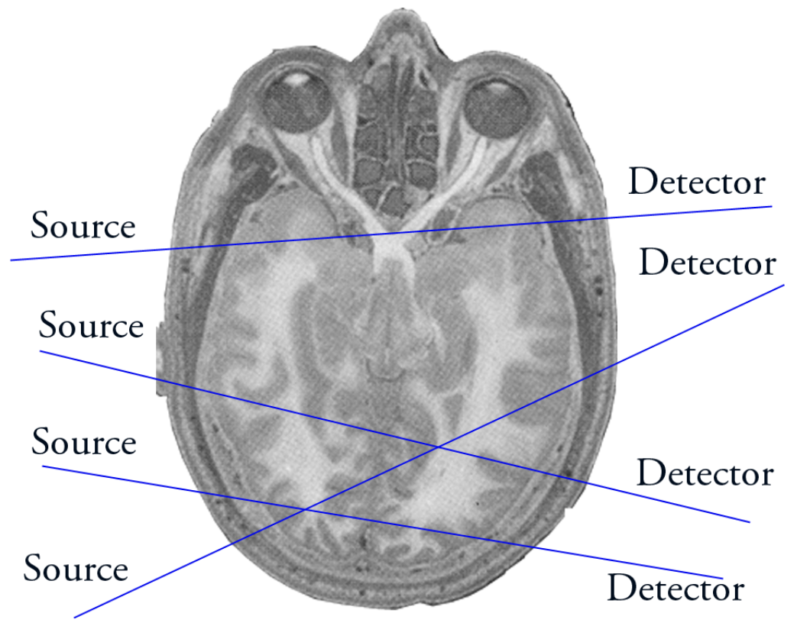

In trying to solve this problem, what’s not allowed is to move the detector through the body — that’s not covered by HMO plans. What *is* allowed is to rotate the source (and the detector) to get X-rays circling around the two-dimensional cross-section of the body, and what we’ll have are families of parallel X-rays. Before laying all this out, it pays to organize our study of the problem.

## 8.8 The Radon Transform

For each line $L$, cutting through the slice, the integral

$$
\int_L \mu(x_1, x_2)\,ds
$$

is a number. The operation “line determines number” thus defines a real-valued function of $L$. The whole subject of tomography is about this function. To work with it effectively we need to be able describe the set of all lines — not the (Cartesian) equation of a given line, but some kind of parametric description for the *collection* of lines. This will allow us to write the integral as a function of these parameters.

There are many ways to describe the collection of all lines in the plane. One that may seem most natural to you is to use the “slope-intercept” form for the equation of a line; a line can be written as $y = mx + b$ where $m$ is the slope and $b$ is the $y$-intercept. A line can thus be associated with a unique pair $(m, b)$ and vice versa. There’s a catch here, however — vertical lines (lines $x = \text{constant}$, infinite slope) are left out of this description.

Another approach, one that allows us to describe *all* lines and that is well suited for the function of $L$, above, goes as follows. First, a line *through the origin* is determined by its unit normal vector $\mathbf{n}$. Now, $\mathbf{n}$ and $-\mathbf{n}$ determine the same line, so we represent all the (distinct) normal vectors as $(\cos\phi, \sin\phi)$ for an angle $\phi$ satisfying $0 \le \phi < \pi$, measured counterclockwise from the $x_1$-axis. In other words, there is a one-to-one correspondence between the $\phi$’s with $0 \le \phi < \pi$ and the collection of all lines through the origin.

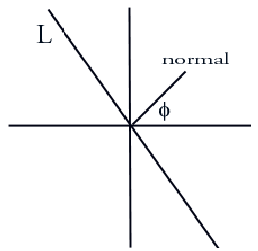

A line not through the origin can then be described by its unit normal vector together with the *directed* distance of the line from the origin, a positive number if measured in the direction of $\mathbf{n}$ and a negative number if measured in the direction $-\mathbf{n}$. Call this directed distance $\rho$. Thus $-\infty < \rho < \infty$.

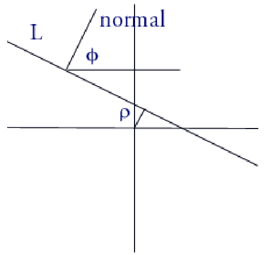

The set of pairs $(\rho, \phi)$ provides a parameterization for the set of all lines in the plane. Once again:

- A pair $(\rho, \phi)$ means, in this context, the unique line with normal vector $\mathbf{n} = (\cos\phi, \sin\phi)$ which is at a directed distance $\rho$ from the origin, measured in the direction $\mathbf{n}$ if $\rho > 0$ and in the direction $-\mathbf{n}$ if $\rho < 0$.

Anytime you’re confronted with a new coordinate system you should ask yourself what the situation is when one of the coordinates is fixed and the other is free to vary. In this case, if $\phi$ is fixed and $\rho$ varies we get a family of parallel lines.

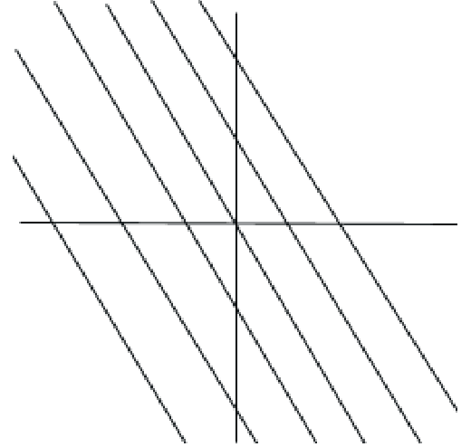

For the other case, when $\rho$ is fixed, we have to distinguish some cases. The pairs $(0, \phi)$ correspond to lines through the origin. When $\rho$ is positive and $\phi$ varies from 0 to $\pi$ (including 0, excluding $\pi$) we get the family of lines tangent to the upper semicircle of radius $\rho$ (including the tangent at $(\rho, 0)$ excluding the tangent at $(-\rho, 0)$). When $\rho < 0$ we get lines tangent to the lower semicircle (including the tangent at $(-|\rho|, 0)$, excluding the tangent at $(|\rho|, 0)$).

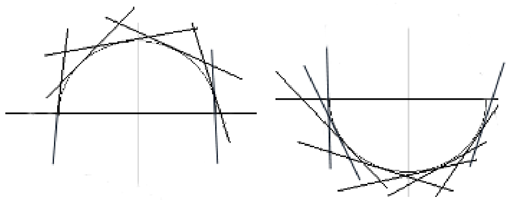

Using the coordinates $(\rho, \phi)$ we therefore have a *transform* of the function $\mu(x_1, x_2)$ to a function $\mathcal{R}\mu(\rho, \phi)$ defined by

$$
\mathcal{R}\mu(\rho, \phi) = \int_{L(\rho, \phi)} \mu(x_1, x_2)\,ds\,.
$$

This is called the *Radon transform* of $\mu$, introduced by Johann Radon — way back in 1917! The fundamental question of tomography can then be stated as:

- Is there an inversion formula for the Radon transform? That is, from knowledge of the values $\mathcal{R}\mu(\rho, \phi)$ can we recover $\mu$?

We’ve indicated the dependence of the integral on $\rho$ and $\phi$ by writing $L(\rho, \phi)$, but we want to use the coordinate description of lines to write the integral in a still more convenient form. Using the dot product, the line determined by $(\rho, \phi)$ is the set of points $(x_1, x_2)$ with

$$
\rho = \mathbf{x}\cdot\mathbf{n} = (x_1, x_2)\cdot(\cos\phi, \sin\phi) = x_1\cos\phi + x_2\sin\phi\,.
$$

or described via the equation

$$
\rho - x_1\cos\phi - x_2\sin\phi = 0\,, \quad -\infty < x_1 < \infty,\ -\infty < x_2 < \infty\,.
$$

Now consider the delta function “along the line”, that is,

$$
\delta(\rho - x_1\cos\phi - x_2\sin\phi)
$$

as a function of $x_1$, $x_2$. This is also called a *line impulse* and it’s an example of the greater variety one has in defining different sorts of $\delta$’s in two-dimensions. With some interpretation and argument (done in those notes) one can show that integrating a function $f(x_1, x_2)$ against the line impulse associated with a line $L$ results precisely in the line integral of $f$ along $L$. This is all we’ll need here, and with that the Radon transform of $\mu(x_1, x_2)$ can be expressed as

$$
\mathcal{R}(\mu)(\rho, \phi) = \int_{-\infty}^{\infty}\int_{-\infty}^{\infty} \mu(x_1, x_2)\delta(\rho - x_1\cos\phi - x_2\sin\phi)\,dx_1\,dx_2\,.
$$

This is the form we’ll most often work with. One also sees the Radon transform written as

$$
\mathcal{R}(\mu)(\rho, \mathbf{n}) = \int_{\mathbf{R}^2} \mu(\mathbf{x})\delta(\rho - \mathbf{x}\cdot\mathbf{n})\,d\mathbf{x}\,.
$$

This expression suggests generalizations to higher dimensions — interesting, but we won’t pursue them.

**Projections** It’s often convenient to work with $\mathcal{R}(\mu)(\rho, \phi)$ by first fixing $\phi$ and letting $\rho$ vary. Then we’re looking at parallel lines passing through the domain of $\mu$, all perpendicular to a particular line making an angle $\phi$ with the $x_1$-axis (that line is the common normal to the parallel lines), and we compute the integral of $\mu$ along these lines.

This collection of values, $\mathcal{R}(\mu)(\rho, \phi)$ with $\phi$ fixed, is often referred to as a *projection* of $\mu$, the idea being that the line integrals over parallel lines at a fixed angle are giving some kind of profile, or projection, of $\mu$ in that direction.[^8-18] Then varying $\phi$ gives us a family of projections, and one speaks of the inversion problem as “determining $\mu(x_1, x_2)$ from its projections”.

[^8-18]: **Important:** Don’t be fooled by the term “projection”. You are *not* geometrically projecting the shape of the two-dimensional cross section (that the lines are cutting through). You are looking at the attenuated, parallel X-rays that emerge as we move a source along a line. The line is at some angle relative to a reference axis.

This is especially apt terminology for the medical applications, since that’s how a scan is made:

1. Fix an angle and send in a bunch of parallel X-rays at that angle.
2. Change the angle and repeat.

## 8.9 Getting to Know Your Radon Transform

We want to develop a few properties of the Radon transform, just enough to get some sense of how to work with it. First, a few comments on what kinds of functions $\mu(x_1, x_2)$ one wants to use; it’s interesting but we won’t make an issue of it.

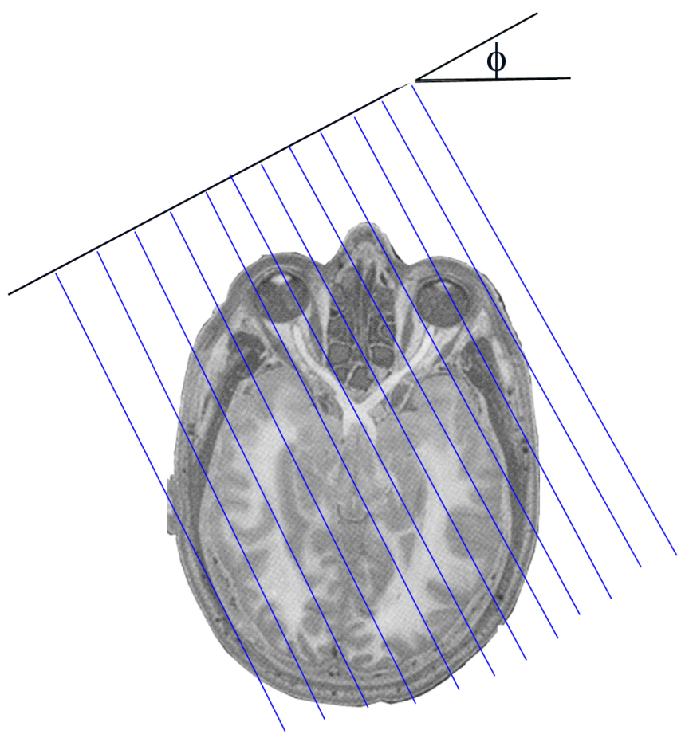

Inspired by honest medical applications, we would *not* want to require that the cross-sectional density $\mu(x_1, x_2)$ be smooth, or even continuous. Jump discontinuities in $\mu(x_1, x_2)$ correspond naturally to a change from bone to muscle, *etc.* Although, mathematically speaking, the lines extend infinitely, in practice the paths are finite. In fact, the easiest thing is just to assume that $\mu(x_1, x_2)$ is zero outside of some region — it’s describing the density of a slice of a finite extent body, after all.

**Examples** There aren’t too many cases where one can compute the Radon transform explicitly. One example is the circ function, expressed in polar coordinates as

$$
\operatorname{circ}(r) = \begin{cases} 1 & r \le 1 \\ 0 & r > 1 \end{cases}
$$

We have to integrate the circ function along any line. Think in terms of projections, as defined above. From the circular symmetry, it’s clear that the projections are independent of $\phi$.

Because of this we can take any convenient value of $\phi$, say $\phi = 0$, and find the integrals over the parallel lines in this family. The circ function is 0 outside the unit circle, so we need only to find the integral (of the function 1) over any chord of the unit circle parallel to the $x_2$-axis. This is easy. If the chord is at a distance $\rho$ from the origin, $|\rho| \le 1$, then

$$
\mathcal{R}(1)(\rho, 0) = \int_{-\sqrt{1-\rho^2}}^{\sqrt{1-\rho^2}} 1\,dx_2 = 2\sqrt{1 - \rho^2}\,.
$$

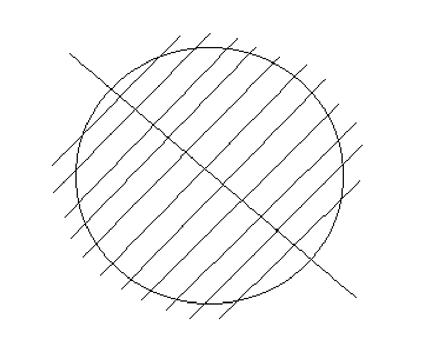

Thus for any $(\rho, \phi)$,

$$
\mathcal{R}\operatorname{circ}(\rho, \phi) = \begin{cases} 2\sqrt{1 - \rho^2} & |\rho| \le 1 \\ 0 & |\rho| > 1 \end{cases}
$$

**Gaussians again** Another example where we can compute the Radon transform exactly is for a Gaussian:

$$
g(x_1, x_2) = e^{-\pi(x_1^2 + x_2^2)}\,.
$$

Any guesses as to what $\mathcal{R}g$ is? Let’s do it.

Using the representation in terms of the line impulse we can write

$$
\mathcal{R}g(\rho, \phi) = \int_{-\infty}^{\infty}\int_{-\infty}^{\infty} e^{-\pi(x_1^2 + x_2^2)}\delta(\rho - x_1\cos\phi - x_2\sin\phi)\,dx_1\,dx_2\,.
$$

We now make a change of variables in this integral, putting

$$
\begin{aligned}
u_1 &= x_1\cos\phi + x_2\sin\phi, \\
u_2 &= -x_1\sin\phi + x_2\cos\phi.
\end{aligned}
$$

This is a rotation of coordinates through an angle $\phi$, making the $u_1$-axis correspond to the $x_1$-axis. The Jacobian of the transformation is 1, and we also find that

$$
u_1^2 + u_2^2 = x_1^2 + x_2^2\,.
$$

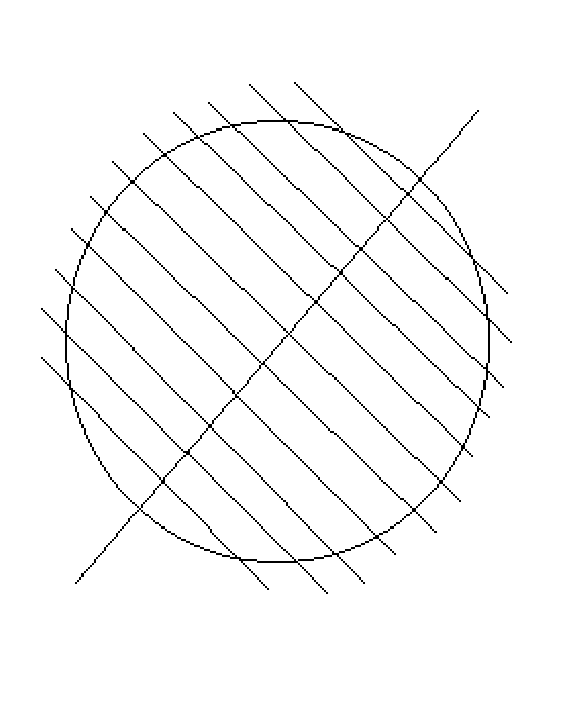

In the new coordinates the integral becomes:

$$
\begin{aligned}
\mathcal{R}g(\rho, \phi) &= \int_{-\infty}^{\infty}\int_{-\infty}^{\infty} e^{-\pi(u_1^2 + u_2^2)}\delta(\rho - u_1)\,du_1du_2 \\
&= \int_{-\infty}^{\infty}\left(\int_{-\infty}^{\infty} e^{-\pi u_1^2}\delta(\rho - u_1)\,du_1\right)e^{-\pi u_2^2}\,du_2 \\
&= \int_{-\infty}^{\infty} e^{-\pi\rho^2}e^{-\pi u_2^2}\,du_2 \quad \text{(by the sifting property of } \delta\text{)} \\
&= e^{-\pi\rho^2}\int_{-\infty}^{\infty} e^{-\pi u_2^2}\,du_2 \\
&= e^{-\pi\rho^2} \quad \text{(because the Gaussian is normalized to have area 1)}
\end{aligned}
$$

Writing this in polar coordinates, $r = x_1^2 + x_2^2$, we have shown that

$$
\mathcal{R}(e^{-\pi r^2}) = e^{-\pi\rho^2}\,.
$$

How about that.

**Linearity, Shifts, and Evenness** We need a few general properties of the Radon transform.

**Linearity:** $\mathcal{R}(\alpha f + \beta g) = \alpha\mathcal{R}(f) + \beta\mathcal{R}(g)$. This holds because integration is a linear function of the integrand.

**Shifts:** This is a little easier to write (and to derive) in vector form. Let $\mathbf{n} = (\cos\phi, \sin\phi)$. The result is

$$
\mathcal{R}(\mu(\mathbf{x} - \mathbf{b})) = (\mathcal{R}\mu)(\rho - \mathbf{b}\cdot\mathbf{n}, \phi)
$$

In words: shifting $\mathbf{x}$ by $\mathbf{b}$ has the effect of shifting each projection a distance $\mathbf{b}\cdot\mathbf{n}$ in the $\rho$-variable.

To derive this we write the definition as

$$
\mathcal{R}(\mu(\mathbf{x} - \mathbf{b})) = \int_{\mathbf{R}^2} \mu(\mathbf{x} - \mathbf{b})\delta(\rho - \mathbf{x}\cdot\mathbf{n})\,d\mathbf{x}
$$

If $\mathbf{b} = (b_1, b_2)$ then the change of variable $u_1 = x_1 - b_1$ and $u_2 = x_2 - b_2$, or simply $\mathbf{u} = \mathbf{x} - \mathbf{b}$ with $\mathbf{u} = (u_1, u_2)$, converts this integral into

$$
\begin{aligned}
\mathcal{R}(\mu(\mathbf{x} - \mathbf{b})) &= \int_{\mathbf{R}^2} \mu(\mathbf{u})\delta(\rho - (\mathbf{u} + \mathbf{b})\cdot\mathbf{n})\,d\mathbf{u} \\
&= \int_{\mathbf{R}^2} \mu(\mathbf{u})\delta(\rho - \mathbf{u}\cdot\mathbf{n} - \mathbf{b}\cdot\mathbf{n}))\,d\mathbf{u} \\
&= (\mathcal{R}\mu)(\rho - \mathbf{b}\cdot\mathbf{n}, \phi)
\end{aligned}
$$

**Evenness:** Finally, the Radon transform always has a certain symmetry — it is always an even function of $\rho$ and $\phi$. This means that

$$
\mathcal{R}\mu(-\rho, \phi + \pi) = \mathcal{R}\mu(\rho, \phi)\,.
$$

Convince yourself that this makes sense in terms of the projections. The derivation goes:

$$
\begin{aligned}
\mathcal{R}\mu(-\rho, \phi + \pi) &= \int_{-\infty}^{\infty}\int_{-\infty}^{\infty} \mu(x_1, x_2)\delta(-\rho - x_1\cos(\phi + \pi) - x_2\sin(\phi + \pi))\,dx_1\,dx_2 \\
&= \int_{-\infty}^{\infty}\int_{-\infty}^{\infty} \mu(x_1, x_2)\delta(-\rho - x_1(-\cos\phi) - x_2(-\sin\phi))\,dx_1\,dx_2 \\
&= \int_{-\infty}^{\infty}\int_{-\infty}^{\infty} \mu(x_1, x_2)\delta(-\rho + x_1\cos\phi + x_2\sin\phi)\,dx_1\,dx_2 \\
&= \int_{-\infty}^{\infty}\int_{-\infty}^{\infty} \mu(x_1, x_2)\delta(\rho - x_1\cos\phi - x_2\sin\phi)\,dx_1\,dx_2 \quad \text{(because } \delta \text{ is even)} \\
&= \mathcal{R}\mu(\rho, \phi)
\end{aligned}
$$

## 8.10 Appendix: Clarity of Glass

Here’s a chart showing how the clarity of glass has improved over the ages, with some poetic license in estimating the clarity of the windows of ancient Egypt. Note that on the vertical axis on the left the tick marks are powers of 10 but the units are in decibels — which already involve taking a logarithm! The big jump in clarity going to optical fibers was achieved largely by eliminating water in the glass.

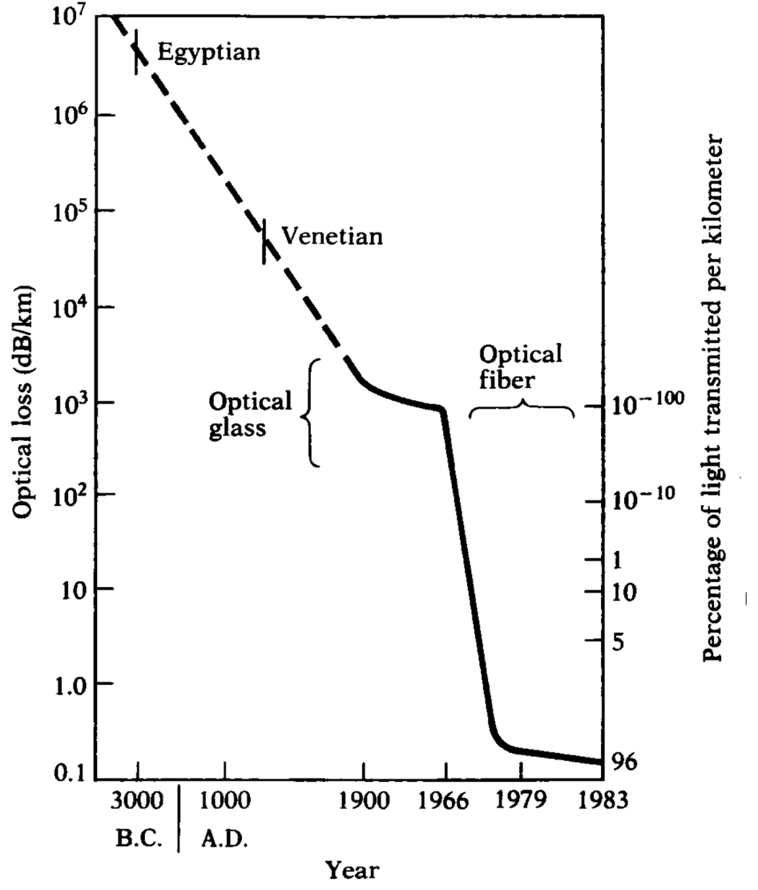
## 8.11 Medical Imaging: Inverting the Radon Transform

Let’s recall the setup for tomography. We have a two-dimensional region (a slice of a body) and a density function $\mu(x_1, x_2)$ defined on the region. The Radon transform of $\mu$ is obtained by integrating $\mu$ along lines that cut across the region. We write this as

$$
\mathcal{R}\mu(\rho, \phi) = \int_{-\infty}^{\infty}\int_{-\infty}^{\infty} \mu(x_1, x_2)\delta(\rho - x_1\cos\phi - x_2\sin\phi)\,dx_1\,dx_2\,.
$$

Here $(\rho, \phi)$ are coordinates that specify a line; $\phi$ $(0 \le \phi < \pi)$ is the angle the *normal* to the line makes with the $x_1$-axis and $\rho$ $(-\infty < \rho < \infty)$ is the directed distance of the line from the origin. $\delta(\rho - x_1\cos\phi - x_2\sin\phi)$ is a line impulse, a $\delta$-function along the line whose (Cartesian) equation is $\rho - x_1\cos\phi - x_2\sin\phi = 0$.

If we fix $\phi$ and vary $\rho$, then $\mathcal{R}\mu(\rho, \phi)$ is a collection of integrals along parallel lines through the region, all making the same angle, $\phi + \pi/2$, with a reference axis, the $x_1$-axis. This set of values is referred to as a *projection* of $\mu$. Thus one often speaks of the Radon transform as a collection of projections parameterized by an angle $\phi$.

In practice $\mu(x_1, x_2)$ is unknown, and what is available are the values $\mathcal{R}\mu(\rho, \phi)$. These values (or rather a constant times the exponential of these values) are what your detector registers when an X-ray reaches it having gone through the region and having been attenuated according to its encounter with $\mu(x_1, x_2)$. The problem is to reconstruct $\mu(x_1, x_2)$ from these meter readings, in other words to invert the Radon transform.

Among those who use these techniques, $\mu(x_1, x_2)$ is often referred to simply as an *image*. In that terminology the problem is then “to reconstruct the image from its projections”.

**The Projection-Slice Theorem** The inversion problem is solved by a result that relates the *two-dimensional* Fourier transform of $\mu$ to a *one-dimensional Fourier transform* of $\mathcal{R}(\mu)$, *taken with respect to $\rho$*. Once $\mathcal{F}\mu$ is known, $\mu$ can be found by Fourier inversion.

The formulation of this relation between the Fourier transforms of an image and its projections is called the *Projection-Slice Theorem*[^8-19] and is the cornerstone of tomography. We’ll go through the derivation, but it must be said at once that, for practical applications, all of this has to be implemented *numerically*, i.e., with the DFT (and the FFT). Much of the early work in Computer Assisted Tomography (CAT) was in finding efficient algorithms for doing just this. An important issue are the errors introduced by approximating the transforms, termed *artifacts* when the reconstructed image $\mu(x_1, x_2)$ is drawn on a screen. We won’t have time to discuss this aspect of the problem.

[^8-19]: Also called the Central Slice Theorem, or the Center Slice theorem.

---

Starting with

$$
\mathcal{R}\mu(\rho, \phi) = \int_{-\infty}^{\infty}\int_{-\infty}^{\infty} \mu(x_1, x_2)\delta(\rho - x_1\cos\phi - x_2\sin\phi)\,dx_1\,dx_2\,,
$$

what is its Fourier transform with respect to $\rho$, regarding $\phi$ as fixed? For lack of a better notation, we write this as $\mathcal{F}_\rho(\mathcal{R}(\mu))$. Calling the frequency variable $r$ — dual to $\rho$ — we then have

$$
\begin{aligned}
\mathcal{F}_\rho\mathcal{R}(\mu)(r, \phi) &= \int_{-\infty}^{\infty} e^{-2\pi ir\rho}\mathcal{R}\mu(\rho, \phi)\,d\rho \\
&= \int_{-\infty}^{\infty} e^{-2\pi ir\rho}\int_{-\infty}^{\infty}\int_{-\infty}^{\infty} \mu(x_1, x_2)\delta(\rho - x_1\cos\phi - x_2\sin\phi)\,dx_1\,dx_2\,d\rho \\
&= \int_{-\infty}^{\infty}\int_{-\infty}^{\infty} \mu(x_1, x_2)\left(\int_{-\infty}^{\infty} \delta(\rho - x_1\cos\phi - x_2\sin\phi)e^{-2\pi ir\rho}\,d\rho\right)dx_1\,dx_2 \\
&= \int_{-\infty}^{\infty}\int_{-\infty}^{\infty} \mu(x_1, x_2)e^{-2\pi ir(x_1\cos\phi + x_2\sin\phi)}\,dx_1\,dx_2 \\
&= \int_{-\infty}^{\infty}\int_{-\infty}^{\infty} \mu(x_1, x_2)e^{-2\pi i(x_1r\cos\phi + x_2r\sin\phi)}\,dx_1\,dx_2
\end{aligned}
$$

Check out what happened here: By interchanging the order of integration we wind up integrating the line impulse against the complex exponential $e^{-2\pi ir\rho}$. For that integration we can regard $\delta(\rho - x_1\cos\phi - x_2\sin\phi)$ as a shifted $\delta$-function, and the integration with respect to $\rho$ produces $e^{-2\pi i(x_1r\cos\phi + x_2r\sin\phi)}$. Now if we let

$$
\begin{aligned}
\xi_1 &= r\cos\phi \\
\xi_2 &= r\sin\phi
\end{aligned}
$$

the remaining double integral is

$$
\int_{-\infty}^{\infty}\int_{-\infty}^{\infty} e^{-2\pi i(x_1\xi_1 + x_2\xi_2)}\mu(x_1, x_2)\,dx_1\,dx_2 = \int_{\mathbf{R}^2} e^{-2\pi i\mathbf{x}\cdot\boldsymbol{\xi}}\mu(\mathbf{x})\,d\mathbf{x}\,.
$$

This is the two-dimensional Fourier transform of $\mu$.

---

We have shown

- The Projection-Slice Theorem:

  $$
  \mathcal{F}_\rho\mathcal{R}(\mu)(r, \phi) = \mathcal{F}\mu(\xi_1, \xi_2), \quad \xi_1 = r\cos\phi,\ \xi_2 = r\sin\phi\,.
  $$

---

Observe that

$$
r^2 = \xi_1^2 + \xi_2^2 \quad\text{and}\quad \tan\phi = \frac{\xi_2}{\xi_1}\,.
$$

This means that $(r, \phi)$ are polar coordinates for the $(\xi_1, \xi_2)$-frequency plane. As $\phi$ varies between 0 and $\pi$ (including 0, excluding $\pi$) and $r$ between $-\infty$ and $\infty$ we get all the points in the plane.

**Reconstructing the image** That last derivation happened pretty fast. Let’s unpack the steps in using the projection-slice theorem to reconstruct an image from its projections.

1. We have a source and a sensor that rotate about some center. The angle of rotation is $\phi$, where $0 \le \phi < \pi$.
2. A family of parallel X-rays pass from the source through a (planar) region of unknown, variable density, $\mu(x_1, x_2)$, and are registered by the sensor.

   For each $\phi$ the readings at the meter thus give a function $g_\phi(\rho)$ (or $g(\rho, \phi)$), where $\rho$ is the (directed) distance that a particular X-ray is from the center of the beam of parallel X-rays.

   Each such function $g_\phi$, for different $\phi$’s, is called a projection.
3. For each $\phi$ we compute $\mathcal{F}g_\phi(r)$, i.e., the Fourier transform of $g_\phi(\rho)$ with respect to $\rho$.
4. Since $g_\phi(\rho)$ also depends on $\phi$ so does its Fourier transform. Thus we have a function of two variables, $G(r, \phi)$, the Fourier transform of $g_\phi(\rho)$. The projection-slice theorem tells us that this is the Fourier transform of $\mu$:

   $$
   \mathcal{F}\mu(\xi_1, \xi_2) = G(r, \phi), \quad \text{where} \quad \xi_1 = r\cos\phi,\ \xi_2 = r\sin\phi\,.
   $$

   Thus $(\mathcal{F}\mu)(\xi_1, \xi_2)$ is *known.*
5. Now take the inverse two-dimensional Fourier transform to recover $\mu$:

   $$
   \mu(\mathbf{x}) = \int_{\mathbf{R}^2} e^{2\pi i\mathbf{x}\cdot\boldsymbol{\xi}}\,\mathcal{F}\mu(\boldsymbol{\xi})\,d\boldsymbol{\xi}\,.
   $$

**Running the numbers** Very briefly, let’s go through how one might set up a numerical implementation of the procedure we’ve just been through. The function that we know is $g(\rho, \phi)$ — that’s what the sensor gives us, at least in discrete form. To normalize things we suppose that $g(\rho, \phi)$ is zero for $|\rho| \ge 1$. This means, effectively, that the region we’re passing rays through is contained within the circle of radius one — the region is bounded so we can assume that it lies within some disk, so we scale to assume the the region lies within the unit disk.

Suppose we have $M$ equal angles, $\phi_j = j\pi/M$, for $j = 0, \dots, M - 1$. Suppose next that for each angle we send through $N$ X-rays. We’re assuming that $-1 \le \rho \le 1$, so the rays are spaced $\Delta\rho = 2/N$ apart and we index them to be

$$
\rho_n = \frac{2n}{N}\,, \quad n = -\frac{N}{2}, \dots, \frac{N}{2} - 1\,.
$$

Then our projection data are the $MN$ values

$$
g_{nj} = g(\rho_n, \phi_j)\,, \quad j = 0, \dots, M - 1\,,\ n = -\frac{N}{2}, \dots, \frac{N}{2} - 1\,.
$$

The first step in applying the projection slice theorem is to find the one-dimensional Fourier transform of $g(\rho, \phi_j)$ with respect to $\rho$, which, since the function is zero for $|\rho| \ge 1$, is the integral

$$
\mathcal{F}g(r, \phi_j) = \int_{-1}^1 e^{-2\pi ir\rho}g(\rho, \phi_j)\,d\rho\,.
$$

We have to approximate and discretize the integral. One approach to this is very much like the one we took in obtaining the DFT (Chapter 6). First, we’re integrating with respect to $\rho$, and we already have sample points at the $\rho_n = 2n/N$; evaluating $g$ at those points gives exactly $g_{nj} = g(\rho_n, \phi_j)$. We’ll use these for a trapezoidal rule approximation.

We also have to discretize in $r$, the “frequency variable” dual to $\rho$. According to the sampling theorem, if we want to reconstruct $\mathcal{F}g(r, \phi_j)$ from its samples in $r$ the sampling rate is determined by the extent of $g(\rho, \phi_j)$ in the spatial domain, where the variable $\rho$ is limited to $-1 \le \rho \le 1$. So the sampling rate in $r$ is 2 and the sample points are spaced 1/2 apart:

$$
r_m = \frac{m}{2}\,, \quad m = -\frac{N}{2}, \dots, \frac{N}{2} - 1\,.
$$

The result of the trapezoidal approximation using $\rho_n = 2n/N$ and of discretizing in $r$ using $r_m = m/2$ is

$$
\begin{aligned}
\mathcal{F}g(r_m, \phi_j) &\approx \frac{2}{N}\sum_{n=-N/2+1}^{N/2} e^{-2\pi i\rho_nr_m}g_{nj} \\
&= \frac{2}{N}\sum_{n=-N/2+1}^{N/2} e^{-2\pi inm/N}g_{nj}\,.
\end{aligned}
$$

(The 2 in $2/N$ comes in from the form of the trapezoidal rule.) Up to the constant out front, this is a DFT of the sequence $(g_{nj})$, $n = -N/2 + 1, \dots, N/2$. (Here $n$ is varying, while $j$ indexes the projection.) That is,

$$
\mathcal{F}g(r_m, \phi_j) \approx \frac{2}{N}\underline{\mathcal{F}}\,(g_{nj})[m]\,.
$$

Computing this DFT for each of the $M$ projections $\phi_j$ $(j = 0, \dots, M - 1)$ gives the data $\mathcal{F}g(r_m, \phi_j)$. Call this

$$
G_{mj} = \underline{\mathcal{F}}\,(g_{nj})[m]\,.
$$

The next step is to take the two-dimensional *inverse* Fourier transform of the data $G_{mj}$. Now there’s an interesting problem that comes up in implementing this efficiently. The $G_{mj}$ are presented as data points based on a *polar coordinate* grid in the frequency domain:

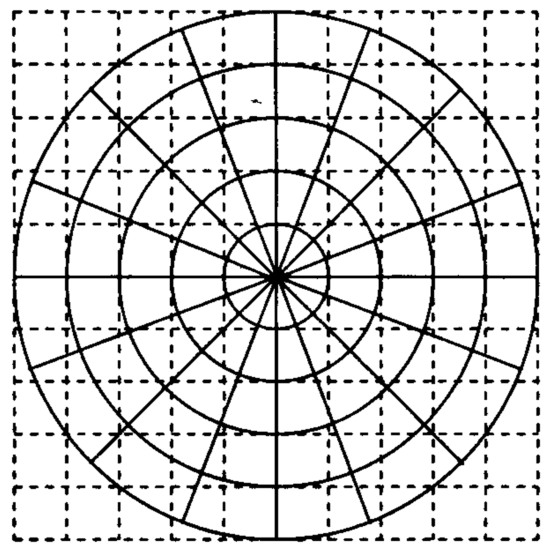

The vertices in this picture are the points $(r_m, \phi_j)$ and that’s where the data points $G_{mj}$ live. However, efficient FFT algorithms depend on the data being presented on a *Cartesian* grid. One way this is often done is to manufacture data at Cartesian grid points by taking a weighted average of the $G_{mj}$ at the polar grid points which are nearest neighbors:

$$
G_{\text{Cartesian}} = w_aG_a + w_bG_b + w_cG_c + w_dG_d\,.
$$

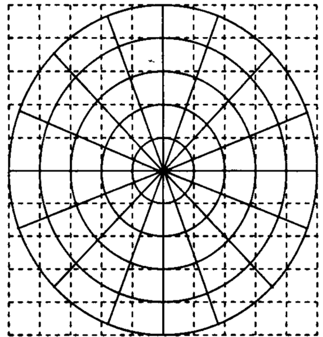 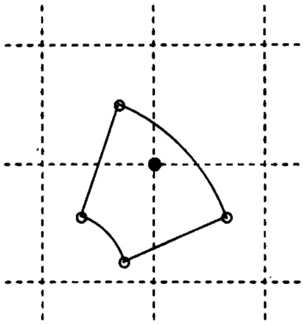

Choosing the weighting factors $w_a$, $w_b$, $w_c$ and $w_c$ is part of the art, but *the most significant introductions of error in the whole process come from this step.*

The final picture is then created by

$$
\mu(\text{grid points in spatial domain}) = \underline{\mathcal{F}}^{-1}(G_{\text{Cartesian}})\,.
$$

**This is your brain. This is your brain on Fourier transforms** Here are some pictures of a Fourier reconstruction of a model brain.[^8-20]. The “brain” is modeled by a high density elliptical shell (the skull) with lower density elliptical regions inside.

[^8-20]: See the paper: L A. Shepp and B. F. Logan, The Fourier reconstruction of a head section, *IEEE Trans. Nucl. Sci.*, NS-21 (1974) 21–43.

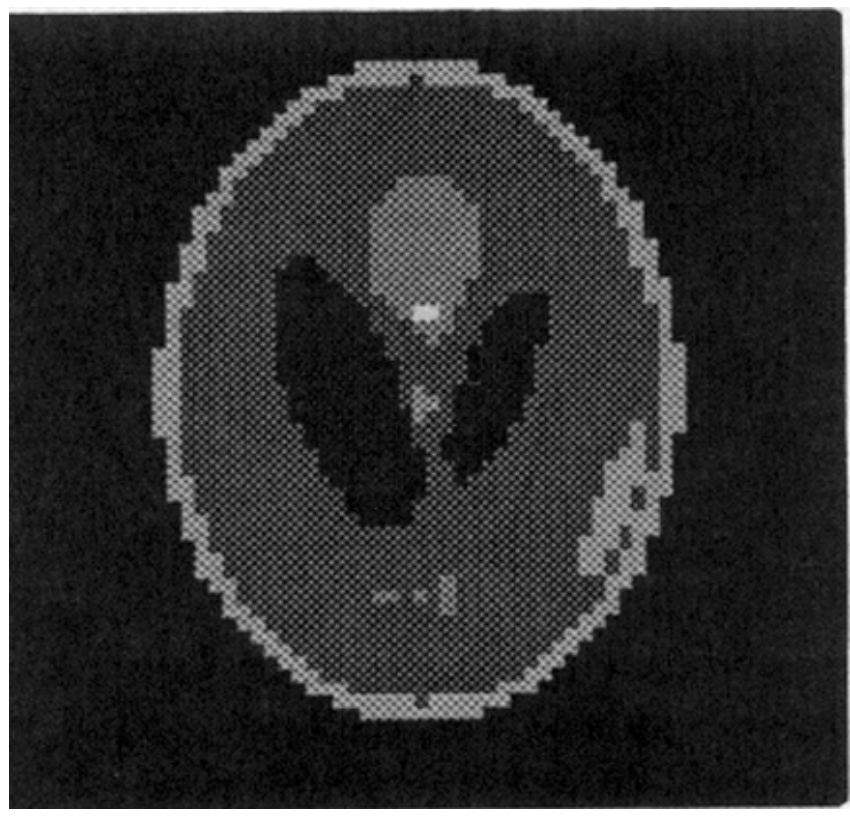

It’s possible to compute explicity the Radon transform for lines going through an elliptical region, so the sampling can be carried out based on these formulas. There are 64 projections (64 $\phi_j$’s) each sampled at 64 points (64 $\rho_n$’s) in the interval $[-1, 1]$. Here’s the plot of the values of the projections (the Radon transforms along the lines). As in pictures of the (Fourier) spectrum of images, the values here are represented via shading; white represents large values and black represents small values. The horizontal axis is $\rho$ and the vertical is $\phi$.

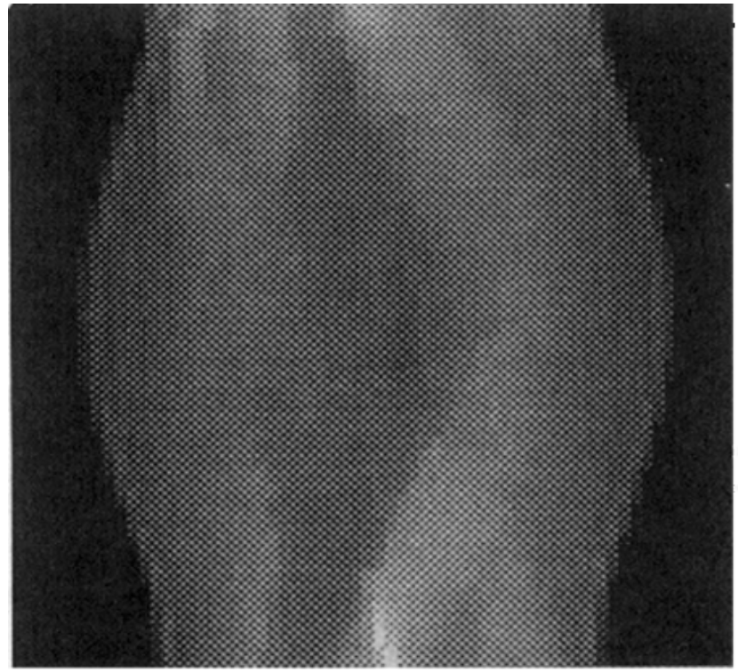

And here is the reconstructed brain.

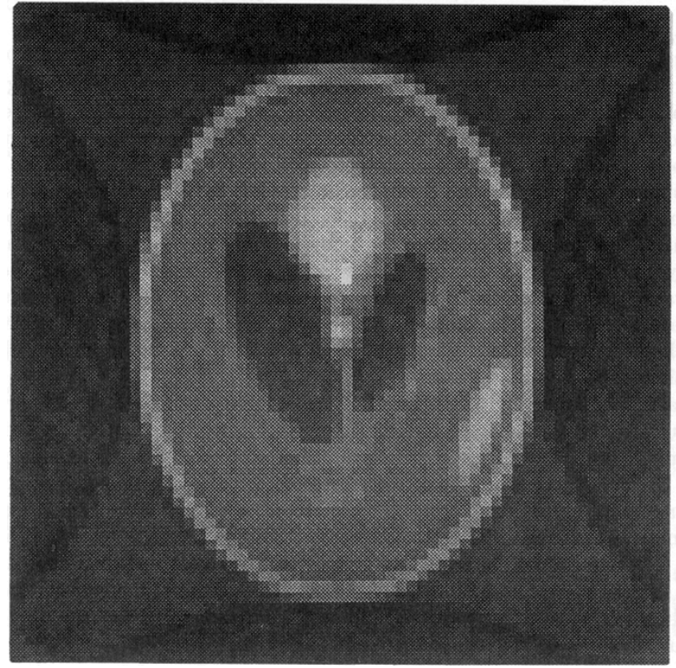
