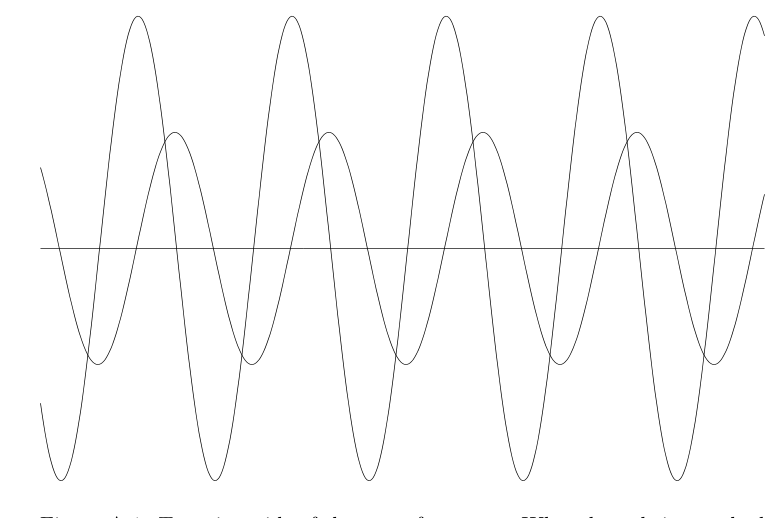

# Appendix A: Mathematical Background

## A.1 Complex Numbers

These notes are intended as a summary and review of complex numbers. I’m assuming that the definition, notation, and arithmetic of complex numbers are known to you, but we’ll put the basic facts on the record. In the course we’ll also use calculus operations involving complex numbers, usually complex valued functions of a real variable. For what we’ll do, this will *not* involve the area of mathematics referred to as “Complex Analysis”.

For our purposes, the extensions of the formulas of calculus to complex numbers are straightforward and reliable.

> **Declaration of principles** Without apology I will write
>
> $$
> i = \sqrt{-1}\,.
> $$
>
> In many areas of science and engineering it’s common to use $j$ for $\sqrt{-1}$. If you want to use $j$ in your own work I won’t try to talk you out of it. But I’ll use $i$.

Before we plunge into notation and formulas there are two points to keep in mind:

- Using complex numbers *greatly* simplifies the algebra we’ll be doing. This isn’t the only reason they’re used, but it’s a good one.
- We’ll use complex numbers to represent real quantities — real signals, for example. At this point in your life this should not cause a metaphysical crisis, but if it does my only advice is *to get over it.*

Let’s go to work.

**Complex numbers, real and imaginary parts, complex conjugates** A *complex number* is determined by two real numbers, its *real* and *imaginary* parts. We write

$$
z = x + iy
$$

where $x$ and $y$ are real and

$$
i^2 = -1\,.
$$

$x$ the real part and $y$ is the imaginary part, and we write $x = \operatorname{Re} z$, $y = \operatorname{Im} z$. Note: it’s $y$ that is the imaginary part of $z = x + iy$, not $iy$. One says that $iy$ is an *imaginary number* or is *purely imaginary.* One says that $z$ has positive real part (resp., positive imaginary part) if $x$ (resp., $y$) is positive. The set of all complex numbers is denoted by $\mathbf{C}$. (The set of all real numbers is denoted by $\mathbf{R}$.)

Elementary operations on complex numbers are defined according to what happens to the real and imaginary parts. For example, if $z = a + ib$ and $w = c + di$ then their sum and product are given by

$$
\begin{aligned}
z + w &= (a + c) + (b + d)i \\
zw &= (ac - bd) + i(ad + bc)
\end{aligned}
$$

I’ll come back to the formula for the general quotient $z/w$, but here’s a particular little identity that’s used often: Since $i \cdot i = i^2 = -1$ we have

$$
\frac{1}{i} = -i \quad \text{and} \quad i(-i) = 1\,.
$$

---

The *complex conjugate* of $z = x + iy$ is

$$
\bar{z} = x - iy\,.
$$

Other notations for the complex conjugate are $z^*$ and sometimes even $z^\dagger$. It’s useful to observe that

$$
z = \bar{z} \quad \text{if and only if } z \text{ is real, i.e., } y = 0.
$$

Note also that

$$
\overline{z + w} = \overline{z} + \overline{w}\,, \quad \overline{zw} = \overline{z}\,\overline{w}\,, \quad \overline{\overline{z}} = z\,.
$$

We can find expressions for the real and imaginary parts of a complex number using the complex conjugate. If $z = x + iy$ then $\overline{z} = x - iy$ so that in the sum $z + \overline{z}$ the imaginary parts cancel. That is $z + \overline{z} = 2x$, or

$$
x = \operatorname{Re} z = \frac{z + \overline{z}}{2}\,.
$$

Similarly, in the difference, $z - \bar{z}$, the real parts cancel and $z - \bar{z} = 2iy$, or

$$
y = \operatorname{Im} z = \frac{z - \bar{z}}{2i}\,.
$$

Don’t forget the $i$ in the denominator here.

---

The formulas $\overline{z + w} = \bar{z} + \bar{w}$ and $\overline{zw} = \bar{z}\bar{w}$ extend to sums and products of more than two complex numbers, and to integrals (being limits of sums), leading to formulas like

$$
\overline{\int f(t)g(t)\,dt} = \int \overline{f(t)}\,\overline{g(t)}\,dt \quad (\text{here } dt \text{ is a real quantity.})
$$

This overextended use of the overline notation for complex conjugates shows why it’s useful to have alternate notations, such as

$$
\left(\int f(t)g(t)\,dt\right)^{*} = \int f(t)^{*} g(t)^{*}\,dt\,.
$$

It’s best not to mix stars and bars in a single formula, so please be mindful of this. I wrote these formulas for “indefinite integrals” but in our applications it will be definite integrals that come up.

---

The *magnitude* of $z = x + iy$ is

$$
|z| = \sqrt{x^2 + y^2}\,.
$$

Multiplying out the real and imaginary parts gives

$$
z\bar{z} = (x + iy)(x - iy) = x^2 - i^2y^2 = x^2 + y^2 = |z|^2\,.
$$

This formula comes up all the time.

More generally,

$$
|z + w|^2 = |z|^2 + 2\operatorname{Re}\{z\bar{w}\} + |w|^2 \quad \text{which is also} \quad |z|^2 + 2\operatorname{Re}\{\bar{z}w\} + |w|^2\,.
$$

To verify this,

$$
\begin{aligned}
|z + w|^2 &= (z + w)(\bar{z} + \bar{w}) \\
&= z\bar{z} + z\bar{w} + w\bar{z} + w\bar{w} \\
&= |z|^2 + (z\bar{w} + + \overline{z\bar{w}}) + |w|^2 \quad \text{which is also} \quad |z|^2 + (\bar{z}w + \overline{\bar{z}w}) + |w|^2.
\end{aligned}
$$

---

**The quotient $z/w$** For people who really need to find the real and imaginary parts of a quotient $z/w$ here’s how it’s done. Write $z = a + bi$ and $w = c + di$. Then

$$
\begin{aligned}
\frac{z}{w} &= \frac{a + bi}{c + di} \\
&= \frac{a + bi}{c + di}\,\frac{c - di}{c - di} \\
&= \frac{(a + bi)(c - di)}{c^2 + d^2} = \frac{(ac + bd) + (bc - ad)i}{c^2 + d^2}\,.
\end{aligned}
$$

Thus

$$
\operatorname{Re} \frac{a + bi}{c + di} = \frac{ac + bd}{c^2 + d^2}\,, \quad \operatorname{Im} \frac{a + bi}{c + di} = \frac{bc - ad}{c^2 + d^2}\,.
$$

Do *not* memorize this. Remember the “multiply the top and bottom by the conjugate” sort of thing.

**Polar form** Since a complex number is determined by two real numbers it’s natural to associate $z = x + iy$ with the pair $(x, y) \in \mathbf{R}^2$, and hence to identify $z$ with the point in the plane with Cartesian coordinates $(x, y)$. One also then speaks of the “real axis” and the “imaginary axis”.

We can also introduce polar coordinates $r$ and $\theta$ and relate them to the complex number $z = x + iy$ through the equations

$$
r = \sqrt{x^2 + y^2} = |z| \quad \text{and} \quad \theta = \tan^{-1}\frac{y}{x}\,.
$$

The angle $\theta$ is called the *argument* or the *phase* of the complex number. One sees the notation

$$
\theta = \arg z \quad \text{and also} \quad \theta = \angle z\,.
$$

Going from polar to Cartesian through $x = r\cos\theta$ and $y = r = \sin\theta$, we have the *polar form* of a complex number:

$$
x + iy = r\cos\theta + ir\sin\theta = r(\cos\theta + i\sin\theta)\,.
$$

## A.2 The Complex Exponential and Euler’s Formula

The real workhorse for us will be the complex exponential function. The exponential function $e^z$ for a complex number $z$ is defined, just as in the real case, by the Taylor series:

$$
e^z = 1 + z + \frac{z^2}{2!} + \frac{z^3}{3!} + \cdots = \sum_{n=0}^{\infty} \frac{z^n}{n!}\,.
$$

This converges for all $z \in \mathbf{C}$, but we won’t check that.

Notice also that

$$
\begin{aligned}
\overline{e^z} &= \overline{\left(\sum_{n=0}^{\infty} \frac{z^n}{n!}\right)} \quad (\text{a heroic use of the bar notation}) \\
&= \sum_{n=0}^{\infty} \frac{\bar{z}^n}{n!} \\
&= e^{\bar{z}}
\end{aligned}
$$

Also, $e^z$ satisfies the differential equation $y' = y$ with initial condition $y(0) = 1$ (this is often taken as a definition, even in the complex case). By virtue of this, one can verify the key algebraic properties:

$$
e^{z+w} = e^z e^w
$$

Here’s how this goes. Thinking of $w$ as fixed,

$$
\frac{d}{dz} e^{z+w} = e^{z+w}
$$

hence $e^{z+w}$ must be a constant multiple of $e^z$;

$$
e^{z+w} = ce^z\,.
$$

What is the constant? At $z = 0$ we get

$$
e^w = ce^0 = c\,.
$$

Done. Using similar arguments one can show the other basic property of exponentiation,

$$
(e^z)^r = e^{zr}
$$

if $r$ is real. It’s actually a tricky business to define $(e^z)^w$ when $w$ is complex (and hence to establsh $(e^z)^w = e^{zw}$). This requires introducing the *complex* logarithm, and special considerations are necessary. We will not go into this.

---

The most remarkable thing happens when the exponent is purely imaginary. The result is called Euler’s formula and reads

$$
e^{i\theta} = \cos\theta + i\sin\theta\,.
$$

I want to emphasize that the left hand side has only been defined via a series. The exponential function in the real case has nothing to do with the trig functions sine and cosine, and why it should have anything to do with them in the complex case is a true wonder.[^A-1]

[^A-1]: Euler’s formula is usually proved by substituting into and manipulating the Taylor series for $\cos\theta$ and $\sin\theta$. Here’s another more elegant way of seeing it. It relies on results for differential equations, but the proofs of those are no more difficult that the proofs of the properties of Taylor series that one needs in the usual approach. Let $f(\theta) = e^{i\theta}$. Then $f(0) = 1$ and $f'(\theta) = ie^{i\theta}$, so that $f'(0) = i$. Moreover

    $$
    f''(\theta) = i^2 e^{i\theta} = -e^{i\theta} = -f(\theta)
    $$

    i.e., $f$ satisfies

    $$
    f'' + f = 0, \quad f(0) = 1,\ f'(0) = i\,.
    $$

    On the other hand if $g(\theta) = \cos\theta + i\sin\theta$ then

    $$
    g''(\theta) = -\cos\theta - i\sin\theta = -g(\theta), \quad \text{or} \quad g'' + g = 0
    $$

    and also

    $$
    g(0) = 1, \quad g'(0) = i\,.
    $$

    Thus $f$ and $g$ satisfy the same differential equation with the same initial conditions, so $f$ and $g$ must be equal. Slick. I prefer using the second order ordinary differential equation here since that’s the one naturally associated with the sine and cosine. We could also do the argument with the first order equation $y' = y$. Indeed, if $f(\theta) = e^{i\theta}$ then $f'(\theta) = ie^{i\theta} = if(\theta)$ and $f(0) = 1$. Likewise, if $g(\theta) = \cos\theta + i\sin\theta$ then $g'(\theta) = -\sin\theta + i\cos\theta = i(\cos\theta + i\sin\theta) = ig(\theta)$ and $g(0) = 1$. This implies that $f(\theta) = g(\theta)$ for all $\theta$.

Plugging $\theta = \pi$ into Euler’s formula gives $e^{i\pi} = \cos\pi + i\sin\pi = -1$, better written as

$$
e^{i\pi} + 1 = 0\,.
$$

This is sometimes referred to as the most famous equation in mathematics; it expresses a simple relationship — and why should there be any at all? — between the fundamental numbers $e$, $\pi$, $1$, and $0$, not to mention $i$. We’ll probably never see this most famous equation again, but now we’ve seen it once.

**Consequences of Euler’s formula** The polar form $z = r(\cos\theta + i\sin\theta)$ can now be written as

$$
z = re^{i\theta}\,,
$$

where $r = |z|$ is the magnitude and $\theta$ is the phase of the complex number $z$. Using the arithmetic properties of the exponential function we also have that if $z_1 = r_1e^{i\theta_1}$ and $z_2 = r_2e^{i\theta_2}$ then

$$
z_1z_2 = r_1r_2e^{i(\theta_1 + \theta_2)}\,.
$$

That is, the magnitudes multiply and the arguments (phases) add.

Euler’s formula also gives a dead easy way of deriving the addition formulas for the sine and cosine. On the one hand,

$$
\begin{aligned}
e^{i(\alpha+\beta)} &= e^{i\alpha}e^{i\beta} \\
&= (\cos\alpha + i\sin\alpha)(\cos\beta + i\sin\beta) \\
&= (\cos\alpha\cos\beta - \sin\alpha\sin\beta) + i(\sin\alpha\cos\beta + \cos\alpha\sin\beta).
\end{aligned}
$$

On the other hand,

$$
e^{i(\alpha+\beta)} = \cos(\alpha + \beta) + i\sin(\alpha + \beta)\,.
$$

Equating the real and imaginary parts gives

$$
\begin{aligned}
\cos(\alpha + \beta) &= \cos\alpha\cos\beta - \sin\alpha\sin\beta \\
\sin(\alpha + \beta) &= \sin\alpha\cos\beta + \cos\alpha\sin\beta
\end{aligned}
$$

I went through this derivation because it expresses in a simple way an extremely important principle in mathematics and its applications.

> If you can compute the same thing two different ways, chances are you’ve done something significant.

Take this seriously.[^A-2]

[^A-2]: In some ways this is a maxim for the Fourier transform class. As we shall see, the Fourier transform allows us to view a signal in the time domain and in the frequency domain; two different representations for the same thing. Chances are this is something significant.

**Symmetries of the sine and cosine: even and odd functions** Using the identity

$$
\overline{e^{i\theta}} = e^{\overline{i\theta}} = e^{-i\theta}
$$

we can express the cosine and the sine as the real and imaginary parts, respectively, of $e^{i\theta}$:

$$
\cos\theta = \frac{e^{i\theta} + e^{-i\theta}}{2} \quad \text{and} \quad \sin\theta = \frac{e^{i\theta} - e^{-i\theta}}{2i}
$$

Once again this is a simple observation. Once again there is something more to say.

You are very familiar with the symmetries of the sine and cosine function. That is, $\cos\theta$ is an *even function*, meaning

$$
\cos(-\theta) = \cos\theta\,,
$$

and $\sin\theta$ is an *odd function*, meaning

$$
\sin(-\theta) = -\sin\theta\,.
$$

Why is this true? There are many ways of seeing it (Taylor series, differential equations), but here’s one you may not have thought of before, and it fits into a general framework of evenness and oddness that we’ll find useful when discussing symmetries of the Fourier transform.

If $f(x)$ is *any* function, then the function defined by

$$
f_e(x) = \frac{f(x) + f(-x)}{2}
$$

is *even.* Check it out:

$$
f_e(-x) = \frac{f(-x) + f(-(-x))}{2} = \frac{f(-x) + f(x)}{2} = f_e(x)\,.
$$

Similarly, the function defined by

$$
f_o(x) = \frac{f(x) - f(-x)}{2}
$$

is *odd.* Moreover

$$
f_e(x) + f_0(x) = \frac{f(x) + f(-x)}{2} + \frac{f(x) - f(-x)}{2} = f(x)
$$

The conclusion is that any function can be written as the sum of an even function and an odd function. Or, to put it another way, $f_e(x)$ and $f_o(x)$ are, respectively, the *even and odd parts* of $f(x)$, and the function is the sum of its even and odd parts. We can find some symmetries in a function even if it’s not symmetric.

---

And what are the even and odd parts of the function $e^{i\theta}$? For the even part we have

$$
\frac{e^{i\theta} + e^{-i\theta}}{2} = \cos\theta
$$

and for the odd part we have

$$
\frac{e^{i\theta} - e^{-i\theta}}{2} = i\sin\theta\,.
$$

Nice.

## A.3 Algebra and Geometry

To wrap up this review I want to say a little more about the complex exponential and its use in representing sinusoids. To set the stage for this we’ll consider the mix of algebra and geometry — one of the reasons why complex numbers are often so handy.

We not only think of a complex number $z = x + iy$ as a point in the plane, we also think of it as a vector with tail at the origin and tip at $(x, y)$. In polar form, either written as $re^{i\theta}$ or as $r(\cos\theta + i\sin\theta)$, we recognize $|z| = r$ as the length of the vector and $\theta$ as the angle that the vector makes with the $x$-axis (the real axis). Note that

$$
|e^{i\theta}| = |\cos\theta + i\sin\theta| = \sqrt{\cos^2\theta + \sin^2\theta} = 1\,.
$$

Many is the time you will use $|e^{i(\text{something real})}| = 1$.

Once we make the identification of a complex number with a vector we have an easy back-and-forth between the algebra of complex numbers and the geometry of vectors. Each point of view can help the other.

Take addition. The sum of $z = a + bi$ and $w = c + di$ is the complex number $z + w = (a + c) + (c + d)i$. Geometrically this is given as the vector sum. If $z$ and $w$ are regarded as vectors from the origin then $z + w$ is the vector from the origin that is the diagonal of the parallelogram determined by $z$ and $w$.

Similarly, as a vector, $z - w = (a - c) + (b - d)i$ is the vector that goes from the tip of $w$ to the tip of $z$, i.e., along the other diagonal of the parallelogram determined by $z$ and $w$. Notice here that we allow for the customary ambiguity in placing vectors; on the one hand we identify the complex number $z - w$ with the vector with tail at the origin and tip at $(a - c, b - d)$. On the other hand we allow ourselves to place the (geometric) vector anywhere in the plane as long as we maintain the same magnitude and direction of the vector.

It’s possible to give a geometric interpretation of $zw$ (where, you will recall, the magnitudes multiply and the arguments add) in terms of similar triangles, but we won’t need this.

Complex conjugation also has a simple geometric interpretation. If $z = x + iy$ then the complex conjugate $\bar{z} = x - iy$ is the mirror image of $z$ in the $x$-axis. Think either in terms of reflecting the point $(x, y)$ to the point $(x, -y)$ or reflecting the vector. This gives a natural geometric reason why $z + \bar{z}$ is real — since $z$ and $\bar{z}$ are symmetric about the real axis, the diagonal of the parallelogram determined by $z$ and $\bar{z}$ obviously goes along the real axis. In a similar vein, $-\bar{z} = -(x - iy) = -x + iy$ is the reflection of $z = x + iy$ in the $y$-axis, and now you can see what $z - \bar{z}$ is purely imaginary.

---

There are plenty of examples of the interplay between the algebra and geometry of complex numbers, and the identification of complex numbers with points in the plane (Cartesian or polar coordinates) often leads to some simple approaches to problems in analytic geometry. Equations in $x$ and $y$ (or in $r$ and $\theta$) can often be recast as equations in complex numbers, and having access to the arithmetic of complex numbers frequently simplifies calculations.

## A.4 Further Applications of Euler’s Formula

We’ve already done some work with Euler’s formula $e^{i\theta} = \cos\theta + i\sin\theta$, and we agree it’s a fine thing to know. For additional applications we’ll replace $\theta$ by $t$ and think of

$$
e^{it} = \cos t + i\sin t
$$

as describing a point in the plane that is moving in time. How does it move? Since $|e^{it}| = 1$ for every $t$, the point moves along the unit circle. In fact, from looking at the real and imaginary parts separately,

$$
x = \cos t, \quad y = \sin t
$$

we see that $e^{it}$ is a (complex-valued) parametrization of the circle; the circle is traced out exactly once in the *counterclockwise* direction as $t$ goes from $0$ to $2\pi$. We can also think of the vector from the origin to $z$ as rotating counterclockwise about the origin, like a (backwards moving) clock hand.

For our efforts I prefer to work with

$$
e^{2\pi it} = \cos 2\pi t + i\sin 2\pi t
$$

as the “basic” complex exponential. Via its real and imaginary parts, the complex exponential $e^{2\pi it}$ contains the sinusoids $\cos 2\pi t$ and $\sin 2\pi t$, each of frequency 1 Hz. If you like, including the $2\pi$ or not is the difference between working with frequency in units of Hz, or cycles per second, and “angular frequency” in units of radians per second. With the $2\pi$, as $t$ goes from $0$ to $1$ the point $e^{2\pi it}$ traces out the unit circle exactly once (one cycle) in a counterclockwise direction. The units in the exponential $e^{2\pi it}$ are (as they are in $\cos 2\pi t$ and $\sin 2\pi t$)

$$
e^{2\pi\,\text{radians/cycle}\cdot i\cdot 1\,\text{cycles/sec}\cdot t\,\text{sec}}\,.
$$

Without the $2\pi$ the units in $e^{it}$ are

$$
e^{i\cdot 1\,\text{radians/sec}\cdot t\,\text{sec}}\,.
$$

We can always pass easily between the “complex form” of a sinusoid as expressed by a complex exponential, and the real signals as expressed through sines and cosines. But for many, many applications, calculations, prevarications, etc., it is *far* easier to stick with the complex representation. As I said earlier in these notes, if you have philosophical trouble using complex entities to represent real entities the best advice I can give you is to *get over it.*

---

We can now feel free to change the amplitude, frequency, and to include a phase shift. The general (real) sinusoid is of the form, say, $A\sin(2\pi\nu t + \phi)$; the amplitude is $A$, the frequency is $\nu$ (in Hz) and the phase is $\phi$. (We’ll take $A$ to be positive for this discussion.) The general complex exponential that includes this information is then

$$
Ae^{i(2\pi\nu t + \phi)}\,.
$$

Note that $i$ is multiplies the entire quantity $2\pi\nu t + \phi$. The term *phasor* is often used to refer to the complex exponential $e^{2\pi i\nu t}$.

And what is $Ae^{i(2\pi\nu t + \phi)}$ describing as $t$ varies? The magnitude is $|Ae^{i(2\pi i\nu t + \phi)}| = |A| = A$ so the point is moving along the circle of radius $A$. Assume for the moment that $\nu$ is positive — we’ll come back to negative frequencies later. Then the point traces out the circle in the counterclockwise direction at a rate of $\nu$ cycles per second — 1 second is $\nu$ times around (including the possibility of a fractional number of times around). The phase $\phi$ determines the starting point on the circle, for at $t = 0$ the point is $Ae^{i\phi}$. In fact, we can write

$$
Ae^{i(2\pi\nu t + \phi)} = e^{2\pi i\nu t}\,Ae^{i\phi}
$$

and think of this as the (initial) vector $Ae^{i\phi}$ set rotating at a frequency $\nu$ Hz through multiplication by the time-varying phasor $e^{2\pi i\nu t}$.

---

What happens when $\nu$ is negative? That simply reverses the direction of motion around the circle from counterclockwise to clockwise. The catch phrase is just so: positive frequencies means counterclockwise rotation and negative frequencies means clockwise rotation. Now, we can write a cosine, say, as

$$
\cos 2\pi\nu t = \frac{e^{2\pi i\nu t} + e^{-2\pi i\nu t}}{2}
$$

and one sees this formula interpreted through statements like “a cosine is the sum of phasors of positive and negative frequency”, or similar phrases. The fact that a cosine is made up of a positive and negative frequency, so to speak, is important for some analytical considerations, particularly having to do with the Fourier transform (and we’ll see this phenomenon more generally), but I don’t think there’s a geometric interpretation of negative frequencies without appealing to the complex exponentials that go with real sines and cosines —“negative frequency” is clockwise rotation of a phasor, period.

**Sums of sinusoids** As a brief, final application of these ideas we’ll consider the sum of two sinusoids of the same frequency.[^A-3] In real terms, the question is what one can say about the superposition of two signals

$$
A_1\sin(2\pi\nu t + \phi_1) + A_2\sin(2\pi\nu t + \phi_2)\,.
$$

[^A-3]: The idea for this example comes from *A Digital Signal Processing Primer* by K. Stieglitz

Here the frequency is the same for both signals but the amplitudes and phases may be different.

If you answer too quickly you might say that a phase shift between the two terms is what leads to beats. Wrong. Perhaps physical considerations (up to you) can lead you to conclude that the frequency of the sum is again $\nu$. That’s right, but it’s not so obvious looking at the graphs of the individual sinusoids and trying to imagine what the sum looks like, e.g., (see graph below):

Figure A.1: Two sinusoids of the same frequency. What does their sum look like?

An algebraic analysis based on the addition formulas for the sine and cosine does not look too promising either. But it’s easy to see what happens if we use complex exponentials.

Consider

$$
A_1e^{i(2\pi\nu t + \phi_1)} + A_2e^{i(2\pi\nu t + \phi_2)}
$$

whose imaginary part is the sum of sinusoids, above. Before messing with the algebra, think geometrically in terms of rotating vectors. At $t = 0$ we have the two vectors from the origin to the starting points, $z_0 = A_1e^{i\phi_1}$ and $w_0 = A_2e^{i\phi_2}$. Their sum $z_0 + w_0$ is the starting point (or starting vector) for the sum of the two motions. But how do those two starting vectors move? They rotate together at the same rate, the motion of each described by $e^{2\pi i\nu t}z_0$ and $e^{2\pi i\nu t}w_0$, respectively. Thus their sum also rotates at that rate — think of the whole parallelogram (vector sum) rotating rigidly about the vertex at the origin. Now mess with the algebra and arrive at the same result:

$$
A_1e^{i(2\pi\nu t + \phi_1)} + A_2e^{i(2\pi\nu t + \phi_2)} = e^{2\pi i\nu t}(A_1e^{i\phi_1} + A_2e^{i\phi_2})\,.
$$

And what is the situation if the two exponentials are “completely out of phase”?

Of course, the simple algebraic manipulation of factoring out the common exponential does not work if the frequencies of the two terms are different. If the frequencies of the two terms are different $\dots$ now *that* gets interesting.
