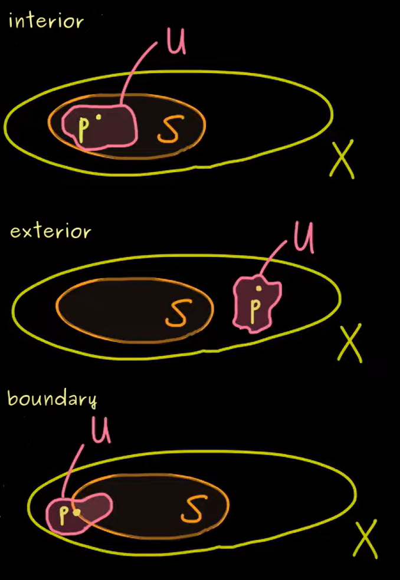

# Introduction to Manifolds

## What Are Manifolds? (Intuitive Introduction)

**Manifolds** are mathematical objects that "locally look like" familiar Euclidean space, but can have a more complex global structure.

### Everyday Examples

Think about these familiar objects:
- **A sphere** (like Earth's surface): Locally, any small patch looks flat (like your neighborhood), but globally it's curved
- **A cylinder**: Locally flat, but globally it wraps around
- **A torus** (donut shape): More complex global structure, but still locally flat

The key insight: **Even though these surfaces are curved in 3D space, if you zoom in enough on any small region, it looks essentially flat - like a piece of paper.**

### The Big Picture

Manifolds let us:
1. **Do calculus on curved spaces** (like finding tangent vectors to curves on a sphere)
2. **Study geometry without being embedded in higher dimensions** 
3. **Unify different areas of mathematics** (topology, geometry, analysis)

Our journey: **Topology → Manifolds → Differential Forms → Stokes' Theorem**

---

## Building the Foundation: From Metric Spaces to Topology

### Why Start with Metric Spaces?

**Metric spaces** give us the most intuitive way to think about "closeness" and "neighborhoods."

**Definition**: A **metric space** $(X, d)$ is a set $X$ with a distance function:
$$d: (X \times X) \rightarrow \mathbb{R}$$

The distance function must satisfy:
1. **Non-negative**: $d(x, y) \geq 0$, and $d(x, y) = 0 \iff x = y$
2. **Symmetric**: $d(x, y) = d(y, x)$
3. **Triangle inequality**: $d(x, z) \leq d(x, y) + d(y, z)$

**Examples**:
- $\mathbb{R}^n$ with Euclidean distance: $d(x, y) = \sqrt{\sum_{i=1}^n (x_i - y_i)^2}$
- Any subset of $\mathbb{R}^n$ with the inherited distance
- The sphere $S^2$ with distance along great circles

### The Limitation of Metric Spaces

**Problem**: Not all interesting spaces have a natural metric! 

**Examples where metrics become awkward**:
- Spaces with "holes" or complex topology
- Infinite-dimensional spaces
- Abstract spaces from algebra or geometry

**Solution**: We only really need the concept of "neighborhoods" and "open sets," not exact distances.

### Enter Topology

**Key Insight**: Instead of measuring exact distances, we can just specify which sets are "open" (roughly: sets that don't include their boundary).

### What Are Open Sets? (Intuitive Explanation)

**Open sets** are subsets that "don't include their boundary" - you can think of them as sets where:
- If you're inside the set, you can wiggle around a little bit and still be inside
- There's always some "breathing room" around each point in the set

**Examples in $\mathbb{R}$**:
- **Open interval** $(a, b) = \{x : a < x < b\}$ is open
  - *Why?* For any point inside, you can move slightly left or right and still be in the interval
  - The endpoints $a$ and $b$ are NOT included (that's why it's "open")
  
- **Closed interval** $[a, b] = \{x : a \leq x \leq b\}$ is NOT open
  - *Why?* The endpoints $a$ and $b$ have no "wiggle room" - you can't move left from $a$ or right from $b$ and stay in the set
  
- **Half-open interval** $[a, b)$ is NOT open
  - *Why?* The point $a$ has no room to wiggle leftward

**Examples in $\mathbb{R}^2$**:
- **Open disk** $\{(x,y) : x^2 + y^2 < 1\}$ (interior of unit circle) is open
- **Closed disk** $\{(x,y) : x^2 + y^2 \leq 1\}$ (includes the circle boundary) is NOT open
- **Any union of open disks** is open

**The Big Idea**: Open sets capture the notion of "interior" without needing to measure exact distances!

### Formal Definition of Topology

**Definition**: A **topology** $\tau$ on a set $X$ is a collection of subsets (called **open sets**) satisfying:

1. **Includes extremes**: $\emptyset, X \in \tau$
2. **Arbitrary unions**: If $\{U_\alpha\}_{\alpha \in I} \subseteq \tau$, then $\bigcup_{\alpha \in I} U_\alpha \in \tau$ \
   *(Here $I$ is any index set - it could be finite, countable, or even uncountable. This means we can take the union of any collection of open sets, no matter how many there are.)*
3. **Finite intersections**: If $U_1, U_2, \ldots, U_n \in \tau$, then $\bigcap_{i=1}^n U_i \in \tau$

The pair $(X, \tau)$ is called a **topological space**.

### Examples of Topologies

1. **Discrete topology**: $\tau = \mathcal{P}(X)$ (every subset is open)
   - *Intuition*: Every point is completely isolated
   
2. **Indiscrete topology**: $\tau = \{\emptyset, X\}$ (only trivial sets are open)
   - *Intuition*: All points are "glued together"
   
3. **Standard topology on $\mathbb{R}$**: Open sets are arbitrary unions of open intervals
   - *Intuition*: This matches our usual notion of "open" from calculus

### From Metric to Topology

**Every metric space gives a topology**: In $(X, d)$, call $U \subseteq X$ open if:
$$\forall x \in U, \exists \epsilon > 0 \text{ such that } B_\epsilon(x) := \{y : d(x,y) < \epsilon\} \subseteq U$$

*Translation*: $U$ is open if around every point in $U$, there's a small ball entirely contained in $U$.

## Understanding Open Sets: Interior, Exterior, and Boundary

### Intuitive Definitions

For a subset $S$ of a topological space $(X, \tau)$ and a point $p \in X$:

**Interior points**: Points that are "definitely inside" $S$
- **Definition**: $p$ is an **interior point** of $S$ if there exists an open set $U$ with $p \in U \subseteq S$
- **Intuition**: You can wiggle around $p$ a little bit and still be in $S$

**Exterior points**: Points that are "definitely outside" $S$  
- **Definition**: $p$ is an **exterior point** of $S$ if there exists an open set $U$ with $p \in U \subseteq X \setminus S$
- **Intuition**: You can wiggle around $p$ and never touch $S$

**Boundary points**: Points that are "right on the edge" of $S$
- **Definition**: $p$ is a **boundary point** of $S$ if every open set containing $p$ intersects both $S$ and $X \setminus S$
- **Intuition**: No matter how little you wiggle around $p$, you'll hit both inside and outside of $S$

Visually, these correspond to the following conditions: 

### Examples

**Example 1**: $S = (0, 1)$ in $\mathbb{R}$
- Interior points: All points in $(0, 1)$
- Exterior points: All points in $(-\infty, 0] \cup [1, \infty)$  
- Boundary points: $\{0, 1\}$

**Example 2**: $S = [0, 1]$ in $\mathbb{R}$
- Interior points: All points in $(0, 1)$
- Exterior points: All points in $(-\infty, 0) \cup (1, \infty)$
- Boundary points: $\{0, 1\}$

**Key Insight**: The interior is the same, but whether boundary points are "in" the set depends on whether we include the endpoints!

---

## What's Next?

Now that we understand topology, we can build toward manifolds:

1. **Continuous functions** between topological spaces
2. **Homeomorphisms** (topology-preserving maps)
3. **Charts and atlases** (how to put coordinates on curved spaces)
4. **Smooth manifolds** (where we can do calculus)
5. **Differential forms** and the **generalized Stokes' theorem**

The payoff: We'll be able to do calculus on curved spaces like spheres, tori, and much more exotic objects!