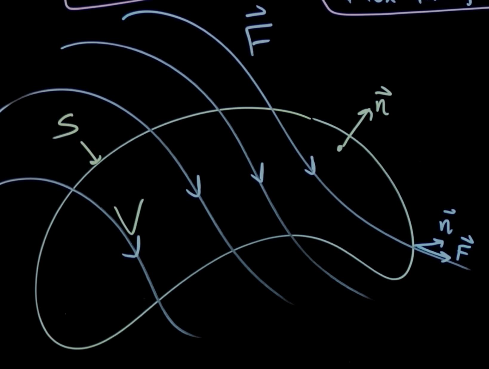

## Flux

The **flux** of a vector field $\mathbf{F}$ through a surface $S$ is given by:

$$
\Phi = \int_S \vec{F} \cdot d\vec{S} = \int_S \vec{F} \cdot \hat{n} \cdot dS
$$

where $d\vec{S}$ is the differential surface element and $\hat{n}$ is the unit normal vector to the surface. 

The reason why we're taking the dot product with $\hat{n}$ is because we want to get the component of $\mathbf{F}$ that is perpendicular to the surface. (i.e, at each point on the surface, the arrow that's pushing out of the surface)

## Gauss Divergence Theorem
The **Gauss Divergence Theorem** states that the flux of a vector field $\mathbf{F}$ through a closed surface $S$ is equal to the volume integral of the divergence of $\mathbf{F}$ over the volume $V$ enclosed by the surface:

$$
\iint_S \vec{F} \cdot d\vec{S} = \iiint_V \nabla \cdot \vec{F} dV
$$

This theorem is a generalization of the **Divergence Theorem** in three dimensions.

### Visual proof of Gauss Divergence Theorem

Imagine this is our vector field $\vec{F}$ and we want to find the flux through the surface $S$.

Now, if we divide this surface into very very small squares, it will look something like this:

At each of these small squares, we're demonstrating the "arrows of divergence" of the vector field $\vec{F}$, as you can see, once the square becomes sufficiently small, the opposing arrows of two neighboring squares cancel out, leaving only the arrows on the boundary squares of the surface which are pushing out of the surface.

----

Source: I made it up. JK. https://youtu.be/TORt20_HjMY?si=ygZQX2aPTfc3sjrf